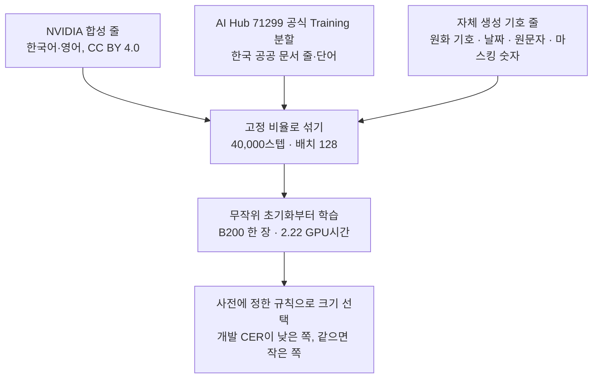
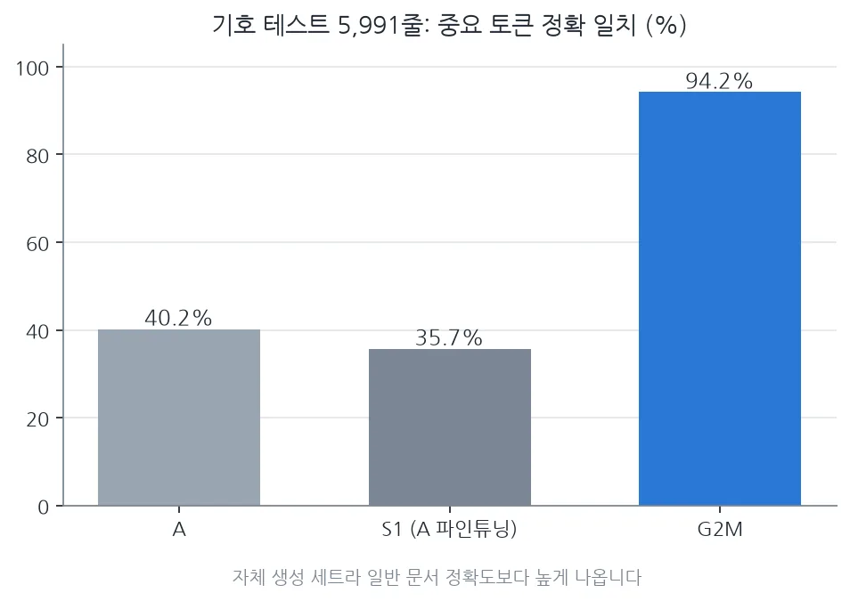

ThakiOCR의 두 번째 공개 모델 G2M을 Hugging Face에 [ThakiOCR-KOEN-G2M-Preview](https://huggingface.co/ThakiCloud/ThakiOCR-KOEN-G2M-Preview)라는 이름으로 올렸습니다. 파라미터는 893만 개이고 Apache-2.0 라이선스입니다.

먼저 상태부터 밝힙니다. G2M은 **연구 프리뷰**입니다. 미리 정해 둔 게이트 다섯 개 가운데 날짜 게이트 하나를 통과하지 못해 **A1_GEN2_NO_GO**로 판정됐습니다. 제품용으로는 NO-GO입니다. 기준을 넘어서가 아니라, 무엇을 했고 어디서 막혔는지 다른 연구자가 살펴보고 재사용할 수 있도록 공개합니다.

⚠️ **금융 문서와 계약 문서의 중요 필드(금액, 계좌번호, 식별번호, 날짜, 계약 조건)를 이 모델로 자동 처리하지 마십시오.** 아래에서 설명할 날짜와 원화 기호 오류가 바로 그런 문서에서 문제가 되는 실패입니다. 사람이 확인하는 단계를 반드시 두어야 합니다.

## 쉽게 말하면

영수증의 '₩1,000'을 'W1,000'으로 읽거나, 계약서의 '①'을 지워 버리는 OCR은 글자 오류율이 낮아도 쓸 수 없습니다. 글자 한두 개만 틀렸지만 그 글자가 금액과 조항을 정하기 때문입니다.

G2M은 이 문제를 겨냥했습니다. 숫자와 기호가 많은 줄을 일부러 만들어 학습에 넣었고 실제 공공 문서 이미지도 함께 학습했습니다. 그 결과 기호 정확도는 크게 올랐지만 띄어쓰기가 들어간 날짜와 생김새가 거의 같은 두 원화 기호는 여전히 틀립니다.

## 왜 기호가 따로 문제인가

일반적인 OCR 평가는 글자 오류율(CER) 하나로 성능을 말합니다. 그런데 문서 한 줄에서 기호가 차지하는 비율은 작습니다. 원화 기호가 전부 틀려도 CER은 거의 움직이지 않습니다.

ThakiCloud가 앞서 공개 문서 VLM을 한국어 금융 서식에 파인튜닝했을 때도 같은 일이 있었습니다. 전체 오류율은 좋아졌는데 학습 데이터를 만드는 과정에서 기호가 지워져 모델이 원화 기호, 날짜 안의 공백, 별표, 원문자를 빼먹는 법을 배웠습니다. 그래서 이번에는 기호를 지키는지 따로 재는 지표를 먼저 정했습니다.

## 무엇을 만들었나

구조는 첫 번째 공개 모델인 [ThakiOCR A](/tech-blog/ko/research/thakiocr-a-small-korean-english-line-ocr/)와 같은 계열의 줄 단위 CTC 인식기입니다. 잘라 낸 텍스트 한 줄을 받아 문자열을 돌려주고 페이지에서 글자 영역을 찾지는 않습니다. A보다 합성곱 채널과 블록 수를 늘려 파라미터가 213만 개에서 893만 개가 됐습니다.

출력할 수 있는 글자는 A의 14,152자에 반각·전각 원화 기호와 엔화 기호, 학습 라벨에 세 번 이상 나온 글자 96개를 더한 14,250자입니다. 유니코드 정규화는 NFC만 써서 `₩`(U+20A9)와 `￦`(U+FFE6)를 다른 글자로 유지했습니다.

## 무엇으로 학습했나

AI Hub 데이터는 공식 Training 분할만 썼고 Validation 분할은 학습에 쓰지 않았습니다. 기호 합성 줄은 SIL Open Font License 1.1 폰트로 렌더링했습니다. 공개 저장소에는 가중치와 코드만 있고 AI Hub 원본 이미지, 잘라 낸 이미지, 라벨은 하나도 넣지 않았습니다.

## 나온 결과

독립 평가 세트는 학습과 모델 선택이 모두 끝난 뒤 한 번만 열었습니다. 비교 대상 A는 첫 공개 모델이고 S1은 A를 AI Hub 데이터로 파인튜닝한 내부 모델입니다.

| 평가 | 지표 | G2M | A | S1 |
|---|---|---|---|---|
| 기호 테스트 5,991줄 | 중요 토큰 정확 일치 | 94.2% | 40.2% | 35.7% |
| 기호 테스트 5,991줄 | CER | 0.40% | 10.38% | 12.91% |
| 실문서 홀드아웃 70줄 | CER | 0.89% | 6.33% | 1.60% |
| 실문서 홀드아웃 526개 | 숫자가 있는 행 정확 일치 | 98.7% | 94.6% | 97.3% |
| 실문서 홀드아웃 526개 | 날짜 토큰 정확 일치 | 3/4 | 4/4 | 4/4 |

기호 테스트는 G2M이 목표로 한 글자만 모아 직접 생성한 세트입니다. 학습한 기술을 그대로 재기 때문에 일반 문서를 읽는 정확도보다 높게 나옵니다. 실문서 홀드아웃은 학습 데이터와 같은 데이터셋 계열에서 학습에 쓰지 않은 볼륨 하나를 떼어 낸 것입니다.

게이트 결과는 다음과 같습니다. I1 중요 토큰 정확 일치는 통과, I2 원화 기호 계열 정확 일치(두 원화 기호를 같은 통화로 볼 때 99.9%)는 통과, I3 실문서 줄 CER이 S1보다 낮은지는 통과, I5 크기와 CPU 지연(줄당 중앙값 13.3ms)은 통과였습니다. **I4 실문서 숫자·날짜는 날짜 4개 중 3개만 맞아 탈락**했습니다.

## 못 믿을 부분

**날짜 게이트 탈락.** 틀린 날짜 하나는 연도 뒤 마침표 다음에 공백이 있는 형식(`YYYY. M.DD`)이었고 모델이 그 공백을 지웠습니다. 내부 실문서 개발 세트에서도 날짜 토큰 정확 일치는 45%에서 69%에 그쳤습니다. 공백이 들어간 날짜는 알려진 약점입니다.

**실문서 홀드아웃이 너무 작습니다.** 한 볼륨, 한 시리즈에서 나온 526개이고 그중 전체 줄은 70개, 날짜 토큰은 4개뿐입니다. 하나만 틀려도 날짜 점수가 25%p 움직입니다. 다른 종류의 문서에 대해서는 말해 주는 것이 거의 없습니다.

**두 원화 기호를 헷갈립니다.** `₩`와 `￦`는 학습에 쓴 폰트에서 거의 똑같이 생겼습니다. 기호 테스트에서 코드 포인트까지 정확히 맞힌 비율은 81.0%이고 같은 통화로 보면 99.9%입니다. 427행에서 한쪽을 다른 쪽으로 읽었습니다(`￦`를 `₩`로 301행, `₩`를 `￦`로 126행). 통화의 뜻만 필요하면 후처리에서 둘 다 KRW로 바꾸면 됩니다. 이때 문자열 전체에 NFKC를 적용하면 `①` 같은 글자까지 바뀌므로 피해야 합니다.

**그 밖의 한계.** 사진, 손글씨, 저대비, 장식 글꼴은 학습 범위 밖입니다. 줄 이미지 전용이고 학습은 한 번만 해서 실행 간 편차를 재지 않았습니다.

## 공개 전에 확인한 것

공개로 바꾼 뒤 로그인하지 않은 환경에서 저장소를 내려받아 파일 해시를 원본과 대조했습니다. 같은 줄 이미지로 다시 추론해 보니 한국어 512줄은 모두, 영어는 512줄 중 510줄에서 내부 결과와 같은 문자열이 나왔습니다. 저장소에 학습 데이터가 들어 있지 않은지도 파일 목록으로 확인했습니다.

## 다음 모델로 이어진 것

G2M의 실문서 평가는 너무 작았습니다. 그래서 다음 모델 A2는 학습에 전혀 쓰지 않은 서식 3종, 1,493쪽, 43,751줄짜리 봉인 평가 세트를 따로 만들어 검증했습니다. A2는 아직 비공개 연구 후보이고 그 결과와 남은 한계는 [A2 독립 평가 글](/tech-blog/ko/research/thakiocr-a2-independent-eval-43751-lines/)에 정리했습니다.

기호 오류를 모델만으로 없애기는 어렵습니다. OCR이 금액을 잘못 읽었을 때 업무 시스템이 어떻게 대응해야 하는지는 [Paxis 검증 글](/tech-blog/ko/agentops/thakiocr-paxis-verify-before-commit/)에서 다룹니다.

## 참고

- 모델: [ThakiCloud/ThakiOCR-KOEN-G2M-Preview](https://huggingface.co/ThakiCloud/ThakiOCR-KOEN-G2M-Preview) (연구 프리뷰, A1_GEN2_NO_GO)
- 학습 데이터: NVIDIA OCR-Synthetic-Multilingual-v1(CC BY 4.0), AI Hub 71299 Training 분할(재배포하지 않음), SIL OFL 1.1 폰트로 만든 기호 합성 줄
- 제품 출시가 아닙니다. 성능이 최고 수준이라고 주장하지 않습니다.
