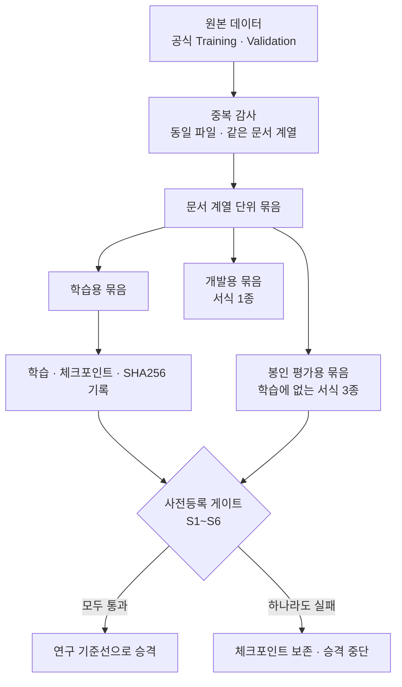
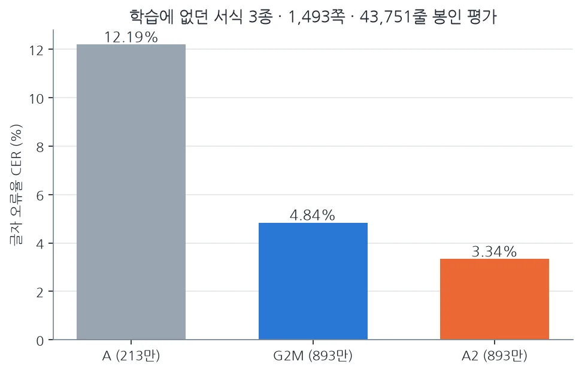

문서 OCR의 정확도를 높이려면 더 큰 모델부터 찾아야 할까요? ThakiCloud가 직접 만든 문자 인식 모델에서는 다른 결과가 나왔습니다. 구조와 파라미터 수가 같은 두 모델 G2M과 A2를 비교했더니, 학습 데이터와 평가 방식을 다시 설계한 A2가 처음 보는 금융 서식에서 글자 오류율(CER)을 31% 낮췄습니다.

이 글은 자체 OCR 모델을 만들려는 엔지니어와 데이터 책임자를 위한 글입니다. 무엇을 바꿨는지, 그 숫자가 어디까지 유효한지, 그리고 이 과정을 기업 학습 파이프라인으로 옮길 때 Maxis가 맡아야 할 일이 무엇인지 차례로 설명합니다.

## 쉽게 말하면

같은 학생에게 교재만 바꿔 준 실험과 비슷합니다. 학생의 머리(모델 구조와 크기)는 그대로 두고 무엇으로 공부시키고 어떻게 시험을 보게 할지를 바꿨습니다.

시험 문제가 교재에 그대로 실려 있으면 점수는 오르지만 실력을 잰 것이 아닙니다. 그래서 교재와 시험지가 겹치지 않도록 먼저 정리했고 채점 기준은 시험 전에 미리 적어 두었습니다. 31%라는 숫자는 이렇게 정리한 시험지에서 나왔습니다.

## 세 모델의 관계

ThakiOCR는 문서에서 잘라 낸 텍스트 한 줄을 읽는 줄 단위 인식 모델 계열입니다. 페이지에서 글자 영역을 찾는 일은 하지 않고 앞단의 검출 모델이 잘라 준 이미지를 문자열로 바꿉니다.

첫 모델인 ThakiOCR A는 213만 파라미터로, NVIDIA의 합성 OCR 데이터만으로 학습했습니다. 두 번째 G2M은 893만 파라미터로 키우고 공공 문서 데이터와 기호 합성 데이터를 더했습니다. 세 번째 A2는 G2M과 같은 구조를 처음부터 다시 학습하면서 금융 문서 데이터를 추가했습니다.

A2와 G2M은 크기가 같기 때문에 둘의 차이는 데이터와 학습 설정에서 왔다고 볼 수 있습니다. 이 점이 이번 비교를 의미 있게 만듭니다.

## 무엇을 학습에 넣었나

A2는 네 가지 데이터를 정해진 비율로 섞어 학습했습니다. NVIDIA 다국어 합성 OCR 데이터, AI Hub 71299 공공 문서의 공식 Training 분할, AI Hub 632 금융업 특화 문서의 공식 Training 분할, 그리고 직접 생성한 기호 합성 데이터입니다.

632에서는 문서 계열 중복을 제거하고 남은 쪽 가운데 9,986쪽을 학습에 썼습니다. 이 쪽들에서 잘라 낸 학습 샘플은 369,813개로, 약 37만 개입니다. 학습은 B200 GPU 한 장에서 40,000스텝 동안 진행했고 본학습에 2.16 GPU-시간이 들었습니다.

평가에 쓴 서식이나 공식 Validation 데이터는 학습에 넣지 않았습니다. 어떤 데이터를 학습에 쓰지 않았는지도 학습 전에 목록으로 고정했습니다.

## 시험지 정리: 중복부터 찾았습니다

632를 감사하는 과정에서 중요한 사실을 발견했습니다. 공식 Validation 이미지 가운데 936장이 Training 이미지와 CRC32 값과 파일 크기까지 같은, 사실상 같은 파일이었습니다. Training 안에서도 2,338장이 서로 중복됐습니다.

이 상태로 Validation 점수를 쟀다면 모델이 처음 보는 문서를 얼마나 잘 읽는지가 아니라, 이미 본 문서를 얼마나 기억하는지를 쟀을 것입니다.

그래서 파일 단위가 아니라 문서 계열 단위로 묶었습니다. 이미지와 텍스트의 지문으로 같은 계열의 문서를 하나의 묶음으로 만들고 한 묶음이 학습과 평가에 동시에 들어가지 않게 했습니다. 이 과정에서 학습 데이터와 묶음을 공유하는 Validation 2,315쪽을 평가에서 뺐습니다.

## 결과: 크기는 같고 오류는 31% 적었습니다

최종 평가는 학습에서 통째로 뺀 서식 3종으로 했습니다. 은행 계좌개설 신청서 1종과 보험 안내·확인서 2종이며 1,493쪽에서 마스킹 행을 제외한 43,751줄을 채점했습니다. 이 세트는 단 한 번만 열었습니다.

| 모델 | 파라미터 | 글자 오류율(CER) |
|---|---|---|
| ThakiOCR A | 213만 | 12.19% |
| ThakiOCR G2M | 893만 | 4.84% |
| ThakiOCR A2 | 893만 | 3.34% |

A2의 오류율은 G2M의 0.689배입니다. 오류가 약 31% 줄었다는 뜻입니다. 문서 묶음 1,493개를 다시 뽑아 계산한 차이의 95% 신뢰구간도 0보다 작은 쪽에만 있었습니다.

세부 지표와 남은 약점은 [A2 평가 글](/tech-blog/ko/research/thakiocr-a2-independent-eval-43751-lines/)에서 따로 다룹니다.

## 이 숫자를 어디까지 믿을 수 있나

봉인 평가의 서식은 학습에 없었지만 데이터 출처는 같은 AI Hub 632였습니다. 다른 금융기관의 문서, 다른 스캐너나 휴대폰 촬영 환경에서 같은 개선이 나오는지는 아직 검증하지 않았습니다.

통화 기호 쪽 근거도 제한적입니다. 봉인 서식 3종에는 원화 기호가 한 번도 나오지 않아, 통화 지표는 학습에 등장한 서식의 평가 세트에서만 나왔습니다. 그래서 A2가 비슷하게 생긴 두 원화 기호(₩와 ￦)를 구별한다고 주장하지 않습니다.

A2는 연구 기준선으로 승격됐지만 제품 출시 판정은 NO_GO입니다. 가중치도 공개하지 않았습니다. 연구 성과와 제품 출시를 분리해 판단한다는 원칙을 그대로 지켰습니다.

## Maxis가 해결해야 하는 문제

기업이 자체 OCR 모델을 만들 때 어려운 부분은 학습 코드를 실행하는 일이 아닙니다. 어떤 데이터로 학습했는지, 같은 문서 계열이 평가에 섞이지 않았는지, 이 가중치가 어느 실험에서 나왔는지, 새 모델이 이전 모델보다 정말 나은지를 계속 추적하는 일이 더 어렵습니다.

Maxis는 ThakiCloud의 AI 학습·파인튜닝 플랫폼입니다. 이번 연구에서 쓴 방식은 Maxis의 학습 파이프라인 설계와 그대로 연결됩니다.

- 데이터 매니페스트와 SHA256: 학습에 들어간 파일 목록의 해시를 기록하고 평가 세트와의 교차 중복을 학습 전에 검사합니다.
- 큐 기반 GPU 작업: 학습과 평가를 Kueue 대기열의 배치 잡으로 실행해 다른 작업의 GPU를 빼앗지 않습니다. 산출물은 잡이 끝나는 방식과 무관하게 오브젝트 스토리지에 남깁니다.
- 체크포인트 계보: 체크포인트마다 해시를 남기고 다시 읽어 같은 값이 나오는지 확인합니다.
- 사전등록 게이트: 합격 기준을 결과를 보기 전에 기록하고 실패하면 체크포인트는 보존하되 승격은 멈춥니다.

마지막 항목이 특히 중요합니다. 연구 지표가 좋아도 정한 게이트를 통과하지 못하면 다음 단계로 넘기지 않아야 하고 그 판정이 코드와 기록으로 남아야 합니다.

## 다음 과제

다음 세대 모델은 A2를 기준선으로 삼아 새로운 출처의 문서를 평가 대상으로 확보하는 일부터 시작합니다. 다른 기관의 서식, 손글씨에 가까운 글씨, 촬영 환경 변화, 통화 기호가 핵심 대상입니다. 이미 한 번 연 봉인 세트는 다음 모델을 고르는 데 다시 쓰지 않습니다.

이번 연구에서 확인한 것은 모델을 키우기 전에 데이터 구성과 평가 설계를 바로잡는 쪽이 더 큰 효과를 낼 수 있다는 점입니다. 고객 데이터를 고객이 통제하는 환경에서 학습하고 결과를 검증해 다음 모델로 이어 가는 과정을 반복 가능하게 만드는 것이 Maxis의 역할입니다.

학습한 모델을 어떻게 서비스할지는 [Metis 계층형 추론 글](/tech-blog/ko/llmops/thakiocr-metis-tiered-document-inference/)에서, 읽은 결과를 업무에 어떻게 연결할지는 [Paxis 검증 워크플로 글](/tech-blog/ko/agentops/thakiocr-paxis-verify-before-commit/)에서 이어서 다룹니다.

## 참고

- 공개 OCR 모델 네 개 한눈에 보기: [ThakiOCR 모델 허브](/tech-blog/ko/ocr/)
- 공개 모델: [ThakiOCR-KOEN-V1-Dense (A)](https://huggingface.co/ThakiCloud/ThakiOCR-KOEN-V1-Dense), [ThakiOCR-KOEN-G2M-Preview](https://huggingface.co/ThakiCloud/ThakiOCR-KOEN-G2M-Preview)
- A2는 연구 평가를 통과한 비공개 체크포인트이며 금융 문서 자동 처리 제품으로 출시하지 않았습니다.
- AI Hub 원본 이미지와 라벨, 잘라 낸 학습 샘플은 국내 내부 저장소에만 두며 공개하거나 재배포하지 않습니다.
