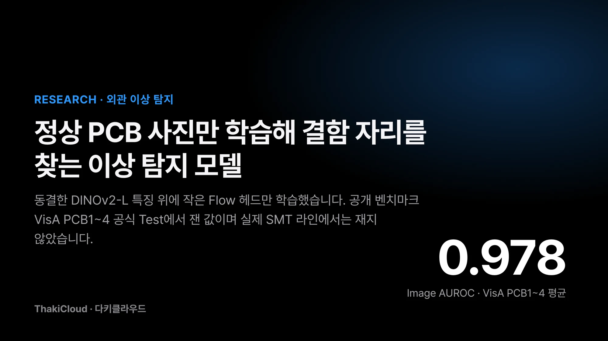
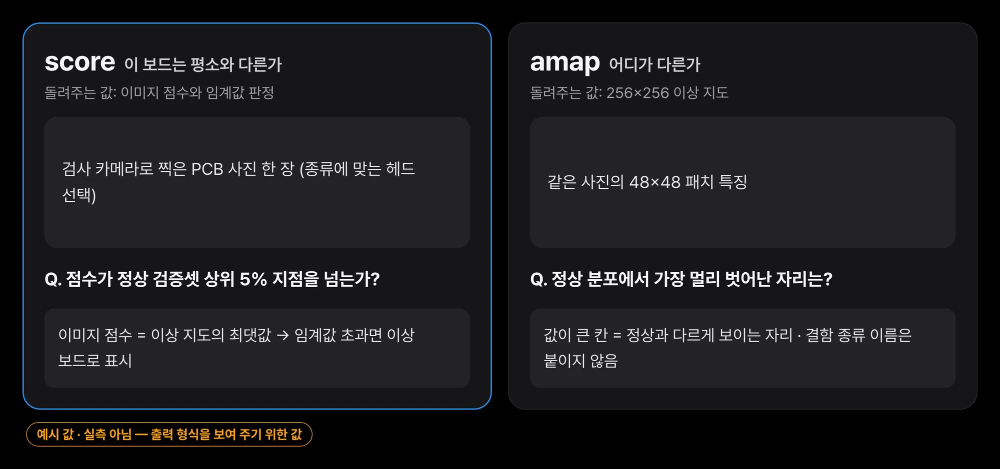
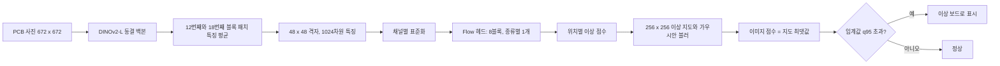
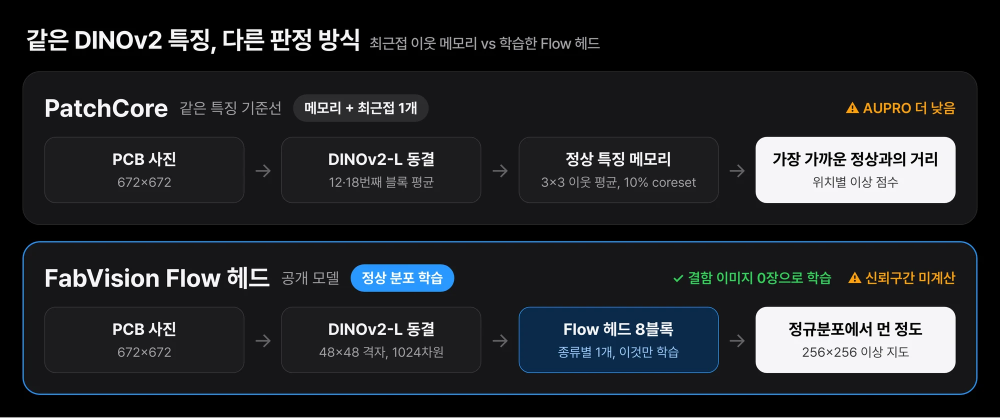
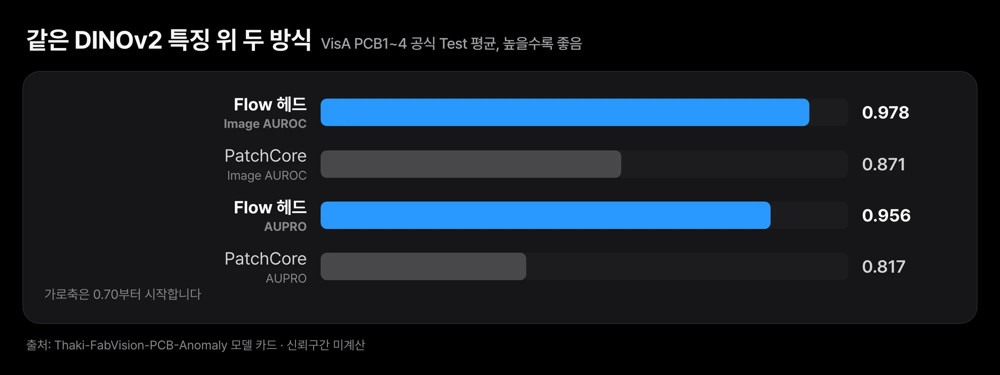
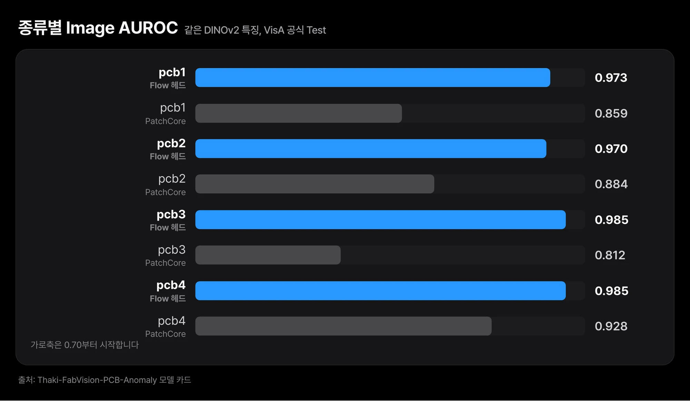

*VisA PCB1~4 공식 Test에서 잰 결함 이미지 판별 성적의 평균은 0.978입니다.*

검사원이 매일 들여다보는 회로 기판 사진은 대부분 멀쩡합니다. 결함 사진은 드물고, 처음 보는 결함은 예고 없이 나타납니다. 결함마다 사진을 모아 분류기를 가르치려 하면 사진이 다 모일 즈음 라인이 이미 바뀌어 있습니다.

그래서 정상 기판 사진만 보여 주고 학습시킨 모델이 결함이 있는 보드를 골라내고 결함이 있는 자리까지 표시하도록 만들었습니다. 외관 검사 자동화를 고민하는 제조 엔지니어와, 결함 사진을 충분히 모으기 어려운 팀에게 쓸모 있는 이야기입니다. 공개 벤치마크의 기판 네 종류에서 잰 결함 이미지 판별 성적은 아래 표와 같습니다.

다만 이 숫자는 공개 벤치마크 사진에서 나온 것입니다. 실제 SMT 제조라인이나 다른 카메라에서는 재 보지 않았습니다. 모델은 [Hugging Face](https://huggingface.co/ThakiCloud/Thaki-FabVision-PCB-Anomaly)에 Research Preview로 공개했고 이 글은 그 모델이 무엇을 했고 무엇을 아직 모르는지를 다룹니다.

| 항목 | 값 (VisA PCB1~4 공식 Test, 4종 평균) |
|---|---|
| Image AUROC | **0.978** |
| Image AP | 0.976 |
| Pixel AUROC | 0.991 |
| AUPRO (FPR≤0.3) | 0.956 |
| 정상 보드 오경보율 (정해 둔 임계값 기준) | 6.2% |
| 이미지 한 장 처리 시간 (B200 1장, 배치 1, 중앙값) | 약 27ms |
| 같은 DINOv2 특징 위 PatchCore | Image AUROC 0.871, AUPRO 0.817 |

*모든 수치는 VisA PCB1~4 공식 Test를 모델과 임계값을 정한 뒤 한 번만 평가한 결과입니다. 실제 SMT 라인에 그대로 옮겨 말할 수 없습니다.*

## 쉽게 말하면

진짜 지폐만 수없이 만져 본 은행 창구 직원을 떠올리시면 됩니다. 이 직원은 위조지폐를 따로 공부하지 않았어도 손끝에 닿는 느낌이 평소와 다르면 바로 멈춥니다. 어느 부분이 이상한지도 짚어 냅니다. 이 모델도 정상 기판 사진만 보고 "평소 모습"을 익힌 뒤, 새 사진에서 그 모습을 벗어난 자리를 표시합니다.

다만 이 직원이 한 은행, 한 종류의 지폐만 만져 봤다면 다른 나라 지폐 앞에서는 헷갈릴 수 있습니다. 이번 모델도 공개 데이터 한 곳의 기판 네 종류만 봤습니다. 아래에서 그 점을 숫자와 함께 짚습니다.

## 결함 사진은 늘 모자라고 정상 사진은 매일 쌓입니다

PCB 외관 검사에서 가장 모으기 어려운 것은 결함 사진입니다. 결함 종류마다 사진을 수백 장씩 모아 분류기를 학습하는 방식은 데이터를 다 모을 때쯤 이미 라인이 바뀌어 있기 쉽습니다.

반대로 정상 보드 사진은 매일 쌓입니다. 그래서 "정상이 어떻게 생겼는지"만 배우고 그 모습에서 벗어난 자리를 이상으로 표시하는 방식을 택했습니다. 숙련 검사원이 처음 보는 결함이라도 "평소와 다르다"는 것은 알아채는 것과 같은 원리입니다.

이번 작업의 목표는 이 방식이 공개 벤치마크에서 어느 수준까지 나오는지, 그리고 그 결과를 누구나 다시 확인할 수 있는 형태로 공개하는 것이었습니다.

## 공개 벤치마크 VisA의 기판 네 종류로 학습했습니다

데이터는 Amazon Science가 공개한 VisA(Zou 외, ECCV 2022)의 PCB1~PCB4 네 종류를 썼습니다. 라이선스는 CC BY 4.0입니다. 분할은 VisA가 정한 공식 1cls 분할을 그대로 따랐고 학습용 정상 이미지를 9:1로 나눠 학습(train)과 정상 검증(Normal Dev)으로 썼습니다.

| 종류 | 학습 (정상) | Normal Dev (정상) | Test |
|---|---|---|---|
| pcb1 | 814 | 90 | 200 (결함 100, 정상 100) |
| pcb2 | 811 | 90 | 200 (결함 100, 정상 100) |
| pcb3 | 815 | 90 | 201 (결함 100, 정상 101) |
| pcb4 | 814 | 90 | 201 (결함 100, 정상 101) |

학습 전에 같은 파일이 학습과 Test에 동시에 들어가 있는지 확인했고 완전히 같은 이미지와 학습-Test 누수는 0건이었습니다. 원본 이미지, 결함 마스크, Test 이미지, 추출한 특징은 공개 저장소에 하나도 넣지 않았습니다. 공개한 것은 학습한 헤드 가중치, 추론 코드, 설정 파일, 모델 카드뿐입니다.

## 결함 이미지는 학습에도 선택에도 쓰지 않았습니다

학습에는 결함 이미지를 한 장도 쓰지 않았습니다. 모델은 정상 보드 사진에서 "이 위치에는 보통 이런 모양이 나온다"는 분포를 배웁니다. 판정할 때는 새 사진의 각 위치가 그 분포에서 얼마나 벗어났는지를 점수로 매기고 가장 많이 벗어난 위치의 점수를 그 이미지의 점수로 씁니다.


*보드 사진 한 장을 넣으면 이미지 점수와 이상 지도가 나옵니다. 점수는 확률이 아니라 정상 분포에서 벗어난 정도입니다.*

선택도 정상 이미지로만 했습니다. 체크포인트는 5 epoch마다 Normal Dev의 평균 손실(NLL)을 재서 가장 낮은 것을 골랐고 판정 임계값은 Normal Dev 점수의 상위 5% 지점(q95)으로 정했습니다. Test의 결함 이미지와 마스크는 어떤 선택에도 쓰지 않았고 Test 결과를 본 뒤 체크포인트나 임계값을 다시 고르지도 않았습니다.

임계값을 q95로 정했다는 것은 학습 데이터와 비슷한 정상 보드에서 대략 20장 중 1장은 경보가 난다는 뜻입니다. 이 값은 설계상 출발점이며 실제로 쓸 때는 놓친 결함과 헛경보의 비용을 따져 자기 라인에서 다시 정해야 합니다.

## 얼린 DINOv2-L 위에 작은 Flow 헤드만 학습했습니다

구조는 두 부분입니다. 앞쪽은 Meta가 공개한 이미지 모델 DINOv2-L이고 학습하지 않고 그대로 얼려 두었습니다. 뒤쪽은 PCB 종류마다 하나씩 학습한 작은 Flow 헤드입니다. 학습한 것은 이 헤드뿐입니다.



DINOv2-L은 입력 사진을 672×672로 바꿔 받고 12번째와 18번째 블록의 패치 특징을 평균해 48×48 격자 위의 1024차원 특징을 만듭니다. 중간 블록을 고른 것은 마지막 블록보다 질감과 국소 모양 정보가 더 많이 남아 있으리라고 보았기 때문입니다. 이 선택을 따로 비교 실험하지는 않았습니다.

Flow 헤드는 FastFlow 형식을 직접 구현한 것입니다. Anomalib의 공식 구현이나 그 체크포인트를 가져다 쓴 것이 아닙니다. 8개 블록이 ActNorm, 고정 채널 순열, affine coupling(3×3과 1×1 커널을 번갈아 사용, 은닉 512채널) 순서로 쌓여 있습니다. 쉽게 말해, 정상 특징을 다루기 쉬운 정규분포 모양으로 바꾸는 변환을 배우고 바꾼 뒤에도 정규분포에서 멀리 떨어진 위치를 이상으로 봅니다.

학습은 Adam(학습률 1e-3), 60 epoch, seed 0으로 했고 네 종류를 모두 학습하는 데 B200 GPU 1장으로 약 36분이 걸렸습니다. 헤드 하나의 가중치는 126MB입니다.

## 같은 특징 위 PatchCore보다 결함을 더 잘 골랐습니다

비교 기준으로 PatchCore를 같은 조건에서 돌렸습니다. PatchCore는 정상 특징을 메모리에 저장해 두고 새 특징이 가장 가까운 정상 특징에서 얼마나 먼지로 이상을 판단하는 널리 쓰이는 방법입니다. 이번에는 같은 동결 DINOv2 특징 위에 3×3 이웃 평균, 10% coreset, 최근접 1개 방식으로 구현했습니다.

| 방법 (같은 DINOv2 특징) | Image AUROC | Pixel AUROC | AUPRO | 정상 오경보율 |
|---|---|---|---|---|
| FabVision Flow 헤드 | **0.978** | **0.991** | **0.956** | 6.2% |
| PatchCore | 0.871 | 0.981 | 0.817 | 9.0% |

AUROC는 결함 이미지와 정상 이미지를 점수 순으로 줄 세웠을 때 결함이 위로 올라오는 정도이고, 만점에 가까울수록 둘을 잘 가릅니다. AUPRO는 결함 영역을 픽셀 단위로 얼마나 덮었는지를 결함 하나하나에 고르게 무게를 두어 잰 값입니다.


*두 방식 모두 같은 동결 DINOv2-L 특징을 씁니다. 차이는 정상 특징을 저장해 두고 거리를 재느냐, 정상 분포를 학습하느냐입니다.*


*Flow 헤드의 Image AUROC 평균은 0.978이었고, AUPRO까지 두 지표 모두 PatchCore보다 높았습니다. 가로축이 원점에서 시작하지 않는 점에 주의해 주십시오.*

이 비교가 말하는 것은 좁습니다. 같은 특징을 쓸 때 Flow 헤드가 최근접 이웃 방식보다 그 특징을 더 잘 활용했다는 것까지입니다. 흔히 쓰는 WideResNet-50 기반 PatchCore와 비교한 것이 아니고 신뢰구간도 계산하지 않았습니다. 그래서 이 모델이 PatchCore 일반보다 낫다거나 VisA에서 최고 성능이라고 말하지 않습니다.

## PCB1~4 개별 결과도 미리 정한 여섯 기준을 모두 통과했습니다

| 종류 | Image AUROC | Image AP | Pixel AUROC | AUPRO | 정상 오경보율 | 결함 검출률 |
|---|---|---|---|---|---|---|
| pcb1 | 0.973 | 0.972 | 0.997 | 0.976 | 8.0% | 91% |
| pcb2 | 0.970 | 0.966 | 0.988 | 0.954 | 4.0% | 90% |
| pcb3 | 0.985 | 0.985 | 0.988 | 0.941 | 7.9% | 93% |
| pcb4 | 0.985 | 0.983 | 0.992 | 0.951 | 5.0% | 93% |

*오경보율과 검출률은 Normal Dev q95 임계값 기준입니다. Test는 종류마다 결함 100장, 정상 100~101장입니다.*


*종류별 PatchCore Image AUROC는 pcb1 0.859, pcb2 0.884, pcb3 0.812, pcb4 0.928이었습니다. 네 종류 모두 Flow 헤드가 높았고 차이가 가장 큰 곳은 pcb3이었습니다.*

학습을 시작하기 전에 통과 기준을 먼저 정해 커밋해 두었습니다. Image AUROC 평균 0.95 이상과 종류별 0.90 이상, Pixel AUROC 평균 0.95 이상, AUPRO 평균 0.80 이상, 정상 오경보율 평균 10% 이하, 같은 특징 PatchCore보다 0.03 넘게 낮지 않을 것, 저장한 가중치를 다시 불러왔을 때 점수 오차 1e-5 이하의 여섯 가지입니다. 이 여섯 기준(G1~G6)은 모두 통과했습니다.

훈련 과정이 늘 매끄럽지는 않았습니다. pcb4는 50 epoch 근처에서 검증 손실이 갑자기 뛰었고 선택 규칙에 따라 30 epoch 체크포인트가 골라졌습니다. 다른 seed로 다시 학습해 보지는 않았기 때문에, 이 불안정이 얼마나 자주 생기는지는 모릅니다.

## 학습과 시험 사진이 서로 너무 닮았습니다

먼저 오경보율입니다. 평균 6.2%는 정상 보드 100장 중 6장 정도가 경보를 낸다는 뜻입니다. 사람이 다시 보는 단계가 있는 검사라면 감당할 수 있는 수준일 수 있지만, 그 판단은 라인마다 다릅니다.

더 큰 한계는 데이터가 서로 너무 닮았다는 점입니다. VisA는 같은 보드 디자인을 같은 카메라로 반복해서 찍었습니다. 완전히 같은 사진은 없었지만, 지각 해시(dHash) 거리 4 이하인 근사중복 쌍을 세어 보니 아래처럼 많았습니다.

| 종류 | 근사중복 쌍 전체 | 그중 학습-Test 사이 쌍 |
|---|---|---|
| pcb1 | 16,438 | 3,088 |
| pcb2 | 14,879 | 3,760 |
| pcb3 | 129,390 | 31,437 |
| pcb4 | 5,514 | 1,710 |

즉, Test 사진 대부분이 학습 때 본 사진과 매우 비슷한 환경에서 찍혔습니다. 조명, 각도, 보드 리비전이 조금씩 바뀌는 실제 라인에서는 점수가 이보다 낮을 가능성이 큽니다. 다른 카메라, 다른 보드로의 일반화도 검증하지 않았습니다. 이 모델은 결함 종류를 이름 붙이지도 못하고 평소와 다른 자리를 표시할 뿐입니다.

## 공개 코드 검증은 원래 기준으로 두 번 실패했습니다

모델 판정이 끝난 뒤, 공개용으로 정리한 추론 코드가 평가 때의 코드와 같은 답을 내는지 GPU에서 다시 확인했습니다. 공개 코드(이미지 한 장씩 처리)와 평가 코드(16장씩 처리)를 같은 Test 이미지에 돌려 점수, 이상 지도, 판정, 지표를 비교했고 허용 오차는 첫 실행 전에 코드에 고정해 두었습니다. 이 검증은 처음에 두 번 실패했습니다.

| 차례 | 결과 | 내용 |
|---|---|---|
| 1차 | 실패 | 설정 파일에 백본 버전(revision)이 비어 있었습니다. 또 공개 코드가 fp32 특징을 써서, fp16 특징으로 평가한 값과 점수 상대오차가 최대 0.63%로 허용치 0.5%를 넘었습니다. 설정에 버전을 고정하고 추론 특징을 평가와 같은 fp16으로 맞췄습니다. 허용치는 그대로 두었습니다. |
| 2차 | 실패 | pcb3 점수 상대오차가 1.97%였습니다. pcb3 점수는 0 근처(임계값 0.003)에 모여 있어 아주 작은 차이도 상대오차로는 크게 보였습니다. 이상 지도, 판정, 지표는 일치했습니다. 여기서 멈추고 책임자에게 판단을 요청했습니다. |
| 3차 | 통과 (바뀐 기준) | 결과를 본 뒤 점수 비교 기준을 "Test 점수 범위 대비 최대 절대오차 0.5% 이하"로 바꿨습니다. 이 기준으로 네 종류 모두 9e-5 이하였고 판정 일치 100%, 지표는 판정 문서와 같았습니다. |
| 익명 재검증 | 통과 (바뀐 기준) | 공개 전환 직후 토큰 없이 Hugging Face에서 전체 파일을 받아 같은 검사를 다시 돌렸습니다. |

이 표에서 분명히 해 둘 점이 있습니다. 바뀐 기준은 결과를 본 뒤에 정한 사후 기준입니다. 원래 기준인 점수 상대오차 0.5%로는 2차 검증이 실패였고 그 기록은 지우지 않고 그대로 남겨 두었습니다. 3차의 통과는 이 사후 기준을 통과했다는 뜻이지, 사전에 등록한 기준을 통과했다는 뜻이 아닙니다.

반면 앞 절의 G1~G6는 공개 패키지 검증과 별개의 모델 판정입니다. 학습 전에 정해 둔 기준이고 결과를 본 뒤 바꾼 것이 없습니다. 패키지 검증에서 바뀐 것은 "공개 코드가 평가 코드와 같은 답을 내는가"를 재는 방식이며 모델 성능 기준은 아닙니다.

## 지금은 자기 라인에서 다시 학습할 출발점입니다

지금 단계에서 권할 수 있는 쓰임은 실험과 출발점입니다. 첫째, 정상 이미지만으로 이상 탐지가 어느 정도 되는지 자기 데이터에서 가늠해 보는 기준점으로 쓸 수 있습니다. 공개한 헤드는 VisA 보드에 맞춰져 있으므로, 실제로는 같은 구조로 자기 라인의 정상 사진에 헤드를 새로 학습하고 임계값도 그 라인에서 다시 정해야 합니다.

둘째, 이상 지도를 검사원이 보는 화면에 겹쳐 "어디를 다시 볼지" 알려 주는 보조 도구를 연구할 수 있습니다. 셋째, 결함 사진이 쌓이기 전 초기 라인에서 헛경보와 놓친 결함이 어떻게 나오는지 비용을 따져 보는 실험에 쓸 수 있습니다.

어느 경우든 판정은 사람이 다시 확인하는 구조를 전제로 합니다. 이 모델은 인증받은 검사 장비가 아니고 ThakiCloud의 다른 제품과 묶어 쓰는 흐름도 아직 시험하지 않았습니다.

## 설치와 추론은 코드 몇 줄이면 됩니다

백본은 저장소에 포함하지 않고 실행할 때 `facebook/dinov2-large`의 고정 revision(`47b73eefe95e8d44ec3623f8890bd894b6ea2d6c`)에서 받아 옵니다.

```bash
pip install torch "transformers>=4.45" safetensors pillow numpy huggingface_hub
```

```python
from huggingface_hub import snapshot_download
import sys

path = snapshot_download("ThakiCloud/Thaki-FabVision-PCB-Anomaly")
sys.path.insert(0, path)
from PIL import Image
import inference

backbone, head, threshold, device = inference.load(path, "pcb1")   # pcb1 | pcb2 | pcb3 | pcb4
amap, score = inference.score(backbone, head, Image.open("board.jpg"), device)
print(score, score > threshold)   # 이미지 점수와 고정 임계값 판정
```

셸에서는 `python inference.py <model_dir> pcb1 board.jpg`로도 돌릴 수 있습니다. `amap`은 256×256 이상 지도이고 값이 큰 곳이 정상과 다르게 보이는 자리입니다. 보드 종류에 맞는 헤드를 골라야 합니다. pcb1로 학습한 헤드는 pcb2 정상 보드가 어떻게 생겼는지 모릅니다.

공개 파일은 10개입니다. 모델 카드 두 개(영문, 한국어), 설정 파일, 집계 지표, 모델 코드, 추론 코드, 종류별 헤드 가중치 네 개입니다. 확인한 저장소 revision은 `ede737842367b1a569041435e602831d3a2fcd4e`이고 헤드별 SHA256은 `config.json`에 적혀 있습니다.

## 끝으로

정상 PCB 사진만 학습해서 VisA PCB1~4 Test에서 결함 이미지를 높은 AUROC로 골라내고 결함 위치를 표시하는 모델을 공개했습니다. 같은 특징 위의 PatchCore보다 높았지만, 그 비교는 같은 특징이라는 좁은 조건에서만 성립합니다.

못 한 것도 분명합니다. 실제 SMT 라인, 다른 카메라, 다른 보드에서는 재 보지 않았고 학습과 Test 사진이 서로 많이 닮았습니다. 공개 코드 검증은 원래 기준으로 실패했다가 사후에 바꾼 기준으로 통과했으며 두 기록을 모두 남겼습니다. 이 모델은 자기 라인에서 다시 학습하고 다시 재 볼 출발점으로 봐 주시면 됩니다.

오늘 해 볼 첫 실험은 이렇습니다. 자기 라인의 정상 보드 사진으로 같은 구조의 헤드를 학습하고, 그 라인의 정상 검증 사진에서 임계값을 다시 정해 보시기 바랍니다. 진짜 지폐만 만져 본 창구 직원도 새 은행에 가면 그 은행의 지폐부터 다시 만져 봐야 합니다. 모델과 추론 코드는 [Hugging Face](https://huggingface.co/ThakiCloud/Thaki-FabVision-PCB-Anomaly)에 있습니다.

---

*출처: 공개 모델 카드(Hugging Face revision `ede7378`)와 내부 판정·공개 기록(2026년 11월 2~3일). 수치는 모두 VisA PCB1~4 공식 1cls Test 기준입니다. 데이터: VisA (Zou et al., ECCV 2022), CC BY 4.0. 백본: DINOv2 (Oquab et al., 2023), Apache-2.0.*
