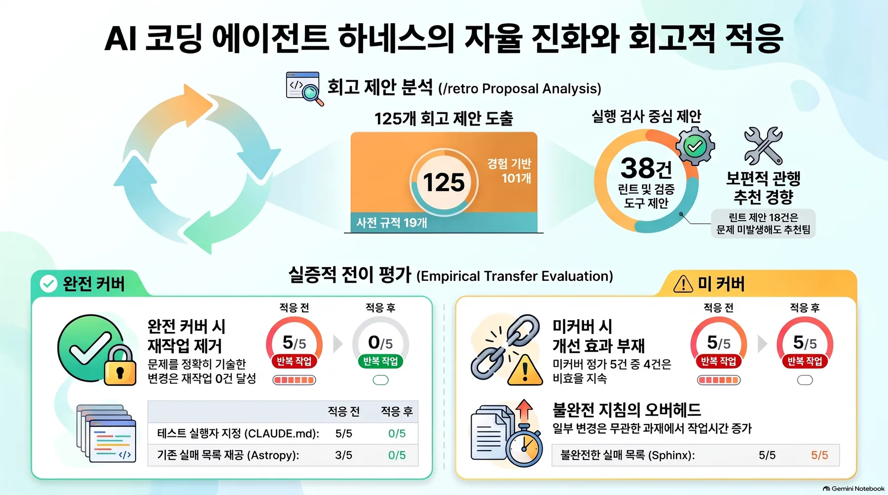
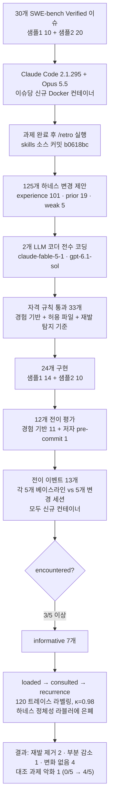
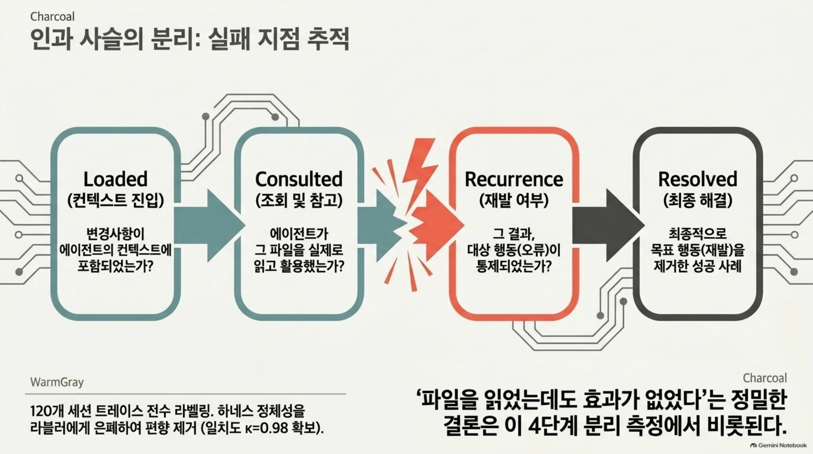
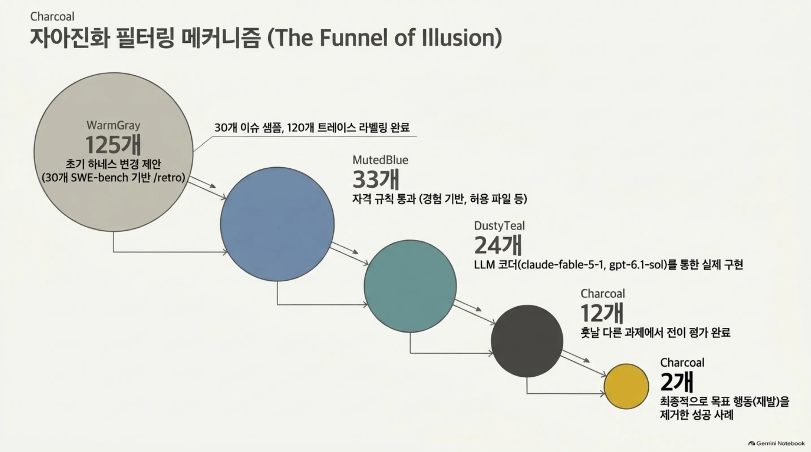
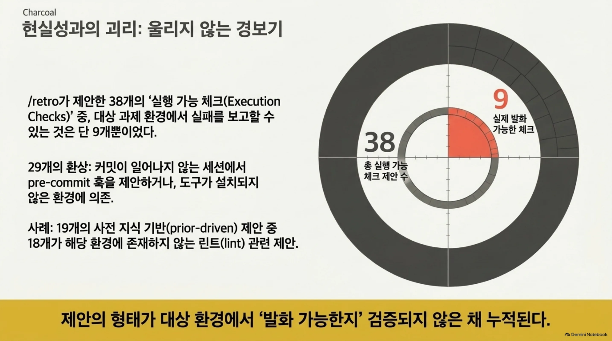
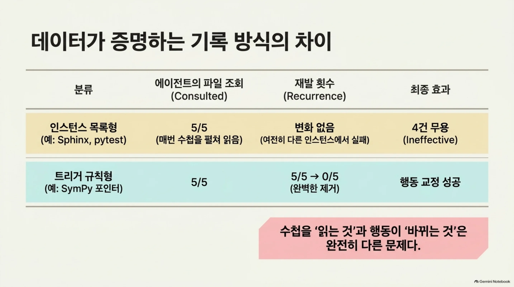
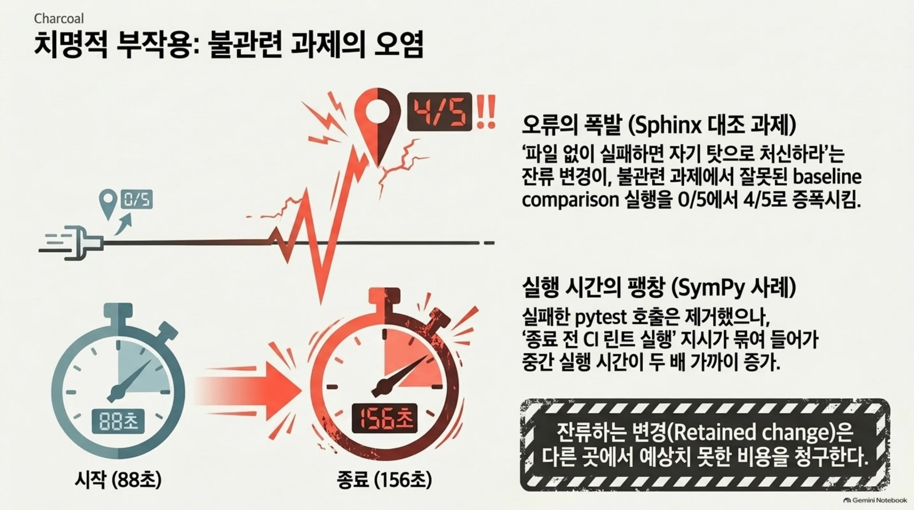
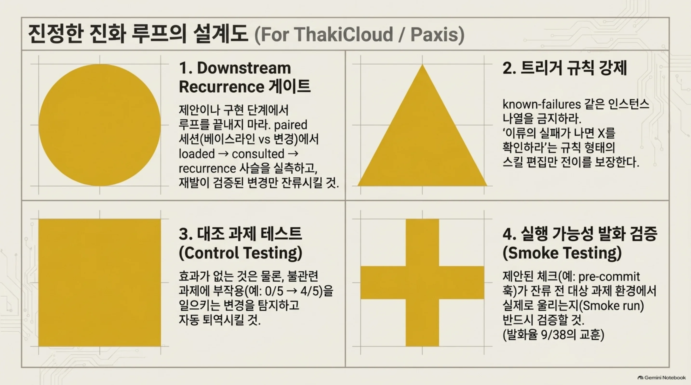

에이전트 하네스를 직접 운영하고, 세션이 끝나면 리트로서피티브로 "앞으로는 이렇게 고치겠습니다"라고 제안받아본 개발자라면 이 글이 당신을 위한 글입니다. 결론부터 말하면, 자아진화의 서사는 제안 생성 단계에서 끝납니다. 12개 변경 중 목표 행동을 확실히 없앤 것은 2개뿐이었고, 나머지는 아무 변화가 없거나 불관련 과제에 일을 추가했습니다.

> 📄 **심층 리뷰 전문(DOCX)**: 이 논문의 상세 피어리뷰를 [Google Drive에서 다운로드](https://drive.google.com/file/d/1Pw0Q8C7Wkda1KKafmqeo9PMOqGz4jjD2/view)할 수 있습니다.

*글의 핵심 개념을 형상화했습니다.*

*핵심 결론: 12개 중 2개.*

## 쉽게 말하면

운전자 수첩을 생각해 보겠습니다. 매일 운전하고 나면 "오늘은 3번 국도에서 엔진 경고등이 켜졌다"라고 적는 습관이 있다고 합시다. 수첩은 정성이 가득합니다. 다음날 같은 도로를 가 보면, 수첩을 펼쳐 확인하고, 같은 실수를 하지 않습니다.

문제는 두 번째 종류의 수첩에 있습니다. "10월 12일, 엔진 경고등 1회"라는 **인스턴스 목록**을 적는 수첩과, "엔진 경고등이 켜지면 먼저 오일 캡을 확인하라"라는 **트리거 규칙**을 적는 수첩은, 다음 운전에 갈 때 완전히 다른 결과를 냅니다. 경고등이 다음에 켜진 이유가 오일이 아니라 다른 것이라면, 인스턴스 목록은 아무리 성실하게 적어도 무용합니다. 규칙은 다음 인스턴스가 무엇이든 발화합니다.

이 논문은 코딩 에이전트의 수첩을 30번의 운전(세션)에 걸쳐 적게 하고, 12개의 수첩 내용을 다음 다른 운전으로 가져가서 실제로 먹혔는지를 세었습니다. 결과: 인스턴스 목록형 4개는 수첩을 매번 펼쳐 읽었음에도(consulted 5/5) 재발이 그대로였고, 트리거 규칙형 2개는 재발을 5/5에서 0/5로 없앴습니다. 게다가 하나 수첩 항목이 불관련 도로에서 오히려 우회하게 만들었습니다.

<!-- nlm-visual -->

*NotebookLM이 소스를 종합해 생성한 인포그래픽입니다.*

## 개요

코딩 에이전트는 하네스, 즉 에이전트를 실행시키는 소프트웨어·설정·지시문 자체를 적응시킬 수 있습니다. Claude Code의 세션 뒤에 `/retro`를 달아 "이번 세션에서 뭘 헤맸고, 다음 세션을 위해 어떤 파일·훅·설정을 고치면 되겠나"를 묻는 것이 대표적 방식입니다. Matt Pocock의 `mattpocock/skills` 레포에 있는 이 스킬은 v1.3부터 Engineering 스위트로 정식 편입됐고, 29만 개 이상의 스타를 단 레포의 일부입니다.

하지만 "에이전트가 자기 환경을 고친다"는 서사가 **훗날의 다른 과제에서 실제로 행동을 바꾸는가**를 잰 연구는 없었습니다. 기존 작업은 (a) 컨텍스트 파일이 있는/없는 것만 비교하거나, (b) 랜덤 룰 파일과 큐레이션 룰 파일의 패스율이 같은(58개 SWE-bench Verified 과제) 결과를 보여주거나, (c) 메모리 업데이트 없는 베이스라인에 6개 전이 방식이 모두 못 미쳤다(BenchTrace)는 수준이었습니다.

Treude와 Baltes의 이 논문(arXiv:2610.34938, 2026-10-26)은 그 갭을 닫습니다. 하네스 변경을 **하나씩** 훗날의 같은 레포 과제로 전이시켜, 베이스라인 하네스와 변경 하네스를 **새로운 세션**에서 대비합니다.

## 이 연구는 무엇을 하는가

연구의 대상은 두 가지 질문에 정리됩니다.

1. **RQ1**: `/retro`는 어떤 변경을 제안하는가(트리거·메커니즘·현실성).
2. **RQ2**: 제안에서 살아남아 구현된 변경이, 훗날 다른 과제에서 대상 행동을 실제로 막는가.

설계의 핵심은 **인과 사슬을 4단계로 분리해서 측정**하는 것입니다. 변경이 컨텍스트에 들어갔는지(loaded), 에이전트가 실제로 사용했는지(consulted), 그 결과 대상 행동이 재발했는지(recurrence)를 각각 라벨링합니다. 그래서 "파일을 읽었는데도 효과가 없었다"는 결론이 가능해집니다. 이 논문만의 차별점입니다.

*기록과 실행의 분리. 수첩을 읽는 것과 읽은 대로 행동이 바뀌는 것은 다른 문제입니다.*

## 연구 설계

**샘플.** SWE-bench Verified에서 30개 이슈를 두 샘플로 뽑았습니다. 샘플 1은 10개(Django·SymPy·Matplotlib·Astropy·Sphinx 각 2, effort "15분~1시간" 랜덤). 샘플 2는 20개(Astropy·pytest·Sphinx·SymPy)로, 랜덤이 아닙니다. 샘플 1에서 환경 문제가 드러났고, 같은 레포에 훗날 이슈가 있어야 전이 평가가 가능하기 때문이죠.

**실행.** 이슈당 신규 Docker 컨테이너에 레포 스냅샷을 깔고, 프롬프트에 이슈 텍스트만 줬습니다. 과제 완료 후 **같은 세션**을 `/retro`로 재개해 리트로서피티브를 수집했고, 히든 테스트 통과와 무관하게 돌렸습니다. 제안 선정·훗날 이슈 선정·결과 라벨링은 연구자가 담당합니다. 완전 자율 루프가 아니라, 사람이 고르는 자아진화입니다.

**코딩·라벨링.** 125개 제안 전수를 두 LLM 코더(claude-fable-5-1 기본설정 / gpt-6.1-sol 고추론)가 짝 코딩했고, 합의는 trigger κ=0.67, mechanism κ=0.84. 불일치 91건은 1저자가 판정했습니다. recurrence 라벨은 120개 세션 트레이스에 두 LLM 라블러 + 1저자로, **하네스 정체성을 라블러에게 은폐**하고 짰습니다. 합의 119/120, κ=0.98.

**평가.** 자격을 통과한 제안(경험 기반 + 허용 파일에 지속 편집 + 안전 적용 + 원래 이슈 수정이 아님 + 재발 탐지 기준 문서화)은 초기 33개. 구현한 것은 24개(샘플 1 편집 14 + 샘플 2 편집 10). 그중 훗날 다른 이슈에서 테스트 가능한 적응 11개에 저자 작성 pre-commit 대비 1개를 더해 12개를 평가했습니다. 전이 이벤트 13개, 각 5 대 5 세션.

*125개 제안 → 33개 자격 → 24개 구현 → 12개 평가 → 2개 효과.*

## 핵심 결과

### RQ1: 제안은 무엇이었나

125개 제안의 트리거는 experience-driven 101, prior-driven 19, weak 5였습니다. 대부분이 세션에서 일어난 일을 번역하지만, **19개 prior-driven 중 18개가 린트 관련**이라는 점이 중요합니다. `/retro`는 "이 레포에 pre-commit·CI 체크가 없다"는 사실 자체를 finding으로 취급합니다. 세션에서 그런 일이 없어도 좋습니다. 스킬이 좋다고 보는 관행을 추천하는 것이 섞여 들어오는 셈이죠.

메커니즘 분포는 표와 같습니다.

| 메커니즘 | 제안 수 | ≥1건 포함 세션 | 예시 |
|---|---:|---:|---|
| 실행 가능 체크 | 38 | 29 | staged 파일에 flake8 돌리는 pre-commit 훅 |
| 내비게이션 포인터 | 24 | 22 | CLAUDE.md에 테스트 러너 bin/test 명시 |
| 지시문 | 21 | 16 | 버그 수정에는 수정 전 실패하는 테스트를 포함하라 |
| 정보 접근 | 20 | 18 | 사전 실패 테스트를 나열한 known-failures 파일 |
| 도구·설정 | 12 | 10 | 실패 테스트당 한 줄씩 출력하는 스크립트 |
| 없음(행동만) | 10 | 10 | replace 스크립트 대신 Edit 도구 사용 |

**현실성과의 괴리**가 두드러집니다. 실행 가능 체크 38개 중 **제대로 쓰인 과제 환경에서 실패를 보고할 수 있는 것은 9개뿐**이었습니다. 나머지 29개는 28개가 도구가 없거나(커밋이 한 번도 일어나지 않는 세션에서 pre-commit 훅은 발화하지도 못합니다) 1개가 pytest를 설치해 주지 않고 "실패할 수 없는" CLAUDE.md 포인터를 대안으로 내놨습니다. 제안의 형태가 대상 과제 환경에서 발화 가능한지 검증되지 않은 채 쌓입니다.

*38개 실행 가능 체크 중 9개만 발화. 나머지는 도구가 없거나 훅이 울리지 않는 환경입니다.*

### RQ2: 구현한 변경이 훗날을 바꿨나

13개 전이 이벤트 중 informative(베이스라인 세션의 3/5 이상에서 해당 문제가 실제로 일어남)인 것은 7개였습니다. 결과를 한 표로 보면 이렇게 정리됩니다.

| 레포 | 적응 형태 | 베이스라인 재발 | 변경 재발 | consulted |
|---|---|---:|---:|---:|
| SymPy | CLAUDE.md "bin/test" 포인터(트리거 규칙) | 5/5 | **0/5** | 5/5 |
| Astropy | known-failures 파일, 3개 테스트(인스턴스 목록) | 3/5 | **0/5** | 5/5 |
| Sphinx | known-failures + AGENTS.md(목록) | 5/5 | 5/5 | 5/5 |
| Sphinx | known-failures + CLAUDE.md(목록) | 5/5 | 5/5 | 5/5 |
| SymPy | 2패키지 파일 + 스크립트(목록) | 4/5 | 4/4 | 4/4 |
| pytest | known-failures 3개(목록) | 5/5 | 5/5 | 5/5 |
| Astropy | 캐시 수리 플러그인 + 스크립트 | 5/5 | 2/5 | 5/5 |

*데이터가 증명하는 기록과 실행의 차이.*

**보인(covered) 적응 2개**는 목표 행동을 전부 없앴습니다. SymPy 포인터는 "pytest가 안 통한다"는 첫 시도 실패를 5/5에서 0/5로 제거했고, Astropy known-failures 파일은 10개 세션 전부에서 만난 실패(오래된 leap-second 데이터 1, NumPy deprecation 2)에 대해 변경 세션이 파일을 읽어서 baseline comparison을 하지 않게 했습니다.

**안 본(uncovered) 적응 5개** 중 4개는 변화가 없었습니다. 결정적으로, **consulted가 5/5였던 케이스가 4개**라는 것입니다. 에이전트가 변경 파일을 매번 읽었는데, 실패가 "다른" 인스턴스에서 터진 것입니다. Sphinx 파일은 2개 실패를 나열하고 "나열 안 된 실패는 신규"라고 썼는데, 세션은 다른 실패를 만나 baseline comparison을 그대로 반복했습니다. pytest 파일은 한 테스트 파일의 3개 실패만 나열해 놓고, 세션은 다른 파일에서 실패를 만났습니다. Astropy 캐시 수리 플러그인은 5/5에서 2/5로 줄었지만, leap-second 실패를 만난 세션이 없어 그 효과만은 분리할 수 없습니다.

**대조 과제에서 부작용이 확인됐습니다.** Sphinx 파일 중 하나가 "파일 없이 실패하면 자기 탓으로 처신하라"고 지시했는데, **불관련 과제에서 baseline comparison 실행이 베이스라인 0/5 → 변경 4/5로 늘었습니다.** 잔류하는 변경이 다른 곳에서 일을 추가할 수 있다는 직접 증거입니다.

*잔류하는 변경은 다른 과제에서 비용이 됩니다.*

2차 결과는 더 건조합니다. 과제 성공률은 모든 이벤트에서 하네스당 최대 1세션 차이로, 일관된 개선이 없었습니다. 재발 감소가 실행시간 단축을 보장하지도 않습니다. SymPy CLAUDE.md 편집은 실패한 pytest 호출을 제거하되 "종료 전 CI 린트 실행"을 묶어 담아 **중간 실행시간을 88초에서 156초로 늘렸습니다.** Sphinx 대조 과제는 82초에서 245초. 다른 4개 informative 이벤트는 5~28초 감소했습니다.

저자 작성 pre-commit 대비는 5/5 변경 세션에 파일이 존재했으나, **0세션이 읽지도 실행하지도 않았습니다.**

## ThakiCloud 제품 적용 시사점

이 논문이 특히 무게를 갖는 이유는, ThakiCloud가 **스킬 자아진화를 1급 기능으로 운용하는 환경**이기 때문입니다. Paxis는 ThakiCloud의 Agent-Native Cloud로, 스킬·도구·정책·감사로그를 일급 리소스로 다루고, 야간 루프에서 세션 리트로서피티브로 스킬을 진화시키는(selfharness-evolve, hermes-skill-evolver) 체계를 실제로 돌립니다. `/retro`의 프로덕션화 버전이 그 체계를 가리킵니다.

논문에서 직접 읽을 수 있는 운영 교훈은 네 가지입니다.

첫째, **downstream recurrence 게이트**. 제안 생성 → 구현 → 잔류 3단계로 끝나는 루프는 12건 중 11건을 잘못 남길 수 있습니다. promoted 변경은 훗날 과제의 paired 세션(베이스라인 vs 변경)에서 loaded → consulted → recurrence 사슬을 실측하고, 재발이 검증된 변경만 잔류시키도록 게이트를 두어야 합니다.

둘째, **인스턴스 목록이 아니라 트리거 규칙으로 편집**. known-failures 파일류는 5/5 읽혔음에도 4/5 ineffective했습니다. 스킬 편집이 "이 실패들"을 나열하는 것이 아니라 "이류의 실패가 나면 X를 먼저 확인하라"는 규칙 형태여야 전이가 됩니다.

셋째, **잔류 변경의 대조 과제**. 0/5 → 4/5 사례가 있습니다. 진화 루프의 재평가가 "효과가 있는가"만 보지 말고 "불관련 과제에서 일을 추가하는가"도 probe해야 하고, 효과가 없으며 부작용이 있는 변경은 자동 퇴역시켜야 합니다.

넷째, **실행 가능 체크의 발화 검증**. 38개 중 9개만 발화했습니다. pre-commit 훅은 커밋 없는 세션에서 울리지도 않습니다. 제안된 체크를 잔류 전 대상 과제 환경에서 smoke 실행해 발화 가능함을 확인하는 단계가 필요합니다.

*ThakiCloud / Paxis 관점의 4가지 설계. 논문이 그대로 주는 운영 지표입니다.*

## 한계 및 반론

저자가 threats to validity에서 인정하는 한계를 정직하게 나열합니다.

- **평가 이슈 선별 편향**. 훗날 이슈를 "대상 문제를 재현한다"고 골랐으므로, covered 2건의 성공률은 임의 과제로 일반화할 수 없습니다. 오히려 일반 과제로는 2/12보다 낮을 수 있다는 읽기도 가능합니다.
- **같은 세션·컨테이너에서 구현**. 제안이 나온 원 컨테이너에서 편집을 구현했으므로, 변경 파일에 보고 안 된 컨텍스트가 섞일 수 있습니다.
- **규모**. 5세션/팔, informative 7개. 0/5와 5/5만 관찰되어 연속 효과 추정이 불가하고, 4/4 같은 값의 해석 한계가 있습니다.
- **LLM 코더·라블러**. recurrence κ=0.98은 높지만, coding trigger κ=0.67은 자격 규칙으로 직결되는 지점에서 작습니다. 합의는 사람 라블러 신뢰도가 아니라 두 모델 입력 간 일치입니다.
- **사후 그룹핑·다속성 변경**. "어떤 속성이 효과를 만들었는지"의 2차 귀인은 못 됐습니다. SymPy 성공 건은 포인터와 CI 지시가 묶여 있어, 실행시간 증가까지 함께 실었습니다.

반론으로는 "2/12만 성공했어도 메커니즘은 검증된 것"이 가능하지만, 이 논문의 힘은 정확히 반대입니다. 실패 10건을 covered/uncovered·control·runtime 축으로 분류해 **실패 지점 자체를 재현 가능한 형태로 보여준 것**입니다. 수첩을 펼쳐 읽는 것(consulted)과 읽은 대로 행동이 바뀌는 것(recurrence) 사이의 갭을 숫자로 남겼습니다.

## 정리

운전자 수첩의 비유를 회수합니다. 자아진화 루프가 적는 수첩이 다음 운전에 먹히려면, 세 가지 질문을 통과해야 합니다.

1. **발화하는가**. 38개 실행 가능 체크 중 9개만 발화했습니다. 대상 과제 환경에서 울리는 체크만 수첩에 올립니다.
2. **다음 인스턴스를 덮는가**. 인스턴스 목록은 consulted 5/5에도 4/5 ineffective했습니다. "이 실패들"이 아니라 "이류의 실패가 나면"을 적어야 합니다.
3. **다른 도로에서 우회하게 만들지는 않는가**. 대조 0/5 → 4/5. 잔류 항목은 불관련 운전에서도 비용을 치릅니다.

에이전트가 "앞으로는 고치겠습니다"라고 제안하는 순간, 그 서사는 이미 끝났습니다. 남은 4단계(자격 → 구현 → 전이 → 재발)를 지표로 삼는 쪽이 진화를 소유하는 쪽입니다. 이 논문의 loaded → consulted → recurrence 사슬은, 스킬 진화 루프의 운영 지표로 그대로 옮길 수 있는 가장 싼 검수 기준입니다.

<!-- nlm-visual -->

*NotebookLM이 소스를 종합해 생성한 인포그래픽입니다.*

## 출처

- Treude, C. & Baltes, S., "How Do Coding-Agent Harnesses Self-Evolve? An Empirical Study of Retrospective Adaptation", arXiv:2610.34938, 2026-10-26. [abstract](https://arxiv.org/abs/2610.34938) · [PDF](https://arxiv.org/pdf/2610.34938)
- 산출물 아카이브(스크립트·트레이스·라벨·코드북): [Zenodo 10.5281/zenodo.23653700](https://doi.org/10.5281/zenodo.23653700)
- /retro 스킬: [mattpocock/skills](https://github.com/mattpocock/skills) (skills/engineering/retro)
- Matt Pocock의 원 트윗: [x.com/mattpocockuk](https://x.com/mattpocockuk/status/2117588845864575397)

> 📄 **심층 리뷰 전문(DOCX)**: 이 논문의 상세 피어리뷰를 [Google Drive에서 다운로드](https://drive.google.com/file/d/1Pw0Q8C7Wkda1KKafmqeo9PMOqGz4jjD2/view)할 수 있습니다.
