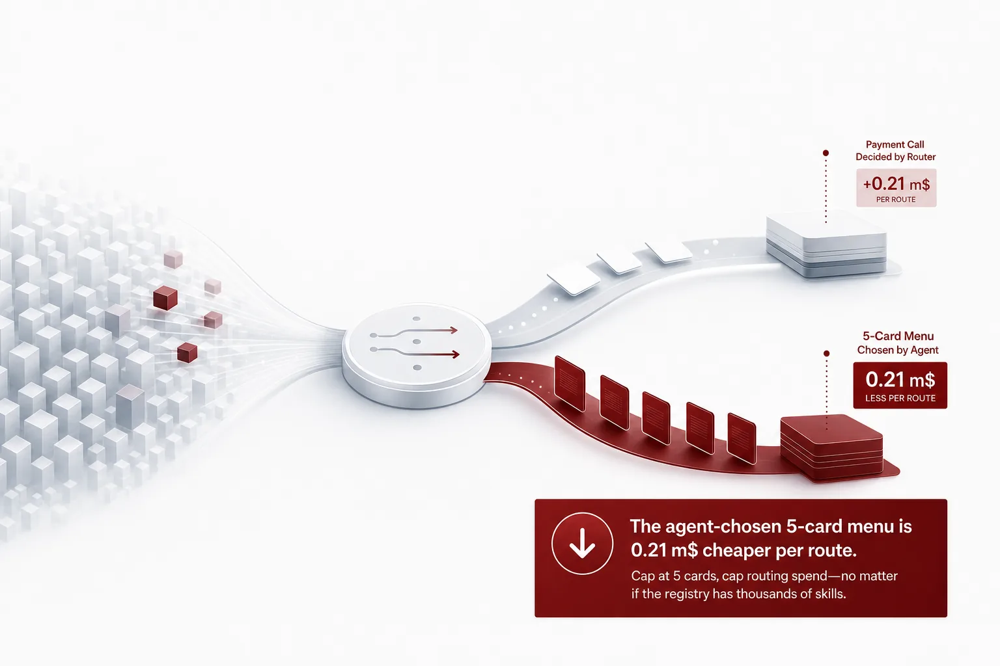
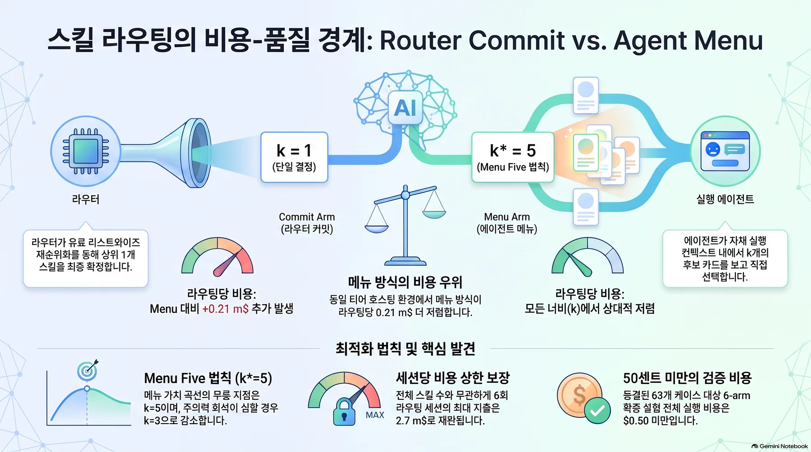
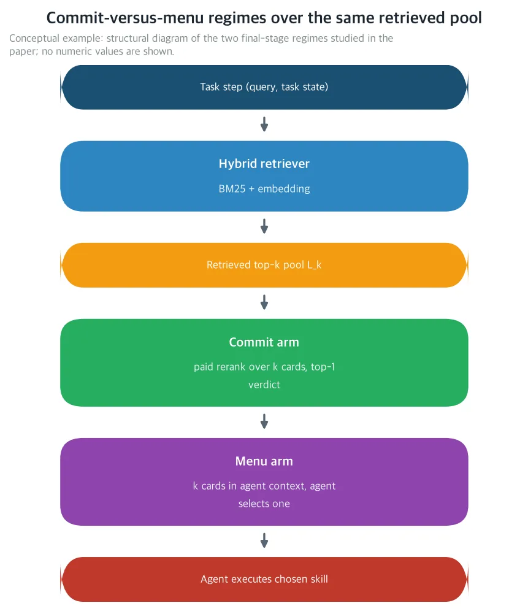
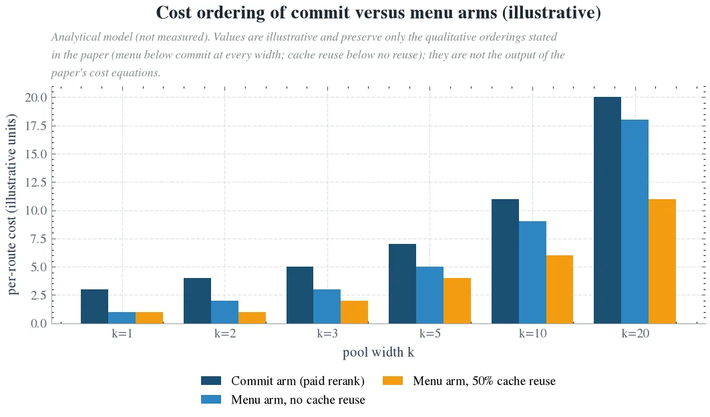
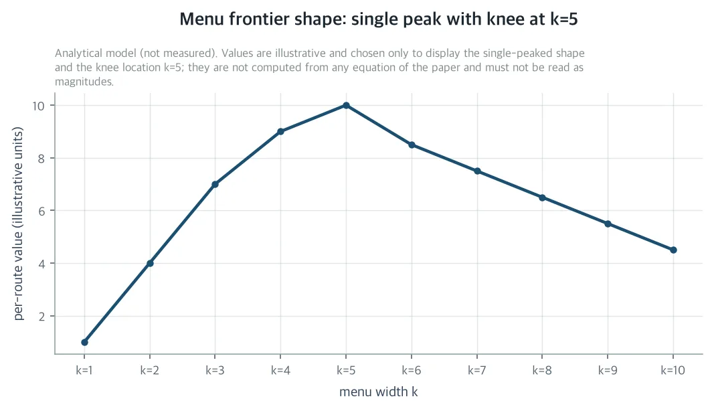
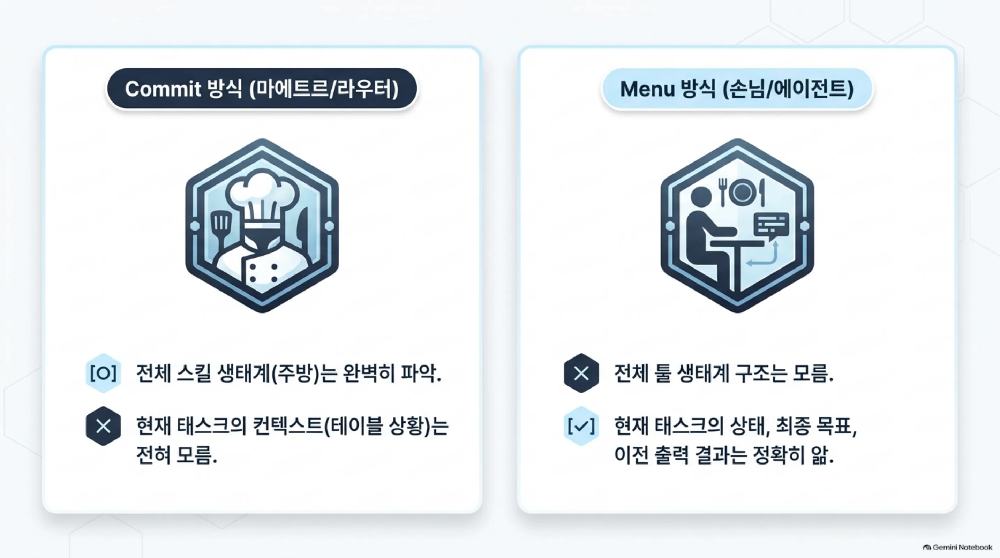
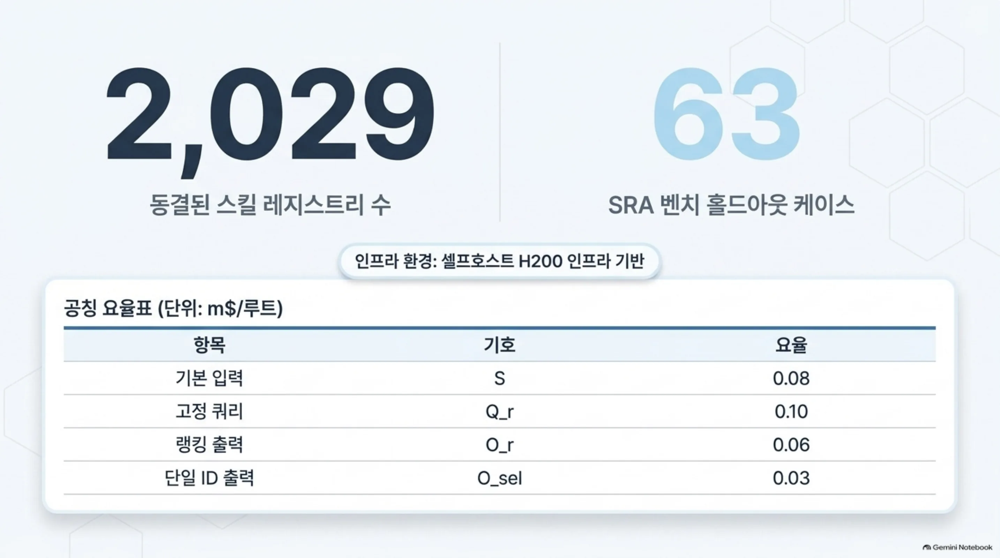
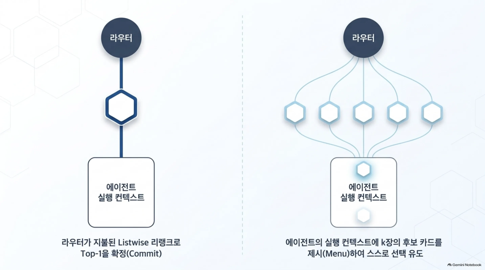
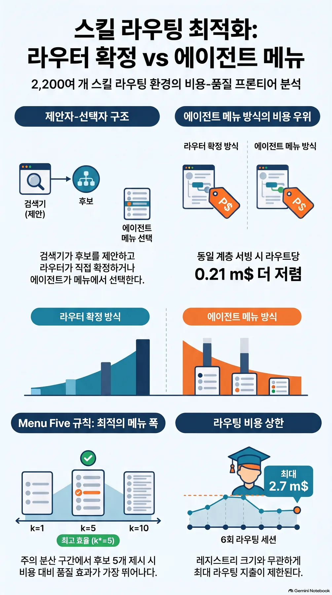

자기 GPU 위에서 무인으로 돌리는 에이전트 하네스를 운영한다면, 이 글은 바로 당신을 위한 글입니다. 스킬 라우터의 마지막 단계는 두 가지입니다. 하나는 라우터가 모델 호출 한 번을 지불하고 답을 스스로 정하는 것입니다. 다른 하나는 후보 목록을 에이전트에게 넘겨 고르게 하는 것입니다. 이 논문은 셀프호스트에서는 후자가 항상 더 싸다고 가격 매깁니다. 그리고 최적의 목록 길이는 5장입니다.

재측정 대상은 동결된 2,029스킬 레지스트리와 셀프호스트 H200입니다. 이 논문이 가격 매기는 것은 아직 한 번도 함께 매겨지지 않은 두 변수입니다. 목록이 몇 장인지, 그리고 최종 선택권이 누구에게 있는지입니다.

*글의 핵심 개념을 형상화했습니다.*

## 쉽게 말하면

식당의 마지막 주문을 생각해 보겠습니다. 방식은 두 가지입니다. 첫째는 마에트르가 테이블을 대신 위해 메뉴를 정해 주방에 내보내는 것입니다. 둘째는 메뉴를 손님에게 쥐어 줘서 스스로 주문하게 하는 것입니다.

손님들은 테이블에 앉아 있습니다. 왜 왔는지, 전에 무엇을 먹었는지, 얼마나 오래 머물 수 있는지를 마에트르보다 잘 압니다. 마에트르는 주방은 속속들이 알지만, 그 테이블의 상황은 아무것도 모릅니다.

스킬 라우터의 마지막 단계는 바로 이것입니다. 라우터가 마에트르이고 에이전트가 손님입니다. 라우터는 수천 개 스킬에서 짧은 후보 목록까지 추려 놓았습니다. 남은 질문은 하나입니다. 그 목록에서 최종 하나를 누가 고르는가입니다. 이 논문은 그 선택에 가격을 매깁니다. 목록은 몇 장이 좋고 선택권은 누구에게 두는 것이 좋은가?

<!-- nlm-visual -->

*NotebookLM이 소스를 종합해 생성한 인포그래픽입니다.*

## 무엇을 해봤나

논문이 묻는 것은 하나입니다. 어떤 목록 길이, 어떤 고르는 쪽 조건에서 "에이전트가 고르는 것"이 "라우터가 대신 정하는 것"을 이기느냐입니다. 비교 축은 루트당 토큰 비용, top-1 품질, 그리고 둘의 M-가중 합입니다. M은 한 번의 잘못된 라우팅이 만드는 기대 하류 손실입니다.

설정은 동결 2,029스킬 레지스트리 위의 셀프호스트 H200입니다. 프로덕션 규모의 무인 하네스에서는 매 태스크 스텝이 라우터로 가, 약 2,200개의 버전 관리 스킬 중 하나로 라우팅됩니다. 리트리버는 BM25와 dense embedding 유사도를 융합하고 마지막 단계는 추려진 top-k 풀 위에서 하는 선택적 지불 listwise LLM 호출입니다. 그 호출이 리트리버의 원시 순위를 갈아씁니다. 무인 루프에서 misroute는 사람이 잡아줄 수 있는 약해진 답변이 아닙니다. 스텝 자체가 실패하거나, 아무도 눈치채기 전에 태스크의 토큰 예산이 태워집니다.

홀드아웃은 SRA 벤치 63건입니다. 기록된 2026년 9월 라우터 단계 지점에서 top-1은 48.9퍼센트, 다섯 개 회수는 86.7퍼센트였습니다. 같은 시리즈에서 이웃한 두 단계는 이미 매겨졌습니다. 하나는 gatekeeper 결과로, 라우터가 후보를 얼마나 싼 대가로 '볼' 수 있는지, quantization의 scoring-stage 가격입니다. 다른 하나는 Final Five 결과로, 고정한 풀에서 한 번의 지불 listwise 리랭크가 top-1을 t + a_k(r_k − t)로 끌어올리고 비용은 풀 폭 k에 선형으로 자랍니다. 선택 정확도가 a_k = a_5(5/k)^δ로 희석되는 밴드 δ ∈ [0.23, 0.66]에서 가장 값을 하는 풀은 k = 5였습니다.

열려 있던 것은 풀 폭을 바꾸면 프론티어가 어떻게 움직이는지와, 최종 선택권이 누구에게 있는지입니다. 이 논문은 그 갭을 닫습니다. 하네스에서 라우터의 판정은 실행 에이전트가 소비합니다. 에이전트는 이미 태스크 전체 상태, 목표, 이전 툴 출력을 보고 있습니다. 같은 리트리브 풀을 쓰는 방식이 구조적으로 둘로 갈립니다.

Commit: 라우터가 k장에 대한 listwise 리랭크를 지불하고 top-1 판정을 commit하며 에이전트는 골린 스킬의 스펙을 로드해 실행합니다. Menu: 라우터가 k장 후보 카드를 에이전트의 실행 컨텍스트에 넘기고 태스크 컨텍스트를 이미 소유한 모델이 하나를 고릅니다.

*논문이 가격 매기는 두 최종 단계 regime, commit과 menu의 구조 도식입니다. 같은 top-k 풀 위에서 라우터는 지불된 listwise 리랭크로 top-1을 commit하거나, 실행 에이전트에게 k장 후보 카드를 제시합니다. (개념 예시: 수치값을 표시하지 않습니다)*

menu는 보통 의미에서의 리랭커 대체재가 아닙니다. 고르는 쪽의 정보가 다릅니다(전체 태스크 상태 대 쿼리), 주의 경제가 다릅니다(긴 컨텍스트 안 k장 중 1장 대 짧은 listwise 프롬프트 안 k장 중 1장), 청구가 다릅니다(에이전트의 토크나이저와 율 대 라우터의). 논문의 질문은 이것입니다. 어떤 menu 폭 k에서, 어떤 고르는 쪽 조건에서, 에이전트에게 menu를 보여주는 일이 라우터에서 판정을 commit하는 일을 이깁니까? 비교 축은 루트당 토큰 비용, top-1 품질, 둘의 M-가중 합입니다. knee는 어디에 있습니까?

논문은 새로운 라우팅을 재측정하지 않습니다. 명시적 전제(A1~A6)와 아래 표의 선언된 요율 카드 위에서 가격 매기고 청구서는 결정적 닫힘 형태로 씁니다.

| 항목 | 기호 | 요율 (m$/루트) |
|---|---|---|
| 기본 입력 | S | 0.08 |
| 고정 쿼리 | Q_r | 0.10 |
| 랭킹 출력 | O_r | 0.06 |
| 단일 ID 출력 | O_sel | 0.03 |

## 나온 결과

### menu 쪽이 항상 더 싼 이유: break-even 부등식

논문은 이 설정을 menu-width 문제로 형식화합니다. proposer-chooser 분해로, 리트리버가 top-k 풀을 제안하고 라우터(commit 팔) 또는 에이전트(menu 팔)가 하나의 스킬을 고릅니다. 어느 팔도 이미 맞은 top-1을 깨지 않는다는 keep-safe 전제(A4~A5) 아래, 루트당 가치 V = MT − C에서 menu 팔이 commit 팔을 weakly 지배하는 조건은 매 풀 폭 k마다 하나의 부등식이 됩니다.

M(r_k − t)(b_k − a_k) ≥ C^m_k − C^c_k

b_k는 에이전트의 인풀 fix 확률입니다. 골이 풀 안에 있으나 1위가 아닐 때, 제시된 k장에서 골을 고르는 확률입니다. a_k는 리랭커의 fix 확률입니다. 왼쪽은 에이전트의 태스크-컨텍스트 우위가 리트리벌이 이미 도달한 fix 질량으로 사는 가치이고 오른쪽은 menu가 commit 호출 상대로 치는 비용입니다. menu의 단일 ID 출력 O_sel이 피하는 리랭크 호출의 고정 입력 Q_r과 출력 O_r이 여기에 들어 있습니다.

이 corollary가 논문의 중심 구조 주장입니다. same-tier 셀프호스트 서빙, 율 카드가 하나이고 에이전트의 토크나이저와 라우터의 토크나이저가 같은 대가로 청구되는 서빙에서, prefix-cache 재사용이 없으면 C^m_k − C^c_k = O_sel − O_r − Q_r − S < 0가 매 k ≥ 1에서 성립합니다. menu 팔은 폭에 무관한 상수로, 매 폭에서 루트당 엄격히 더 쌉니다.

선언된 공칭 율에서 그 상수는 0.03 − 0.06 − 0.10 − 0.08 = −0.21 m$입니다. menu는 폭과 무관하게 루트당 0.21 m$ 더 쌉니다. k = 5, M = 100 m$에서 그 허용분은 약 0.56점입니다. menu는 인풀 선택에서 리랭커보다 반 점 가까이 열세여도 가치로는 이깁니다. commit된 리랭크 호출이 정당해지는 경우는 두 가지뿐입니다. 에이전트의 인풀 선택이 엄격히 나쁠 때(퇴화된 에이전트 티어, 노이즈 많은 컨텍스트), 혹은 엄격히 비쌀 때입니다.

즉, 사람 말로는 셀프호스트 서빙에서 '상황을 아는 쪽이 고르게 하는 것'의 대가는 고정값이고 그 값은 라우터의 지불 상담 호출보다 싸다는 뜻입니다.

### 왜 싼가: 두 팔은 다른 물건을 청구한다

menu가 구조적으로 싼 이유는 두 팔이 다른 물건을 청구하기 때문입니다. commit 호출은 k장 전체를 라우터 토크나이저로, 고정 쿼리 Q_r과 랭킹 출력 O_r을 더해서 치합니다. menu는 '추가' 카드 k−1장만 청구합니다. 첫 번째 카드는 두 regime 모두에서 에이전트가 실행을 위해 어쨌거나 로드하는 스펙입니다. 추가 카드는 에이전트 티어에서, prefix-cache 재사용분을 빼고 더 싼 단일 ID 출력을 붙여 치합니다.

같은 스킬 카드는 밤마다 다시 나오고 exact-match 자동 prefix 캐싱이 세션 안 카드 텍스트의 β_m 분율을 재사용합니다. 그래서 β_m은 서빙 디테일이 아니라 모든 정리 안에 들어 있습니다.

### 티어 격차가 배포 경계를 긋는다

티어 격차 threshold corollary가 배포 경계를 긋습니다. 에이전트 티어가 라우터 카드 가격의 μ배(공칭에서 μ = 3)이면 menu는 추가 카드마다 (μ−1)S 프리미엄을 치고 C^m_5 − C^c_5 = 0.43 m$가 됩니다. break-even은 M = 100 m$에서 b_5 − a_5 ≥ 1.14점, M = 200 m$에서 0.57점, M = 50 m$에서 2.28점을 요구합니다. menu는 same-tier 셀프호스트 플릿에서는 default이고 이질 티어에서는 premium option입니다. premium은 misroute penalty가 작을수록 얇아집니다.

즉, 사람 말로는 손님의 티어가 비쌀수록, 추가 메뉴 카드 하나당 프리미엄이 붙는다는 뜻입니다. 잘못된 주문의 손해가 작을수록 그 프리미엄은 얇아집니다.

*두 팔의 루트당 비용 순서입니다. same-tier 서빙에서 menu 팔은 매 풀 폭에서 commit 팔 아래에 있고, prefix-cache 재사용이 menu의 폭 의존 기울기를 펴 줍니다. (분석 모델, 실측이 아닙니다)*

### Menu Five rule: knee는 다섯 장

폭 문제는 자기만의 희석 지수를 가집니다. 에이전트의 인풀 fix 확률은 menu가 넓을수록 b_k = b_5(5/k)^δ_m로 떨어지고 지수는 δ_m입니다(A3). 논문은 δ_m이 리랭커의 δ와 같다고 가정하지 않습니다. 두 고르는 쪽의 주의 경제가 다르기 때문입니다. 짧은 listwise 프롬프트 대 긴 실행 컨텍스트의 차이입니다. 문헌의 위치 편향과 장문 컨텍스트 열화 결과는 δ_m을 양수로 밀어 올립니다. 더 긴 menu는 카드가 더 많은 것 이상입니다. 더 힘든 주의이기도 합니다.

recall shape A1(기록된 지점에 앵커한 single-saturating-exponential, r_∞ = 0.94 가정)과 A3 아래에서 menu 팔의 루트당 가치는 k에 대해 엄격히 concave입니다. 프론티어는 유일한 knee를 갖고 인접한 두 폭이 이를 공유할 수 있습니다. knee는 한 장 더 보이는 카드가 더 이상 값을 하지 못하는 지점입니다. 각 추가 카드는 새로운 recall 질량 (r_{k+1} − r_k)에 b_{k+1}을 곱해 사들이고 기존 질량을 r_k(b_k − b_{k+1})만큼 희석합니다. 둘의 순수, M 단위에서 prefix-cache 조정된 가격 S_e(1 − β_m)을 넘으면 그 카드는 값을 합니다.

Menu Five 정리는 선언된 공칭 율과 M ∈ {50, 100, 200} m$, 폭 {1, 3, 5, 10} 위에서 knee를 고정합니다. M 범위와 시나리오 b_5 범위를 통틀어, dilution 밴드의 핵심 δ_m ∈ [0.23, 0.62]에서는 k* = 5가 균일하게 성립합니다. 이는 리랭커 팔을 가격 매긴 dilution 밴드와 같은 밴드의 핵심입니다. 밴드 상단(δ_m > 0.62, 강한 에이전트 희석)에서는 knee가 3으로 붕괴합니다. M = 200 m$에서도 추가 카드는 값을 하지 못합니다. k* = 10에 도달하는 길은 에이전트의 주의 희석이 밴드 하단(δ_m < 0.16~0.22) 아래로만 열립니다.

두 regime 사이의 레버는 팔이지 폭이 아닙니다. Final Five가 δ ∈ [0.23, 0.66]에서 리랭크 풀을 k* = 5로 매겼습니다. menu는 같은 공칭 율에서 δ_m ∈ [0.23, 0.62]로 k* = 5가 됩니다.

*menu 팔의 루트당 가치가 menu 폭에 따라 보이는 single-peaked 형상으로, knee는 다섯 장 카드에서입니다. 기록된 앵커 지점은 t = 0.489, r_5 = 0.867이고 r_∞ = 0.94를 가정합니다. (분석 모델, 실측이 아닙니다)*

밴드 중간(δ_m = 0.5)의 시나리오 grid가 break-even을 가능한 고르는 쪽 페어링을 가로질러 읽습니다. 동점(b_5 = a_5)에서는 풀 5에서 품질이 같고 menu가 루트당 0.21 m$ 더 쌉니다. free-menu corollary가 숫자로 됩니다.

컨텍스트 우위(b_5 = 1.25·a_5, 에이전트의 태스크 상태가 풀 안에서 고르는 일을 돕는 경우)에서는 가치 이득이 루트당 +4.9~+6.8 m$로 커집니다. D = 6 결정의 세션당 배당은 30~41 m$입니다. 컨텍스트 열위(b_5 = 0.8·a_5, 노이즈 많거나 퇴화된 에이전트)에서는 부호가 뒤집힙니다. M = 100 m$에서 menu는 루트당 3.6~6.6 m$를 잃습니다. 그 regime에서 지불 리랭크 호출, 혹은 그 distill 버전이 default가 맞습니다.

### 쿼리마다 달리는 게이트, 레지스트리 크기와 무관한 상한

commit-versus-menu 결정은 쿼리 단위로 내려갈 수 있습니다. top-1 질량 t_q를 가진 쿼리 q에서 menu를 보여 주는 것이 값을 하는 것은 M_q·b_{q,k}(r_k − t_q) ≥ C^m_k − C_0일 때입니다. C_0는 지불된 마지막 단계가 없는 retrieval-only 폴백 비용입니다.

certified-margin 게이트가 이를 충분하게 구현합니다. rank-safety margin 진단이 리트리버의 top-1을 증명 가능하게 안전하다고 인증하면, 지불된 마지막 단계를 건너뛰고 나머지에서 폭 k*의 menu를 켭니다. 인증된 쿼리는 폴백 비용에 올바른 판정을 지키고 게이트의 harmful-skip 회계가 keep-break 위험을 묶습니다. skip률 p, 게이트 keep-break률 ε_g에서 하이브리드의 품질과 비용은 두 식으로 갈립니다.

T^h = p·t(1−ε_g) + (1−p)[t + b_{k*}(r_{k*} − t)], C^h = p·C_0 + (1−p)·C^m_{k*}

same-tier regime에서는 이것이 uniform commit을 weakly 지배합니다. uniform menu와 uniform commit은 p = 0, p = 1의 특수한 경우입니다.

cost cap 정리는 이 시리즈가 앞서 내놓지 못한 일반화입니다. 어떤 retrieve-present-choose 스택에서든 제시 폭을 knee k*에 캡하면 상한이 놓입니다. 스킬 코퍼스 위 RAG, 툴 선택, 샘플 답변 위 best-of-N도 모두 해당됩니다. 세션당 라우팅 지출은 레지스트리 크기 N과 무관하게 D[(k*−1)s̄(1−β̄) + ĉ_sel + C_0]로 상한됩니다.

폴백을 초과하는 결정당 지출은 (k−1)s̄(1−β̄) + ĉ_sel을 넘지 못합니다. 선택 품질은 위에서 recall 상한 r_k, 아래에서 폴백 t에 묶여 있습니다. 리랭크는 리트리벌이 안 데려온 것을 만들 수 없고 상한은 두 팔 모두에게 지켜집니다.

선언된 공칭 율에서 D = 6, k* = 5, β̄ = 0이면 세션의 라우팅 지출 상한은 6 × (0.32 + 0.03 + 0.10) = 2.7 m$, 세션당 1센트 미만입니다. 레지스트리가 몇천 스킬로 자라도 이 상한은 그대로입니다.

즉, 사람 말로는 식당의 메뉴가 크다고 한 방문당 청구서가 커지는 것이 아닙니다. 상한은 테이블에 내어 주는 메뉴의 길이와 받는 테이블 수로 결정됩니다. 메뉴를 5장에 고정하면, 상한도 결정됩니다.

## 그래서 무엇을 바꾸면 되나

ThakiCloud 에이전트 플랫폼에 이 결과는 라우팅 정책의 closed-form 배포 값입니다. 정책은 두 단계로 세웁니다. 두 희석 지수 δ와 δ_m을 재거나, 상속 밴드 안에서 가정합니다. 팔은 동점 비교 b_5 대 a_5로, 폭은 knee로 잡습니다.

재학습이 필요 없고 신규 인프라도 필요 없습니다. 레버는 하네스의 제시 파라미터이고 그 비용 쪽은 결정적 청구서입니다. 기존 sra_bench와 Metis 토큰 계량만으로 구현할 수 있습니다.

same-tier 셀프호스트 플릿에서 commit된 리랭크 호출은 premium option이지, default가 아닙니다. default는 knee 폭의 menu이며 인증-스킵과 knee 폭 menu의 하이브리드 라우터가 품질을 지키는 가장 싼 라우팅 모드가 됩니다. 2,000+ 스킬 생태계 전체의 태스크당 토큰 지출에 직접 들어가는 부분입니다.

cap의 사회 읽기는 작은 조직을 위한 토큰 비용 상한입니다. 셀프호스트 추론 위 천 단위 스킬 생태계의 세션당 라우팅 지출이 knee에 선형이 되고 레지스트리 성장과 무관해집니다. 라우팅 지출이 곧 토큰 지출이므로, 상한은 에너지 상한이기도 합니다. 어떤 propose-present-choose 인터페이스에도 일반화됩니다.

과학적으로는, 이 논문이 가격 매기는 지점이 새로운 것입니다. 기존 캐스케이드와 리랭킹의 비용-품질 문헌은 최종 단계 후보 집합을 고정 k에서만 다룹니다. 이 논문은 리트리벌 라우터의 commit 권리와 하위 에이전트의 선택 권리 사이의 분배 프론티어를 처음 가격 매깁니다. 동결 레지스트리 위 재현 가능한 실험 프로토콜을 함께 내놓습니다.

## 못 믿을 부분

이 글의 숫자 전부는 명시적 전제(A1~A6) 하의 모델 추정입니다. 셀프호스트 H200 인프라에서 선언된 공칭 율의 결정적 청구서이기도 합니다. 연구는 분석적이며 라우팅 실측을 보고하지 않습니다. 정리 하나하나를 실측 숫자로 바꿀 장치는 논문이 함께 내놓은 사전 등록 프로토콜입니다.

한계는 여섯 개입니다. 첫째, SRA 홀드아웃은 n = 63이므로, 프론티어는 넓은 bootstrap 구간을 가진 부등식이지 점이 아닙니다. 둘째, A1의 single-saturating-exponential recall shape과 A3의 power-law menu 희석은 가정입니다. r_k의 어깨나 b_k의 주의 절벽은 knee를 움직입니다. 그것이 정확히 반증 기준 P-M3와 P-M4가 잡도록 만들어진 대상입니다.

셋째, 비용 공칭 율은 선언된 것이지 여기에서 재측정된 것이 아니고 P-M1이 다시 가격을 매깁니다. 넷째, 케이스당 골 스킬이 하나인 한, 기능적으로 동등한 스킬이 공존할 때 top-1은 하네스의 진짜 성공 조건보다 엄격합니다. 다섯째, 연구는 하나의 플릿, 하나의 menu 형식(평평한 카드, 랭크 순 유지)이며 카드 압축이나 재배열은 카드 가격과 희석 지수를 동시에 바꿉니다. 여섯째, 모델은 하나의 에이전트 티어를 가격 매깁니다. 쿼리마다 에스컬레이션하는 multi-tier 에이전트는 cap이 덮지 않는 두 번째, 라우터 쪽 폭 결정을 만듭니다.

프로토콜은 동결 2,029스킬 레지스트리 스냅샷 위, 동결 63케이스 SRA 홀드아웃에서 여섯 팔로 달립니다. Arm 0은 retrieval-only 폴백이고 Arm 1은 commit-5(Final Five 구성)입니다. Arm 2~4는 menu-3, menu-5, menu-10이고 Arm 5는 하이브리드입니다. 하이브리드는 certified-margin 게이트와 나머지에서의 menu-5 구성입니다.

추정 대상은 b_k, δ_m, β_m, 결정적 청구서, 그리고 시리즈 회계에서 상속하는 M입니다. b_k는 실행된 스텝의 결정적 태스크 성공으로 등급 매기는 에이전트의 인풀 fix 확률입니다. δ_m은 같은 k장 menu의 세 가지 직렬화를 permutation probe로 바꾸어, 에이전트 선택의 flip률로 읽습니다. β_m은 세션 안 exact-match prefix 세립도의 카드 텍스트 히트률입니다.

반증은 결과별로 등록됩니다. P-M1은 same-tier 팔에서 free menu가 청구 정밀도 안에서 유지되는 것입니다. P-M2는 동점 이상(b_5 ≥ a_5)입니다. P-M3는 실측 knee가 {3, 5}에 놓이는 것으로, δ̂_m < 0.20이 아니면 10을 거부합니다. P-M4는 permutation probe의 dilution 밴드 [0.23, 0.66]와 menu당 flip률 ≤ 10%입니다. P-M5는 하이브리드 skip률 p ∈ [40%, 60%]와 품질 비용 ≤ 1.5점입니다.

선언된 공칭 율에서 여섯 팔 전체 확인은 63 × 6 × 약 1 m$ ≈ 0.38달러, 50센트 미만입니다. menu 팔이 free-menu corollary에 의해 싼 쪽입니다.

---

논문 원문과 수반 자료는 여기에서 볼 수 있습니다: [The Menu Width](https://huggingface.co/datasets/thaki-AI/daily-paper-2026-11-04-menu-width-skill-routing)

*본문의 모든 수치는 명시적 전제(A1~A6) 하의 모델 추정과 선언된 공칭 율의 결정적 청구서이며 라우팅 실측을 보고하지 않습니다. 본문은 읽기 쉽게 반올림했고 정밀한 값은 캡션과 표에 두었습니다.*

<!-- nlm-visual -->

*NotebookLM이 소스를 종합해 생성한 인포그래픽입니다.*
