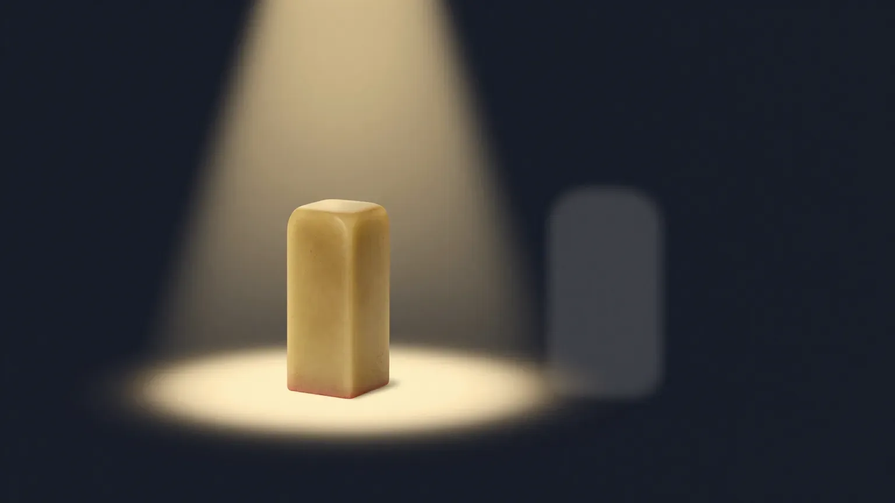
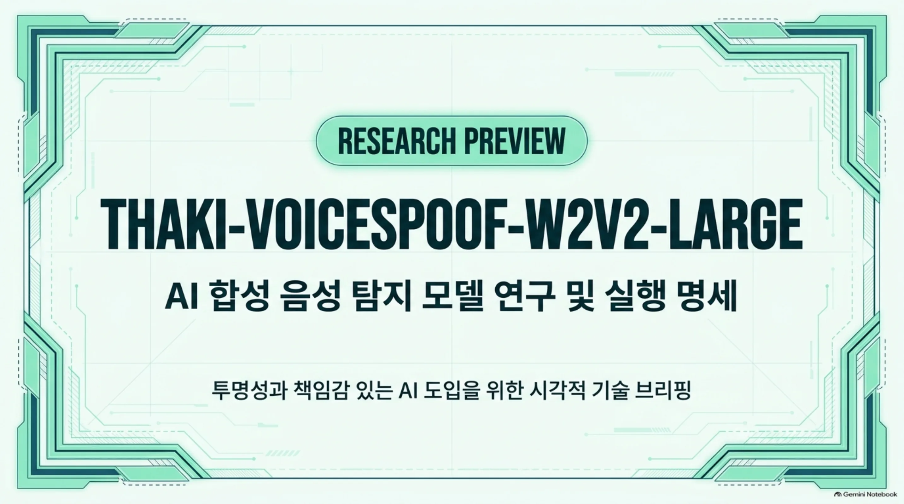
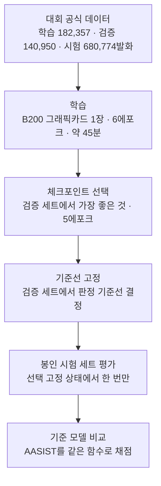
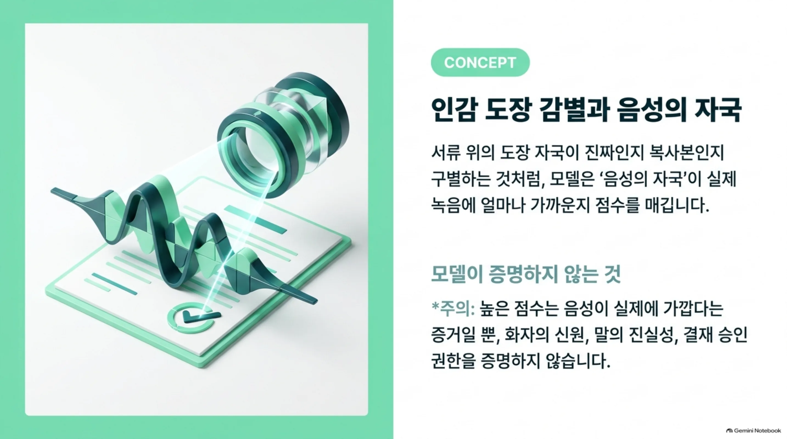
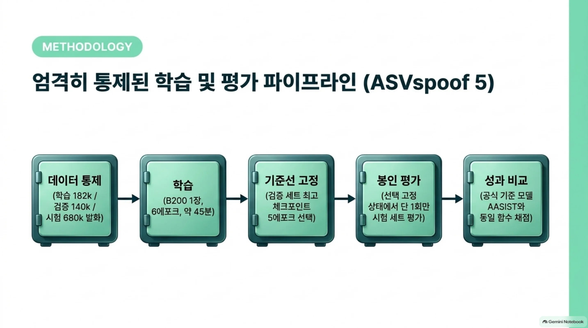
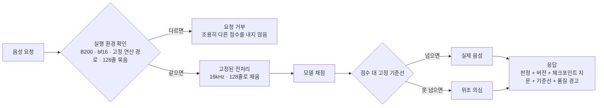
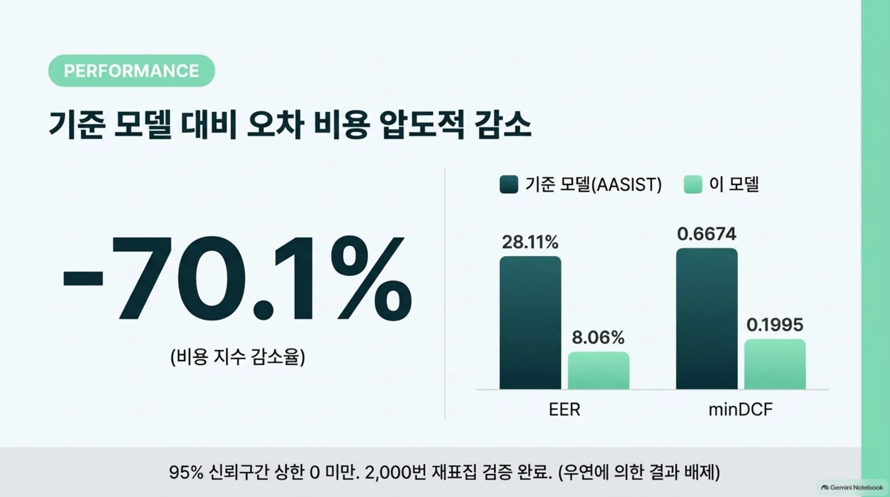

음성이 실제 녹음인지 합성인지를 판별하는 모델을 만들어 공개했습니다. 공개 시험에서는 기준선보다 오차 비용이 약 70퍼센트 낮았지만, 공개 전 재로드 검사에서 실패한 항목 하나를 지우지 않고 그대로 공개합니다. 모델을 학습해서 서비스에 올리는 일, 혹은 모델 결과를 업무에 쓰는 일을 맡고한다면 이 글을 읽을 가치가 있습니다.

AI가 만든 목소리는 사람의 목소리와 점점 비슷해지고 있습니다. 고객센터 전화에서 들은 목소리, 음성으로 들어온 결재 요청이 실제 사람의 말인지 확인해야 하는 일이 늘고 있습니다.

모델의 일은 단순합니다. 들어온 음성 하나에 점수 하나를 매기고 그 점수가 고정된 기준선을 넘으면 실제 음성으로 판정합니다. ThakiCloud는 이 모델을 공개 모델 공유 사이트에 연구 미리보기로 올렸습니다. 정식 이름은 Thaki-VoiceSpoof-W2V2-Large입니다.

*실제 도장 자국과 복사한 도장 자국의 차이를 살피는 일을 형상화한 이미지입니다.*

*2026년 11월 4일 기준: 연구 미리보기(Research Preview)로 공개했습니다(revision 093c7a1). 공개 전 검사 네 가지 중 세 가지는 통과했고 재로드 검사는 실패했습니다. 실패 기록은 지우지 않았고 공개는 검증한 실행 환경에 한정한 별도 예외 승인입니다. Metis 운영 배포와 Paxis 자동 실행 연동은 승인하지 않았습니다. 아래 Metis·Paxis 내용은 참조 설계입니다.*

## 쉽게 말하면

서류를 받는 창구를 생각해 보겠습니다. 직원이 서류 위의 도장이 진짜 인장에서 찍힌 것인지를 먼저 확인합니다. 진짜 도장과 복사해서 만든 도장의 자국은 미세하게 달라 보입니다. 경험 많은 직원은 그 차이로 구별합니다.

이 모델은 그 일을 목소리에서 합니다. 실제 녹음된 음성이 진짜 도장이고 합성하거나 변환한 음성이 복사한 도장입니다. 모델은 음성의 자국이 실제 녹음에 얼마나 가까운지를 보고 점수를 매깁니다.

직원이 확인하지 않는 것도 있습니다. 누가 도장을 찍었는지, 내용이 사실인지, 그 사람에게 서명 권한이 있는지까지입니다. 도장이 진짜여도 찍은 사람이 권한이 없으면 서류는 무효입니다. 모델도 같습니다. 높은 점수는 목소리가 실제 녹음에 가깝다는 것만 증명합니다. 화자의 신원과 말의 진실, 거래 승인 권한까지 증명하지는 않습니다.

## 무엇을 해봤나

모델은 공개 음성 위조 탐지 대회(ASVspoof 5)의 데이터로 학습했습니다. 대회는 학습 세트 182,357발화와 검증 세트 140,950발화, 시험 세트 680,774발화를 제공합니다. 시험 세트의 음성과 정답은 봉인되어 있어, 선택이 고정된 상태에서 한 번만 평가할 수 있습니다.

백본은 외부 음성 기반 모델(Wav2Vec2-Large)입니다. 파라미터는 약 3억 개입니다. 처음 계획한 백본은 사전학습에 쓴 외부 데이터가 대회 규칙에 맞지 않아 학습 전에 제외했습니다. 점수를 높이려고 바꾼 것이 아니라, 평가에 신뢰할 수 있는 데이터 계보를 지키기 위해서였습니다.

학습은 B200 그래픽카드 한 장에서 끝났습니다. 전체로는 6에포크, 34,188스텝, 약 45분입니다. 유한하지 않은 값이 나온 스텝은 0건이었습니다. 검증 세트에서 가장 좋은 체크포인트를 고르고 판정 기준선도 거기서 고정했습니다.

점수는 실제 음성 쪽 점수에서 위조 음성 쪽 점수를 뺀 값입니다. 이 점수가 고정된 기준선을 넘으면 실제 음성으로 판정합니다.

학습 전 데이터 무결성도 확인했습니다. 공식 파일 18개의 체크섬이 모두 맞았습니다. 학습 세트와 검증 세트의 완전 중복은 0건이었습니다. 시험 세트 음성과 정답은 따로 보관해 봉인했습니다.

기준선은 대회 공식 기준 모델(AASIST)입니다. 같은 평가 함수로 같은 세트에 점수를 매겨 두 모델이 같은 시험 지문에 응하게 했습니다.

*학습과 검증 세트로 모델을 배우고 고른 뒤, 봉인된 시험 세트에서는 선택을 고정하고 한 번만 평가했습니다.*
*처음 계획한 백본은 XLS-R 300M이며 사전학습 데이터(MLS)가 대회의 개방 조건 규칙에 맞지 않아 학습 전에 제외했습니다.*

## 나온 결과

### 전체 점수: 오차 비용 약 70퍼센트 낮음

결과를 보겠습니다. 오차 균형점(EER)은 실제 음성을 위조로 잘못 보내고 위조를 실제로 잘못 받는 두 오차가 마주하는 지점입니다. 낮을수록 오차가 적습니다. 탐지 비용 지수(minDCF)는 두 오차에 실제 업무의 불균형을 반영한 총 비용을 나타내며 낮을수록 좋습니다.

| 지표 | 기준 모델(AASIST) | 이 모델 |
|---|---:|---:|
| 검증 세트 EER | 15.20% | 4.07% |
| 검증 세트 minDCF | 0.3147 | 0.1045 |
| 봉인 시험 세트 EER | 28.11% | 8.06% |
| 봉인 시험 세트 minDCF | 0.6674 | 0.1995 |

봉인 시험 세트에서 비용 지수는 기준 모델보다 70.1퍼센트 낮았습니다.

이 차이가 우연인지 보기 위해 화자 737명 단위로 두 모델을 짝짓고 2,000번 재표집했습니다. 개선폭의 95퍼센트 신뢰구간은 전부 0 아래입니다.

미리 정해둔 두 관문(10퍼센트 이상 개선, 신뢰구간 상한이 0 미만)도 모두 통과했습니다.

즉, 사람 말로는 전체 오차 비용이 기준 모델의 약 3할 수준이고 그 차이가 우연일 가능성은 배제됩니다.

다만 조건은 같지 않습니다. 기준 모델은 대회 데이터만으로 학습한 폐쇄 조건이고 이 모델은 외부 음성 데이터로 사전학습한 개방 조건입니다. 그래서 "같은 데이터에서 70퍼센트 낫다"거나 "대회 최고 성능"이라고 말하지 않습니다. 이번 평가 프로토콜에서 두 시스템을 비교한 결과입니다.

### 평균이 가리는 약점

고정 기준선에서 위조 음성이 지나가는 비율은 공격 종류별로 크게 달라집니다.

| 공격 종류 | 위조 음성 통과율 | 해당 공격 EER |
|---|---:|---:|
| A28 | 25.9% | 14.2% |
| A19 | 21.4% | 12.3% |
| A27 | 21.4% | 11.3% |
| A31 | 20.0% | 11.5% |

가장 어려운 공격에서는 위조 음성이 네 개 중 하나꼴로 실제 음성으로 통과했습니다.

반대 방향의 오차도 있습니다. 전화 코덱을 거친 실제 사람의 음성이 위조로 잘못 판단된 비율은 10퍼센트를 넘습니다.

*코덱 C07, C10, C09에서는 실제 사람의 음성을 각각 13.9, 14.3, 12.9퍼센트 비율로 위조로 잘못 거부했습니다.*

점수 자체도 잘 보정된 확률이 아닙니다. 고정 기준선과 함께 써야 합니다.

*보정 지수(Cllr)는 검증 세트 5.09, 시험 세트 8.28입니다.*

즉, 사람 말로는 직원이 위조를 잡는 일은 전반적으로 잘하되, 위조가 더 교묘할수록, 진짜가 더 흐려질수록 헷갈리는 것입니다.

### 재로드 검사에서 실패한 것: 같은 가중치, 조금 다른 점수

공개 전 검사 네 가지 중 하나가 실패했습니다. 재로드 검사는 동결한 가중치를 새 프로세스에서 불러와 검증 세트 5,000발화를 채점하고 학습 실행이 남긴 점수와 비교합니다. 기준은 최대 차이가 1,000분의 1 이내이고 판정 일치율이 99.9퍼센트 이상인 것이었습니다.

결과는 실패입니다. 판정 일치율은 100퍼센트였지만 최대 차이는 저정밀 연산(bf16) 한 칸이었습니다. 원래 기준은 바꾸지 않았고 이 실패 기록은 지우지 않습니다.

*재로드 검사 세부: 최대 점수 차 0.125(bf16 한 칸), 기준 1e-3 이내. 점수가 달라진 클립은 2개였고 나머지 4건은 기준 점수 파일의 소수점 반올림이었습니다.*

원인을 좁히는 데 쓴 것은 읽기 전용 진단 하나입니다.

- 실제로 점수가 달라진 클립은 2개였고 둘 다 bf16 한 칸(0.125) 차이였습니다.
- 두 클립의 위치는 5,000개를 128개씩 나눈 뒤 남은 마지막 8개 묶음입니다. 학습 실행에서는 같은 클립이 128개짜리 완정 묶음 안에서 채점됐습니다.
- 묶음 구성을 같게 맞춘 채 채점하면 원본 점수가 그대로 재현됩니다. 독립 프로세스 세 번의 결과는 비트 단위로 일치합니다.
- 가중치, 입력, 연산 경로는 학습 경로와 동일합니다.

결론은 GPU의 무작위 변이가 아니라, 묶음(배치) 구성에 따라 결정적으로 달라지는 수치 차이입니다. 저정밀 연산에서는 같은 연산도 숫자를 어떻게 묶느냐에 따라 결과가 미세하게 달라질 수 있습니다.

진단 코드의 규칙 출력과 최종 원인 판정은 기록의 일부입니다. 둘 다 지우지 않습니다.

*규칙 출력은 IMPLEMENTATION_DEFECT이며 config의 메타데이터 두 필드(_name_or_path, dtype 표기)에만 걸렸습니다. 최종 원인 판정은 BF16_NUMERICAL_VARIATION_SUPPORTED, 세부 원인은 DETERMINISTIC_BATCH_SHAPE_SENSITIVITY입니다.*

진단에서 더 큰 사실도 나왔습니다. 수치 환경을 바꾸면 점수가 생각보다 많이 움직입니다.

| 바꾼 것 | 점수 변화(검증 세트 앞 5,000클립) | 판정 일치율 |
|---|---|---:|
| 묶음 형태(bf16) | bf16 한 칸(0.125) | 100% |
| 어텐션 연산 경로(flash, mem-efficient, math) | 최대 3.6, 3.5, 1.5점 | 100, 99.98, 100퍼센트 |
| 정밀도(fp32 또는 fp16, TF32 켜고 끄기) | 최대 약 8.9점 | 99.46퍼센트(27건 판정 반전) |

정밀도를 정밀 연산(fp32)으로 바꾸면 결과가 공개 수치와 같지 않습니다. 모델은 저정밀 연산(bf16)으로 학습하고 평가했으니, 공개 수치는 그 조건에서만 성립합니다. fp32와의 동등성은 주장하지 않습니다.

즉, 사람 말로는 점수는 고정한 검사 조명으로 본 모델의 읽힌 값이고 조명을 바꾸면 값이 달라집니다.

그래서 공개 판단을 재로드 검사와 분리했습니다. 1,000분의 1 기준을 실측 차이에 맞춰 느슨하게 하는 대신, 검증한 실행 환경을 명시하고 그 밖에서는 실행하지 않는 별도 공개 예외를 승인했습니다.

실행 계약은 다음과 같습니다. B200 그래픽카드, 저정밀 연산(bf16) 자동 정밀도, 고정된 어텐션 연산 경로, 128줄 고정 묶음(짧은 요청은 0으로 채우고 채운 행은 버림), 고정 소프트웨어 버전입니다. 이 중 하나만 달라도 추론 코드는 점수를 반환하지 않고 요청을 거부합니다.

*고정 버전: torch 2.9.0(cu130), CUDA 13.0, cuDNN 9.13, transformers 4.57.6.*

이 정책은 별도로 검증했습니다. 1개에서 512개까지 불규칙한 요청 크기로 보내도, 기준 파일의 반올림 범위 안에서 원본 점수가 그대로 나왔습니다.

*테스트한 요청 크기는 1, 7, 128, 300, 33, 512 등 불규칙한 크기입니다.*

재현 대상은 재로드 검사 부분집합 5,000클립과 별도 검증 세트 10,240클립입니다. 이 둘의 판정은 전부 일치했습니다. 독립 프로세스 두 번의 결과는 비트 단위로 일치합니다.

지원하지 않는 환경 17가지(정밀도, 연산 경로, CPU, 다른 그래픽카드와 버전)는 전부 거부됩니다. 이 검증은 공개 예외의 근거일 뿐, 재로드 검사의 실패를 바꾸지 않습니다.

봉인 시험 세트 680,774발화는 이 정책 아래 채점하지 않았습니다. '나온 결과' 첫 표의 시험 세트 수치는 정책을 정하기 전에 한 번 잰 원본 값입니다. 검증 세트에서는 고정 정책 점수와 학습 실행 점수가 일치했지만 시험 세트에서도 같은지는 확인하지 않았습니다.

공개된 체크포인트는 토큰 없이 내려받아 누구나 검증할 수 있습니다. 내려받은 체크포인트의 지문과 기준선은 공개 값과 일치합니다.

*지문(sha256)과 기준선(19.25)이 공개 값과 일치하며 검증한 환경을 벗어난 실행 조건 10가지는 모두 거부됩니다. 거부 시험 이후 지원 경로의 결과는 변하지 않았습니다.*

같은 환경에서 검증 세트 15,360발화를 채점하면, 학습 실행 점수와의 최대 차이는 5×10⁻⁹로 기준(1×10⁻⁸ 이하) 안에 놓입니다.

기준선 판정은 15,360건 전부 일치했습니다.

## 그래서 무엇을 바꾸면 되나

### Maxis: 학습보다 근거를 남기는 일

Maxis는 ThakiCloud의 학습과 파인튜닝 영역입니다. 이번 연구는 Maxis가 지향하는 재현 가능한 개발 과정의 사례입니다. 결과는 연구용 GPU 잡에서 나온 것이고 Maxis 제품과 끝까지 이어진 통합은 아닙니다.

| 항목 | 결과 |
|---|---|
| GPU | NVIDIA B200 1장 |
| 학습 | 6에포크, 34,188스텝, 약 45분 |
| 유한하지 않은 스텝 | 0 |
| 선택한 체크포인트 | 5에포크 |
| 검증 세트 minDCF | 0.1045 |
| 고정된 기준선 | 19.25 |

실패한 관문도 그대로 남겼습니다. 첫 검사에서는 백본 학습률이 워밍업 때문에 지나치게 낮아 두 개 가중치의 변화가 첫 스텝에서 아직 안 보입니다. 검사 대상 41개 매개변수는 0이 아닌 유한한 기울기를 받는 상태입니다. 원인을 진단한 뒤 첫 스텝 확인과 150스텝 누적 갱신 확인으로 검사 항목을 나누었고 개정한 검사는 재실행 한 번 만에 통과가 확인됩니다. 원래 실패 기록은 그대로입니다.

봉인 시험 세트 채점에서 저정밀 점수의 동점이 통계 계산을 한 번 멈추게 했습니다. 저장된 원본 점수는 그대로 두고 표본을 실제로 펼쳐 공식 평가 함수를 부르도록 코드를 고쳤습니다. 복구 이력은 별개의 기록입니다.

재로드 검사 실패를 다룬 방식도 같습니다. 실패 기록을 보존하고 원인을 한 번에 좁히고 새 판단은 별도 기록으로 남깁니다. 데이터 출처에서 학습 환경, 체크포인트, 독립 평가, 공개 관문까지 이어져야 모델을 재현하고 감사할 수 있습니다. 학습이 끝났다고 공개하거나 서비스에 올리지 않습니다.

### Metis: 실행 환경까지 포함한 추론 계약

Metis는 추론과 서빙 영역입니다. 모델은 텍스트를 생성하지 않으므로, Metis에서 쓰면 채팅 LLM이 아니라 음성 분류 전용 엔드포인트가 맞습니다.

*실행 환경이 계약과 다르면 요청을 거부합니다. 응답에는 판정과 함께 모델 버전, 체크포인트 지문, 기준선, 품질 경고를 담습니다.*

응답에는 실제 음성·위조 의심이라는 라벨만으로는 부족합니다. 모델 이름, 체크포인트 지문, 전처리 버전, 점수 방향, 기준선, 품질 경고를 함께 넣어야 합니다. 재로드 검사가 알려준 것은 수치 실행 환경도 계약에 들어가야 한다는 것입니다.

GPU 종류, 정밀도, 연산 경로, 묶음 정책이 바뀌면 같은 가중치라도 점수가 달라집니다. 실행 환경이 계약과 다르면 요청을 거부하는 쪽이, 조용히 다른 점수를 내는 것보다 안전합니다. 공개한 추론 코드는 그렇게 만들어졌습니다.

B200에서 4.04초 클립의 모델 추론 시간만 보면, 묶음 크기 1에서 50퍼센타일 지연이 11.6밀리초입니다.

묶음 크기 32에서는 16.1밀리초이고 피크 메모리는 3.18GiB입니다. 이 값들은 128개 채움 전의 원 모델 측정입니다.

공개본은 128줄 고정 묶음 정책을 쓰므로, 클립 하나 요청도 128줄 묶음으로 계산합니다. 같은 조건에서 클립 하나 요청은 53.5밀리초, 128클립 요청은 52.6밀리초였습니다.

피크 메모리는 9.14GiB입니다.

점수 재현성을 얻는 대가로 단건 지연이 약 4.6배 늘어난 셈입니다.

이 숫자들은 전화 통화 전체의 지연이 아닙니다. 음성 수신, 재샘플링, 네트워크, 대기, 후처리가 들어 있지 않습니다.

입력은 16킬로헤르츠, 64,600샘플로 고정되어 있어, 전화망 재샘플링, 짧은 음성 채움, 긴 음성 분할, 스트리밍이 연구 코드와 같은 결과를 내는지 따로 확인해야 합니다. 처리량, 동시성, 장애 시 동작도 재지 않았습니다.

Metis 서빙과 끝까지 이어지는 통합은 검증하지 않았고 Metis 운영 배포는 승인하지 않은 상태입니다.

### Paxis: 탐지는 실행 권한이 아니다

Paxis는 도구 실행, 업무 흐름, 정책과 승인을 다루는 에이전트 플랫폼입니다.

모델을 붙인다면 이런 시나리오가 있습니다. 음성으로 들어온 결재 요청이나 고객센터 변경 요청에서 합성음이 의심되면, 에이전트는 후속 업무를 바로 실행하지 않습니다. 추가 검증이나 담당자 검토가 필요한 사건으로 돌립니다.

| 계층 | 역할 |
|---|---|
| 모델 | 실제 음성·위조 음성 분류 점수 |
| Metis | 전처리, 버전, 실행 환경, 점수 계약을 갖춘 추론 서비스 |
| Paxis | 권한 검증, 사람 승인, 도구 실행과 감사 기록 |

흐름은 음성 기반 업무 요청, 모델 탐지, 업무 정책과 별도 인증, 담당자 검토, 승인된 도구 실행 또는 반려, 감사 기록 순서입니다. 구현을 마친 Paxis 작업이 아니라 참조 설계입니다.

도장이 진짜로 보여도 누가 찍었는지, 내용에 서명 권한이 있는지는 증명되지 않습니다. 높은 점수도 마찬가지입니다. 화자의 신원, 발화 내용의 진실성, 업무 권한을 증명하지 못합니다.

낮은 점수도 전화망이 정상 음성을 흐리게 해서 나온 결과일 수 있습니다. 탐지는 참고 증거로만 쓰고 실행 권한은 별도 정책과 사람 승인으로 다뤄야 합니다.

실제로 연결한다면 오차 균형점만이 아니라, 정상 사용자가 검토로 넘어간 비율, 잘못 승인된 업무 건수, 담당자 처리 시간, 정책 위반, 감사 기록의 완전성을 함께 봐야 합니다.

이 끝에서 끝 성과는 아직 재지 않았고 Paxis 연동도 검증하지 않았습니다. 탐지 점수로 업무를 자동으로 실행하는 연동은 승인하지 않았습니다.

## 못 믿을 부분

성능은 공개 대회 봉인 시험 세트에서 확인했습니다. 아직 확인하지 않은 것은 많습니다. 실제 전화망과 마이크, 한국어와 방언, 다른 정밀도의 실행 환경, 다양한 입력 길이의 스트리밍, 처리량과 동시성입니다.

Metis 서빙과 Paxis 업무 흐름과의 끝에서 끝 통합은 검증하지 않았고 Metis 운영 배포와 Paxis 자동 실행 연동은 승인하지 않았습니다.

시험 세트 수치는 실행 계약을 정하기 전에 한 번 잰 원본 값이며 계약 아래에서 재확인하지 않았습니다.

재로드 검사의 실패도 현재진행형입니다. 공개는 모든 검사를 통과한 것이 아니라, 검증한 실행 환경에 한정한 별도 예외 승인입니다.

모델 카드 첫 화면에는 검증한 실행 환경, 그 밖에서의 거부 동작, 추론 비용, 성능 한계, 평가 이력을 적었습니다. 저장소에는 추론 코드와 라이선스, 데이터 출처 고지가 함께 올라 있습니다.

대회 원천 음성, 발화별 라벨, 화자 정보는 올리지 않았습니다. 한국어 음성 위조 탐지는 독립적으로 검증하지 않았습니다.

*참고 자료: ASVspoof 5 평가 계획, 공식 ASVspoof 5 코드와 AASIST, Wav2Vec2-Large 모델 카드. 본문 수치는 2026년 11월 4일 공개 전 검사 판정과 재로드 검사 원인 진단 기록에 근거하며 공식 리더보드 순위가 아닙니다.*
