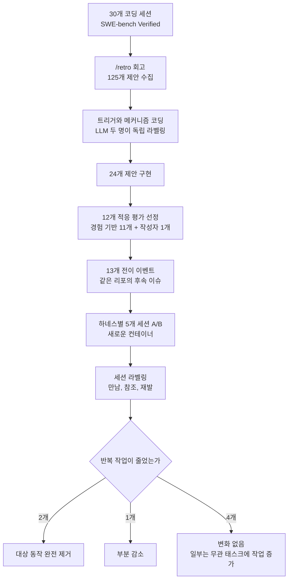

## 왜 읽어야 하나

코딩 에이전트를 운영하면서, 에이전트가 스스로 제안한 하네스 변경을 남겨 둘지 지울지 결정을 내려야 하는 분이라면 이 글을 읽어 보세요. 그 결정은 작지만 후속 비용은 큽니다. 효과가 없는 메모는 벽에 몇 달씩 남고, 다음 에이전트가 그대로 따르기 때문입니다. 이 논문의 핵심 결론은 한 문장으로 정리됩니다. 제안을 구현했다고 해서 반복 작업이 줄었다는 증거가 되는 것은 아닙니다. 유효한 전이 평가 7개 중, 대상 동작을 완전히 없앤 적응은 2개뿐이었습니다.

## 쉽게 말하면

프로젝트 회의가 끝나면 회의록 메모를 벽에 붙이는 일이 있습니다. "앞으로는 테스트는 bin/test로 돌려라" 같은 메모입니다. /retro 스킬이 코딩 에이전트에서 하는 일은 이와 닮아 있습니다. 세션이 끝나면 에이전트가 이번 세션에서 막힌 지점을 되짚어 보고, 하네스 변경 제안을 냅니다. 메모를 만들고, 벽에 붙이는 것, 즉 제안 생성과 구현은 어렵지 않습니다.

이 논문이 묻는 질문은 "벽에 붙인 메모가 다음 시프트에 실제로 먹히느냐"입니다. 연구진은 다음 에이전트가 같은 류의 작업을 두 번 시켜 봤습니다. 메모가 없는 세션과 메모가 있는 세션, 각각 5개씩. 그리고 두 쪽이 같은 자리에 몇 번 부딪혔는지를 세었습니다. 결론부터 말하면, 다음 시프트의 실제 작업과 맞았던 메모는 부딪힘을 줄였습니다. 맞지 않았던 메모는 효과가 없었고, 어떤 메모는 작업이 오히려 길어졌습니다.

## 개요

하네스 자가진화는 요즘 에이전트 엔지니어링에서 가장 뜨거운 주제 중 하나입니다. 에이전트가 완료한 세션의 경험에서 배운 것을 컨텍스트 파일, 훅, 설정 같은 하네스 자체에 반영하는 방식입니다. 모델을 다시 학습하지 않고도 에이전트가 쓸수록 좋아진다면, 운영자가 매 세션을 손으로 점검하는 비용은 크게 줄어듭니다.

그런데 "그것이 실제로 작동하는가"에 대한 직접적 증거는 거의 없었습니다. 대부분의 논의는 제안이 잘 만들어지는가, 파일이 잘 수정되는가까지만 측정했습니다. 나중에 온 세션에서 에이전트의 행동이 달라졌는지는 별개의 질문입니다. Treude와 Baltes의 논문이 바로 후자를 처음 실증으로 잰 연구입니다. arXiv 번호는 2610.34938이고, 2026년 10월 26일에 제출됐습니다.

연구 대상은 Matt Pocock의 스킬 저장소에 있는 /retro 스킬입니다. 세션이 끝나면 그 세션을 회고해서, 사람이 승인해야 하는 하네스 변경 제안을 번호 매겨서 내놓습니다. 연구는 Claude Code 2.1.295와 Opus 5.5 환경에서 SWE-bench Verified 이슈 30개를 돌려 진행했습니다.

논문 제출 다음 주, Matt Pocock 본인이 "역대 최고의 이슈 리포트일지도 모른다"며 이 논문을 전했습니다. 해당 트윗은 17만 뷰를 넘었습니다. 에이전트 생태계에서 "스스로 배우는 에이전트"가 마케팅 언어가 아니라 측정 대상이 되고 있다는 신호입니다.

> 📄 **심층 리뷰 전문(DOCX)**: 이 논문의 상세 피어리뷰를 [Google Drive에서 다운로드](https://drive.google.com/file/d/1Hkv5hCPpT7DFDkRiiNHnDFIZ_YztQiMg/view)할 수 있습니다.

## /retro 스킬이란

/retro 스킬의 목적은 회고입니다. 에이전트가 태스크를 끝낸 뒤, 세션 트레이스를 다시 읽고, 하네스 변경에 대한 번호 매김 제안 목록을 만듭니다. 제안의 대상은 CLAUDE.md 같은 컨텍스트 파일, 훅, 린트나 CI 설정 같은 지속 가능한 하네스 구성입니다. 중요한 설계는 모든 제안이 사람 승인을 거친다는 점입니다. 에이전트는 제안만 하고, 구현 여부는 사람이 갑니다.

논문은 이 스킬의 b0618bc 커밋 소스를 연구 대상으로 삼았습니다. 스킬 지침에는 주목할 규칙이 하나 있습니다. pre-commit 훅이 없고, 체크를 돌리는 CI 잡도 없는 리포지토리는 "찾은 문제(finding)"로 센다는 규칙입니다. 이 규칙이 제안의 성격을 좌우하는데, 결과 부분에서 다시 나옵니다.

## 연구 설계

연구는 두 단계로 나뉩니다. 먼저 30개 세션에서 제안을 모으고, 그중 구현된 적응을 후속 이슈로 옮겨 전이 평가를 하는 것입니다.

첫 단계의 30개 세션은 두 샘플로 구성됐습니다. 탐색 샘플 10개는 Django, SymPy, Matplotlib, Astropy, Sphinx에서 각각 2개씩, SWE-bench Verified의 "15분~1시간" 개발 노력 카테고리에서 무작위로 뽑았습니다. 두 번째 샘플 20개는 Astropy, pytest, Sphinx, SymPy에서 뽑았는데 무작위가 아닙니다. 앞선 세션에서 환경 문제를 겪은 리포지토리를 의도적으로 골랐습니다. 기존 테스트 실패, 린트 도구 부재 같은 문제가 실제로 재현되도록 하기 위해서입니다.

각 이슈는 새 Docker 컨테이너에서 새 세션으로 돌았습니다. 프롬프트에는 이슈 설명만 줬고, 추가 힌트는 넣지 않았습니다. 세션이 끝나면 같은 세션에 /retro를 이어 붙여 회고를 실행했고, 패스가 벤치마크에 통과했느냐와 무관하게 출력 그대로를 저장했습니다.

이 과정으로 제안 125개가 나왔고, 세션당 2개에서 6개였습니다. 각 제안은 고정된 코트북으로 두 명의 LLM 코더가 독립 코딩했습니다. 한 명은 전체 트레이스를 봤고(claude-fable-5-1), 다른 한 명은 발췌를 봤습니다(gpt-6.1-sol, 고이해력 설정). 트리거 코드의 일치도는 κ=0.67, 메커니즘 코드는 κ=0.84였고, 불일치한 91곳은 저자 1명이 해결했습니다.

제안이 구현·평가에 적격한 조건은 네 가지입니다. 경험 기반이어야 하고, 허용된 파일과 설정에 지속 하네스 변경을 제안해야 하며, 적용이 안전해야 하고, "나중 세션의 반복 작업을 식별하는 서술 기준"을 쓸 수 있어야 합니다. 이 조건을 통과한 제안은 33개였고, 그중 24개를 원본 세션의 컨테이너에서 구현했습니다. 구현 결과 다른 이슈에서 평가할 수 있는 적응이 11개 나왔습니다. 여기에 연구진이 직접 작성한 pre-commit 설정 1개가 더해져, 평가한 적응은 총 12개입니다.

전이 이벤트가 평가의 단위입니다. 각 적응마다 같은 리포의 다른 이슈를 고르고, 그 환경에서 대상 문제가 실제로 재현되는지 새 컨테이너에서 먼저 확인했습니다. 그런 뒤 원본 하네스로 5개 세션, 적응 하네스로 5개 세션을 돌렸습니다. 적응 3개는 무관한 컨트롤 태스크에서도 돌려, 작업을 추가하는지 확인했습니다. 120개 세션 트레이스는 LLM 라벨러 두 명과 저자 1명이 라벨링했고, 재발 라벨의 일치도는 κ=0.98이었습니다.

## 제안 125개는 어떤 모습이었나 (RQ1)

메커니즘 기준으로 가장 많은 것은 실행 가능한 체크(Executable check)로 38개였습니다. 그다음 순서는 내비게이션 포인터 24개, 지침(instruction) 21개, 정보 접근(information access) 20개, 도구 또는 설정 12개였고, 하네스를 바꾸지 않는 작업 지침(_none_)이 10개였습니다. 실행 가능한 체크의 가장 흔한 예는 staged 파일에 flake8을 돌리는 pre-commit 훅입니다.

트리거 기준으로 101개가 경험 기반이었습니다. 세션 트레이스에서 실제로 본 사건에 기반한 제안입니다. 19개는 선행 기반(prior-driven)이었고, 5개는 약한 연결이었습니다. 그런데 선행 기반 19개 중 18개가 린트 관련이었습니다. 앞서 나온 스킬 지침의 규칙 때문입니다. 린트 자동화가 없는 리포지토리는 finding으로 센다고 해서, 세션에서 린트 문제가 실제로 일어나지 않았어도 린트를 권합니다. 린트 관련 제안은 30개 세션 중 29개에서 43건 나왔고, 그중 23개가 경험 기반, 18개가 선행 기반, 2개가 약한 연결이었습니다.

즉, /retro의 출력은 세션 경험의 번역만이 아닙니다. 스킬 자체에 든 의견도 함께 실립니다. 이렇게 낸 실행 가능한 체크는 대부분 태스크 환경에서 동작하지 않았습니다. 38개 중 9개만이 제시된 그대로 실패를 보고할 수 있었고, 28개는 도구가 없거나 세션이 커밋을 하지 않아 절대 발화하지 않는 commit 훅이었습니다.

환경 문제의 재발 양상도 눈에 띱니다. 10개 탐색 세션 중 5개, 20개 두 번째 샘플 중 19개의 트레이스에 실패한 셸 명령, 반복된 셸 명령, 여러 테스트 러너가 나왔고, 대부분은 docutils나 Python 버전이 안 맞는 기존 테스트 실패, 낡은 leap-second 데이터, 린트 도구 부재 때문이었습니다. Claude Code는 30개 세션 중 15개에서 known-failures 파일을 제안했습니다. 이미 실패하는 테스트를 목록으로 적어 두면, 나중에 온 세션이 매번 베이스라인 대조를 다시 할 필요가 없다는 아이디어입니다.

## 반복 작업이 실제로 줄었는가 (RQ2)

전이 이벤트 13개 중 7개가 유효(informative)했습니다. 유효한 기준은, 원본 하네스 세션 5개 중 3개 이상이 대상 문제를 실제로 마주했다는 것입니다. 남은 5개 이벤트는 환경에 문제가 있었지만, 세션이 거의 부딪히지 않았습니다. 4개 이벤트는 원본 세션 0개, 1개 이벤트는 5개 중 1개만 문제를 만났습니다.

적응 2개가 대상 동작을 완전히 제거했습니다. 첫째는 SymPy의 CLAUDE.md 한 줄입니다. pytest가 설치돼 있지 않은데, 원본 세션 5개 전부에서 먼저 pytest를 시도했습니다. 적응 세션에서는 5개 중 0개. 벽 메모가 정확히 다음 시프트의 첫걸음에서 막히던 자리를 막았습니다. 둘째는 Astropy의 known-failures 파일입니다. leap-second 데이터 문제와 NumPy deprecation 실패 3개를 목록으로 적었습니다. 10개 세션 전부에서 이 실패 중 하나 이상에 부딪혔고, 적응 세션은 파일을 읽은 뒤 베이스라인 대조를 하지 않았습니다. 재발은 5개 중 3개에서 5개 중 0개로 줄었습니다.

4개 이벤트에서는 재발이 줄지 않았습니다. 공통 원인은 적응이 나중에 온 세션이 실제로 만난 인스턴스를 커버하지 못했다는 것입니다. Sphinx 파일 두 개는 실패하는 테스트 2개씩만 적었고, 나중 세션은 다른 테스트에서 실패를 만났습니다. SymPy 파일은 2개 패키지만 커버했는데, 세션은 다른 패키지를 테스트했습니다. pytest 파일은 한 테스트 파일의 실패 3개만 적었는데, 나중 세션은 다른 파일에서 실패를 만났습니다. 메모가 틀린 것이 아니라, 다음 시프트의 작업이 달라진 것입니다.

1개는 부분적으로 줄였습니다. Astropy의 cache 복구 플러그인과 비교 스크립트 조합으로 재발이 5개 중 5개에서 5개 중 2개로 줄었습니다. 다만 그 세션 어디에서도 대상이던 leap-second 실패를 만나지 못했고, 스크립트 목록에 없는 NumPy 실패를 만나 다시 "새 실패"로 처리했습니다.

컨트롤 태스크가 역방향의 증거를 냈습니다. Sphinx known-failures 파일 하나는 "목록에 없는 실패는 내 편집 탓으로 치르라"고 안내했습니다. 무관한 컨트롤 이슈에서는 적응 세션 5개 중 4개가 베이스라인 대조를 실행했고, 원본 하네스에서는 5개 중 0개였습니다. 불완전한 목록이 다음 에이전트를 덜 검증하게 한 것이 아니라, 더 검증하게 만든 것입니다. 메모를 따르면서 작업이 늘어난 경우입니다.

시간과 성공률은 일관되게 좋아지지 않았습니다. 태스크 성공은 모든 이벤트에서 하네스 간 차이가 1개 세션 이내였고, 향상된 일관된 증거는 없었습니다. SymPy CLAUDE.md 적응은 중앙값 시간을 88초에서 156초로 늘렸습니다. pytest 한 줄을 막은 대신, 마무리 전 CI 린트 체크를 돌리라는 두 번째 줄을 함께 실었고, 적응 세션은 전부 그걸 돌렸습니다. 재발이 줄어도, 메모가 지시를 추가하면 세션은 길어질 수 있습니다.

## 한계 및 반론

저자들이 스스로 밝힌 한계가 있습니다. 첫째, 전이 이슈는 대상 문제를 재현하도록 의도적으로 고른 것입니다. 그러므로 이 연구가 잰 것은 "문제가 생기는 곳에서 적응이 먹히는 빈도"이지, "임의의 나중에 온 이슈에서 도움이 되는 빈도"가 아닙니다. 7개 중 2개를 일반적인 성공률로 읽으면 과대평가입니다.

둘째, 표본이 작습니다. 하네스당 5개 세션, 유효 이벤트 7개. 논문 테이블의 수치는 이 사례들을 기술하고, "만난 문제를 커버했는가"가 유일한 원인이라고 확정하지도 못합니다. 12개 적응은 여러 성격을 동시에 달리하고, 라벨링 후에야 그룹이 나뉘었습니다.

셋째, 적응을 구현한 쪽이 제안을 낸 원래 세션과 같은 컨테이너입니다. 변경된 파일에 제안 텍스트에 없는 정보가 섞였을 수 있고, 라벨러는 세션이 옮겨 온 파일을 읽는 흔적을 트레이스에서 볼 수 있어 완전 블라인드도 아닙니다.

범위도 한 곳입니다. 에이전트 하나, 스킬 버전 하나, 환경 문제만. 코드 탐색이나 코딩 컨벤션 적응은 평가되지 않았고, 번들된 적응의 구성 요소를 하나씩 분리해서 잰 것도 아닙니다.

## ThakiCloud 제품 적용 시사점

이 논문은 Paxis의 자가진화 루프가 정면으로 받습니다. Paxis는 Skills, Tools, Policies, Audit Logs를 일급 리소스로 다루는 Agent-Native Cloud입니다. 완료된 세션을 회고해 스킬과 하네스 변경을 제안하고, 승인된 것을 다음 세션에 반영하는 구조는 /retro와 같은 형상입니다. 이 논문이 보여주는 것은, 그 형상의 절반만 갖춰도 작동하는 것처럼 보인다는 사실입니다. 생성과 구현은 증명했고, 검증과 폐기는 아직입니다.

논문의 평가 레시피는 세 개의 질문으로 옮겨 쓸 수 있습니다. 대상 문제가 나중에 온 세션에서 실제로 일어났는가. 에이전트가 그 변경을 참조했는가. 행동이 달라졌는가. Paxis의 스킬 승격 게이트에 이 세 질문에 답하는 A/B 전이 평가를 넣을 수 있습니다. 새로운 스킬을 적용한 세션과 하지 않은 세션을 같은 류의 태스크로 5개 이상씩, 새 세션에서 돌리고, 재발이 줄어야 승격합니다.

컨트롤 태스크도 빼면 안 됩니다. 어떤 메모는 무관한 태스크에서 작업을 늘렸기 때문입니다. 승격 전에 무관 이슈 1~2개를 함께 측정하고, 검증 시간이 늘면 승격하지 않습니다.

제안 시점의 실행 가능성 검증도 교훈입니다. 실행 가능한 체크 38개 중 29개가 도구가 없거나 커밋이 없어 절대 발화하지 못했습니다. 스킬 진화 루프가 체크를 제안할 때, 지금 환경에서 불릴 수 있는지를 정적으로 확인하는 단계가 앞에 있어야 합니다.

이 논문에서 추출한 액션 아이템 3개는 리뷰 레저에 기록돼 있고(applied=queued), 사람 리뷰 대기 상태입니다. 스킬 진화 루프의 변경 제안에 A/B 전이 평가 단계를 추가하는 것, 무관 태스크 컨트롤 1~2개를 추가하는 것, 제안 시점의 실행 가능 정적 검증을 넣는 것입니다.

Metis를 쓰는 고객 환경에도 같은 교훈이 적용됩니다. known-failures 파일이나 특정 환경을 가정한 CLAUDE.md 줄은 시간이 지나면 낡는 메모입니다. 환경은 변하고 메모는 그대로면, 다음 에이전트가 옛 메모를 따릅니다. 남은 변경은 한 번의 리뷰가 아니라, 지속적인 평가가 필요합니다.

## 정리

벽 메모 비유로 끝내면, 이 논문은 "에이전트가 스스로 쓴 메모가 실제로 먹는지"를 처음 잰 연구입니다. 답은 단순하지 않습니다. 다음 시프트의 실제 작업과 맞던 메모 2개는 대상 동작을 완전히 없앴고, 맞지 않던 메모 4개는 효과가 없었으며, 1개는 무관한 태스크에 작업을 더했습니다. 125개 제안은 모두 그럴듯했고, 구현도 매끄러웠습니다. 행동이 바뀐 것은 그중 소수였습니다.

자가진화 에이전트를 만드는 사람이라면, 다음 단계는 더 많은 제안을 생성하는 것이 아니라 검증 단계를 세우는 것입니다. 변경을 벽에 남기기 전에 세 가지를 답하세요. 대상 문제가 일어났는가, 에이전트가 참조했는가, 행동이 달라졌는가. 세 질문에 답이 없는 메모는 벽에 두지 않는 것이 낫습니다. 그리고 한 번 붙인 메모도 주기적으로 다시 평가해, 효과가 사라진 메모는 고치거나 떼어 내야 합니다. 하네스 자가진화는 제안이 나오는 순간이 아니라, 이 검증 루프가 닫혔을 때 비로소 시작됩니다.

## 출처

- [arXiv 2610.34938, How Do Coding-Agent Harnesses Self-Evolve? An Empirical Study of Retrospective Adaptation](https://arxiv.org/abs/2610.34938) (PDF: <https://arxiv.org/pdf/2610.34938>)
- [연구 산출물 아티팩트 (Zenodo)](https://zenodo.org/records/23653700): 프롬프트, 코트북, 세션 트레이스, 라벨, 하네스 변경 전체
- [/retro 스킬 소스 (github.com/mattpocock/skills)](https://github.com/mattpocock/skills)
- [Matt Pocock의 트윗](https://x.com/mattpocockuk/status/2117588845864575397): "This might be the greatest issue report in history"

> 📄 **심층 리뷰 전문(DOCX)**: 이 논문의 상세 피어리뷰를 [Google Drive에서 다운로드](https://drive.google.com/file/d/1Hkv5hCPpT7DFDkRiiNHnDFIZ_YztQiMg/view)할 수 있습니다.
