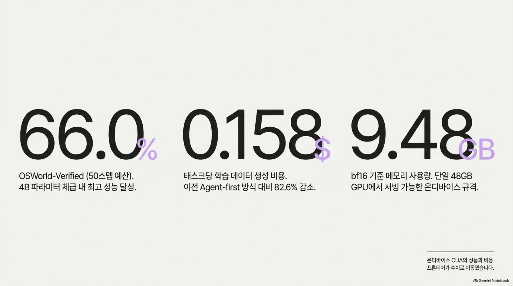
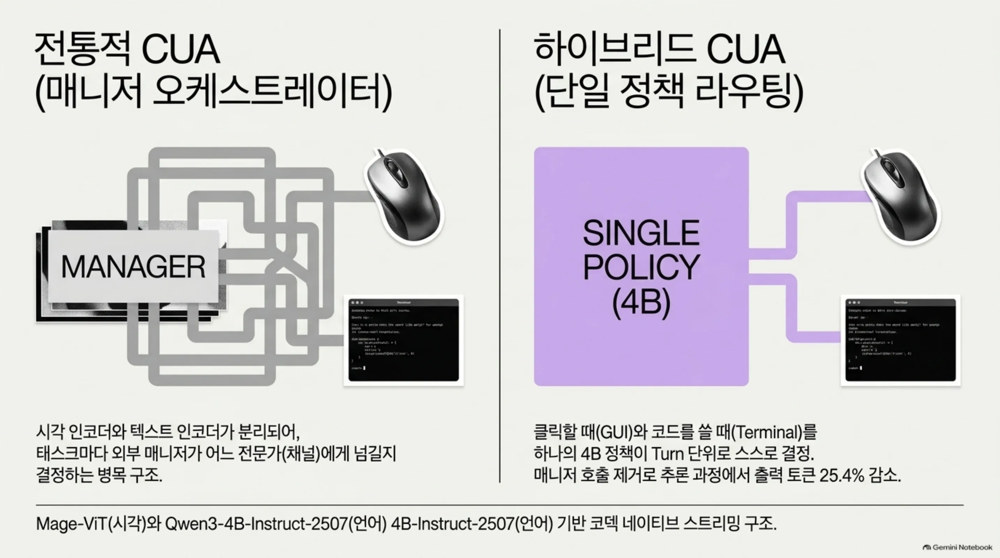
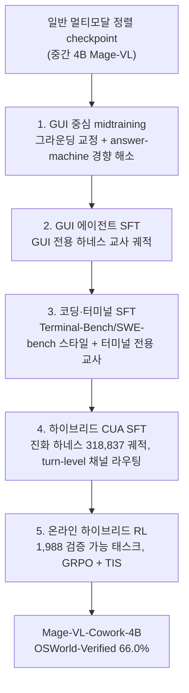
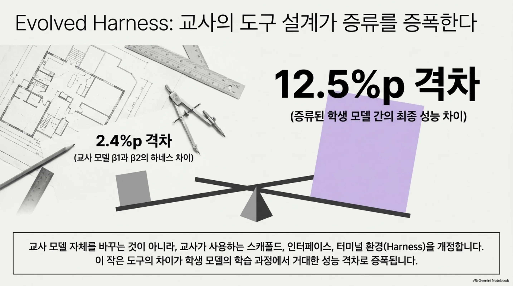
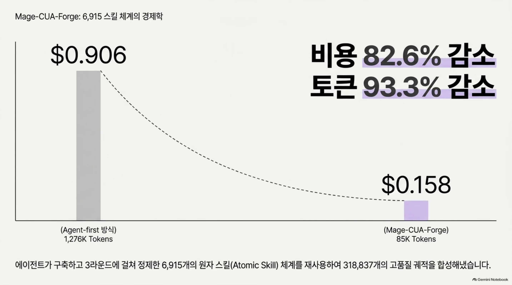
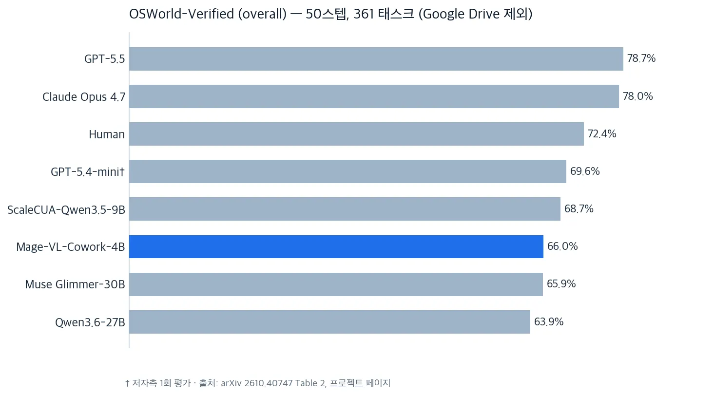
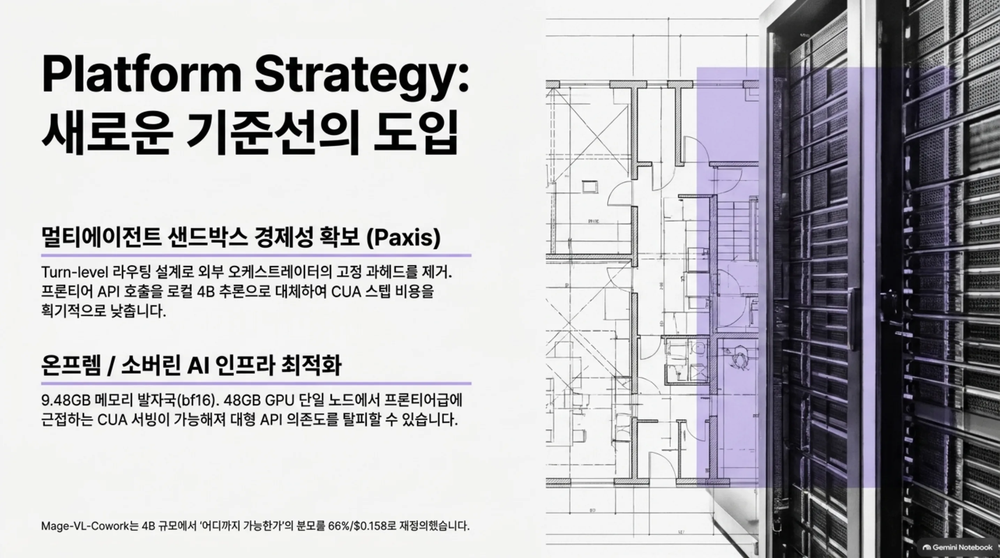
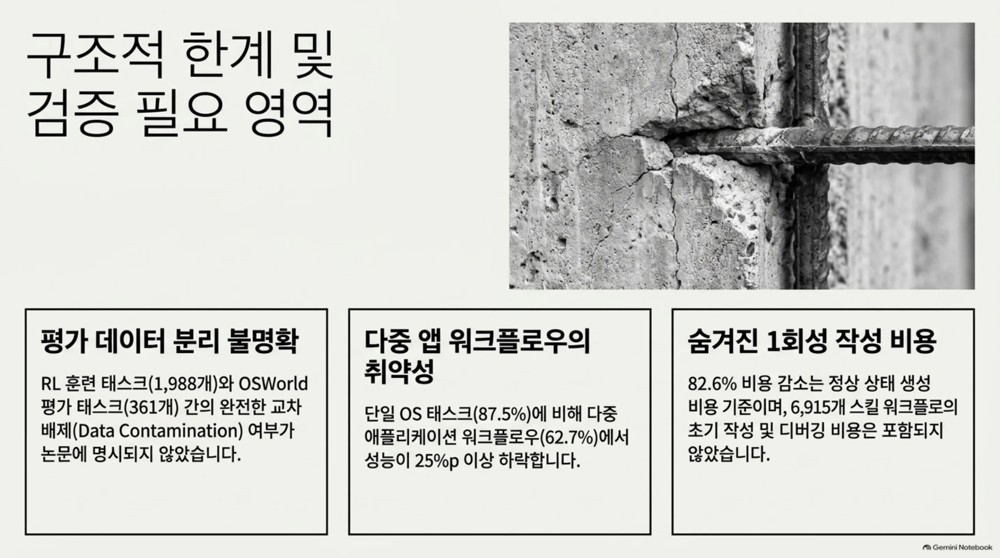

*클릭과 타이핑, 두 채널을 한 정책이 쓴다는 설계 개념을 형상화했습니다.*

> 📄 **심층 리뷰 전문(DOCX)**: 이 논문의 상세 피어리뷰를 [Google Drive에서 다운로드](https://drive.google.com/file/d/1d8Y4QKEFHl9DHmWRhub30Wc6ngn5_TVf/view)할 수 있습니다.

## 왜 읽어야 하나

멀티에이전트 샌드박스를 운영하는 에이전트 플랫폼 엔지니어, 온프렘·소버린 AI 인프라를 계획하는 담당자라면, 다음 CUA(computer-use agent) 로드맵을 세우기 전에 이 논문을 읽어야 합니다.

핵결을 선단정합니다. Microsoft는 4B 오픈웨이트 모델이 화면 클릭(GUI 채널)과 터미널 타이핑(코드 채널)을 단일 정책 안에서 스스로 라우팅하도록 만드는 완전한 훈련 레시피를, 모델과 함께 Apache-2.0으로 공개했습니다. OSWorld-Verified 66.0%(50스텝 예산)로 4B급 최고 성능이고 학습 데몬스트레이션의 태스크당 생성 비용은 $0.158입니다. 온디바이스 CUA의 기준선이 수치로 이동한 사건입니다.

## 쉽게 말하면

두 손을 모두 쓰는 한 명을 상상해 보세요. 지금까지 컴퓨터 에이전트는 두 명의 전담 전문가로 나뉘어 있었습니다. 마우스를 들고 화면을 보는 전문가, 그리고 코드를 쓰고 터미널에 타이핑하는 전문가. 태스크가 오면 매니저(외부 오케스트레이터)가 어느 전문가에게 넘길지 정했습니다.

Mage-VL-Cowork는 그 구조를 없애는 모델입니다. 한 명의 작업자가, 작업 도중에 스스로 "이건 클릭하면 된다", "이건 코드로 풀면 빠르다"를 결정합니다. 매니저 호출이 사라지는 만큼, 한 태스크당 걸리는 모델 호출과 토큰도 줄어듭니다.

이 비유를 끝까지 써 가겠습니다. 이 작업자를 가르치는 선배(교사 모델)는, 교재가 아니라 자기 작업 도구를 먼저 고칩니다. 도구가 좋아야 데모가 좋아지니까요. 선배가 쓰는 스크린, 도구 버튼, 안내문, 작업대(터미널 환경)를 개선한 뒤, 그 선배가 만든 데모를 작업자에게 따라 하도록 시킵니다. 선배의 도구가 조금 달라질 뿐인데, 따라 배운 작업자의 실력은 크게 갈립니다. 이 논문의 5단계 커리큘럼, 교사의 하네스 진화, 6,915개 스킬 체계는 전부 이 한 명의 작업자를 만들어내는 레시피입니다.

## 개요

Microsoft Mage 팀이 2026년 10월 29일 arXiv 2610.40747에 논문을 올렸고 모델은 Hugging Face(microsoft/Mage-VL-Cowork)에 Apache-2.0 오픈웨이트로 공개되어 있습니다. 4B 파라미터, bf16 기준 9.48GB(2 샤드). 코드는 GitHub microsoft/Mage 저장소에 있습니다.

백본 구성을 짚겠습니다. Mage-VL-Cowork는 Mage-VL, 즉 codec-native 스트리밍 멀티모달 foundation model 위에 서 있습니다. 시각 인코더 Mage-ViT는 from-scratch로 학습했고(16×16 patch grid, spatial_merge_size=2, 3D RoPE), 언어 모델은 Qwen3-4B-Instruct-2507입니다. 4B 규모에서 시각 스택을 새로 학습했다는 점이, 기존 비전 인코더를 붙이는 것과 구별되는 지점입니다.

출고와 함께 데모도 붙었습니다. Hugging Face ML 엔지니어 Niels Rogge가 만들어 공개한 데모는, "위키피디아에 가서 에펠탑이 완공된 시기를 찾아라" 같은 태스크를 던지면, 모델이 실제 Linux 데스크톱 위에서 클릭하고 타이핑하고 스크롤하고 터미널을 쓰는 것을 보여주는 것입니다. 구성은 전부 Hugging Face 안에서 도는 것입니다. 모델은 HF Space, 데스크톱은 HF Sandbox. 관리할 VM이 없다는 것이 트윗의 표현입니다. 4B 규모 CUA가 공개되자마자 실용 데모까지 닿았다는 것이, 이번 출고의 체감입니다.

*한눈에 보는 핵심 수치. OSWorld-Verified 66.0%(50스텝 예산), 태스크당 데이터 생성 비용 $0.158(−82.6%), bf16 9.48GB의 온디바이스 서빙 발자국.*

## 하이브리드 컴퓨터 유즈란 무엇인가

전통적인 CUA는 스크린샷을 받아 클릭·드래그 좌표를 출력합니다. 논문의 표현에 따르면, 스크린샷 전용 GUI 채널은 도메인의 속성이 아니라 "모델링 선택"이고 보통의 스크린샷 하나가 수천 토큰을 먹는 비싼 선택입니다. 화면을 계속 보며 동작할수록, 그 수천 토큰이 매 스텝마다 반복됩니다. 터미널 채널은 같은 상태를 한 줄의 출력으로 압축할 수 있습니다. 채널 라우팅의 이득은 정확히 이 토큰 격차에서 나옵니다. RL 이후 출력 토큰 25.4% 감소(후술)는, 이 설계가 추론 비용으로 환산되는 것을 보여주는 수치입니다.

하이브리드 컴퓨터 유즈는 하나의 정책이 두 채널을 모두 가진 것입니다. GUI 채널(시각 관찰 + 좌표 제어)과 터미널 채널(영속 셸 환경, 코드 실행, 커맨드라인 유틸리티 호출, 애플리케이션 라이브러리 직접 호출). 핵심 설계는 채널 라우팅을 외부 오케스트레이터가 아니라 정책 내부, turn 단위로 학습시킨다는 것입니다. 프로젝트 페이지의 표현을 그대로 쓰면 "클릭할 때와 코드를 쓸 때를 아는 4B 정책 하나"입니다.

*전통적 CUA는 외부 매니저가 두 전문가 채널을 골라 넘기지만 하이브리드 CUA는 단일 4B 정책이 turn 단위로 GUI와 터미널을 스스로 결정합니다. 매니저 호출 제거로 출력 토큰이 25.4% 줄어드는 지점.*

학습 데이터에서 GUI 도구 호출과 터미널 도구 호출의 비율은 68.19% 대 31.81%입니다. 한 채널로 몰린 데이터가 아니라, 태스크에 따라 채널이 배분되는 데이터를 학습합니다.

## 5단계 훈련 레시피

커리큘럼은 5단계이고 일반 멀티모달 정렬 checkpoint에서 시작합니다. 프론티어 모델을 증류하는 것이 아니라, 채널 능력을 단계별로 쌓아 올리는 구조입니다. midtraining과 SFT는 2에폭, 32,768 토큰 패킹으로 학습합니다.

*5단계 커리큘럼. 한 채널씩 익힌 뒤 두 채널을 동시에 쓰는 단일 정책으로 수렴하고 마지막 RL에서 검증 가능한 보상으로 정제합니다.*

각 단계를 보면 다음과 같습니다.

1단계 GUI 중심 midtraining은 answer-machine 경향을 교정합니다. 질문에는 답하지만 조작은 하지 않는 패턴이죠. UGround, UI-E2I-Synth, OS-Atlas, MolmoWeb, JEDI, SeeClick 그라운딩 코퍼스를 720p~1080p로 필터링하고 좌표를 [0,999]로 정규화한 `computer_use` 클릭 호출로 학습합니다.

2단계 GUI 에이전트 SFT는 GUI 전용 하네스의 교사 궤적으로 멀티스텝 GUI 실행을 배우게 합니다. 나중에 두 채널 중 하나를 "선택"하게 하려면, 먼저 두 채널 모두에서 능력이 있어야 한다는 논리입니다.

3단계 코딩·터미널 SFT는 Terminal-Bench 스타일과 SWE-bench 스타일 데이터에, 같은 데스크톱 태스크를 터미널 전용 교사 하네스로 돌린 궤적을 덧붙입니다.

4단계 하이브리드 CUA SFT는 진화한 하이브리드 하네스로 만든 318,837개 궤적으로 turn-level 채널 라우팅을 학습합니다.

5단계 온라인 하이브리드 RL은 ScaleCUA가 공개한 1,988개 태스크(각각 검증 가능한 보상이 짝으로 주어짐)에서 학습합니다. frontier sampling, GRPO 최적화, 비동기 rollout, TIS(truncated importance sampling)로 정책 지연을 제어합니다(정책 지연 상한 3 업데이트, TIS 가중치 상한 2.0). 각 rollout은 OSWorld-Verified 평가와 같은 50스텝 예산을 씁니다.

### 교사가 쓰는 도구도 진화한다 (evolved harnesses)

이 레시피의 가장 독특한 부분입니다. 교사(데몬스트레이션 생성 모델)는 고정된 환경에서 태스크를 푸는 것이 아닙니다. authoring 에이전트가 교사가 쓰는 하네스를 개정합니다. 하네스는 스캐폴드(F), 도구 인터페이스(T), 프롬프트(P), 터미널 실행 환경(E, Docker 샌드박스)의 네 구성요소입니다.

개정 기준은 공유 dev set 위의 네 가지입니다. rubric 기반 태스크 성공률, 태스크당 토큰 비용, 실행 피드백, 앱별 채널 통계. 논문에 따르면 진화는 성장만큼이나 제거입니다. xdotool을 빼고 python-pptx 같은 도메인 라이브러리를 넣습니다. 하네스 전환은 α→β(터미널 채널 추가)→γ(스캐폴드)→δ(교사 모델 교체)→ε(프롬프트 정제) 순서이고 한번 선택된 하네스는 이후 데이터 생성 라운드에서 사실상 고정됩니다.

교사 스택은 프롬프트 한 줄이 아닙니다. 데몬스트레이션 교사는 GPT-5.4(공식 GPT-5.4 OSWorld 에이전트), 스텝별 reasoning 어노테이션은 GPT-5.4-mini, rubric 판단자와 태스크 생성 비용 비교는 gpt-5.6-terra입니다.

*교사가 쓰는 도구 설계(하네스)의 격차는 2.4pp, 그런데 그 교사로 증류한 학생 모델의 격차는 12.5pp로 증폭됩니다. 교사의 스캐폴드·인터페이스·터미널 환경이 교사 모델 그 자체보다 더 큰 변수라는 뜻.*

### 데이터 생성 인프라 (Mage-CUA-Forge)

293,806개 데스크톱·웹 태스크는 6,915개 원자 스킬 체계 위에서 합성됩니다. 스킬 체계는 에이전트가 구축했고 학생 피드백을 반영해 3라운드 정제되었습니다. 단일 앱 61.76%, 다 앱 38.24%. 교사 실행 + rubric 기반 LLM 판단 + 품질 필터링을 거쳐 318,837개 궤적이 남습니다.

비용 효율이 이 인프라의 핵심 성과입니다. 태스크당 생성 비용이 agent-first 방식 $0.906(1,276K tokens)에서 Mage-CUA-Forge $0.158(85K tokens)로, 82.6% 감소(토큰 −93.3%). 단, 1회성 워크플로 작성·디버깅 비용은 태스크당 비교에서 제외됩니다.

*6,915개 원자 스킬 체계 재사용으로 318,837개 궤적을 합성하며 태스크당 생성 비용이 agent-first $0.906에서 $0.158로(−82.6%, 토큰 −93.3%) 내려옵니다.*

## 결과

OSWorld-Verified는 66.0%(50스텝 예산). 361개 held-out 태스크(Google Drive 제외)의 2회 실행 평균(run 1: 65.33%, run 2: 66.75%)입니다. 논문 Table 2의 비교군은 다음 표입니다.

| 모델 | OSWorld-Verified (overall) | 비고 |
|---|---|---|
| GPT-5.5 | 78.7 | 프론티어 API |
| Claude Opus 4.7 | 78.0 | 프론티어 API |
| Human | 72.4 | |
| ScaleCUA-Qwen3.5-9B | 68.7 | 50스텝 |
| **Mage-VL-Cowork-4B** | **66.0** | 50스텝, 4B급 최고 |
| Muse Glimmer-30B | 65.9 | |
| Qwen3.6-27B | 63.9 | |
| Fara1.5-4B | 13.9 | 같은 4B 대조군 |

*arXiv 2610.40747 Table 2 비교군. Mage-VL-Cowork-4B(66.0%)가 파랑으로 강조되어 있습니다. †는 저자측 1회 평가를 뜻합니다.*

단계별 진행은 균등합니다. GUI SFT 45.56% → 하이브리드 SFT 55.84%(+10.28pp) → RL 66.0%(+10.16pp). SFT가 쌓는 것과 RL이 정제하는 것의 기여가 비슷합니다.

연산량 분해도 보고됩니다(부록 B). midtraining 1.182e21, SFT 3.988e21, RL 2.618e21 FLOP, 합계 7.787e21. 비중은 midtraining 15.2%, SFT 51.2%, RL 33.6%. 성능의 절반이 SFT, 그리고 RL이 1/3을 맡는다는 분배입니다.

1단계 midtraining의 그라운딩 효과도 보고됩니다. OSWorld-G 30.6% → 56.9%(Qwen3.5-4B 54.5%와 비교), ScreenSpot-v2 78.8% → 87.2%(Qwen3-VL-4B 85.3%와 비교).

RL은 성능만 올리지 않습니다. 평균 모델 호출 25.36(GUI SFT) → 21.57(하이브리드 SFT) → 18.77(RL), 출력 토큰 약 25.4% 감소(5,499/태스크). 성능 +10.16pp와 효율 향상이 같은 단계에서 함께 옵니다.

카테고리별은 Operating system 87.5%, Office 64.9%, Daily 65.0%, Professional 66.3%, Multi-application workflow 62.7%입니다. 단일 앱 OS 태스크가 다 앱 워크플로우보다 현저히 강합니다.

WebVoyager-Static(셀프빌트 오프라인 리플리카, 643 태스크)은 58.6%(377/643)인데, SFT 체크포인트 기준입니다. RL 후 모델이 아닙니다.

하네스 ablation(Table 5, 672 held-out 다 앱 태스크)은 이 논문의 설계 논리를 뒷받침합니다. 교사 β1(GUI+코딩) 92.0% 대 교사 β2(GUI+코딩+AX) 89.6%, 2.4pp 격차. 그런데 β1에서 증류한 학생 37.6%, β2에서 증류한 학생 25.1%, 12.5pp 격차로 확대됩니다. 교사의 하네스 차이는 증류 과정에서 증폭된다는 뜻입니다.

## SOTA claim과 그 범위

트윗의 "new SOTA for on-device computer use" 표현은, 논문 원문의 "state-of-the-art performance at its parameter size"보다 넓습니다. 정밀하게 쓰면, 4B급 파라미터 사이즈 내의 SOTA입니다. 같은 4B 대조군 Fara1.5-4B(13.9%)를 큰 폭으로 상회하지만 30B Muse Glimmer(65.9%)와는 사실상 동점이고 프론티어 API(GPT-5.5 78.7%, Claude Opus 4.7 78.0%)와는 12~13pp 차이가 남습니다. 사람(72.4%)도 여전히 위입니다.

참고로 논문은 GPT-5.4-mini를 같은 361 태스크에서 1회 자체 평가했는데, 69.6%(50스텝)입니다. 프론티어 미니 모델과의 격차는 3.6pp로, 대형 프론티어 격차(12~13pp)보다 훨씬 좁습니다. "온디바이스 SOTA"를 읽을 때는 이 두 범위를 함께 읽어야 합니다.

## ThakiCloud 제품 적용 시사점

Paxis 렌즈에서 보면, 이 레시피가 남기는 수치는 멀티에이전트 샌드박스의 CUA 스텝 경제성 계산에 새 입력값입니다. turn-level 채널 라우팅(외부 오케스트레이터 제거) 설계는, Paxis 멀티채널 도구 에이전트(GUI+API+CLI)에 직접 이식 가능한 패턴입니다. 오케스트레이터 호출이라는 고정 과헤드를 정책 내부로 옮기는 설계이니까요. 태스크당 생성 비용 $0.158에 4B 서빙(9.48GB bf16)을 더하면, 프론티어 API 호출로 대체할 수 있는 CUA 스텝의 비용-품질 프론티어가 수치로 확보됩니다. Niels Rogge가 HF Space + HF Sandbox로 공개한 데모(모델과 데스크톱 전부 Hugging Face 안, VM 관리 없음)는, Paxis의 샌드박스 격리 실행을 온디바이스 규모로 내려온 시나리오입니다. Paxis 샌드박스 데모에 Mage-VL-Cowork를 올려 실측하면, "프론티어 API vs 로컬 4B" CUA 경제성이 내부 데이터로 확정됩니다.

ai-platform 렌즈에서 보면, 온프렘·소버린 AI의 CUA 구성에 프로덕션 후보 기준선이 생겼습니다. 66% OSWorld-Verified, 9.48GB bf16, Apache-2.0. 48GB급 GPU 한 장으로 서빙 가능한 CUA는, 대형 프론티어 API 의존을 줄이는 온프렘 구성의 구체적 옵션이 됩니다. 온디바이스 소형 CUA 흐름은 ai-platform의 대형 GPU 의존을 낮추는 방향과 일치합니다.

*ThakiCloud 관점의 두 시사점. Paxis의 오케스트레이터 고정 과헤드를 turn-level 라우팅으로 줄여 CUA 스텝 경제성을 확보하는 것, 그리고 48GB급 GPU 단일 노드에서의 온프렘·소버린 CUA 서빙.*

## 한계 및 반론

첫째, 수치의 출처가 Microsoft의 발표 페이지와 모델 카드입니다. 제3자 독립 평가는 아직 없습니다. 66.0%는 저자 측 2회 실행 평균이며 OSWorld-Verified에서 Google Drive 태스크는 제외됩니다.

둘째, RL 학습셋과 평가셋의 분리 문제가 명시되지 않습니다. RL은 ScaleCUA 공개 1,988개 태스크로 훈련하고 OSWorld-Verified 361개 held-out으로 평가합니다. 두 집합이 교차하지 않는다는 선언은 논문이 하지 않습니다. CUA 벤치마크 생태계에서 데이터 오염 질문은 상시적이며 이 논문은 답하지 않는 편입니다.

셋째, 판단 모델의 이중 역할입니다. rubric 판단자와 태스크 생성 비용 베이스라인이 같은 gpt-5.6-terra입니다. 판단자 편향에 대한 분석은 없으며 교사가 프론티어 API(GPT-5.4)에 의존하는 한 학습 재현의 비용 장벽은 모델 서빙보다 큽니다.

넷째, 다 앱 워크플로우가 약합니다. 62.7% vs Operating system 87.5%. 실제 생산 CUA의 가치가 나는 구간에서 카테고리 간 격차가 25pp 안팎입니다.

다섯째, 논문에는 Limitations 섹션이 없습니다. 위 항목은 저자가 밝힌 한계가 아니라 리뷰어의 추정임을 구분해 읽어야 합니다.

여섯째, −82.6% 비용 수치는 1회성 작성 비용을 뺀 것입니다. Mage-CUA-Forge의 태스크당 비교는 정상 상태 생성 비용만 세고 6,915개 스킬 워크플로의 작성·디버깅 비용은 분자에 들어가지 않습니다. 인프라를 재사용한다면 작은 비용이고 처음부터 재현한다면 수치에 반영되지 않는 비용입니다.

*검증이 필요한 세 영역. RL 학습·평가 데이터 분리 미명시, 다중 앱 워크플로우의 25pp 이상 성능 하락, 1회성 작성 비용을 뺀 −82.6% 비용 수치.*

## 정리

서론의 결론을 회수합니다. 온디바이스 CUA의 기준선이 45%대에서 66.0%(OSWorld-Verified, 50스텝)로 이동했고 그 레시피와 모델이 Apache-2.0으로 공개되었습니다.

이 논문이 남기는 것은 세 가지입니다. 하나는 단일 정책 채널 라우팅 설계, 두 채널을 외부 오케스트레이터 없이 정책 내부에서 학습시키는 구조입니다. 둘은 evolved harnesses, 데몬스트레이션의 품질을 교사의 모델이 아니라 교사의 도구 설계에서 끌어올리는 방식입니다(교사 2.4pp 격차가 학생 12.5pp 격차로 증폭된 ablation이 근거). 셋은 6,915개 스킬 체계 재사용으로 태스크당 $0.158까지 내린 CUA 학습 데이터의 경제성입니다.

CUA 로드맵을 세우는 팀에 한 줄을 남깁니다. 4B 규모에서 "어디까지 가능한가"의 분모가 66%/$0.158으로 바뀌었습니다. 온프렘 구성의 CUA 후보를 고를 때, 프론티어 API 대체의 비용-품질 계산을 할 때, 이 수치가 새 기준선입니다.

## 출처

- Xiaoyi Zhang 외, "Mage-VL-Cowork: A Full Training Recipe to Learn Hybrid Computer Use From Evolved Harnesses", arXiv 2610.40747 (2026-10-29): https://arxiv.org/abs/2610.40747
- Microsoft Mage 팀 프로젝트 페이지: https://microsoft.github.io/Mage/cowork/
- Hugging Face 모델 카드 (Apache-2.0, 4B, 9.48GB bf16): https://huggingface.co/microsoft/Mage-VL-Cowork
- GitHub (microsoft/Mage): https://github.com/microsoft/Mage
- 데모 트윗 (Niels Rogge, 2026-11-04): https://x.com/hjguyhan/status/2118212198912970768 (RT)
- 인용된 모든 벤치마크 수치는 arXiv 논문 Table 2~5와 프로젝트 페이지에 근거합니다.

> 📄 **심층 리뷰 전문(DOCX)**: 이 논문의 상세 피어리뷰를 [Google Drive에서 다운로드](https://drive.google.com/file/d/1d8Y4QKEFHl9DHmWRhub30Wc6ngn5_TVf/view)할 수 있습니다.
