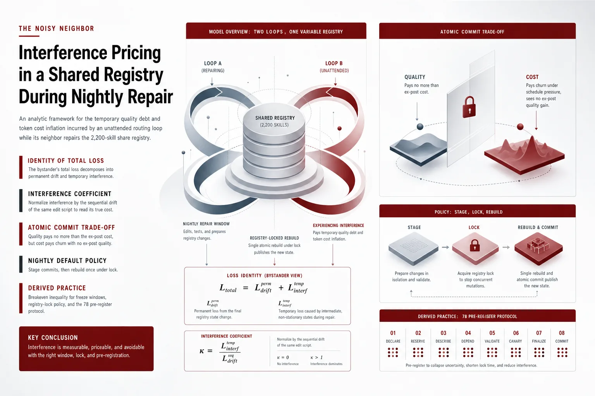
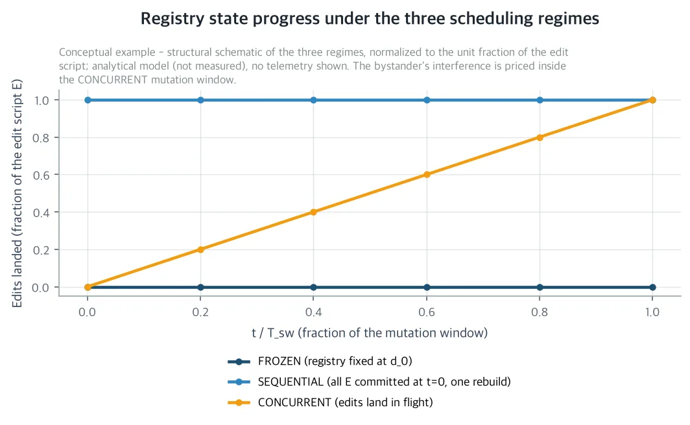
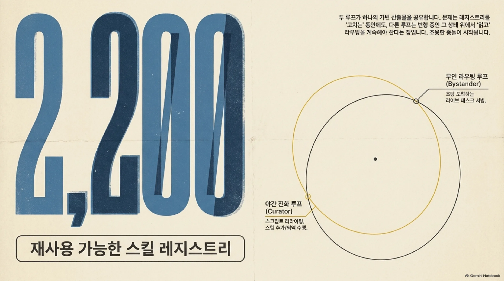
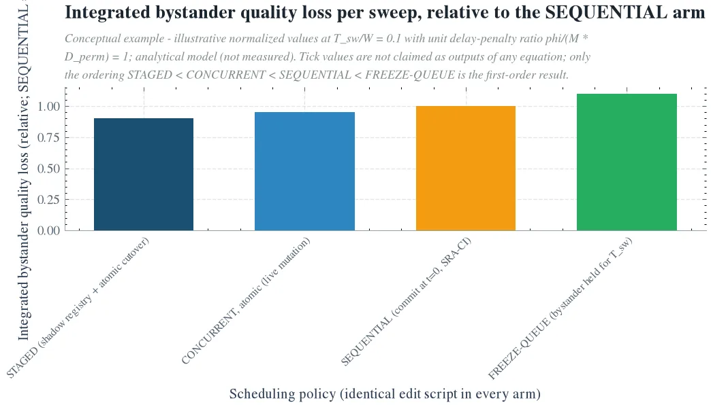
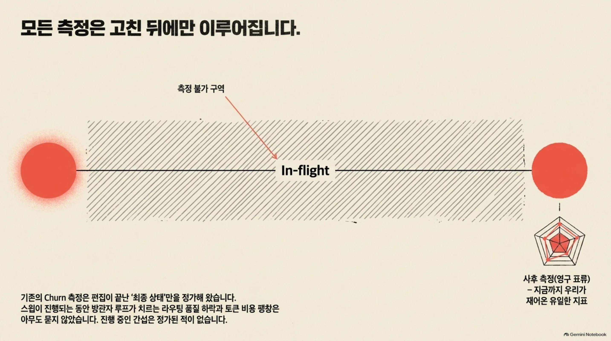
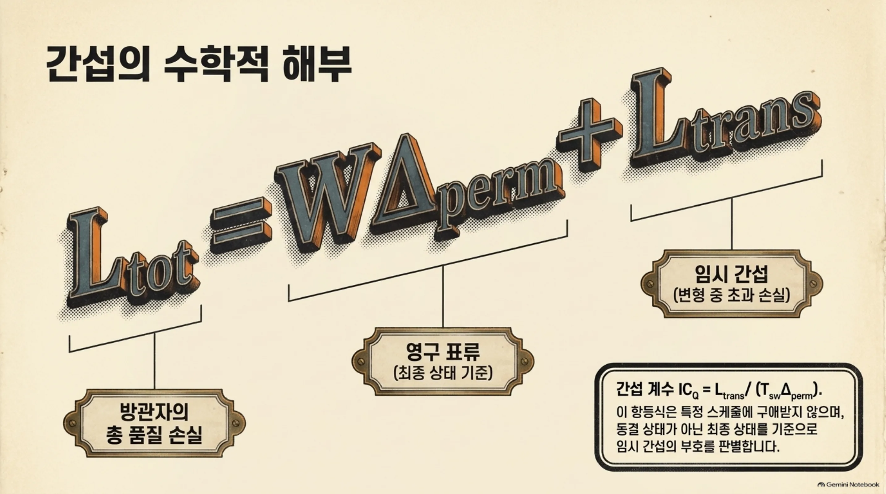

야간 진화 스윕이 스킬 레지스트리를 고치는 동안에도, 같은 레지스트리 위에서 라이브 태스크를 계속 서빙하는 무인 라우팅 루프를 돌린다면 이 논문을 읽어야 합니다. 야간 작업 스케줄링이 바로 이 논문의 주제입니다. 더 넓게 보면 스킬 레지스트리라는 가변 상태 하나를 공유하면서 여러 무인 루프를 같은 H200 클러스터에서 동시에 돌리는 모든 팀의 이야기입니다. 질문은 하나입니다. 방관자 루프의 라우팅 정확도, 토큰 비용, 엔드투엔드 태스크 성공률 중 어느 만큼이 변형 진행 중 나빠지고 어느 만큼은 끝난 뒤 잰 영구 표류인지 가르는 것입니다. 지금까지의 churn 측정, 우리 라우터 시리즈를 포함해, 전부 고친 뒤를 정가해 왔습니다. 진행 중의 것은 정가된 적이 없습니다. 야간 자기 진화가 라우팅 품질을 조용히 깎고 토큰 청구서를 부풀려도, 사후 점수로는 알아차리지 못합니다. 처음부터 알아둘 것이 있습니다. 이 논문은 분석 논문이며 실측을 보고하지 않습니다. 이 글의 수치는 기호이거나, 기록된 부대 표류 법칙에 대한 일차 산술이거나, 미리 약속한 프로토콜 파라미터이고 두 그림은 분석 모델의 그림이며 측정 데이터가 아닙니다. 측정은 논문이 사전등록한 7팔 프로토콜의 몫입니다.

*글의 핵심 개념을 형상화했습니다.*

## 문제의식: 모든 churn 측정은 고친 뒤에만 잽니다

우리 생산 하네스는 무인 태스크의 모든 단계를 약 2,200개의 재사용 스킬 중 하나로 라우팅합니다. 하이브리드 라우터가 lexical BM25 레인 하나, dense 레인 하나를 돌리고 두 레인의 랭킹 시그널은 모두 스킬 본인의 설명 텍스트입니다. lexical 레인은 코퍼스에 결합되어 있습니다. 모든 term의 idf가 레지스트리 전체 스킬의 term 빈도의 함수이므로, 어떤 편집도 방관자의 lexical 점수를 움직입니다. dense 레인은 편집된 스킬의 임베딩을 움직입니다. 설명 텍스트는 동시에 라우팅 신호이자 커레이터의 쓰기 표면입니다.

두 루프가 가변 산출물 하나를 공유합니다. 밤사이 진화 루프, 커레이터 스윕이, 편집 스크립트인 설명 리라이팅과 스킬 추가와 스킬 퇴역의 순서를 같은 레지스트리에 적용합니다. 편집은 실시간 t_1부터 t_E에 착지하고 스윕 지속 시간이 T_sw, 속도가 ρ_e = E/T_sw입니다. 같은 윈도우 동안 라이브 태스크가 일정 도착률 λ로 계속 도착하고 레지스트리가 그 순간의 상태로 라우팅됩니다. 레지스트리를 쓰는 루프와 읽는 루프가 다르고 둘 다 같은 셀프호스트드 H200 클러스터에서 무인으로 갑니다.

우리 라우터 시리즈는 지금까지 그 레지스트리를 축 하나씩 정가해 왔습니다. 쿼리 패러프레이징 불안정, 레지스트리 규모에 따른 top-1 생존율 감소, 동결 인덱스 신선도, 적대적 설명 주입, 그리고 최근의 무해한 설명 편집인 Silent Reroute까지 포함합니다. Silent Reroute은 일차 부대 표류 법칙을 세웠습니다. 편집되지 않은 태스크의 기대 top-1 플립률이 편집 의미 거리, 편집 유형, 레지스트리 규모 N의 함수로 어떻게 움직이는지입니다. 유형 순서는 의미 이동이 가장 크고 그 다음이 truncation, 그 다음이 패러프레이징이며 recall 레벨 표류는 top-1 표류의 약 0.25배였습니다. 그런데 이 시리즈의 모든 연구는 편집이 끝난 뒤의 최종 레지스트리 상태를 잽니다. 사후 점수입니다. 배포는 편집이 끝나기를 기다리지 않습니다. 스윕이 진행 중이면서 방관자는 변형 중인 레지스트리 위에 계속 서빙합니다.

이것이 고전적인 노이즈 네이바 문제의 크로스 루프 버전입니다. 두 소비자가 리소스 하나를 공유하고 하나가 그것을 고치고 다른 하나가 가격화되지 않은 간섭을 치릅니다. 차이가 있는 것은 공유 리소스의 종류입니다. 서빙 문헌에서는 하드웨어, 즉 GPU 메모리나 PCIe fabric, 테일 레이턴시입니다. 여기서는 상태, 즉 레지스트리입니다. 간섭이 fabric을 타고 가지 않고 설명 텍스트와 검색 인덱스를 타고 갑니다. 이 논문이 가격화하는 질문은 둘입니다. 하나는 방관자의 손실 중 어느 만큼이 임시인 변형 중의 초과이고 어느 만큼이 영구인 최종 상태의 표류인지입니다. 다른 하나는 라이브로 변형하는 레지스트리와 동결 레지스트리와 동일 편집의 순차 리플레이가 비용-품질 프론티어의 어디에 떨어지는지입니다.

*같은 편집 스크립트 위에 세 스케줄링 레짐과, 변형 윈도우 동안 공유 레지스트리에 착지한 스크립트의 비율을 그린 개념도입니다. FROZEN은 절대 진화하지 않고 SEQUENTIAL은 t=0에서 전체 스크립트를 커밋하는 Silent Reroute 사후 프로토콜이고, CONCURRENT는 편집이 in-flight로 착지하는 동안 방관자가 계속 라우팅합니다. 이 논문이 정가하는 간섭은 CONCURRENT 팔의 변형 윈도우에 있습니다. 분석 모델의 그림이며 실측 데이터가 아닙니다.*

## 총 손실을 영구와 임시로 나누는 항등식

같은 편집 스크립트 E를 세 개의 스케줄링 레짐에서 정가한다. FROZEN은 편집이 없고 레지스트리 상태 d(t)는 항상 d_0이다. 이것은 앵커이지 프론티어 점이 아니다. SEQUENTIAL은 윈도우의 라우팅에 앞서 t=0에서 전체 스크립트를 커밋하고 인덱스를 한 번 재빌드한다. 이것은 정확히 Silent Reroute 사후 프로토콜인 SRA-CI이고, 품질은 Q_S, 영구 표류는 Δ_perm = Q_F - Q_S이다. CONCURRENT는 편집이 t_1부터 t_E에 in-flight로 착지하는 동안 방관자가 계속 라우팅한다. 이것이 배포다. 팔마다 달라지는 것은 착지 스케줄과 잠금뿐이고, 편집 스크립트는 같다.

방관자의 윈도우 [0, W] 총 품질 손실은 L_tot = ∫_0^W (Q_F - Q_c(t)) dt이며, Q_c(t)는 t 시점의 순간 품질이다. 이 논문이 세우는 항등식은 L_tot = W Δ_perm + L_trans이고, 여기서 L_trans = ∫_0^T_sw (Q_S - Q_c(t)) dt이다. 독립성도 선형성도 가정하지 않는다. 어떤 편집 스케줄에서든 성립한다. L_trans는 부호가 붙은 임시 간섭이다. 동결 상태가 아니라 최종 상태를 기준으로 잰, 변형 중의 방관자 초과 손실(양수)이나 완화(음수)다. 스케줄이 품질에 무관하다면 L_trans는 0이다.

간섭 계수는 이 임시 비용을 동일 편집의 순차 표류로 정규화한 값이다. IC_Q = L_trans / (T_sw Δ_perm)이다. 비용 쪽 IC_C는 임시 비용 초과를 영구 per-route 비용 델타 ΔC_perm로 나눈다. 분모가 ε를 못 넘으면 절대 초과분을 보고한다. 기준값은 세 개다. IC_Q = 0이면 스케줄이 품질에 무관하다. IC_Q > 0이면 진짜 간섭, in-flight 상태가 평균적으로 최종 상태보다 나쁘다는 뜻이다. IC_Q < 0이면 임시 완화, 해로운 편집이 아직 착지하지 않았다는 뜻이다. 분모가 동일 편집 스크립트의 순차 표류이므로, SRA-CI 사후 측정 한 번으로 두 분모를 모두 캘리브레이션한다. 밤마다 하나인 숫자로, 스케줄이 방관자 비용에 얼마를 얹는지 읽을 수 있다.

## 일차 분석: 품질은 추가 비용을 안 내고 비용은 사후 점수에 안 보인다

가정은 기록된 부대 표류 법칙에 두 가지를 더한다. 각 편집 j의 기대 방관자 영향 δ_j가 음수이고 편집 간 영향이 독립이며 편집이 [0, T_sw]에서 거의 균일하게, 포아슨 과정으로, 속도 ρ_e로 착지한다.

품질 채널의 결과: IC_Q = -1/2이다. 원자적 커밋, 즉 리더가 d_{j-1}이거나 d_j일 뿐 섞인 상태를 절대 못 보는 조건에서 결과는 다음과 같다. E[Q_c(t)] = Q_F - δ̄ ρ_e t이고 L_trans = -Δ_perm T_sw / 2, IC_Q = -1/2, L_tot = Δ_perm (W - T_sw/2)가 된다. 부호를 읽으면, 스윕 중에는 해로운 편집이 아직 착지하지 않았으므로 방관자는 평균적으로 최종 상태보다 낫다. SEQUENTIAL 팔은 Δ_perm을 전체 윈도우 W에 대해 치르고 CONCURRENT 팔은 Δ_perm (W - T_sw/2)만 치른다. 사후 SRA-CI 점수로 야간 스윕을 수락하거나 거부하는 정책은 방관자의 in-flight 품질 비용을 결코 과소정가하지 못한다. 사후 측정이 보수적 품질 프록시라는 뜻이다. 단일 루프 churn 결과인 Silent Reroute은 품질에 대해서는 스케줄 보정 계수 1 - T_sw/(2W)를 붙여 크로스 루프 레짐으로 일반화된다. 경보 구간은 IC_Q ≥ 0이다.

비용 채널은 겹치지 않는다. 품질은 일차에서 스케줄에 무관한데, 비용은 그렇지 못하다. 모든 편집은 방관자에게 보이는 인덱스 구조, 즉 BM25 코퍼스 통계, 임베딩 인덱스, 캐시된 라우팅 프롬프트에 흡수되어야 한다. 흡수가 진행되는 동안 per-route 지출이 오른다. 검색과 유료 최종 셀렉션 사이에서 풀이 바뀌고 stale 캐시 미스 뒤의 재시도가 붙고 인젝션 길이가 순간적으로 늘어난다. γ는 편집당 방관자 쪽 처닝 비용, 단위가 토큰이다. T_mem은 메모리 윈도우, 즉 하나의 편집의 처닝이 0까지 가라앉는 시간이다. 그러면 CONCURRENT 팔의 스윕당 방관자 비용 팽창은 ΔC_byst = λ γ T_mem E이다. SEQUENTIAL과 FROZEN 팔에서는 0이다. 리빌드가 일회성이어서 커레이터가 치르고 방관자의 per-route 청구서에서 감가된다. Staleness Frontier의 비용 최적 재임베딩 주기가 이 T_mem의 정상상태 유비다.

레이트 리미팅 불변성: 스윕이 메모리 윈도우보다 긴 동안, T_sw > T_mem이면, 시간평균 비용은 편집 수 E와 메모리 윈도우 T_mem에만 의존하고 스윕의 속도와 무관하다. 스윕을 2배로 늘리면 ρ_e가 반이 되고 per-route 피크 초과 γ ρ_e T_mem과 그 SLO 리스크가 반으로 줄지만, 시간평균 청구서는 그대로다. 늘어나는 스윕이 도움이 되는 것은 겹치는 레짐 T_sw < T_mem뿐이다. 비용 쪽 결론은 품질 쪽의 거울이다. 순차 측정은 품질에서는 보수적이나, 비용에서는 맹이다. 최종 상태의 per-route 델타 ΔC_perm(보통 작음)만 정가하고, 스케줄 주도 처닝은 하나도 못 본다. 라이브 팔의 추가 청구서, 스윕당 λ γ T_mem E는 토큰 미터가 루프별로 비용의 귀속을 만들므로, 치른 루프의 라인 아이템으로 관측된다.

혼합 상태: IC_Q > 0의 유일한 일차 경로다. 원자적 적용은 쓰기 주체의 성질이지 레지스트리의 성질이 아니다. 편집이 비원자적으로 적용되면, 각 t_j 주변의 가시성 윈도우 ω 동안 방관자는 혼합 상태를 읽는다. 설명은 자리에서 리라이팅되고 BM25 통계는 term별로 갱신되며 임베딩은 lexical 레인이 따라오기 전에 재인덱싱된다. 그 사이 lexical 시그니처는 아직 구 상태이고 dense 시그니처는 이미 새 상태다. 편집된 스킬에 term 공간에서 인접한 골드 스킬을 가진 요청은 double-miss한다. 편집 전 상태에서도, 편집 후 상태에서도 제대로 라우팅되지만 혼합 상태에서는 안 되는 것이다. 한계는 혼합 상태의 추가 시간 적분 임시 품질 손실이 ω E p v 이하라는 것이다. 여기서 p는 전형적 편집 스킬의 풀에 태스크가 들어갈 확률이고 v는 double-miss에서 걸리는 per-task 품질 가치다. IC_Q ≤ -1/2 + ρ_e ω p v / Δ_perm. 트래픽 노출로 가중한 혼합 윈도우가 반 스윕 치기의 누적 부대 표류를 넘을 수 없다는 뜻입니다. 이 한계는 term 공간에서 편집이 뭉치는 모서리, 유사 복제 스킬의 동시 리라이팅 같은 자리에서, 상수 이내로 타이트합니다. 바로 그 자리가 독립성 가정이 가장 크게 깨지는 곳입니다. IC_Q ≥ 0 경보는 모델이 못 보는 그 모서리를 겨냥해 있는 셈입니다.

## 프리즈 윈도우를 정가하는 정책: 스테이징 커밋이 기본, 라이브는 예외

스케줄링 레버를 태스크-가치 화폐로 씁니다. 오루팅 한 건당 페널티 M, Δ_perm^v = M Δ_perm. 네 후보 정책의 일차 스윕당 방관자 손실입니다. LIVE(원자적 동시): λ M Δ_perm (W - T_sw/2) + κ λ γ T_mem E. STAGED(섀도 레지스트리, 원자적 컷오버, 한 번의 리빌드): λ M Δ_perm (W - T_sw) + π_fresh λ T_sw. FREEZE-QUEUE(방관자를 T_sw 동안 대기): λ M Δ_perm W + φ λ T_sw. SEQUENTIAL(t=0 커밋): λ M Δ_perm W. 여기서 κ는 H200 비용 기준으로 토큰을 가치로 바꾸고 π_fresh는 in-flight 추가에 라우팅하는 per-task 가치, φ는 큐에 넣는 per-task 지연/SLO 페널티입니다.

브레이크이븐 결과는 세 가지라는 뜻입니다. STAGED가 SEQUENTIAL을 지배합니다. 방관자 비용은 같고 품질은 엄격히 낫기 때문입니다. Δ_perm^v (W - T_sw) < Δ_perm^v W. STAGED가 LIVE를 지배하는 조건은 M Δ_perm/2 + κ γ ρ_e T_mem ≥ π_fresh입니다. 영구 표류의 절반을 가치 단위로 해서, per-task 처닝을 더한 것이, in-flight 편집의 per-task 가치를 넘을 때입니다. LIVE가 FREEZE-QUEUE를 지배하는 조건은 M Δ_perm/2 + φ > κ γ ρ_e T_mem입니다.

π_fresh는 스윕 중 추가의 가치이고 무인 루프의 요구는 그날의 태스크가 정하므로 희귀합니다. 두 번째 조건은 정상 운영에서 여유 있게 성립합니다. 그래서 야간 기본 정책은 STAGED입니다. LIVE는 예외입니다. 스윕이 방관자가 명확히 필요로 하는 추가로 지배될 때만, R4 경보 아래에서만 운영합니다.

네 규칙 정책입니다. R1은 라이브 레지스트리 잠금입니다. 스윕은 [0, T_sw] 동안 전체 스크립트를 섀도 레지스트리에 적용하고 라이브 레지스트리는 불변입니다. 방관자는 잠금 전체 동안 동결 스냅샷에 라우팅합니다. R2는 원자적 컷오버입니다. T_sw에서 섀도 상태가 원자적으로 스왑되고 인덱스 리빌드는 BM25 통계와 임베딩을 포함해, 잠금 아래에서 한 번, 방관자의 크리티컬 패스 밖에서 일어납니다. 스윕의 방관자 처닝 청구서는 0이 되고 품질 손실은 Δ_perm^v (W - T_sw), STAGED 손실이 됩니다. R3는 예외의 속도 상한입니다. 라이브로 공개해야 하는 편집은 클래스별 브레이크이븐 조건이 성립하는 동안에만 수용되고 속도는 ρ_e ≤ (M Δ_perm/2 - π_fresh)/(κ γ T_mem)로 상한이 붙습니다. R4는 표류 경보입니다. 롤링 프로브가 SRA 부대 스위트의 고정 부분집합을 스윕 도중 Δt마다 재점수 매기고, SRA-CI 게이트를 라이브 레지스트리 쪽으로 다시 향시킨 것입니다. 프로브 표류가 미리 약속한 경보 a_Q = 2 δ̄_law, Silent Reroute 법칙의 편집당 기대 부대치의 2배,를 넘으면 스윕을 멈춥니다. 이것은 모델이 커버하지 않는 두 모서리, 비원자적 혼합 상태와 고차 편집 상호작용에 대한 경험적 가드입니다.

회계는 구성상 관측 가능합니다. 토큰 미터가 루프별로 처닝 청구서를 라인 아이템으로 만들고 R1과 R2 아래에서 방관자의 그것은 정확히 0이며 커레이터가 컷오버 때 한 번 칩니다. 품질 청구서는 STAGED 청구서이고 사후 silent-reroute 청구서 이하입니다.

하나의 동일 편집 스크립트에서 일차 스윕당 방관자 품질 청구서의 크기를 비교한 개념도입니다. 레지스트리 잠금인 STAGED가 가장 싸고 라이브 원자적 변형은 반 스윕 윈도우만큼 크레딧을 받고 방관자를 대기시키는 FREEZE-QUEUE는 순차 청구서 위에 지연 페널티를 얹습니다. 비용-품질 프론티어의 니는 STAGED에 있습니다. 분석 모델의 그림이며 실측 데이터가 아닙니다.*

## 회사와 사회, 과학에 주는 것

회사에 주는 것은, 이미 돌고 있는 두 루프 사이의 간섭을 정가하는 첫 체계화와, 그 정가를 실행하는 야간 스케줄 정책입니다. 플랫폼은 이미 셀프호스트드 H200 클러스터 위에서, 단일 공유 2,200스킬 레지스트리를 향해 야간 스킬-진화 루프와 무인 태스크-라우팅 루프를 동시에 돌립니다. 이 논문은 측정 가능한 간섭 계수와, 표류 시간 곡선과, 프리즈 윈도우/registry-lock 정책을 줍니다. 기존 커레이터 스윕과 sra_bench와 Metis 토큰 미터링 위에 붙일 수 있는 비용-품질 가드레일입니다. 야간 진화가 더 이상 라우팅 품질을 조용히 깎지 못하고 토큰 청구서를 부풀리지 못합니다. 스케줄링이 추측이 아니라 브레이크이븐이 있는 정책이 됩니다.

사회에 주는 것은, 가변 상태 하나를 공유하는 다중 무인 루프 운영의 간섭을 가격하는 공개적이고 재현 가능한 방법론입니다. ops 에이전트, 진화 에이전트, 태스크 에이전트가 동시에 돌아가는 것이 표준이 되면서 숨은 품질 표류와 비용 유출을 일찍 잡는 수단이 각 조직에 필요합니다. 대규모 자율 에이전트 운영이 더 안전하고 더 쌈해집니다. 사후 churn 예산은 크로스 루프 예산이 아니었고 간섭 계수는 그것이 그랬는지 알려 주는 정규화자입니다.

과학에 주는 것은, 자기 진화형 에이전트 하네스의 크로스 루프 레짐에 대한 첫 체계화입니다. 기존 자기 진화형 라이브러리 연구인 Skill++, SkillForge, SELM, Trackable은 진화 스텝이 끝난 뒤의 정상 상태에서 라이브러리를 평가합니다. 스텝 중에 라우팅을 계속하는 방관자를 정가한 연구는 없습니다. 서빙 문헌의 노이즈 네이바 연구는 리소스나 실패를 타고 간 간섭을 가격했고 이 논문이 가격하는 것은 세 번째 채널인 가변 지식 상태를 타고 간 간섭입니다. 단일 루프 churn 결과가 크로스 루프 레짐으로 일반화되는지에 대한 답도 줍니다. 일차에서 둘로 갈립니다. 품질은 일반화되고 스케줄 보정 1 - T_sw/(2W)를 붙이면 사후 청구서가 보수적 프록시가 됩니다. 비용은 일반화되지 않고, 처닝 청구서 λ γ T_mem E는 라이브 레짐에만 존재하며 레이트 리미팅에 불변이고, 단일 루프 비용 측정은 정확히 그 라인 아이템만큼 크로스 루프 배포를 과소정가합니다.

## 한계: 기호로 끝나는 숫자와, 모델이 못 보는 모서리

첫째, 분석적 범위입니다. 이 논문은 항등식과 정책을 세우지만 IC_Q, IC_C, ΔC_byst, 브레이크이븐의 부호, 경보의 거짓 양성률, 스케줄 보정 계수의 값은 프로토콜의 약속이지 측정이 아닙니다. 모든 정량적 주장은 기록된 표류 법칙의 일차 산술이거나, 라벨된 모델 한계이거나, 미리 약속한 프로토콜 파라미터입니다. 크로스 루프 레짐의 숫자는 사전등록 프로토콜이 텔레메트리로 바꿉니다.

프로토콜은 2,200스킬 레지스트리, 셀프호스트드 H200, 루프별 토큰 미터링 위의 7팔 설계입니다. 설계 불변식: 모든 진화 팔이 동일한 편집 스크립트를 쓰고 착지 스케줄과 잠금만 다릅니다. A1 LIVE는 원자적 편집당 공개, A2 FROZEN은 베이스라인, A3 SEQUENTIAL은 동일 스크립트의 Δ_perm과 ΔC_perm을 SRA-CI로 잽니다. A4 FREEZE-QUEUE는 지연 비용 φ, A5 STAGED는 정책 자체의 청구서, A6 RATE-LIMITED는 스윕을 2 T_sw로 늘려 스케줄 불변성을 테스트합니다. 시간평균 처닝은 그대로이고 피크가 반으로 줄어야 합니다. A7 PER-EDIT-LOCK은 편집당 짧은 글로벌 read lock으로 혼합 상태를 구성상 제거하고 A1 - A7가 혼합 상태 항이 됩니다. 프로브 기반 추정자는 SRA 부대 스위트의 n_P 케이스 고정 부분집합을 Δt마다 재점수 매깁니다. 델타 방법의 분산 한계는 Δt와 T_sw와 무관하고 목표 상대 정밀도 ε를 위한 설계 한계가 n_P의 크기를 줍니다. 미리 약속한 수락 기준은 이렇습니다. LIVE(A1)는 IC_Q ≤ 0이고 처닝 라인 아이템이 β_bill 이하여야 야간 기본 모드로 허용됩니다. 기본값 β_bill은 야간 방관자 지출의 5%입니다. 조건에 R4 경보 0회가 붙고 기준은 신뢰 1-α에서 적용됩니다. 그렇지 않으면 STAGED가 기본입니다. A6의 불변성과 A7의 혼합 상태 영은 반증 가능한 부분 가설이고, 위반은 독립성 가정과 스케줄 불변성 후과를 다시 엽니다.

둘째, 추가성입니다. 유사 복제 스킬의 편집은 상호작용할 수 있고 경쟁하는 설명의 두 리라이팅은 증폭하거나 상쇄할 수 있습니다. 일차 가정은 그것을 배제하고 혼합 상태 한계는 그것을 커버하지 못합니다. R4 경보가 지정 가드이고 A7가 0인 상태에서 A1에서 IC_Q > 0이 지속되면 상호작용의 시그니처입니다. 셋째, 벌스티 스케줄입니다. 실제 커레이터는 포아슨보다 더 bursty합니다. 원자적 품질 항에 대해서는 보수적이며 m(t)에 선형인 기대는 변하지 않고 분산이 변하며 피크 처닝은 올라갑니다. 넷째, 워크로드 정상성입니다. 프로브 설계가 고정 부대 스위트를 재점수 매김으로써 분포를 고정합니다. 다섯째, 레지스트리 성장입니다. 부대 표류 법칙은 규모 최대점 N* ≈ 3,535의 상승 구간에 서 있습니다. N이 자라면 Δ_perm과 브레이크이븐 좌변이 함께 자라서 STAGED 기본이 더 여유로워집니다. 대신 경보 a_Q는 규모 밴드마다 다시 유도해야 합니다. 여섯째, 메모리 윈도우입니다. 스케줄 불변성 후과가 T_sw > T_mem인 동안만 성립하고 캠페인은 A6를 점수 매기기 전에 이것을 확인합니다.

Silent Reroute은 진화 루프가 남기는 것, 최종 상태의 영구 부대 표류를 정가했습니다. 이 논문은 이웃이 아직 움직이는 동안 치르는 것을 정가하고 스케줄러에게 브레이크이븐을 건넵니다. 레지스트리의 간섭 계수는 이제 측정 가능하고 청구서 항목이 되고 거버넌스의 대상이 되는 양입니다. 그 값을 정하는 7개 팔은 사전등록되어 있습니다. 전체 논문과 7팔 측정 프로토콜은 Hugging Face 논문 상세 페이지에서 볼 수 있습니다. https://huggingface.co/datasets/thaki-AI/daily-paper-2026-11-06-noisy-neighbor-cross-loop-interference
