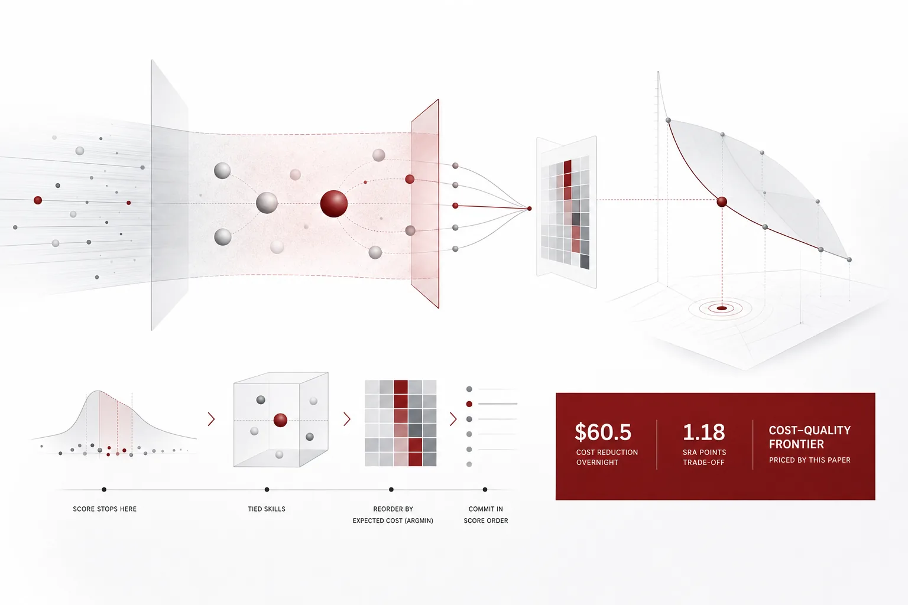
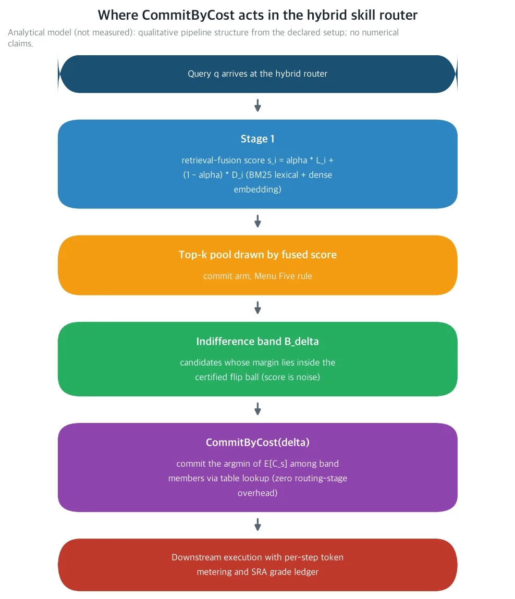
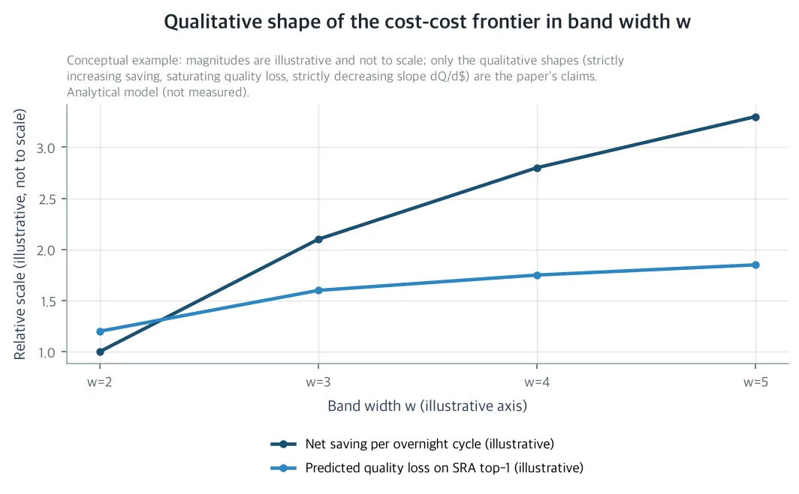

라우터의 점수가 두 스킬을 구별하지 못하게 동점이 되면, 지금 규칙은 점수 순서라는 이름으로 사실상 동전을 던집니다. 이 논문은 그 동전에 가격을 매깁니다. 선언된 요금에서, 이미 원장에 쓴 기대비용이 더 싼 쪽을 고르는 조회 하나면 밤에 60.5달러가 줄어듭니다. 자기 GPU에서 수천 스킬 레지스트리 위의 무인 에이전트를 돌리고 라우터의 토큰 원장을 직접 관리한다면, 이 글은 당신을 위한 것입니다.

ThakiCloud의 하이브리드 스킬 라우터는 이 시리즈에서 단계마다 정가되어 왔습니다. 검색 점수, 유료 재순위 호출, 스테이지 오버헤드, 추론 예산, 쿼리 절단, 근접 중복 레지스트리, 패러프레이징 불안정, 마감의식 티어 슂, 후보 풀 폭, 사후 미스 가격까지입니다. 아직 정가되지 않은 것은 하나였습니다. 동점이 됐을 때 무엇을 고를지, 즉 인디퍼런스 결정입니다. 이 논문은 그 결정을 정가합니다.

먼저 한 가지만 밝혀 둡니다. 이 논문은 분석 논문이며 새로운 실측을 보고하지 않습니다. 본문 수치는 전부 선언된 공칭 요금 카드 위의 닫힘 형태의 예측이거나, 인용 논문에 귀속된 결과입니다. 두 그림은 분석 모델이 그린 도식이며 실측 데이터가 아닙니다. 측정은 논문이 사전등록한 4갈래 프로토콜의 몫입니다.

*글의 핵심 개념을 형상화했습니다.*

## 쉽게 말하면

동전을 하나 더 가까이 보겠습니다. 라우터는 밤마다 들어오는 작업마다 스킬을 골라 줍니다. 검색 점수가 한쪽을 확실하게 지지하면 그쪽을 고르면 됩니다. 그런데 점수가 동점이 되는 경우도 있습니다. 동점이면 순위를 정하는 기준이 하나도 남지 않은 경우입니다.

지금 라우터는 이때도 점수 순서라는 이름으로 1위를 고릅니다. 근접 동점이면 점수 차이는 불안정성 안쪽이라, 이 선택은 사실상 동전 던지기입니다. 그리고 이 동전의 두 면은 같은 값을 가지지 않습니다. 한 면의 스킬은 실패해도 일찍, 싼 대가로 떨어집니다. 다른 면의 스킬은 실패했을 때 더 크게 잃고, 돌리는 구간도 깁니다.

두 면의 값은 이미 알고 있습니다. 이 하네스는 매 스텝의 토큰을 이미 원장에 쓰기 때문입니다. 그래서 동전을 던질 필요가 없습니다. 동점이면 원장에서 더 싼 쪽을 고르면 되는 것입니다. 새 추론 호출도, 새 인프라도 필요 없습니다. 알고 있던 값을 찾는 조회 한 번이면 됩니다. 이 논문이 제안하는 규칙의 이름은 CommitByCost입니다.

즉, 사람 말로는 점수가 동점이면 지금은 동전을 던지는 것이고, CommitByCost는 동전을 안 던지고 원장 값이 더 싼 쪽을 고르라는 규칙입니다.

## 무엇을 해봤나

라우터는 두 단계로 갑니다. 1단계는 문자열 검색(BM25)과 밀집 벡터 검색의 융합 점수로 후보 풀을 끌어 올립니다. 융합 점수는 s_i = α·L_i + (1−α)·D_i입니다. 2단계는 그 풀 위에서 루트당 0.08달러의 유료 재순위 호출을 하고, 커밋 갈래(라우터가 최종 후보를 정한다) 또는 메뉴 갈래(풀을 에이전트에게 넘긴다)를 택합니다. 이 논문은 커밋 갈래에서, 근접 동점인 후보 사이에서 무엇을 고르느냐를 정가합니다.

*두 단계 하이브리드 라우터의 구조 도식입니다. 왼쪽은 문자열과 밀집 벡터의 융합 검색, 오른쪽은 루트당 0.08달러의 유료 재순위 호출입니다. 기대비용 타이브레이크가 근접 동점 후보를 다시 정렬하는 구역, 인디퍼런스 밴드 B_δ가 표시되어 있습니다. 개념 구조를 그린 분석 모델의 도식이며 실측이 아닙니다.*

같은 시리즈의 Fickle Router는 이미 한계를 그어 놓았습니다. 반경 ρ_eff의 역전 구체(certified flip ball) 안에서는, 융합 점수가 진짜 스킬 품질에 상대해 보면 노이즈입니다. 1위와 2위의 격차가 δ 이내로 좁아지면, 점수는 어느 쪽이 나은지 구분하지 못합니다. 그런데 두 후보의 기대비용은 같지 않습니다. 지금 커밋되는 1위의 미스 배율(miss multiplier)은 1.8이고, 밴드 안의 더 싼 멤버의 미스 배율은 1.6입니다. 비싼 쪽은 더 긴 실행 구간도 가집니다.

인디퍼런스 밴드는 간단히 정의됩니다. 격차를 m(q) = s_top(q) − s_2(q)로 쓰면, 밴드 B_δ(q)는 1위와의 차이가 δ 이내인 후보의 집합입니다. δ를 ρ_eff로 고정하면, Fickle Router가 인증한 1위의 모든 뒤집힘 상대가 밴드 안에 들어옵니다. 근접 동점 발생률 p(δ)는 선언된 값 0.30입니다. 밤마다 라우팅되는 루트 열 개 중 셋이 이 밴드에 떨어지는데, 지금 그 셋은 점수 순서라는 이름으로 사실상 무작위로 커밋됩니다.

이 밴드는 가격 매겨진 무지(priced ignorance)의 지역입니다. 후보 사이의 품질 차이가 불안정성 세금으로 인증된 지역에서, 결정에서 의미를 가진 것은 비용뿐입니다.

비용 모델의 선언값은 간단합니다. 스텝당 스킬 비용의 중앙값은 0.10달러이고, 분산 정도 σ_c는 0.5입니다. 뒤집힘의 종류는 세로 나눕니다. 열 건 중 여섯 건은 등급이 그대로인 무해한 동점, 세 건은 비싼 재실행, 한 건은 등급이 크게 떨어지는 잘못된 라우팅입니다. 밴드 경계를 넘는 straddle 뒤집힘은 열 건 중 한 건이고, 이 유형의 등급 하락은 0.38로 더 큽니다. straddle의 값은 같은 시리즈의 Miss Price 회계에서 옵니다.

*정밀 선언값은 여기서 봅니다: 평균 E[C] = 0.1133달러, 세 클래스별 등급 하락 0 / 0.05 / 0.30, straddle 파라미터 ρ = 0.6, q_rec = 0.9, q_fail = 0.2입니다.*

전제 A4는 가장 싼 밴드 멤버의 조건부 미스 배율도 가장 낮다고 가정합니다. 싼 쪽이 실패해도 회복이 저렴하다는 뜻입니다. 그래서 이득은 두 독립 채널로 옵니다. 하나는 실행 비용 감소(E[C] − E[min_w])이고, 다른 하나는 미스 배율 감소(m_top − m_c)입니다.

CommitByCost(δ)가 하는 일은 한 줄입니다. 밴드 w개 멤버 가운데 기대 하류 토큰 비용 E[C_s]가 가장 낮은 멤버, s*(q) = argmin_{s∈B_δ(q)} E[C_s]를 커밋합니다. C_s는 스킬마다 스텝 원장 토큰(라우터, 실행, 복구)의 합입니다. 이 하네스는 이미 매 스텝을 쓰고 있으므로, 타이브레이크는 이미 쓴 원장 테이블의 조회입니다. 확인 비용 c_check = 0이고, 라우팅 단계에 새 추론 호출이 없습니다. w = 1이면 지금 커밋으로 되돌아오므로, 근접 동점이 없는 상태에서는 아무것도 바꾸지 않는 그대로 꽂아 쓰는 규칙입니다.

브레이크이븐 정리는 닫힘 형태의 한 식으로 압축됩니다. 밴드 폭 w에서의 루트당 순이득은 Δ(w) = p(1 − 1/w)·[(1−g)(E[C] − E[min_w]) − g·D(w)]이고, D(w)는 straddle 초과분입니다. Δ(w)가 양수면 이 규칙은 돈을 냅니다.

확인 프로토콜은 실험 갈래 4개로 사전등록됩니다. A0는 제어(점수 순 top-1)이고, A1은 Band Two, A2는 Band Three입니다. A3는 A1에 선택적 검증 LLM 호출을 더한 갈래입니다. 갈래마다 교체 비율, straddle 비율, 교체 루트당 순절감, A0 대비 SRA top-1 변화, 표준 스테이지 원장(라우터/실행/복구 토큰, 실측 시간, 결정적 등급)을 기록합니다.

반증 기준 F1~F5는 모두 닫힘 형태의 예측으로 정해져 있습니다.

| 기준 | 내용 | 예측값 |
|---|---|---|
| F1 | 교체 비율이 10~20퍼센트 사이에 든다 | p(1 − 1/2) = 15퍼센트 |
| F2 | 교체 루트당 순절감이 0.0025달러 이상 | 0.00336달러 |
| F3 | A1의 품질 하락(A0 대비 SRA top-1)이 B_Q = 1.5 이하 | 1.18 |
| F4 | straddle 비율이 0.20 이하 | 선언값 0.10 |
| F5 | 마진이 ρ_eff를 넘는 구역에서는 CommitByCost가 활성화되지 않아야 한다(가드밴드 감사) | 없음 |

선언된 요금에서 프로토콜 전체 비용은 22.16달러, 25달러 미만입니다.

*비용 산식: SRA 벤치마크 63케이스 × 실험 갈래 4 × 루트당 재순위 호출 0.08달러, 그리고 A3 갈래의 검증 호출 1,000회 × 0.002달러입니다. 합계 63 × 4 × 0.08 + 1,000 × 0.002 = 22.16달러.*

## 나온 결과

선언된 공칭 요금에서는 밴드 폭 w가 2, 3, 4, 5인 모든 폭에서 순이득이 양수입니다. 폭이 넓을수록 밤당 절감은 커집니다. 즉, 사람 말로는 선언된 값 어디에도 이 규칙이 돈을 잃는 밴드 폭이 없다는 것입니다.

| 밴드 폭 w | E[min_w] (달러/스텝) | 밤당 순절감 (달러) | 예측 품질 손실 dQ (SRA 포인트) | 프론티어 기울기 (포인트/달러) |
|---|---|---|---|---|
| 2 | 0.0820 | 60.5 | 1.18 | 0.0195 |
| 3 | 0.0701 | 126.0 | 1.57 | 0.0125 |
| 4 | 0.0634 | 170.4 | 1.77 | 0.0104 |
| 5 | 0.0590 | 202.0 | 1.88 | 0.0093 |

가장 나쁜 단일 파라미터 시나리오, g = 0.20에서도 w = 2의 밤당 순이득은 36.4달러로 남습니다. 민감도 그리드의 어떤 시나리오에서도 부호는 뒤집히지 않습니다.

루트당 순이득은 재순위 호출 비용 0.08달러의 약 4퍼센트입니다. 라우팅 단계 초과비용 없이 얻는 값입니다. 정밀한 루트당 값은 표의 밤당 순절감을 밤마다 라우팅되는 루트 수로 나누면 됩니다.

이 논문이 프론티어를 올리는 방향이 핵심입니다. 축을 품질을 고정하고 비용을 재는 것에서, 아낀 달러당 품질 손실을 재는 것으로 바꿉니다. 이 축을 cost-cost라고 부릅니다. 예측 품질 손실 dQ(w)는 A3의 클래스별 등급 하락으로 계산되고, 절감액은 d$(w) = N·Δ(w)입니다. N은 밤마다 라우팅되는 스텝 수 18,000입니다.

프론티어 기울기 dQ/d$는 w에 대해 엄격히 감소합니다. w = 2에서 w = 5로 넓히면, 달러 하나를 아끼는 품질 대가는 두 배쯤 낮아집니다. E[min_w]가 순서 통계량의 성질로 w에 대해 엄격히 감소하고, 절감 폭이 함께 커지기 때문입니다. 밴드가 넓을수록 달러 하나를 아끼는 품질 대가가 싥다는 뜻입니다.

*논문이 예측하는 cost-cost 프론티어의 정성적 형상입니다. 밤 사이클당 순수 절감(달러)은 밴드 폭 w에 대해 엄격히 증가하고, 예측 품질 손실(SRA 포인트)은 증가하되 포화됩니다. w = 2에서 5로 넓히면 기울기는 0.0195에서 0.0093포인트/달러로 내려갑니다. 예시 형상을 그린 분석 모델의 도식이며 실측이 아닙니다.*

품질 예산 B_Q가 밴드 폭을 닫힘 형태로 고정합니다. w*(B_Q)는 dQ(w) ≤ B_Q를 만족하는 가장 넓은 폭입니다. 선언된 B_Q = 1.5에서는 dQ(2) = 1.18이 예산 안에 들지만, dQ(3) = 1.57은 예산을 넘습니다. 그래서 기본값은 w* = 2입니다. B_Q가 2.0으로 오르면 w* = 5가 됩니다. 밴드 폭은 엔지니어링 상수가 아니라, 품질 예산이 정하는 값입니다.

w = 2, 즉 Band Two에서 밤사이 스텝 실행 지출은 사이클당 60.5달러 줄어듭니다. 예측 품질 대가는 1.18 SRA top-1 포인트이고, 이는 선언된 밤별 스텝 실행 예산 2,040달러의 약 3퍼센트(2.96퍼센트)입니다. 즉, 사람 말로는 밤 예산의 3퍼센트 안팎을, SRA top-1 1.18 포인트의 품질 대가로 바꿔 아낀다는 것입니다.

## 그래서 무엇을 바꾸면 되나

회사에게는, 2,200스킬 자기 진화 레지스트리에 꽂아 넣는 라우팅 규칙입니다. 새 인프라도, 재학습도 필요 없습니다. 기존 스텝별 스킬 토큰 원장, SRA 벤치마크(63케이스 홀드아웃, 임계 θ = 0.75), 레지스트리 그 자체만 재사용합니다. 선언된 공칭에서는 밤사이 스텝 실행 지출이 사이클당 60.5달러 줄어듭니다.

이 메시지는 시리즈와 같지만 한 단계 아래에 내려앉습니다. 아끼는 토큰마다 무인 에이전트의 태스크당 추론 비용에 바로 반영되고, 그 비용이 작은 팀에게 완전한 업무 자동화가 경제적으로 가능한지를 가릅니다. 같은 시리즈의 tokenergy 결과에서 토큰은 에너지이기도 합니다. 품질 손실을 품질 예산 안에 두고 조회 하나로 얻는 절감은, 작은 팀의 자동화 경제학에 그대로 들어갑니다.

과학적으로는 세 가지가 남습니다. 첫째, 인디퍼런스 밴드 B_δ가 라우팅의 일급 대상이 됩니다. Fickle Router가 뒤집힘이 일어날 수 있는 한계를 그었고, 이 논문은 그 구체 안에서 행동합니다. 둘째, 사후 기대 하류 비용이 라우팅 신호가 됩니다. Miss Price의 미스 가격 공식 (m−1)c_E + (1−ρ)c_def + c_rec는 사후 회계 장부에서, 루트가 잡히기 전 결정을 다시 정렬하는 신호로 올라갑니다. 셋째, 프론티어가 cost-cost로 업그레이드되고, 기울기가 밴드 폭에 대해 엄격히 감소합니다.

이 논문은 Menu Width(Menu Five rule, k* = 5)와 Miss Price 모두에 대해 명시적인 한 단계 업그레이드입니다. 전자는 풀 폭 k와 커밋-메뉴 분할을 정가했지만 점수 순 top-1 커밋을 전제했고, 후자는 사후 미스 가격을 정가했습니다.

최종 선택권이 에이전트에 있는 메뉴 갈래라면, CommitByCost는 메뉴의 순서가 됩니다. 더 싼 스킬이 먼저 제시되는 순서입니다. 인디퍼런스 밴드는 커밋-메뉴 분할과 직교하고, Menu Five rule(k* = 5)과 합성됩니다. 후보 5개 풀 안에서 밴드는 근접 동점 부분집합만 다시 정렬하고, 풀 폭은 에이전트가 보는 후보 수를 관장합니다.

## 못 믿을 부분

첫째, 모든 수치는 명시적 전제 A1~A7와 선언된 공칭 요금 카드 위의 닫힘 형태의 예측입니다. Δ(w)의 부호는 민감도 그리드 전체에서 견고하지만, 미래 하네스 실행이 순이득을 수십 퍼센트 옮길 수 있습니다. 그리드의 가장 나쁜 시나리오는 g = 0.20이 36.4달러, σ_c = 0.30이 22.5달러, m_c = 2.0이 51.6달러입니다. 전부 양수이지만, 범위는 좁지 않습니다.

둘째, 전제 A2(스코어-맹성)입니다. 밴드 안의 비용과 검색 점수가 상관이 있으면 차익은 줄어듭니다. F5의 가드밴드 감사와 프로토콜의 스테이지 원장 회계가 그것을 확인하는 채널이지만, 점수-비용 상관이 있는 세계로 부호 보장은 스스로 확장되지 않습니다.

셋째, 값의 표류입니다. 2,200스킬 레지스트리는 자기 진화하며 밤마다 달라집니다. 스텝별 스킬 비용 표는 정적이지 않고, 슬라이딩 윈도우 리프레시가 필요합니다. 값의 낡음은 모델에서 σ_c의 추가 항으로 들어오고, c_def = c_E인 동에서도 부호 보장은 확장되지 않습니다. 둘 다 하네스 실행의 몫이기도 합니다.

논문의 위치는 분명합니다. 이 논문은 결정을 주장하지 않습니다. 확인되거나 반증될 수 있는 개입과 회계를 지정해 놓은 것입니다. 실험 갈래 4개, 반증 기준 5개, 비용 22.16달러입니다. 이 라우터 시리즈의 모든 단계가 이 방식으로 정가되어 왔고, 인디퍼런스 결정은 그 다음 측정 대상입니다.

---

논문 원문과 수반 자료는 여기에서 볼 수 있습니다: [The Indifference Band](https://huggingface.co/datasets/thaki-AI/daily-paper-2026-11-07-expected-cost-indifference-router)

*본문의 모든 수치는 명시적 전제(A1~A7)와 선언된 공칭 요금 카드 하의 닫힘 형태의 예측이거나, 인용 참고 문헌에 귀속된 결과입니다. 이 글은 라우팅 실측을 보고하지 않습니다. 두 그림은 모두 분석 모델의 도식이며 실측 데이터가 아닙니다. 본문은 읽기 쉽게 반올림했고, 정밀한 값은 표와 캡션에 두었습니다.*
