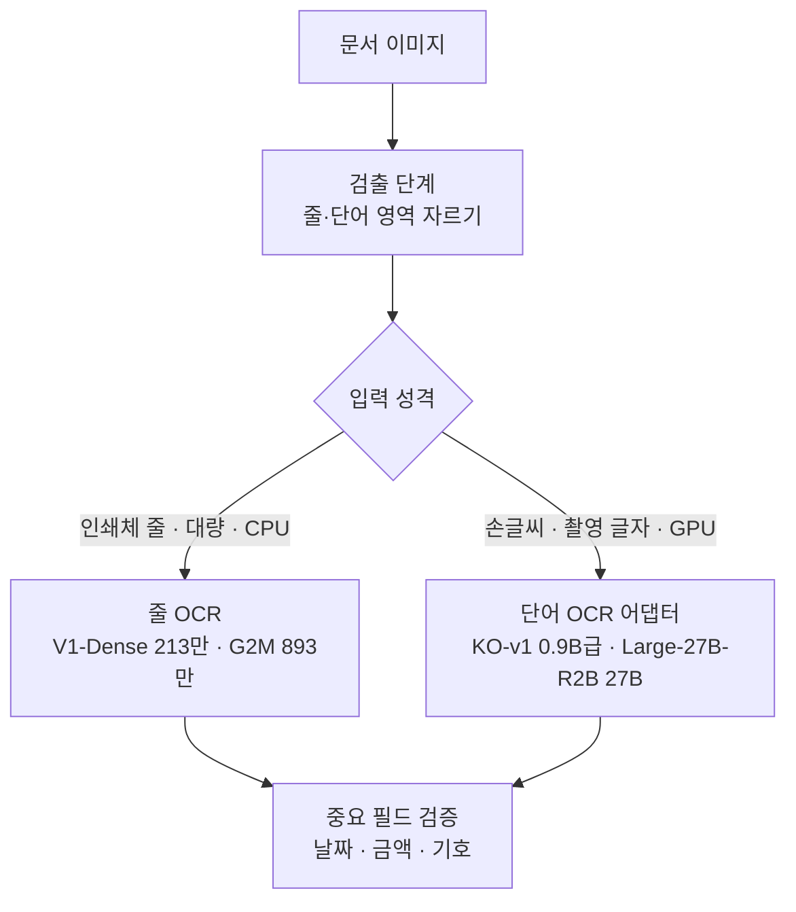

ThakiCloud는 크기가 1만 배 넘게 차이 나는 한국어 문자 인식 모델 네 개를 공개했습니다. 작은 두 모델은 CPU에서 텍스트 한 줄을 읽고 큰 두 모델은 GPU에서 한국어 단어 이미지 한 장을 읽습니다. 네 모델은 서로 다른 문제를 풀기 위해 만들었고 평가 세트와 지표도 다르기 때문에 숫자를 나란히 놓고 순위를 매길 수 없습니다.

## 쉽게 말하면

택배 분류 센터를 떠올리면 됩니다. 바코드가 반듯하게 찍힌 상자는 컨베이어 위 스캐너가 1초에 수십 개씩 처리합니다. 손으로 주소를 쓴 상자나 젖어서 번진 송장은 숙련된 직원에게 넘깁니다. 스캐너와 직원 중 누가 더 뛰어난지 묻는 것은 의미가 없습니다. 둘이 맡는 상자가 다르기 때문입니다.

ThakiOCR의 작은 모델은 스캐너, 큰 모델은 숙련된 직원에 가깝습니다.

## 왜 크기가 다른 모델 네 개인가

기업 문서 처리에는 성격이 다른 두 요구가 함께 있습니다.

첫째는 양과 환경입니다. 같은 서식의 줄 이미지를 하루에 수십만 번 읽어야 하고 GPU가 없는 온프레미스 서버나 현장 단말에서 돌려야 하는 경우가 많습니다. 이때는 CPU에서 한 줄을 수 밀리초 안에 읽는 작은 줄 OCR이 필요합니다. ThakiOCR-KOEN-V1-Dense(213만 파라미터)와 ThakiOCR-KOEN-G2M-Preview(893만 파라미터)가 이 자리를 맡습니다.

둘째는 어려운 입력입니다. 손글씨, 야외에서 찍은 간판 글자, 흔치 않은 한글 음절은 작은 CTC 모델이 잘 읽지 못합니다. 이런 단어는 이미 대량의 이미지·텍스트로 학습된 비전 언어 모델을 한국어 단어 OCR에 맞춰 조정하는 편이 낫습니다. ThakiOCR-KO-v1(0.9B급 기반 모델용 LoRA)과 ThakiOCR-Large-27B-R2B(27B 기반 모델용 LoRA)가 이 자리를 맡습니다.



네 모델 모두 페이지에서 글자 위치를 찾지 않습니다. 앞단에 검출 단계가 있어야 하고 그 뒤에서 어느 모델로 보낼지를 정합니다. 이 배치 방식은 [Metis 계층형 문서 추론 글](/tech-blog/ko/llmops/thakiocr-metis-tiered-document-inference/)에서 따로 다룹니다. 모델별 규모, 링크, 라이선스는 [ThakiOCR 모델 허브](/tech-blog/ko/ocr/)에 모아 두었습니다.

## 각 모델이 배운 것

### V1-Dense: 합성 데이터만으로는 띄어쓰기를 못 배운다

V1-Dense는 NVIDIA가 CC BY 4.0으로 공개한 합성 OCR 데이터만으로 처음부터 학습했습니다. 이 모델에서 배운 것은 두 가지입니다.

하나는 한국어 OCR에서 어휘가 모델 크기를 정한다는 점입니다. 출력할 수 있는 글자가 14,152자라서 전체 213만 파라미터 가운데 약 183만 개가 마지막 출력층에 있고 이미지를 읽는 부분은 약 30만 개입니다.

다른 하나는 합성 데이터의 한계입니다. 실제 한국어 단어 이미지의 38%에서 음절 사이에 없는 공백을 넣었습니다. 합성 줄의 띄어쓰기 통계가 스캔한 문서와 달랐기 때문입니다. 자세한 결과는 [ThakiOCR A 공개 글](/tech-blog/ko/research/thakiocr-a-small-korean-english-line-ocr/)에 있습니다.

### G2M: 평균 오류율은 기호 오류를 숨긴다

G2M은 같은 계열 구조를 893만 파라미터로 키우고 실제 공공 문서 이미지와 자체 생성한 기호 줄을 더해 처음부터 다시 학습했습니다. 원화 기호나 원문자가 전부 틀려도 문서 한 줄에서 차지하는 비율이 작아 CER은 거의 움직이지 않습니다. 그래서 기호를 지키는지 따로 재는 지표를 먼저 정했습니다.

같은 기호 시험 세트(자체 생성 합성 줄 5,991개)에서 중요 토큰 엄격 일치율은 V1-Dense 40.2%, G2M 94.2%였습니다. 이 두 숫자는 같은 세트, 같은 지표라 비교할 수 있습니다.

남은 실패도 분명합니다. 연도 뒤에 공백이 들어간 날짜를 틀렸고 생김새가 거의 같은 `₩`(U+20A9)와 `￦`(U+FFE6)를 427줄에서 서로 바꿔 읽었습니다. 미리 정해 둔 합격 기준(사전등록 게이트) 다섯 개 가운데 날짜 기준에서 떨어져 판정은 A1_GEN2_NO_GO입니다. 경위는 [G2M 공개 글](/tech-blog/ko/research/thakiocr-g2m-numbers-and-symbols/)에 정리했습니다.

G2M과 같은 구조로 금융 문서 데이터를 더해 다시 학습한 A2는 가중치를 공개하지 않았습니다. A2는 학습에 없던 서식으로 따로 평가했습니다. 그 결과는 [A2 평가 글](/tech-blog/ko/research/thakiocr-a2-independent-eval-43751-lines/)과 [Maxis 관점의 학습 글](/tech-blog/ko/research/thakiocr-maxis-same-size-fewer-errors/)에 있습니다.

### KO-v1: 단어를 더 잘 읽는 쪽이 문서를 망칠 수 있다

KO-v1은 문서 OCR 모델 ATH-MaaS/OvisOCR3에 LoRA를 붙여 한국어 단어 OCR을 학습했습니다. 같은 데이터로 두 갈래를 학습했습니다.

- M1: 언어 디코더에만 LoRA를 붙이고 비전 쪽은 고정했습니다.
- M2: 디코더와 비전 타워에 LoRA를 붙이고 비전·언어 연결부도 학습했습니다.

단어 정확도는 M2가 더 좋았습니다. 개발 세트 CER이 M1 7.78%, M2 5.98%였고 차이의 95% 신뢰구간이 0을 포함하지 않았습니다. 그런데 결과를 보기 전까지 열지 않은(봉인) 합성 표 50쪽에서 M2의 표 구조 정확 일치는 0.80으로, 기반 모델 0.98에서 허용폭 0.04를 넘게 떨어졌습니다. 미리 정한 선택 규칙에 따라 표 구조를 지킨 M1을 공개했습니다.

비전 쪽까지 조정하면 단어는 더 잘 읽지만 기반 모델이 원래 갖춘 문서 구조 능력이 깨질 수 있다는 것이 이 모델의 교훈입니다. 학습 과정은 [KO-v1 공개 글](/tech-blog/ko/research/thakiocr-ko-v1-ovisocr3-korean-finetune/)에서 다룹니다.

### Large-27B-R2B: 큰 개선은 조정 자체에서 나왔다

Large-27B-R2B는 Qwen/Qwen3.6-27B의 디코더 선형층 496개에 LoRA를 붙였습니다. 같은 개발 세트에서 CER이 기반 모델 18.04%에서 6.01%로 내려갔고 어느 원천에서도 나빠지지 않았습니다.

개선의 대부분은 미세조정 자체에서 왔습니다. 기반 모델은 손글씨 데이터셋 91에서 없는 글자를 끼워 넣는 오류가 많았는데(삽입률 18.6%) 미세조정이 이를 없앴습니다. 반면 희귀 글자를 더 자주 뽑는 샘플링(R2-B)이 균등 샘플링(R2-A)보다 더해 준 개선은 0.41%p였고 신뢰구간 상한이 0에 가까워 통계적으로 경계선입니다.

별도의 추론 전용 연구에서는 R2-A 어댑터에 단어 대신 그 단어가 든 줄 전체를 보여 주자 데이터셋 605의 일부 페이지에서 단어 CER이 2.35%p 내려갔습니다. 이 결과는 R2-B 어댑터의 성질이 아니라 다음 연구 방향을 정하는 근거입니다. 자세한 내용은 [Large-27B-R2B 공개 글](/tech-blog/ko/research/thakiocr-large-27b-r2b-qwen-korean-ocr/)에 있습니다.

## 측정 계약은 어떻게 다른가

아래 표는 평가 세트와 지표가 서로 달라 모델 간 순위가 아닙니다. 각 모델의 대표 수치가 어떤 조건에서 나왔는지 보여 주는 표입니다.

| 모델 | 입력 | 평가 세트 | 독립성 | 대표 지표 |
|---|---|---|---|---|
| V1-Dense | 줄 | AI 허브 71299 검증 데이터 일부의 단어 5,000개 | 개발용, 독립 시험 아님 | CER 37.14% |
| G2M | 줄 | AI 허브 71299 Training 중 학습에서 뺀 한 권의 줄 70개 | 학습 뒤 한 번만 개봉, 같은 데이터셋 계열 | CER 0.89% |
| KO-v1 | 단어 | 데이터셋 605·91·105 Validation에서 원천별 600개, 총 2,400개 | 같은 원천, 독립 시험 아님 | CER 25.28% → 7.78% |
| Large-27B-R2B | 단어 | 데이터셋 605·91·105 Validation에서 원천별 600개, 총 2,400개 | 같은 원천, 독립 시험 아님 | CER 18.04% → 6.01% |

이 표를 읽을 때 세 가지를 기억하면 됩니다.

첫째, 입력 단위가 다릅니다. 줄 CER과 단어 CER은 같은 이름의 지표라도 다른 일을 잽니다. 줄에는 띄어쓰기가 들어 있고 단어에는 없습니다.

둘째, 평가 세트의 크기와 독립성이 다릅니다. G2M의 실문서 세트는 줄 70개뿐이라 오류 하나가 수치를 크게 움직입니다. KO-v1과 Large-27B-R2B의 개발 세트는 학습 데이터와 같은 원천이라 새 글씨체나 새 문서 종류에서 얼마나 읽는지를 말해 주지 않습니다.

셋째, 큰 두 모델의 개발 세트는 구성 방식이 비슷하지만 평가 이미지·전처리·디코딩·정답 처리가 같은지 검증하지 않았습니다. 그래서 "0.9B급이 27B와 같은 수준"이라고 말하지 않습니다. 각 모델에서 비교할 수 있는 숫자는 같은 세트에서 잰 자기 기반 모델 대비 변화뿐입니다.

속도와 메모리도 측정 조건이 달라 아래 표 역시 순위가 아닙니다.

| 모델 | 측정 조건 | 지연(중앙값) | 메모리 |
|---|---|---|---|
| V1-Dense | 데이터센터 서버 CPU 4스레드, 줄 하나 | 5.61ms | 카드에 없음 |
| G2M | CPU, 줄 하나 | 13.3ms | 카드에 없음 |
| KO-v1 | B200 한 장, 단어 하나 | 0.210초 | 최대 7.02GiB |
| Large-27B-R2B | 같은 GPU 한 장(bf16), 단어 하나 | 약 0.46초 | 약 53GB |

## 실제 오류 유형과 한계

네 모델의 오류는 유형별로 정리하면 다음과 같습니다.

- **공백 삽입**: V1-Dense는 실제 한국어 단어 이미지의 38%에서 음절 사이에 공백을 넣습니다. 공백을 무시하면 같은 세트의 CER이 37.14%에서 17.81%로 내려갑니다.
- **날짜 안의 공백**: G2M은 연도 뒤에 공백이 있는 날짜에서 공백을 지웠습니다. 내부 실문서 개발 세트의 날짜 토큰 정확 일치율은 45%에서 69% 사이였습니다.
- **비슷한 기호 혼동**: G2M은 기호 시험 세트에서 두 원화 기호를 427줄에서 바꿔 읽었습니다(`￦`를 `₩`로 301줄, `₩`를 `￦`로 126줄).
- **문서 구조 손상**: KO-v1의 M2 갈래는 단어를 더 잘 읽었지만 표 50개 중 10개에서 셀 글자는 맞히고 표 구조는 틀렸습니다. 공개한 M1은 이 문제가 없도록 고른 갈래입니다.
- **없는 글자 삽입**: Large-27B-R2B의 기반 모델은 손글씨에서 없는 글자를 끼워 넣었고 미세조정 뒤 이 오류는 사라졌습니다.

공통 한계도 있습니다. 네 모델 모두 연구용 공개이고 실행할 때마다 결과가 얼마나 달라지는지 여러 시드로 재지 않았습니다. 금융·법률·신분 문서의 중요 필드를 사람 확인 없이 읽는 데 쓰면 안 됩니다.

## 어떤 기준으로 고르나

숫자 순위가 아니라 세 가지 질문으로 고릅니다.

1. **입력이 줄인가, 단어인가?** 검출기가 줄을 잘라 준다면 V1-Dense나 G2M, 단어를 잘라 준다면 KO-v1이나 Large-27B-R2B입니다.
2. **GPU를 쓸 수 있는가?** GPU가 없으면 줄 OCR 두 모델만 후보입니다. GPU 한 장에 7GiB 정도면 KO-v1, 53GB 이상이면 Large-27B-R2B까지 돌릴 수 있습니다.
3. **틀리면 안 되는 글자가 무엇인가?** 원화 기호, 원문자, 마스킹 숫자라면 G2M이 그 기술을 겨냥해 학습했습니다. 손글씨나 촬영 글자라면 단어 OCR 어댑터가 그 데이터로 학습했습니다. 어느 쪽이든 날짜와 금액은 따로 검증하는 단계를 둡니다.

검증 단계를 어떻게 설계하는지는 [Paxis 검증 워크플로 글](/tech-blog/ko/agentops/thakiocr-paxis-verify-before-commit/)에서 다룹니다.

## 내려받아 실행하기

작은 줄 OCR 모델은 저장소에 든 `inference.py` 하나로 돌아갑니다. 아래 코드는 V1-Dense 카드에 있는 그대로입니다.

```bash
pip install torch numpy pillow safetensors
python inference.py line.png              # one or more line images
python inference.py --demo                # renders an English line and reads it back
```

```python
from inference import ThakiOCR
ocr = ThakiOCR(".", device="cpu")
print(ocr.recognize(["line1.png", "line2.png"]))
```

KO-v1과 Large-27B-R2B는 어댑터이므로 기반 모델을 카드에 적힌 리비전으로 고정해서 불러와야 합니다. 두 카드 모두 같은 형태의 실행 예제를 제공합니다.

```bash
pip install torch "transformers>=5.0" "peft>=0.21" pillow
python inference_example.py --image word.png            # prints the transcription
python inference_example.py --image word.png --report   # JSON: text + load checks
```

프롬프트, 이미지 크기, 디코딩 설정은 카드의 Usage 표를 그대로 따라야 합니다. 그 밖의 설정은 평가하지 않았습니다.

## 온프레미스와 플랫폼에서 쓰려면

네 모델 모두 가중치를 내려받아 내부망에서 실행할 수 있습니다. ThakiCloud는 고객이 통제하는 환경에서 모델을 학습하고(Maxis), 서비스하고(Metis), 업무에 연결하는(Paxis) 플랫폼을 만듭니다. 작은 줄 OCR은 CPU 엔드포인트로, 단어 OCR 어댑터는 GPU 엔드포인트로 나눠 올리고 그 앞에 문서 분류를, 뒤에 중요 필드 검증을 두는 구성을 연구합니다.

자체 문서로 평가해 보거나 플랫폼 도입을 검토하신다면 [ThakiCloud](https://thakicloud.com)로 문의하시면 됩니다.

## 관련 글

- [ThakiOCR 모델 허브](/tech-blog/ko/ocr/)
- [ThakiOCR A: 213만 파라미터 자체 한국어·영어 OCR](/tech-blog/ko/research/thakiocr-a-small-korean-english-line-ocr/)
- [ThakiOCR G2M: 숫자와 기호를 더 정확하게 읽는 두 번째 공개 모델](/tech-blog/ko/research/thakiocr-g2m-numbers-and-symbols/)
- [ThakiOCR A2: 독립 평가 43,751줄에서 확인한 개선과 남은 한계](/tech-blog/ko/research/thakiocr-a2-independent-eval-43751-lines/)
- [ThakiOCR-KO-v1 공개 글](/tech-blog/ko/research/thakiocr-ko-v1-ovisocr3-korean-finetune/)
- [ThakiOCR-Large-27B-R2B 공개 글](/tech-blog/ko/research/thakiocr-large-27b-r2b-qwen-korean-ocr/)
- [ThakiOCR와 Metis로 설계하는 계층형 문서 추론](/tech-blog/ko/llmops/thakiocr-metis-tiered-document-inference/)

## 참고

- 모델: [ThakiOCR-KOEN-V1-Dense](https://huggingface.co/ThakiCloud/ThakiOCR-KOEN-V1-Dense), [ThakiOCR-KOEN-G2M-Preview](https://huggingface.co/ThakiCloud/ThakiOCR-KOEN-G2M-Preview), [ThakiOCR-KO-v1](https://huggingface.co/ThakiCloud/ThakiOCR-KO-v1), [ThakiOCR-Large-27B-R2B](https://huggingface.co/ThakiCloud/ThakiOCR-Large-27B-R2B)
- 데이터 출처: NVIDIA OCR-Synthetic-Multilingual-v1(CC BY 4.0), AI 허브(AI-Hub)의 OCR 데이터(공공)(71299), 대용량 손글씨 OCR 데이터(605), 다양한 형태의 한글 문자 이미지 인식 데이터(91), 야외 실제 촬영 한글 이미지 데이터(105). AI 허브 데이터와 그 가공물은 재배포하지 않습니다.
- 네 모델 모두 연구용 공개이며 제품 출시 판정은 별도입니다. 성능이 최고 수준이라고 주장하지 않습니다.
