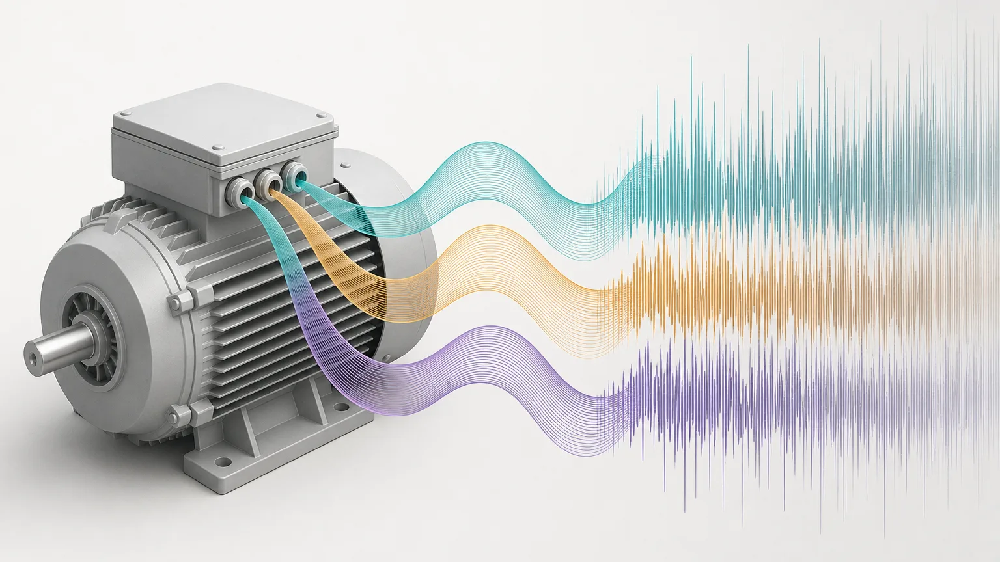
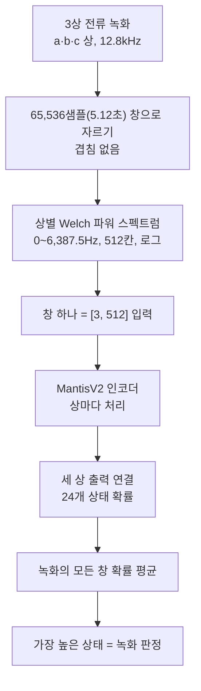
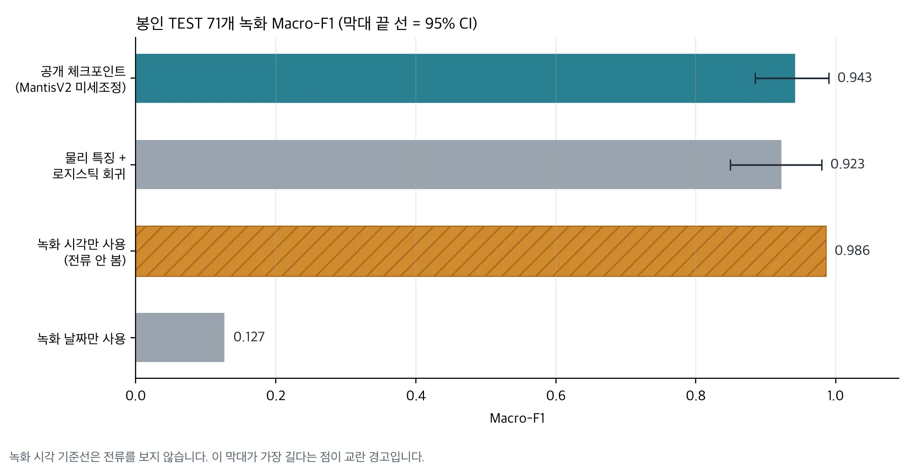

모터의 3상 전류만 보고 고장 상태를 구분하는 연구 모델을 Hugging Face에 공개했습니다. 모델 이름은 Thaki-MCSA-MantisV2-MCC5입니다. 시계열 사전학습 모델 MantisV2를 MCC5 모터 전류 데이터로 미세조정했고 24가지 상태를 구분합니다.

학습에 쓰지 않은 운전 조건 3개의 녹화 71개로 한 번만 평가했고 Macro-F1은 0.943이었습니다. 그런데 같은 시험에서 전류를 전혀 보지 않고 녹화 시각만 쓰는 기준선이 0.986을 냈습니다. 그래서 이 점수만으로 실제 공장 모터의 고장을 진단할 수 있다고 말할 수 없습니다. 무엇을 했고 어떤 결과가 나왔는지, 그리고 아직 믿으면 안 되는 부분을 함께 정리했습니다.

## 쉽게 말하면

이 실험은 한 학생이 같은 교실에서 같은 선생님에게 시험을 본 것과 비슷합니다. 점수는 높았지만 시험지마다 볼펜 색이 달랐다면 학생이 문제를 풀었는지 볼펜 색을 외웠는지 가리기 어렵습니다. MCC5에서는 녹화 시각이 그 볼펜 색 역할을 했습니다. 이 모델이 다른 교실, 즉 다른 물리 모터에서도 문제를 푸는지는 아직 시험하지 않았습니다.

## 왜 모터 전류를 보는가

전동기는 고장 상태와 운전 조건에 따라 전류의 크기, 주파수 성분, 상 사이의 관계가 달라질 수 있습니다. MCSA(Motor Current Signature Analysis)는 이런 전기 신호에서 상태 변화의 단서를 찾는 방법입니다. 전류 센서는 이미 설비에 달려 있는 경우가 많아서 기존 계측만으로 어떤 진단 정보를 얻을 수 있는지 검토할 가치가 있습니다.

다만 전류가 바뀐다고 고장이라는 뜻은 아닙니다. 부하, 회전 속도, 공급 전압, 측정 장비도 신호를 바꿉니다. 고장 분류 모델을 만들 때는 이 요인과 고장을 구분할 수 있는 데이터 구조가 먼저 필요합니다.

## 무엇을 학습했나

데이터는 MCC5-THU입니다. 2.2kW 3상 유도전동기 시험 장치 한 대에서 수집한 녹화이고 정상 1개와 단일·복합 고장 23개를 합쳐 24가지 상태가 있습니다. 원본은 Mendeley Data에 CC BY 4.0으로 공개되어 있습니다.

모델 입력은 녹화 원파형이 아닙니다. 12.8kHz로 기록된 전류를 65,536샘플(5.12초) 길이의 겹치지 않는 창으로 자릅니다. 창마다 상별로 Welch 방식의 파워 스펙트럼을 구하고 0~6,387.5Hz 구간 512개 칸을 로그로 바꿔 [3, 512] 입력을 만듭니다. MantisV2 인코더가 상마다 이 입력을 처리하고 세 상의 출력을 이어 붙여 24개 상태의 확률을 계산합니다. 녹화 하나의 판정은 창별 확률을 평균한 뒤 가장 높은 상태입니다.



개발 단계에서는 9개 운전 조건을 하나씩 빼고 학습하는 교차검증(LOCO)을 했습니다. 이 단계에서 물리 특징 분류기, 사전학습 MantisV2 표현, MantisV2 전체 미세조정을 비교했습니다. 공개한 체크포인트는 개발용 녹화 208개 전체로 다시 학습한 모델 하나입니다.

## 결과

| 평가 | Macro-F1 | 무엇을 뜻하나 |
|---|---|---|
| MantisV2 미세조정, 9-fold LOCO 교차검증 | 0.945 (최저 fold 0.884) | fold마다 새로 학습한 모델의 평균입니다. 공개 파일의 점수가 아닙니다 |
| 공개 체크포인트, 봉인 TEST 71개 녹화 | 0.943, 95% CI [0.885, 0.990] | 학습 전에 봉인하고 한 번만 연 시험입니다 |
| 물리 특징 + 로지스틱 회귀, 같은 TEST | 0.923, 95% CI [0.849, 0.980] | 전통 방식 기준선입니다 |
| 녹화 시각만 사용, 같은 TEST | 0.986 | 전류를 보지 않는 교란 경고용 기준선입니다 |
| 녹화 날짜만 사용, 같은 TEST | 0.127 | 날짜 단위로는 거의 맞히지 못합니다 |



*같은 봉인 TEST의 네 결과만 그렸습니다. LOCO 0.945는 다른 평가라 차트에서 뺐습니다.*

봉인 TEST에서 공개 체크포인트는 71개 중 67개 녹화를 맞혔습니다. 24개 상태 중 20개는 정밀도와 재현율이 모두 1.00이었습니다. 틀린 4건 중 3건은 권선 고장의 심각도 H와 L을 서로 바꾼 경우였고 나머지 1건은 베어링 외륜 고장을 축 휨으로 판정했습니다. 권선 H의 F1은 0.40, 권선 L은 0.57입니다.

이 숫자는 작은 표본에서 나왔습니다. 상태마다 TEST 녹화가 3개뿐이고 전압 불평형 L은 2개입니다. 하나만 틀려도 그 상태의 재현율이 0.33 움직입니다.

물리 특징 기반 로지스틱 회귀보다 Macro-F1이 0.020 높았지만 그 차이의 95% 신뢰구간은 [−0.051, +0.094]로 0을 포함합니다. 미리 정한 우월 기준(+5%p 이상, 신뢰구간 하한 0 초과)에 못 미쳤으므로 이 장치에서 MantisV2가 손으로 만든 스펙트럼 특징보다 낫다고 주장하지 않습니다. 같은 TEST에서 확률 보정 오차(ECE, 10구간)는 0.025로, 로지스틱 회귀의 0.142보다 작았습니다. 모델이 내는 확률이 실제 정답률에 더 가깝다는 뜻입니다. 다만 이 장점도 같은 시험 장치 안에서 확인한 것입니다.

## 녹화 시각 기준선이 더 높은 이유

MCC5에서는 상태 라벨과 녹화 시점이 강하게 묶여 있습니다. 24개 라벨 중 21개는 사실상 하루 안에 녹화됐습니다. 같은 라벨의 녹화가 시간상 몰려 있어서 녹화 시각만 알아도 라벨을 거의 맞힐 수 있습니다. 이 기준선이 0.986입니다. 반면 날짜만 쓰는 기준선은 0.127로 낮습니다. 문제는 날짜 자체가 아니라 같은 날 안의 녹화 순서입니다.

MantisV2가 녹화 시각을 입력으로 받은 것은 아닙니다. 다만 녹화 시점에 따라 달라진 장치 상태나 측정 환경이 전류에 남았을 수 있습니다. 모델이 고장 대신 그 차이를 배웠을 가능성을 이 데이터만으로는 배제할 수 없습니다.

같은 날 같은 조건에서 정상과 고장을 번갈아 측정하고 서로 다른 물리 모터에서 같은 고장을 재현했다면 더 강한 검증이 됐을 것입니다. 이번 데이터로는 그런 현장 일반화를 증명할 수 없었습니다.

## 그래도 공개한 이유

이번 공개는 현장에 바로 넣을 완제품이 아니라 연구 미리보기(Research Preview)입니다. 사전학습 시계열 모델을 모터 전류에 어떻게 적용했는지, 전통적인 물리 특징 방법과 어떻게 비교했는지, 어떤 데이터 교란이 평가를 흔드는지 재현할 수 있게 하려는 것입니다.

가중치와 코드는 Apache-2.0으로 공개했습니다. 기반 모델 paris-noah/MantisV2도 Apache-2.0입니다. 원본 MCC5 데이터는 모델 저장소에서 재배포하지 않으니, 데이터는 원본 제공처에서 받으시기 바랍니다.

모델 카드의 예제는 다음과 같습니다. 입력은 a·b·c 3상 전류(암페어)이고 샘플링 주파수는 정확히 12,800Hz여야 합니다. 리샘플링은 검증하지 않아서 다른 주파수는 로더가 거부합니다.

```python
import numpy as np
from thaki_mcsa import load_model, welch_views, predict_recording

net, labels, meta = load_model("mantisv2_mcc5_full_welch.pt", device="cpu")  # 로드 전에 sha256을 확인합니다
current = np.load("current.npy")                 # [3, n_samples], 암페어, fs = 12,800 Hz
out = predict_recording(net, labels, welch_views(current, fs=12800))
print(out["label"], out["top3"], out["n_windows"])
```

설치와 명령줄 사용법은 [Hugging Face 모델 카드](https://huggingface.co/ThakiCloud/Thaki-MCSA-MantisV2-MCC5)에 있습니다. 참고로 일반 x86 서버 CPU에서 90초 녹화 하나를 처리하는 데 약 1초가 걸렸습니다. 엣지 장치에서는 재지 않았습니다.

## 실제 설비에 쓰려면 무엇이 더 필요한가

현장 설비에 적용하기 전에 최소한 다음을 확인해야 합니다. 서로 다른 물리 모터에서 같은 고장이 반복되는지, 정상과 고장이 비교 가능한 부하·속도·전압 조건에서 측정됐는지, 장비 ID나 센서 코드나 수집 시각이 정답 라벨을 대신하지 않는지입니다. 같은 파형이나 같은 녹화 세션이 학습과 평가에 동시에 들어가지 않았는지도 봐야 합니다. 마지막으로 개발에 쓰지 않은 장비에서 오경보와 고장 누락이 얼마나 나는지 재야 합니다.

이 항목들은 모델을 키운다고 해결되지 않습니다. 데이터와 평가 설계에서 풀어야 합니다.

## 모델 출력에서 정비 업무까지

모델이 이상 징후를 출력해도 그것만으로 설비를 멈추거나 정비 작업을 자동 실행하면 안 됩니다. 검증된 모델을 Metis 같은 추론 운영 계층으로 제공하고 Paxis로 담당자 검토와 업무 연결, 승인 절차를 구성하는 방식을 생각할 수 있습니다.

이것은 참조 설계입니다. 이번 MCSA 모델을 Paxis와 통합해 현장 성능을 검증했다는 뜻이 아닙니다. 같은 기준으로 센서 판정을 정비 업무에 잇는 구조는 [센서 값으로 설비 상태를 읽고, Paxis가 정비 업무를 엽니다](/tech-blog/ko/research/thaki-equipmenthealth-sensor-paxis-maintenance/)에서 다뤘습니다.

## 정리

이 모델은 MCC5에서 높은 분류 점수를 냈습니다. 동시에 녹화 시각 기준선이 그보다 높고 물리 특징 기준선과의 차이도 확실하지 않다는 점을 드러냈습니다. 모터 고장 진단 AI에 필요한 것은 높은 점수 하나가 아니라, 처음 보는 장비에서도 고장 신호를 구분한다는 증거입니다.

자사 설비의 전류나 센서 데이터로 AI 적용 가능성을 검토하고 싶다면 [ThakiCloud에 문의](/contact?interest=industrial-ai&origin=mcsa)하시기 바랍니다. 장비 종류, 센서 구성, 측정 조건부터 함께 검토합니다.



---

*모델: [ThakiCloud/Thaki-MCSA-MantisV2-MCC5](https://huggingface.co/ThakiCloud/Thaki-MCSA-MantisV2-MCC5) (Apache-2.0, 연구 미리보기). 기반 모델: [paris-noah/MantisV2](https://huggingface.co/paris-noah/MantisV2) (Apache-2.0). 데이터 출처: MCC5-THU, Mendeley Data, CC BY 4.0. 본문의 Metis·Paxis 연결은 참조 설계이며 통합 제품의 실측 결과가 아닙니다.*
