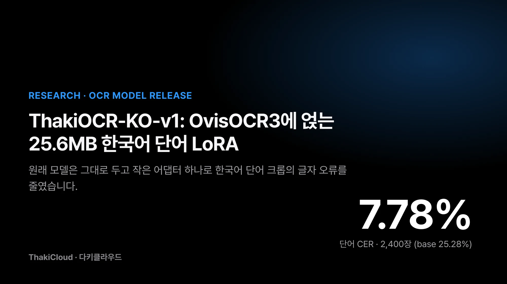
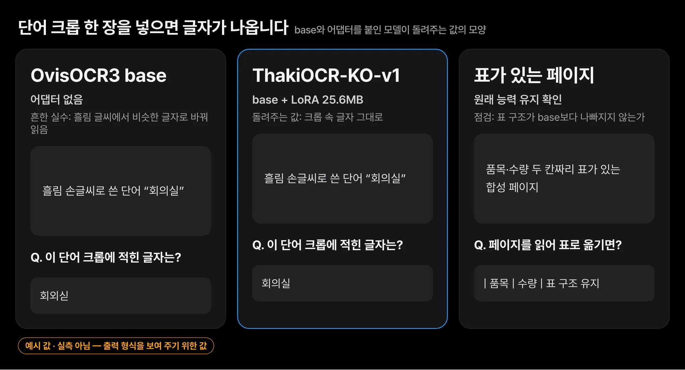
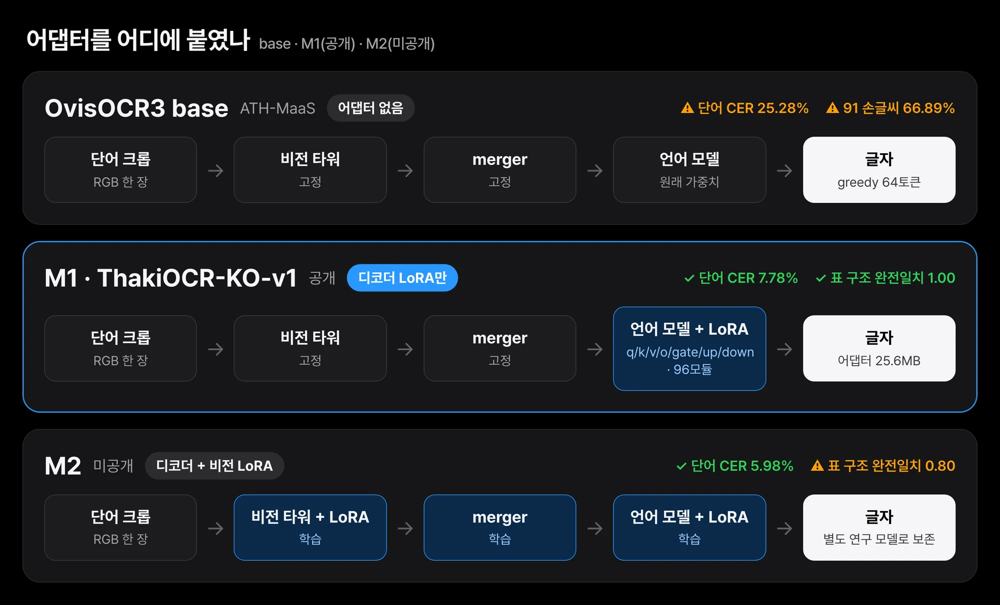
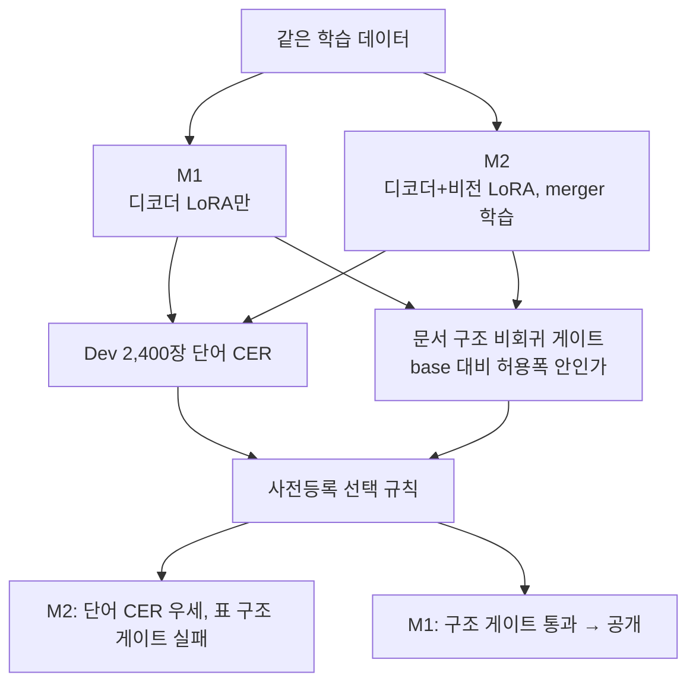
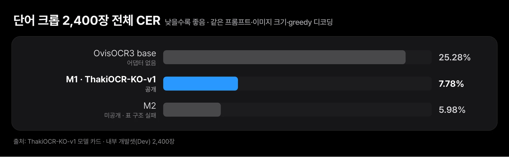
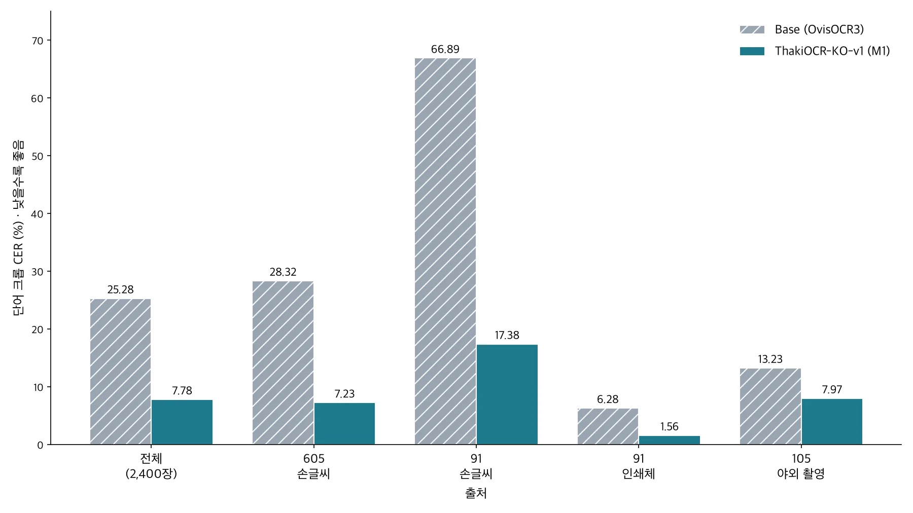
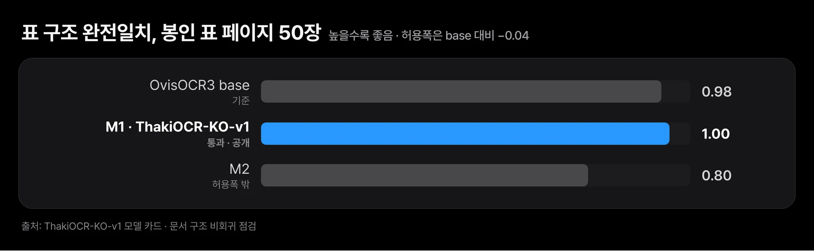
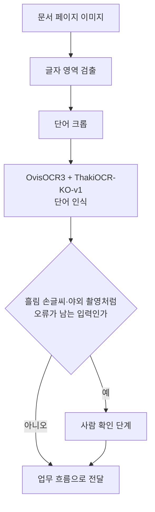

손으로 쓴 신청서의 이름 칸이나 야외에서 찍은 간판, 인쇄된 양식의 항목은 모두 단어 하나로 잘려 들어옵니다. 문서 처리 흐름은 이런 단어를 한 장씩 읽습니다. 그런데 흘림 손글씨를 만나면 공개 모델도 글자를 자주 틀립니다.

공개된 문서 인식 모델이 한국어 손글씨와 단어 이미지를 더 정확하게 읽도록 작은 보정 모듈을 학습해 공개했습니다. 잘라 낸 단어 이미지 2,400장에서 글자 오류율이 25.28%에서 7.78%로 내려갔습니다. 원래 모델과 비교하면 오류가 69.2% 줄었습니다.

연구용 공개이며 제품 출시가 아닙니다. 이 모델은 단어 하나를 잘라 낸 이미지를 읽습니다. 문서 한 쪽 전체를 읽는 성능은 검증하지 않았으니, 손글씨 신청서나 촬영한 간판을 처리하는 흐름의 한 단계로 보시면 됩니다. 원래 모델은 그대로 두고 작은 파일 하나만 더 내려받아 얹는 구조라 기존 환경에 붙이기도 쉽습니다.

모델 이름은 [ThakiCloud/ThakiOCR-KO-v1](https://huggingface.co/ThakiCloud/ThakiOCR-KO-v1)이고, 공개 OCR 모델 OvisOCR3에 붙이는 LoRA 어댑터입니다. 위 오류율은 문자 오류율(CER)이며 base 모델과 같은 조건으로 쟀습니다. 어댑터는 25.6MB이고 Apache-2.0 라이선스입니다.

## 쉽게 말하면

OvisOCR3는 인쇄된 문서를 잘 읽는 경력 직원에 가깝습니다. 다만 한국어 손글씨, 특히 사람마다 모양이 다른 흘림 글씨에는 약했습니다. 우리는 이 직원에게 한국어 단어 카드 묶음으로 짧은 집중 연습을 시켰습니다. 기억 전체를 바꾸지 않고 메모장 한 권(LoRA)만 덧붙이는 방식입니다.

연습 뒤 단어 카드를 읽는 실력은 크게 늘었습니다. 원래 잘하던 표 읽기를 잊지 않았는지도 따로 확인했습니다. 단어는 더 잘 읽게 됐어도 표 읽기 시험에서 떨어진 다른 연습 방식은 이번 공개에서 뺐습니다.

## 검출이 좋아도 단어를 잘못 읽으면 결과가 틀립니다

한국어 문서 처리 파이프라인은 보통 페이지에서 글자 영역을 찾은 뒤 그 영역을 잘라 인식합니다. 잘라 낸 단어 이미지를 정확히 읽는 단계가 약하면 앞단 검출이 아무리 좋아도 결과가 틀립니다. 손으로 쓴 신청서, 야외에서 찍은 간판, 인쇄된 양식처럼 입력 조건이 다양한 한국어 환경에서는 이 단계의 오류가 쌓입니다.

OvisOCR3는 문서 구조를 읽는 능력이 있는 공개 OCR 모델입니다. 같은 조건으로 잰 결과 한국어 단어 크롭에서는 CER이 25.28%였고 손글씨 하위셋 하나에서는 66.89%까지 올라갔습니다. 우리는 이 약점만 보강하고 base 모델이 원래 갖고 있던 문서 구조 능력은 해치지 않는 것을 목표로 잡았습니다.


*출력 형식을 보여 주는 예시입니다. 단어와 표는 설명용으로 지어낸 것이며 학습·평가 데이터에서 가져오지 않았습니다.*

입력은 단어 하나가 담긴 크롭 이미지이고 출력은 그 안의 글자입니다. 어댑터를 붙인 뒤에도 페이지를 넣으면 원래처럼 표를 읽어야 합니다. 이 두 가지를 함께 지키는 것이 이번 학습의 조건이었습니다.

## 언어 모델 쪽에만 25.6MB 어댑터를 붙였습니다

### 모델

- base: [ATH-MaaS/OvisOCR3](https://huggingface.co/ATH-MaaS/OvisOCR3), revision `4833d5d2afa6e769ee933f024504d67ace80a24c`. base 저장소의 `main`은 그 뒤에 바뀌었으므로 이 revision을 고정해 써야 합니다.
- 크기: 어댑터를 병합한 bf16 체크포인트가 1,706,030,528바이트이고 파라미터로 환산하면 약 0.85B입니다. 모델 카드는 "0.9B급"으로 적습니다.
- 어댑터: LoRA r=16, alpha=32, dropout 0.05. 언어 모델의 `q/k/v/o/gate/up/down_proj`에만 붙였습니다. 모듈은 96개이고 학습 파라미터는 6,389,760개입니다. 비전 타워와 비전-언어 merger는 고정했습니다.

LoRA(Low-Rank Adaptation)는 원래 가중치를 그대로 두고 옆에 작은 행렬 두 개를 덧붙여 그 부분만 학습하는 방법입니다. 그래서 공개 파일은 원래 모델 전체가 아니라 덧붙인 행렬만 담은 25.6MB 어댑터입니다.


*M1은 언어 모델 쪽에만 LoRA를 붙였고, M2는 비전 쪽까지 학습했습니다. M2가 단어는 더 잘 읽었지만 표 구조 점검에서 떨어져 M1을 공개했습니다.*

### 데이터

학습 데이터는 AI 허브(AI-Hub)의 세 데이터셋입니다.

- AI 허브(AI-Hub) · 대용량 손글씨 OCR 데이터(605)
- AI 허브(AI-Hub) · 다양한 형태의 한글 문자 이미지 인식 데이터(91), 손글씨·인쇄체 하위셋
- AI 허브(AI-Hub) · 야외 실제 촬영 한글 이미지 데이터(105)

데이터는 승인받은 신청자 본인이 내부 학습과 평가에만 썼습니다. 원본과 가공물(크롭, 라벨 파일, 서브셋, 샘플)은 공개 저장소에 없고 이 글에도 싣지 않습니다. 데이터가 필요하면 AI 허브에서 직접 신청해야 합니다.

91 인쇄체 하위셋은 제3자 폰트로 렌더링됐습니다. 학습에 쓴 라벨의 폰트 라이선스 필드를 모두 확인했습니다. 폰트는 10종이었고 SIL Open Font License 7종, 지자체 무료 글꼴 3종이었으며 금지 조항은 찾지 못했습니다. 공개 저장소에는 폰트 파일도 렌더링 이미지도 없습니다.

### 학습

같은 데이터로 두 가지 방식을 학습했습니다.

- **M1(공개한 어댑터)**: 디코더에만 LoRA를 붙였습니다.
- **M2**: 디코더와 비전 타워 모두에 LoRA를 붙이고 merger도 학습했습니다.

M1은 B200 GPU 한 장에서 4.74 GPU시간 학습했고 학습 중 최대 메모리는 3.88 GiB였습니다. 학습 데이터에서 따로 떼어 낸 내부 검증 분할로 조기 종료를 판단했습니다(patience 4, 세부 설정은 모델 카드). 5,500 step에서 멈췄고 공개한 어댑터는 5,250 step의 최고 체크포인트입니다. 평가용 개발셋(Dev)은 체크포인트를 고르는 데 쓰지 않았습니다.

두 방식 중 무엇을 공개할지는 결과를 보기 전에 등록한 선택 규칙으로 정했습니다.



## 단어 크롭 오류율이 25.28%에서 7.78%로 내려갔습니다

**평가셋**: 내부 개발셋(Dev) 단어 크롭 2,400장입니다. 학습에 쓴 세 데이터셋의 공식 검증 분할에서 출처별로 600장씩(605, 91 손글씨, 91 인쇄체, 105) 뽑았습니다. 정답 글자는 모두 7,389자이고 91 손글씨는 작성자 15명입니다. 같은 원천에서 나온 셋이므로 독립 시험셋이 아닙니다.

**지표**: 이 글에서 Word CER은 단어 크롭 단위로 잰 문자 오류율(CER)을 뜻합니다. 단어 오류율(WER)이 아닙니다. 예측과 정답을 NFC 정규화하고 앞뒤 공백을 지운 뒤 글자 편집 거리를 정답 글자 수로 나눕니다. "전체"는 2,400장의 편집 거리 합을 전체 정답 글자 수로 나눈 값입니다. 낮을수록 좋습니다.

**기준선**: 어댑터를 붙이지 않은 OvisOCR3(같은 revision)를 같은 프롬프트, 같은 이미지 크기, 같은 greedy 디코딩으로 같은 2,400장에 돌렸습니다. M1 학습과 M2 학습에서 각각 잰 base 예측은 2,400장 모두 같았습니다.

| 출처 | Base (OvisOCR3) | **M1 (공개 어댑터)** | M2 (미공개) |
|---|---|---|---|
| 전체 (2,400장) | 25.28% | **7.78%** | 5.98% |
| 605 손글씨 (600장) | 28.32% | **7.23%** | 5.53% |
| 91 손글씨 (600장, 작성자 15명) | 66.89% | **17.38%** | 12.19% |
| 91 인쇄체 (600장) | 6.28% | **1.56%** | 1.66% |
| 105 야외 촬영 (600장) | 13.23% | **7.97%** | 6.47% |


*base 25.28%에서 공개 어댑터 M1은 7.78%로 내려갔습니다. M2는 5.98%로 더 낮았지만 표 구조 점검을 통과하지 못했습니다.*

- 같은 문항끼리 비교한 M1과 base의 차이는 전체 −17.50%p(95% CI −20.32~−15.12)입니다. 네 출처 모두 신뢰구간이 0을 포함하지 않는 범위에서 좋아졌습니다.
- 출처별 CER을 단순 평균한 값은 M1 8.53%입니다.
- 문자 종류별 M1 CER은 한글 9.11%, 숫자 0.85%, 라틴 문자 5.04%, 문장부호 4.14%입니다. base는 각각 18.87%, 3.75%, 22.30%, 18.42%였습니다. 라틴 문자는 크롭 42장(139자)뿐이라 이 값은 흔들림이 큽니다.


*같은 프롬프트, 같은 이미지 크기, 같은 greedy 디코딩으로 잰 출처별 단어 크롭 CER입니다. 낮을수록 좋습니다.*

### 표 구조를 지킨 M1을 공개했습니다

단어 크롭으로 미세조정하면 base 모델이 원래 하던 표 읽기나 읽기 순서가 망가질 수 있습니다. 그래서 단어 크롭이 아닌 페이지로 base보다 나빠지지 않았는지(비회귀)만 점검했습니다. 평가셋은 학습과 튜닝에 쓰지 않고 따로 잠가 둔 합성 봉인 페이지 200장(표 페이지 50장 포함)과 한국어 문서 테스트 849건입니다. 허용폭은 결과를 보기 전에 정했습니다. 어댑터를 bf16으로 병합한 사본을 base 모델과 같은 인터페이스로 서빙해 쟀습니다.

| 점검 | 허용폭 | Base | **M1** | M2 |
|---|---|---|---|---|
| 표 구조 완전일치 (봉인 표 페이지 50장) | −0.04 | 0.98 | **1.00** | 0.80 ✗ |
| 표 TEDS (봉인) | −0.02 | 0.999 | **0.992** | 0.992 |
| 읽기 순서 Kendall τ (봉인) | −0.01 | 0.998 | **0.997** | 0.995 |
| 읽기 순서 커버리지 (봉인) | −0.01 | 0.998 | **0.997** | 0.996 |
| 한국어 문서 테스트 849건, 표 통과율 | −0.02 | 51.9% | **56.2%** | 55.6% |
| 한국어 문서 테스트 849건, 전체 통과율 | −0.02 | 58.0% | **60.2%** | 59.5% |

M2는 단어 인식이 더 정확했습니다. M2와 M1의 차이는 전체 −1.80%p(95% CI −2.43~−1.14)이고 91 손글씨는 작성자 15명 단위 bootstrap으로 −5.19%p(95% CI −7.49~−3.20)입니다. 그런데 표 구조 완전일치가 0.80으로 base의 0.98에서 허용폭 0.04를 넘게 떨어졌습니다. 사전등록 규칙에 따라 M1을 골랐습니다. M2 체크포인트는 별도 연구 모델로 보존하고 이 저장소에는 넣지 않았습니다.


*base 0.98 대비 M1은 1.00으로 허용폭 안이었고, M2는 0.80으로 허용폭 0.04를 넘게 떨어졌습니다. 합성 페이지 50장의 결과입니다.*

M1의 1.00은 합성 페이지 50장의 결과입니다. 실제 문서에서 표 구조가 늘 맞는다는 뜻이 아닙니다.

## 흘림 손글씨와 야외 촬영에서는 아직 틀립니다

### 어디서 여전히 틀리나

- **흘림 손글씨가 가장 어렵습니다.** 91 손글씨는 66.89%에서 17.38%로 내려갔지만 여전히 다른 출처보다 두 배 이상 높습니다. 아직 사람 확인 없이 쓰기 어려운 수준입니다.
- **한글 음절 오류가 대부분입니다.** 정답 글자 가운데 한글이 가장 많고 M1의 한글 CER은 9.11%로 숫자(0.85%)보다 열 배 이상 높습니다. 남은 오류는 대부분 한글 음절에서 나옵니다.
- **야외 촬영 이미지는 개선 폭이 작습니다.** 105는 13.23%에서 7.97%로 내려가 출처 가운데 상대 개선이 가장 작았습니다.
- **머리말·꼬리말 처리는 base와 같이 약합니다.** 한국어 문서 테스트의 머리말·꼬리말 항목 통과율은 base 5.4%, M1 6.3%로 둘 다 낮습니다. 이 어댑터가 고친 영역이 아닙니다.

### 측정하지 않았거나 주장하지 않는 것

- **전체 페이지 OCR**: 실제 문서 전체를 읽는 성능은 목표 과제로 평가하지 않았습니다. 이 모델은 단어 한 개가 담긴 크롭을 받는 것을 전제로 합니다.
- **분포 밖 일반화**: Dev는 학습 데이터와 같은 세 데이터셋에서 나왔습니다. 새 작성자, 새 폰트, 새 문서 유형, 새 촬영 조건은 시험하지 않았습니다. 91 인쇄체는 학습과 Dev에 같은 폰트가 나옵니다.
- **더 큰 모델과의 비교**: 이 어댑터가 더 큰 OCR 모델과 대등하다고 말하지 않습니다.
- **다른 추론 설정**: 아래 고정 설정 외의 프롬프트, 이미지 크기, 샘플링은 평가하지 않았습니다.

## 어댑터를 붙이면 조금 느려지고 메모리를 더 씁니다

B200 GPU 한 장, 배치 1 기준으로 쟀습니다.

| 모델 | 지연 중앙값 | p95 | 최대 메모리 |
|---|---|---|---|
| OvisOCR3 base | 0.186초 | 0.310초 | 4.95 GiB |
| **ThakiOCR-KO-v1** | **0.210초** | **0.360초** | **7.02 GiB** |

두 중앙값을 실제 속도로 재생하면 차이가 이 정도입니다.

<figure class="fig-video"><video src="/assets/images/thakiocr-ko-v1-ovisocr3-korean-finetune-fig-race.mp4" poster="/assets/images/thakiocr-ko-v1-ovisocr3-korean-finetune-fig-race.webp" autoplay muted loop playsinline preload="metadata" aria-label="OvisOCR3 base와 ThakiOCR-KO-v1의 단어 크롭 1장 지연을 실제 속도로 재생한 애니메이션"></video><figcaption>위 표의 지연 중앙값(실측)을 8초 동안 실제 속도로 재생했습니다. 어댑터 비용은 한 장에 수십 밀리초 수준입니다.</figcaption></figure>

오류율이 크게 줄어든 대가로 한 장에 수십 밀리초와 메모리 2GiB 남짓을 더 씁니다. 처리량이 중요한 흐름이라면 이 비용을 함께 따져 봐야 합니다.

## 공개 전에 2,400장을 다시 돌려 같은 답을 확인했습니다

- 공개 직전 릴리스 어댑터로 Dev 2,400장을 다시 추론했습니다. 학습 때 저장한 예측과 2,400장 모두 같은 문자열이 나왔고 전체 CER도 7.78%로 같았습니다.
- 공개로 바꾼 뒤에는 로그인하지 않은 환경에서 파일 6개를 내려받아 sha256이 공개 전 매니페스트와 모두 같은지 확인했습니다.
- 같은 익명 환경에서 base 모델과 어댑터, `inference_example.py`를 내려받아 합성 이미지 한 장을 정확히 읽는지 확인했습니다. LoRA가 붙은 모듈은 96개, 비전 쪽은 0개였습니다. 이 점검은 로딩 확인이며 성능 측정이 아닙니다.

## 고정 설정 그대로 내려받아 돌리면 됩니다

모델 카드의 고정 설정을 그대로 써야 합니다.

| 항목 | 값 |
|---|---|
| base 모델 | `ATH-MaaS/OvisOCR3` revision `4833d5d2afa6e769ee933f024504d67ace80a24c` |
| 프롬프트 | 그 revision의 base 저장소에 있는 `prompts/plain_ocr.txt` |
| 채팅 템플릿 | `apply_chat_template(..., add_generation_prompt=True, enable_thinking=False)`, 이미지 다음에 프롬프트 |
| 이미지 크기 | `min_pixels = 448*448`, `max_pixels = 2880*2880` |
| 디코딩 | greedy(`do_sample=False`), `max_new_tokens=64` |
| 가중치 | base는 fp32, 생성은 bf16 autocast |
| 입력 | 단어 하나가 담긴 RGB 크롭 한 장 |

저장소의 참조 스크립트로 바로 돌릴 수 있습니다.

```bash
pip install "transformers>=5.0" "peft>=0.21" torch pillow huggingface_hub
python inference_example.py --image word.png
python inference_example.py --image word.png --report   # JSON with load checks
```

모델 카드에 실린 최소 코드는 다음과 같습니다.

```python
import torch, transformers
from huggingface_hub import hf_hub_download
from peft import PeftModel
from PIL import Image

BASE, REV = "ATH-MaaS/OvisOCR3", "4833d5d2afa6e769ee933f024504d67ace80a24c"
processor = transformers.AutoProcessor.from_pretrained(BASE, revision=REV)
model = transformers.AutoModelForImageTextToText.from_pretrained(BASE, revision=REV, dtype=torch.float32).to("cuda")
model = PeftModel.from_pretrained(model, "ThakiCloud/ThakiOCR-KO-v1").eval()

prompt_text = open(hf_hub_download(BASE, "prompts/plain_ocr.txt", revision=REV), encoding="utf-8").read()
msgs = [{"role": "user", "content": [{"type": "image"}, {"type": "text", "text": prompt_text}]}]
prompt = processor.tokenizer.apply_chat_template(msgs, tokenize=False, add_generation_prompt=True, enable_thinking=False)
inputs = processor(text=[prompt], images=[Image.open("word.png").convert("RGB")], return_tensors="pt",
                   images_kwargs={"min_pixels": 448 * 448, "max_pixels": 2880 * 2880}).to("cuda")
with torch.no_grad(), torch.autocast("cuda", dtype=torch.bfloat16):
    out = model.generate(**inputs, max_new_tokens=64, do_sample=False)
print(processor.tokenizer.decode(out[0, inputs["input_ids"].shape[1]:], skip_special_tokens=True).strip())
```

공개 파일은 `adapter_model.safetensors`(25.6MB), `adapter_config.json`, `inference_example.py`, 영어 카드 `README.md`, 한국어 카드 `MODEL_CARD.ko.md`, `LICENSE`입니다. 내부의 bf16 병합본(1.71GB)은 이번 공개에 넣지 않았습니다. bf16 병합본은 fp32 base에 어댑터를 붙여 돌린 결과와 비트 단위로 같지 않습니다.

## 어댑터는 Apache-2.0, 학습 데이터는 재배포할 수 없습니다

- **base 모델**: `ATH-MaaS/OvisOCR3`는 Apache-2.0입니다. base 모델 사용은 base 모델 라이선스를 따릅니다.
- **ThakiOCR-KO-v1 LoRA 어댑터**: Apache-2.0으로 공개했습니다.
- **학습 데이터**: 재배포할 수 없습니다. 어댑터를 쓸 때는 "AI 허브(AI-Hub)" 출처와 위 세 데이터셋 이름을 함께 표기해 주세요.

## 온프레미스에서는 어댑터만 바꿔 끼우며 시험할 수 있습니다

어댑터가 25.6MB이고 base가 공개 모델이므로, 문서를 밖으로 내보낼 수 없는 온프레미스 환경에서도 base를 한 번 받아 두면 어댑터만 교체하며 시험할 수 있습니다. 이 모델은 ThakiCloud의 큐 기반 GPU 학습과 데이터 계보 기록, 해시 검증, 익명 재현 절차를 그대로 거쳐 만들었습니다.

문서 업무 흐름에서 이 어댑터가 맡는 자리는 잘라 낸 단어를 읽는 한 단계입니다. 흘림 손글씨나 야외 촬영처럼 오류가 남는 입력은 사람 확인 단계로 넘기는 구성을 권합니다.



ThakiCloud는 고객이 통제하는 환경에서 모델을 학습하고(Maxis), 서비스하고(Metis), 업무에 연결하는(Paxis) 플랫폼을 만듭니다. 자체 문서로 같은 방식의 어댑터를 학습하거나 평가하려면 [ThakiCloud](https://thakicloud.com)로 문의해 주시기 바랍니다.

## 끝으로

ThakiOCR-KO-v1은 OvisOCR3에 25.6MB 어댑터 하나를 얹어 한국어 단어 크롭의 오류율을 25.28%에서 7.78%로 낮추고, 표 구조 능력은 지켰습니다. 써 보려면 base를 고정 revision으로 받아 두고, 내 업무의 단어 크롭 수십 장을 어댑터 유무로 나란히 돌려 보시기를 권합니다. 흘림 손글씨가 많다면 그 묶음만 따로 오류율을 재 보는 것이 좋습니다.

- 같은 시리즈의 대형 모델: [ThakiOCR-Large-27B-R2B 공개 글](/tech-blog/ko/research/thakiocr-large-27b-r2b-qwen-korean-ocr/). 평가셋과 전처리, 디코딩이 달라 이 글의 수치와 순위를 매겨 비교할 수 없습니다.
- 처음부터 직접 학습한 작은 OCR: [ThakiOCR A 공개 글](/tech-blog/ko/research/thakiocr-a-small-korean-english-line-ocr/)
- 숫자와 기호에 집중한 후속 모델: [G2M 공개 글](/tech-blog/ko/research/thakiocr-g2m-numbers-and-symbols/)

- 모델: [ThakiCloud/ThakiOCR-KO-v1](https://huggingface.co/ThakiCloud/ThakiOCR-KO-v1)
- base 모델: [ATH-MaaS/OvisOCR3](https://huggingface.co/ATH-MaaS/OvisOCR3)
- 학습 데이터: 위 학습 데이터 절의 AI 허브(AI-Hub) 데이터셋 605·91·105. 데이터 재배포 불가, 신청자 본인 내부 이용.
- 연구용 공개이며 제품 출시 판정은 별도입니다.
