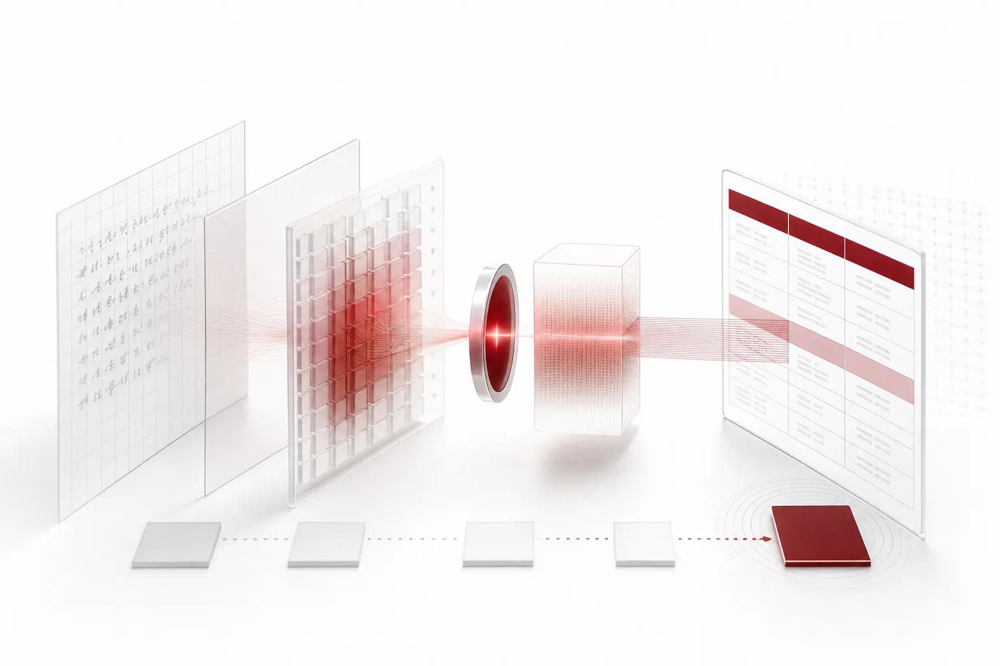
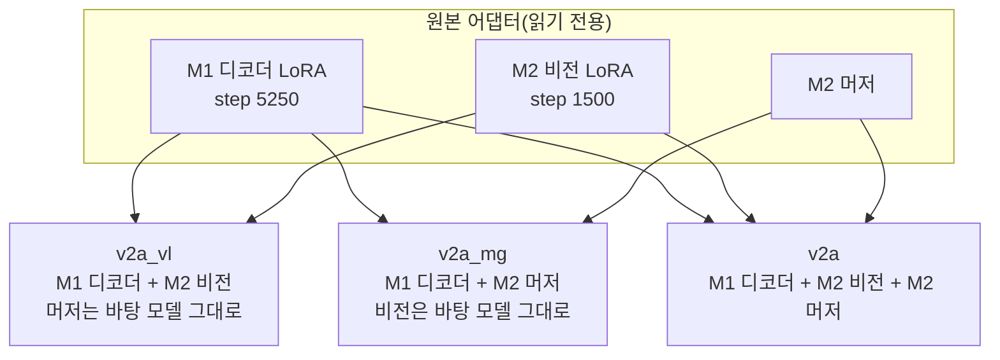

**아래 수치는 개발용 세트에서 잰 진단값이며 독립 검증 전이라 공식 성능이 아닙니다. 모델은 공개하지 않았습니다.** 개발용 세트는 이전 모델을 고를 때 이미 쓴 데이터라서 여기서 나온 숫자로는 최종 성능을 판정할 수 없습니다.

학습을 더 하지 않고 두 어댑터를 부품 단위로 결합했습니다. 이미지를 읽는 쪽의 어댑터만 옮긴 조합이 개발용 세트에서 단어 글자 오류율 4.80%, 손글씨 글자 오류율 9.78%를 기록했고 표 구조 진단도 통과했습니다. 하지만 사전등록한 독립 평가 데이터가 기준에 못 미쳐 공개를 보류했습니다. 성능이 나빠서 멈춘 것이 아니라 평가할 데이터가 부족해서 멈췄습니다.

아래에서는 개발(Dev) 세트를 Dev로, 단어 단위 글자 오류율을 Word CER로, 이미지를 읽는 쪽 어댑터를 Vision LoRA(비전 LoRA)로 적습니다.

*글의 핵심 개념을 형상화했습니다.*

## 쉽게 말하면

글씨를 읽는 사람을 눈과 머리로 나눠 보겠습니다. 한 사람(M1)은 표를 정확하게 옮겨 적지만 흘려 쓴 손글씨에 약합니다. 다른 사람(M2)은 손글씨를 더 잘 읽지만 표를 옮길 때 칸을 틀리게 나누는 일이 있습니다.

이번 실험은 M1의 머리는 그대로 두고 M2의 안경만 빌려 씌운 것과 같습니다. 그 결과 손글씨는 더 잘 읽고 표 구조는 흐트러지지 않았습니다. 다만 이 시험은 두 사람이 이미 풀어 본 문제지로 친 것이라, 처음 보는 문제지로 다시 확인해야 합니다. 그 새 문제지를 아직 충분히 모으지 못했습니다.

## 어떤 문제를 풀려고 했나

ThakiOCR-KO-v1을 고를 때 후보가 둘 있었습니다. 두 후보 모두 OvisOCR3(Apache-2.0)를 바탕 모델로 LoRA 미세조정을 했습니다.

- **M1**: 언어 디코더에만 LoRA를 붙였습니다. 평가 전용으로 따로 보관한 봉인 세트의 표 50개에서 구조 일치율 1.00을 기록해 표 구조를 지켰습니다. 사전등록 규칙에 따라 KO-v1로 공개됐습니다.
- **M2**: 디코더 LoRA에 더해 비전 인코더 LoRA와 머저(비전 특징을 언어 모델 입력으로 바꾸는 부분)까지 학습했습니다. 손글씨 오류가 통계적으로 유의하게 줄었지만 봉인 표 50개의 구조 일치율이 0.80으로 떨어져 사전에 정한 구조 기준을 통과하지 못했습니다.

그래서 이런 질문이 남았습니다. M2의 손글씨 개선이 어느 부품에서 왔는지, 그리고 그 부품만 가져오면 표 구조를 지킬 수 있는지입니다.

## 무엇을 결합했나

추가 학습은 하지 않았습니다. 두 어댑터의 가중치를 부품(디코더 · 비전 · 머저) 단위로 옮겨 세 가지 조합을 만들었습니다. 원본 어댑터는 읽기 전용으로 두었습니다.

v2a를 주 조합으로, v2a_vl과 v2a_mg를 하나씩 뺀 부품 하나씩만 옮긴 비교 조합(ablation)으로 사전등록했습니다. 결합이 제대로 됐는지는 코드로 확인했습니다. 원본 어댑터의 해시와 학습 기록이 일치하는지, 두 어댑터의 LoRA 설정(rank, alpha 등)과 디코더 키 집합·형태가 같은지, 결합 뒤 학습 가능한 파라미터가 0개인지, 병합한 가중치의 부품별 해시가 원본과 같은지를 봤습니다. 확정한 v2a_vl은 디코더 LoRA 모듈 96개와 비전 LoRA 모듈 48개로 구성되며 머저 변경분은 없습니다. 어댑터 크기는 35.0MB입니다.

## 왜 Vision LoRA만 남겼나

세 조합을 같은 잡, 같은 디코딩 조건(그리디, 최대 64토큰, 배치 1)에서 돌려 비교했습니다. 결과는 사전에 정해 둔 네 가지 판정 중 하나로 분류했습니다.

| 조합 | 구성 | 사전등록 판정 | 손글씨 개선 전이 | 표 구조 | 읽기 순서 |
|---|---|---|---|---|---|
| v2a | M1 디코더 + M2 비전 + M2 머저 | A (전이·구조 유지) | 충족 | 유지 | 유지 |
| v2a_vl | M1 디코더 + M2 비전 | A (전이·구조 유지) | 충족 | 유지 | 유지 |
| v2a_mg | M1 디코더 + M2 머저 | D (악화) | 미충족 | 미유지 | 실패 |

머저만 옮긴 v2a_mg는 오류가 오히려 늘었고 읽기 순서 진단도 실패했습니다. 비전 LoRA를 포함한 두 조합은 모두 통과했으며 그중 v2a_vl이 오류율이 가장 낮았습니다. 사전 결정 규칙("v2a_vl이 구조 진단을 통과하면 독립 평가 1순위 후보로 삼는다")에 따라 v2a_vl을 단일 주 후보로 확정했습니다.

이 비교로 알 수 있는 것은 부품 수준의 진단까지입니다. 손글씨 개선은 M2의 비전 LoRA를 따라왔습니다. M2에서 보인 표 구조 하락은 M1 디코더를 쓴 조합에서는 나타나지 않았습니다. 그렇다고 M2 디코더가 구조 하락의 유일한 원인이라는 뜻은 아닙니다. 비전·디코더·머저 사이의 상호작용 가능성이 남아 있습니다.

## Dev 진단 결과

Dev 세트는 2,400문항이며 출처별로 600문항씩입니다. 다만 이 세트는 KO-v1 후보를 고를 때 이미 썼습니다. 그래서 여기 나온 숫자는 진단용이며 최종 판정이나 공개 근거가 되지 않습니다. 같은 Dev 문항에서 바탕 모델 OvisOCR3의 CER은 25.28%였습니다(KO-v1 선정 잡에서 측정).

| Dev 출처 (각 600문항) | v2a | v2a_vl | v2a_mg |
|---|---|---|---|
| AI 허브 105 야외 촬영 | 6.57% | 5.84% | 9.56% |
| AI 허브 605 손글씨 | 4.51% | 3.83% | 9.26% |
| AI 허브 91 손글씨 (작성자 15명) | 11.66% | 9.78% | 20.77% |
| AI 허브 91 인쇄체 | 1.40% | 1.30% | 2.39% |

네 출처를 합쳐 계산한 v2a_vl의 전체 Word CER(pooled)은 4.80%입니다. 손글씨 개선이 결합 모델로 옮겨왔는지는 문항 단위 쌍체 부트스트랩과 91 손글씨 작성자 단위 부트스트랩의 95% 신뢰구간으로 판정했습니다. v2a_vl은 두 조건을 모두 충족했습니다.

## 표 구조 진단은 무엇을 쟀나

비전 쪽을 바꾸면 글자는 잘 읽어도 표의 칸 나눔이나 읽기 순서가 무너질 수 있습니다. 그래서 KO-v1 선정 때와 같은 항목·같은 허용폭으로, 바탕 모델과 함께 같은 잡에서 측정했습니다.

- **봉인 표 구조 일치율(structure_em)**: 봉인 세트의 표 50개에서 셀·병합·머리글 구조가 정답과 정확히 같은 비율입니다. 이 항목에는 0.96이라는 별도 하한도 함께 걸었습니다.
- **TEDS**: 표를 트리로 보고 정답과의 편집 거리로 유사도를 잽니다.
- **읽기 순서**: 순서 상관(tau)과 포함률(coverage)이 바탕 모델보다 0.01 넘게 떨어지면 실패입니다.
- **KDoc-OCRBench-V2 통과율**: 표 문항과 전체 문항의 통과율이 바탕 모델보다 0.02 넘게 떨어지면 실패입니다.

| 항목 (v2a_vl) | 바탕 모델 | v2a_vl | 허용폭 | 결과 |
|---|---|---|---|---|
| 봉인 표 structure_em | 0.98 | 1.00 | 0.04 | 통과 |
| 봉인 표 TEDS | 0.9992 | 0.9916 | 0.02 | 통과 |
| 읽기 순서 tau | 0.9976 | 0.9944 | 0.01 | 통과 |
| 읽기 순서 coverage | 0.9982 | 0.9968 | 0.01 | 통과 |
| KDoc 표 통과율 | 0.5199 | 0.5571 | 0.02 | 통과 |
| KDoc 전체 통과율 | 0.5806 | 0.5999 | 0.02 | 통과 |

## 오류 유형과 한계

- **손글씨가 여전히 가장 어렵습니다.** 출처별로 보면 91 손글씨의 CER(9.78%)이 인쇄체(1.30%)의 일곱 배 이상입니다. 91 손글씨 Dev는 작성자가 15명뿐이라 새 작성자에게 일반화되는지는 알 수 없습니다.
- **표 문항의 상당수는 여전히 실패합니다.** KDoc 표 통과율 0.5571은 표 문항 열 개 중 네 개 이상을 통과하지 못한다는 뜻입니다. 바탕 모델보다 나빠지지 않았다는 진단이지, 표 인식이 충분하다는 뜻이 아닙니다.
- **TEDS는 조금 내려갔습니다.** 바탕 모델 0.9992에서 0.9916으로 0.0075 낮아졌고 허용폭 안입니다.
- **Word 크롭 모델입니다.** 페이지 전체 OCR 모델이 아니며 이번 진단도 그런 주장을 하지 않습니다.
- **재현 일치율의 원인이 확정되지 않았습니다.** M1·M2를 다시 돌렸을 때 학습 당시 예측과 문항이 일치한 비율은 0.99167과 0.99333으로 기준 0.97을 넘었지만, 차이가 BF16 비결정성 때문이라는 것은 아직 가설입니다.
- **Dev 재사용**: 앞에서 말했듯 모든 수치가 이미 쓴 데이터에서 나왔습니다.

## 왜 공개를 보류했나

### 규칙은 결과 전에 정했고, 바꾸지 않습니다

최종 판정용 독립 평가 규칙은 결과를 보기 전에 사전등록하고 고정했습니다. 수집 순서는 "고정 규칙으로 수집 → 코드로 중복 검사 → 코드로 정답 생성 → 평가 목록(매니페스트) 해시 고정 → 그다음에 후보 모델을 한 번만 실행"입니다. 매니페스트를 고정하기 전에는 어떤 후보 모델도 평가 페이지에 돌리지 않습니다. 기준에 못 미쳤을 때 규칙을 느슨하게 하거나 수집 기간을 늘리지 않는다는 것도 미리 정해 두었습니다.

### 독립 문서 평가(I-DOC): 표 페이지와 템플릿이 모자랐습니다

공공누리 1유형이나 CC BY 4.0으로 공개된 문서 가운데 HWPX·DOCX·LaTeX 원문 표가 있는 문서만 대상으로 삼았습니다. 기존 평가에 쓴 발행처·템플릿은 뺐습니다.

| 요건 | 기준 | 확보 | 결과 |
|---|---|---|---|
| 표 페이지 | 150쪽 이상 | 93쪽 | 미달 |
| 표가 있는 템플릿 | 15종 이상 | 9종 | 미달 |
| 문서 | 40건 이상 | 183건 | 충족 |

150쪽이라는 기준에는 이유가 있습니다. 봉인 표 50개에서 구조 일치율 0.96(48/50)이 나와도 Wilson 95% 하한은 약 0.86에 그쳐 의미 있는 판정이 어렵습니다. 권리를 확인한 문서 242건에서 1,330쪽을 검토했습니다. 정답을 만들 수 있는 페이지는 451쪽이었습니다. 기존 평가 세트와 겹치는 14쪽과 템플릿당 상한(표 페이지 20쪽)을 넘은 49쪽을 빼니 388쪽이 남았습니다. 그중 표 페이지는 93쪽이었습니다. 가장 큰 탈락 사유는 원문 표가 여러 페이지에 걸쳐 있는 경우였습니다(2,752건). 한 페이지에 표의 일부만 있으면 그 페이지의 정답 표 구조를 원문에서 확정할 수 없기 때문입니다.

### 독립 손글씨 평가(I-HW): 작성자 ID 조건을 채울 원천이 없었습니다

손글씨는 학습과 Dev에 한 번도 나오지 않은 작성자의 글씨로 평가해야 새 작성자에 대한 일반화를 잴 수 있습니다. 그래서 명시적인 작성자 ID가 필요합니다.

- AI 허브 91: 작성자 ID는 있지만 137명 전원이 이미 학습이나 Dev에 쓰여 새 작성자가 없습니다.
- AI 허브 605, 81, 71301: 라벨에 나이·성별 같은 속성만 있고 작성자 ID가 없습니다.

나이·성별 조합이나 파일 이름을 작성자 ID 대신 쓰지 않습니다. 같은 사람인지 검증할 수 없는 가정이기 때문입니다.

### 기존 데이터를 다시 쓰지 않는 이유

Dev 2,400문항과 봉인 표 세트는 KO-v1 후보를 고를 때 이미 썼습니다. 그 데이터로 다시 판정하면 이미 본 문제에 맞춰 고른 결과를 성능으로 착각할 수 있습니다. 그래서 다음 행동은 금지로 정했습니다.

- 추가 학습(V2-B/C)
- 평가·정답 규칙 완화(예: 여러 페이지에 걸친 표 규칙)
- 기존 학습·Dev 데이터를 독립 평가로 재사용
- 모델이나 평가 세트 다시 고르기

이 상태는 성능 NO-GO가 아닙니다. 공식 독립 평가를 한 번도 돌리지 않았으므로 성능이 나쁘다는 판정도 내릴 수 없습니다. 공식 상태는 INDEPENDENT_EVAL_DATA_INSUFFICIENT(독립 평가 데이터 부족), RELEASE_HOLD(공개 보류)입니다.

## 다음 단계

독립 문서·손글씨 평가 데이터를 확보한 뒤 같은 규칙으로 평가합니다. 확정한 v2a_vl 파일과 디코딩 설정은 바꾸지 않습니다.

## 지금 쓸 수 있는 모델

이 후보는 공개하지 않았기 때문에 다운로드와 추론 코드는 없습니다. 지금 내려받아 쓸 수 있는 한국어 OCR 모델은 [ThakiOCR-KO-v1 글](/tech-blog/ko/research/thakiocr-ko-v1-ovisocr3-korean-finetune/)에서 설치와 추론 방법까지 확인할 수 있습니다. ThakiOCR 모델 전체는 [OCR 허브](https://thakicloud.com/tech-blog/ko/ocr/)에 모아 두었습니다.

## 온프레미스와 기술 문의

ThakiCloud는 고객이 통제하는 환경에서 모델을 학습하고(Maxis), 서비스하고(Metis), 업무에 연결하는(Paxis) 플랫폼을 만듭니다. 이번 실험도 사전등록, 큐 기반 GPU 잡, 해시 검증을 같은 절차로 거쳤습니다. 문서 OCR 도입이나 기술 문의는 [ThakiCloud](https://thakicloud.com)에서 받습니다.

## 관련 글

- [ThakiOCR-KO-v1: OvisOCR3 한국어 미세조정](/tech-blog/ko/research/thakiocr-ko-v1-ovisocr3-korean-finetune/)
- [ThakiOCR A: 213만 파라미터 자체 한국어·영어 OCR](/tech-blog/ko/research/thakiocr-a-small-korean-english-line-ocr/)
- [ThakiOCR G2M: 숫자와 기호](/tech-blog/ko/research/thakiocr-g2m-numbers-and-symbols/)
- [ThakiOCR A2 독립 평가 43,751줄](/tech-blog/ko/research/thakiocr-a2-independent-eval-43751-lines/)

## 데이터 출처

- AI 허브(AI-Hub) 데이터셋: 다양한 형태의 한글 문자 OCR(91), 대용량 손글씨 OCR(605), 야외 실제 촬영 한글 이미지(105). 집계 수치만 싣고 원본·샘플은 싣지 않았습니다. 데이터는 신청자 본인 내부 이용에 한하며 재배포하지 않습니다.
- 바탕 모델: ATH-MaaS/OvisOCR3 (Apache-2.0)
- 표 진단: KDoc-OCRBench-V2(평가 전용)
