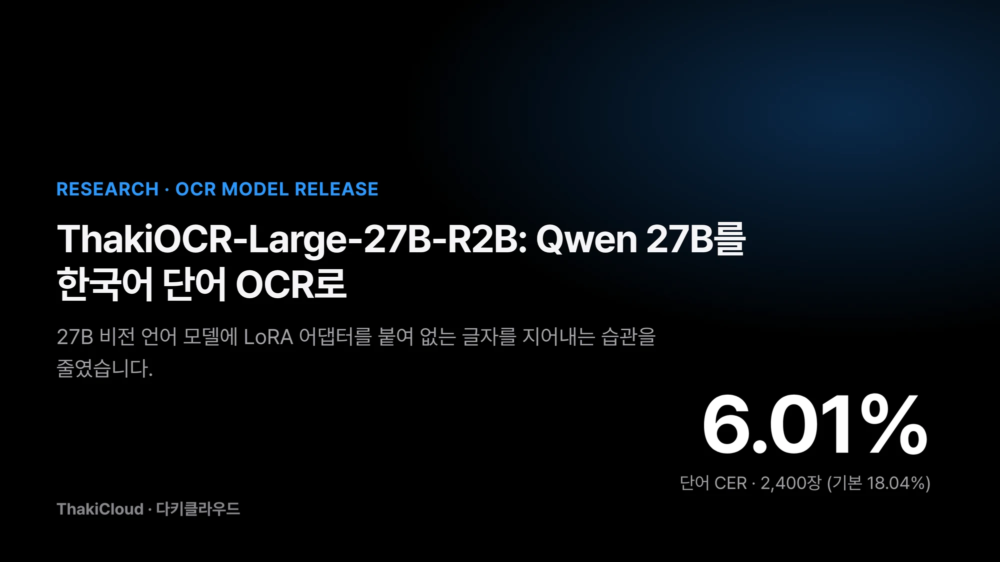
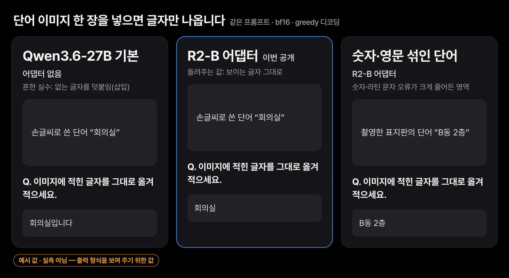
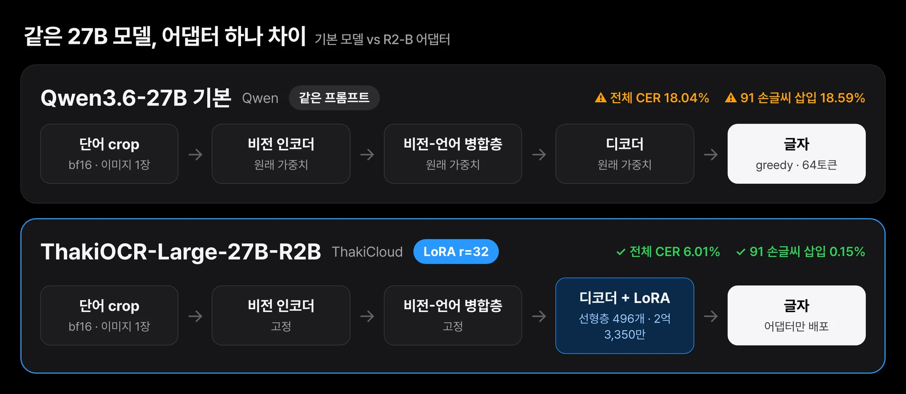
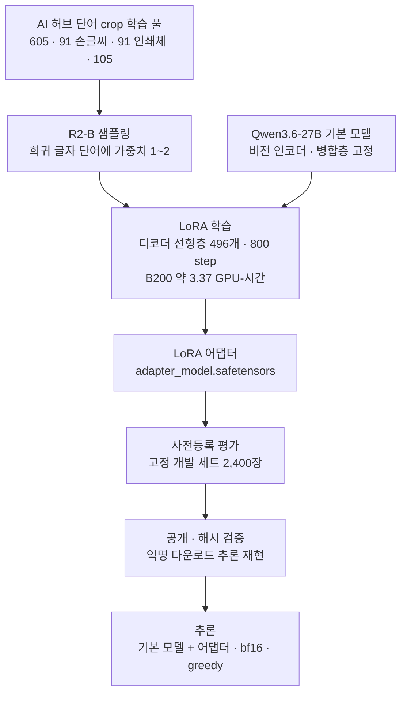
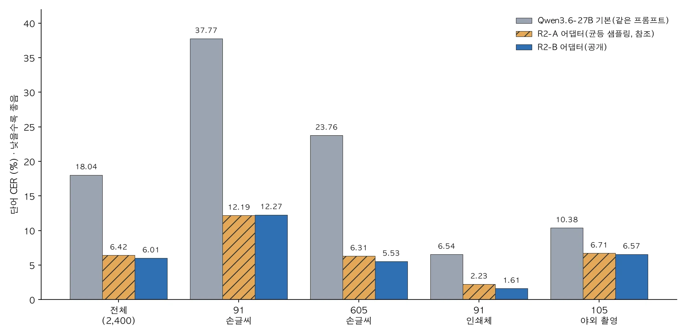
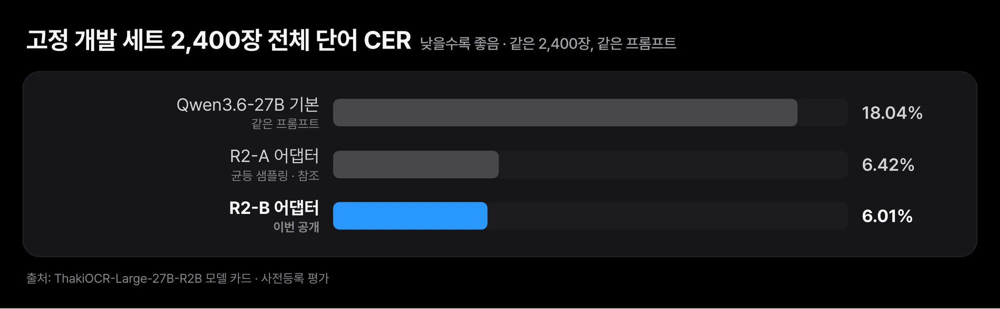
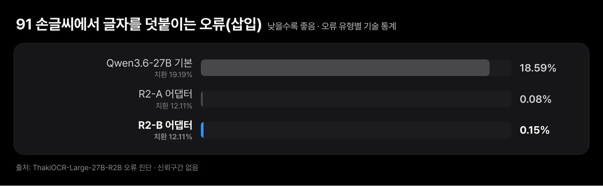

한국어 단어 이미지를 글자로 옮겨 적는 연구 모델을 공개했습니다. 큰 비전 언어 모델은 그대로 두고 그 위에 작은 추가 학습 파일을 얹는 방식입니다. 같은 지시문을 쓴 원래 모델과 비교하면 글자 오류가 크게 줄었습니다.

손글씨 신청서나 현장 사진처럼 상태가 제각각인 한국어 단어를 읽을 때 원래 모델은 없는 글자를 덧붙이는 실수를 자주 했습니다. 이번 학습은 그 습관을 줄이는 데 효과가 있었습니다. 숫자와 영문자 오류도 함께 줄었지만, 금액 표기처럼 형식이 중요한 부분은 따로 재지 않았습니다. 검증한 범위는 단어 이미지 한 장을 읽는 데까지이고, 문서 전체 읽기는 아직 재지 않았습니다.

공개 이름은 [ThakiOCR-Large-27B-R2B](https://huggingface.co/ThakiCloud/ThakiOCR-Large-27B-R2B)입니다. Qwen3.6-27B에 붙이는 LoRA 어댑터이고 라이선스는 Apache-2.0입니다. 고정 개발 세트 2,400장에서 기본 모델의 단어 CER은 18.04%였습니다. 이 어댑터를 붙이면 6.01%로 내려갑니다. 단어 crop 한 장을 읽는 연구 프리뷰이며 제품 출시가 아닙니다.

## 쉽게 말하면

글을 잘 읽는 사람에게 처음 보는 손글씨 메모를 한 단어씩 보여 주면 자주 틀립니다. 글자를 못 알아봐서라기보다 없는 글자를 덧붙여 읽는 버릇이 있기 때문입니다. 이 어댑터는 그 사람에게 손글씨·인쇄·촬영 단어 카드 1만 2,800장을 한 번씩 보여 주며 "보이는 글자만 그대로 적으라"고 연습시킨 결과입니다. 사람은 그대로 두고 습관만 고쳤기 때문에, 기본 모델 위에 작은 어댑터 파일을 얹는 형태로 배포합니다.

## 큰 모델도 한국어 손글씨 단어에서는 없는 글자를 덧붙입니다

기업 문서 처리에서는 손글씨 신청서, 인쇄 양식, 현장에서 찍은 간판·표지처럼 상태가 제각각인 한국어 이미지를 글자로 옮겨야 합니다. 큰 비전 언어 모델은 이미지 내용을 설명하는 데는 강합니다. 하지만 미세조정 전에는 한국어 손글씨 단어를 정확히 옮겨 적을 때 오류가 많았습니다. 우리 측정에서 Qwen3.6-27B 기본 모델은 손글씨 단어(91 손글씨)에서 CER 37.77%를 보였습니다.


*출력 형식과 오류 유형을 보여 주는 예시입니다. 단어는 설명용으로 지어낸 것이며 학습·평가 데이터에서 가져오지 않았습니다.*

입력은 페이지에서 단어 하나만 잘라 낸 이미지이고, 이 글에서는 이를 crop이라고 부릅니다. 출력은 그 안의 글자뿐이어야 합니다. 기본 모델은 여기에 없는 글자를 덧붙이는 일이 잦았습니다.

이번 연구가 답하려 한 질문은 두 가지입니다.

1. 27B 모델의 디코더에 LoRA만 붙여 단어 OCR을 학습하면 기본 모델보다 오류가 줄어드는가.
2. 희귀 글자가 많이 든 단어를 더 자주 뽑는 학습(R2-B)이 균등하게 뽑는 학습(R2-A)보다 나은가.

## 비전 쪽은 그대로 두고 디코더에만 어댑터를 붙였습니다

LoRA는 원래 가중치는 얼려 두고 옆에 작은 행렬 몇 개만 새로 학습하는 미세조정 방식입니다. 기본 모델은 `Qwen/Qwen3.6-27B`(revision `6a9e13bd6fc8f0983b9b99948120bc37f49c13e9`, Apache-2.0)입니다. 공개물은 이 모델에 붙이는 LoRA 어댑터이며 기본 모델 가중치는 포함하지 않습니다.


*비전 인코더와 병합층은 그대로 두고 디코더 선형층 496개에만 LoRA를 붙였습니다.*

학습 흐름은 다음과 같습니다.



| 항목 | 값 |
|---|---|
| 방법 | LoRA r=32, alpha=64, dropout 0.05. 디코더 선형층 496개(attention·MLP)에 부착 |
| 고정한 부분 | 비전 인코더와 비전-언어 병합층 |
| 학습 파라미터 | 2억 3,350만 개 |
| 학습 | 800 step, 학습률 1e-4, warmup 100, AdamW, 유효 배치 16(GPU 2장 × 누적 8) |
| 본 이미지 수 | 1만 2,800장, 이미지당 최대 1회. 605 3,840 · 91 손글씨 3,840 · 91 인쇄체 1,920 · 105 3,200 |
| 샘플링(R2-B) | 출처별로 비복원 가중 추출. 단어의 평균 글자 희귀도 순위로 가중치 1~2 부여(글자 빈도는 학습 분할에서만 계산) |
| 학습 연산 | NVIDIA B200 약 3.37 GPU-시간 |
| 어댑터 파일 | `adapter_model.safetensors` 933,974,032바이트 |

학습 데이터는 AI 허브의 공개 신청형 데이터셋 세 종류에서 단어 단위로 잘라 만들었습니다. 중복을 제거한 뒤 학습 풀은 91 손글씨 149,980장, 605 119,361장, 91 인쇄체 20,927장, 105 33,105장입니다. 데이터와 그 가공물(crop, 라벨 파일, 부분 집합, 샘플)은 공개하지 않으며 이 글에도 넣지 않았습니다.

- AI 허브(AI-Hub) · 대용량 손글씨 OCR 데이터(605)
- AI 허브(AI-Hub) · 다양한 형태의 한글 문자 이미지 인식 데이터(91)
- AI 허브(AI-Hub) · 야외 실제 촬영 한글 이미지 데이터(105)

## 전체 단어 오류율이 18.04%에서 6.01%로 내려갔습니다

**기준선**은 미세조정하지 않은 같은 Qwen3.6-27B에 같은 프롬프트(`이미지에 적힌 글자를 그대로 옮겨 적으세요. 글자만 출력하세요.`)와 같은 디코딩 설정을 쓴 결과입니다. R2-A는 같은 조건에서 샘플링만 균등하게 바꾼 참조용 어댑터입니다.

**평가 세트**는 학습에 쓴 세 데이터셋의 공식 Validation 분할에서 출처마다 600장씩 뽑은 단어 crop 2,400장입니다. 세 모델 모두 같은 2,400장으로 쟀습니다. 학습 데이터와 같은 데이터셋에서 나왔기 때문에 독립 테스트 세트가 아닙니다.



**지표**는 단어 CER입니다. 유니코드 NFC 정규화와 앞뒤 공백 제거 뒤, 전체 편집 수를 정답 글자 수로 나눈 값이며 낮을수록 좋습니다.

| 모델 | 전체(2,400) | 91 손글씨 | 605 손글씨 | 91 인쇄체 | 105 야외 촬영 |
|---|---|---|---|---|---|
| Qwen3.6-27B 기본(같은 프롬프트) | 18.04% | 37.77% | 23.76% | 6.54% | 10.38% |
| R2-A 어댑터(균등 샘플링, 참조) | 6.42% | 12.19% | 6.31% | 2.23% | 6.71% |
| **R2-B 어댑터(이번 공개)** | **6.01%** | 12.27% | **5.53%** | **1.61%** | 6.57% |

단어 전체가 맞은 비율은 기본 72.7%, R2-A 84.0%, R2-B 85.2%입니다.

판정 규칙은 결과를 보기 전에 사전등록했습니다. 95% 신뢰구간은 2,400개 ID에 대해 출처별로 층화한 paired bootstrap 2,000회로 계산했습니다.

- R2-B와 기본 모델의 전체 차이는 −12.03%p [−14.88, −9.73]입니다. 네 출처 중 나빠진 곳은 없습니다.
- R2-B와 R2-A의 전체 차이는 −0.41%p [−0.82, −0.03]입니다. 사전등록 기준은 통과했지만 상한이 0에 가깝습니다. 근접 중복 후보 274장을 뺀 보조 분석에서는 상한이 0.0이었습니다. 그래서 희귀 글자 샘플링의 추가 이득은 약한 결과로만 해석합니다.
- 91 손글씨에서는 R2-B가 R2-A보다 낫지 않았습니다(+0.08%p, 작성자 단위 구간 [−0.89, +0.92]%p).

누출 차단도 확인했습니다. 학습과 평가 사이에 파일 해시, 디코딩한 픽셀 해시, 원본 이미지 해시가 겹친 것은 0건이고 91 손글씨 작성자도 겹치지 않습니다. 평가 후보와 비슷한 학습 이미지(dHash 4 이하이면서 pHash 8 이하)는 학습에서 뺐습니다. 체크포인트는 step 800 하나로 미리 고정했습니다.


*같은 2,400장, 같은 프롬프트로 잰 전체 단어 CER입니다. R2-A와의 차이는 작아 약한 결과로만 해석합니다.*

## 개선의 대부분은 글자를 지어내지 않게 된 데서 왔습니다

오류 진단은 신뢰구간 없이 기술 통계로만 냈습니다. 원본 문장이나 이미지는 인용하지 않고 유형과 비율만 적습니다.

**기본 모델의 주된 오류는 글자 덧붙이기였습니다.** 91 손글씨에서 기본 모델은 치환 19.19%, 삽입 18.59%, 삭제 0이었습니다. 미세조정 뒤 삽입은 R2-A 0.08%, R2-B 0.15%로 거의 사라졌고, 치환은 두 어댑터 모두 12.11%로 남았습니다. 이 출처에서 개선의 대부분은 없는 글자를 지어내지 않게 된 데서 왔습니다. 비슷한 글자를 잘못 고르는 오류는 그대로 남아 있습니다.


*삽입 오류는 거의 사라졌고, 비슷한 글자로 바꿔 읽는 치환 오류는 남았습니다.*

**숫자와 라틴 문자 오류는 크게 줄었습니다.** 글자 종류별 전체 CER은 다음과 같습니다. 정답과 예측을 해당 종류의 글자로만 투영해 계산한 값입니다.

| 글자 종류 | 기본 | R2-A | R2-B |
|---|---|---|---|
| 숫자 | 6.81% | 1.45% | 0.77% |
| 한글 | 12.71% | 7.26% | 7.00% |
| 라틴 문자 | 25.18% | 7.91% | 5.76% |
| 문장부호 | 19.17% | 4.89% | 4.51% |

R2-B가 R2-A보다 나아진 부분은 주로 숫자, 라틴 문자, 그리고 학습 데이터에 5~49번 나온 글자입니다. 학습에 4번 이하 나온 희귀 글자에서는 차이가 보이지 않았습니다. 표본도 60회뿐이어서 결론을 내릴 수 없습니다.

**숫자·금액 오독 검증은 이 수준까지만 했습니다.** 위 숫자 CER은 단어 crop 안의 숫자 글자에 대한 값입니다. 금액 표기(쉼표, 원 기호, 단위), 날짜 형식, 숫자열 전체 일치율은 이 어댑터로 따로 재지 않았습니다. 금액을 다루는 업무라면 형식 검사나 합계 대조 같은 별도 검증을 붙여야 합니다. 그 효과는 아직 측정하지 않았습니다.

## 단어 한 장 밖의 범위는 아직 재지 않았습니다

이번 평가가 보여 주는 것은 단어 crop 한 장을 읽는 능력까지입니다. 아래 항목은 검증하지 않았습니다.

- 단어 crop 한 장만 읽습니다. 전체 페이지, 줄·문단, 표, 레이아웃, 읽기 순서는 평가하지 않았습니다.
- 평가 세트가 학습과 같은 데이터셋에서 나왔습니다. 새 문서 종류, 새 촬영 조건에서 성능이 유지되는지는 모릅니다.
- 91 인쇄체는 학습과 평가에 같은 폰트 10종이 나옵니다. 폰트 일반화 결과가 아닙니다.
- 91 손글씨 평가 작성자는 15명이고 모두 학습에 없던 사람입니다. 그룹이 적어 작성자 단위 구간이 넓습니다.
- 605와 105는 그룹 키가 없어 그룹 단위 일반화를 보이지 못했습니다.
- 전문 OCR 모델과 같은 조건에서 비교하지 않았습니다. 그보다 낫다고 주장하지 않습니다.
- 영어 전용이나 한영 혼합 입력은 따로 재지 않았습니다.

## 한 장에 약 0.46초이고, 처리량과 비용은 아직 모릅니다

확인한 것과 남은 것을 한 표로 정리하면 다음과 같습니다.

| 항목 | 상태 |
|---|---|
| 고정 개발 세트 전체 단어 CER | ✅ 기본 18.04% → R2-B 6.01% |
| 91 손글씨 글자 덧붙이기(삽입) | ✅ 18.59% → 0.15% |
| 숫자·라틴 문자 오류 | ✅ 숫자 6.81% → 0.77%, 라틴 문자 25.18% → 5.76% |
| 균등 샘플링(R2-A) 대비 추가 이득 | ⚠️ −0.41%p, 상한이 0에 가까워 약한 결과 |
| 금액·날짜 형식, 숫자열 전체 일치 | ⚠️ 따로 재지 않음 |
| 문서 전체·표·레이아웃 읽기 | ⚠️ 평가하지 않음 |
| 처리량·동시성·비용 | ⚠️ 아직 측정하지 않음 |

운영에 필요한 수치는 다음과 같습니다.

| 질문 | 현재 근거 |
|---|---|
| GPU 메모리 | 모델 카드 기준 bf16, 배치 1에서 약 53GB. 같은 기본 모델에 R2-A 어댑터를 붙인 별도 실험(R3-0, B200)에서 최대 VRAM 52.1~52.4GiB |
| 확인한 하드웨어 | NVIDIA B200(평가·지연), H200(공개 후 로드·추론 스모크) |
| 지연 | 모델 카드 기준 B200 한 장, 배치 1에서 crop당 중앙값 약 0.46초. 내부 측정이며 서빙 벤치마크가 아닙니다 |
| 처리량·동시성·비용 | 아직 측정하지 않았습니다 |
| 더 작은 GPU, 양자화, 병합 체크포인트 | 아직 측정하지 않았습니다. 어댑터 추론만 측정했습니다. 병합본은 어댑터 추론과 비트 단위로 같지 않을 수 있습니다 |

**온프레미스 운영**은 라이선스와 배포 형태로 보면 가능합니다. 기본 모델과 어댑터 모두 Apache-2.0 공개 가중치이고 기본 모델 저장소는 접근 승인이 필요 없습니다. 두 가중치를 받아 자체 GPU 서버에서 돌리면 추론할 이미지를 외부로 보내지 않아도 됩니다. 다만 위 표의 하드웨어가 아닌 환경에서 동작과 성능은 우리가 재지 않았습니다.

## 고정 설정 그대로 내려받아 돌리면 됩니다

아래 설정을 그대로 써야 합니다. 다른 프롬프트, 이미지 크기, 샘플링 설정은 평가하지 않았습니다. 기본 모델의 `generation_config.json`은 샘플링이 켜져 있으므로 `do_sample=False`를 꼭 넘겨야 합니다.

| 항목 | 값 |
|---|---|
| 기본 모델 | `Qwen/Qwen3.6-27B`, revision `6a9e13bd6fc8f0983b9b99948120bc37f49c13e9` |
| 프롬프트 | `이미지에 적힌 글자를 그대로 옮겨 적으세요. 글자만 출력하세요.` |
| 채팅 템플릿 | 사용자 턴 하나(이미지 다음 프롬프트), `add_generation_prompt=True`, `enable_thinking=False` |
| 이미지 크기 제한 | `min_pixels = 64*64`, `max_pixels = 1024*1024` |
| 디코딩 | greedy(`do_sample=False`), `max_new_tokens=64`, 배치 1 |
| 정밀도 | bf16 |

```bash
pip install torch "transformers>=5.0" "peft>=0.21" pillow
python inference_example.py --image word.png            # 인식 결과 출력
python inference_example.py --image word.png --report   # 결과와 로딩 점검을 JSON으로
```

저장소의 `inference_example.py`는 기본 모델 revision을 고정하고 LoRA 모듈 496개가 붙었는지와 비전 인코더 쪽 모듈이 0개인지 확인합니다. 핵심 부분은 다음과 같습니다.

```python
import torch, transformers
from peft import PeftModel
from PIL import Image

base = "Qwen/Qwen3.6-27B"; rev = "6a9e13bd6fc8f0983b9b99948120bc37f49c13e9"
processor = transformers.AutoProcessor.from_pretrained(base, revision=rev)
model = transformers.AutoModelForImageTextToText.from_pretrained(base, revision=rev, dtype=torch.bfloat16).to("cuda")
model = PeftModel.from_pretrained(model, "ThakiCloud/ThakiOCR-Large-27B-R2B").eval()

msgs = [{"role": "user", "content": [{"type": "image"},
         {"type": "text", "text": "이미지에 적힌 글자를 그대로 옮겨 적으세요. 글자만 출력하세요."}]}]
prompt = processor.tokenizer.apply_chat_template(msgs, tokenize=False, add_generation_prompt=True, enable_thinking=False)
inputs = processor(text=[prompt], images=[Image.open("word.png").convert("RGB")], return_tensors="pt",
                   images_kwargs={"min_pixels": 64 * 64, "max_pixels": 1024 * 1024}).to("cuda")
out = model.generate(**inputs, max_new_tokens=64, do_sample=False)
print(processor.tokenizer.decode(out[0, inputs["input_ids"].shape[1]:], skip_special_tokens=True).strip())
```

공개 뒤에는 로그인하지 않은 환경에서 어댑터를 받아 해시가 원본과 같은지 확인했습니다. 이어서 공개 예제 코드를 그대로 실행해, 직접 렌더링한 합성 이미지 한 장(AI 허브 데이터 아님)을 정확히 읽는 것까지 확인했습니다.

## 자체 GPU 환경에 배치하는 문의는 ThakiCloud로 받습니다

ThakiCloud는 고객이 통제하는 환경에서 모델을 학습하고(Maxis), 서비스하고(Metis), 업무에 연결하는(Paxis) 플랫폼을 만듭니다. 이번 어댑터도 데이터 계보 기록, 사전등록 평가, 큐 기반 GPU 학습, 해시 검증, 익명 다운로드 재현이라는 같은 절차를 거쳤습니다. 자체 GPU 환경에 배치하거나 자체 문서로 다시 평가하는 일에 관한 기술 문의는 [ThakiCloud](https://thakicloud.com)로 보내 주시면 됩니다.

## 끝으로

27B 비전 언어 모델의 디코더에 어댑터 하나를 붙여, 한국어 단어를 읽을 때 없는 글자를 지어내는 습관을 크게 줄였습니다. 희귀 글자 샘플링의 추가 이득은 작았고, 문서 전체 읽기와 서빙 비용은 다음 단계에서 재야 합니다.

같은 한국어 단어 OCR 과제를 훨씬 작은 모델로 다룬 연구는 [ThakiOCR-KO-v1 글](/tech-blog/ko/research/thakiocr-ko-v1-ovisocr3-korean-finetune/)에 정리했습니다. 두 글은 평가 세트와 측정 조건이 달라 서로의 수치를 순위로 비교하지 않습니다.

- [ThakiOCR A: 213만 파라미터 한국어·영어 줄 단위 OCR](/tech-blog/ko/research/thakiocr-a-small-korean-english-line-ocr/)
- [ThakiOCR G2M: 숫자와 기호를 더 정확하게 읽는 두 번째 공개 모델](/tech-blog/ko/research/thakiocr-g2m-numbers-and-symbols/)
- [ThakiOCR A2: 독립 평가 43,751줄에서 확인한 개선과 남은 한계](/tech-blog/ko/research/thakiocr-a2-independent-eval-43751-lines/)

- 모델: [ThakiCloud/ThakiOCR-Large-27B-R2B](https://huggingface.co/ThakiCloud/ThakiOCR-Large-27B-R2B) (Apache-2.0)
- 기본 모델: [Qwen/Qwen3.6-27B](https://huggingface.co/Qwen/Qwen3.6-27B) (Apache-2.0)
- 학습 데이터: AI 허브(AI-Hub) 605·91·105. 데이터 재배포 불가, 신청자 본인 내부 이용. 데이터가 필요하면 AI 허브에 직접 신청해야 합니다.
- 연구용 공개이며 제품 출시 판정은 별도입니다.
