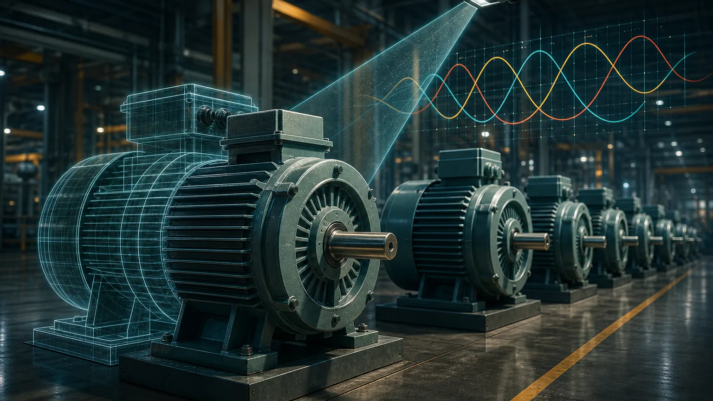
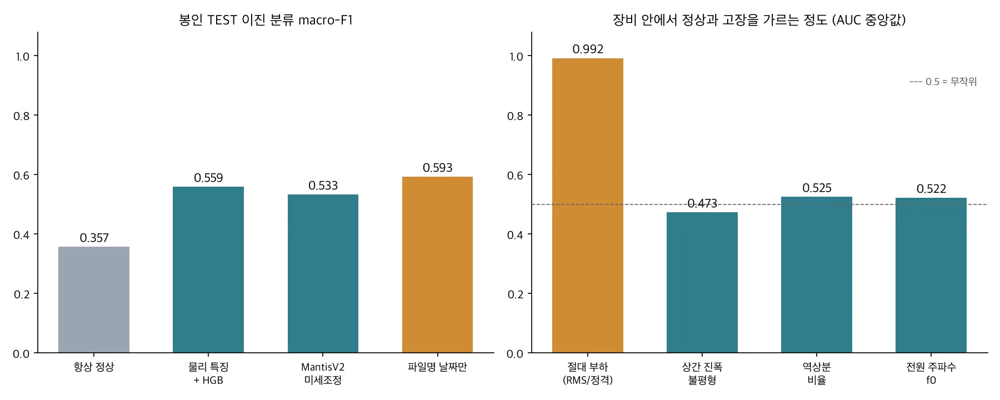
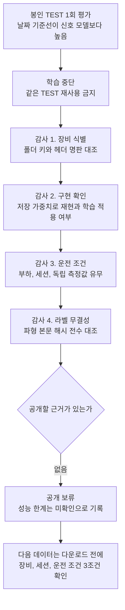

설비 데이터로 고장 진단 모델을 만들려는 분께 드리는 결론부터 적습니다. AI 허브 기계시설물 고장 예지 센서(#238)의 3상 전류로 모터 고장 진단 모델을 학습했고, 학습에 쓰지 않은 모터 10대에서 한 번만 평가했습니다. 그 결과 파일명의 날짜만 보고 맞히는 기준선이 이진 분류 macro-F1 0.593으로, 물리 특징 모델(0.559)과 MantisV2 미세조정 모델(0.533)보다 높았습니다.

그래서 모델을 공개하지 않았습니다. 다만 "전류로는 고장을 못 가린다"는 결론도 내리지 않았습니다. 왜 점수가 낮았는지 데이터와 코드를 다시 감사했더니 장비 식별 오류, 운전 조건 교란, 라벨이 다른 파형 사본이 차례로 나왔기 때문입니다. 이 글은 그 감사를 어떤 순서로 했고 각 단계에서 무엇을 확인했는지 정리한 기록입니다.

## 쉽게 말하면

학생 40명의 시험 점수로 공부법의 효과를 보려 했는데, 알고 보니 출석부에서 세 쌍의 학생이 한 이름으로 묶여 있었습니다. 게다가 시험을 본 날짜만 알아도 점수를 꽤 맞힐 수 있었고 같은 답안지가 이름표만 바꿔 두 번 제출된 경우도 있었습니다. 이런 상태에서는 공부법이 효과가 없다고도, 있다고도 말할 수 없습니다. 먼저 출석부와 답안지를 바로잡아야 합니다.

## 무엇을 학습하고 어떻게 평가했나

데이터는 장비별 폴더에 2 kHz로 1초씩 기록한 3상 전류 파일이고 전체 1,301,718개입니다. 라벨은 정상과 고장 4종(베어링, 벨트 풀림, 축정렬 불량, 회전체 불평형)입니다. 장비 단위로 개발용(DEV)과 시험용(TEST)을 나누고 개발용 15,364파일로 학습했습니다. 시험용 5,400파일(정상 3,000, 고장 4종 각 600)은 결과를 본 뒤 모델이나 임계값을 바꾸지 않는 조건으로 봉인해 두었다가 한 번만 열었습니다.

비교한 모델은 둘입니다. 하나는 스펙트럼 물리 특징에 HGB(Histogram Gradient Boosting)를 얹은 모델이고 다른 하나는 시계열 사전학습 모델 MantisV2를 미세조정한 모델입니다. 같은 시험에 기준선도 함께 넣었습니다. 항상 "정상"이라고 답하는 기준선과, 전류는 보지 않고 파일명 메타데이터만 쓰는 기준선입니다.

## 첫 신호: 날짜가 모델을 이겼다

| 시험 | 항상 정상 | 물리 특징 + HGB | MantisV2 미세조정 | 파일명 날짜만 |
|---|---|---|---|---|
| 이진 분류 macro-F1 | 0.357 | 0.559 | 0.533 | 0.593 |
| 이진 분류 정확도 | 0.556 | 0.560 | 0.535 | 0.598 |
| 5클래스 macro-F1 | 0.143 | 0.253 | 0.197 | 0.175 |

정확도로 보면 물리 특징 모델은 항상 정상이라고 답하는 기준선과 거의 같았습니다(0.560 대 0.556). 5클래스에서 불평형 재현율은 물리 특징 모델이 0.000, MantisV2가 0.013이었습니다. 정상 데이터만 있는 장비에서는 오경보가 많았습니다.

여기서 할 수 있는 일은 두 가지였습니다. 모델과 전처리를 바꿔 같은 시험을 다시 치르거나, 점수가 왜 이렇게 나왔는지 먼저 확인하는 것입니다. 앞의 방법은 같은 TEST를 보고 고친 점수라 독립 검증이 될 수 없습니다. 그래서 학습을 멈추고 감사부터 했습니다.

## 감사는 이 순서로 했다

모든 단계는 학습 없이 진행했습니다. 저장해 둔 가중치를 그대로 썼고 판정 규칙은 결과를 보기 전에 문서에 고정했습니다.

## 감사 1: 장비 하나라고 믿은 폴더에 장비가 둘 있었다

처음에는 장비를 (정격 폴더, 모터 폴더) 조합으로 구분했습니다. 그런데 각 파일 헤더에 적힌 명판 정보(정격 회전수, 출력, 정격 전류)까지 키에 넣자 서로 다른 그룹이 40개가 아니라 43개로 늘었습니다. 폴더 3개에 rpm과 정격 전류가 다른 장비가 둘씩 섞여 있었던 것입니다. 데이터셋 페이지의 공식 장비 목록과 행 단위로 대조해 보니 이 3쌍은 출력과 설비 ID가 같고 설치 위치만 다른 장비였습니다. 전류 폴더 경로에는 위치 정보가 없어서 하나로 합쳐진 것입니다.

학습용과 시험용 사이에 같은 장비가 들어간 경우는 0건이었습니다. 폴더 단위로 나눴고 장비는 폴더의 부분집합이기 때문입니다. 대신 "모터별" 점수가 틀렸습니다. 시험용에서 정상과 고장이 함께 있는 장비처럼 보였던 두 폴더는 실제로는 정상만 있는 장비와 고장 위주 장비가 합쳐진 것이었습니다. 그래서 그 폴더의 높은 점수는 같은 장비의 정상과 고장을 가른 결과가 아니라 서로 다른 장비를 구분한 결과였습니다.

장비 단위로 다시 집계하자 같은 장비 안에서 정상과 고장이 균형 있게 공존하는 시험 장비는 6대뿐이었습니다. 그 6대에서 물리 특징 모델의 균형 정확도는 평균 0.537, 최저 0.472였습니다. 정상만 있는 장비 4대의 오경보율은 평균 0.584, 최대 0.913이었습니다. 파일 단위 macro-F1은 라벨이 바뀌지 않았으므로 그대로 두고 장비 단위 지표와 신뢰구간만 고쳤습니다.

## 감사 2: 모델은 실제로 학습됐고, 결과는 재현됐다

점수가 낮을 때 가장 먼저 의심할 것은 학습이 제대로 걸리지 않은 경우입니다. 확인해 보니 미세조정은 선언한 대로 1,830 step을 돌았고 인코더 파라미터의 51.3%가 바뀌었습니다. 라벨 인코딩과 클래스 재매핑에도 결함은 없었습니다.

저장된 가중치로 같은 5,400파일을 다시 추론했더니 네 가지 점수(이진과 5클래스, 두 모델)가 원래 값과 소수점 여섯째 자리까지 같았습니다. GPU 연산 정밀도 설정(TF32)을 바꾸면 경계에 걸린 파일 1~2개의 예측이 뒤집혔지만 점수 영향은 F1 0.0004 이하였습니다. 그러니 낮은 점수는 구현 실수로 설명되지 않습니다.

## 감사 3: 정상과 고장이 다른 운전점에서 녹화됐다

다음으로 전처리가 지운 정보를 봤습니다. 입력 단계에서 상별 기본파 크기로 나누고 3상을 평균했기 때문에 절대 전류 크기와 상간 차이는 모델에 들어가지 않았습니다. 지운 양 각각이 장비 안에서 정상과 고장을 얼마나 가르는지 단일 특징 AUC로 쟀습니다.

결과는 한쪽으로 크게 치우쳤습니다. 절대 부하(RMS를 정격 전류로 나눈 값) 하나만으로 정상과 고장이 섞인 장비 24대 중 21대에서 AUC가 0.9 이상이었고 중앙값은 0.992였습니다. 반면 상간 진폭 불평형(0.473), 역상분 비율(0.525), 전원 주파수(0.522)는 무작위 수준이었습니다. 같은 (장비, 라벨) 조합 안에서 부하의 5~95% 폭은 정격의 ±1.6%였습니다. 고장 녹화와 정상 녹화가 서로 다른 운전점에서 찍혔다는 뜻이고 이것이 고장 때문에 부하가 실제로 오른 것인지 녹화 세션 차이인지는 이 데이터로 구분할 수 없습니다.

데이터에는 실측 회전수, 부하 토크, 전압, 세션 ID가 없습니다. 파일명 시각으로 세션을 복원해 보니 같은 센서 코드 스트림 안에서 라벨이 53,893번 바뀌었고 그중 61%가 1초 이내였습니다. 고장을 물리적으로 만들고 되돌리는 실험이라면 1초 간격으로 수만 번 바뀔 수 없습니다. 날짜 기준선이 신호 모델을 이긴 이유도 이 구조와 맞아떨어집니다.

## 감사 4: 이름표만 다른 같은 파형

마지막으로 130만 파일 전체의 파형 본문을 해시로 대조했습니다. 한 장비 폴더에서 5,223쌍의 파일이 파형은 바이트 단위로 같고 헤더의 라벨 두 줄만 달랐습니다. 축정렬 불량 녹화의 사본에 정상 라벨이 붙어 있었던 것입니다. 헤더가 달라 파일 체크섬도 달랐기 때문에 기존 중복 제거를 통과했고 개발용 학습 데이터에 들어갔습니다.

같은 라벨 안에서 시각만 다른 동일 파형도 140,311그룹 나왔습니다. 2,000샘플짜리 3상 실측 잡음이 비트 단위로 같을 수는 없으므로 파일 복제로 봅니다. 시간으로 학습과 평가를 나누면 같은 파형이 양쪽에 들어갈 수 있는 누수 경로입니다.

## 공개하지 않기로 한 판단

판단 근거는 세 가지입니다. 첫째, 봉인 시험에서 신호 모델이 메타데이터 기준선을 넘지 못했습니다. 둘째, 정상만 있는 장비에서 오경보가 너무 많아 현장 경보로 쓸 수 없습니다. 셋째, 감사로 찾은 교란 때문에 이 데이터 안에서는 "같은 장비, 같은 운전 조건에서 정상과 고장을 가르는가"를 검증할 수 없습니다. 43대 장비는 모두 학습이나 평가에 이미 쓰여서 처음 보는 장비도 남아 있지 않습니다.

그래서 모델은 공개하지 않고 성능 한계도 확정하지 않았습니다. 내부 원장의 상태를 그대로 옮기면 공개 보류(`RELEASE_NO_GO`), 모델 성능 한계 미확인(`MODEL_PERFORMANCE_LIMIT=UNVERIFIED`)입니다. 확정할 수 있는 것은 현재 파이프라인을 이 데이터로 현장에 적용하는 데 실패했다는 사실입니다. 전류 기반 진단 자체의 기술적 한계를 보여 주는 증거는 아닙니다. 같은 시험 세트로 점수를 개선해 독립 검증처럼 보고하는 일도 하지 않습니다.

## 다음 데이터는 다운로드 전에 거른다

이번 감사에서 얻은 가장 실용적인 결과는 데이터를 고르는 순서입니다. 지금까지 다룬 세 데이터(MCC5, KAIST 베어링, AI 허브 #238)의 공통 문제는 모델이 고장을 배웠는지 장비나 세션이나 운전 조건을 배웠는지 구분하기 어렵다는 점이었습니다. 그래서 다음 후보는 논문, 데이터 설명서, 파일 목록만으로 아래 세 조건을 먼저 확인하고 하나라도 근거가 부족하면 받지 않습니다.

| 조건 | 확인할 것 |
|---|---|
| 같은 고장이 여러 물리 장비에 있는가 | 장비 ID와 고장 라벨 교차표에서 칸마다 2대 이상 |
| 정상과 고장을 여러 독립 세션에서 반복 측정했는가 | 조건마다 세션 3회 이상, 측정 순서가 고정이 아님 |
| 같은 운전 조건에서 정상과 고장을 비교할 수 있는가 | 속도, 부하, 토크 칸마다 정상과 고장이 모두 있음 |

AI 허브 #238 트랙도 영구 폐기가 아닙니다. 같은 모터의 정상과 고장을 여러 부하와 회전수에서 교차 수집하고 독립 측정한 회전수, 토크나 전력, 전압, 세션 ID를 함께 기록하고 완전히 다른 모터로 평가할 수 있는 데이터가 생기면 다시 엽니다.

## 정리

고장 진단 모델의 점수가 낮을 때 모델을 먼저 바꾸면 같은 시험을 반복해서 보게 되고 점수가 올라도 무엇이 좋아졌는지 알 수 없습니다. 이번에는 기준선과 감사를 먼저 했고 그 덕분에 장비 식별 오류 3쌍, 운전점 교란, 라벨 사본 5,223쌍을 찾았습니다. 공개할 모델은 나오지 않았지만, 어떤 데이터라면 새 장비 일반화를 검증할 수 있는지는 분명해졌습니다. 같은 원칙으로 공개한 모델과 그 한계는 [MCSA 모델 공개 글](/tech-blog/ko/research/thaki-mcsa-mantisv2-mcc5/)에 정리했습니다.

자사 설비 데이터로 고장 진단 AI를 검토하고 있다면 [ThakiCloud에 문의](/contact?interest=industrial-ai&origin=aihub238-audit)하시기 바랍니다. 모델 이야기보다 장비 구성, 측정 조건, 라벨이 붙는 방식부터 함께 확인합니다.



## 출처

- [AI 허브, 기계시설물 고장 예지 센서 데이터(#238)](https://www.aihub.or.kr/aihubdata/data/view.do?dataSetSn=238)
- [paris-noah/MantisV2 (Hugging Face, Apache-2.0)](https://huggingface.co/paris-noah/MantisV2)
- [Mantis: Lightweight Foundation Model for Time Series Classification (GitHub)](https://github.com/vfeofanov/mantis)

---

*데이터 출처: AI 허브(AI-Hub), 기계시설물 고장 예지 센서(#238). 원본과 가공 데이터는 재배포하지 않으며 신청자 내부 연구에만 사용했습니다. 이 글에는 집계 수치만 실었고 파형, 파일, 라벨 행은 싣지 않았습니다.*
