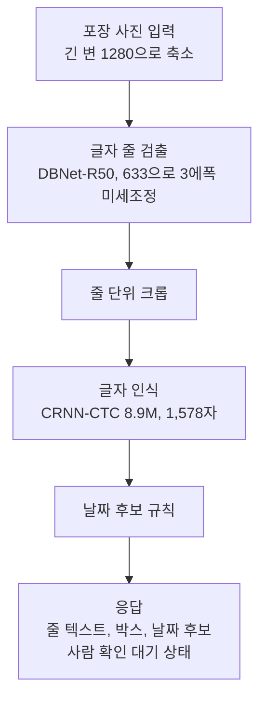
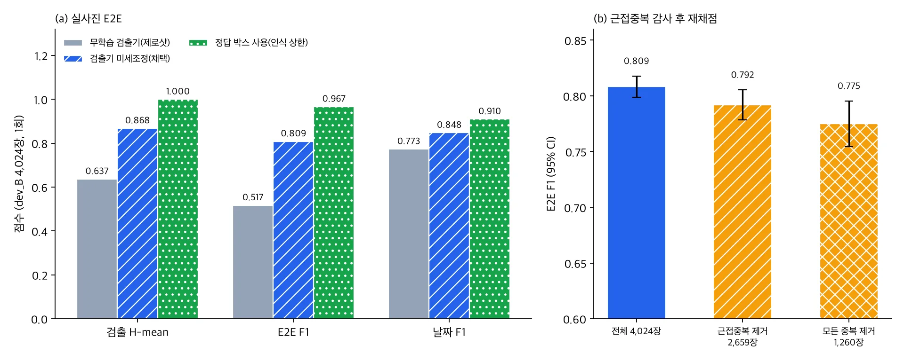

*개념도입니다. 실제 화장품 포장이나 데이터셋 이미지가 아닙니다.*

제품 포장 사진에서 글자와 날짜를 읽는 기능을 사내 서버에 올리려는 분께 결론부터 드립니다. 8.9M 파라미터 CRNN 인식기와 미세조정한 검출기를 묶은 화장품 포장 OCR은 실사진 E2E에서 F1 0.809를 냈습니다. 학습에 쓰지 않은 제품 묶음 4,024장으로 한 번만 평가한 값입니다.

다만 이 숫자는 그대로 믿기 어렵습니다. 평가 사진의 33.9%가 학습 사진과 시각적으로 거의 같았고, 이를 빼면 F1은 0.775~0.792로 내려갑니다. 매장이나 고객이 찍은 사진으로는 아직 재 보지 못했습니다. 이 글은 무엇이 확인됐고 무엇이 남았는지를 수치와 조건으로 정리합니다.

## 쉽게 말하면

받아쓰기 시험에 비유할 수 있습니다. 먼저 단어 카드 한 장씩을 보여 주고 읽게 하는 시험을 봤고, 우리 학생(CRNN)은 거의 틀리지 않았습니다. 그다음 신문 한 면을 통째로 주고 어디에 글자가 있는지 찾아서 읽게 했습니다. 이 단계에서는 글자를 찾는 눈(검출기)이 성적을 좌우했습니다.

시험이 끝난 뒤 시험지를 다시 보니 문제의 3분의 1 정도가 연습 문제와 거의 같은 신문이었습니다. 그 문제를 빼고 다시 채점했더니 점수가 조금 내려갔지만 무너지지는 않았습니다. 아직 남은 일은 우리가 한 번도 본 적 없는 신문, 즉 고객 현장의 사진으로 시험을 보는 것입니다.

## 무엇을 만들었나

데이터는 AI 허브(AI-Hub)의 화장품·의약품 패키지 OCR(633)입니다. 실내에서 찍은 포장 사진 105,216장이고 사진마다 글자 영역 라벨이 붙어 있습니다. 같은 제품의 사진이 학습과 평가에 동시에 들어가지 않도록 제품 묶음 단위로 나눴습니다.

파이프라인은 사진에서 글자 줄을 찾는 검출기, 줄을 잘라 읽는 인식기, 읽은 문자열에서 날짜 후보를 고르는 규칙의 세 단계입니다.

평가 규칙은 측정 잡을 내기 전에 파일로 고정해 커밋했습니다. 결과를 본 뒤 임계값이나 분할을 바꾸지 않았고 판정용 평가셋은 한 번만 열었습니다.

## 단어 카드 시험: 크롭 인식

첫 단계는 정답 박스로 잘라 낸 글자 조각만 읽는 시험입니다. 봉인해 둔 공식 시험 분할을 한 번 열어 쟀더니 CRNN의 문자 오류율(CER)은 0.0158이었습니다.

비교 대상은 앞서 만든 범용 한국어 OCR인 ThakiOCR-KO-v2입니다. 같은 6,128개 조각에서 짝을 맞춰 비교하면 CRNN의 CER이 0.050 낮았습니다(95% 신뢰구간 −0.058~−0.043). 학습 제품군에 없던 제품 475개 조각만 보면 차이는 −0.040(−0.055~−0.026)으로 줄었지만 여전히 0보다 확실히 작았습니다. 공개 모델 PP-OCRv5와의 비교에서는 완전 일치율이 0.971 대 0.884였습니다.

속도 차이도 컸습니다. B200에서 조각 하나를 읽는 시간이 CRNN 1.74ms, ThakiOCR-KO-v2 153.8ms였습니다. CRNN은 CPU 1스레드에서도 조각당 15.9ms라 GPU 없는 서버에 올릴 수 있습니다.

이 결과가 말하는 범위는 좁습니다. CRNN은 이 데이터로 학습했고 비교한 두 모델은 이 데이터를 보지 않았습니다. 그래서 "이 도메인에서는 전용 소형 모델이 범용 모델보다 낫다"까지만 말할 수 있습니다. ThakiOCR-KO-v2를 같은 데이터로 미세조정했다면 격차가 사라졌을 수도 있고 그 비교는 하지 않았습니다.

## 신문 한 면 시험: 실사진 E2E

실제 서비스는 사진 한 장을 통째로 받습니다. 그래서 학습에 쓰지 않은 제품 묶음 1,173개의 사진 4,024장(dev_B)에서 검출부터 인식까지 한 번에 평가했습니다. 검출기와 임계값은 다른 묶음(dev_A)으로만 골랐고 dev_B는 이 평가에서 한 번만 썼습니다.

| 지표 (dev_B, 1회 평가) | 무학습 검출기 + 같은 CRNN | 미세조정 검출기 + CRNN | 정답 박스 + CRNN |
|---|---|---|---|
| 검출 H-mean | 0.637 | 0.868 (0.859~0.877) | 1.000 |
| E2E F1 | 0.517 | 0.809 (0.799~0.818) | 0.967 |
| E2E CER | 0.368 | 0.117 (0.109~0.127) | 0.017 |
| 날짜 F1 | 0.773 | 0.848 (0.826~0.868) | 0.910 |

공개 사전학습 가중치 그대로인 검출기는 E2E F1 0.517에 그쳤습니다. 같은 구조를 이 데이터로 3에폭 미세조정하자 0.809가 됐고, 두 조건의 짝 차이는 +0.291(0.279~0.302)이었습니다. 인식기는 그대로 두고 검출기만 바꾼 결과입니다.

정답 박스를 주면 E2E F1이 0.967까지 오릅니다. 남은 격차의 대부분이 인식이 아니라 검출, 그중에서도 놓친 줄(재현율 0.879)에서 나온다는 뜻입니다. 그래서 다음 개선 대상은 검출기입니다.

이 표에도 낙관 편향이 하나 있습니다. CRNN 체크포인트를 고를 때 쓴 개발 분할에 dev_B 제품 묶음이 들어 있었습니다. 검출기는 dev_B를 보지 않았지만 인식 쪽 수치는 조금 후하게 나왔을 수 있습니다.

## 시험지를 다시 봤더니: 근접중복 감사

제품 묶음 단위로 나눴으니 평가 사진은 처음 보는 포장이라고 가정했습니다. 그 가정을 확인하려고 dev_B 사진마다 학습 사진 중 가장 비슷한 것을 찾아 화면 구조(SSIM)와 특징점 정합으로 대조했습니다.

결과는 예상보다 나빴습니다. dev_B 4,024장 중 1,365장(33.9%)이 다른 묶음의 학습 사진과 시각적으로 사실상 같았습니다. 같은 실물 포장이 용량이나 표기 차이로 다른 제품명이 붙어 학습 쪽에 들어간 경우로 추정합니다. 묶음 이름을 직접 열어 보지는 않았으므로 원인은 추정으로 남깁니다.

중복 사진을 빼고 이미 나온 예측을 다시 채점했습니다. 시각 중복 1,365장을 빼면 E2E F1은 0.792(0.778~0.805)였습니다. 시각, 텍스트, 해시 기준 중 하나라도 걸린 사진을 모두 빼고 1,260장만 남기면 0.775(0.755~0.795)였습니다. 원래 값 0.809보다 1.7~3.4포인트 낮지만 크게 무너지지는 않았습니다.

이 감사에도 반론이 있습니다. 같은 촬영대와 같은 조명에서 찍은 서로 다른 포장이 비슷하다고 잡혔다면 33.9%는 과대 추정입니다. 반대로 각도가 크게 다른 중복은 후보에서 빠졌을 수 있습니다. 사람이 대조표를 직접 보지 않았으므로 이 비율은 대리 추정입니다.

## 사내 서버에서 돌리는 beauty.ocr

검출기와 인식기는 ONNX로 내보내 `beauty.ocr`라는 도구로 묶었습니다. onnxruntime CPU만 쓰고 PyTorch는 불러오지 않습니다. 번들 크기는 모델과 문자 목록을 합해 136.6MB입니다.

4스레드 CPU(AMD EPYC 9355, GPU 노드의 CPU)에서 사진 한 장 처리 시간 중앙값은 546.6ms, 95번째 백분위는 1,348.7ms였습니다. 측정 중 최대 메모리는 4.12GiB였습니다. 같은 사진에서 CPU 결과와 GPU 결과의 E2E F1 차이는 −0.0005로 사실상 같았습니다.

에이전트가 HTTP로 부르는 도구 서버에 올려 회귀 시험도 했습니다. Intel Xeon 8592V 4스레드에서 100장을 처리해 평가 때 쓴 코드로 얻은 9,571줄과 한 줄도 다르지 않았습니다. 왕복 지연 중앙값은 876ms였습니다. 서버 프로세스는 외부망을 막아 두었고 차단 시도는 0건, 외부 주소로 열린 소켓도 0개였습니다. 외부 OCR API는 한 번도 부르지 않습니다.

응답은 항상 "사람 확인 대기" 상태로 나가고 시스템에 아무것도 쓰지 않습니다. 제품명은 뽑지 않고 `NOT_EXTRACTED`로 돌려줍니다. 줄 위치 기반의 단순 규칙으로는 제품명 정밀도가 0.044에 그쳐 쓸 수 없었기 때문입니다. 이 문제는 별도 글에서 다룹니다.

## ThakiCloud 제품 적용 시사점

Paxis에서 이 결과가 쓰이는 자리는 서류와 사진이 오가는 업무 자동화입니다. 입고 검수나 표시 사항 확인처럼 포장 사진을 보고 날짜를 옮겨 적는 일을 에이전트가 초안으로 채우고 사람이 확인하는 흐름입니다. `beauty.ocr`가 항상 확인 대기 상태로 답하도록 만든 이유도 여기에 있습니다.

데이터를 밖으로 내보내기 어려운 고객이라면 Aegis 같은 사내 설치 환경이 전제가 됩니다. GPU 없이 4코어 CPU와 8GiB 메모리에서 돌아가고 외부망 없이 동작한다는 점이 그 조건과 맞습니다. 범용 모델을 키우는 대신 도메인 데이터로 소형 모델을 따로 학습하는 방식은 Maxis가 맡는 작업 흐름과 같습니다.

## 한계 및 반론

가장 강한 반론은 평가 사진이 모두 같은 데이터셋, 같은 촬영 방식에서 나왔다는 점입니다. 라벨을 확인해 보니 촬영 환경은 전부 실내였고 반사, 곡면, 흐림을 표시한 필드는 없었습니다. 매장 조명이나 고객 휴대폰 사진에서 검출 재현율 0.879가 유지된다는 근거는 아직 없습니다.

지연도 대표값이 아닙니다. 두 번의 측정 모두 클러스터 GPU 노드의 CPU를 썼고 CPU 종류가 달라 결과가 546.6ms와 772ms(서버 내부 처리)로 갈렸습니다. 고객이 실제로 쓸 CPU에서 다시 재야 합니다.

판정의 층위도 구분해야 합니다. 크롭 인식과 실사진 E2E는 미리 정해 둔 통과 기준을 모두 넘었으므로 모델 판정은 통과입니다. 그러나 상용화 판정은 고객 사진 검증과 대상 CPU 지연 측정이 남아 있어 조건부입니다. 고객 실증 전이라 지금 팔 수 있는 기능이라고 말하지 않습니다.

## 정리

화장품 포장 사진의 글자와 날짜를 읽는 소형 OCR은 정해진 평가에서 E2E F1 0.809, 근접중복을 뺀 보수적 재채점에서 0.775~0.792를 냈습니다. GPU 없이 CPU 4스레드에서 장당 약 0.55~0.77초(처리 시간 중앙값, CPU 종류에 따라 다름)에 외부망 없이 돌아갑니다. 다음 개선은 인식기가 아니라 검출기의 놓친 줄을 줄이는 일입니다.

그리고 다음 시험은 처음 보는 사진이어야 합니다. 같은 기능을 검토한다면 자사 촬영 조건의 사진으로 먼저 평가해 보시기를 권합니다. 이 글의 수치는 그 평가를 설계할 때 기준선으로 쓰기 좋습니다.

---

*데이터 출처: AI 허브(AI-Hub), 화장품·의약품 패키지 OCR(633). 데이터는 재배포하지 않으며 신청자 본인의 내부 학습·평가에만 사용했습니다. 이 글에는 집계 수치만 실었고 사진, 크롭, 라벨 값은 싣지 않았습니다. 그림은 원장 수치로 그린 차트와 개념도입니다.*
