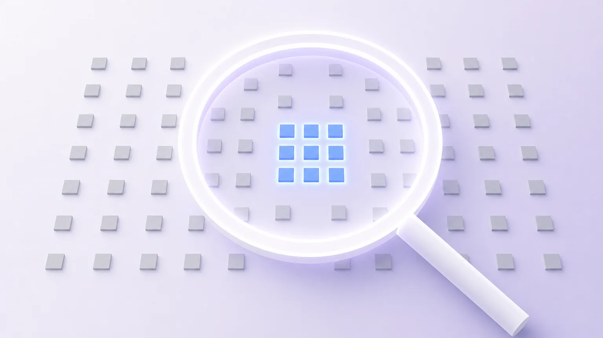
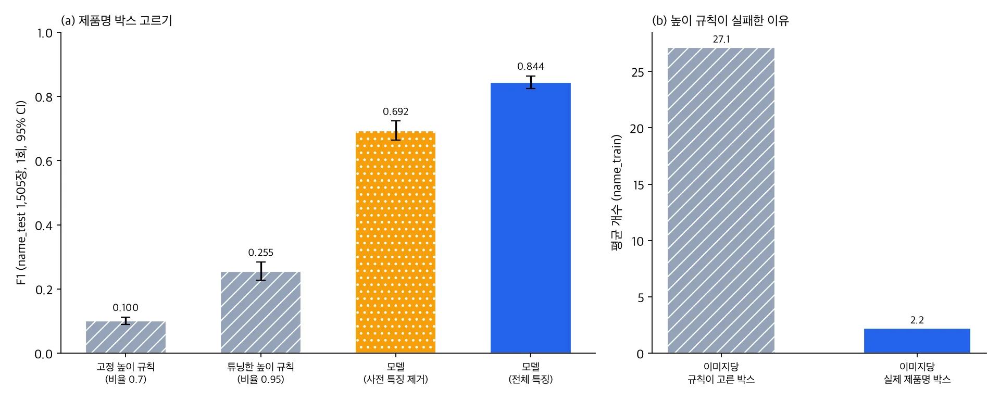

*개념도입니다. 실제 화장품 포장이나 데이터셋 이미지가 아닙니다.*

포장 사진에서 읽어 낸 글자 줄 가운데 어느 것이 제품명인지 자동으로 고르려는 분께 결론부터 드립니다. 글자가 가장 큰 줄을 고르는 규칙은 거의 쓸모가 없었습니다. 반면 박스 위치와 글자 특성을 함께 보는 작은 트리 모델은 F1 0.844를 냈습니다. 학습에 쓰지 않은 제품 묶음 547개, 사진 1,505장에서 한 번만 평가한 값입니다.

다만 이 평가는 정답 박스와 정답 텍스트를 입력으로 준 조건입니다. 실제 OCR이 읽은 글자에 연결한 평가는 별도로 기준을 정해 측정 중이며 아직 결과가 없습니다. 이 글은 확인된 범위와 확인되지 않은 범위를 나눠 정리합니다.

## 쉽게 말하면

서점 진열대에서 책 제목을 찾는 일에 비유할 수 있습니다. "글씨가 가장 큰 것이 제목"이라는 규칙은 그럴듯하지만, 표지에는 출판사 로고나 띠지 문구처럼 큰 글씨가 많습니다. 실제로 표지마다 이 규칙이 고르는 후보는 수십 개인데 진짜 제목은 두 개 남짓입니다.

그래서 크기만 보지 않고 위치, 글자 종류, 그 문구가 다른 책에서 제목으로 쓰였는지까지 함께 보는 점원을 훈련했습니다. 이 점원은 훨씬 정확해졌습니다. 다만 아직 정답이 적힌 카드만 보고 골랐고 흐릿하게 잘못 읽힌 표지에서도 잘 고르는지는 시험하지 않았습니다.

## 왜 규칙이 실패했나

앞선 화장품 포장 OCR 작업에서 우리는 제품명을 뽑지 않고 `NOT_EXTRACTED`로 돌려주기로 했습니다. 줄 높이 기반 규칙의 제품명 정밀도가 0.044였기 때문입니다. 원인을 나눠 보니 문제는 규칙이 너무 많이 고른다는 데 있었습니다.

데이터는 AI 허브(AI-Hub)의 화장품·의약품 패키지 OCR(633)입니다. 라벨에서 제품명에 해당하는 유형은 이미지당 평균 2.2개인데, 높이 규칙은 이미지당 평균 27.1개 박스를 골랐습니다. 이미지의 51.2%에는 제품명 박스가 아예 없었습니다. 잘못 고른 박스의 44%는 유형 5, 27.5%는 유형 2, 22%는 유형 4였습니다. 비교 기준을 바꿔도 결론은 같았습니다. 라벨의 메타 제품명 문자열과 겹치는지로 채점해도 정밀도는 0.052였습니다.

## 무엇을 만들었나

박스 하나하나에 대해 "이것이 제품명인가"를 맞히는 이진 분류기입니다. 픽셀은 쓰지 않고 박스 좌표와 크기, 같은 줄의 박스 수, 글자 종류 비율, 단위나 날짜 모양 여부, 그리고 그 문자열이 학습 데이터에서 제품명으로 쓰인 비율 같은 35개 특징만 씁니다. 모델은 scikit-learn의 HistGradientBoosting입니다.

학습은 7만 2,542장에서 뽑은 박스 약 804만 개로 B200 노드의 CPU 12코어에서 했고 GPU는 쓰지 않았습니다. 학습부터 평가까지 전체 잡은 219초가 걸렸습니다. 사진 한 장당 추론 지연은 따로 재지 않았습니다.

분할은 제품 묶음 단위로 나눠 학습 20,978개, 개발 564개, 시험 547개 묶음이 서로 겹치지 않게 했습니다. 판정 임계값은 개발 분할에서만 골랐고 판정 기준과 비교 대상은 측정 전에 파일로 고정해 커밋했습니다.

## 결과: 정답 텍스트가 주어졌을 때

시험 분할 1,505장을 한 번 열어 잰 결과입니다.

| 방법 (name_test, 1회) | 정밀도 | 재현율 | F1 (95% 신뢰구간) |
|---|---|---|---|
| 고정 높이 규칙 (비율 0.7) | 0.055 | 0.566 | 0.100 (0.090~0.112) |
| 튜닝한 높이 규칙 (비율 0.95) | 0.282 | 0.232 | 0.255 (0.227~0.284) |
| 모델, 사전 특징 제외 | 0.730 | 0.659 | 0.692 (0.664~0.723) |
| 모델, 전체 특징 | 0.875 | 0.816 | 0.844 (0.825~0.864) |

튜닝한 규칙과의 짝 차이는 F1 +0.590(0.563~0.618)이었습니다. 정밀도는 고정 규칙의 약 16배입니다. 화장품 996장과 의약품 509장으로 나눠 봐도 F1은 0.844와 0.846으로 비슷했습니다.

가장 크게 기여한 것은 "이 문자열이 학습 데이터에서 제품명이었나"를 세는 사전 특징이었습니다. 이 특징을 빼면 F1이 0.692로 내려갔고 짝 차이는 +0.152(0.131~0.174)였습니다.

## 이 숫자가 증명하지 않는 것

가장 강한 반론은 사전 특징이 문자열을 외웠을 수 있다는 점입니다. 시험 사진의 40.2%(605장)가 학습 사진과 시각적으로 거의 같았습니다. 같은 실물 포장과 같은 브랜드 문자열이 학습에 이미 있었다면 모델은 판단한 것이 아니라 기억한 것입니다.

반대 방향의 근거도 있습니다. 시각이나 텍스트 기준으로 근접중복을 뺀 425장에서 F1은 0.815였습니다. 다만 이 값은 신뢰구간을 계산하지 않은 참고치입니다. 학습 데이터에 없던 제품명 문자열 149개에 대한 재현율은 0.711이었습니다. 그래도 진짜 처음 보는 브랜드에서는 사전 특징이 정보를 주지 못해 성능이 사전 특징을 뺀 수준(F1 약 0.69)에 가까워질 수 있습니다.

두 번째 한계는 입력 조건입니다. 이번 평가는 정답 박스와 정답 텍스트를 줬습니다. 실제 파이프라인의 검출 H-mean은 0.868, 문자 오류율은 0.117이므로 문자열이 조금만 틀려도 사전 조회가 빗나갑니다. OCR 출력에 연결한 실사진 평가는 새 평가셋과 새 기준으로 측정 중입니다. 이 글을 쓰는 시점에는 결과가 없어 미검증입니다.

## ThakiCloud 제품 적용 시사점

Paxis의 서류·사진 처리 흐름에서 제품명은 사람이 확인할 필드 후보로 제시하는 것이 맞습니다. 지금 단계에서는 OCR 도구가 계속 제품명을 `NOT_EXTRACTED`로 두고 이 모델은 실사진 연결 평가를 통과한 뒤에야 후보 제시 기능으로 붙일 수 있습니다.

이 모델은 GPU 없이 CPU에서 학습되고 픽셀을 보지 않으므로 Aegis 같은 사내 설치 환경에 얹기 쉽습니다. 큰 비전 언어 모델 대신 도메인 데이터로 작은 분류기를 학습하는 방식은 Maxis의 소형 도메인 모델 흐름과 같습니다. 다만 고객 데이터로 검증하기 전이므로 기능으로 판매할 수 있다고 말하지 않습니다.

## 한계 및 반론

이미 말한 두 가지 외에도 남은 조건이 있습니다. 모든 사진이 같은 데이터셋의 실내 촬영본이라 반사, 곡면, 흐림 조건의 성능은 모릅니다. 라벨의 제품명 유형은 평균 3.1자 단위의 토막이라 메타데이터의 제품명 글자 중 32.7%만 덮습니다. 이 단위가 고객이 원하는 제품명과 같은지도 확인하지 않았습니다.

판정의 층위도 구분해야 합니다. 이번 결과는 사전에 정한 세 기준(튜닝 규칙보다 높을 것, 점추정 기준, 신뢰구간 기준)을 통과해 모델 판정은 통과입니다. 실사진 연결 평가와 고객 실증이 남아 있으므로 상용화 판정은 내리지 않았습니다.

## 정리

제품명을 고르는 일은 글자 크기만으로는 풀리지 않았습니다. 위치, 글자 종류, 문자열의 과거 쓰임을 함께 보는 작은 트리 모델은 정답 텍스트가 주어진 조건에서 F1 0.844를 냈고 튜닝한 규칙보다 0.59 높았습니다.

이 수치의 상당 부분은 학습 데이터의 문자열 기억에 기댔을 수 있습니다. 실제 OCR 출력에 연결한 평가는 측정 중이며 그 결과가 나오기 전까지 제품명 자동 추출은 켜지 않습니다. 같은 기능을 검토한다면 정답 텍스트 조건 점수가 아니라 실제 OCR 출력 위 점수로 판단하시기를 권합니다.

---

*데이터 출처: AI 허브(AI-Hub), 화장품·의약품 패키지 OCR(633). 데이터는 재배포하지 않으며 신청자 본인의 내부 학습·평가에만 사용했습니다. 이 글에는 집계 수치만 실었고 사진, 크롭, 라벨 값은 싣지 않았습니다. 그림은 원장 수치로 그린 차트와 개념도입니다.*
