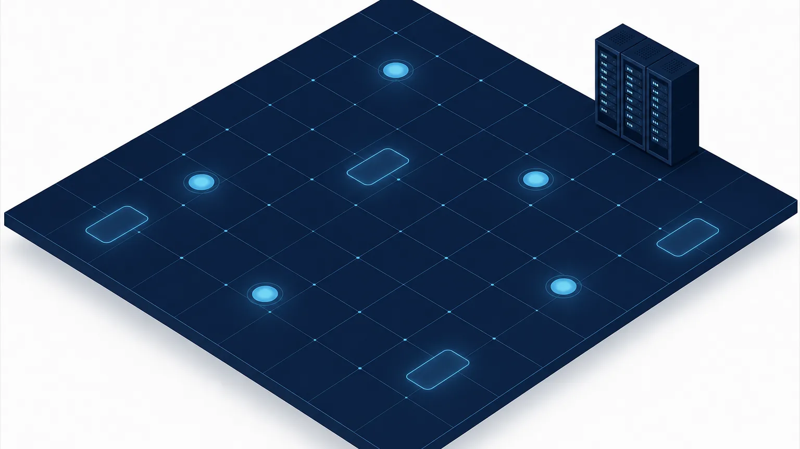
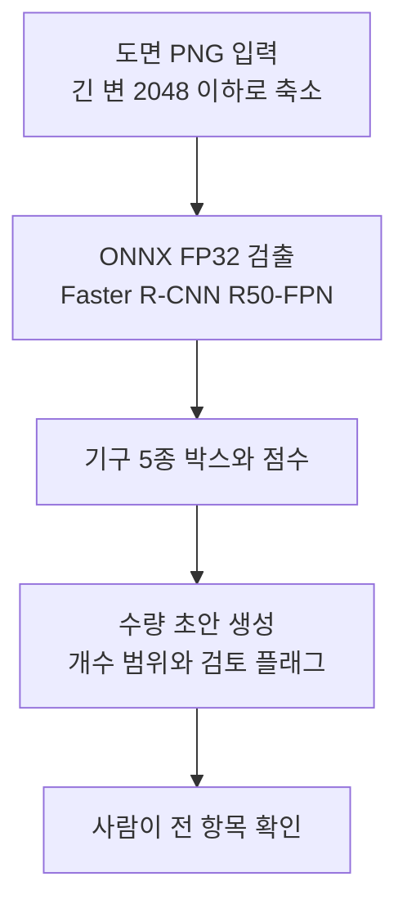
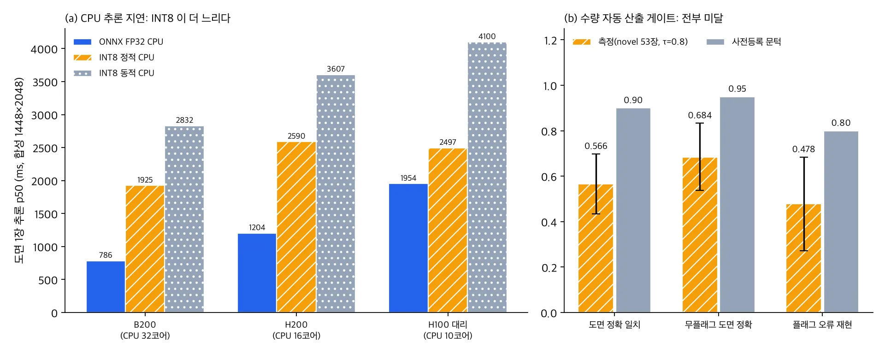

*개념도입니다. 실제 도면이나 데이터셋 이미지가 아닙니다.*

건축 도면에서 위생기구 개수를 뽑아 견적 초안을 만들려는 분께 결론부터 드립니다. 변기, 세면대, 싱크대, 욕조, 가스레인지 다섯 종을 찾는 검출 모델은 사내 서버용 패키지로 만드는 데 성공했습니다. GPU에서는 도면 한 장을 약 26ms에 검출하고 학습 도면과 겹치지 않는 도면 53장에서 AP50 0.922를 냈습니다.

그러나 같은 53장에서 다섯 종의 개수가 모두 맞은 도면은 56.6%였습니다. 미리 정해 둔 기준은 90%였습니다. 그래서 이 모델은 수량을 자동으로 채우는 용도로는 쓰지 않고 사람이 모든 항목을 확인하는 초안으로만 씁니다. 이 글은 통과한 부분과 미달한 부분을 수치와 조건으로 나눠 정리합니다.

## 쉽게 말하면

창고 재고 조사에 비유할 수 있습니다. 직원이 선반 사진을 보고 상자마다 동그라미를 칩니다. 동그라미 하나하나는 대부분 정확합니다(검출 정확도). 그런데 장부에 적히는 것은 선반별 개수이고 선반 하나에서 상자 하나만 빠뜨려도 그 선반의 장부는 틀립니다.

도면도 같습니다. 도면 한 장에 기구가 평균 7.6개 있고 그중 하나만 놓쳐도 그 도면의 견적은 틀립니다. 동그라미 정확도가 높아도 장부 정확도는 따로 재야 한다는 것이 이번 결과의 요점입니다.

## 무엇을 만들었나

데이터는 AI 허브(AI-Hub)의 건축 도면 데이터(OBJ)(71465)입니다. 도면을 학습 7,900장, 개발 199장, 공식 시험 1,014장으로 나눴습니다. 공식 시험 1,014장 중 94.8%는 학습 도면과 서식이 거의 같은 근접중복이었습니다. 그래서 일반화 판단은 근접중복이 아닌 53장(이하 새 도면 53장)으로만 합니다.

모델은 ResNet-50 FPN 기반 Faster R-CNN 검출기입니다. 이를 ONNX(opset 17)로 내보내 GPU와 CPU가 같은 파일을 쓰도록 했습니다.

패키지 선택 규칙과 수량 판정 기준은 측정 잡을 내기 전에 파일로 고정해 커밋했습니다. 공식 시험 분할은 한 번만 열었습니다.

## 검출 정확도: 통과

ONNX FP32 패키지로 공식 시험을 한 번 돌린 결과, 1,014장에서 mAP50-95 0.926, AP50 0.9805였습니다. 학습 잡의 PyTorch 결과(0.9269, 0.9805)와 차이는 −0.0009, 0.0이었습니다. 내보내기 과정에서 정확도를 잃지 않았다는 뜻입니다.

새 도면 53장에서는 mAP50-95 0.7875, AP50 0.922로 내려갔습니다. 종류별로 보면 싱크대가 가장 약해 AP50 0.79였고 나머지 네 종은 0.95 안팎이었습니다. 근접중복 1,014장의 수치는 학습 도면과 같은 서식에서 나온 값이라 고객 도면 기대치로 인용하지 않습니다.

## 하드웨어별 지연과 INT8을 쓰지 않은 이유

지연은 데이터셋이 아닌 합성 입력(1448×2048)으로 쟀습니다. 배치 1, onnxruntime 1.28, CUDA 실행기 기준입니다. 도면 한 장 추론 시간 중앙값은 다음과 같습니다.

| 하드웨어 (CPU 코어) | ONNX FP32 GPU | ONNX FP16 GPU | ONNX FP32 CPU | INT8 정적 CPU | INT8 동적 CPU |
|---|---|---|---|---|---|
| B200 (32) | 26.1ms | 24.69ms | 786.1ms | 1,925.01ms | 2,831.59ms |
| H200 (16) | 27.33ms | 22.23ms | 1,204.46ms | 2,590.13ms | 3,607.11ms |
| H100 대리 가중치 (10) | 30.12ms | 25.2ms | 1,953.59ms | 2,496.96ms | 4,100.12ms |

B200 GPU에서 95번째 백분위는 32.34ms였고 세션당 GPU 메모리가 3.9GB 늘었습니다. H100 행은 학습 가중치가 아닌 대리 가중치로 쟀습니다. B200에서 대리 가중치와 학습 가중치의 지연 차이가 ±3% 안이었으므로 근사치로만 씁니다.

CPU용 INT8은 정확도 이전에 속도에서 탈락했습니다. 동적 INT8은 개발 분할 mAP50-95가 0.0735 떨어졌고 FP32보다 2~3배 느렸습니다. 정적 INT8은 정확도 하락이 0.0033으로 허용 범위 안이었지만 B200 CPU에서 1,925ms로 FP32(786ms)보다 느렸습니다. 채택 조건은 FP32의 0.77배 이하였습니다. onnxruntime CPU의 정수 연산 경로가 이 모델과 입력 크기에서는 이득을 내지 못한 것으로 보입니다.

GPU용 FP16도 채택하지 않았습니다. 박스 계산만 FP32로 남긴 혼합 FP16은 정확도가 오히려 0.0014 올랐지만, 기준 하드웨어인 B200에서 속도가 FP32의 0.946배라 채택 조건(0.9배 이하)을 넘지 못했습니다. H200에서는 0.81배였으므로 H200·H100 고객용 FP16 패키지는 별도 기준을 정해 다시 판단할 후보입니다. 박스 계산까지 모두 FP16으로 바꾸면 mAP50-95가 0.057 떨어져 위치 정밀도가 무너졌습니다.

결과적으로 GPU와 CPU 모두 FP32 ONNX 파일 하나를 씁니다. 같은 B200에서 PyTorch FP32가 18.17ms로 onnxruntime보다 빨랐으므로 TensorRT 실행기나 PyTorch 직접 서빙이 다음 개선 후보입니다.

## 실제 도면에서의 지연

실제 도면 PNG로는 전처리부터 수량 초안까지 전체 시간을 쟀습니다. 기구가 28개인 밀집 도면 20장과 7개인 일반 도면 10장을 썼습니다.

B200 GPU에서 추론만 22.76ms, 전처리를 포함한 전체는 135.21ms였습니다. H200에서는 추론 27.49ms, 전체 88.85ms였습니다. 전체 시간을 좌우한 것은 추론이 아니라 약 17.4MP 원본 PNG를 읽고 줄이는 전처리였습니다. 전처리에는 B200 노드에서 96ms, H200 노드에서 52ms가 걸렸습니다.

검출 개수는 지연에 거의 영향을 주지 않았습니다. 밀집 도면과 일반 도면의 GPU 추론 중앙값 차이는 1ms 미만이었습니다. CPU는 32스레드에서 추론 788ms, 전체 889ms였고 16스레드에서는 1,204ms, 1,256ms였습니다. 8스레드는 노드에 따라 1,324~1,792ms로 갈렸습니다. 프로세스당 최대 메모리는 약 2.3GB였습니다. CPU만으로는 실시간이 어렵고 배치나 야간 처리에 맞습니다.

## 수량 자동 산출: 미달

견적에 필요한 것은 박스가 아니라 도면별 기구 개수입니다. 그래서 측정 전에 두 가지 운영 방식의 기준을 정했습니다. 수량을 그대로 채우는 자동 방식은 도면 정확 일치 0.90 이상과 셀 평균 오차 0.05 이하가 조건이었습니다. 검토 플래그가 없는 도면만 자동으로 확정하는 보조 방식은 플래그 없는 도면의 정확 일치 0.95 이상, 틀린 도면을 플래그로 잡는 비율 0.80 이상, 플래그 비율 0.60 이하가 조건이었습니다.

점수 임계값 0.8은 개발 분할 199장으로만 골랐습니다. 새 도면 53장의 결과는 다음과 같습니다.

- 도면 정확 일치 0.566(95% 신뢰구간 0.434~0.698), 기준 0.90
- 셀 평균 오차 0.1925(0.102~0.321), 기준 0.05
- 플래그 없는 도면의 정확 일치 0.684(0.539~0.833), 기준 0.95
- 틀린 도면을 플래그로 잡은 비율 0.478(0.273~0.684), 기준 0.80
- 플래그 비율 0.283, 기준 0.60 이하로 통과

신뢰구간 상한도 모두 기준 아래라 표본이 53장뿐이라는 점을 감안해도 결론이 뒤집히지 않습니다. 두 방식 모두 미달입니다. 틀린 도면 23장 중 플래그가 잡은 것은 11장뿐이었습니다. 플래그가 없는 도면도 32%는 개수가 틀렸습니다. "플래그가 없으면 자동 확정"이라는 운영은 근거가 없습니다.

틀리는 방향은 주로 과소계수였습니다. 새 도면 53장에서 싱크대는 12번 적게, 4번 많이 셌고 변기는 10번 적게, 4번 많이 셌습니다. 검출 단계에서 싱크대 AP50이 가장 낮았던 것과 같은 방향입니다. 근접중복 시험 1,014장에서도 기구가 30개를 넘는 도면 7장은 정확 일치가 0.14에 그쳤습니다.

## ThakiCloud 제품 적용 시사점

Paxis에서 이 모델이 들어갈 자리는 견적 담당자의 수량 초안 작성 보조입니다. 모델이 기구별 개수를 범위로 제시하면 담당자가 도면을 보며 모든 항목을 확인한 뒤 확정합니다. 이번 결과로 자동 확정 단계는 빠졌고 사람이 승인하는 흐름이 기본값으로 정해졌습니다.

도면을 외부로 보내기 어려운 건설사라면 Aegis 같은 사내 설치 환경이 전제입니다. GPU가 있으면 전처리 포함 장당 약 0.09~0.14초, CPU 32스레드만으로도 약 0.89초라 야간 일괄 처리에는 충분합니다. 특정 도면 서식에 맞춘 소형 검출 모델을 따로 두는 방식은 Maxis의 도메인 모델 흐름과 맞습니다.

## 한계 및 반론

가장 강한 반론은 새 도면 53장이 고객 도면을 대표하지 않는다는 점입니다. 같은 데이터셋 안에서 서식이 겹치지 않는 도면을 골랐을 뿐이고 표본이 작아 신뢰구간이 넓습니다. 고객 도면에서는 수치가 더 낮을 수도, 서식이 단순하면 더 높을 수도 있습니다.

정답도 AI 허브 라벨의 박스 개수입니다. 라벨에 누락이나 중복이 있으면 그만큼 모델 오차로 잡히는데, 라벨 품질은 따로 감사하지 않았습니다. 또 개발 분할의 밀집 도면은 기구 28개가 상한이었으므로 수백 개 기구가 있는 대형 평면도의 지연과 수량은 재지 못했습니다. 라벨에 축척, 층, 실 정보가 없어 수량 초안의 단위와 위치 정보는 호출하는 쪽이 따로 넣어야 합니다.

판정의 층위도 구분해야 합니다. 검출과 패키징은 미리 정한 기준을 통과했고 수량 자동 산출은 미달입니다. 상용화 여부는 이 두 모델 판정과 별개이며 고객 도면 검증이 아직 없습니다. 고객 실증 전이므로 견적을 자동으로 뽑아 주는 제품이라고 말하지 않습니다.

## 정리

도면 위생기구 검출 모델은 GPU와 CPU가 같은 ONNX FP32 파일을 쓰며 B200 GPU에서 장당 약 26ms(합성 입력), 실도면 전처리 포함 135ms로 동작합니다. INT8은 CPU에서 오히려 느려 쓰지 않았고 FP16은 B200에서 이득이 작아 보류했습니다.

정확도는 박스 단위로 높았지만 도면별 개수를 모두 맞힌 비율은 새 도면에서 56.6%였습니다. 그래서 이 모델은 사람이 모든 항목을 확인하는 수량 초안까지만 씁니다. 다음 단계는 싱크대와 변기의 과소계수 원인을 개발 분할에서 나눠 보고 독립된 고객 도면으로 다시 평가하는 일입니다.

---

*데이터 출처: AI 허브(AI-Hub), 건축 도면 데이터(OBJ)(71465). 데이터는 재배포하지 않으며 신청자 본인의 내부 학습·평가에만 사용했습니다. 이 글에는 집계 수치만 실었고 도면, 크롭, 라벨 값은 싣지 않았습니다. 그림은 원장 수치로 그린 차트와 개념도입니다.*
