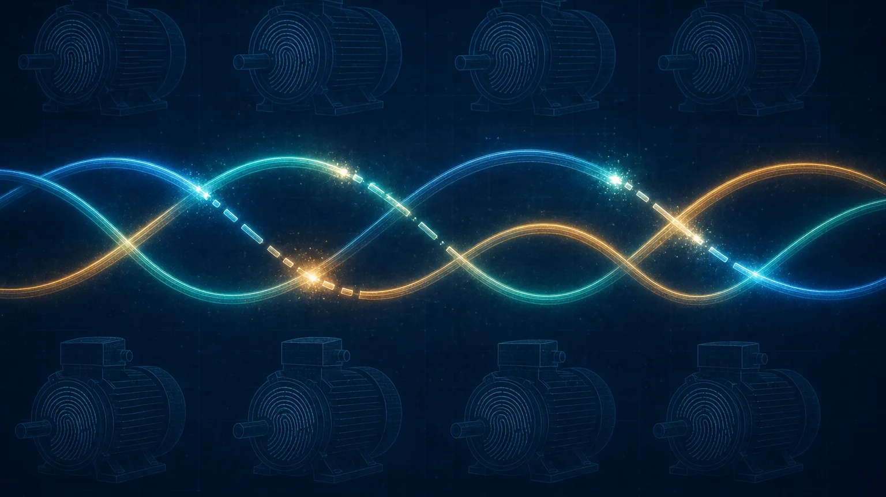
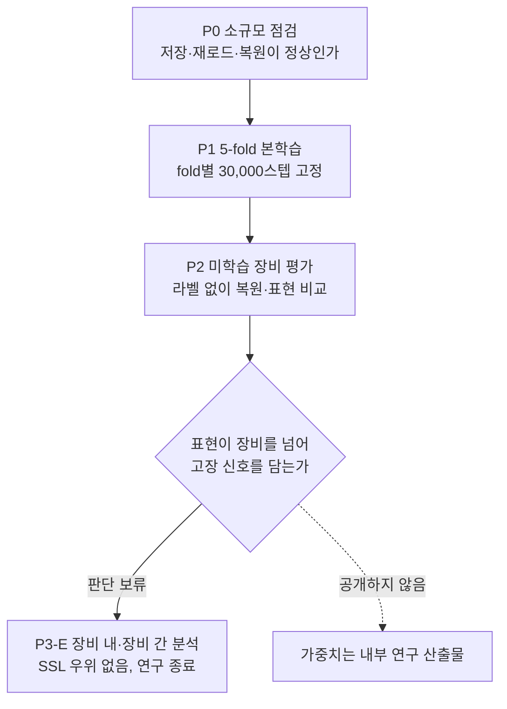
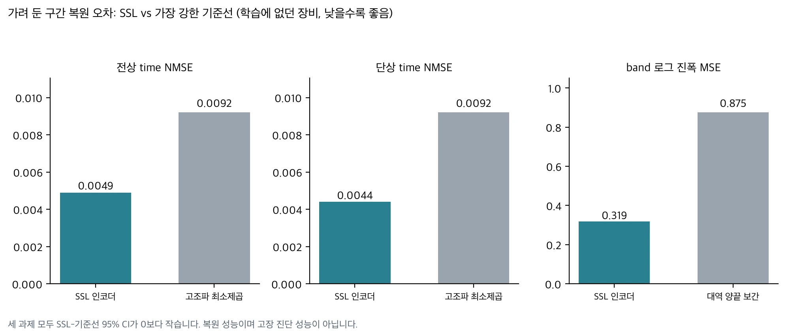
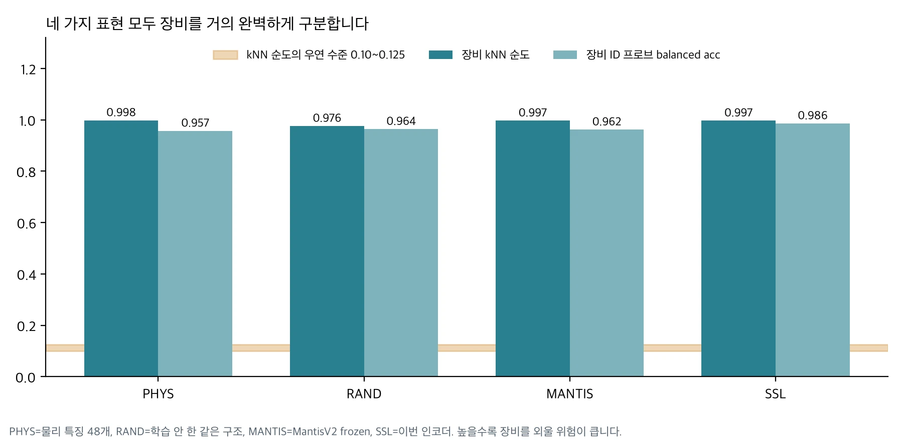

> **2026-11-08 최종 실험 결과 반영.** 장비 안에서 정상과 고장을 가르는 분석(P3-E)을 사전에 정한 기준대로 마쳤고, 그 결과를 아래 「최종 검증」 절에 추가했습니다. 앞쪽의 P0~P2 결과는 처음 발행한 내용 그대로 둡니다.

산업 현장 전동기 42대의 전류 파형 111만 개로, 고장 라벨을 쓰지 않는 자기지도 학습(SSL) 인코더를 학습했습니다. 학습에 넣지 않은 장비에서 파형 일부를 가리고 복원하게 하자, 기본파와 고조파로 맞춘 기준선보다 오차가 절반 수준이었습니다. 여기까지는 성공입니다.

그런데 이 인코더가 만든 표현을 다른 세 가지 표현과 나란히 놓고 보니, 넷 모두 "이 창이 어느 장비에서 왔는지"를 거의 완벽하게 맞혔습니다. 학습하지 않은 랜덤 인코더도, 사람이 설계한 물리 특징 48개도 마찬가지였습니다. 그래서 이 인코더가 고장 진단에 더 좋은 표현이라고 말할 근거는 아직 없습니다. 새 모델 가중치를 공개하는 글이 아니라, 결과를 보기 전에 무엇을 정해 두었고 결과가 무엇을 증명하지 못했는지 정리한 검증 기록입니다.

## 쉽게 말하면

글씨체만 보고도 누가 쓴 답안지인지 알아보는 채점자를 떠올리면 됩니다. 이 채점자가 정답도 잘 맞힌다면, 그건 문제를 이해해서일 수도 있고 "이 학생은 늘 맞힌다"를 기억해서일 수도 있습니다. 이번 데이터에서는 장비마다 고장 유형이 거의 정해져 있습니다. 그래서 장비를 알아보는 능력이 곧 고장을 맞히는 능력처럼 보일 수 있습니다. 이번 실험은 인코더가 파형 구조는 배웠다는 것까지 확인했고, 그 구조가 장비 글씨체 이상인지는 확인하지 못했습니다.

## 왜 라벨 없이 학습했나

같은 AI 허브 산업 전류 데이터로 고장 라벨을 쓰는 지도학습을 먼저 해 봤습니다. 처음 보는 10대 모터로 한 번만 평가했을 때 이진 F1이 0.559였습니다. 정상 데이터만 있는 모터에서 오경보율이 77%와 91%였습니다. 5클래스 분류는 0.253이었습니다. 이 트랙은 공개하지 않기로 하고 닫았습니다.

실패 원인 중 하나는 데이터 구조였습니다. 고장 유형마다 해당 장비가 몇 대뿐이라, 모델이 고장 신호 대신 장비 자체를 외워도 학습 점수가 오릅니다. 그래서 다음 질문을 바꿨습니다. 라벨을 아예 보지 않고 전류 파형 자체의 구조를 배우게 하면, 장비를 넘어 쓸 수 있는 표현이 나올까. 공개된 시계열 기반 모델인 MantisV2와 달리 실제 산업 전류로만 학습한 인코더를 내부에 확보하는 것도 목적이었습니다.

## 결과 보기 전에 정해 둔 것

이번 실험은 학습을 시작하기 전에 프로토콜 문서를 봉인했습니다. 결과를 보고 기준을 바꾸면 어떤 결과든 성공처럼 쓸 수 있기 때문입니다.

데이터는 중복과 라벨 복사 오류를 걸러 낸 1,111,199개 파형, 42대 장비입니다. 장비 폴더 단위로 5개 fold를 나눴습니다. fold k 모델은 fold k 장비의 파형 파일 자체를 받지 않습니다. 학습 잡이 시작할 때 학습 데이터와 평가 데이터의 해시 교집합이 0인지 확인합니다. 고장 라벨은 별도 파일로 떼어 두어 학습·평가 잡이 받지 못하게 했습니다. 라벨 파일이 잡 안에 있으면 그 잡은 시작하지 않고 멈춥니다.

학습 길이는 30,000스텝으로 고정했습니다. 학습에서 빼 둔 1% 창의 손실은 기록만 하고 종료 시점이나 체크포인트 선택에는 쓰지 않았습니다. 평가 지표, 비교할 기준선, 해석 범위도 이때 함께 정했습니다. 해석 범위는 "학습에 없던 장비"까지입니다. 같은 달의 다른 장비 데이터가 학습에 들어갔으므로 "학습에 없던 기간"으로 일반화된다고 말할 수 없습니다.

## 인코더와 학습 목표

모델은 약 790만 파라미터 크기입니다. 3상 전류를 평균하지 않고 각 상을 독립 채널로 넣습니다. 정규화는 학습 데이터 전체에서 구한 스칼라 하나로만 나눕니다. 창마다 따로 정규화하면 절대 진폭과 상 사이의 진폭비가 지워지는데, 이것이 모터 상태를 읽는 단서일 수 있어서 남겨 두었습니다.

시간 쪽은 커널 크기가 다른 1D 합성곱으로, 주파수 쪽은 로그 진폭과 상대 위상으로 토큰을 만든 뒤 4층 Transformer로 합칩니다. 학습 과제는 두 가지입니다. 시간 축에서 10~50 ms 구간 몇 개를 지우고 되살리거나, 주파수 축에서 5~40 Hz 대역 몇 개를 지우고 그 진폭을 되살립니다. 증강은 물리적으로 말이 되는 범위로 제한했습니다. 3상 공통 이득을 ±10% 바꾸고, 상 순서를 순환시키고, 아주 작은 잡음을 더하는 정도입니다.

학습은 H200 1장으로 fold마다 따로 돌렸고 5개 fold 모두 30,000스텝을 끝까지 마쳤습니다. 다시 불러온 체크포인트의 임베딩이 저장 전과 정확히 같은지도 확인했습니다. P0부터 P2까지 실제로 쓴 GPU 시간은 4.045 GPU-h입니다.

## 결과 1. 가려 둔 파형 복원은 기준선을 이겼습니다

학습에 없던 장비에서 고정된 위치를 가리고 복원 오차를 쟀습니다. 기준선은 0으로 채우기, 선형 보간, 보이는 구간에서 기본파와 1~7차 고조파를 최소제곱으로 맞추는 방법, 그리고 단상만 가린 경우 세 상 전류의 합이 0이라는 키르히호프 제약으로 예측하는 방법입니다.

| 과제 | SSL | 고조파 최소제곱 | 키르히호프 | 선형/양끝 보간 | 0 채움/제거 그대로 | SSL−최강 기준선 95% CI |
|---|---|---|---|---|---|---|
| 전상 time NMSE | **0.0049** | 0.0092 | - | 1.372 | 1.001 | −0.0043 [−0.0075, −0.0012] |
| 단상 time NMSE | **0.0044** | 0.0092 | 0.208 | 1.373 | 1.001 | −0.0048 [−0.0079, −0.0020] |
| band 로그 진폭 MSE | **0.319** | - | - | 0.875 | 33.3 | −0.556 [−0.588, −0.514] |

신뢰구간은 장비 단위로 2,000번 다시 뽑아 구했습니다. 세 과제 모두 구간이 0보다 아래에 있습니다.

사전에 정한 판독 기준에 따라, 이 인코더는 "기본파와 고조파, 3선 제약만으로는 설명되지 않는 파형 구조를 학습했다"고 쓸 수 있습니다. 여기서 멈춰야 합니다. 파형을 잘 되살린다는 것과 고장을 잘 구분한다는 것은 다른 이야기입니다.

## 결과 2. 네 가지 표현 모두 장비를 알아봤습니다

두 번째 평가는 표현 자체를 봤습니다. 같은 창에 대해 네 가지 표현을 만들었습니다.

- **PHYS**: 사람이 설계한 물리 특징 48개입니다. 기존 신호처리로 이미 설명되는 정보의 기준입니다.
- **RAND**: 같은 구조를 학습 없이 초기화한 인코더입니다. 학습이 아니라 구조 자체가 주는 효과를 가려냅니다.
- **MANTIS**: MantisV2를 고정해 쓴 표현입니다. 입력을 512 Hz로 재표본하므로 256~1000 Hz 정보가 사라진다는 점을 미리 적어 두었습니다.
- **SSL**: 이번에 학습한 인코더입니다.

| 지표 | PHYS | RAND | MANTIS | SSL |
|---|---|---|---|---|
| 장비 kNN 순도 (우연 수준 0.10~0.125) | 0.998 | 0.976 | 0.997 | 0.997 |
| 장비 ID 프로브 balanced acc | 0.957 | 0.964 | 0.962 | **0.986** |
| 장비 분산 비율 η² | 0.52 | 0.63 | **0.94** | 0.72 |
| 물리량 전이 R² f0 | (포함) 0.87 | 0.98 | 0.98 | 0.96 |
| 물리량 전이 R² 역상분 비율 | (포함) 0.55 | 0.53 | −0.31 | **0.56** |
| 물리량 전이 R² THD 2~7차 | (포함) 0.06 | 0.23 | **0.41** | 0.07 |
| 물리량 전이 R² log RMS | (포함) 0.94 | 0.96 | **1.00** | 0.99 |

kNN 순도는 어떤 창의 가장 가까운 이웃 10개 중 같은 장비에서 온 창의 비율입니다. 같은 녹화 세션의 이웃은 뺐습니다. 우연이라면 0.10~0.125가 나와야 하는데, 네 표현 모두 0.97을 넘었습니다.

이 표를 이렇게 읽었습니다.

첫째, 장비를 외울 위험은 표현의 문제가 아니라 데이터의 성질입니다. 학습하지 않은 인코더와 물리 특징 48개도 2,000 표본짜리 짧은 창만으로 장비를 거의 완벽하게 구분합니다. 이 데이터에서 장비 ID는 숨기기 어려운 정보입니다.

둘째, SSL이 랜덤 인코더보다 장비를 더 잘 알아봅니다. kNN 순도 차이는 +0.021 [+0.010, +0.035], 프로브 차이는 +0.022 [+0.001, +0.056]입니다. 학습을 하면 표현이 좋아진 것처럼 보이지만, 장비 구분이 강해진 것은 이 데이터에서는 장점이 아니라 위험 신호 쪽입니다. 반대로 MantisV2와의 차이는 kNN +0.0007 [−0.0005, +0.0022], 프로브 +0.024 [−0.000, +0.061]로 0을 포함합니다.

셋째, 장비를 넘어 전이되는 물리 정보는 지표마다 결과가 엇갈렸습니다. 학습 장비로 맞춘 회귀를 처음 보는 장비에 적용했을 때, 역상분 비율은 SSL이 가장 높고 MantisV2는 음수였습니다. 재표본 과정에서 상 사이 위상 정보가 사라진 탓으로 보이지만 추정입니다. 고조파 왜곡률(THD)은 반대로 MantisV2가 가장 높고 SSL은 물리 특징 수준이었습니다. 그래서 "SSL이 MantisV2보다 전이 가능한 물리 정보를 더 담는다"는 주장은 성립하지 않습니다.

## 평균이 가린 fold 불안정

표의 R²는 다섯 fold를 합친 값입니다. fold별로 보면 다른 그림이 나옵니다. fold 0에서는 f0 R²가 모든 표현에서 크게 음수였습니다. 물리 특징이 −61, SSL이 −100이었습니다. fold 4에서는 역상분 비율 R²가 모든 표현에서 음수였습니다. 평가 장비의 값이 학습 장비 범위 밖에 있었던 경우로 보입니다.

장비 42대를 다섯으로 나누면 fold마다 평가 장비가 8~9대뿐입니다. 장비 몇 대가 범위를 벗어나면 평균이 그럴듯해도 특정 fold는 무너집니다. 그래서 풀링한 숫자 하나만 보고하지 않고 fold별 표를 결과 파일에 함께 남겼습니다.

## 이번 결과로 말하지 않는 것

다음 주장은 하지 않습니다.

- 이 인코더가 고장 진단에 더 좋은 표현이라는 주장. P2에서는 라벨을 쓰지 않았고, 라벨을 쓴 P3-E에서도 우위가 나오지 않았습니다.
- MantisV2보다 낫다는 주장. 장비 식별 차이의 신뢰구간이 0을 포함합니다. 물리량 전이는 지표마다 엇갈립니다. P3-E 장비 간 중앙값도 SSL 0.610, MantisV2 0.612로 거의 같았습니다.
- 처음 보는 기간이나 다른 공장으로 일반화된다는 주장. 평가 범위는 같은 기간의 처음 보는 장비까지입니다.
- 운전 조건과 무관하게 동작한다는 주장. 회전수, 토크, 전압 기록이 없어 운전 조건을 통제하지 못했습니다.

학습한 가중치는 공개하지 않습니다. 내부 연구 산출물로만 보관하며 공개 판정은 `RELEASE_NO_GO`입니다.

## 다음 단계로 정해 둔 것: 장비 안에서 정상과 고장을 가르는가

남은 질문은 하나입니다. 장비를 알아보는 능력을 빼고도 고장 신호가 남는가. 이를 보려면 한 장비 안에 정상과 고장 데이터가 함께 있는 장비만 따로 봐야 합니다. 장비가 같으면 장비 ID로 답을 맞힐 수 없기 때문입니다. 정상 또는 고장 한쪽만 있는 장비에서 나온 높은 정확도는 성능으로 인정하지 않기로 미리 정해 두었습니다.

이 분석(P3-E)은 2026-11-08에 한 번 실행했습니다. 판정은 결과를 보기 전에 정한 기준을 그대로 따랐습니다.

## 최종 검증: 111만 개 전류 파형으로 학습한 SSL Encoder는 신규 모터에서 더 나았을까?

P3-E는 두 가지를 봤습니다. 하나는 같은 장비 안에서 정상 구간과 고장 구간을 가르는지입니다. 녹화 날짜 단위로 묶어 교차검증했으므로 같은 날의 창이 학습과 평가에 동시에 들어가지 않습니다. 정상과 고장이 함께 있는 장비·고장 조합 25개를 골랐고, 녹화 시각이나 센서 정보만으로 AUROC 0.90 이상이 나오는 3개는 교란으로 보고 뺐습니다. 다른 하나는 같은 고장을 가진 나머지 장비로 학습한 뒤, 학습에 없던 장비 한 대에서 같은 구분이 되는지입니다. 25대를 한 대씩 빼 가며 평가했습니다.

| 항목 | 값 |
|---|---|
| 실측 학습 파형 | 1,111,199개 |
| 내부 SSL 체크포인트 | 5개, 비공개 |
| SSL 총 GPU 사용량 | 6.665 GPU-h |
| 장비 내부 AUROC 중앙값 | PHYS 0.998 / MantisV2 0.999 / SSL 0.991 |
| 미학습 장비 AUROC 중앙값 | PHYS 0.519 / MantisV2 0.612 / SSL 0.610 / Random 0.638 |
| SSL 유의 우세 장비 내 비교 | 22쌍 중 0쌍 |
| 장비 간 사전등록 우위 기준 충족 | 25대 중 8대, 기준 17대 미달 |
| 최종 판정 | P3E_FAULT_SIGNAL_NO_SSL_ADVANTAGE |

장비 안에서는 세 표현 모두 AUROC가 0.99 안팎이었습니다. 학습하지 않은 랜덤 인코더도 중앙값 0.960이었습니다. 장비 안에서는 무엇을 쓰든 정상과 고장 구간이 잘 갈린다는 뜻이라, 이 숫자로 표현의 우열을 가리기는 어렵습니다. 그 안에서도 SSL이 물리 특징과 MantisV2를 둘 다 유의하게 앞선 쌍은 22쌍 중 하나도 없었습니다. 오히려 SSL이 유의하게 낮은 쌍이 물리 특징 대비 16쌍, MantisV2 대비 18쌍이었습니다.

학습에 없던 모터로 넘어가자 숫자가 우연 수준 근처로 떨어졌습니다. 장비 안에서 0.99였던 구분이 중앙값 0.52~0.64에 머물렀습니다. AUROC가 0.5보다 낮아 거꾸로 맞힌 장비도 물리 특징 12대, SSL 7대, MantisV2 5대, 랜덤 4대였습니다. 미리 정한 기준은 SSL이 물리 특징과 MantisV2보다 모두 높은 장비가 25대 중 17대 이상이고 평균 차가 양수여야 한다는 것이었습니다. 실제로는 8대였고 평균 차는 −0.098이었습니다.

랜덤 인코더의 장비 간 중앙값 0.638이 가장 높게 나왔지만, 랜덤 인코더가 더 좋은 표현이라는 뜻은 아닙니다. 네 표현 모두 0.5 근처에서 장비마다 크게 흔들렸고, 그 사이의 순위는 관측값일 뿐입니다. 우위 판정은 SSL을 대상으로 미리 정한 기준으로만 내렸고, 랜덤 인코더가 낫다는 검정은 하지 않았습니다.

장비 안에서 고장 구간을 가르는 신호가 있다는 것은 확인했습니다. 시간·센서 교란 기준선보다 나았기 때문입니다. 하지만 그 신호가 고장의 물리인지, 그 기간의 장비 상태나 운전 조건 차이인지는 이 설계로 가를 수 없습니다. 회전수·토크·전압 기록이 없기 때문입니다.

판정은 사전에 정한 규칙 그대로 `P3E_FAULT_SIGNAL_NO_SSL_ADVANTAGE`입니다. SSL에 쓴 GPU는 P0~P2 4.045 GPU-h와 P3-E 2.62 GPU-h를 더해 6.665 GPU-h입니다. 이 데이터로는 추가 학습, 미세조정, 재평가를 하지 않고 연구를 닫았습니다. 다섯 개 체크포인트는 내부에 비공개로 보관합니다. 운전 조건과 정비 이력이 함께 있는 새 산업 데이터가 확보되면 별도 프로젝트로 다시 시작합니다.

같은 문제를 다른 데이터에서 겪은 기록은 [모터 전류 분석(MCSA) AI 모델을 공개했습니다](/tech-blog/ko/research/thaki-mcsa-mantisv2-mcc5/)에 있습니다. 그 실험에서는 녹화 시각만 쓰는 기준선이 모델보다 높은 점수를 냈습니다.

## 정리

라벨 없이 학습한 산업 전류 인코더는 파형 구조를 배웠습니다. 학습에 없던 장비에서 가려 둔 구간을 고조파 기준선보다 정확하게 되살렸습니다. 하지만 이 데이터에서는 어떤 표현이든 장비를 거의 완벽하게 구분했고, 장비 안과 장비 사이를 나눠 본 최종 검증에서도 SSL의 우위는 나오지 않았습니다.

자기지도학습은 가려진 전류 파형을 복원하는 능력을 향상시켰지만, 실제 고장 정보를 기존 물리 특징이나 MantisV2보다 잘 표현한다는 증거는 얻지 못했습니다. 장비 내부에서 높은 분류 성능이 나와도, 새로운 모터에서 같은 성능이 유지되지는 않았습니다.

손실이 줄고 복원이 좋아졌다는 결과와 현장에서 쓸 만한 진단 표현이라는 결론 사이에는 따로 확인해야 할 단계가 있었고, 이번 데이터는 그 단계를 넘지 못했습니다. 공개 모델은 MCC5로 학습한 MantisV2 Research Preview 하나로 유지합니다.

자사 설비의 전류나 센서 데이터가 이런 장비 지름길을 품고 있는지 함께 점검하고 싶다면 [ThakiCloud에 문의](/contact?interest=industrial-ai&origin=current-ssl)하시기 바랍니다. 모델을 고르기 전에 데이터 구조부터 검토합니다.



---

*데이터 출처: AI 허브(AI-Hub) 기계시설물 고장 예지 센서(#238). 원본과 가공 데이터는 신청자 본인의 내부 연구에만 사용했고 재배포하지 않습니다. 본문에는 집계 수치만 담았습니다. 비교 모델: [paris-noah/MantisV2](https://huggingface.co/paris-noah/MantisV2) (Apache-2.0). 이번에 학습한 인코더 체크포인트 5개는 공개하지 않습니다.*
