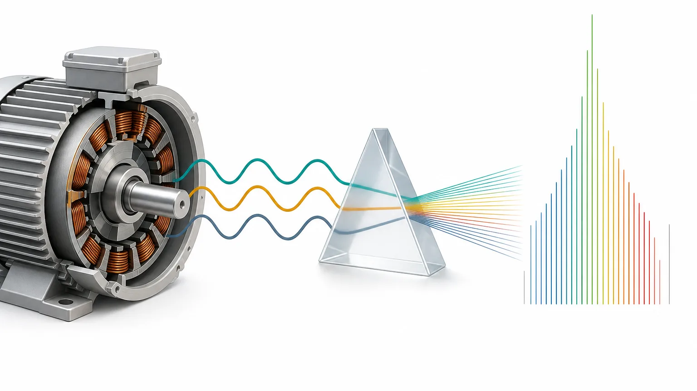
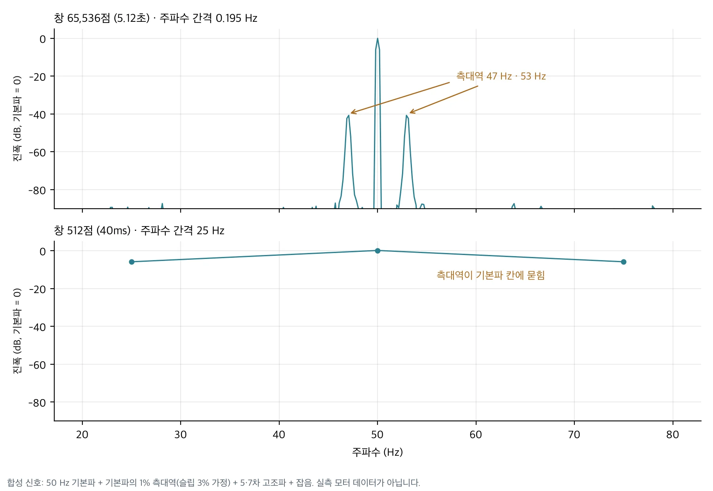
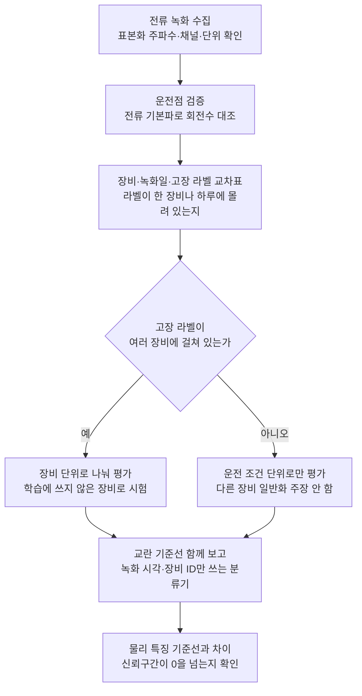

모터 전류 분석(MCSA, Motor Current Signature Analysis)은 전동기에 흐르는 전류만 보고 설비 상태의 단서를 찾는 방법입니다. 진동 센서를 새로 붙이지 않아도 되고 전류는 이미 배전반에서 재는 경우가 많아서 산업 현장에서 자주 검토됩니다.

전류에는 많은 정보가 들어 있지만 전부 들어 있지는 않습니다. 이 글은 전류만으로 읽을 수 있는 신호, 분석 창을 고를 때 생기는 손실, 그리고 모델이 고장 대신 장비를 외워 높은 점수를 내는 경우를 차례로 다룹니다. 앞서 공개한 [MCSA 연구 모델 글](/tech-blog/ko/research/thaki-mcsa-mantisv2-mcc5/)의 배경 설명에 해당합니다.

## 쉽게 말하면

전류를 듣는 일은 엔진 소리로 차 상태를 짐작하는 일과 비슷합니다. 큰 소리(기본파)는 거의 늘 들리고 고장의 단서는 그 옆에서 아주 작게 울리는 소리(측대역)인 경우가 많습니다. 작은 소리를 구분하려면 충분히 오래 들어야 하고 녹음을 짧게 자르거나 거칠게 압축하면 그 소리가 큰 소리에 묻힙니다. 또 차마다 원래 소리가 다르기 때문에, 고장 소리 대신 "이건 그 차 소리"라는 것만 외워도 시험 점수는 높게 나올 수 있습니다.

## 전류에 담기는 네 가지 신호

3상 유도전동기 전류에서 진단에 주로 쓰는 신호는 네 가지입니다. 고장별 주파수 관계는 Thomson과 Fenger의 정리(IEEE Industry Applications Magazine, 2001)를 기준으로 했습니다.

**기본파(f0).** 전원이나 인버터가 공급하는 주파수입니다. 상용 전원이면 50Hz나 60Hz이고 인버터로 속도를 바꾸면 운전점마다 달라집니다. 극쌍 수가 p인 모터의 동기 속도는 60·f0/p rpm이므로, 기본파는 운전 조건을 확인하는 기준이 됩니다. 우리는 MCC5 데이터를 감사할 때 회전 신호 채널(키페이즈)이 잡음 때문에 41건에서 회전수를 제대로 세지 못하자, 전류 기본파로 운전점을 검증했습니다. 전류로 구한 f0·60/rpm 비율의 중앙값이 1.002로 2극 동기 회전과 맞았고 명목 회전수에서 10% 넘게 벗어난 녹화 3건은 평가 전에 따로 뺐습니다.

**고조파와 THD.** 기본파의 정수배 성분입니다. 전체 고조파 왜곡률(THD)은 고조파 크기의 합을 기본파 크기로 나눈 값입니다. 고조파는 자기 포화나 권선 이상에서도 생기지만 인버터 스위칭이나 전원 품질에서도 생깁니다. 그래서 THD가 올랐다는 사실만으로 모터 고장이라고 말할 수 없습니다.

**상 불평형과 역상분.** 세 상의 전류를 대칭 성분으로 나누면 정상분과 역상분이 나옵니다. 역상분 비율이 커지면 상 사이 균형이 깨졌다는 뜻입니다. 고정자 권선 단락이 원인일 수 있지만 공급 전압 불평형도 같은 신호를 만듭니다. MCC5에는 전압 불평형이 별도 상태로 들어 있어서 이 둘을 가르는 일이 실제로 시험됩니다.

**측대역.** 회전자나 기계 쪽 이상이 전류를 변조하면 기본파 양옆에 작은 성분이 생깁니다. 회전자 바가 끊어지면 (1±2ks)·f0(s는 슬립, k는 정수)에, 편심이 있으면 회전 주파수 간격으로 측대역이 나타납니다. 베어링 결함도 측대역을 만들 수 있지만 진동이 전류로 옮겨 오며 약해지기 때문에 보통 가장 찾기 어렵습니다. 측대역은 기본파보다 수십 dB 작고 기본파와 몇 Hz밖에 떨어져 있지 않습니다.

## 창 길이가 주파수 해상도를 정합니다

스펙트럼을 구할 때 주파수 칸의 간격은 표본화 주파수를 창의 표본 수로 나눈 값입니다. MCC5는 12.8kHz로 기록되어 있고 65,536점 창(5.12초)이면 간격은 12,800 ÷ 65,536 = 0.195Hz입니다. 같은 신호를 512점(40ms)으로 자르면 간격이 25Hz로 넓어집니다.

아래 그림은 합성 신호로 그렸습니다. 50Hz 기본파에 슬립 3%를 가정한 47Hz·53Hz 측대역을 기본파의 1% 크기로 넣고 5·7차 고조파와 잡음을 더했습니다. 실측 모터 파형은 쓰지 않았습니다.

긴 창에서는 측대역이 기본파 옆에 −40dB 봉우리로 따로 보입니다. 512점 창에서는 25Hz, 50Hz, 75Hz 세 칸만 남고 3Hz 떨어진 측대역은 50Hz 칸 안으로 들어가 사라집니다. 정보가 원래 신호에 있더라도 창을 짧게 자르면 분석 단계에서 지워집니다.

창이 길다고 늘 좋은 것은 아닙니다. 창 안에서 부하나 속도가 바뀌면 봉우리가 퍼지고 창 수가 줄어 학습 표본도 적어집니다. 그래서 우리는 모델 성능을 보기 전에 창 길이 후보를 주파수 해상도 기준으로 정하고 이를 사전등록했습니다.

## 512점으로 줄이면 잃는 것

시계열 사전학습 모델 상당수는 입력 길이 512점을 기준으로 학습됩니다. 고주파로 기록된 전류를 이 길이에 맞추는 방법은 몇 가지가 있고 방법마다 잃는 정보가 다릅니다.

| 방법 | 남는 것 | 잃는 것 |
|---|---|---|
| 원파형 512점을 그대로 자르기 | 40ms 파형 모양 | 주파수 간격이 25Hz라 측대역 구분 불가 |
| 512Hz로 재표본한 시간 신호 | 256Hz 아래 성분 | 50Hz 전원이면 5차 고조파(250Hz) 위쪽이 거의 사라짐 |
| 긴 창의 스펙트럼을 512칸으로 묶기 | 0~6,400Hz 전체 대역 | 칸 폭이 12.5Hz라 기본파 근처 측대역이 합쳐짐, 상 사이 위상 정보 없음 |

공개한 MCSA 모델은 세 번째 방식을 썼습니다. 상별로 Welch 파워 스펙트럼을 구해 0~6,387.5Hz를 512칸으로 나눴습니다. 넓은 대역을 보는 대신 기본파 바로 옆 몇 Hz 단위 측대역은 이 입력에서 구분되지 않습니다. 이것이 모델의 한계라기보다 입력 설계의 선택이라는 점을 함께 적어 둡니다.

## 전류만으로는 보기 어려운 것

전류로 단서를 찾을 수 있다는 말과 원인을 확정할 수 있다는 말은 다릅니다. 전류만으로 판단하기 어려운 경우는 다음과 같습니다.

첫째, 물리 단위입니다. MCC5 감사에서 토크 채널 값은 명목 토크(Nm)의 −1~4% 수준이었고 전류 원시값도 데이터 설명서의 단위와 크기가 맞지 않았습니다. 그래서 절대 전류값이나 토크로 무엇을 주장하지 않고 녹화 안에서 정규화한 값만 썼습니다. 현장 데이터도 센서 교정 기록이 없으면 같은 문제가 생깁니다.

둘째, 원인 구분입니다. 역상분 증가는 권선 단락과 전압 불평형 모두에서 나타나고 고조파 증가는 모터 상태와 구동 장치 모두에서 나타납니다. 부하가 출렁이면 측대역과 비슷한 변조가 생기기도 합니다. 운전 조건(속도, 토크, 전압)을 함께 기록하지 않으면 해석이 열려 있습니다.

셋째, 시간에 대한 예측입니다. 짧은 녹화로 상태를 구분하는 일과 고장까지 남은 시간을 예측하는 일은 다른 문제입니다. 고장 시점과 정비 이력이 이어진 연속 기록이 없으면 잔여 수명(RUL)은 측정할 수 없습니다.

## 모델은 고장보다 장비를 먼저 배울 수 있습니다

전류 진단 모델을 평가할 때 가장 조심하는 부분입니다. 모터마다 전원, 배선, 부하, 센서가 조금씩 다르고 이 차이는 고장 신호보다 큰 경우가 많습니다. 학습 데이터에서 장비와 고장 라벨이 겹쳐 있으면 모델은 고장 대신 장비를 알아보는 법을 배우고 같은 장비가 시험에 다시 나오면 점수가 높게 나옵니다.

두 데이터에서 이 문제를 직접 확인했습니다. MCC5에서는 공개 모델이 봉인 TEST에서 Macro-F1 0.943을 냈지만 전류를 보지 않고 녹화 시각만 쓴 기준선이 0.986을 냈습니다. 상태별 녹화가 거의 하루씩 몰려 있었기 때문입니다. AI 허브의 「기계시설물 고장 예지 센서」 데이터(#238)에서는 라벨 없이 장비 42대를 비교했는데 전류에서 뽑은 물리 특징 48개만으로도 가까운 이웃 창이 같은 장비에서 나오는 비율(kNN 순도)이 0.998이었습니다. 무작위로 고를 때의 0.10~0.125보다 여덟 배 이상 높습니다. 고장을 학습시키기 전에 이미 장비 구분이 거의 끝나 있다는 뜻입니다.

그래서 우리는 평가 데이터를 다음 순서로 점검합니다.

녹화 시각이나 장비 번호만 쓰는 분류기를 함께 돌려 보는 일은 비용이 거의 들지 않습니다. 그런데 이 기준선이 모델보다 높게 나오면 모델 점수가 무엇을 재는지부터 다시 봐야 합니다.

## 정리

전류는 기본파, 고조파, 상 불평형, 측대역이라는 네 가지 단서를 줍니다. 측대역처럼 작은 단서를 보려면 창 길이와 입력 압축 방식을 먼저 정해야 하고 512점 입력은 어느 쪽으로 줄이든 무언가를 잃습니다. 그리고 전류 진단 모델의 점수는 학습에 쓰지 않은 장비에서 확인하기 전까지 고장을 구분한 결과인지 장비를 알아본 결과인지 알 수 없습니다.

자사 설비의 전류 데이터로 진단 가능성을 검토하고 싶다면 [ThakiCloud에 문의](/contact?interest=industrial-ai&origin=mcsa-basics)하시기 바랍니다. 데이터에 어떤 장비와 운전 조건이 들어 있는지부터 함께 확인합니다.



---

*그림의 스펙트럼은 numpy로 만든 합성 신호입니다. MCC5 수치는 MCC5-THU(Mendeley Data, CC BY 4.0) 감사·평가 결과, 장비 구분 수치는 AI 허브(AI-Hub) 「기계시설물 고장 예지 센서」(#238)의 라벨 없는 표현 평가에서 나온 집계값이며 원천 데이터는 포함하지 않았습니다. 고장별 주파수 관계: W. T. Thomson, M. Fenger, "Current signature analysis to detect induction motor faults", IEEE Industry Applications Magazine, 2001.*
