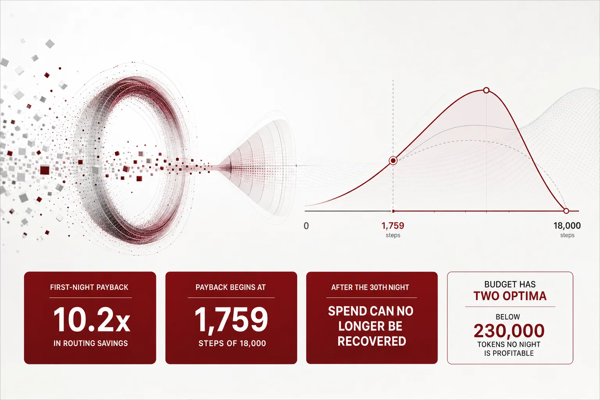
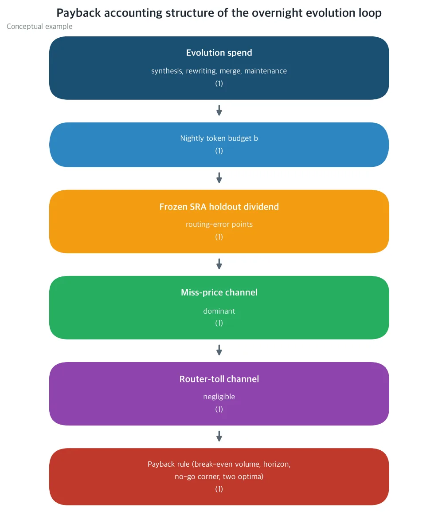
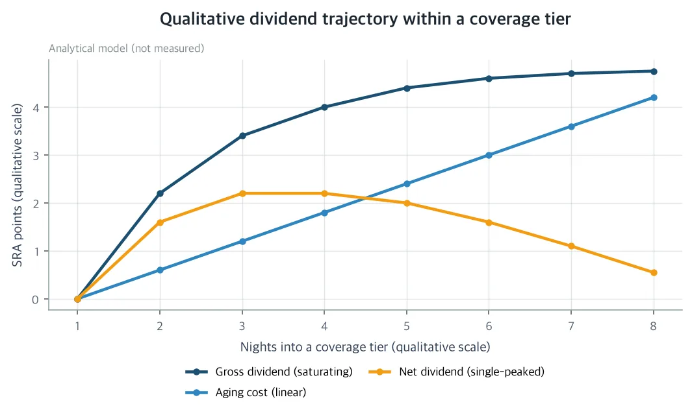
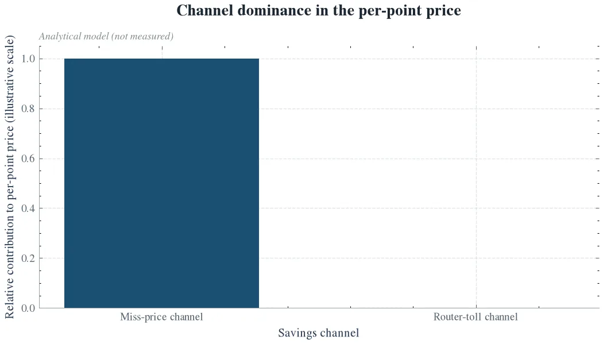

스킬 레지스트리의 밤사이 자기 진화 지출은, 되돌아오는 값이 닫힘 형태로 계산 가능한 예산 라인입니다. 자기 GPU에서 무인 에이전트를 돌리고 스킬 라우터의 토큰 원장을 직접 관리하는 분이라면, 이 글은 그 예산을 정할 브레이크이븐 숫자를 줍니다. 논문이 선언한 요금에서, 첫 밤 지출은 라우팅 절감으로 10.2배가 돌아옵니다. 다만 이 논문의 모든 수치는 선언된 공칭 요금 카드 위의 닫힘 형태의 예측이며 새 실측은 보고하지 않습니다. 확인이나 반증은 사전등록된 4갈래 동결 홀드아웃 프로토콜의 몫입니다.

*글의 핵심 개념을 형상화했습니다.*

## 쉽게 말하면

스킬 레지스트리를 2,200개 물건의 창고로 생각하면 됩니다. 자기 H200 클러스터의 무인 에이전트는, 밤마다 18,000건의 작업을 처리합니다. 각 작업에는 창고에서 물건 하나가 나갑니다. 물건을 고르는 쪽이 라우터입니다.

고르는 쪽이 틀리면 대가를 치릅니다. 오른 물건 때문에 재작업이 생기고 다음 작업도 늦어집니다. ThakiCloud의 스킬 라우터 시리즈는 그 대가를 이미 가격으로 붙여 뒀습니다. 오품 하나당 1.4달러, 그것이 미스 가격입니다.

창고에는 밤의 정리반이 있습니다. 새 물건을 입고하고 라벨을 다시 쓰고 비슷한 물건을 합치고 선반 인덱스를 갱신하는 일입니다. 이 모든 일이 토큰을 씁니다. 오늘의 논문이 정가하려는 것은 바로 이 정리반의 밤 지출입니다.

정리반의 일은, 고르는 쪽의 오품을 줄입니다. ThakiCloud의 스킬 라우터 시리즈는, 그 이전까지 라우터 쪽의 비용만 단계별로 정가해 왔습니다. 창고를 고쳐 주는 진화 쪽은, 아직 값이 없는 예산 라인으로 남아 있습니다. 오늘의 논문은 그 값입니다.

창고는 늘 움직입니다. 물건이 입고되고 빠지면서 감시 테스트의 63개 사례 중 21개가 조용히 무효화됐습니다. 그래서 이 논문은 테스트를 동결합니다. 사례, 정답, 채점, 토큰화, 라우팅 구성을 고정하고 움직이는 것은 창고의 내용만입니다. 창고가 나아진 것만으로 점수가 오르면, 그 점수는 정리반의 공입니다.

그래서 이 논문이 묻는 것은, 밤사이 정리비가 오품 손실로 되돌아오는지 여부입니다. 회수가 몇 건의 픽에서 시작되는지, 몇 번째 밤에 멈추는지도 같은 장부에서 답합니다.

답은 되돌아오지만 한계가 있습니다. 지출은 늘수록 효과가 줄어 포화되고 창고는 다시 서서히 지저분해져 일정 밤 이후로는 지출을 못 만회합니다. 즉, 사람 말로는 정리반을 계속 일시키지 말고, 알람이 울리는 밤에 쉬게 해야 한다는 뜻입니다.

## 무엇을 해봤나

논문은 밤사이 진화 예산, 곧 정리반이 한 밤에 쓰는 토큰 수의 회수율을 정의합니다. 회수율은, 그 지출이 하류 라우팅 절감으로 얼마나 돌아오는지의 비율입니다. 절감은 두 채널로 환산됩니다.

첫 채널은 미스 가격입니다. 스킬 라우팅 정확도(SRA) 포인트가 1점 오르면, 라우팅 에러가 그만큼 줄고 오품 대가만큼 절감됩니다.

두 번째 채널은 통행료입니다. 정돈된 창고는 전체를 뒤지지 않아도 되는 경우가 늘고 그 차이도 절감이 됩니다. 두 채널의 가격은 이미 이 시리즈에 기록되어 있어서, 이 논문은 새 가격을 만들지 않습니다. 장부에 쓴 값을 진화 지출 쪽으로 연결하는 것뿐입니다.

*논문의 정가 회계 구조입니다. 밤사이 진화 지출이 동결 홀드아웃의 품질 개선, 곧 배당을 사고 그 배당이 미스 가격 채널과 통행료 채널로 하류 라우팅 절감으로 환산됩니다. 개념적 예시이며 실측 데이터가 아닙니다.*

지출 쪽은 네 가지 작업으로 모입니다. 새 스킬을 만드는 합성, 스킬 설명을 다시 쓰는 재작성, 중복 스킬을 합치고 적게 쓰는 스킬을 내리는 위생, 그리고 인덱스를 다시 만드는 갱신입니다. 각 작업에 이미 정가된 요율을 붙여 혼합 요율을 만들고 밤 예산에 곱해 그 밤의 지출을 계산합니다. 합성은 스킬 하나당 생성 측 가격으로, 나머지는 서빙 요율로 잡힙니다.

돌아오는 값, 곧 배당의 모양은 두 힘의 합입니다. 예산이 늘면 배당도 커지지만 새로 커버되는 작업이 줄어드는 만큼 효과가 포화됩니다. 밤이 지날수록 그 효과는 지수대로 꺾입니다.

창고도 스스로 다시 지저분해집니다. 스킬이 낡고 스킬 수가 늘수록 고르는 것이 어려워지는 에이징입니다. 배당은 포화 곡선에서 이 에이징을 뺀 값입니다.

이 두 쪽을 놓으면, 브레이크이븐은 계산이 됩니다. 지출을 되돌아오는 값으로 나눈 최소 작업 수, 브레이크이븐 스텝입니다. 밤마다 지출을 만회하는 마지막 밤, 한계 회수 지평입니다. 두 값 모두 예산의 닫힘 함수이며, 예산을 흔드리면 V자 곡선으로 움직입니다.

그 아래에는, 어떤 밤도 이롭지 않은 영역이 있습니다. 밤 예산이 23만 토큰을 못 넘으면, 작업량이 아무리 많아도 회수가 안 됩니다. 논문은 이 영역을 노고 코너라 부릅니다.

최점도 둘입니다. 회수율을 최대화하는 효율 최점과, 밤 순이익을 최대화하는 순이익 최점이 다른 자리에 있습니다. 목표가 몇 배가 되느냐인지, 얼마를 남기느냐인지에 따라 예산도 달라집니다.

이 계산이 실제 창고에도 성립하는지를 판정할 도구는 논문이 사전등록한 프로토콜입니다. 창고를 얼린 갈래, 지금 예산의 갈래, 효율 최점의 갈래, 순이익 최점에 퇴출을 더한 갈래, 4개로 나눕니다. 배당은 약 300사례의 부수 테스트로 재고 회귀는 63사례의 SRA 게이트로 막습니다.

반증 기준 F1부터 F5까지가, 각 예측이 어떤 관측으로 확인되거나 뒤집히는지 미리 정해 둡니다. 프로토콜 비용은 파일럿 약 650달러, 전체 약 6,500달러로, 선언된 밤 예산 안에 들어 있습니다.

## 나온 결과

선언된 공칭 요금에서 지금의 밤 예산은 200만 토큰입니다. 그 밤의 지출은 38달러이고 다음 밤의 순배당은 1.54 SRA 포인트입니다.

포인트 하나당 252달러로 환산하면, 첫 밤 절감은 389달러입니다. 회수율은 10.2배입니다.

즉, 사람 말로는 38달러를 쓰면, 다음 밤에 389달러가 돌아옵니다.

30개 밤을 쌓으면, 누적 배당은 약 10만 8천달러, 누적 지출은 1,140달러입니다. 배당 수준은 유지되는 동안, 지출은 밤마다만 들어가기 때문입니다.

브레이크이븐은 1,759스텝에서 납니다. 이는 밤마다 라우팅되는 18,000스텝의 9.8퍼센트입니다. 즉, 사람 말로는 밤 작업의 10분의 1만 돌아가도, 진화 지출은 회수됩니다.

한계 회수 지평은 30번째 밤입니다. 30번째 밤의 순이익은 2.76달러이고 31번째 밤은 마이너스 2.44달러로 돌아옵니다.

배당 자체의 정점은 39번째 밤입니다. 그 뒤로는 에이징이 배당을 갉아먹습니다. 약 141번째 밤에는, 누적 순배당이 제로를 건드리는 것으로 계산됩니다.

*커버리지 티어 안의 누적 순배당 궤적, 분석 모델 도식입니다. 포화하는 총배당에서 선형 에이징을 빼면, 순배당은 39번째 밤에 정점에 이른 뒤, 141번째 밤 안팎으로 제로를 건드립니다. 한계 브레이크이븐 지평인 30번째 밤은 정점보다 앞당겨 오므로, 각 커버리지 티어는 정점 전에 리베이스해야 합니다. 분석 모델이며 실측이 아닙니다.*

정점이 지나면, 창고의 배당은 빌려 쓰는 것이 됩니다. 리베이스 없이 달리면, 에이징이 지운 값을 다시 만드는 데 토큰을 쓰기도 합니다.

반면, 23만 토큰 미만에서는 어떤 밤도 이롭지 않습니다. 노고 코너에서 쓰면, 지출이 에이징보다 먼저 크므로, 작업량이 아무리 많아도 회수가 안 되는 셈입니다.

예산의 최점은 둘입니다. 회수율 최점은 130만 토큰에서, 회수율 10.6배로 납니다.

첫 밤 순이익 최점은 820만 토큰에서, 밤당 651달러로 납니다. 여기서는 회수율이 5.2배까지 내려가도, 남기는 달러가 가장 많습니다.

| 밤 예산 | 밤 지출 | 첫 밤 회수율 | 브레이크이븐 스텝 | 한계 지평 |
|---|---|---|---|---|
| 50만 토큰 | 9.5달러 | 8.2배 | 2,197 | 13개 밤 |
| 100만 토큰 | 19달러 | 10.5배 | 1,717 | 23개 밤 |
| 200만 토큰 | 38달러 | 10.2배 | 1,759 | 30개 밤 |
| 450만 토큰 | 85.5달러 | 7.7배 | 2,333 | 32개 밤 |
| 820만 토큰 | 155.8달러 | 5.2배 | 3,476 | 28개 밤 |

선언된 공칭 요금 카드 위의 닫힘 형태 예측이며 실측이 아닙니다. 효율 최점(130만 토큰, 10.6배)과 순이익 최점(820만 토큰, 651달러)은 그리드 인접 셀의 값입니다.*

절감의 원천은 한 쪽입니다. 통행료 채널은 포인트 당 가격의 2,000분의 1도 안 되는 지분이며 회수는 미스 가격 채널의 이야기입니다.

*SRA 포인트 1점의 가격 채널 구성, 분석 모델 도식입니다. 미스 가격 채널이 가격의 대부분을 차지하고, 라우터 통행료 채널은 2,000분의 1도 안 되는 0.053퍼센트입니다. 분석 모델이며 실측이 아닙니다.*

즉, 사람 말로는 창고를 정돈하면 전체를 뒤지는 수고는 줄지만, 돈을 만들어 내는 것은 오품이 줄어드는 값입니다.

선언값을 하나씩 흔들어 봐도, 부호는 뒤집히지 않는 셈입니다. 배당 천장을 절반으로 낮추면, 회수율은 4.25배로 남습니다.

홀드아웃 대표성을 절반으로 줄이면, 회수율도 절반으로 줄고 브레이크이븐은 두 배로 늘어납니다. 어떤 흔들림에서도, 한계 지평은 15개 밤 이상, 브레이크이븐은 4,236스텝 이하로, 밤 로드 안에 남아 있습니다.

## 그래서 무엇을 바꾸면 되나

회사에게는 밤사이 진화 루프의 운영 규칙이 됩니다. 루프를 배경처럼 켜 두지 말고 목적에 맞춰 예산을 고르면 됩니다. 회수율이 우선이면 130만 토큰, 순이익이 우선이면 820만 토큰이 됩니다.

한계 지평, 약 30개 밤에 다가가면, 퇴출과 병합으로 창고를 리베이스하고 다시 돌립니다. 23만 토큰 미만에서는, 아예 돌리지 않는 것이 오히려 이득입니다.

아깝게 쓰던 그 예산은, 이 시리즈의 전 편이 정가한 인디퍼런스 밴드 타이브레이크로 돌려 쓰는 것이 좋습니다. 그 절감은 밤당 60.5달러의 별도 항목입니다.

사회적으로는, 자기 개선형 에이전트가 항상 켜 있을 필요가 없다는 계산입니다. 밤마다 쓴 달러마다, 라우팅 절감 달러가 돌아오도록 묶으면, 상시 에이전트 인프라의 컴퓨트와 에너지 비용에 상한이 생깁니다.

토큰은 에너지이기도 하므로, 멈춤이 계산된 루프는 전력 비용도 함께 줄입니다. "멈추라"는 명령도, 추측이 아니라 노고 코너라는 숫자가 됩니다.

과학적으로는, 세 가지가 남습니다. 동결 홀드아웃 배당의 포인트 당 가격은, 라우터 원장과 같은 장부에 환산되는 새로운 대상입니다.

자기 진화 스킬 레지스트리의 경제 회수 프론티어가, 동결 홀드아웃 대비로 처음 정가되었습니다. Voyager 류의 스킬 라이브러리와 오프라인 프롬프트 진화는, 이 회수를 정가하지 못했습니다.

그리고 동결 홀드아웃은, 편의가 아니라 측정의 전제입니다. 창고 자체가 움직이면, 점수 변화가 정리반의 것인지 테스트의 것인지 구분할 수 없습니다.

## 못 믿을 부분

첫째, 모든 수치는 선언된 공칭 요금 카드 위의 닫힘 형태의 예측입니다. 새 실측은 없고 논문이 정한 것은 예측과, 확인과 반증을 위한 장부입니다.

모양 결과, 채널 분해와 한계 지평의 닫힘식, 노고 코너와 두 최점은, 요금 카드와 무관한 대수적 결과입니다. 값이 흔들려도, 이 구조는 유지됩니다.

둘째, 값이 가장 위험한 입력은 셋입니다. 홀드아웃 대표성은 1.0으로 선언했고 절반이면 달러 수치가 전부 절반이 됩니다.

배당 천장은, 기록된 37.8포인트 격차의 선언된 분수이며 21개 중 5개 유지되는 홀드아웃 비율로 할인됩니다. 에이징 항 자체도 모델 예측이라, 한계 지평은 위쪽 경계로 읽어야 합니다.

셋째, 창고의 이동입니다. 레지스트리는 밤마다 바뀌고 63사례 중 21사례가 이미 그 이동에 무효화됐습니다. 동결 홀드아웃이 이를 분리하지만 프로토콜의 원장 재계산이 값의 표류까지 잡아 줍니다.

이 논문의 숫자는, "돌아옵니다"의 증거라기보다, "돌아온다고 주장할 때 어떤 관측이 나와야 하는가"의 장부입니다. 파일럿 약 650달러, 전체 약 6,500달러의 프로토콜이, 그 장부를 채울 다음 단계입니다.

---

논문 원문과 수반 자료는 여기에서 볼 수 있습니다: [The Evolution Payback](https://huggingface.co/datasets/thaki-AI/daily-paper-2026-11-08-overnight-skill-evolution-payback)

*본문의 모든 수치는 명시적 전제(A1~A8)와 선언된 공칭 요금 카드 하의 닫힘 형태의 예측이거나, 인용 참고 문헌에 귀속된 결과입니다. 이 글은 실측을 보고하지 않습니다. 세 그림은 모두 분석 모델의 도식이며 실측 데이터가 아닙니다. 본문은 읽기 쉽게 반올림했고 정밀한 값은 표와 캡션에 두었습니다.*