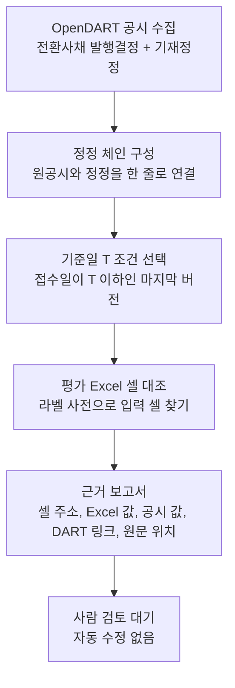
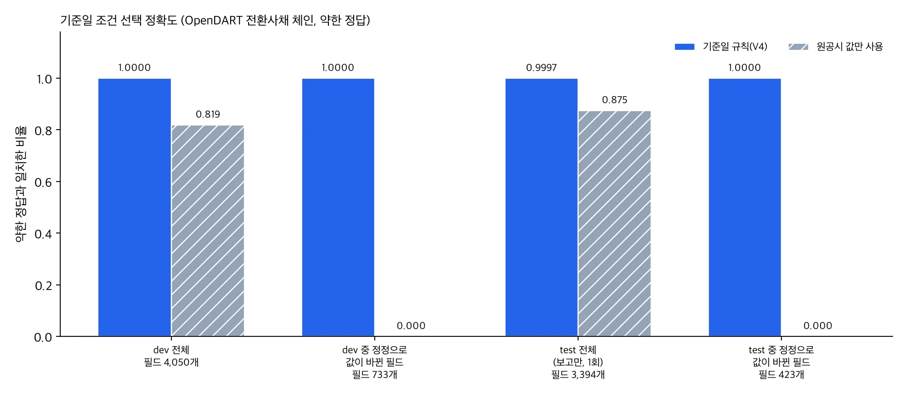
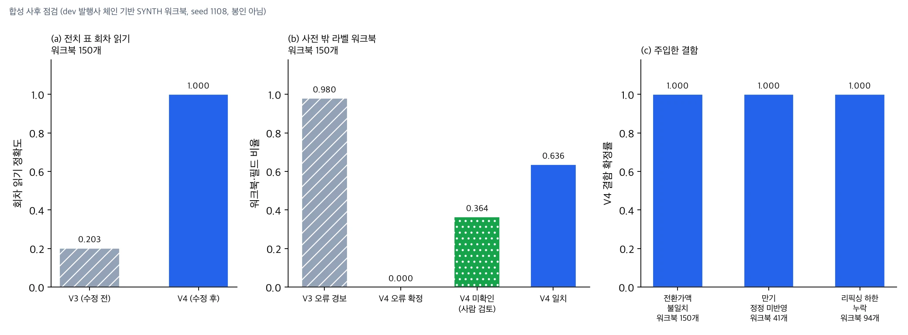
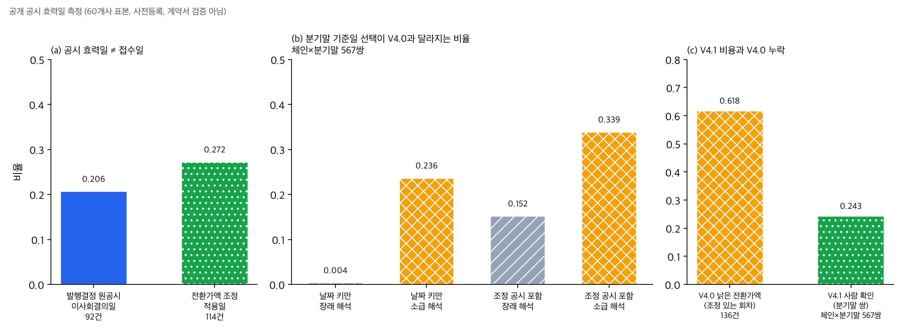

전환사채 평가모형을 검토하는 회계사와 평가 담당자께 결론부터 드립니다. 공개 공시로 기준일 시점의 전환사채 조건을 복원해 보니, 공시 접수일만 보고 버전을 고르면 놓치는 것이 세 가지 있었습니다. 공시에 적힌 효력일이 접수일보다 앞서는 경우가 원공시의 20.7%, 전환가액 조정 공시의 27.2%였습니다. 기재정정이 소급되는지는 공시만으로 알 수 없었고, 소급으로 읽으면 분기말 기준 선택의 23.6%가 달라졌습니다. 가장 큰 문제는 전환가액 조정 공시를 체인에 넣지 않은 첫 버전(V4.0)이 조정이 있는 회차의 분기말 61.8%에서 낡은 전환가액을 냈다는 점입니다.

이를 고친 V4.1은 같은 표본에서 표시 없이 틀린 값을 0건으로 줄였습니다. 정확도가 100%가 됐다는 뜻은 아닙니다. 효력일이 불확실한 값을 자동 판정하지 않고 "확인 필요"로 돌린 결과이며, 이 60개사 표본과 두 가지 해석 안에서만 성립합니다. 그 대가로 분기말 쌍의 24.3%가 사람 확인으로 넘어갑니다.

평가 Excel과의 대조는 아직 직접 만든 합성 워크북에서만 확인했습니다. 실제 회계법인 평가모형, 비상장 RCPS 계약, 공정가치 계산은 검증하지 않았고 DART에 공시된 전체 조건을 빠짐없이 감사한다고 말할 수도 없습니다. 이 글은 무엇을 만들었고 어디까지 확인했는지를 수치와 조건으로 나눠 정리합니다.

## 쉽게 말하면

계약서에 붙은 수정 메모 묶음에 비유할 수 있습니다. 전환사채 발행결정 공시가 원본 계약서라면, 기재정정 공시는 그 위에 날짜를 적어 덧붙인 수정 메모입니다. 전환가액이 바뀌고 만기가 미뤄지고 리픽싱 하한이 새로 생기면 메모가 한 장씩 늘어납니다.

평가는 특정 날짜를 기준으로 합니다. 그래서 "그날까지 붙어 있던 메모만 반영한 계약서"를 다시 만들어야 합니다. 기준일 뒤에 붙은 메모를 미리 반영해도 틀리고 기준일 전에 붙은 메모를 빠뜨려도 틀립니다. V4는 이 메모 묶음을 날짜순으로 정리해 기준일 시점의 계약서를 복원하고 평가 Excel에 적힌 숫자와 한 칸씩 맞춰 봅니다.

## 무엇을 만들었나

ValuationProof V4는 세 단계로 동작합니다. OpenDART에서 전환사채 발행결정과 그 기재정정을 모아 하나의 체인으로 묶습니다. 이어서 기준일 T에 유효한 버전을 고르고 평가 Excel의 입력 셀과 대조해 근거가 붙은 보고서를 냅니다.

기준일 규칙은 단순하게 고정했습니다. 접수일이 T 이하인 버전 중 마지막 버전을 쓰고 T 뒤에 접수된 정정은 결과에서 빼되 값이 바뀐 필드를 따로 알립니다. T가 원공시보다 앞이면 "아직 공시 전"으로 표시합니다. 공시 사이의 연결을 규칙 신호로 복구한 경우에는 사람이 연결을 확인하도록 표시합니다.

대조하는 조건은 권면총액, 전환가액, 리픽싱 하한, 표면이자율, 만기보장수익률, 만기일, 납입일과 전환청구기간 시작일과 종료일입니다. 값마다 접수번호, 접수일, DART 링크, 원문 해시, 원문 안의 줄 위치, 그 값이 처음 등장한 버전을 함께 남깁니다. 풋옵션과 콜옵션은 존재 여부와 최초 행사일 후보만 뽑고 항상 사람 확인으로 보냅니다.

결과는 일치, 불일치, 누락, 미확인, 해당없음 다섯 가지로 나뉩니다. 불일치에는 정정이 반영되지 않은 경우(Excel 값이 이전 버전 값과 같음), 기준일 뒤 정정을 미리 반영한 경우, 단위 오류, 회차를 잘못 연결한 경우가 들어갑니다. 수정 제안은 내지만 Excel을 고치지는 않습니다.

## 공개 공시로 확인한 것: 기준일 조건 선택

평가 데이터는 OpenDART 공개 공시입니다. 앞 버전에서 모아 둔 공시 2,472건과 전환사채 발행결정 구조화 레코드 1,364건을 그대로 활용했습니다. 원공시 접수일이 2026년 이전인 체인 549개를 규칙 개발용(dev)으로, 2026년 체인 412개를 보고용(test)으로 나눴습니다.

이 절의 수치는 접수일 기준으로 버전을 고르는 V4.0 규칙의 결과입니다. 정답의 성격부터 밝혀야 합니다. 정답은 OpenDART 구조화 API가 주는 최신 레코드이고 이는 입력과 같은 공시 출처입니다. 그래서 이 정답은 "최신 버전을 제대로 골랐는가"만 확인하는 약한 정답입니다. 중간 버전에 대한 정답은 없고 독립 전문가가 확인한 값도 아닙니다.

*원장 수치로 그린 차트입니다. test는 규칙을 고르는 데 쓰지 않고 한 번만 실행했습니다.*

| 구간 | 필드 수 | 기준일 규칙(V4) | 원공시 값만 사용 |
|---|---|---|---|
| dev 전체 | 4,050 | 1.0 | 0.819 |
| dev 중 정정으로 값이 바뀐 필드 | 733 | 1.0 | 0.0 |
| test 전체 (보고용, 1회) | 3,394 | 0.9997 | 0.875 |
| test 중 정정으로 값이 바뀐 필드 | 423 | 1.0 | 0.0 |

차이가 나는 곳은 정정으로 값이 실제로 바뀐 필드입니다. dev 733개, test 423개 필드에서 원공시 값은 하나도 맞지 않았고 기준일 규칙은 모두 맞았습니다. 필드별로 보면 원공시 방식은 dev에서 리픽싱 하한 0.768, 만기일 0.772처럼 일정과 하한 조건에서 특히 많이 틀렸습니다.

test에서 틀린 1건은 납입일 필드입니다. test는 규칙 수정에 쓰지 않기로 미리 정했기 때문에 원인을 고치지 않고 그대로 보고합니다.

시점 규칙도 따로 점검했습니다. 정정 접수일 하루 전을 기준일로 두면 그 정정은 결과에서 빠져야 합니다. 이 점검은 dev 816건, test 390건 전부 통과했고 기준일 뒤 값이 결과에 섞여 들어간 경우는 0건이었습니다.

## 합성 Excel로 확인한 것: 오류 찾기

실제 평가 Excel은 아직 받아 본 적이 없습니다. 이 절의 결과도 V4.0으로 낸 것입니다. 그래서 공개 공시 체인의 값으로 합성 워크북을 만들어 대조 기능을 시험했습니다. 아래 결과는 모두 합성 워크북 결과입니다.

먼저 공개 체인 하나([DART 원공시](https://dart.fss.or.kr/dsaf001/main.do?rcpNo=20220816000660))를 골라 기준일을 2026년 7월 30일로 두고 워크북 네 개를 만들었습니다. 이 체인에는 기준일 전날 접수된 정정과 기준일 뒤에 접수된 정정이 모두 있습니다. V4는 네 워크북 모두 기준일 전날 정정을 고르고 기준일 뒤 정정은 제외했습니다.

정상 워크북에서는 오류를 하나도 내지 않았습니다. 만기일과 전환청구 종료일을 이전 버전 값으로 남겨 둔 워크북에서는 두 셀을 "정정 미반영"으로 찾았고 어느 버전의 값인지도 함께 표시했습니다. 리픽싱 하한과 만기일을 잘못 적은 워크북에서는 두 셀을 "값 불일치"로 찾았습니다. 표를 가로세로로 뒤집고 사전에 없는 라벨을 쓴 워크북에서는 오류를 확정하지 않고 5개 필드를 미확인으로 넘겼습니다.

다음으로 dev 발행사 체인 150개로 워크북을 대량으로 만들어 사후 점검을 했습니다. 이 점검은 봉인 평가가 아닙니다. 워크북 어휘와 배치를 만든 사람과 코드를 고친 사람이 같기 때문에 결과가 후하게 나올 수 있습니다.

*합성 워크북 결과입니다. 실제 평가모형으로는 정확도를 재지 않았습니다.*

앞 버전(V3)에는 약점이 두 가지 있었습니다. 첫째, 회차가 열 방향으로 놓인 전치 표에서 회차를 잘못 읽었습니다. 회차 태그를 가장 가까운 셀이 아니라 왼쪽 첫 헤더 셀에서 읽도록 고치자 합성 워크북 150개에서 회차 읽기 정확도가 0.203에서 1.0이 됐습니다.

둘째, 사전에 없는 라벨을 오류로 오인했습니다. V3는 새 어휘 워크북의 0.98에서 오류 경보를 냈습니다. V4는 사전 밖 라벨을 맞히려 하지 않고 미확인으로 보냅니다. 그 결과 오류 확정은 0이 됐고 대신 필드의 0.364가 사람 검토로 넘어갔습니다. 오경보를 줄인 대가로 사람이 볼 양이 늘었다는 뜻입니다.

일부러 넣은 결함은 모두 찾았습니다. 전환가액 불일치(워크북 150개), 만기 정정 미반영(41개), 리픽싱 하한 누락(94개)에서 결함 확정률은 1.0이었습니다. 정상 셀을 오류로 확정한 비율과 틀린 값을 일치로 넘긴 비율은 모든 배치에서 0이었습니다.

## 효력일 문제: 접수일만 보면 놓치는 것

V4의 기준일 규칙은 공시 접수일로 버전을 고릅니다. 그런데 공시에는 이사회결의일이나 조정가액 적용일이 따로 적혀 있고 이 날짜가 접수일과 다를 수 있습니다. 이 차이가 기준일 선택을 얼마나 바꾸는지 측정 계획을 먼저 등록한 뒤 공개 공시로 쟀습니다. 표본은 해시로 고른 60개사이고 대부분 2025~2026년 공시라서 시장 전체 비율로 일반화하지 않습니다.

*공개 공시 필드 측정입니다. 효력일은 발행사가 공시에 적은 날짜이며 계약서로 확인한 날짜가 아닙니다.*

발행결정 원공시 92건 중 19건(20.7%)은 이사회결의일이 접수일과 달랐습니다. 전환가액 조정 공시 114건 중 31건(27.2%)은 조정가액 적용일이 접수일과 달랐습니다. 방향은 한쪽뿐이었습니다. 효력일이 접수일보다 늦은 사례는 0건이었고 전부 효력이 먼저 생기고 공시가 나중에 나왔습니다. 그래서 접수일 기준 규칙은 새 조건을 늦게 반영하는 쪽으로만 틀립니다.

기재정정은 더 까다롭습니다. 정정의 효력이 접수일부터 생기는지(장래 해석) 직전 효력일로 거슬러 올라가는지(소급 해석)는 공시만으로 알 수 없습니다. 체인과 분기말을 짝지은 567쌍에서 날짜 키만 바꿔 보면 장래 해석에서는 0.35%만 선택이 달라지지만 소급 해석에서는 23.6%가 달라졌습니다. 어느 해석이 맞는지는 이 측정으로 판단하지 않습니다.

가장 큰 문제는 날짜 키가 아니었습니다. V4.0은 전환가액 조정 공시를 체인에 넣지 않았습니다. 조정 공시와 짝이 맞는 22개 체인의 분기말 136쌍 중 84쌍(61.8%)에서 V4.0은 리픽싱 전의 낡은 전환가액을 "기준일 유효 값"으로 냈습니다. 앞에서 본 약한 정답도 발행결정 레코드라서 이 누락을 잡지 못합니다.

그래서 V4.1에서 세 가지를 고쳤습니다. 먼저 공시에 적힌 효력일을 우선 키로 씁니다. 조정 공시가 있으면 전환가액에 반영합니다. 효력일이 확정되지 않아 해석에 따라 값이 갈리는 필드는 일치나 불일치로 자동 판정하지 않고 "확인 필요(효력일 미확정)"로 보냅니다. 같은 표본의 일자별 필드 508,528쌍을 다시 측정하니 V4.0은 소급 해석 대비 108,835쌍에서 표시 없이 다른 값을 냈고 V4.1은 두 해석 모두에 대해 0쌍이었습니다. 수정 코드가 장래 해석의 키를 쓰므로 장래 해석 대비 0은 당연한 결과이고, 의미 있는 확인은 소급 해석 대비 0입니다. 소급 해석에서 달라지는 값에는 전부 "확인 필요" 표시가 붙었다는 뜻입니다. 이 0은 정확도 100%가 아닙니다. 판단할 수 없는 값을 사람에게 넘겨서 얻은 숫자이고, 이 표본과 장래·소급 두 해석의 범위에서만 성립합니다. 두 해석 밖의 사정이나 표본에 없는 공시 유형까지 보장하지 않습니다.

대가도 분명합니다. 분기말 567쌍 중 138쌍(24.3%)에서 한 필드 이상이 사람 확인으로 넘어갑니다. 재측정 과정에서 V4.1 초안의 버그도 하나 드러났습니다. 발행 당시 전환가액을 다시 적은 기재정정이 나중에 접수됐다는 이유로 조정된 값을 되돌려 719개 일자·필드에서 표시 없는 오답을 냈습니다. 조정 공시가 기재정정보다 우선하도록 고친 뒤 0이 됐습니다.

## V4.2 업데이트: 조정 공시를 스스로 모은다 (2026-11-09)

V4.1에는 구멍이 하나 남아 있었습니다. 조정 공시를 호출하는 쪽이 직접 넣어 줘야 했다는 점입니다. V4.2는 명령줄 기본 경로에서 OpenDART 목록을 2년 단위로 끝까지 훑어 전환가액 조정 공시를 직접 모읍니다. 원문은 결정론 파서가 읽고, LLM은 쓰지 않습니다. 사건마다 세 날짜를 따로 남깁니다. 접수일, 공시에 적힌 효력일, 그 사실을 알 수 있었던 시점입니다. 그래서 "수집 종료일까지 알려진 사건을 모두 반영한 값"과 "특정 시점까지 알려진 사건만 반영한 값"을 나눠 낼 수 있습니다.

수집이 완전한지 확인하는 검사도 넣었습니다. 회차가 모호하거나(C4), 앞뒤 조정의 가격이 이어지지 않거나(C5), 정정 공시를 원래 공시와 연결하지 못하면(C6) 전환가액을 자동 판정하지 않고 "수집 완전성 미확인"으로 사람에게 넘깁니다.

측정 계획을 먼저 등록하고 V4.1과 같은 60개사 표본으로 쟀습니다. 단위는 체인과 분기말을 짝지은 567쌍입니다.

| 지표 | 값 | 분자/분모 |
|---|---|---|
| 전환가액 자동 확정 | 78.8% | 447/567쌍 |
| 전환가액 수집 완전성 미확인 | 12.2% | 69/567쌍 |
| 전환가액 효력일 미확정 | 9.0% | 51/567쌍 |
| 한 필드 이상 사람 확인 | 35.3% | 200/567쌍 |
| 표시 없는 오답 | 0 | 분기말 4,536칸, 일자별 508,528칸 |

*공개 공시 필드 기준의 소프트웨어 검증 결과입니다. 계약서나 고객 자료로 검증한 값이 아닙니다.*

위 세 줄(78.8%, 12.2%, 9.0%)은 전환가액 한 필드를 겹치지 않게 나눈 값이라 더하면 567쌍이 됩니다. 35.3%는 단위가 다릅니다. 필드 하나라도 확인이 필요한 쌍의 비율이고, 전환가액이 표시된 120쌍을 모두 포함합니다. 미확인 69쌍의 사유는 C6 52건, C4 22건, C5 17건입니다. 한 쌍에 사유가 여러 개 붙을 수 있어 합 91이 69보다 큽니다. 사유별로 서로 다른 쌍이 몇 개인지는 세지 않았습니다.

V4.0이 낡은 전환가액을 냈던 84쌍(앞에서 본 61.8%)도 다시 돌렸습니다. V4.2는 이 중 79쌍을 자동 확정했는데 모두 정답과 같았습니다. 나머지 5쌍은 확인 필요로 넘겼습니다. 표시 없이 낡은 값을 낸 쌍은 0이었습니다. 조정 공시를 상한 없이 전부 모은 정답으로 다시 재 보니 V4.1에서도 표시 없는 오답이 나왔습니다. 분기말 기준 51칸이고, 조정 공시를 넣어 주지 않는 기본 경로는 109칸입니다. V4.1 수치가 틀렸던 것은 아닙니다. V4.1의 정답은 회사당 원문 8건 상한 안에서 만든 것이었습니다.

대가는 사람이 볼 양입니다. 분기말 쌍 중 사람 확인으로 가는 비율이 같은 계산 기준으로 V4.1의 23.6%에서 35.3%로 늘었습니다. 표시 없는 오답 0도 정확도 100%가 아닙니다. 정답도 V4.2가 수집한 바로 그 공시에서 만들었으니 독립 대조라고 할 수 없습니다. 이 표본과 장래·소급 두 해석 안에서만 성립하는 숫자입니다. 조정 기재정정 8건 중 3건은 정정 전후 표를 아직 읽지 못합니다. C6은 이 정정표를 읽지 못해 생기므로 파서를 고치면 사람 확인 비율이 내려갈 여지가 있습니다.

## 검증하지 않은 것

검증 범위 밖의 항목을 따로 적습니다. 실제 회계사가 만든 평가 Excel은 한 건도 대조하지 않았습니다. 실제 모형의 수식, 시트 구조, 용어는 합성 워크북과 다를 수 있습니다.

효력일 측정은 공개 DART 필드 검증이며 계약서 검증이 아닙니다. 공시에 적힌 날짜가 서명된 계약의 효력일과 같은지, 기재정정이 소급되는지는 확인하지 못했습니다. 그래서 V4.1도 모든 결과에 "계약 효력일 미확인"을 유지합니다.

전환가액 조정 공시의 자동 수집은 V4.2에서 들어갔지만 그 완전성은 DART 공시 범위 안의 이야기입니다. 회차 중복 검사(C4)는 표본 안의 체인끼리만 비교하므로 표본 밖에서 같은 회차로 발행된 채권은 보지 못합니다. 공시되지 않은 조정은 당연히 수집할 수 없습니다.

비상장 RCPS는 입력 스키마와 점검 목록만 있습니다. 조기상환 4항목, 우선배당 2항목, 전환비율 조정 4항목, 공정가치 2항목입니다. 이 기능은 항상 "고객 실증 필요"를 돌려주고 합성 입력으로 성공을 선언하지 않습니다.

공정가치는 계산하지 않습니다. V4는 평가모형에 들어간 조건 값이 공시와 맞는지만 봅니다. 할인율, 변동성, 이항모형 같은 평가 가정은 다루지 않습니다.

공시 연결 75건을 사람이 검토할 표본으로 뽑아 두었지만 사람 판정은 아직 0건입니다. 규칙으로 복구한 연결에 기댄 체인은 dev 15개, test 14개였고 이 체인들은 결과에 "연결 확인 필요"가 붙습니다.

## ThakiCloud 제품 적용 시사점

이 작업이 겨냥하는 자리는 Paxis의 업무 자동화입니다. 평가 검토자가 공시를 찾아 열고 정정을 날짜순으로 정리하고 Excel 셀과 맞춰 보는 반복 작업을 에이전트가 초안으로 채우고 사람은 불일치와 미확인 항목만 판단합니다. 그래서 V4의 모든 결과는 승인 대기 상태로 나가고 Excel을 자동으로 고치지 않습니다.

판정은 전부 결정론 규칙과 코드가 내립니다. 외부 AI API를 부르지 않고 에이전트 도구로 호출될 때는 외부망 차단 안에서 실행됩니다. 평가 자료를 밖으로 내보내기 어려운 회계법인이나 기업이라면 Aegis 같은 사내 설치 환경에서 같은 흐름을 돌릴 수 있습니다. 결과마다 접수번호와 원문 위치가 남기 때문에 감사 추적에도 쓸 수 있습니다.

## 한계 및 반론

가장 강한 반론은 정답이 약하다는 점입니다. dev 1.0과 test 0.9997은 "최신 버전을 잘 골랐다"는 뜻이지 "중간 기준일에서도 맞다"는 뜻이 아닙니다. 중간 버전은 시점 규칙 점검으로만 확인했고 그 점검도 공시 접수일 기준입니다. 게다가 이 약한 정답은 발행결정 레코드라서 전환가액 조정을 반영하지 않습니다. 효력일 측정에서 드러난 낡은 전환가액 문제는 정답 쪽에서도 보이지 않았던 셈입니다.

Excel 대조 수치는 직접 만든 시험지로 본 결과입니다. 어휘와 배치를 만든 쪽과 코드를 고친 쪽이 같아서 실제 평가모형에서는 미확인 비율이 더 높거나, 지금은 보이지 않는 오류 유형이 나올 수 있습니다. V3 봉인 세트는 수정 후 다시 열지 않았으므로 봉인 세트 기준의 개선 폭도 아직 모릅니다.

공시는 서명된 계약서가 아닙니다. 사모 전환사채나 비상장 투자 조건은 대부분 DART에 나오지 않습니다. 공시에 없는 조건은 이 도구가 확인할 수 없습니다.

## 정리

이 작업에서 가장 쓸모 있었던 결과는 실제 공시에서 세 가지 함정을 찾은 것입니다. 효력일과 접수일의 차이, 기재정정의 소급 여부, 그리고 전환가액 조정 공시의 누락입니다. 기준일 시점 조건 선택 자체는 결정론 규칙으로 처리할 수 있었습니다. 공개 공시 기준으로 원공시만 쓰는 방식보다 확실히 정확했고 기준일 뒤 값이 섞인 경우는 0건이었습니다. Excel 대조는 합성 워크북에서 결함을 모두 찾았고 사전 밖 라벨은 오류로 단정하지 않고 사람에게 넘겼습니다. 효력일 측정에서는 접수일만 보는 규칙이 전환가액 조정을 놓친다는 더 큰 문제가 드러났고, V4.1은 효력일이 불확실한 값을 자동 판정하지 않는 대가로 분기말 쌍의 24.3%를 사람 확인으로 넘깁니다.

남은 일은 실제 평가모형으로 시험하는 것입니다. 실무에서 쓰는 평가 Excel의 구조와 용어, 그리고 공시와 계약서 사이의 차이를 확인해야 이 도구가 쓸 만한지 판단할 수 있습니다.

## 함께 검증할 회계법인을 찾습니다

전환사채나 RCPS 평가 검토 업무에서 이 도구를 실제 평가모형으로 함께 시험해 볼 회계법인과 평가 담당 조직을 찾습니다. 자료는 귀사 환경 안에서만 다루는 방식으로 설계할 수 있습니다. 관심이 있으시면 [ThakiCloud 홈페이지](https://thakicloud.com)의 문의 창구로 연락해 주십시오.

V4.2 코드(태그 v4.2.0, 이전 판은 v4.1)는 GitHub [ThakiCloud/thaki-valuationproof](https://github.com/ThakiCloud/thaki-valuationproof)에, 브라우저에서 돌려 보는 데모는 Hugging Face Space [ThakiCloud/ValuationProof-Demo](https://huggingface.co/spaces/ThakiCloud/ValuationProof-Demo)에 공개했습니다. 공개본에는 코드와 완전 합성 데이터만 들어 있고 실제 공시 원문이나 공시에서 파생한 값은 넣지 않았습니다. 그래서 데모의 기준일과 결과는 이 글에 실은 수치와 다릅니다.

---

*데이터 출처: 금융감독원 전자공시시스템 [DART](https://dart.fss.or.kr)와 [OpenDART](https://opendart.fss.or.kr) 공개 공시. 이 글에는 집계 수치만 실었고 공시 원문은 옮기지 않았습니다. Excel 결과는 모두 합성 워크북 결과이며 그림은 원장 수치로 그린 차트입니다.*
