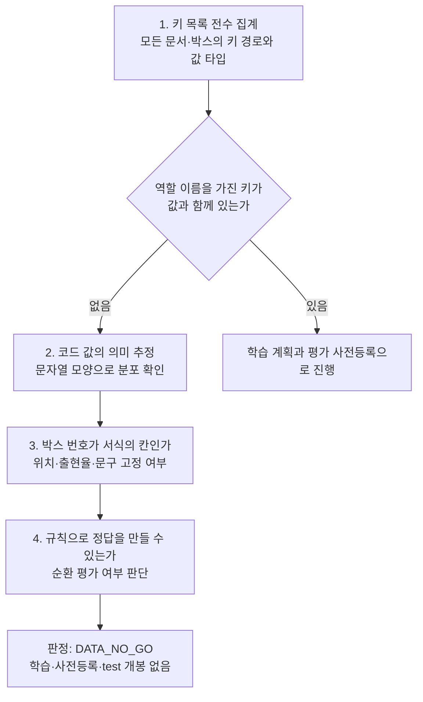
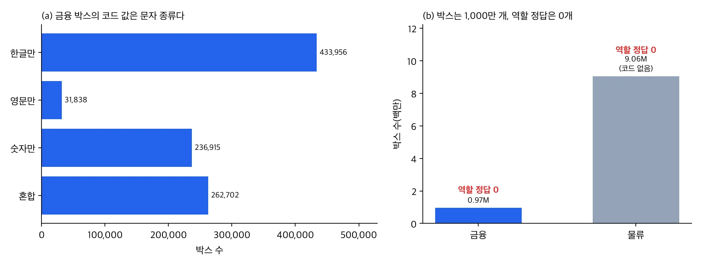
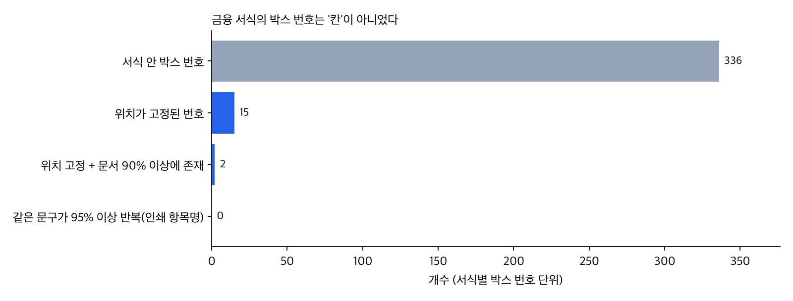

청구서나 세금계산서에서 금액, 일자, 사업자번호를 자동으로 뽑는 모델을 준비하는 분께 결론부터 드립니다. 우리는 문서 14만 2,111건과 글자 박스 약 1,000만 개가 담긴 공개 데이터셋을 확보했습니다. 그러나 그 박스가 금액인지 일자인지 알려 주는 정답은 하나도 없었습니다. 그래서 필드 역할 분류 모델을 학습하지 않았고 이 판정을 DATA_NO_GO로 기록했습니다.

학습을 시작하기 전에 라벨 구조를 기계적으로 감사했기 때문에 GPU는 전혀 쓰지 않았습니다. 이 글은 무엇을 확인해서 그 결론에 이르렀는지, 그리고 같은 점검을 자기 데이터에 어떻게 적용할 수 있는지를 정리합니다.

## 쉽게 말하면

요리 대회 심사를 준비한다고 생각해 보시면 됩니다. 창고에 재료가 산더미처럼 쌓여 있습니다. 그런데 심사에 필요한 것은 재료가 아니라 "이 접시가 몇 점인가"라는 채점표입니다. 재료가 아무리 많아도 채점표가 없으면 요리사를 가르칠 수도, 실력을 잴 수도 없습니다.

우리가 받은 데이터는 재료가 아주 풍부했습니다. 문서 사진마다 글자가 있는 위치와 그 글자가 무엇인지가 꼼꼼하게 적혀 있었습니다. 하지만 "이 글자 묶음은 금액 칸의 값이다" 같은 채점표는 없었습니다. 채점표 없이 요리사를 가르치려면 우리가 채점표를 직접 지어내야 합니다. 그렇게 만든 모델은 우리가 지어낸 규칙을 다시 맞히는 것 이상을 증명하지 못합니다.

## 무엇을 하려 했나

목표는 스캔한 금융·물류 문서에서 글자 박스마다 역할(금액, 일자, 사업자번호, 거래처 등)을 붙이는 분류기였습니다. 글자 인식은 기존 OCR이 맡습니다. 이 모델은 읽힌 글자가 어떤 칸의 값인지 판단하는 역할입니다.

데이터 후보는 AI 허브(AI-Hub) — 금융 및 물류 분야 특화 문서 OCR(71301)이었습니다. 금융 문서 44,990건과 물류 문서 97,121건, 서식 34종으로 구성돼 있습니다. 금융 문서에는 문서당 평균 21.5개, 물류 문서에는 평균 93.3개의 글자 박스가 있습니다. 규모로만 보면 역할 분류기를 학습하기에 충분해 보였습니다.

데이터는 신청자 본인이 내려받아 본인 전용 저장소에서만 다뤘습니다. 재배포가 불가한 데이터이므로 이 글에는 건수와 비율 같은 집계만 싣고 문서 이미지나 박스 문자열, 서식 예시는 싣지 않습니다.

## 학습 전에 확인한 네 가지

학습 계획을 세우기 전에 "과제에 필요한 정답이 라벨 안에 있는가"라는 질문 하나를 세웠습니다. 이 질문에 답하려고 라벨 파일을 사람이 넘겨 보는 대신 전수 집계하는 CPU 작업을 클러스터에서 세 번 돌렸습니다(스모크 1회, 전체 실행 1회, 의심 키 추가 확인 1회). 확인한 것은 네 가지입니다.



### 1. 라벨 키를 전부 세기

첫 단계는 라벨 JSON에 등장하는 모든 키 경로와 값의 타입을 세는 일입니다. 박스 단위 키는 식별 번호, 꼭짓점 x 좌표, 꼭짓점 y 좌표, 박스 안 문자열, 문자 종류 코드 다섯 가지뿐이었고 문자 종류 코드는 금융 문서에만 있었습니다. 문서 단위에는 이미지 크기, 서식 종류, 촬영 기기, 작성자 정보 같은 메타데이터가 있었지만 박스의 역할을 가리키는 키는 없었습니다.

키 이름에 label, class, field, role, tag, type 같은 말이 들어간 경로는 따로 골라 다시 봤습니다. 일부 문서(15건)에서 태그로 보이는 키가 378개 박스에 붙어 있었지만 값은 전부 비어 있었습니다. 다른 옵션 키도 같은 15건에만 있었고 값이 고정된 도구 메타데이터였습니다.

### 2. 코드 값의 의미를 데이터로 추정하기

금융 문서의 박스에는 0부터 3까지의 코드가 붙어 있었습니다. 이 코드가 역할이라면 문제는 끝납니다. 공식 코드표가 파일 안에 없어서 코드별로 박스 문자열이 한글만인지, 영문만인지, 숫자와 구두점만인지를 비율로 셌습니다.



*원장 집계로 그린 차트입니다. 문서 이미지나 박스 문자열은 쓰지 않았습니다.*

결과는 분명했습니다. 코드 0인 박스는 모두 한글을 포함하고 숫자는 하나도 없었습니다. 코드 1은 모두 영문을 포함했습니다. 코드 2는 모두 숫자와 구두점만으로 이뤄져 있었습니다. 코드 3은 숫자가 섞인 혼합 문자열이었습니다(숫자 포함 비율 94.8%). 이 코드는 "무슨 칸인가"가 아니라 "어떤 문자로 적혀 있는가"를 말합니다. 물류 문서에는 이 코드조차 없었습니다. 공식 정의를 확인한 것이 아니라 분포로 추정한 해석이라는 점은 밝혀 둡니다.

### 3. 박스 번호가 서식의 칸인지 확인하기

역할 키가 없어도 같은 서식 안에서 박스 번호가 늘 같은 칸을 가리킨다면 길이 있습니다. 서식마다 칸 하나에만 역할을 붙이면 모든 문서에 퍼뜨릴 수 있기 때문입니다. 그래서 같은 서식 안에서 같은 번호를 가진 박스의 중심 좌표가 얼마나 흔들리는지, 그 번호가 문서 몇 퍼센트에 등장하는지, 그 박스의 문자열이 늘 같은지를 셌습니다(서식마다 문서 최대 1,000건 기준).



*원장 집계로 그린 차트입니다. 위치 고정 기준은 정규화한 중심 좌표의 표준편차 0.02 미만입니다.*

금융 서식 안 박스 번호 336개 가운데 위치가 고정된 것은 15개였습니다. 그중 문서의 90% 이상에 등장하는 것은 2개뿐이었습니다. 박스 번호는 서식의 칸이 아니라 문서마다 붙인 일련번호에 가깝습니다. 같은 문구가 95% 이상 반복되는 번호는 0개였습니다. 서식에 인쇄된 항목명 박스가 라벨에 없고 사람이 기입한 값만 있다는 뜻입니다. 물류 문서는 박스 번호가 문서마다 고유했고, 인쇄 문구까지 박스로 잡혀 있었지만 어느 항목명과 어느 값이 짝인지는 적혀 있지 않았습니다.

### 4. 규칙으로 정답을 만들면 안 되는 이유

마지막으로 규칙 기반 정답 생성을 검토했습니다. 금액, 일자, 사업자번호 모양의 정규식을 박스에 돌려 보면 후보는 나옵니다. 금융 혼합 박스의 7.6%가 금액 모양, 4.6%가 사업자번호 모양이었습니다. 물류 박스는 금액 모양이 0.95%, 일자 모양이 0.63%였습니다. 하지만 이것은 후보 비율일 뿐 성능이 아닙니다. 정답 역할이 없어서 재현율도 정밀도도 정의할 수 없습니다.

이 후보를 정답으로 삼아 모델을 학습하면 모델은 정규식을 흉내 내게 됩니다. 그리고 같은 정규식으로 만든 평가셋에서 높은 점수를 받습니다. 그 점수는 규칙을 다시 맞혔다는 사실 말고는 아무것도 증명하지 않습니다. 인쇄 항목명 근처의 값을 그 항목의 역할로 보는 방법도 같은 문제가 있습니다. 게다가 금융 라벨에는 항목명 박스가 없어서 적용할 수도 없었습니다. 합성 문서로 대체하는 방법도 같은 이유로 채택하지 않았습니다.

## 자기 데이터에 적용하는 점검 코드

위 절차는 어떤 문서 라벨에도 그대로 쓸 수 있습니다. 아래 코드는 라벨 JSON 묶음을 받아 키 경로와 타입을 셉니다. 이어서 역할로 보이는 키를 골라내고 박스 번호가 서식의 칸처럼 행동하는지를 측정합니다. 박스를 꺼내는 함수와 좌표·문자열 키 이름만 자기 스키마에 맞게 바꾸면 됩니다. 박스 문자열은 저장하지 않고 해시만 세므로 감사 산출물에 원본 내용이 남지 않습니다.

```python
import json, re, zlib
from collections import Counter, defaultdict
from statistics import pstdev

ROLEISH = re.compile(r"(label|categor|class|key|field|name|role|entity|link|tag|kind|type)", re.I)

def walk(o, path, keys, types):
    """모든 키 경로와 값 타입을 센다."""
    if isinstance(o, dict):
        for k, v in o.items():
            p = f"{path}.{k}" if path else k
            keys[p] += 1
            types[p][type(v).__name__] += 1
            walk(v, p, keys, types)
    elif isinstance(o, list):
        for v in o[:500]:
            walk(v, path + "[]", keys, types)

def audit(docs, boxes_of, form_of, box_id, center, text):
    """docs: 라벨 dict 목록. 나머지는 스키마에 맞춘 접근 함수."""
    keys, types = Counter(), defaultdict(Counter)
    slot_pos = defaultdict(list)          # (서식, 박스 번호) -> 정규화 중심 좌표
    slot_txt = defaultdict(Counter)       # (서식, 박스 번호) -> 문자열 해시 빈도
    docs_per_form = Counter()
    for d in docs:
        walk(d, "", keys, types)
        f = form_of(d)
        docs_per_form[f] += 1
        for b in boxes_of(d):
            slot_pos[(f, box_id(b))].append(center(d, b))
            slot_txt[(f, box_id(b))][zlib.crc32(text(b).encode())] += 1
    roleish = {p: dict(types[p]) for p in keys if ROLEISH.search(p.split(".")[-1])}
    stable = present = const = 0
    for (f, i), pts in slot_pos.items():
        sx, sy = pstdev(x for x, _ in pts), pstdev(y for _, y in pts)
        stable += sx < 0.02 and sy < 0.02
        present += len(pts) >= 0.9 * docs_per_form[f]
        const += slot_txt[(f, i)].most_common(1)[0][1] / len(pts) >= 0.95
    return {"key_paths": dict(keys), "roleish_paths": roleish,
            "slots": len(slot_pos), "pos_stable": stable,
            "present_ge90": present, "text_const_ge95": const}
```

결과를 읽는 순서도 정해 두면 판단이 흔들리지 않습니다. 첫째, 역할로 보이는 키가 있으면 값이 비어 있지 않은지와 값의 종류 수를 봅니다. 둘째, 코드 값이 있으면 코드별 문자열 모양(한글, 영문, 숫자 비율과 길이 분포)을 세어 역할인지 문자 종류인지 구분합니다. 셋째, 위치가 고정된 박스 번호가 대부분이면 서식당 한 번 라벨링해 퍼뜨릴 수 있습니다. 반대로 소수라면 박스 단위 사람 라벨이 필요합니다. 넷째, 여기까지 정답이 나오지 않으면 규칙이나 합성으로 정답을 만들지 말고 멈춥니다.

## 이 판단이 왜 가치 있었나

가장 큰 이득은 잘못된 숫자를 만들지 않은 것입니다. 정규식으로 만든 정답으로 학습했다면 아마 높은 정확도가 나왔을 것입니다. 그 숫자는 보고서에 올라가 고객 제안으로 이어졌을 수 있습니다. 실제 청구서에서 그 모델이 얼마나 맞는지는 아무도 모르는 상태로 말입니다. 이번 감사로 그런 숫자가 생길 여지를 학습 전에 없앴습니다.

비용도 작았습니다. 집계 작업 세 개는 GPU 없이 CPU만 썼습니다. 학습도 하지 않았고 평가셋도 열지 않았기 때문에 나중에 정답이 생겼을 때 쓸 평가셋도 오염되지 않은 채 남아 있습니다.

판정이 남긴 것은 "안 된다"가 아니라 재개 조건입니다. 박스 번호가 서식의 칸이 아니므로 서식 단위 라벨로는 부족합니다. 사람이 박스 단위로 역할을 검수한 라벨이 필요합니다. 평가는 학습에 쓰지 않은 서식으로 나눠야 서식을 외운 모델을 걸러낼 수 있습니다. 또는 고객의 실제 청구서와 세금계산서에 역할 라벨을 붙이는 방법이 있습니다. 둘 중 하나가 준비되면 그때 학습 계획과 평가 기준을 미리 등록하고 시작합니다.

## ThakiCloud 제품 적용 시사점

Paxis에서 문서 자동화는 에이전트가 서류에서 값을 뽑아 초안을 채우고 사람이 확인하는 흐름입니다. 그 흐름에서 "금액 필드 추출 정확도 몇 %"라는 숫자는 고객이 도입을 결정하는 근거가 됩니다. 그래서 근거 없는 숫자를 만들지 않는 것이 기능을 하나 더 만드는 것보다 중요합니다. 지금 다키클라우드가 문서 필드에 대해 가진 것은 정규식으로 금액, 일자, 사업자번호 후보를 뽑고 원문 위치와 해시를 근거로 붙이는 기준선뿐이며, 이것을 정확도 수치로 포장하지 않습니다.

Maxis가 맡는 도메인 모델 학습 흐름에도 같은 점검을 학습 전 점검 단계로 둘 수 있습니다. 고객 데이터를 받으면 학습 작업을 내기 전에 라벨 스키마 감사 작업을 먼저 돌려 과제에 필요한 정답이 있는지 확인하는 방식입니다. 이 점검은 CPU만으로 돌고 원본 문자열을 산출물에 남기지 않습니다. 그래서 데이터를 밖으로 내보내기 어려운 Aegis 같은 사내 설치 환경에서도 적용할 수 있습니다.

## 한계 및 반론

가장 강한 반론은 "공식 문서를 읽었으면 알 수 있었던 것 아닌가"입니다. 맞는 지적입니다. 실제로 데이터셋 설명서의 구성 설명만으로도 역할 라벨이 없을 가능성은 짐작할 수 있었습니다. 그래도 짐작과 확인은 다릅니다. 설명서에 없는 키가 일부 문서에 숨어 있을 수 있습니다(실제로 태그 키가 378개 박스에 있었습니다). 코드 값이 역할일 가능성도 데이터로 배제해야 했습니다. 전수 집계는 그 가능성을 숫자로 닫았습니다.

코드 값의 의미는 추정입니다. 공식 코드표를 확인하지 못했고 문자열 모양의 분포로 판단했습니다. 다만 코드 0은 100% 한글 포함·숫자 없음, 코드 1은 100% 영문 포함, 코드 2는 100% 숫자와 구두점만이었으므로 역할이라는 해석이 들어설 자리는 거의 없습니다.

박스 번호의 칸 분석은 서식마다 최대 1,000건의 문서로 계산했습니다. 표본을 늘리면 위치가 고정된 번호의 수가 조금 달라질 수 있습니다. 하지만 336개 중 15개라는 차이를 뒤집을 정도는 아니라고 봅니다.

## 정리

데이터가 있다는 것과 과제에 필요한 정답이 있다는 것은 다릅니다. 이번에는 문서 14만 건과 박스 1,000만 개가 있었지만 필드 역할 정답은 0개였습니다. 라벨 키 전수 집계, 코드 값 분포, 박스 번호의 서식 칸 여부, 규칙 정답의 순환 여부라는 네 가지 점검으로 학습 전에 그 사실을 확인했습니다.

문서 필드 추출을 준비하신다면 학습 계획보다 라벨 감사를 먼저 돌려 보시기를 권합니다. 위 코드 정도의 CPU 작업이면 답이 나옵니다. 그 답이 "없다"라면 사람 라벨을 어디에 얼마나 붙여야 하는지까지 함께 알려 줍니다.

---

*데이터 출처: AI 허브(AI-Hub) — 금융 및 물류 분야 특화 문서 OCR(71301). 데이터는 재배포하지 않으며 신청자 본인의 내부 이용 조건에서만 감사를 수행했습니다. 이 글에는 건수와 비율 같은 집계만 실었고 문서 이미지, 박스 문자열, 서식 예시, 식별자는 싣지 않았습니다. 그림은 감사 원장의 집계로 그린 차트입니다.*
