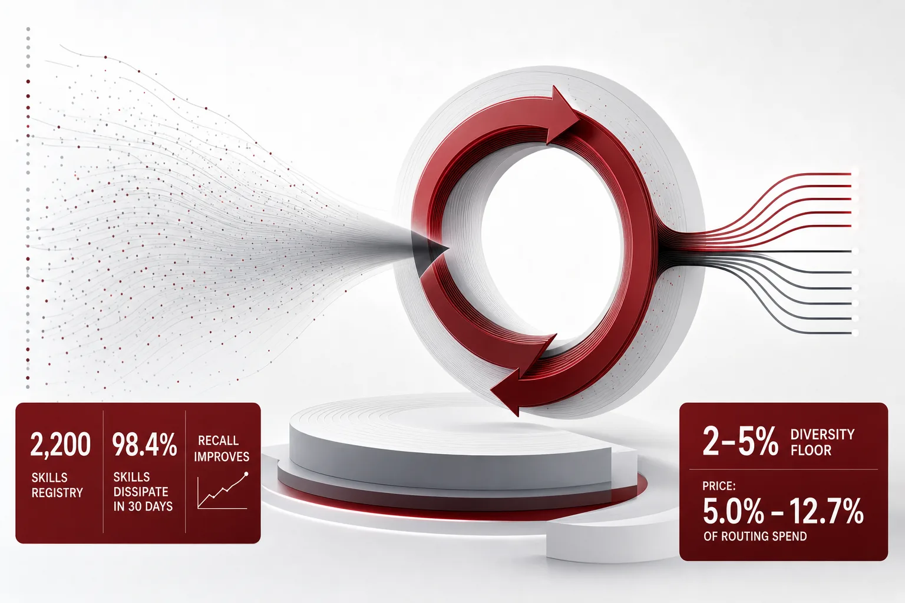
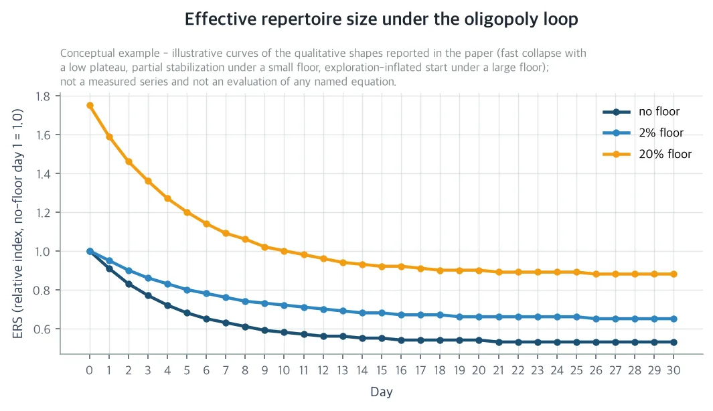
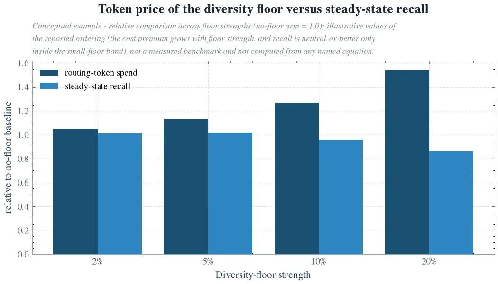

스킬 레지스트리를 밤새 자기 진화시키는 무인 에이전트 하네스를 돌리고 그 레지스트리 위에서 라우터로 태스크를 서빙하는 엔지니어라면 이 논문을 읽어야 합니다. 밤사이 자기 강화 루프는 품질 지표가 좋아지는 동안 서빙하는 메뉴를 조용히 줄입니다. 이 논문은 그 축소기를 두 개의 숫자로 재고 리콜을 지키는 작은 강제 탐색의 토큰 가격을 정가합니다. 2,200스킬 레지스트리를 30일만 방치하면 실질 메뉴가 절반으로 줄고, 스킬의 98% 이상이 라우팅에서 사라집니다. 그런데 같은 기간 리콜은 오히려 오릅니다. 이 실태는 품질 지표로는 안 보이는데, 2~5% 강제 탐색, '다양성 바닥선'으로 그 값을 사면, 라우팅 지출의 5~13%면 됩니다.

처음부터 알아둘 것이 있습니다. 이 논문의 수치는 생산 규모를 그대로 둔 시드 고정 시뮬레이션이며 프로덕션 실측은 아닙니다. 프로덕션 확인은 논문이 미리 써 둔 프로토콜의 몫입니다.

*글의 핵심 개념을 형상화했습니다.*

## 문제의식: 지표가 좋아질수록 메뉴가 좁아지는 루프

우리 생산 하네스는 매일 300개의 태스크 스텝을 40개 도메인, 2,200개 스킬 중 하나로 라우팅합니다. 밤사이 하네스는 스킬을 합성하고 검증하고 리라이팅하고 병합합니다. 다음 날 라우터가 그 레지스트리로 서빙합니다. 이 시리즈의 이전 연구들은 이 루프의 단계를 하나씩 가격해 왔습니다. 후보를 몇 개까지 보여줄지, 근접 동점 후보 중 무엇을 고를지, 이 진화 루프가 토큰 대비 얼마를 회수할지가 그 질문이었습니다. 이 모든 가격은 '선택이 품질을 고정했을 때 얼마가 들는가'라는 질문의 답입니다. 아직 남은 질문은 하나입니다. 이 루프가 스스로 서빙하는 대상, 즉 라우터의 메뉴 점수표에 어떤 일을 하고 있느냐는 질문입니다.

밤사이 진화 스텝은 그날 결과로 점수를 고칩니다. 라우팅되어 평균 이상으로 성공한 스킬의 점수는 곱해집니다. 평균 이하로 성공한 스킬은 감쇠합니다. 라우팅을 못 받은 스킬은 하루 5%씩 줄어듭니다. 식당가 비유가 정확합니다. 가이드는 밤마다 그날 결과로 리뷰 노트를 고칩니다. 고객은 리뷰 좋은 식당만 찾아가고 유명한 식당은 고객을 더 받아 리뷰가 더 오르고 자리는 더 얻습니다. 손님이 없는 작은 가게는 조용히 문을 닫습니다. 이 메커니즘은 추천 플랫폼의 매튜 효과, 생성형 검색의 브랜드 인기 편향, 크리에이터 플랫폼의 신규 창작자 기아에서 이미 알려진, 부가 부를 낳는 과정입니다.

이 논문이 세우는 가설은 이 루프가 방치되면 자신이 사는 생태계를 과점화한다는 것입니다. 라우팅은 소수의 슈퍼 스킬로 집중되고 실질 메뉴는 쪼그라들고 롱테일은 소멸합니다. 게다가 그 축소기는 매일 보는 품질 지표에는 안 보이거나, 오히려 보상됩니다. 가설을 반증 가능하게 만들려면 재는 숫자가 필요합니다. 논문은 유효 레퍼토리 사이즈(ERS), 즉 라우팅 질량을 실제로 나르는 스킬의 개수, Shannon 엔트로피, 그리고 롱테일 소멸률, 즉 5일 동안 라우팅이 0번인 스킬의 비율을 사용합니다.

## 30일의 실태: 메뉴가 절반으로 줄고 98%가 문을 닫는 과정

바닥선이 없을 때 루프는 부를 집중하는 기계가 됩니다. 유효 레퍼토리 사이즈는 1일차의 14.0에서 정상상태 7.5로, 46% 줄어듭니다. 엔트로피는 0.46에서 0.30으로 떨어지고 30일째 마지막 5일 윈도우에서 스킬의 98.4%는 라우팅이 0번, 소멸입니다. 라우터의 점수표에서도 86.2%의 스킬은 최대 스킬 점수의 1/1000 이하로 가루가 됩니다. 붕괴는 대부분 처음 10일 안에 끝나고 그 뒤는 정체합니다. 각 뜨거운 도메인마다 소수의 슈퍼 스킬만 남는 안정적인 과점 상태가 됩니다.

이 붕괴는 두 개의 채널이 겹쳐서 일어납니다. 첫 번째는 '한 번도 라우팅되지 않는' 채널입니다. 점수가 낮으니 라우터가 뽑지 못하고 뽑히지 못하니 매일 5%씩 줄어듭니다. 논문의 정리로, 핵심 스킬 점수의 10%에서 출발하는 꼬리 스킬은 90일 안에 붕괴 임계 아래로 떨어집니다. Zipf 수요 아래에서는 레지스트리의 61.2%가 1일차부터 '30일째까지 생존 못 하는' 집합 안에 있습니다. 두 번째는 '뽑혀도 평균 이하' 채널입니다. 라우팅되어도 평균 이하로 성공하면 점수가 곱해지지 않고 감쇠합니다. 그래서 측정한 붕괴 86.2%는 첫 번째 채널의 61.2%를 넘습니다. 소멸률에는 구조적 바닥도 있습니다. 5일 동안 라우팅이 1,500번이면, 라우팅이 고르게 나뉘어도 소멸 스킬은 31.8% 이상일 수밖에 없습니다. 측정한 98.4%는 그 바닥 위에 루프가 만든 집중 66.6%가 더해진 것입니다. 즉, 사람 말로는 문 닫은 가게의 3분의 1은 손님 자체가 적어 불가피한 것이고 나머지는 루프가 만들어 낸 것입니다.

*바닥선이 없을 때 유효 레퍼토리 사이즈가 빠르게 줄어 낮은 수준에서 정체하고 2%의 작은 바닥선은 중간 수준에서 안정시키고 20%의 큰 바닥선은 탐색 자체로 부풀어 오른 상태에서 높은 수준을 유지합니다. 유효 레퍼토리 사이즈는 라우팅 질량을 실제로 나르는 스킬의 개수를 뜻합니다. 분석 모델의 그림이며 실측 데이터가 아닙니다.*

가장 중요한 결과는 두 번째입니다. 이 축소기는 품질 지표에 안 보입니다. 같은 기간 커버리지 리콜, 즉 도메인 매칭 성공률,은 1일차 0.17에서 정상 0.26으로 오릅니다. 집중이 바로 그 메커니즘이기 때문입니다. 현재 수요에 맞는 스킬을 계속 강화하면 그 수요에서는 리콜이 오릅니다. 태스크 성공률 대시보드만 보면 루프는 품질을 높인 것처럼 보입니다. 대시보드가 못 보는 것이 소멸 원장입니다. 2,200개 스킬 중 98.4%에 라우팅이 하나도 남지 않은 상태입니다. 이제 수요가 바뀌거나, 뜨거운 도메인의 슈퍼 스킬 하나가 쓰러지면, 받을 롱테일이 없습니다. 레지스트리의 커버리지는 소수의 중복 복사본뿐인 단일 장애점이 됩니다.

## 다양성 바닥선: 강제 탐색의 가격과 리콜 고정점

해결 장치는 확률 ε만큼 점수표를 무시하고 24개인 좁은 후보 망 대신 96개인 넓은 망에서 균일하게 고르게 하는 것입니다. 탐색은 구성상 점수표를 우회하므로, 꼬리 스킬도 라우팅될 자격을 얻습니다. ε은 다이얼 하나입니다.

이 다이얼의 가격에는 닫힌형이 있습니다. 하루 라우팅 토큰 초과 Δ(ε)는 '탐색 확률 × 하루 스텝 수 × (넓은 망 − 좁은 망) × 설명 평균 길이'로, εT(K_e−K)ḿ으로 근사됩니다. 말하자면 바닥선의 값은 프롬프트에 넣는 추가 후보 설명의 가격입니다. 1일차 점수표로 평가하면, ε당 하루 약 52만 토큰입니다. 시드 시뮬레이션으로 측정한 정상상태 초과분은 모든 팔에서 7% 이내에 이 닫힌형과 일치했습니다.

그다음 질문은 얼마를 돌릴 것이냐입니다. 리콜 고정점, 즉 정상상태 리콜이 바닥선 없을 때 이상을 유지하는 최대 ε을 찾으면, 구간은 5%에서 10% 미만입니다. 5% 바닥선에서 정상 리콜은 0.266으로 기준 0.261보다 약간 높고 2%에서는 0.263입니다. 10%에서는 0.250으로 기준을 밑돌고 20%에서는 0.224로 3.7%p 하락입니다. 토큰 값은 이렇습니다. 기준 라우팅 지출은 하루 약 19.4만 토큰입니다. 2% 바닥선은 하루 9,750토큰, 5.0% 추가이고 5% 바닥선은 12.7% 추가입니다. 20% 바닥선은 54.2% 추가인데, 리콜까지 깎입니다. 프론티어는 강하게 오목합니다. 첫 2%가 유효 레퍼토리 1.7을 사는 값이 토큰 5.8천인데, 그 위의 어떤 지점보다 약 3배 쌌습니다. 5%에서는 17.3천, 20%에서는 19.7천입니다. 즉, 사람 말로는 소량 탐색이 가장 싸고 많이 돌릴수록 단위당 가격이 오르면서 리콜까지 나갑니다.

운영 규칙은 세 줄로 나옵니다. 기본은 ε=2%입니다. 유효 레퍼토리 사이즈가 1일차의 70%를 밑도라는 경보가 울리면 5%까지 올립니다. 그 경보는 붕괴 6일차쯤 울리므로, 정체 전에 잡힙니다. 그리고 20%에는 값을 치르지 않습니다. 비싸고 리콜도 나쁘기 때문입니다.

*바닥선 강도가 오르면 라우팅 토큰 지출은 계속 오릅니다. 다만 정상상태 리콜이 기준 이상으로 유지되는 구간은 2~5% 바닥선에 한정되고 20% 바닥선은 리콜을 깎습니다. 분석 모델의 그림이며 실측 데이터가 아닙니다.*

## 회사·사회·과학: 같은 실험이 세 자리에 닿는 곳

회사에 주는 것은 두 개 숫자의 건강 검진과 한 개 다이얼입니다. 5일 롤링 윈도우의 유효 레퍼토리 사이즈와 소멸률이 경보이고 바닥선 강도 ε이 처방입니다. 2,200스킬 레지스트리에 대해 정상상태와 토큰 가격이 실측되어 있으므로, 조용히 무너지는 레지스트리가 롱테일 커버리지가 나빠지기 전에 잡히고 고쳐집니다. 바닥선의 하루 9,750토큰은 루프 자체의 야간 지출, 130~820만 토큰,에 비해 두세 자리 낮은 수준입니다. 그래서 앞선 Evolution Payback 연구의 10.2배 첫날 회수 결론은 바닥선을 돌리더라도 흔들리지 않습니다. Indifference Band 연구와의 상호작용도 구체적입니다. 동점 후보 밴드는 점수표 대로의 인증인데, 이 루프가 점수표를 슈퍼 스킬 쪽으로 움직입니다. 밴드 구성은 '슈퍼 스킬과 그 복제본'에서 '슈퍼 스킬과 슈퍼 스킬'로 표류하고 밴드의 60.5달러/사이클 절약은 생태계 상태에 따른 통계입니다. 밴드 인증을 점수표 상태마다 다시 계산하고 절약을 유효 레퍼토리 사이즈의 함수로 보고하면, 붕괴 경보와 타이브레이크 재가격화가 같은 시그널에서 나옵니다.

사회에, 정확히는 무인 자기 개선 시스템 운영에 주는 것은 이름 있는 실패 모드 하나입니다. '자기 개선 하의 생태계 과점(ecosystem oligopoly under self-improvement)'입니다. 무인 자기 개선 에이전트 생태계는 지금 대량으로 배포되고 표준 품질 지표가 평탄하거나 오르는 동안 자신의 스킬 다양성을 집중시킬 수 있습니다. 태스크 성공률 대시보드만 보는 사람이 알아차리지 못하는 방식입니다. 추천 시스템은 이 것을 매튜 효과로, 생성형 검색은 브랜드 인기 편향으로, 크리에이터 플랫폼은 신규 창작자 기아로 발견했고 전부 '바닥선' 개입으로 완화합니다. 에이전트 스킬 생태계는 여기에 두 가지를 더합니다. 첫째, 노출이 라우팅된 작업이라는 점입니다. 각 배정에 실제 토큰 가격과 실제 사용자가 있습니다. 둘째, 할당자가 사람의 개입 없이 자신의 결과로 자신을 밤마다 다시 학습한다는 점입니다. 그래서 이 실패 모드는 한 번 감사하면 되는 편향이 아니라, 계속 모니터링해야 하는 동학입니다. 다행히 모니터링은 쌌습니다. 두 개의 롤링 윈도우 통계와 2~5% 탐색 부가료면 됩니다.

과학에 주는 것은 자기 진화형 하네스 문헌에 축 하나를 추가하는 일입니다. 기존 문헌은 비용, 품질, ROI를 잰 것입니다. 이 논문은 그 셋이 못 보는 세 번째 축, 생태계 동학을 만듭니다. 자기 강화 라우팅+진화 루프의 부의 집중과 롱테일 소멸, 그리고 그것의 비용-품질-다양성 프론티어입니다. 전작을 업그레이드하는 점도 여기에 있습니다. Indifference Band가 동점 내부의 의사결정을 가격했던 동안, 이 논문은 동점 지형 자체가 루프에 의해 내생적임을 보여줍니다. 이 분야에 남기는 리마인더는 이것입니다. 자신의 배정에서 배우는 할당자는, 개입 없이 있으면 메뉴를 최적화해 버립니다.

## 한계: 프로덕션 실측으로 바뀌지 않은 것들

첫째, 리콜 프록시입니다. 시뮬레이션의 도메인 커버리지 리콜은 SRA 홀드아웃 라우팅 리콜을 대신하는 프록시입니다. 고정점 기준은 1대1로 옮겨붙게 쓰였지만, 프로덕션 숫자는 하네스에서 재야 합니다. 논문은 확인 프로토콜과 반증 기준을 미리 써 둡니다. 바닥선 없을 때 30일 안에 유효 레퍼토리 사이즈가 1일차의 70%를 밑돌거나, 소멸률이 0.8을 넘는다면 가설이 반증됩니다.

둘째, 모델 충실도입니다. 시뮬레이션은 점수 라우팅, 결과 피딩 강화, 미라우팅 감쇠, 토큰 미터링 프롬프트까지 메커니즘을 재현합니다. 다만 프로덕션 야간 스텝은 스킬을 합성하고 병합하고 중복 제거까지 합니다. 병합은 스킬을 통째로 없애므로 추가 집중 압력입니다. 그래서 측정한 동학은 바닥선 없는 경우에 오히려 낙관적일 수 있습니다.

셋째, 수요 레짐입니다. 30일 동안의 한 개의 Zipf 레짐(α=1.1)입니다. 수요가 평탄해지거나 기간 중 수요가 바뀌면 절대 숫자는 변합니다. 다만 소멸의 구조적 바닥과 가격 닫힌형은 수요에 무관합니다.

넷째, 바닥선 설계입니다. 균일한 넓은 탐색은 가장 단순한 바닥선이지 가장 싼 바닥선이 아닙니다. 꼬리 스킬을 골라 넣거나, 경보가 울릴 때만 탐색하는 구조적 바닥선은 같은 다양성을 더 싼 가격에 살 수 있을 것입니다. 그 가격화는 다음 연구의 몫입니다.

이 글의 모든 수치는 생산 규모에서 돌린 시드 고정 시뮬레이션이며 프로덕션 실측은 아닙니다. 두 그림은 분석 모델의 그림입니다. 전체 논문과 세팅은 Hugging Face 논문 상세 페이지에서 볼 수 있습니다. https://huggingface.co/datasets/thaki-AI/daily-paper-2026-11-09-skill-oligopoly-diversity-collapse