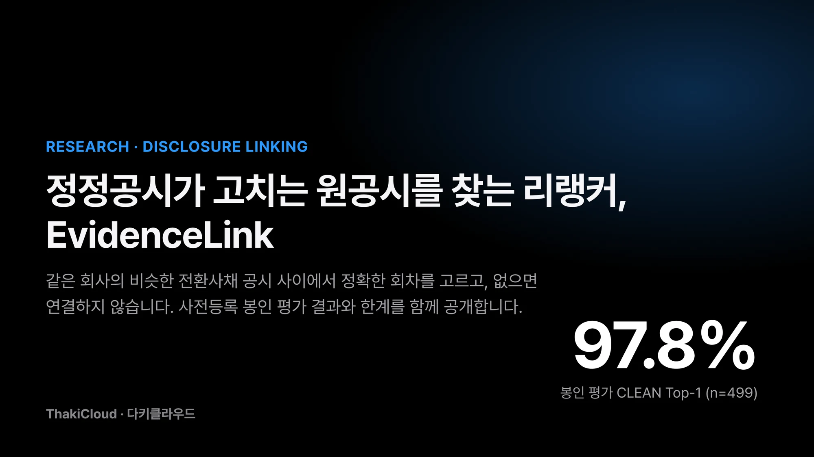
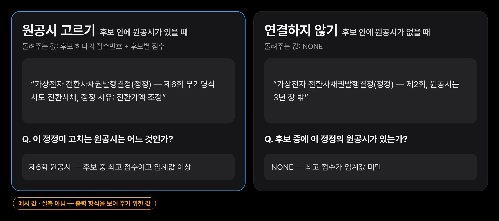
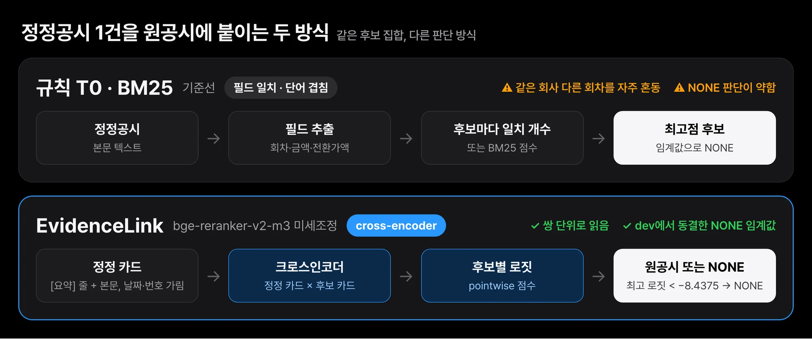
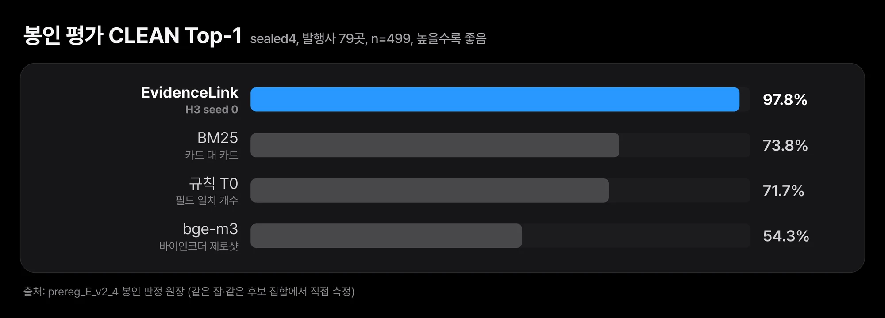

전환사채를 발행한 회사는 발행 조건이 바뀌면 정정공시를 냅니다. 전환가액을 조정하거나, 납입일을 미루거나, 권면총액을 고칠 때마다 공시가 하나씩 쌓입니다. 공시를 모아 분석하는 쪽에서는 정정공시 한 건을 받을 때마다 이 정정이 어느 원공시를 고치는지 찾아 붙여야 합니다. 같은 회사가 제4회, 제5회, 제6회 사채를 연달아 발행했다면 표 구성까지 거의 같은 공시 여러 건 가운데 정확한 회차를 골라야 합니다.

다키클라우드는 이 연결 작업을 맡는 한국어 크로스인코더 EvidenceLink-DART-Reranker-KO를 Hugging Face에 공개했습니다. 정정공시 한 건과 후보 원공시 몇 건을 넣으면 원공시 하나를 고르고 후보 안에 원공시가 없으면 NONE을 돌려줍니다. 학습에 쓰지 않은 발행사 79곳의 정정공시로 만든 봉인 평가에서 CLEAN Top-1 0.978을 기록했습니다. 같은 조건에서 BM25는 0.7375였습니다.

이 글에서는 이 모델이 무엇을 입력받아 무엇을 돌려주는지, 기존 방식과 어떻게 다른지, 봉인 평가에서 무엇을 확인했고 무엇은 확인하지 못했는지를 순서대로 설명합니다.

모델: [ThakiCloud/EvidenceLink-DART-Reranker-KO](https://huggingface.co/ThakiCloud/EvidenceLink-DART-Reranker-KO)

## 정정공시 한 건에 원공시 하나, 또는 NONE을 돌려줍니다

정정공시 본문에는 정정 사유, 바뀐 항목, 최초 제출일이 적혀 있습니다. 같은 회사가 같은 날 여러 회차를 냈다면 날짜만으로는 회차를 가릴 수 없고 회차와 금액을 비교하는 규칙은 표 구성이 같은 후보 앞에서 자주 틀립니다.

EvidenceLink는 이 문제를 순위 매기기(reranking)로 풉니다. 순위 매기기란 후보 목록을 받아 각 후보가 질문에 얼마나 맞는지 점수를 매기고 정렬하는 일입니다. 정정공시를 질문으로, 같은 회사가 직전 3년 안에 낸 원공시 최대 10건과 다른 회사 공시 3건을 후보로 넣습니다. 모델은 후보마다 점수를 내고 가장 높은 점수가 동결해 둔 임계값 −8.4375보다 낮으면 연결하지 않고 NONE을 돌려줍니다.

*가상 발행사로 만든 형식 예시입니다. 모델은 후보마다 점수(로짓, 확률 아님)를 내고, 최고점이 동결 임계값 −8.4375보다 낮으면 NONE을 돌려줍니다.*

NONE이 중요한 이유는 틀린 연결이 연결하지 않은 것보다 비싸기 때문입니다. 원공시가 아닌 공시에 정정을 붙이면 그 뒤의 전환가액 추적, 희석 계산, 조건 변경 이력이 모두 다른 사채 기준으로 쌓입니다. 후보 안에 답이 없을 때 모른다고 말하는 능력은 정확도와 따로 측정해야 합니다.

## 필드를 세는 대신 정정과 후보를 한 쌍으로 읽습니다

기준선은 두 가지였습니다. 규칙 T0은 정정공시와 후보에서 회차, 권면총액, 전환가액 같은 필드를 뽑아 일치하는 개수를 셉니다. BM25는 두 문서의 단어 겹침으로 점수를 냅니다. 둘 다 같은 회사의 다른 회차처럼 필드가 대부분 겹치는 후보 앞에서 약합니다.

EvidenceLink는 `BAAI/bge-reranker-v2-m3`를 OpenDART 공개 공시로 전체 미세조정한 크로스인코더입니다. 크로스인코더는 질문과 후보를 하나의 입력으로 이어 붙여 함께 읽고 점수를 내는 모델입니다. 질문과 후보를 따로 벡터로 바꿔 비교하는 바이인코더보다 느리지만 두 문서 사이의 세부 차이를 더 잘 봅니다.

*규칙과 BM25는 필드 일치나 단어 겹침을 세고, EvidenceLink는 정정 카드와 후보 카드를 한 쌍으로 읽어 점수를 냅니다. 세 방식 모두 같은 후보 집합에서 쟀습니다.*

입력은 원문 그대로가 아니라 카드 형식입니다. 맨 앞에 회차, 권면총액, 전환가액, 표면이자율, 만기이자율, 최저조정가액을 담은 `[요약]` 줄을 두고 그 뒤에 공시 본문을 붙입니다. 최초 제출일과 14자리 접수번호는 가립니다. 날짜를 보고 맞히는 지름길을 막기 위해서입니다. 카드를 만드는 코드는 모델과 함께 `evidencelink.py`로 공개했습니다. 같은 형식을 쓰지 않으면 점수 분포가 달라지고 임계값도 맞지 않습니다.

## 학습에 쓰지 않은 발행사 79곳에서 BM25보다 0.2387 높았습니다

평가는 사전등록한 계획(`prereg_E_v2_4`)을 따랐습니다. 사전등록이란 데이터를 보기 전에 무엇을 어떤 기준으로 통과로 볼지 미리 적어 두는 방식입니다. 봉인 평가셋 sealed4는 발행사 79곳의 정정공시 648건이고 이 발행사들은 학습셋과 개발 검증셋(dev)에서 모두 뺐습니다. 통과 기준(게이트)은 CLEAN 집합(n=499)으로 판정합니다. CLEAN은 후보의 접수일이 쿼리 카드에 그대로 보이는 쿼리를 뺀 집합입니다.

*학습에 쓰지 않은 발행사의 정정공시에서 EvidenceLink가 BM25보다 23.9%p 높았습니다(발행사 단위 bootstrap 95% 구간 +16.5~+30.9%p).*

| 방식 | Top-1 | 연결 정확도 | NONE 정밀도 | NONE 재현율 | 같은 발행사 오연결률 |
|---|---|---|---|---|---|
| EvidenceLink (H3, seed 0) | 0.978 | 0.9946 | 1.0 | 0.9308 | 0.0246 |
| BM25 | 0.7375 | 0.7642 | 0.5548 | 0.6615 | 0.1387 |
| 규칙 T0 | 0.7174 | 0.6856 | 0.5899 | 0.8077 | 0.1432 |
| bge-m3 바이인코더 제로샷 | 0.5431 | 0.5339 | 0.3289 | 0.5692 | 0.1723 |

네 방식 모두 같은 봉인 평가 실행에서 같은 후보 집합으로 쟀습니다. 같은 발행사 오연결률은 같은 회사의 다른 회차에 잘못 붙인 비율입니다. BM25 기준 0.1387이던 이 비율이 0.0246으로 내려갔습니다. 이 모델이 풀려던 문제가 바로 이 혼동입니다.

차이가 우연인지 보려고 발행사 단위로 묶어 10,000회 paired bootstrap을 돌렸습니다. CLEAN Top-1 차이는 BM25 대비 +0.2387(95% 구간 0.1645~0.3091), T0 대비 +0.2573(0.1635~0.3497)이었습니다. 두 구간 모두 0을 포함하지 않습니다. 전체 648건(ALL) 기준 Top-1은 0.9722로, BM25 0.7454와 T0 0.7068보다 높았습니다. 사전등록한 통과 기준 G1부터 G5까지 모두 충족해 판정은 PASS_V24입니다.

접수 연도별로 나눠도 결과가 크게 흔들리지 않았습니다. CLEAN Top-1은 2022년 0.97(n=100), 2023년 0.9552(n=67), 2024년 0.9857(n=140), 2025년 0.9817(n=109), 2026년 0.988(n=83)이었습니다. 같은 연도에서 BM25는 0.57에서 0.8143 사이였습니다.

## 쓰기 전에 알아야 할 다섯 가지

이 결과는 `prereg_E_v2_4` 이번 실험의 판정이고 일반적인 공시 연결 성능을 보증하지 않습니다. 쓰기 전에 다음을 확인해 주십시오.

**자연 NONE은 입증되지 않았습니다.** 사전등록에서 자연 발생 NONE(원공시가 3년 창 밖에 있는 경우)의 재현율을 G6로 두고, 표본이 30건 이상일 때만 판정하기로 했습니다. sealed4에는 25건뿐이어서 G6는 UNDERPOWERED로 판정에서 빠졌습니다. CLEAN NONE 130건 중 105건은 후보에서 원공시를 일부러 빼서 만든 사례입니다. 자연 NONE 25건에서 이 모델은 0.92로 BM25(0.92)와 같고 규칙 T0(0.96)보다 낮았습니다. 25건으로는 세 방식을 구분할 수 없습니다.

**정답은 사람이 검수하지 않았습니다.** 정답 원공시는 DART가 정정 제출 때 원 보고서에 묶는 정정 체인에서 가져왔습니다. 학습 라벨은 그보다 약한 규칙 라벨로, 정정공시 본문의 최초 제출일을 후보 접수일과 맞춰 만들었습니다. CLEAN에서 이 규칙이 답을 낸 쿼리 기준으로 체인 정답과의 일치율은 0.8868이었습니다.

**dev에 2022~2023년 공시가 거의 없습니다.** dev는 발행사 11곳, 93건이고 2022년 0건, 2023년 1건입니다. epoch와 NONE 임계값을 이 dev에서 골랐기 때문에, 2022~2023년 봉인 수치는 모델을 고른 분포 밖에서 나온 결과입니다.

**디코더가 결과를 좌우합니다.** 2022년 중반 이전 OpenDART 문서는 cp949로 인코딩돼 있습니다. 이전 파이프라인은 이를 UTF-8로 읽으면서 깨진 글자를 대체 문자로 바꿨고, 캐시 문서 1,427건이 손상됐습니다. 그 결과 2022~2023년 필드 추출이 무너졌고 이전 봉인 평가(sealed3)는 NO_GO였습니다. 디코더를 고친 v2에서 sealed4 쿼리의 회차·권면총액 추출률은 연도별 0.948~0.992입니다. 공개한 `dart_zip_to_text`로 읽지 않은 본문을 넣으면 정확도가 떨어진다고 봐야 합니다. 디코더 수정 뒤 이전 모델로 sealed3을 다시 채점하니 같은 385건의 CLEAN Top-1이 0.6571에서 0.9455로 올랐지만, 이미 노출된 평가셋이라 진단용(report-only) 기록일 뿐 통과 근거로 쓰지 않았습니다.

**범위가 좁습니다.** 대상은 전환사채권발행결정과 그 정정공시이고, 접수 연도는 2022~2026년입니다. 다른 공시 유형이나 계약서·엑셀 같은 고객 문서에서 어떤 성능이 나오는지는 재지 않았습니다. 후보는 직전 3년 안의 원공시만 들어가므로 더 오래된 원공시는 연결할 수 없습니다. 입력은 1024 토큰에서 잘리며, 확인한 학습 쌍 4,000개와 dev 쌍 432개가 모두 이 길이를 넘었습니다. `[요약]` 줄을 맨 앞에 둔 이유가 여기에 있습니다.

## 학습은 공개 공시로만 했고, 공개한 것은 가중치와 코드입니다

학습 데이터는 OpenDART API로 받은 공개 공시 1,430건(발행사 205곳)입니다. 같은 후보 집합의 나머지 후보를 모두 음성으로 두고 후보 하나하나에 점수를 매기는 pointwise BCE로 학습했습니다. max_len 1024, batch 16, 2 epoch, lr 2e-5, 양성 가중치 3이고 dev 점수로 epoch 1을 골랐습니다. 시드 두 개의 dev 점수가 같아(0.9085) 사전등록한 동점 규칙대로 seed 0을 봉인 평가 전에 골랐습니다. seed 1은 sealed4에서 평가하지 않았습니다.

Hugging Face 레포에는 가중치(`model.safetensors`, sha256 `a402de3dc80fa8d45b42551ef381f063ec997fdba7d5d6e31462108fd48f6c19`), 토크나이저, 카드 형식과 디코더를 담은 `evidencelink.py`, 가상 발행사로 만든 예시 하나가 들어 있습니다. 공시 원문, 추출 필드, 쿼리, 후보 집합, 라벨은 넣지 않았습니다. 라이선스는 기반 모델과 같은 Apache-2.0입니다.

## 끝으로

EvidenceLink는 전환사채 정정공시를 같은 회사의 비슷한 원공시 가운데 정확한 회차에 붙이는 좁은 과제를 위한 모델입니다. 학습에 쓰지 않은 발행사 79곳의 봉인 평가에서 CLEAN Top-1 0.978, 같은 발행사 오연결률 0.0246을 기록했습니다. 자연 NONE 일반화, 사람이 검수하지 않은 정답, 2022~2023년이 비어 있는 dev는 아직 남은 한계입니다.

직접 써 보려면 레포를 받은 뒤 `python evidencelink.py --selftest`로 디코더와 카드 형식을 점검하고 `--example examples/synthetic_query.json`으로 예시를 돌려 보십시오. 자기 공시 데이터에 쓸 때는 OpenDART 문서를 공개한 디코더로 읽고 정답을 아는 정정공시 몇십 건으로 먼저 Top-1과 NONE 판정을 확인한 뒤 붙이시길 권합니다.

- 모델: [ThakiCloud/EvidenceLink-DART-Reranker-KO](https://huggingface.co/ThakiCloud/EvidenceLink-DART-Reranker-KO)
- 기반 모델: [BAAI/bge-reranker-v2-m3](https://huggingface.co/BAAI/bge-reranker-v2-m3)
- 데이터 출처: [OpenDART](https://opendart.fss.or.kr/) (금융감독원 전자공시 공개 API)
