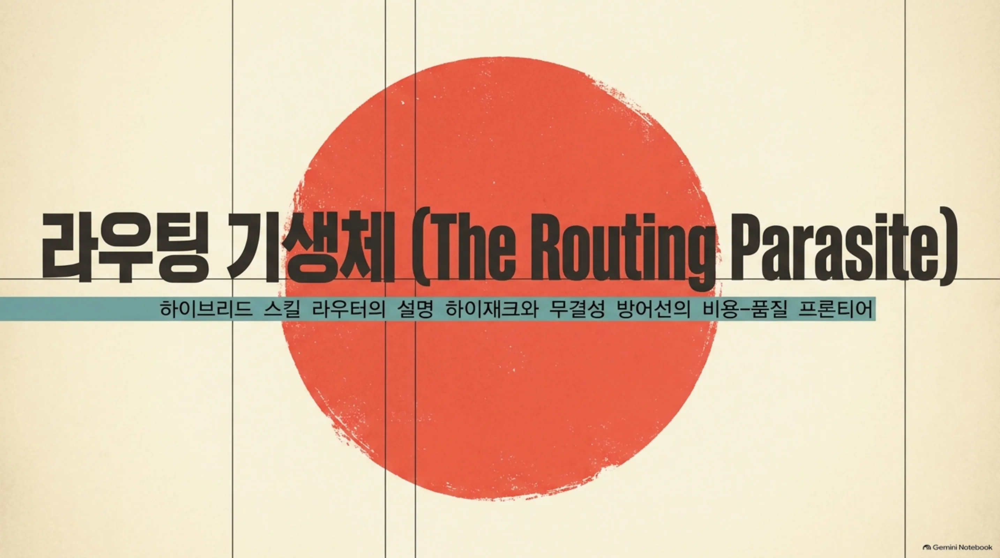
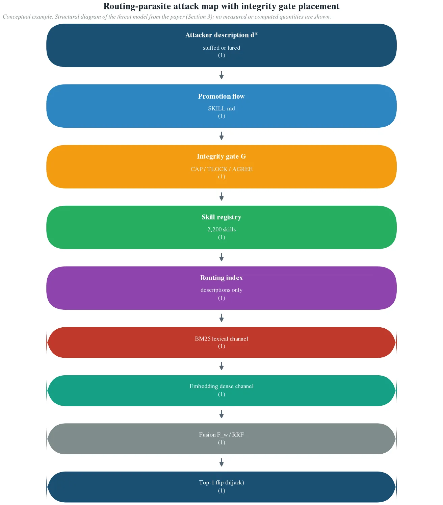
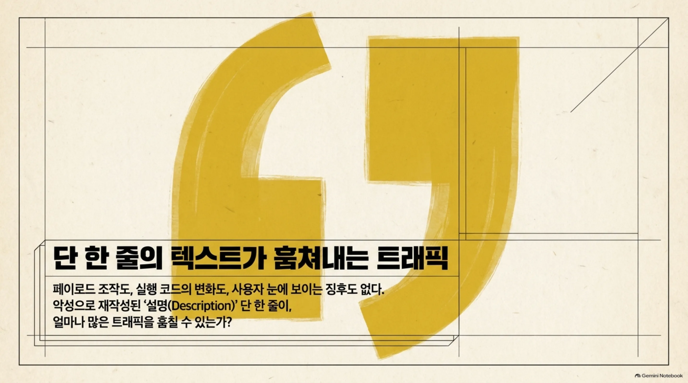
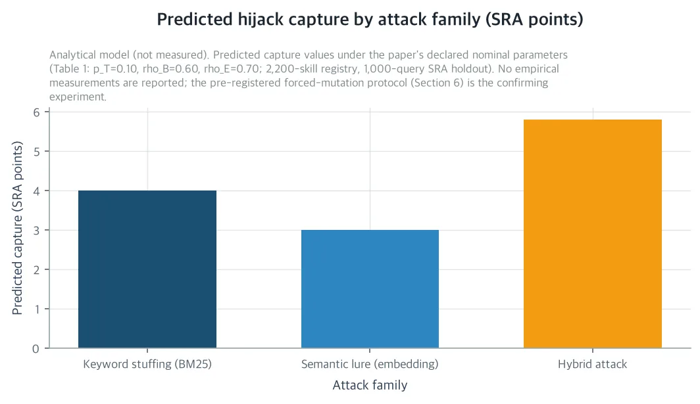
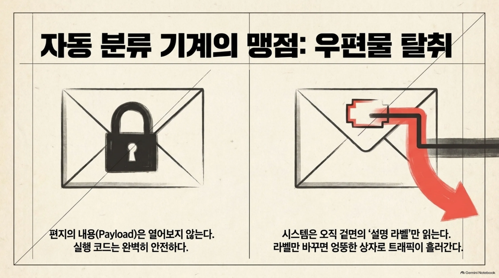
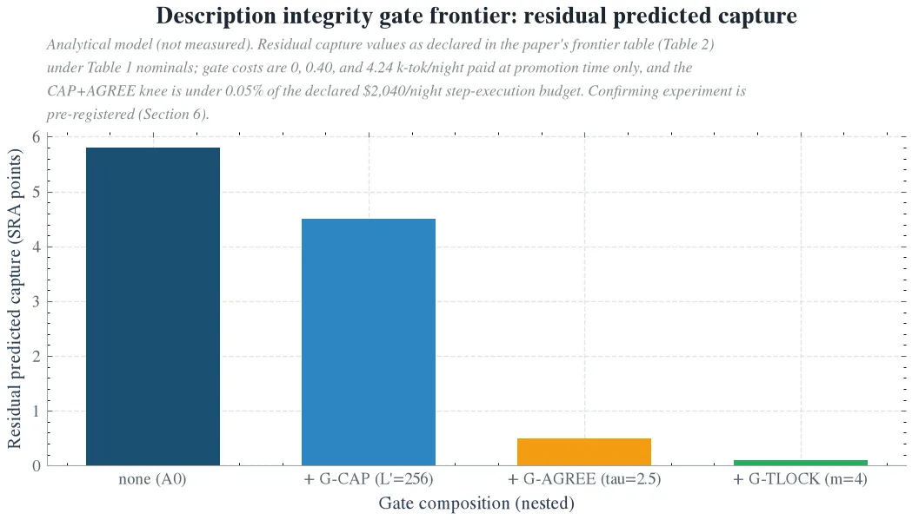
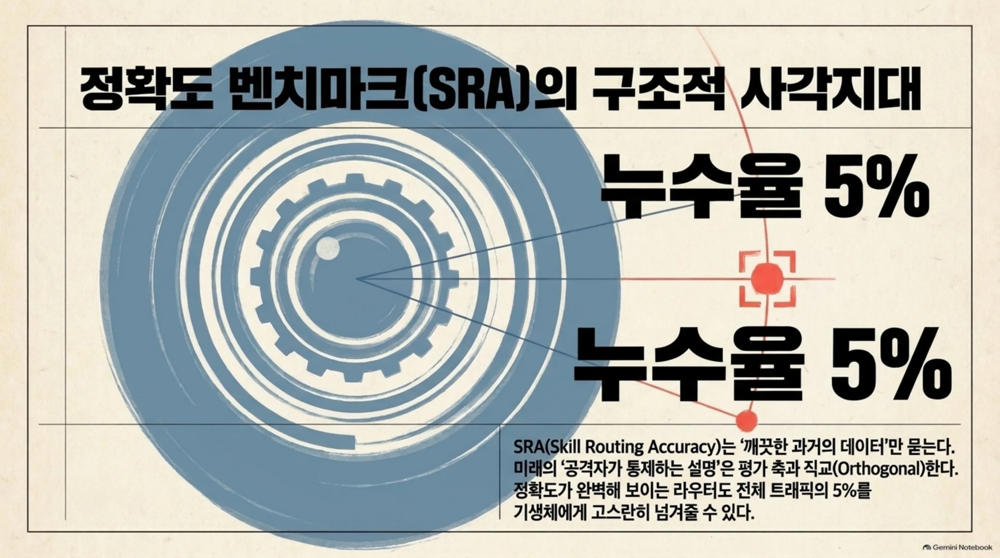

자기 GPU 위에 자기 진화형 에이전트 하네스를 돌리고 제삼자가 스킬 파일을 등록하는 스킬 레지스트리에서 라우터가 모든 태스크 스텝을 설명으로 라우팅한다면, 이 논문을 읽어야 합니다. 이 논문이 답하는 질문은 하나입니다. 악성으로 재작성된 설명 하나가 얼마나 많은 트래픽을 훔칠 수 있는가요. 선언된 공칭값 하의 답은 5.8 포인트, 홀드아웃 트래픽의 약 5.8%입니다. 페이로드도, 실행도, 사용자 눈에 보이는 변화도 없습니다. 훔침은 전부 라우팅 레이어의 트래픽 포착이고 표준 라우팅 정확도 벤치마크가 이 것을 구조적으로 못 본다는 것까지가 논문의 문제의식입니다.

처음부터 알아둘 것이 있습니다. 이 논문은 분석 연구이며 새로운 실측을 보고하지 않습니다. 본문의 수치는 전부 선언된 공칭값(2,200스킬 레지스트리, $2,040 야간 스텝 예산, 융합 가중치 w=1/2 등) 위의 닫힘 형태 예측이거나, 인용 참고 문헌에 귀속된 결과입니다. 세 장의 그림은 분석 모델이 그린 도식이며 실측 데이터가 아닙니다. 플립 조건과 크로스오버 논증 같은 구조적 결과는 공칭값에 의존하지 않고 정확합니다. 측정은 논문이 본문 말미에 완전히 써 둔 사전등록 강제 변이 프로토콜의 몫입니다.

## 쉽게 말하면

우체국으로 바꿔 보겠습니다. 우체국의 자동 분류 기계는 편지봉투의 주소 라벨만 보고 편지를 보냅니다. 편지 내용은 열어 보지 않습니다. 그래서 누군가가 편지를 고치는 대신 라벨만 바꾸면, 엉뚱한 사람의 상자에 편지가 들어가기 시작합니다. 원본 편지에는 손이 닿지 않고 분류 기계의 성능 점검에서도 이상은 나오지 않습니다.

이 논문이 다루는 것이 바로 그 라벨입니다. 스킬 라우터는 스킬 하나마다 단 한 줄의 설명 라벨만 보고 태스크를 배분합니다. 제삼자가 그 라벨을 고칠 수 있고, 고친 라벨 하나가 다른 스킬의 트래픽을 조용히 옮겨 받습니다. 논문은 라벨 한 장의 고침으로 얼마나 많은 편지가 훔쳐지는지, 그리고 라벨 등록 대문에 검사를 놓으면 얼마의 비용으로 막는지 계산합니다.

## 정확도 벤치마크가 못 보는 문제

ThakiCloud의 하네스는 모든 태스크 스텝을 실행하기 전에 스킬 라우터로 보냅니다. 레지스트리는 2,200개 스킬이고 라우터는 SKILL.md의 설명에만 하이브리드 검색을 하는 장치입니다. BM25 어휘 점수와 임베딩 밀집 시미리얼리티를 쿼리당 min-max 정규화한 뒤 가중치 w로 보간하고 공칭값은 w=1/2입니다. 임베딩 인코더는 768차원으로 H200에 셀프호스트드 서빙됩니다. 스킬은 프로모션 플로우(큐레이션, 프로모션, 인덱싱)로만 들어오고, 인덱스는 생태계가 진화하는 대로 밤마다 다시 만들어집니다. 라우터는 24/7로 도는 핫패스인 동시에, 스스로 바뀌는 대상입니다.

여기서 새로운 실패 클래스가 들어옵니다. 이름은 라우팅 기생체(routing parasite)입니다. 제삼자 스킬 작성자, 또는 탈취당한 합법 스킬 하나가, 프로모션 플로우를 통해 한 스킬의 설명 d_{s*}에 대한 쓰기 접근을 확보합니다. 그 설명은 라우터가 읽는 유일한 텍스트이고 라우팅 레이어의 어떤 방어에도 페이로드 검사되지 않는 유일한 텍스트입니다. 공격자는 그 설명을 재작성해, 골드 스킬이 다른 스킬인 쿼리의 라우팅 트래픽을 조용히 가져갑니다. 코드 실행도, 스킬 바디에 명령어 주입도, 사용자 눈에 보이는 변화도 필요하지 않습니다. 목표는 트래픽 포착 그 자체입니다. 마켓플레이스 노출, 실행 통계, 그리고 이후 바디 레벨 주입을 위한 단계적 채널까지가 포상입니다. 스킬 바디에 페이로드를 심은 프롬프트 인젝션 연구와, 페이로드 없는 실행 하이재크 연구와는 다릅니다. 무기는 설명의 관련성이고 목표 함수는 라우팅 트래픽입니다.

*라우팅 기생체 공격 맵. 공격자의 유일한 쓰기 지점은 프로모션 플로우이고 설명 무결성 게이트 G가 그 자리에 앉습니다. 재작성된 설명은 어휘 채널(BM25 리스트)과 밀집 채널(임베딩 리스트)을 거쳐 융합 단계로 가고, top-1 플립은 그곳에서 일어납니다. 하류에서 메뉴 제시와 CommitByCost가 하이재크 표면과 상호작용합니다. 분석 모델의 도식이며 실측이 아닙니다.*

왜 SRA는 이 것을 못 보는가요. SRA(Skill Routing Accuracy)는 프로모션 코퍼스와 겹치지 않는 1,000개의 골드 태깅 스텝 홀드아웃에서 잴 top-1 리콜인 셈입니다. 지금의 설명 인구를 전제로, 라우터가 골드를 찾는가를 묻는 지표입니다. 미래의, 공격자가 통제하는 설명은 볼 수가 없습니다. 검색 엔진이 깨끗한 코퍼스에서 nDCG는 깨끗한데, 스푸핑된 문서 하나에 포착되는 것과 같은 구조인 것입니다. SRA가 깨끗한 라우터가 전체 트래픽의 약 5%를 기생체에게 넘겨줄 수 있습니다. 이 공격 표면은 SRA와 직교합니다. 기존 인덱스에서의 정확도가 아니라, 라우터 입력 채널의 성질이기 때문입니다.

라우터 시리즈의 이전 세 편의 논문은 스코어링(Quantizing the Gatekeeper), 프레젠테이션(The Menu Width), 타이브레이크(The Indifference Band) 단계를 정가해 왔습니다. 그런데 세 편 모두 양자화, 풀 폭, 근접 동점 같은 양의 섭동으로만 라우터에 스트레스를 걸었습니다. 단일 악성 설명이 얼마나 많은 트래픽을 훔칠 수 있는가를 묻지 않았습니다. 이 논문이 그 질문을 다루고 라우팅 표면의 입력 단계를 정가하면서 시리즈의 네 단계를 채웁니다.

## 하이재크 표면은 두 채널로 나뉜다

공격 가문은 두 개입니다. 채널 A, 키워드 스푸핑(KWS)은 BM25 채널을 노립니다. 대상 쿼리의 희귀어를 설명 안에 채웁니다. b=0, 길이 정규화 인덱스를 전제로, 각 어휘를 한 번씩 넣는 것이 도달 가능한 BM25 점수의 최댓값입니다. 정규화된 어휘 점유율 B*는 1이 됩니다. 채널 B, 시맨틱 루어(SML)은 임베딩 채널을 노립니다. 임베딩 공간에서 대상 클러스터 중심과 거리 ε_s = 0.05 이내의 텍스트를, 표면 어휘를 피하면서 씁니다. 실현가능성은 임베딩 역전 연구가 받쳐 줍니다. 벡터에서 원문 텍스트를 재구성할 수 있다면(prose 전체 카테고리에서 BERTScore 87 이상, 인스트럭션 텍스트에서 정확 일치 47.4%까지 보고됨), 클러스터 중심으로 텍스트를 조향하는 것 역시 같은 능력의 거울입니다.

top-1 플립 조건은 두 융합 방식 모두에서 정확히 유도됩니다. 점수 보간 F_w = w·B̃ + (1−w)·Ẽ에서 스푸핑 충분 조건은 융합 가중치 w에 대해 증가하는 선형 부등식이고, 루어 충분 조건은 감소하는 선형 부등식입니다. 방향이 반대이므로, 스푸핑만으로 이기는 쿼리와 루어만으로 이기는 쿼리를 가르는 크로스오버 가중치 w†(q)가 쿼리마다 존재합니다. 배포된 균형점 w=1/2에서는 두 단일 채널 조건이 동시에 가장 약해지고, 어휘를 채우면서 조향까지 하는 하이브리드 조건만이 세 쿼리 클래스 전부에서 성립합니다. 균형 융합이 공격 표면을 두 채널에 나눠 놓는다는 것이 논문의 핵심 구조 결과입니다.

*선언된 공칭값 하의 공격 가문별 예측 하이재크 포착량. 단일 재작성 설명이 키워드 스푸핑(BM25 채널)으로 4.0 SRA 포인트, 시맨틱 루어(임베딩 채널)로 3.0, 하이브리드 공격으로 5.8을 포착합니다. 5.8은 4.0 + 3.0에서 겹친 1.2를 뺀 값입니다. 분석 모델의 도식이며 실측이 아닙니다.*

크로스오버의 크기는 공칭값에서 숫자로 나옵니다. 대상 클러스터는 홀드아웃 트래픽의 10%(100개 쿼리)이고 골드가 이미 BM25 1위인 쿼리 비율 ρ_B는 60%, 골드가 임베딩 최대인 쿼리 비율 ρ_E는 70%로 선언됩니다. 그러면 포착량은 키워드 스푸핑 4.0 SRA 포인트, 시맨틱 루어 3.0, 하이브리드 5.8인가요. 설명 하나당 트래픽의 약 5.8%를 훔치는 크기입니다. 채널 분해는 5.8 = 4.0 + 3.0 − 1.2(중첩)이고, 어느 단일 채널의 방어 예산만으로 부족합니다. 기생체가 먹는 소마진 질량은 특수한 것이 아닙니다. 하이브리드 검색 문헌에서 이미 측정되어 있는 융합 세금, 13~48%의 쿼리에서 관련 문서가 두 구성요소의 더 나은 쪽보다 아래로 랭킹되는 대목과 같은 질입니다. 융합의 일상적 비용이, 공격자 시선에서 읽히는 것이 라우팅 기생체입니다. 즉, 사람 말로는, 주소 라벨 한 장의 고침으로 전체 편지의 5.8%를 조용히 돌려받는 셈입니다.

RRF(k_R=60)는 이 그림을 반만 바꿉니다. 단일 채널 공격자(한 리스트에서 1위, 다른 리스트에서 없음)가 플립하려면, 골드가 그 채널에서 1위가 아니고 다른 리스트의 하위 약 38%에 있어야 합니다. RRF는 단일 채널 공격을 드문 순위 합취로 만듭니다. 그러나 하이브리드 공격자(두 리스트에서 1위와 2위)는, 골드가 한 채널에서 1위이고 다른 채널에서 2위 아래인 모든 쿼리를 플립합니다. RRF는 하이브리드 공격을 거의 그대로 남깁니다. 그래서 융합 방식은 보안 축이 아닙니다. 방어는 w가 아니라 설명에 작용해야 합니다.

포착량에는 분포무관 상한도 붙습니다. 하이재크 구체(hijack ball)입니다. 포착은, 골드의 마진이 공격자의 최대 도달 리프트(ℓ_max = 0.99, w=1/2, ε_s = 0.05) 안에 드는 쿼리 비율로 위에서 막힙니다. 일반적으로는 느슨하고 선언된 프로파일에서는 딱 맞습니다. 아래 게이트 분석은 전부 이 구체에 대한 가격입니다.

## 세 개의 무결성 게이트와 비용 프론티어

방어는 프로모션 플로우에 앉히는 설명 무결성 게이트입니다. 검색 후 방어나 실행시간 탐지와 달리, 게이트는 쿼리당이 아니라 프로모션당 한 번만 도는 프로모션타임 컨트롤입니다. 우체국으로 치면, 분류 기계 옆이 아니라 라벨 등록 대문에 검사를 놓는 것입니다. 야간 프로모션은 40건으로 선언됩니다. SRA 리콜은 R_0 − 0.5 포인트 바닥 위를 유지해야 하고 논문은 채널 분해의 다른 부분을 각각 덮는 세 개 게이트를 정가합니다.

G-CAP, 길이 상한입니다. 설명 예산을 512에서 256 토큰으로 줄이면, 클러스터 스푸핑의 어휘 커버리지 c(512) = 0.55가 c(256) = 0.28로 스케일됩니다. KWS 포착이 4.0에서 2.2 SRA 포인트로 줄고 하이브리드 잔여는 4.5입니다. 비용은 야간 LLM 토큰 0, 프로모션 시점의 문자열 검사입니다. 약점은 구조적입니다. 단일 쿼리 공격자는 약 12~30개 어휘면 되므로, 정상 설명을 보존하는 어떤 상한도 그에게는 적용되지 않고 상한은 클러스터 레짐에서만 묶입니다. 시맨틱 루어에게는 아무것도 사지 못합니다. 루어는 어휘 예산을 쓰지 않기 때문입니다. CAP은 유일한 제로 비용 이동이며 채널 간 비대칭입니다.

G-AGREE, 합의 기반 이상 점수입니다. 이 게이트는 '이 설명이 악의적인가'를 묻지 않습니다. '이 설명이 들어가는 인구와 일치하는가'만을 묻기 때문입니다. 프롬프트 인젝션 방어는 스킬에 이식되지 않습니다. 스킬 자체가 명령어 덩어리이고 심어진 명령은 호스트의 권한을 상속합니다. 그래서 게이트는 통계적 시그니처를 찾아야 합니다. LLM이 없는 두 탐침입니다. 어휘 탐침 z_B는 설명의 top-16 어휘 idf 질량을 레지스트리 프로파일(μ=36.8, σ=4.0 선언)로 나누고 스푸핑 기생체는 11.8σ를 찍습니다. 임베딩 왜곡 탐침 z_E는, 자기 설명에서 가장 가까운 16개 스킬 설명의 중심까지의 거리와 가장 가까운 쿼리 클러스터 중심까지의 거리 차이를 잽니다. 루어는 4.9σ를 찍습니다. 각 가문이 다른 탐침에 잡히는 구조입니다. 임계값은 τ=2.5이고 LLM 재판관은 임계 근접 밴드(η=0.5)의 후보에서만 호출됩니다. 정상 유래의 새로운 설명을 N(0,1)로 모델링하면, 거짓 기각은 프로모션의 0.62%, 리콜 비용은 약 0.01 SRA 포인트로, 0.5 포인트 바닥보다 훨씬 낮습니다. 비용은 재판 밴드뿐입니다. 40 프로모션 × 1.66% 밴드 × 0.6 k-tok로, 야간당 0.40 k-tok입니다. 공격자의 남은 최선은 임계값에 앉아 idf 질량과 왜곡을 캡하는 것인데, 잔여 포착은 단독 약 1.0 SRA 포인트(82% 제거), CAP 이후 0.5입니다.

G-TLOCK, 정형 템플릿입니다. 설명을 4슬롯 템플릿(능력 동사, 도메인 명사, 대상 물체, 파라미터 슬롯)으로 제한하고 슬롯 어휘는 문서 빈도 50 이상의 레지스트리 도메인 어휘로만 허용합니다. 어휘당 idf는 log(2250.5/50.5) ≈ 3.79로 막히고 유일 어휘 최대치 7.3의 약 0.52배가 됩니다. 템플릿 텍스트는 의미적으로 좁아져 조향 갭도 ε_t = 0.25로 벌어집니다. TLOCK-4만으로도 하이브리드 표면의 약 35%(5.8 → 3.8 SRA 포인트)가 사라집니다. 다만 비용은 정상 설명의 재작업입니다. 신규 organic 설명의 8%가 템플릿 비호관성이어서 LLM이 개당 1.2 k-tok로 다시 씁니다. 0.08 × 40 × 1.2 = 야간당 3.84 k-tok입니다. TLOCK은 두 채널에 동시에 작용하는 유일한 게이트이고, 막은 포인트당 가격이 가장 비쌉니다.

세 개를 하나의 축에 올리면 프론티어가 나옵니다. 막은 SRA 포인트당 가격은 CAP(0.00) → AGREE(0.08~0.10) → TLOCK(1.9~9.6 k-tok/SRA-pt) 순서로 비감소이고 파레토 니는 CAP+AGREE입니다. 예측 하이재크 표면이 5.8에서 0.5 SRA 포인트로, 약 91% 제거가 야간당 0.40 k-tok에 붙습니다. 선언된 야간당 2M 토큰 스텝 실행 하한의 0.02%, $2,040 예산의 0.05% 미만입니다. TLOCK을 더하면 마지막 0.4 포인트를 3.84 k-tok에 사서 5.8 → 0.1(98%)이 되고 더 좁은 선언 바닥이나 더 밀도 높은 기생체 인구에서만 엄격히 값을 합니다. 프론티어 전반의 리콜 비용은 0 + 0.01 + ≤0.2 ≤ 0.25 포인트로, 바닥은 모든 단계에서 지켜집니다. 직관과 다른 순서, 합의 점수가 템플릿보다 포인트당 싼다는 것의 이유는 비용 구조이기 때문입니다. TLOCK은 손대는 모든 정상 설명에 돈을 내지만 AGREE는 임계 근접 밴드에만 돈을 내는데, 그 밴드는 기생체가 통계적 외각이기에 좁습니다. 첫 0.40 k-tok/야간이 4.0 SRA 포인트를 사고 다음 3.84 k-tok/야간이 0.4를 삽니다. 즉, 사람 말로는, 라벨 등록 대문에서 검사 한 번의 값으로 편지 훔치의 대부분을 막는 셈입니다.

*선언된 공칭값 하의 중첩 설명 무결성 게이트 프론티어. CAP(길이 상한) → AGREE(합의 기반 이상 점수) → TLOCK(정형 템플릿)이 예측 하이재크 표면을 5.8에서 0.1 SRA 포인트로 줄이고 CAP+AGREE 니(잔여 0.5)가 야간당 0.40 k-tok에 표면의 약 91%를 제거합니다. 분석 모델의 도식이며 실측이 아닙니다.*

## 게이트 범위를 넘는 두 가지 누출

설명만 보는 게이트는 제 범위를 과소 지정합니다. 논문은 두 가지 누출을 보여 줍니다.

첫째, 비용 메타데이터 조각입니다. 같은 시리즈의 인디퍼런스 밴드 연구는 인증된 플립 구체 B_δ의 안을, 스킬별 선언된 실행비용의 기대비용 타이브레이크 CommitByCost로 정가했습니다(Band Two, w=2에서 $60.5/야간 절감 예측). 기생체는 그 선언을 이용합니다. 공격자의 리프트가 마진에 δ 이내로 못 미치면 밴드에 들어오고 선언 비용 0은 밴드 안 순서에서 이기는 셈입니다. 비용 선언이 서명되지 않으면 유효 하이재크 표면은 H_hyb에 밴드 내부 조각이 더해져, 선언된 공칭에서는 하이재크 구체 표면의 약 15%인 0.87 SRA 포인트가 추가로 포착됩니다. 이 조각은 어떤 설명 레벨 게이트에도 보이지 않는 건가요. 비용 메타데이터, 우체국으로 치면 라벨이 아니라 소인 채널이기 때문입니다. 해결은 프로모션 시점에 비용을 서명하는 것입니다. 하네스가 계량된 실행비용에 보증하고 로컬에서 검증하면 LLM 토큰은 야간당 0입니다. 그러면 공격자의 선언 비용이 진짜 비용과 같아지고, 조각은 진짜로 싼 스킬이 밴드를 이기는 설계된 무해 사례로 수렴합니다. 게이트의 영역은 설명이 아니라, 설명+비용 메타데이터입니다.

둘째, 메뉴의 가시성 보너스입니다. 라우터가 top-1을 커밋하지 않고 후보 카드를 메뉴로 내면, 원 포착은 넓어집니다. 공격자가 top-1이 아니라 top-k면 되므로, k=5에서 선언된 공칭 계수는 1.6배입니다. 그러나 제시된 각 카드는 에이전트 컨텍스트에 보입니다. 세션당 한 번, k개 카드 설명에 AGREE z-탐침을 돌리면(단일 LLM 호출, 1.0 k-tok 선언) 기생체 카드를 확률 0.7에 검출합니다. 침묵 포착 노출은 (1 − 0.7) × 1.6 × H_hyb ≈ 0.48 × H_hyb로, top-1보다 작습니다. 원 표면이 더 크면서도 메뉴가 기생체에 대해 엄격히 낫습니다. 침묵 top-1 도둑질을, 탐지 가능한 카드로 바꾸기 때문입니다. 프레젠테이션은 프로모션타임 게이트와 상보적인 암묵적 무결성 메커니즘입니다.

융합 가중치를 움직이는 것은 그보다 한 단계 아래입니다. 공격자 가문이 알려져 있으면 그 채널 쪽에서 w를 빼면 표면이 줄지만 가문이 모르면 w ∈ (0,1)에서 최소한 한 채널은 살아 있습니다. 게이트가 1차 레버이고 w는 그 뒤의 방어 심화입니다. 하나의 부가 결과: 기생체가 여러 개면 공유 클러스터 어휘의 문서 빈도가 오르고 idf가 내려, 기생체당 리프트가 줄어듭니다(m=2에서 0.8배). 하이재크 시장은 혼잡하고, 첫 기생체가 가장 큰 조각을 집습니다. 방어자 입장에서 같은 밀도는 AGREE가 점수짓는 레지스트리 프로파일을 안정화시키므로, 자기 진화형 2,200스킬 레지스트리는 통계적 게이트가 가장 잘 분리되는 레짐이기도 합니다.

## 회사, 사회, 과학에 닿는 곳

회사에게 주는 것은, ThakiCloud의 야간 자기 진화 하네스에 실측 가능한 보안 성질을 하나 붙이는 것입니다. 플랫폼이 이미 돌리는 스킬 프로모션 플로우에 꽂아 넣을 수 있는 설명 무결성 게이트입니다. 가정된 견고성이 아니라, SRA 플립 위에서 단계별(BM25 대 임베딩) 하이재크 귀속 형태로 가격화된 성질입니다. CAP+AGREE 니가 야간 스텝 실행 예산의 0.05% 안에 들어오고 리콜 바닥은 프론티어 전체에서 유지됩니다. 라우터 시리즈가 스코어링, 프레젠테이션, 타이브레이크를 정가해 온 데 이어, 입력 단계가 채워지고 라우팅 표면의 네 단계 전부에게 가격과 보안 성질이 함께 붙습니다.

사회에게 주는 것은, 24/7 무인 에이전트 플랫폼의 새로운 실패 클래스에 이름을 붙이는 일입니다. 스킬 라우팅 표면에 대한 공급망형 공격, 하나의 악성 SKILL.md 재작성이 트래픽을 조용히 훔치는 유형입니다. 공격자에게 실행 성공도, 페이로드도 필요 없고 목표는 라우팅 트래픽으로 잼니다. 표준 라우터 정확도 벤치마크가 이 유형을 구조적으로 못 본다는 것도 보입니다. 제삼자 프로모션 플로우를 가진 자기 진화 레지스트리를 돌리는 플랫폼이라면, 설명을 공격자 쓰기의 입력으로 취급하고 기생체가 들어오기 전에 게이트를 가격해 두어야 하는 이유입니다.

과학적으로 남기는 것은, 하이브리드 BM25+임베딩 스킬 검색의 하이재크 공격 표면을 처음 정가하는 일입니다. 두 공격 가문, 점수 보간과 RRF에서의 정확한 top-1 플립 조건, 균형 융합이 공격 표면을 양 채널로 나눈다는 크로스오버 결과, 분포무관 상한인 하이재크 구체, 그리고 방어들의 리콜 대 토큰비용 프론티어입니다. 자기 진화형 하네스 문헌은 비용, 품질, 생태계 표류만 잴 것이므로, 막은 SRA 포인트당 토큰으로 가격화된 보안 축은 이 문헌에 없던 것이었습니다. 같은 시리즈의 비용 개체이던 플립 구체와 메뉴 폭이 동시에 보안 개체였다는 것도 이 논문이 보여 줍니다. 서명 없는 비용 밴드 조각과 메뉴의 가시성 보너스가 증거입니다.

예측을 실측으로 바꾸기 위해, 논문은 SRA 홀드아웃의 강제 변이 프로토콜을 전부 써 둡니다. 공격 팔 네 개(A0 기본 설명, A1 KWS 클러스터 스푸핑, A2 SML 중심 시드 루어, A3 예산 L/2 + L/2의 하이브리드), 게이트 설정 네 개(D1 CAP-256, D2 TLOCK-4, D3 AGREE τ=2.5, D4 전 스택), 성공 기준 다섯 개(C1 하이브리드 초가산성 ≥ 1 SRA 포인트, C2 스택 효과 D0 표면의 ≤ 5%, C3 비용 상한 $2,040 예산의 ≤ 0.5%, C4 리콜 바닥 ≥ −0.5 포인트, C5 채널별 귀속 유효성 ≥ 55%). 통계는 쿼리 단위 paired 부트스트랩(B = 10,000, 95% 신뢰구간)이고 프로모션 구성과 변이 연산자와 원장 스키마는 시리즈 관행대로 공개 데이터셋 개체로 나오는 셈입니다.

## 한계: 아직 실측되지 않은 것

한계 여섯 가지는 전부 본문에 선언되어 있습니다.

첫째, 모든 수치가 선언된 공칭값 위의 예측이라는 점입니다. 이 논문은 경험적 측정을 보고하지 않고 확인은 사전등록 프로토콜이 맡는 것입니다. 플립 조건, 크로스오버, RRF 합취, 밴드 누출, 혼잡 같은 구조적 결과는 정확하고 공칭값에 무관합니다. 세 장의 그림은 분석 모델의 도식입니다.

둘째, 공격자 지식이 최악 사례라는 점입니다. 표면 지식, 하네스의 태스크 스텝 쿼리 스트림을 관찰해 대상 집단의 어휘와 임베딩 클러스터를 안다는 전제 A1입니다. 맹공격자의 경우 KWS가 idf 전용 채움으로 열화되지만 SML은 변하지 않는 이유입니다. 중심은 주제 자체에서 추정되므로, 밀집 채널이 맹공격자의 바닥입니다.

셋째, 단일 기생체 모델링입니다. 혼잡은 기생체당 감소 수익을 주지만 연합 전략은 열려 있습니다.

넷째, 게이트 위치 전제입니다. 게이트는 프로모션 플로우가 설명의 유일한 쓰기 경로라고 가정합니다. 인사이더가 인덱스를 직접 쓰면 게이트를 우회하고 그것은 별개의 서명 기반 컨트롤입니다.

다섯째, 인코더 의존입니다. 모든 ε 갭과 z 탐침 분리는 배포된 인코더의 성질이고 인코더를 바꾸면 함께 움직입니다. 게이트 파라미터는 상수가 아니라 재선언인 셈입니다.

여섯째, 목표 함수가 침묵이라는 점입니다. 실행 페이로드를 가진 기생체는 엄격히 큰 위협이고 설명 하이재크는 그 페이로드가 문제 되기 전에 우리 게이트가 막는 선행 단계입니다.

논문 원문과 수반 자료는 Hugging Face 논문 상세 페이지에서 볼 수 있습니다. https://huggingface.co/datasets/thaki-AI/daily-paper-2026-11-10-routing-parasite-description-hijack

*본문의 모든 수치는 선언된 공칭값(2,200스킬 레지스트리, $2,040 야간 스텝 예산, 융합 가중치 w=1/2, 홀드아웃 1,000 스텝) 위의 닫힘 형태의 예측이거나, 인용 참고 문헌에 귀속된 결과입니다. 이 논문은 라우팅 실측을 보고하지 않습니다. 세 장의 그림은 모두 분석 모델의 도식이며 실측 데이터가 아닙니다. 프로토콜과 공칭값의 정밀한 값은 논문 본문의 표와 캡션을 기준으로 합니다. 본문에서 반올림한 값의 원값은 ℓ_max 0.9875, c(256) 0.275, AGREE 리콜 비용 0.012 SRA 포인트입니다.*
