보험금 청구서 한 장에는 날짜가 여러 개 있습니다. 작성일이 있고 사고일자가 있고 입원 기간이 있습니다. 계좌번호 칸 옆에는 전화번호와 계약번호가 비슷한 모양으로 붙어 있습니다. 한국어 금융 서식에서 값을 뽑아 다음 시스템으로 넘기려는 개발자라면 이 두 지점에서 모델이 자주 틀린다는 것을 겪어 봤을 것입니다.

다키클라우드는 OCR 박스마다 필드 역할을 붙이는 모델 [DocFields-F32-KO](https://huggingface.co/ThakiCloud/DocFields-F32-KO)를 MIT 라이선스로 공개했습니다. 상태는 **EXPERIMENTAL / RESEARCH PREVIEW**이고, 품질 판정은 **`F32_TARGETS_MISSED`**입니다. 미리 등록한 개발 목표 7개 가운데 6개를 넘겼고, 전화번호 F1은 0.9147로 목표 0.9169에 못 미쳤습니다. 체크포인트를 고른 개발 분할에서도 청구금액 게이트(하한 0.9013)를 0.8946으로 통과하지 못했습니다. 연구 산출물로 공개했고 실제 업무 문서에서 얼마나 맞는지는 보장하지 않습니다.

그래도 한 가지는 분명히 달라졌습니다. 이전 단일 모델에서 0.273이던 날짜 검출 재현율이 0.703이 됐습니다. 이를 다른 모델이나 규칙 엔진 없이 체크포인트 하나로 해냅니다. 아래에서는 그 변화를 만든 네 가지 결정과, 수치를 읽을 때 반드시 함께 봐야 하는 한계를 차례로 다룹니다.

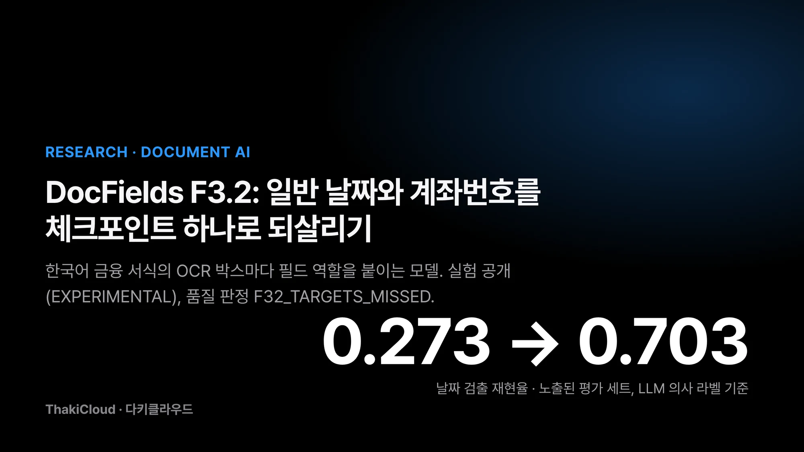
*DocFields F3.2 요약. 수치는 이미 여러 번 열어 본 평가 세트에서 LLM이 붙인 의사 라벨과 맞춘 값입니다.*

## 쉽게 말하면

서류를 분류해 서랍에 넣는 직원을 떠올리면 됩니다. 이전 모델에게는 날짜용 서랍이 '발행일' 하나뿐이었습니다. 사고일자나 생년월일처럼 발행일이 아닌 날짜는 넣을 곳이 없어 '해당 없음' 서랍으로 들어갔습니다. 그렇게 오래 일하다 보니 직원은 날짜를 보면 일단 버리는 버릇이 들었습니다.

F3.2는 이 직원에게 '그 밖의 날짜' 서랍을 하나 더 줬습니다. 판단이 애매한 서류는 억지로 '해당 없음'에 넣으라고 가르치지 않고 그냥 채점에서 뺐습니다. 계좌번호처럼 생긴 숫자라도 옆에 '전화번호'라고 적혀 있으면 계좌 서랍에 넣지 말라고 따로 가르쳤습니다. 이 글의 나머지는 이 서랍 이야기를 조금 더 정확한 말로 옮긴 것입니다.

<!-- nlm-visual -->
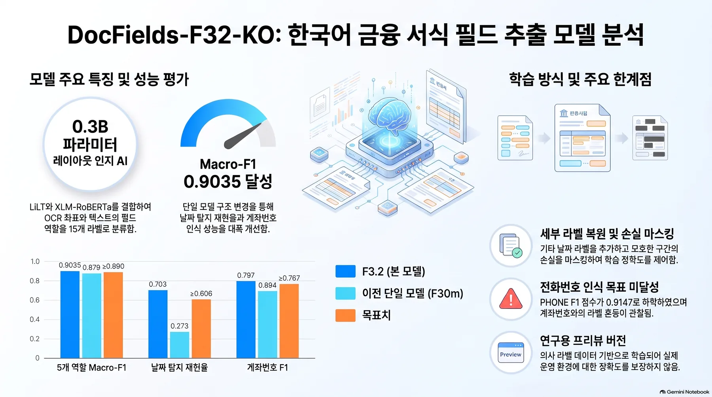
*NotebookLM이 소스를 종합해 생성한 인포그래픽입니다.*

## 발행일 하나뿐이던 날짜 라벨에 OTHER_DATE를 되돌렸습니다

DocFields는 이미지 픽셀을 읽지 않습니다. 입력은 OCR이 낸 글자 박스와 그 좌표이고 출력은 박스마다 붙는 역할 라벨입니다. 기반 모델은 문서 배치 정보를 다루는 LiLT에 다국어 인코더 XLM-RoBERTa를 결합한 [`nielsr/lilt-xlm-roberta-base`](https://huggingface.co/nielsr/lilt-xlm-roberta-base)이고, 이를 15개 라벨로 전체 미세조정했습니다.

이전 단일 모델(F30m)의 날짜 라벨은 발행일(`ISSUE_DATE`) 하나뿐이었습니다. 학습 데이터에서 발행일이 아닌 날짜는 전부 `O`(역할 없음)로 들어갔습니다. 학습 중에 날짜 모양 문자열 대부분이 `O`라는 신호가 반복해서 들어간 셈입니다. 그래서 날짜 자체를 무시하는 쪽으로 배웠고 날짜 검출 재현율이 0.273에 그쳤습니다.

F3.2는 발행일이 아닌 날짜에 `OTHER_DATE`라는 라벨을 따로 줬습니다. 학습은 F30m에서 이어서 시작했습니다. 분류 헤드의 기존 14행은 그대로 복사하고 새로 생긴 `OTHER_DATE` 행만 새로 초기화했습니다. 이미 잘하던 주소, 금액, 전화번호 판단을 처음부터 다시 배우지 않게 하려는 선택이었습니다.

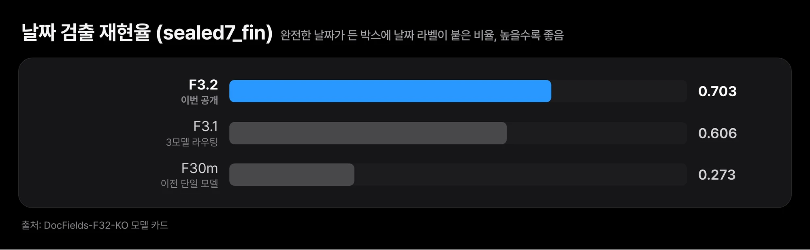
*이전 단일 모델이 0.273에 머물던 날짜 검출이 0.703까지 올라갔습니다. 노출된 평가 세트에서 결정론 날짜 검사기를 기준으로 잰 값이고, 같은 검사기를 학습 라벨에도 썼습니다.*

여기서 날짜 검출은 완전한 날짜 문자열이 든 박스에 `ISSUE_DATE`든 `OTHER_DATE`든 날짜 라벨이 붙었는지를 봅니다. 기준은 날짜 형식을 규칙으로 판정하는 결정론 검사기이며 사람이 확인한 정답은 아닙니다. 정밀도는 0.417로 이전 모델과 같았습니다. 모델이 날짜라고 한 박스의 절반 이상이 그 검사기 기준으로는 완전한 날짜가 아니라는 뜻이며 문서 한 건에 잘못된 날짜 박스가 0.79개꼴로 나옵니다.

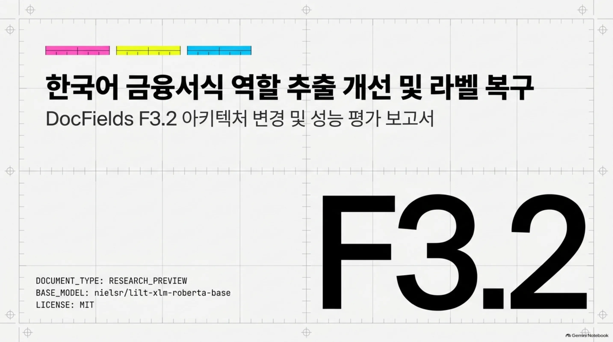

## 애매한 박스는 '역할 없음'으로 가르치지 않고 손실에서 뺐습니다

학습 정답은 대형 언어 모델이 붙인 의사 라벨(pseudo-label)입니다. 의사 라벨은 사람 검수 없이 모델이 만든 정답을 뜻합니다. 이 라벨과 날짜 검사기가 서로 다른 말을 하는 박스가 있었습니다. 검사기는 완전한 날짜라고 하는데 의사 라벨은 다른 역할을 붙였거나, 그 반대인 경우입니다. 계좌번호 형식인데 의사 라벨러가 계좌로 표시하지 않은 문자열도 있었습니다.

이런 박스를 `O`로 밀어 넣으면 이전 모델이 날짜를 무시하게 된 것과 같은 일이 다시 생깁니다. 그래서 F3.2는 이 박스들을 손실 계산에서 뺐습니다. 이 박스에서는 틀려도 맞혀도 학습 신호가 생기지 않습니다. 이렇게 뺀 박스가 약 1,200개입니다. 의사 역할이 이 헤드의 라벨에 없는 박스 3,147개는 이전과 같은 방식으로 뺐습니다.

학습 방식은 두 가지를 비교했고 공개한 것은 증류(distillation) 방식입니다. 증류는 이미 학습된 모델의 판단을 새 모델의 정답으로 빌려 쓰는 방법입니다. 손실에서 뺀 박스에 한해, 이전 전용 모델들의 라벨이 미리 정한 확신 조건을 넘을 때만 가져왔습니다. 정답이 확정된 박스는 덮어쓰지 않았고 LLM 라벨링도 새로 하지 않았습니다.

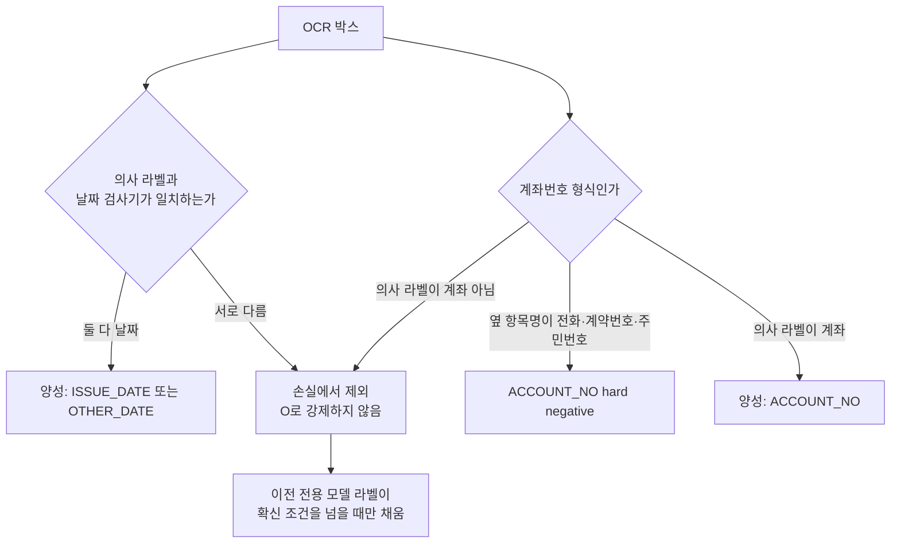

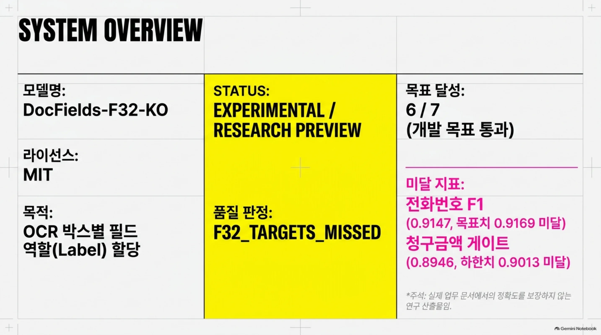

## 계좌번호 모양이라도 옆 항목명이 전화번호면 계좌가 아닙니다

금융 서식에서 숫자와 하이픈으로 된 문자열은 계좌번호, 전화번호, 계약번호, 주민번호 중 어느 것이든 될 수 있습니다. 문자열 모양만으로는 구분이 안 됩니다. 사람은 바로 옆에 인쇄된 항목명을 보고 판단합니다.

F3.2는 이 판단을 학습 라벨에 넣었습니다. 계좌번호 형식인 문자열이라도 바로 옆 항목명이 계약번호, 주민번호, 전화번호이면 `ACCOUNT_NO`의 hard negative로 둡니다. hard negative는 정답과 헷갈리기 쉬운 오답 예시를 일부러 넣어 둘을 가르게 하는 학습 예시입니다. 추론할 때는 계좌번호 쪽 임계값 하나를 둡니다. argmax 결과가 날짜나 계좌가 아닌 박스라도 `ACCOUNT_NO` 확률이 0.25 이상이면 `ACCOUNT_NO`로 올립니다. 날짜 쪽 승격은 끄고 공개했습니다.

평가 세트 `sealed7_fin`에서 `ACCOUNT_NO` F1은 이전 단일 모델 0.694에서 0.797로 올랐습니다. 문서 단위 paired bootstrap(2,000회 재표집, 95% 구간)으로 보면 차이는 +0.104, 구간은 [0.016, 0.219]입니다. 같은 세트에서 문서 단위로 다시 뽑아도 차이가 0 위에 머문다는 뜻입니다. 다만 이 비교 역시 아래 '한계' 절의 조건을 모두 안고 있습니다.

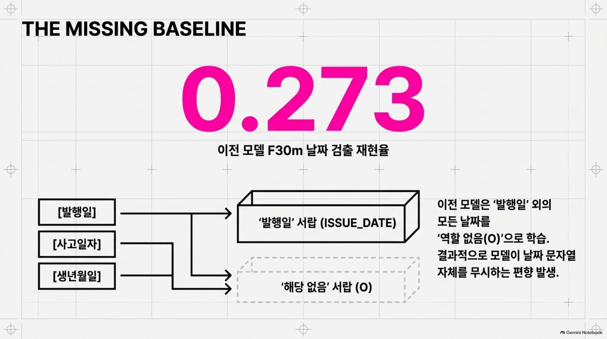

## 세 모델 라우팅을 체크포인트 하나로 합쳤습니다

F3.2 직전 버전인 F3.1은 모델 세 개를 함께 썼습니다. 이전 단일 모델과 전용 모델 둘의 결과를 역할별로 합치는 라우팅입니다. 수치는 나왔지만 운영 쪽 부담이 컸습니다. 모델 세 개를 따로 배포하고 버전을 맞춰야 했고 결과를 합치는 규칙도 관리해야 했습니다.

F3.2의 목표는 추론 때 다른 모델을 부르지 않고 이 라우팅을 체크포인트 하나로 대신하는 것이었습니다. 계좌번호 임계값도 체크포인트 폴더의 `decode.json`에 들어 있어 추론은 이 체크포인트 하나로 끝납니다.

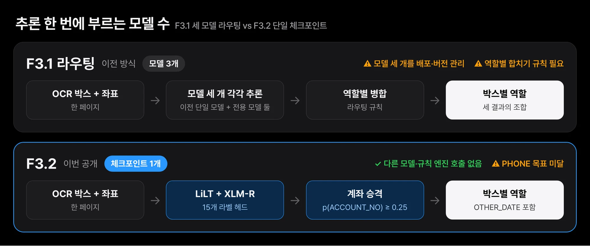
*F3.1은 세 모델의 결과를 역할별로 합쳤습니다. F3.2는 체크포인트 하나와 decode.json 임계값만으로 같은 일을 합니다. 성능은 '비슷한 수준'까지만 확인됐습니다.*

`sealed7_fin`(금융 서식 204건, 그중 라벨이 완전한 문서 198건)에서 잰 값은 아래와 같습니다. 다섯 역할 macro-F1은 계좌번호, 주소, 청구금액, 발행일, 전화번호 F1의 평균입니다.

| 지표 | F3.2 | F30m (이전 단일) | F3.1 (3모델 라우팅) | 목표 | 달성 |
|---|---|---|---|---|---|
| 5개 역할 macro-F1 | 0.9035 | 0.879 | 0.890 | ≥ 0.890 | ✅ |
| 날짜 검출 재현율 | 0.703 | 0.273 | 0.606 | ≥ 0.606 | ✅ |
| 날짜 검출 정밀도 | 0.417 | 0.417 | 0.337 | ≥ 0.337 | ✅ |
| `ACCOUNT_NO` F1 | 0.797 | 0.694 | 0.767 | ≥ 0.767 | ✅ |
| `CLAIM_AMOUNT` F1 | 0.9231 | 0.9231 | 미보고 | ≥ 0.9181 | ✅ |
| `ADDRESS` F1 | 0.9978 | 0.9985 | 미보고 | ≥ 0.9935 | ✅ |
| `PHONE` F1 | 0.9147 | 0.9219 | 미보고 | ≥ 0.9169 | ⚠️ 미달 |

F3.1과 직접 비교한 paired bootstrap 결과도 함께 봐야 합니다. 날짜 검출 재현율은 +0.097 [0.018, 0.181], 정밀도는 +0.081 [0.044, 0.121]로 구간이 0 위에 있습니다. 반면 macro-F1은 +0.014 [−0.016, 0.042], 계좌번호 F1은 +0.030 [−0.016, 0.087]로 구간이 0을 포함합니다. 그래서 이 두 지표에서 F3.2가 F3.1보다 낫다고 말하지 않습니다. 세 모델이 하던 일을 체크포인트 하나로 비슷한 수준까지 해낸다는 데까지만 말할 수 있습니다.

## 전화번호는 목표에 못 미쳤고, 평가도 독립적이지 않습니다

전화번호 목표는 이전 모델 점수에서 0.005를 뺀 값이었습니다. F3.2는 0.007이 떨어졌습니다. 확인한 전화번호 오류는 모두 `PHONE`과 `ACCOUNT_NO`를 서로 바꿔 붙인 경우였습니다. 계좌번호를 되살리는 과정에서 전화번호 일부가 딸려 간 것으로 보이지만 원인을 따로 분리해 확인하지는 않았습니다.

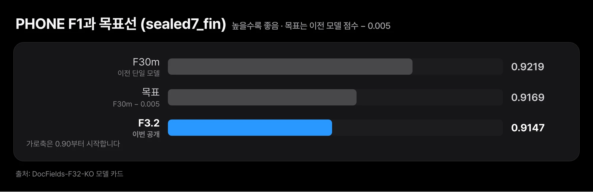
*F3.2의 PHONE F1은 0.9147로 목표 0.9169에 못 미쳤습니다. 확인한 오류는 모두 PHONE과 ACCOUNT_NO를 서로 바꿔 붙인 경우였습니다.*

체크포인트를 고른 개발 분할(823건)에서도 통과하지 못한 기준이 있습니다. 미리 정한 통과 기준(게이트) 7개 가운데 6개를 통과했고 청구금액 게이트는 하한 0.9013에 0.8946으로 못 미쳤습니다. 마지막 라운드의 체크포인트였고 사전등록에 적은 대로 한 번 평가해 그대로 보고합니다. 개발 분할에서 날짜 정밀도는 0.166으로 `sealed7_fin`의 0.417보다 눈에 띄게 낮았습니다.

더 중요한 것은 평가가 독립적이지 않다는 점입니다. 위 수치는 아래 조건을 모두 함께 놓고 읽어야 합니다.

1. **정답이 의사 라벨입니다.** 사내에 배포한 Qwen 계열 대형 언어 모델이 붙인 라벨이라, 점수는 그 라벨러와 얼마나 일치하는지를 잰 값입니다.
2. **`sealed7_fin`은 이미 노출된 평가 세트입니다.** 이전 버전(F2.7, F3.0, F3.1) 평가에 쓰였고 F3.2 작업 중에도 두 번 열었습니다. 출시 판단의 근거가 되지 못합니다.
3. **초기 가중치가 평가 그룹을 본 적이 있습니다.** 출발점인 F30m의 학습 데이터는 평가 분할과 서식 그룹 259개가 겹쳤습니다. F3.2의 학습 문서는 평가 분할과 문서 ID, 서식 그룹 모두 0건이 겹치도록 걸렀지만 초기 가중치를 통한 노출은 남아 있습니다.
4. **날짜 검출 재현율은 독립 검증이 아닙니다.** 같은 날짜 검사기를 학습 라벨을 만드는 조건에도 썼습니다.
5. **외부 평가가 없습니다.** 사람이 라벨을 붙인 독립된 실제 고객 서식 세트를 확보하지 못했습니다(E3 외부 평가는 `DATA_UNAVAILABLE`). 여러분의 서식에서 얼마나 맞는지는 알 수 없습니다.
6. **운영 정확도를 보장하지 않습니다.** 따로 떼어 둔 합성 서식에서는 F3.2가 0.843, 이전 모델이 0.844로 차이가 없었습니다. 이 합성 점수 역시 실제 서식 성능을 뜻하지 않습니다.

정리하면, 날짜와 계좌번호 쪽에서 관측된 개선은 있습니다. 하지만 그 개선이 처음 보는 서식이나 발급처에서도 이어진다는 일반화는 입증하지 못했습니다. 두 가지를 같은 말로 섞지 않으려고 이 절을 길게 썼습니다.

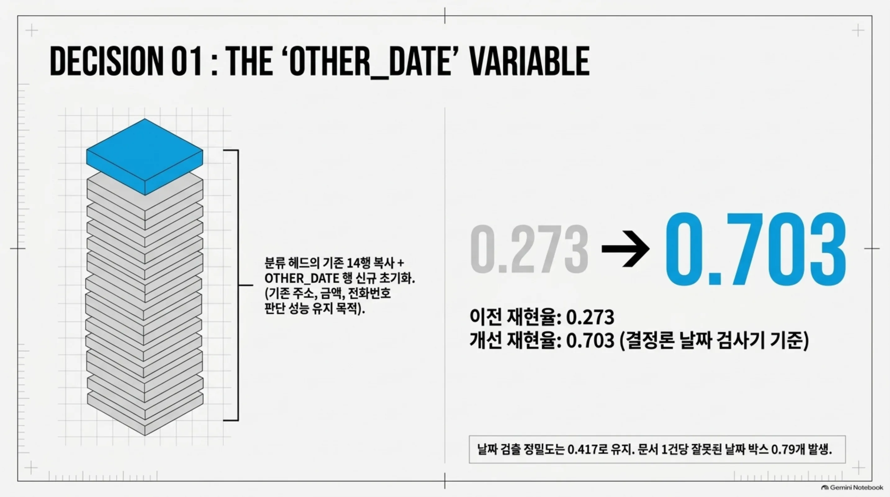

## 직접 돌려 보려면

카드에 실린 손으로 쓴 합성 청구서(19박스)로 동작을 확인할 수 있습니다. 공개 가중치를 CPU로 돌린 실제 출력 일부는 아래와 같습니다. 전화번호와 계좌번호는 맞게 붙었습니다. 사고일자 옆의 값은 `OTHER_DATE`가 더 맞는데 `ISSUE_DATE`로 나왔습니다. 청구인 이름 '홍길동'은 `O`로 놓쳤습니다. 이름 라벨은 합성 서식으로만 배웠기 때문입니다.

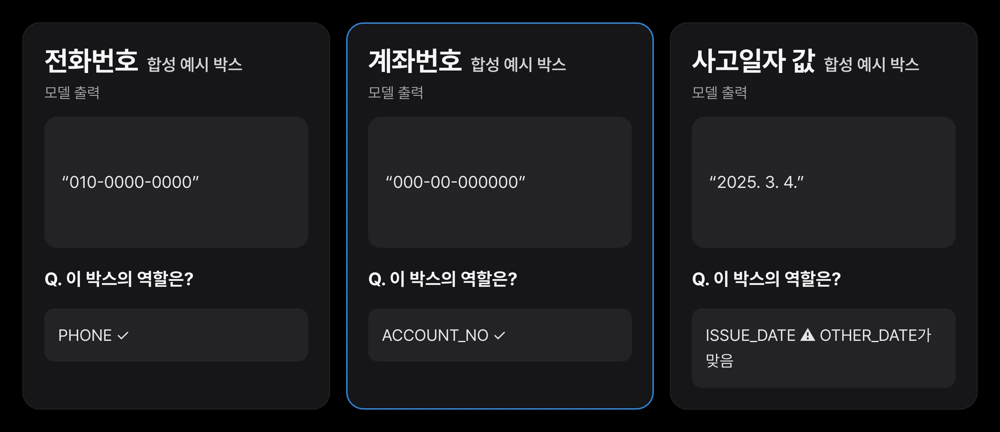
*카드에 실린 손으로 쓴 합성 청구서(19박스)에 공개 가중치를 CPU로 돌린 실제 출력 일부입니다. 쉬운 서식 한 장은 동작 확인일 뿐 정확도 근거가 아닙니다.*

입력은 한 페이지의 OCR 박스 목록이고 `bbox`는 0~1로 정규화한 `[x0, y0, x1, y1]`입니다.

```python
from huggingface_hub import snapshot_download
import sys
d = snapshot_download("ThakiCloud/DocFields-F32-KO"); sys.path.insert(0, d)
import docfields_f32 as df

model, tok, labels, dec = df.load(d, device="cpu")
boxes = [{"text": "계좌번호", "bbox": [0.44, 0.31, 0.56, 0.34]},
         {"text": "000-00-000000", "bbox": [0.60, 0.31, 0.84, 0.34]}]
for r in df.predict(model, tok, labels, dec, boxes):
    print(r["text"], "->", r["label"])
```

두 가지를 지켜야 카드의 수치와 같은 조건이 됩니다. 첫째, 디코딩은 `decode.json`의 계좌번호 임계값을 쓰는 동봉 스크립트로 해야 합니다. 단순 argmax나 기본 `pipeline()`으로 돌리면 결과가 달라집니다. 둘째, 박스 순서가 인코더에 영향을 주므로 OCR이 내는 순서대로 위에서 아래, 왼쪽에서 오른쪽으로 넣어야 합니다. 15개 라벨 가운데 실제 서식으로 학습하고 채점한 것은 `ADDRESS`, `PHONE`, `ACCOUNT_NO`, `CLAIM_AMOUNT`, `ISSUE_DATE`, `OTHER_DATE` 여섯 개뿐이고 나머지 출력은 검증되지 않은 것으로 봐야 합니다.

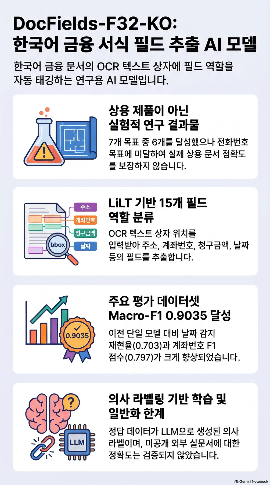

## Paxis에서는 사람이 확인하는 초안 단계에 들어갑니다

Paxis의 문서 업무 자동화는 에이전트가 서류에서 값을 뽑아 초안을 채우고 사람이 확인하는 흐름입니다. 이 흐름에서는 모델 수가 곧 운영 비용입니다. 세 모델을 따로 배포하고 버전을 맞추던 일을 체크포인트 하나로 줄이면, 배포하고 버전을 맞출 대상이 셋에서 하나로 줄어듭니다. 다만 지금의 F3.2는 사람이 확인하는 단계 앞에 두는 후보이고 사람 확인 없이 값을 확정하는 용도로 쓸 수준이라는 근거는 아직 없습니다.

## 끝으로

F3.2는 기반 모델을 그대로 두고 라벨 설계를 바꿨습니다. 발행일 하나뿐이던 날짜 라벨에 `OTHER_DATE`를 되돌렸고 애매한 박스를 `O`로 가르치지 않고 손실에서 뺐습니다. 계좌번호와 전화번호는 옆 항목명으로 갈랐습니다. 그 결과 체크포인트 하나로 세 모델 라우팅과 비슷한 수준에 닿았고 날짜 검출은 노출된 평가 세트 기준으로 더 많이 잡게 됐습니다. 대신 전화번호 목표는 놓쳤고, 평가는 의사 라벨과 노출된 세트에 기대고 있습니다.

비슷한 서식 모델을 다루고 있다면 오늘 할 수 있는 첫 점검은 간단합니다. 학습 라벨에서 `O`로 들어간 박스 가운데 날짜나 계좌번호처럼 생긴 문자열이 얼마나 되는지 세어 보는 것입니다. 그 수가 크다면 모델이 그 역할을 무시하도록 배울 가능성이 큽니다. 모델과 코드는 [Hugging Face](https://huggingface.co/ThakiCloud/DocFields-F32-KO)에 있습니다.


<!-- nlm-visual -->
*NotebookLM이 소스를 종합해 생성한 인포그래픽입니다.*

## 출처와 데이터

- 모델: [ThakiCloud/DocFields-F32-KO](https://huggingface.co/ThakiCloud/DocFields-F32-KO) (MIT, 기반 모델 [`nielsr/lilt-xlm-roberta-base`](https://huggingface.co/nielsr/lilt-xlm-roberta-base) MIT). 이 글의 수치는 모두 모델 카드와 같은 실험 원장에서 옮겼습니다.
- 학습 데이터: AI 허브(AI-Hub)의 OCR 데이터(금융 및 물류)(71301)와 법령 별지 서식(law.go.kr)에 합성 값을 채운 문서. **데이터는 재배포하지 않습니다.** AI 허브 데이터는 신청자 본인의 내부 이용으로 한정되며 이 글과 그림에는 데이터셋의 이미지, 글자, 라벨, 크롭, 샘플이 들어 있지 않습니다. 예시는 모두 손으로 쓴 합성 값입니다.
- 이전 글: [문서 필드 추출 모델을 학습하지 않은 이유](/tech-blog/ko/research/docfields-label-audit-why-we-did-not-train/)
