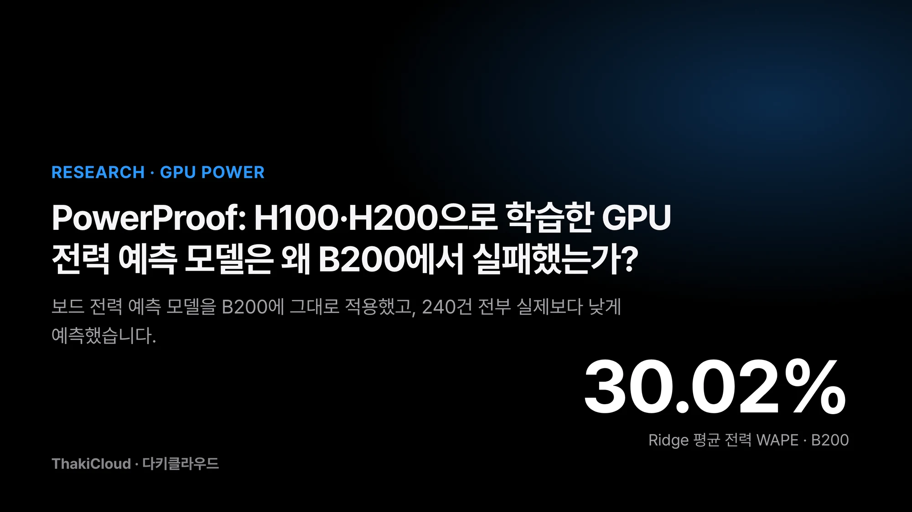
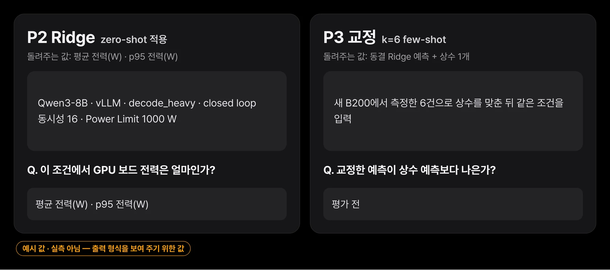
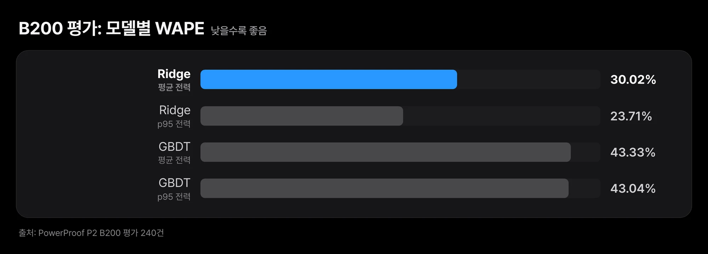
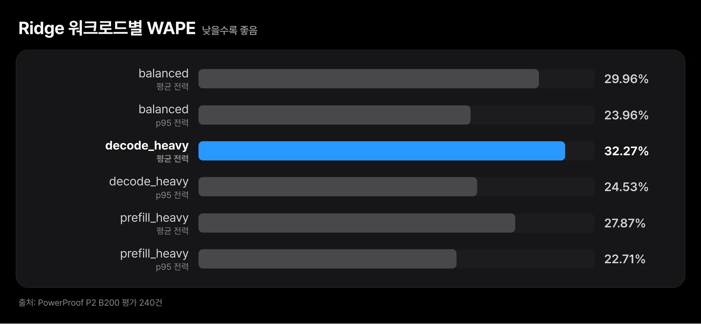
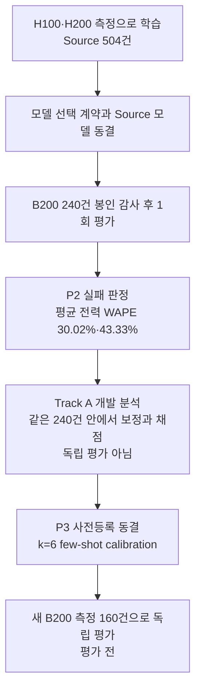
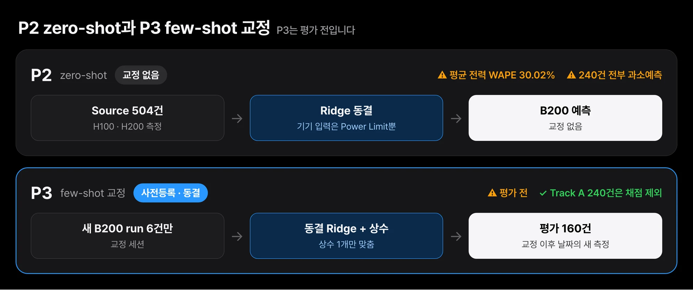

새 세대 GPU를 들이기 전에 서빙 전력을 미리 계산할 수 있다면, 인프라를 계획하는 쪽에서는 랙 설계와 전력 예산을 훨씬 일찍 확정할 수 있습니다.
저희는 H100과 H200에서 잰 전력으로 모델을 학습한 뒤, 한 번도 측정에 쓰지 않은 B200에 그대로 적용해 보았습니다.
결과는 실패였습니다. 평균 전력 기준 오차가 Ridge 모델은 30.02%, GBDT 모델은 43.33%였습니다.
240건 전부 실제보다 낮게 예측했습니다.
다만 그 원인이 GPU 아키텍처 차이인지, Power Limit 설정인지, 다른 환경 요인인지는 이 실험만으로 가릴 수 없습니다.
이 글에서는 평가 절차와 실패의 양상, 같은 데이터로 해 본 개발 분석, 다음 독립 검증 계획을 차례로 정리합니다.

## Meta PowerSight를 읽다가 질문이 생겼습니다

이 질문은 Meta가 OSDI 2026에 발표한 데이터센터 전력 계획 논문을 읽으면서 구체화됐습니다.
논문에 따르면 Meta는 하드웨어 수명주기를 고려한 랙 전력 예산 방법을 10년 넘게 운영해 왔습니다.
이 방법으로 compute, storage, AI 랙 전체에서 평균 약 20%의 전력 오버서브스크립션을 운영합니다.
이 방법은 양산 단계의 전력 텔레메트리를 전제로 합니다.
새 하드웨어 세대가 들어오는 초기에는 그런 데이터가 없습니다.

그래서 논문은 PowerSight라는 머신러닝 모델을 제안합니다.
전력 센서 대신 성능 카운터를 입력으로 받아 서버 시스템 전력을 예측합니다.
학습에 없던 새 아키텍처에서 새 워크로드를 돌린 경우, MLP 모델의 시스템 전력 예측 오차율은 7.89%였습니다.
같은 모델로 새 세대의 랙 전력 예산을 추정했을 때 오차는 2.5%였다고 합니다.

저희가 던진 질문은 같은 방향이지만 대상이 다릅니다.
PowerSight는 성능 카운터로 서버 전체의 시스템 전력을 예측하고 오차를 MAPE 계열 지표로 보고합니다.
저희는 LLM 서빙 중 GPU 한 장의 보드 전력을 NVML로 재고, 서빙 조건만으로 이를 예측해 WAPE로 평가합니다.
측정 대상도, 입력도, 지표도 다르므로 두 연구의 오차 숫자를 나란히 놓고 우열을 말할 수는 없습니다.
저희가 알고 싶었던 것은 하나입니다.
이미 보유한 GPU의 측정만으로 아직 재 보지 않은 새 GPU의 서빙 전력을 예측할 수 있을까요?

## 측정 경로의 재현성부터 확인했습니다

예측 실험을 하기 전에 측정 경로 자체가 믿을 만한지부터 확인했습니다.
H100 NVL, H200 NVL, B200 각각에서 같은 조건의 서빙 부하를 세 번 반복해 요청 구간의 토큰당 에너지(J/token)가 얼마나 흔들리는지 봤습니다.
반복 간 변동계수(CV)는 H100이 약 1%, H200이 0.05%, B200이 0.94%였습니다.
세 장비 모두 사전에 정한 재현성 기준을 통과했습니다.

이 숫자는 장비마다 같은 측정을 다시 했을 때 값이 얼마나 같게 나오는지를 보여 줍니다.
장비 사이의 절대값 비교가 아닙니다. 장비, 실행 환경, Power Limit, 요청 수가 함께 달라서 장비 간 차이를 한 원인으로 설명할 수 없습니다.

측정 환경도 미리 밝혀 둡니다.
전력은 NVML이 보고하는 GPU 보드 전력이고 노드나 서버 전체 전력이 아닙니다.
Power Limit은 H100이 400 W, H200이 600 W, B200이 1000 W입니다. 실험 내내 읽기만 하고 바꾸지 않았습니다.
H100과 H200은 GPU를 통째로 넘긴 VM에서, B200은 Bare Metal에서 측정했습니다.
반복 순서에 따라 온도와 클럭이 달라지는 경향도 보여서, 다음 단계부터는 실행 순서를 무작위로 섞고 시작 온도를 기록했습니다.

## P2: H100·H200으로 학습하고 B200에서 한 번만 평가했습니다

예측 대상은 vLLM으로 Qwen3-8B를 서빙할 때 GPU 보드가 쓰는 전력입니다.
요청을 처리하는 구간의 평균 전력과 p95 전력, 두 값을 라벨로 삼았습니다.

*입력은 실행 전에 정해지는 서빙 조건과 Power Limit이고, 출력은 요청 구간의 평균 전력과 p95 전력입니다. 조건 조합은 형식을 보여 주는 예시입니다.*

학습 데이터(Source)는 H100 186건과 H200 318건, 합계 504건입니다.
평가 데이터(Target)는 B200 240건이며 6개 반복 블록으로 나눠 측정했습니다.
측정값은 240건 모두 유효했습니다.

모델은 두 가지입니다. 주 모델(Primary)은 Ridge 회귀이고 보조 모델(Secondary)은 GBDT입니다.
장비를 구분하는 입력으로는 Power Limit(W) 하나만 넣었습니다.
Power Limit을 넣으면 장비가 달라져도 전력 규모를 따라갈 수 있으리라고 기대했습니다.

부정 결과는 "설정을 바꿔 가며 좋은 숫자를 찾지 않았다"는 보장이 있어야 의미가 있습니다.
그래서 평가 순서를 다음과 같이 고정했습니다.

1. 모델 선택 계약을 동결했습니다(2026-11-09).
2. Source로 학습한 모델을 동결했습니다(2026-11-10).
3. B200 측정값의 봉인 무결성을 감사했고 240/240이 통과했습니다.
4. 평가를 한 번만 실행했습니다(2026-11-11).

B200 라벨은 평가 직전까지 암호화된 상태였습니다.
Primary와 Secondary 이름은 B200 평가 전에 정해졌고 평가 뒤에 바꾸지 않았습니다.

기록해 둘 불일치가 하나 있습니다.
Source 내부 교차검증(LODO, 부록 참고)에서는 GBDT가 Ridge보다 0.51%p 앞섰습니다.
사전에 정한 동률 기준(0.5%p)을 살짝 넘는 차이입니다.
그래도 Primary는 미리 고정한 대로 Ridge를 유지했습니다.

이 단계의 동결 모델은 재현용으로 Hugging Face에 공개했습니다([PowerProof-P2-ZeroShot-Baseline](https://huggingface.co/ThakiCloud/PowerProof-P2-ZeroShot-Baseline)).
이 모델은 B200에서 실패한 기준선입니다. 새 GPU의 전력을 예측하는 범용 모델로 쓰면 안 됩니다.

## B200에서 WAPE 30.02%·43.33%, 240건 전부 과소예측

오차 지표는 WAPE입니다. 모든 run의 절대 오차를 더해 실측값의 합으로 나눈 비율로, 낮을수록 좋습니다.
signed bias는 절대값을 씌우지 않은 오차의 합을 같은 분모로 나눈 값이라 과대예측과 과소예측의 방향이 남습니다.

| 모델 | 평균 전력 WAPE | p95 전력 WAPE | signed bias (평균 / p95) |
|---|---|---|---|
| Ridge (Primary) | 30.02% | 23.71% | −30.02% / −23.71% |
| GBDT (Secondary) | 43.33% | 43.04% | −43.33% / −43.04% |

*평균 전력과 p95 전력 모두 Ridge의 오차가 더 작지만, 가장 작은 값도 23.71%입니다.*

signed bias가 WAPE와 크기는 같고 부호만 음수입니다.
행 단위로 다시 확인해 보니 두 모델 모두 평균 전력과 p95 전력에서 240건 전부 과소예측이었고 오차는 흩어지지 않고 한 방향으로 쏠렸습니다.

워크로드 유형별로 나눠 봐도 Ridge의 오차는 비슷한 수준이었습니다.

| Ridge, 워크로드별 | 평균 전력 WAPE | p95 전력 WAPE |
|---|---|---|
| balanced | 29.96% | 23.96% |
| decode_heavy | 32.27% | 24.53% |
| prefill_heavy | 27.87% | 22.71% |

*평균 전력 오차는 세 워크로드에서 27.87~32.27% 사이입니다.*

실측 평균 전력이 Power Limit의 80% 이상인 구간은 107건이었고 이 구간에서도 Ridge의 평균 전력 WAPE는 28.89%로 전체와 큰 차이가 없었습니다.

6개 블록으로 부트스트랩한 Ridge 평균 전력 WAPE 구간은 29.82~30.28%입니다.
블록이 6개뿐이어서 이 구간의 포함률은 검증되지 않았습니다. 계산값 그대로 읽어 주십시오.

관측으로 확인한 것은 세 가지입니다.
사전에 동결한 두 모델이 처음 보는 B200에서 30%와 43%의 오차를 냈습니다.
오차는 240건 모두 과소예측이라는 같은 방향이었습니다.
Power Limit을 장비 특성으로 넣었지만 B200으로 일반화하지 못했습니다.

과소예측은 관측된 양상일 뿐 원인은 식별하지 못했습니다. 아래는 후보 가설이며 어느 것도 검증되지 않았습니다.

- B200의 전력 특성 자체가 H100·H200과 다를 수 있습니다.
- 같은 Power Limit 값이라도 장비마다 의미가 다를 수 있습니다.
- Source는 VM에서, B200은 Bare Metal에서 측정했습니다. 이 차이가 영향을 줬을 수 있습니다.
- 워크로드나 서빙 환경의 차이가 섞였을 수 있습니다.

설계 측면에서 보면, 이 실험은 두 장비로 맞춘 장비 축을 세 번째 장비로 외삽한 셈입니다.
이 외삽이 실패의 원인인지는 이 데이터로 판단할 수 없습니다.

이 결과의 범위도 분명히 해 둡니다.
GPU 3종과 모델·서빙 스택 1종에서 얻은 결과입니다.
"GPU 전력 예측은 어떤 장비 사이에서도 전이되지 않는다"는 결론으로 넓혀 읽으면 안 됩니다.
실무에 옮기면 이렇습니다. 기존 GPU 측정으로 만든 전력 모델을 새 세대 GPU의 전력 예산에 바로 쓰면 위험합니다.
이번처럼 오차가 한쪽으로만 쏠리면 실제 전력이 계획보다 높게 나옵니다.

## Track A: 같은 240건으로 실패의 모양을 살펴봤습니다

P2가 실패로 종결된 뒤, B200 240건의 정답 라벨은 더는 봉인 대상이 아니게 됐습니다.
저희는 이 240건으로 "어떻게 틀렸는지"를 살펴보는 개발 분석(Track A)을 했습니다.
먼저 분명히 해 둘 점이 있습니다. 이 절의 숫자는 모두 기존 B200 240건 안에서 보정값을 맞추고 같은 240건 안에서 채점한 값입니다.
블록을 나눠 채점했지만 같은 장비, 같은 며칠, 같은 실험 조건입니다. 독립 평가 결과가 아닙니다. 동결된 P2 모델과 P2 판정도 바뀌지 않습니다.

가장 먼저 눈에 띈 것은 단순한 기준선입니다. 모델 없이 B200의 평균 전력 하나만 예측해도 반복 블록 하나를 빼고 채점한 평균 전력 WAPE가 8.3%였습니다.
B200에서는 조건이 바뀌어도 평균 전력이 한 장비 평균 근처에 모여 있다는 뜻입니다.
그래서 "평균 전력 오차 10% 이하" 같은 절대 기준은 아무 모델 없이도 통과하므로 이 데이터에서는 변별력이 없습니다.

그렇다면 실패는 어떤 모양이었을까요?
동결된 Ridge 예측에 상수 하나를 더하자 같은 방식으로 채점한 평균 전력 WAPE가 5.7%까지 내려갔고 240건 전체로 맞춘 그 상수는 약 +235 W였습니다.
Ridge가 조건 사이의 상대적인 순서는 대체로 맞혔고, 틀린 것은 대부분 전력의 수준이었다는 관측입니다.
왜 B200이 그만큼 더 쓰는지에 대한 설명은 아닙니다. 앞 절의 가설 중 무엇이 그 차이를 만들었는지는 여전히 식별되지 않았습니다.

교정에는 run이 몇 개나 필요할까요?
한 블록에서 run 6개를 뽑아 상수를 맞추고 나머지 블록의 교정에 안 쓴 조건만 채점해 보니 평균 전력 WAPE의 중앙값은 6.2%였습니다.
이것 역시 같은 240건 안에서 무작위로 뽑아 본 분포라서, 실제 교정 절차의 성능을 보여 주는 숫자는 아닙니다.

## P3: k=6 few-shot calibration의 독립 평가 계획

Track A가 남긴 질문은 이것입니다.
새 B200 개체에서 run 6개만 측정해 동결된 P2 Ridge에 상수 하나를 더한 예측이 같은 6개 run의 평균만 쓰는 상수 예측보다 실질적으로 나을까요?
이 질문을 P3로 사전등록하고 동결했습니다. 아직 측정 결과는 없습니다.

*P2는 교정 없이 B200에 적용했고, P3는 새 B200에서 run 6개만 측정해 상수 하나를 맞춘 뒤 교정에 쓰지 않은 새 측정으로 평가합니다. P3는 아직 평가 전입니다.*

설계의 핵심은 Track A에서 쓴 240건을 채점에 쓰지 않는다는 점입니다.
교정 세션과 평가 블록을 짝지어 4쌍을 만듭니다. 평가 블록은 자기 교정 세션보다 늦은 날짜에 새 시드로 측정합니다.
평가 블록 하나는 40건이고 전체 평가는 160건입니다.
블록마다 40건 중 10건은 P2에 없던 중간 부하 조건으로 채웁니다.
비교 상대는 Primary와 정확히 같은 6개 run으로 만든 상수 예측입니다.

판정 기준도 미리 고정했습니다. 아래 조건을 모두 만족해야 통과입니다.
평균 전력 WAPE가 8% 이하여야 하고 상수 예측보다 절대값으로 2%p 이상, 상대적으로 20% 이상 좋아야 합니다.
p95 전력 라벨의 WAPE는 5% 이하여야 합니다.
이와 별도로, run마다 계산한 평균 전력 절대 오차율의 95번째 백분위수가 15% 이하여야 합니다.
이 세 지표는 이름이 비슷하지만 서로 다른 값이라 섞어 쓰지 않습니다.

P3가 통과하더라도 그것은 소량의 교정 측정을 쓴 B200 적응 성능입니다.
교정 없이 새 GPU 아키텍처를 맞히는 zero-shot 일반화를 보여 주지는 않습니다. P2의 실패 판정도 그대로 남습니다.
결과가 나오면 통과든 실패든 같은 절차로 공개할 예정입니다.

## 다음 목표는 GPU·NPU Power-Aware Serving입니다

이번 실험에서 얻은 결론은 "새 장비는 측정 없이 맞히려 하지 말고 소량 측정으로 맞춰 쓰는 편이 현실적일 수 있다"는 가설입니다.
P3가 이 가설을 독립 데이터로 검증합니다.

그다음 목표는 전력 예측을 서빙 운영에 넣는 것입니다.
서빙 스케줄러가 요청을 어느 장비에 보낼지 정할 때, 처리량과 지연만이 아니라 예상 전력도 함께 보는 구조를 생각하고 있습니다.
대상에는 GPU뿐 아니라 NPU도 들어갑니다.
다만 NPU는 아직 같은 방식으로 측정하지 않았습니다. 같은 측정 절차를 먼저 세우고 데이터를 모은 뒤에야 전력에 대해 말할 수 있습니다.

## 다키클라우드는 새 GPU를 측정부터 시작합니다

다키클라우드는 업무 자동화 플랫폼 Paxis를 중심에 두고, 그 아래에서 추론 플랫폼 Metis, GPU 클라우드 Telox, Bare Metal 클라우드 Velox가 모델과 장비를 받치는 구조로 제품을 만들고 있습니다.
이 구조에서 새 세대 GPU가 들어오는 시점은 전력 텔레메트리가 가장 적은 때입니다.
이번 결과를 그 상황에 옮기면 원칙이 하나 생깁니다. 기존 GPU 측정으로 만든 전력 모델을 새 GPU의 전력 예산에 그대로 가져다 쓰지 않는다는 것입니다.
그 대신 새 장비에서 소량을 먼저 재고 그 값으로 맞춰 쓰는 절차가 실제로 통하는지를 P3로 확인할 계획입니다.

Paxis가 자동화하는 업무 한 건도 GPU 위의 추론으로 실행됩니다.
장비별 서빙 전력을 미리 알수록 같은 전력 예산 안에서 얼마나 많은 작업을 돌릴 수 있는지 더 정확히 계획할 수 있고, 앞에서 말한 Power-Aware Serving은 그 계획을 서빙 스케줄러 수준으로 내리는 일입니다.
다키클라우드는 이 실험을 사전 동결, 봉인, 감사, 1회 평가 순서로 진행했고 실패한 결과도 같은 절차로 공개합니다.

## 끝으로

H100·H200 측정으로 학습한 전력 예측 모델은 B200에서 평균 전력 WAPE 30.02%(Ridge)와 43.33%(GBDT)를 냈고, 240건 전부 실제보다 낮게 예측했습니다.
새 세대 GPU의 전력 예산을 잡고 있다면 기존 장비로 만든 모델을 그대로 쓰기보다 새 장비에서 먼저 몇 차례 재 보시기를 권합니다.
같은 240건 안에서 본 Track A에서는 상수 하나로 수준을 맞추자 평균 전력 WAPE가 5.7%까지 내려갔습니다. 이 값을 독립 데이터로 다시 확인하는 단계가 P3이며 그 결과는 통과든 실패든 같은 절차로 공개하겠습니다.
동결 모델은 [PowerProof-P2-ZeroShot-Baseline](https://huggingface.co/ThakiCloud/PowerProof-P2-ZeroShot-Baseline)에서 받을 수 있으며 B200에서 실패한 기준선이므로 재현과 비교 용도로만 써 주십시오.

## 부록: 실험 조건

같은 조건을 다시 세우려는 분을 위해 측정 조건을 정리합니다.

서빙 대상은 Qwen3-8B(bf16)이고 vLLM 0.28.0으로 GPU 한 장에 띄웠습니다.
서버 인자는 `--max-model-len 8192`, `--gpu-memory-utilization 0.80`, `--seed 0`이고 prefix caching은 껐으며 반복 블록마다 서버를 새로 띄웠습니다.

| 항목 | 조건 |
|---|---|
| 워크로드 (입력 / 출력 토큰) | balanced 1024 / 256, decode_heavy 256 / 512, prefill_heavy 4096 / 128. EOS를 무시해 출력 길이를 고정 |
| closed loop | 동시성 1, 4, 8, 16 |
| open loop | 각 GPU 기준 처리량의 25, 60, 85%. burstiness 1.0과 0.35, 최대 동시성 16 |
| 절대 부하 | H100 기준 처리량의 25, 60, 85%를 H200과 B200에서도 그대로 실행 |
| 요청 구간 목표 길이 | 75초 |
| Power Limit | H100 NVL 400 W, H200 NVL 600 W, B200 1000 W. 읽기만 하고 바꾸지 않음 |

기준 처리량은 사전 파일럿에서 동시성 16의 closed loop로 잰 초당 완료 요청 수입니다.
그래서 같은 60%라도 GPU마다 실제 도착률(req/s)은 다릅니다.
요청 간격은 Gamma 분포에서 뽑았습니다. burstiness 1.0은 포아송 도착이고 0.35는 요청이 더 몰려 들어옵니다.
도착 시각 배열은 미리 만들어 두었습니다. 같은 조건이면 모든 GPU가 같은 배열을 씁니다.
H200의 318건에는 prefill_heavy 조건만 반복을 12회로 늘린 78건이 들어 있습니다.

전력은 NVML이 보고하는 GPU 보드 전력이며 노드 전체 전력은 아닙니다.
요청 구간은 첫 요청이 시작된 시점부터 마지막 요청이 끝난 시점까지입니다.
평균 전력은 이 구간에서 NVML 누적 에너지 카운터가 늘어난 양을 구간 길이로 나눈 값입니다.
p95 전력은 같은 구간에서 0.2초마다 읽은 전력값의 95번째 백분위수입니다.
NVML 전력 자체가 약 1초 이동평균이므로 이 값은 순간 최댓값이 아니라 1초 평균 전력의 상위 분위입니다.
각 run 앞에는 60초 유휴 구간을 두었습니다.
GPU 단독 점유, 에너지 카운터 증가, 30초 이상 지속 같은 측정 유효성만 따졌습니다. 요청 오류나 지연은 제외 사유가 아닙니다.

모델 입력은 요청 입력 토큰 수, 출력 토큰 수, 최대 동시성, 목표 도착률, burstiness, Power Limit, 워크로드 종류, loop 종류입니다.
closed loop에서는 목표 도착률과 burstiness를 0으로 넣었습니다.
전력, 처리량, 온도, 클럭처럼 실제로 돌려 봐야 알 수 있는 값은 입력에서 뺐습니다.
Ridge는 수치 입력을 표준화한 뒤 alpha 1.0으로 학습했습니다.
GBDT는 scikit-learn의 HistGradientBoosting을 반복 200회, 학습률 0.05로 고정해 썼습니다.
두 모델 모두 하이퍼파라미터 탐색은 하지 않았습니다.

교차검증은 반복 블록 단위로 나눴습니다. 같은 블록이 학습과 평가 양쪽에 들어가지 않도록 코드에서 막았습니다.
모델 선택 점수는 LODO입니다. Source 장비 하나로 학습하고 다른 장비의 빠진 블록을 맞히는 방식입니다.
두 장비를 함께 학습해 빠진 블록을 맞히는 LORBO는 장비 안쪽 진단으로만 봤습니다.
LODO도 장비 하나로만 학습하므로 새 장비에서 전력 규모가 어떻게 달라지는지는 시험하지 못합니다.

참고 문헌: Ruihao Li 외, "Hardware Lifecycle-Aware Power Planning in Commercial Hyperscale Datacenters", OSDI 2026. https://www.usenix.org/conference/osdi26/presentation/li-ruihao
