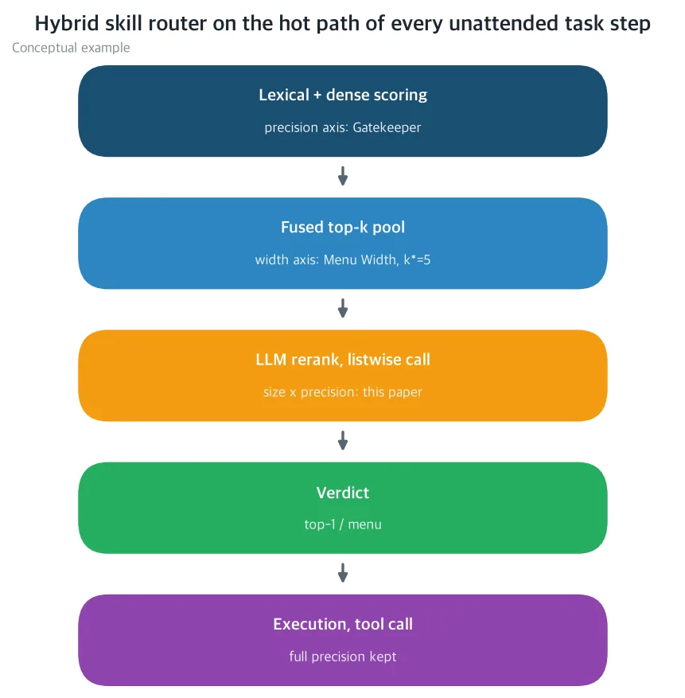
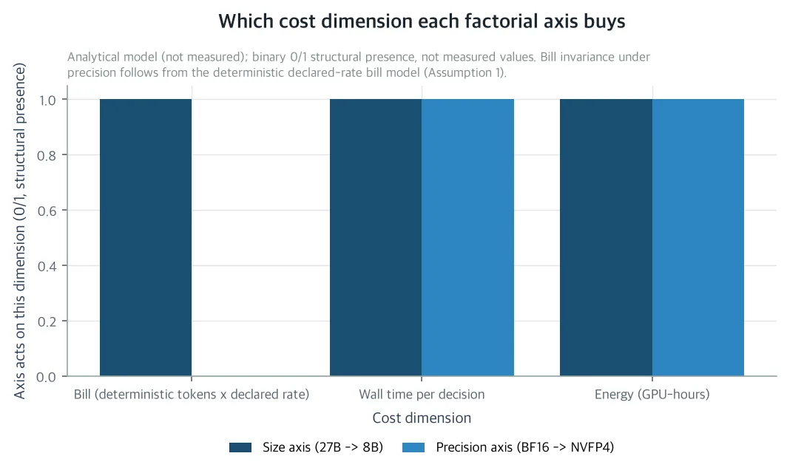
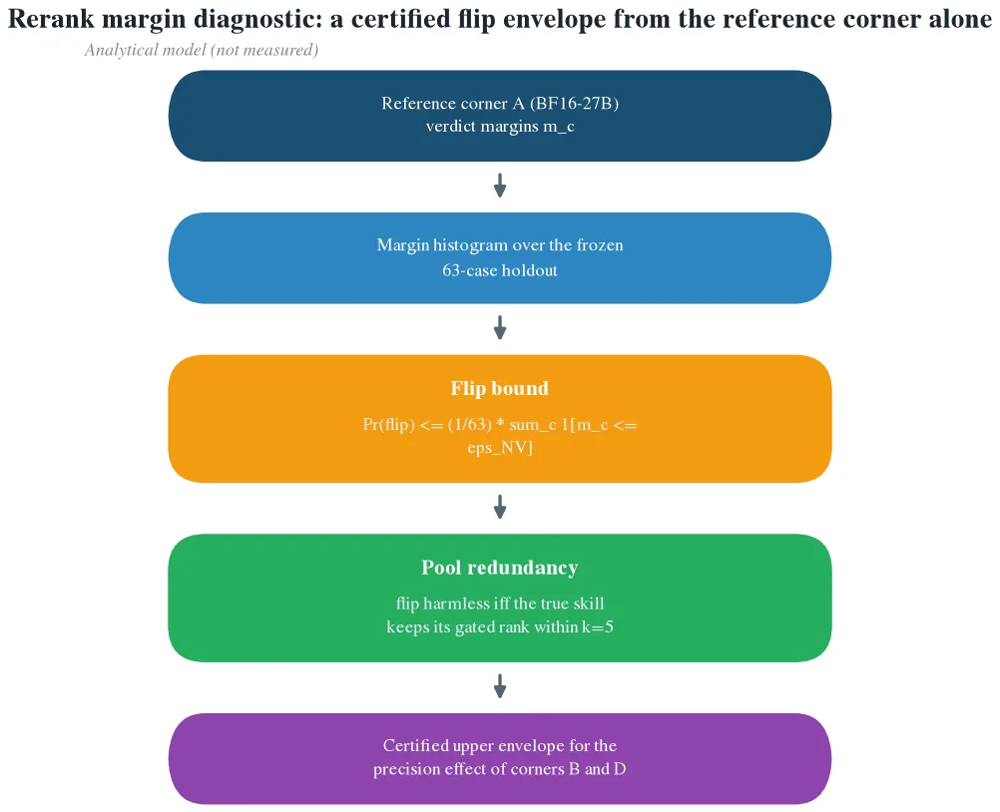

스킬 라우터의 마지막 단계를 서빙 비용의 관점에서 다시 설계하려는 분이라면 이 논문은 읽어야 하는 것이다. 무인 에이전트 하네스의 태스크 스텝은 전부 스킬 라우터를 통과하고 라우터의 마지막 단계인 LLM 리랭크가 매 결마다 지급되는 청구서다. 이 단계는 검색 윈도우 품질 고정 시점에 라우팅 전체 청구액의 71.6%를 차지하고 결정당 약 9.9초의 wall time을 쓴다. 100%의 라우팅 결정을 향해 발화하는 단계의 절감은 온 나이트 워크로드에 걸쳐 복리로 쌓이기 때문이다. ThakiCloud의 라우터 시리즈는 이 주변 축을 하나씩 정가해 둔 상태다. Gatekeeper가 스코어링 단계의 정밀도 축(임베딩 양자화)을, Apprentice Reranker가 리랭크 단계의 크기 축(27B 티처 대 8B DPO 디스틸 학생)을, Menu Width가 후보 풀의 폭 축(니가 k=5)을 정가했다. 그런데 리랭크 단계에서 크기와 정밀도를 교차한 팩토리얼, {27B, 8B} × {BF16, NVFP4}의 네 모서리는 아직 정가되지 않은 칸이다. 이 논문이 그 네 모서리를 셀프호스트드 H200에 놓고 결정론 토큰 과금에서 각 축이 어떤 비용 차원을 사는지, 비용-품질 프론티어의 니가 어디에 오는지, 그리고 팩토리얼의 새 실측이 왜 상호작용 항 κ 하나뿐인지 보여 준다.

읽기 전에 알아둘 것이 있다. 이 논문은 분석 논문이다. 본문에는 새로운 실측이 없다. 비용 쪽 수치는 선언된 셀프호스트드 과금 모델(결정 토큰 수 × 선언 단가) 위에서 도출되고 품질 쪽 구조는 Gatekeeper에서 이어받은 마진 진단이 받쳐 준다. 네 모서리의 실측, κ의 값, 그리고 그 결과로 선택되는 배포 규칙은 본문 말미에 전부 써 둔 사전등록 팩토리얼 프로토콜의 몫이다. 그 실행이 셀프호스트드 청구로 1달러 미만인 근거도 프로토콜 표에 붙어 있다.

## 쉽게 말하면

리랭크 단계를 채용 프로세스의 마지막 관문으로 생각하면 된다. 전 단계(BM25+임베딩 점수)가 2,200명 지원자를 5명으로 압축하면, 리뷰어는 그 5명의 프로필을 읽고 한 명을 지명한다. 무인 에이전트의 태스크 스텝마다 한 번씩 열리는 이 관문이 바로 리랭크다.

리뷰어는 두 레버로 바꿀 수 있다. 첫 번째 레버는 리뷰어의 두뇌 용량, 크기 축이다. 8B DPO 디스틸 학생은 27B 티처의 판정 방식을 배운 리뷰어로, 판단이 약 14.6배 빠르다. 대신 두 모델 가문의 토크나이저가 같은 프로필을 다르게 쪼갰기 때문에 청구는 오히려 약 7.1% 더 나간다. 크기는 시간을 사고 청구서에는 잔돈을 더 얹는 레버다. 두 번째 레버는 정밀도 축이며, 리뷰어가 일하는 형식을 가리킨다. NVFP4는 BF16 대비 무게가 절반인 4비트 블록 스케일 형식이고 리뷰어가 더 빨리 읽고 더 적게 에너지를 쓴다. 그런데 청구서에는 한 줄도 바뀌지 않는다. 셀프호스트드 과금은 토큰 수와 선언 단가로 계산되고 형식은 그 계산에 들어가지 않기 때문이다. 정밀도는 청구 0으로 속도와 에너지를 사온다.

두 레버가 사는 것이 다르므로, 네 모서리(27B-BF16, 27B-NVFP4, 8B-BF16, 8B-NVFP4)의 가격 대부분은 각 레버를 따로 잴 때 이미 나온 측정에서 도출된다. 마지막까지 알려지지 않은 것은 상호작용 하나다. 두 레버를 같이 당겼을 때의 품질 손해가 각 레버의 손해를 합한 것보다 더 큰 값인데, 그 값을 κ라고 부르고 논문은 반증 가능한 가설 H1을 달아 둔다. |κ|가 홀드아웃 1케이스(63케이스 기준 top-1 정확도의 약 1.6포인트) 이내이면 H1이 성립하고 8B-NVFP4 코너를 배포하는 건 산술이 된다. H1이 깨지면 두 레버가 결합해 더 크게 갉아먹는 셈이므로 프론티어의 니가 NVFP4-27B 코너로 물러난다. 어느 쪽이 나오든 네 모서리 실행이 배포 결정이다.

## 문제: 매 결마다 발화하는 가장 비싼 단계

ThakiCloud 하네스의 라우터는 2,295개(유효 스킬 약 2,200개)의 레지스트리에서 각 태스크 스텝을 하나의 스킬로 라우팅한다. BM25 어휘 점수와 임베딩 밀집 점수를 융합해 top-k 후보 풀을 만들고 그 풀 위에서 listwise LLM 호출 한 번으로 top-1 또는 메뉴라는 결정을 내린다. 밀집+희소 증거를 융합한 뒤 비싼 마지막 패스로 판정하는 이 형태는 엔터프라이즈 RAG의 표준이고 리랭크 단계가 질을 가장 비싸게 사는 자리다.

이 단계가 비용 공학의 대상이 되는 데는 청구서와 발화 빈도라는 두 가지 이유가 있다. 청구서부터 보면, 검색 윈도우 품질을 고정하면 LLM 리랭크가 라우팅 전체 청구액의 71.6%를 차지한다(Apprentice 측정, 2026-10-27). 발화 빈도에서는 에스컬레이션 티어는 불확실할 때만, 리트는 일부 결에서만 도는 조건부 단계인 반면 리랭크는 모든 결정을 향해 무조건 도는 필수 단계라는 뜻이다. 출력이 실행 경로인 탓에 오품 하나당 에이전트가 엉뚱한 스킬로 넘어가며 결정당 약 9.9초, 세션당(D=6) 약 59초가 이 단계에서 나간다. 여기서의 결당 절감은 밤이 도는 내내, 모든 무인 태스크의 모든 결정을 걸쳐 복리로 커진다.

*ThakiCloud 라우터 시리즈가 정가한 축(정밀도, 폭, 그리고 이 논문의 크기×정밀도 팩토리얼)이 각 단계에 붙어 있는 도식. 개념 예시(conceptual example)이며 실측 결과가 아니다.*

시리즈의 이전 세 연구는 각각 축 하나를 고정하고 다른 축을 움직였다. Apprentice 측정의 티처 팔은 이미 NVFP4로 서빙되고 있었으므로, 그 연구가 식별한 것은 티처의 정밀도에서 잴 크기 엣지, 사각형의 한 변에 불과하다. 학생 티어의 정밀도 변(BF16-8B, NVFP4-8B)과 두 변의 교차에서 나오는 κ는 어떤 단일축 팔에서도 보이지 않는다. 팩토리얼이 사각형을 완성하는 마지막 칸인 이유다.

## 두 축은 서로 다른 것을 산다: 팩토리얼의 분해

셀프호스트드 결정론 과금에서 팔(arm)의 리랭크 청구는 크기 축의 함수뿐이다. 프롬프트 텍스트, 가문 토크나이저, 선언된 출력 상한, 선언된 셀프호스트드 단가가 고정되면 토큰 수는 움직이지 않고 서빙 정밀도도 표본 변동도 청구 계산에 들어가지 않는다. Apprentice 청구 모델이 세운 구조적 전제이며 셀프호스트드 선언 단가 과금에 해당하는 성질이다. 정밀도에 따라 단가가 달라지는 마켓플레이스 가격에서는 이 전제가 깨지고 그 순간 팩토리얼은 계산상 실행 불가능해진다.

*결정론 셀프호스트드 과금 하에서 크기 축은 세 개의 비용 차원 전체에, 정밀도 축은 wall time과 에너지에만 작용하고 청구서는 불변인가. 분석 모델의 도식(analytical model)이며 실측 데이터가 아니다.*

그래서 네 팔의 비용-품질 프론티어는 분해된다. 청구서는 크기 프론티어가 정하고 wall time은 정밀도 프론티어가 정한다(동일 파라미터에서 NVFP4 디코딩이 BF16 디코딩보다 빠름, 단조). 두 축은 품질 밴드, 동결 홀드아웃의 top-1 정확도와 gated recall@5 쌍을 통해서만 만난다. 팩토리얼의 파레토 니는 청구서 최적 크기 × wall time 최적 정밀도(NVFP4)이고 그 코너가 밴드 안에 있어야 하는 것이다. 아니면 밴드 안 가장 가까운 코너로 온다. 그리고 팩토리얼의 새 실측은 한 항.

κ = Q(27B, BF16) + Q(8B, NVFP4) − Q(27B, NVFP4) − Q(8B, BF16)

우변의 두 메인 효과는 이미 측정되거나, 적어도 바운드가 붙어 있다. 디스틸레이션 갭은 Apprentice 측정에, 4비트 효과는 Gatekeeper의 섭동 바운드와 서빙 정밀도 델타 문헌이 받쳐 준다. 각 코너의 품질은 기준 품질에서 두 메인 효과를 빼고 κ를 더한 값이 되고 비용 좌표는 κ 없이 결정된다. 네 모서리 실행이 답해야 할 것은 한 문장뿐이다. κ는 신뢰구간 안에서 0인지, 실질적으로 마이너스인지를 가른다. κ가 실질적으로 마이너스면 복합 압축은 그 조각의 합보다 나쁘고 니는 NVFP4-27B 코너로 물러난다.

나이트 실행의 복리 산술도 여기서 붙는다. 야간 델타는 세션 전체의 결당 델타 합이며, 리랭크가 100%의 결정을 향해 발화하는 탓에 복리 인자를 정하는 것은 결정 수다. 크기 축의 결당 델타는 청구 환불과 에너지와 처리량 세 항에 모두 기여하지만 디스틸레이션 갭이 밴드를 갉아먹으면 미스루트 리스크 프리미엄을 갚는다. 정밀도 축의 몫은 청구서를 환불하지 않아 에너지와 처리량 항뿐이다. Apprentice 측정이 이 산술을 실측으로 보여 준다. 크기 축의 청구 델타는 마이너스(학생 +7.1%)였는데도 코너가 프론티어를 지배한 것은, 결정 수 규모에서 wall time 환불(약 14.6배)이 그 잔돈을 삼키기 때문이다.

## 리랭크는 양자화에 견디는가: 짧은 판정과 미리 재는 마진

연구 질문의 뒷부분은 정밀도 축을 리랭크 단계에서 쓰는 손실이 4비트 서빙이 생성적 실행에 줄 손실보다 훨씬 작은지를 묻는다. 논문의 답은 예스이며, 메커니즘을 판정 노출(decision exposure)이라고 부른다.

리랭크 판정은 고정 풀 위의 짧은 listwise 판별이다. 출력 상한이 후보 k개의 지명 몇 토큰과 구조 토큰 일부로 묶고 모델은 판단하는 내용을 생성하지 않는다. 판단 대상 풀은 이미 스코어링 단계가 정해 두었으므로, 판정의 노출, 서빙 섭동이 판정을 바꿀 수 있는 출력 위치 수는 k=5에서 O(k) 토큰 수준이다. 실행의 툴 호출은 정반대다. 수천 토큰의 긴 정형 생성이고 환경이 하류에서 검증한다. 초반의 벗어남이 다음 스텝이 보는 전이를 바꾸고 그 벗어남이 쌓여 양자화 에이전트 문헌이 이름 붙인 실패 형태로 커진다. 그래서 4비트가 리랭크 판정을 플립할 확률은 판정 마진으로 막히고 실행 궤적을 오염시킬 확률은 훨씬 긴 노출 위의 궤적 마진으로 막히며 후자가 훨씬 크다. 플립된 판정이여도 포획된다. 풀은 변하지 않고 틀린 top-1도 검색기가 신뢰했던 스킬이다. 진짜 스킬이 게이트된 집합을 떠지 않는 한 gated recall@5는 유지된다. 실행에서는 틀린 호출이 세계 상태를 바꾸므로 이 2차 보호는 대응물이 없다.

논문은 Gatekeeper의 1차 섭동 바운드를 판정 분포로 확장해 참고 코너만으로 양자화 손실의 크기를 재는 진단을 준다. 판정 마진 m_c는 리랭크 listwise 출력에서 1위와 2위 후보의 확률 질 갭이다. 판정 로짓을 ε_NV 이하로 흔드는 서빙 섭동은 m_c ≤ ε_NV인 케이스 c에서만 플립할 수 있다. 진단은 세 단계다. 참고 코너에서 63개 홀드아웃 케이스의 m_c를 기록하고 플립 확률을 마진이 4비트 에러 아래인 케이스 비율로 위에서 막으며 단일 플립 케이스는 gated recall@5에 대해 해석적으로 다시 점수 짓는다. 진짜 스킬이 k=5 풀 안에서 게이트된 순위를 유지하면 그 플립은 무해하다. 양자화 팔을 서빙할 필요가 없다. 양자화 저항 주장의 내용이 바로 이것이다. 리랭크 단계의 에러 채널은 좁으며 그 안의 플립 폭을 미리 재 볼 수 있다.

*4비트 섭동은 판정 마진 m_c가 ε_NV 이하일 때만 홀드아웃 케이스를 플립할 수 있고 단일 플립된 top-1은 gated recall@5 풀 검사에 포획된다. 분석 모델의 도식(analytical model)이며 실측 데이터가 아니다.*

코너 D(NVFP4-8B)에는 두 개의 압축 채널이 겹친다. 디스틸레이션 갭은 판정 분포의 평균 이동(학생이 체계적으로 다른 판정을 선호)이고 4비트 섭동은 같은 분포의 평균 0 지터(블록 스케일 반올림)다. 두 채널이 판정 로짓의 서로 다른 스케일에 작용하면 품질 효과는 대략 가산적이고 κ는 0 근처를 맴돈다. 논문은 가산성을 가정하지 않고 가설 H1로 명시해 둔다. 사전등록 허용 오차 τ_κ를 홀드아웃 1케이스, 63케이스 기준 top-1 정확도 약 1.6포인트로 두는 것이다. H1은 반증 가능하고 깨지면 두 채널이 리랭크 단계에서 결합해 있음을 뜻한다. 학생의 이미 좁은 판정 마진이 지터에 줄 공간이 남지 않는 경우이고 니는 NVFP4-27B 코너로 물러난다.

## 네 모서리에 붙는 세 개의 배포 규칙

논문은 플랫폼의 선택을 우선순위가 있는 세 개의 규칙으로 좁힌다.

R1, 학생 코너다. 코너 D(NVFP4-8B)가 밴드를 인증하고 H1이 성립하면 D를 배포한다. wall time 최적(최소 파라미터에서 가장 빠른 디코딩)이고 밴드 안인 유일한 코너이며 토크나이저가 정한 약 7.1% 청구 프리미엄은 결정 수 규모에서 에너지와 처리량 항이 갚아 준다.

R2, 양자화 전용 레버다. D가 밴드에 실패하고 B(NVFP4-27B)가 인증하면 B를 배포한다. 정밀도 축은 청구 변화 0으로 wall time과 에너지를 환불하고 마진 진단이 참고 코너만으로 B의 정밀도 효과를 미리 인증해 둔다. Gatekeeper의 레버를 리랭크 단계로 확장한 것이다.

R3는 보수 홀드 규칙으로, B와 D가 모두 인증에 실패하면 기준 코너 A(BF16-27B)를 유지하고 레지스트리 개편마다 마진 진단을 다시 돌린다. 밴드는 게이트된 마진으로 쿼리마다 인증되므로 이 지점에서 격리 변수는 서빙이 아니라 레지스트리 표류다.

세 규칙은 구조상 전체를 커버하고 겹치지 않는다. 각 코너의 운명은 밴드 안 여부를 결정하고 규칙 결과를 바꿀 수 있는 측정은 팩토리얼 실행 하나뿐이다. 이는 배포 정책 목표 함수를 단계 로컬로 쓴 사례이며 어떤 코너가 리랭크 단계를 서빙하는 정책을 청구와 에너지와 처리량과 가격화된 기대 미스루트 비용에서 순액으로 점수 짓는다.

## κ를 1달러 미만으로 해결하는 사전등록 프로토콜

프로토콜은 κ를 식별하고 네 코너를 전부 인증하는 가장 작은 실행으로 설계된다. 네 팔 모두 셀프호스트드 H200 클러스터의 한 개의 동결 서빙 설정에서 서빙되고 유일한 자유 변수는 (크기, 정밀도)다. 프로덕션 레지스트리 2,295개 항목은 실행 전 프리즈드 아티팩트로 감사하고 홀드아웃은 동결 63케이스 SRA 세트이며 풀 폭은 k=5로 고정하고 판정은 top-1 정확도와 gated recall@5로 점수를 매긴다. 비용 지표는 결당 결정론 청구와 p50/p95 wall time이고 품질 지표는 63케이스 홀드아웃의 κ 95% 신뢰구간과 판정 마진 히스토그램이다. 결정 규칙은 사전등록 허용 오차(약 1.6포인트)이며 R1부터 R3까지 순서대로 적용된다.

실행 비용이 1달러 미만인 근거는, Menu Width의 6팔 확인 실행이 셀프호스트드 청구 50센트 이내에 들어왔고 같은 결당 청구의 4팔은 엄격히 작기 때문이다. 단일축 시리즈는 이미 메인 효과의 대가를 지불해 뒀다. 남은 미측정 내용은 κ와 전체 사각형의 밴드 인증뿐이다. κ는 네 코너가 한 개의 동결 설정에서 도는 설계에서만 식별된다. 연구끼리 사후에 코너를 비교하면 상호작용과 설정 표류가 섞인다. 리랭크 재현 문헌이 이 대목에서 경고한다. 앵커 기반 pointwise LLM 리랭킹을 논문 텍스트에서 다시 구현한 연구는 보고된 0.66 대 0.24 nDCG@10를 찍었고 8개의 미문서화 상세가 그 갭을 채우기까지 걸렸다. 판정 품질은 문서화되지 않은 상세와 함께 움직이므로, 동결 홀드아웃 사전등록 비교가 이 단계의 서빙 변경을 가격하는 유일한 절제된 방식이다. 이 논문은 프론티어 구조, 저항 논증, 결정 규칙, 프로토콜을 제공하며 측정된 코너는 실행 완료 시점에 보고된다.

## 회사, 사회, 과학에 닿는 곳

회사가 얻는 것은, ThakiCloud 토큰 팩토리의 스킬 라우터 LLM 리랭크 단계를 NVFP4 또는 8B 디스틸 티어로 돌릴 수 있는 실측 브레이크이븐 맵이다. 네 팩토리얼 코너, 각 축이 움직이는 비용 차원, 각 코너가 만족해야 하는 품질 밴드, 나이트 런에 걸친 복리 산술까지 본문에 붙어 있다. 모든 무인 나이트 태스크의 모든 결정을 향해 발화하는 단계의 서빙 비용을 내리며 SRA top-1과 gated recall@5는 동결 홀드아웃 밴드를 유지한다. 절감이 품질 트레이드가 아니라 비용 공학이 되는 조건이 함께 명시되어 있다.

사회가 얻는 것은 단계 선택적 정밀도 예산이다. 에이전트 루프 전체에 하나의 정밀도를 고를 필요가 없다. 실행 티어는 틀린 토큰 하나가 환경을 바꾸는 자리이므로 BF16 또는 잔여 보상 NVFP4를 유지하고 라우팅 티어는 변하지 않는 풀 위의 짧은 판정이라는 에러 채널을 지니므로 로우비트 예산을 쓴다. 상시 비가동 자율성의 에너지와 달러 비용을 낮추고 셀프호스티드 소규모 팀과 온프렘 운영자에게 비가동 자동화를 손익분기 이하로 열어 준다. 이것은 압축 기법이 아닌 단계 간 예산 배분이다.

과학에는 2,200스킬 자기 진화형 하네스의 결정적 최종 단계에서 크기를 정밀도와 교차한 최초의 팩토리얼 정가가 남는다. 결정론 과금에서 네 팔 프론티어가 두 개의 1차원 프론티어와 품질 밴드의 교차로 분해된다는 불연결과, 판정 노출 논증(판별적 리랭킹이 생성적 툴 호출보다 저비트 양자화에 task-resistant 한지를 정량화), 참고 코너만으로 플립 바운드를 미리 재는 마진 진단, 그리고 단계 비용-품질 프론티어의 파레토 니를 위치시키는 1달러 미만 사전등록 프로토콜까지가 그 내용이다. 상호작용 항의 경험적 얼굴은 이미 서빙 문헌에 있다. 정밀도 그리드 실측에서 결합 최적화(15개 설정 중 9개)가 단일축보다 프론티어에 자주 닿는다는 결과이고 이 논문이 그것을 팔 레벨로 정식화한다.

## 한계: 아직 실측되지 않은 것

본문에 선언된 한계는 다섯 가지다. 하나씩 짚어 본다.

첫째, 이 논문은 분석이다. 축 불연결은 선언된 과금 모델에서 따오고 마진 진단은 참고 코너의 1차 바운드이며 B에서 D 코너의 측정이 아니다. 측정된 코너, κ, R1에서 R3 중 어떤 규칙이 선택되는지는 사전등록 실행의 결과로 온다.

둘째, 결과는 플랫폼 특정이다. 결정론 과금 전제는 셀프호스트드 선언 단가 과금에서 성립하고 정밀도 의존 단가의 마켓플레이스 가격에서는 다시 서술해야 한다.

셋째, 홀드아웃은 한 프로덕션 레지스트리의 동결 63케이스 세트 하나에 불과하다. 레지스트리 개편은 설계가 아니라 규칙 R3를 다시 여는 변수다.

넷째, 섭동 논리는 블록 스케일 4비트 서빙이 블록별 스케일로 판정 로짓 지터에 바운드를 둔다는 전제를 둔다. 지터보다 작은 마진이 히스토그램이 탐지하는 대상이며 바운드는 전제만큼만 강한 것이다.

다섯째, 풀 폭은 k=5로 고정되어 있다. 분해는 폭에 무관하고 희석 밴드 동작은 Menu Width 프론티어로 바운드된다.

논문 원문과 수반 자료는 Hugging Face 논문 상세 페이지에서 볼 수 있다. https://huggingface.co/datasets/thaki-AI/daily-paper-2026-11-12-quantized-reranker-size-precision-factorial

*본문의 비용 수치는 선언된 셀프호스트드 과금 모델(결정 토큰 수 × 선언 단가) 위의 도출값이거나, 시리즈 이전 연구에 귀속된 실측이다. 71.6%, +7.1%, 약 14.6배, 9.9초, 59초는 이전 측정의 값이고 이 논문 자체의 새 실측이 아니다. 네 모서리의 실측, κ의 값, R1에서 R3 중 선택되는 규칙은 사전등록 4-arm 실행의 결과로 보고된다. 세 장의 그림은 개념 도식과 분석 모델의 도식이며 실측 데이터가 아니다.*