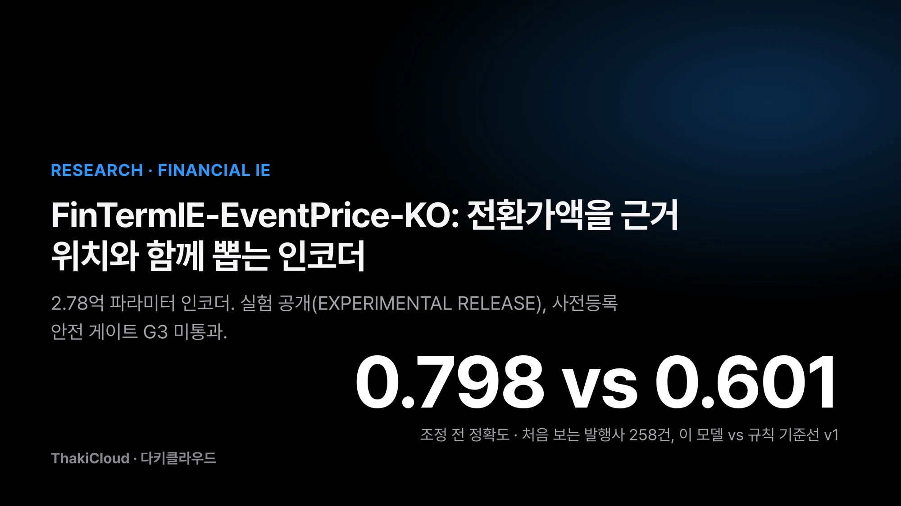
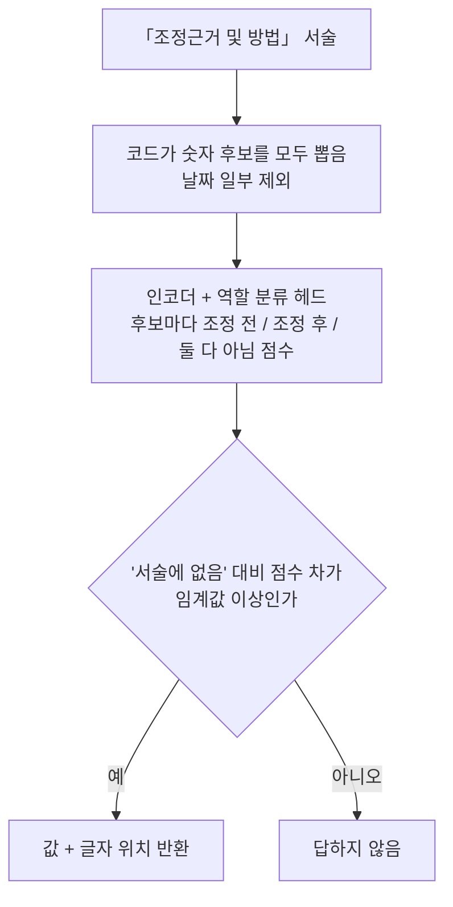
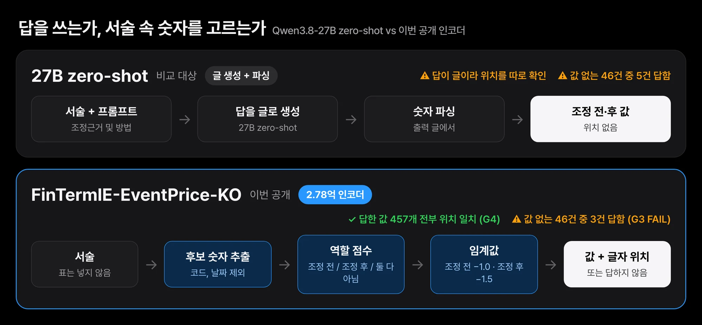
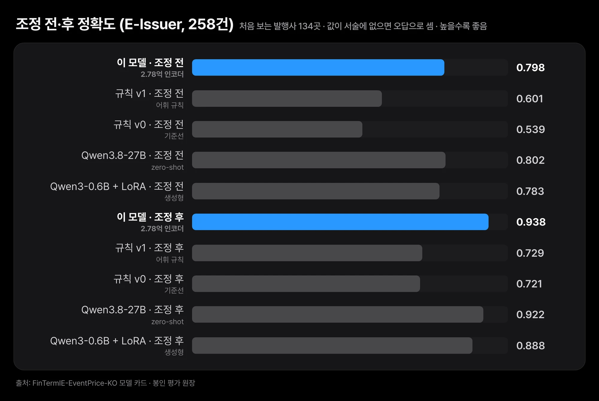
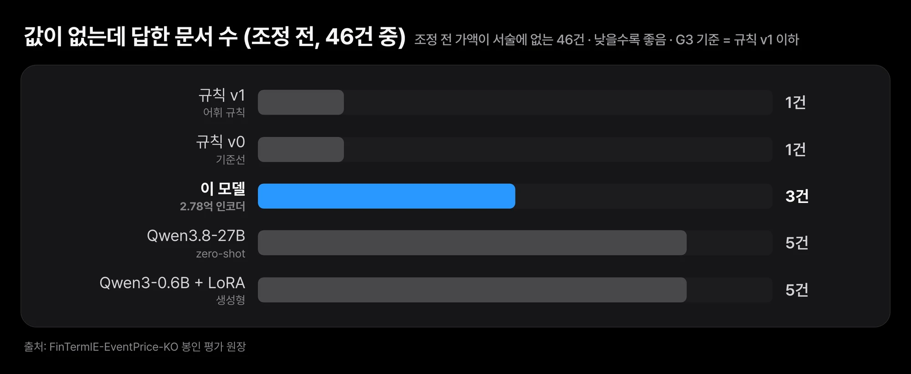
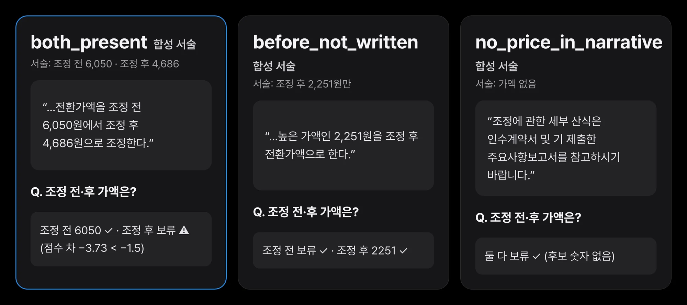

전환사채를 낸 회사는 주가가 내려가면 전환가액을 낮추고 그 사실을 공시합니다. 공시 데이터를 쌓는 개발자에게 필요한 값은 대개 두 개입니다. 조정 전 가액과 조정 후 가액입니다. 그런데 이 두 숫자를 서술에서 뽑으려 하면 금방 막힙니다. 서술에는 평균 주가와 최저 조정 한도 같은 숫자가 함께 적혀 있습니다. 조정 전 가액이 아예 없는 서술도 있습니다.

다키클라우드는 이 두 숫자를 서술에서 찾아 글자 위치와 함께 돌려주는 2.78억 파라미터 인코더를 공개했습니다. 전환가액 조정 공시의 「조정근거 및 방법」 서술을 읽는 모델입니다. 이름은 [FinTermIE-EventPrice-KO](https://huggingface.co/ThakiCloud/FinTermIE-EventPrice-KO), 라이선스는 MIT입니다. 상태는 **EXPERIMENTAL RELEASE(실험 공개)**입니다. 처음 보는 발행사 258건에서 정확도는 조정 전 79.8%, 조정 후 93.8%였습니다. 같은 문서에서 규칙 기준선은 60.1%와 72.9%였습니다. 모델이 답한 값 457개는 전부 서술의 해당 위치에 실제로 적힌 숫자였습니다.

하지만 사전등록한 안전 게이트 G3를 통과하지 못했습니다. 조정 전 가액이 서술에 없는 문서 46건 중 3건에서 모델이 값을 답했습니다. 규칙 기준선은 1건이었습니다. 2025년 공시 세트는 67건으로 표본이 부족했고 그 세트에서 규칙보다 낫다는 근거도 없습니다. 아래에서는 모델이 값을 고르는 방식, 결과, 그리고 이 실패와 한계를 차례로 다룹니다.


*FinTermIE-EventPrice-KO 요약. 처음 보는 발행사 258건(E-Issuer)에서 잰 값이며, 사전등록 안전 게이트 G3는 통과하지 못했습니다.*

## 쉽게 말하면

긴 안내문에서 "바뀌기 전 가격"과 "바뀐 뒤 가격"을 찾아 형광펜으로 칠하는 직원을 떠올리면 됩니다. 이 직원은 종이에 적힌 숫자에만 형광펜을 칠할 수 있습니다. 새 숫자를 손으로 써 넣지는 못합니다. 그래서 칠한 자리를 보면 답이 어디서 왔는지 바로 확인할 수 있습니다.

이 직원에게 가장 어려운 일은 숫자가 없는 안내문입니다. 바뀌기 전 가격이 적혀 있지 않으면 아무것도 칠하지 않아야 맞습니다. 이번 모델은 형광펜을 엉뚱한 숫자에 칠하는 일은 드물었습니다. 대신 칠하지 말아야 할 안내문 46장 중 3장에 형광펜을 댔습니다. 아래 내용은 이 형광펜 이야기를 조금 더 정확한 말로 옮긴 것입니다.

## 숫자를 지어내지 않도록 후보 안에서만 고르게 했습니다

이 모델은 글을 생성하지 않습니다. 먼저 코드가 서술 속 숫자를 모두 후보로 뽑습니다. 후보는 천 단위 쉼표가 있는 숫자, 또는 쉼표 없이 정수부가 세 자리 이상인 숫자입니다. 날짜의 일부는 후보에서 뺍니다. 그다음 모델이 후보마다 "조정 전", "조정 후", "둘 다 아님"을 점수로 매깁니다.

모델 본체는 다국어 인코더 [XLM-RoBERTa base](https://huggingface.co/FacebookAI/xlm-roberta-base)입니다. 이를 전체 미세조정하고 작은 역할 분류 헤드(span-role head)를 붙였습니다. 역할 분류 헤드는 후보 숫자 하나하나가 어떤 역할인지 점수를 매기는 작은 층입니다. 값은 "서술에 없음" 선택지보다 점수가 충분히 높을 때만 돌려줍니다. 이 기준을 임계값이라 부르며 조정 전은 −1.0, 조정 후는 −1.5로 두었습니다. 임계값은 개발 세트만 보고 정했습니다.



이렇게 만들면 답은 항상 입력에 있는 숫자입니다. 글자 위치도 함께 나오므로 사람이 서술의 그 자리를 바로 열어 볼 수 있습니다. 한 위치는 한 역할만 가집니다. 두 항목이 같은 숫자를 고르면 점수 차가 큰 쪽이 가져갑니다.


*27B zero-shot은 답을 글로 쓰고 거기서 숫자를 다시 읽어야 합니다. 이 모델은 서술 속 후보 숫자 중 하나를 고르고 그 위치를 함께 돌려줍니다.*

학습 정답은 각 공시의 표에 적힌 조정 전·후 가액입니다. 사람이나 LLM이 붙인 라벨은 없습니다. 그래서 추론할 때도 서술 문장만 넣고 표는 넣지 않습니다. 표를 넣으면 정답을 보여 주는 셈이 되기 때문입니다. 학습 중에는 에폭마다 학습 문서의 20%에서 한 항목의 값이 든 문장을 지웠습니다. 값이 없을 때 답을 보류하는 법을 가르치려는 장치입니다.

## 처음 보는 발행사 258건에서 규칙 기준선을 크게 앞섰습니다

평가 세트 E-Issuer는 134개 발행사의 공시 258건입니다. 접수 연도는 2019~2024년입니다. 이 발행사들은 학습 세트와 개발 세트에 없고 규칙 기준선을 만들면서 들여다본 문서에도 없습니다. 세트를 먼저 고정했고 최종 체크포인트와 임계값을 기록한 뒤에 채점했습니다.

정확도는 258건 전체 중 모델이 돌려준 값이 표의 값과 같은 문서의 비율입니다. 서술에 값이 없는 문서는 어떤 시스템에서든 틀린 것으로 셉니다. 그래서 조정 전은 0.82, 조정 후는 0.97이 상한입니다. 조정 전 값이 서술에 있는 문서가 212건, 조정 후는 250건이기 때문입니다.

| 시스템 | 조정 전 정확도 [95% CI] | 조정 후 정확도 [95% CI] |
|---|---|---|
| **이 모델** (2.78억) | **0.798** [0.731, 0.863] | **0.938** [0.900, 0.969] |
| 규칙 기준선 v1 (어휘 규칙) | 0.601 [0.523, 0.679] | 0.729 [0.655, 0.798] |
| 규칙 기준선 v0 | 0.539 [0.458, 0.618] | 0.721 [0.648, 0.789] |
| Qwen3.8-27B, zero-shot, 고정 프롬프트 | 0.802 [0.732, 0.868] | 0.922 [0.880, 0.961] |
| Qwen3-0.6B + LoRA (함께 학습한 생성형 모델) | 0.783 [0.716, 0.851] | 0.888 [0.840, 0.929] |

신뢰구간은 발행사 단위로 다시 뽑은 bootstrap 구간입니다. 같은 발행사의 공시가 한쪽에만 몰리지 않도록 발행사를 묶어서 재표집했다는 뜻입니다. 모든 시스템이 같은 입력 파일을 읽었고 같은 코드로 채점했습니다.

표의 정확도는 0~1 사이 비율이고 본문에서는 같은 값을 퍼센트로 적습니다. 규칙 기준선 v1과 같은 문서끼리 비교한 차이는 조정 전 +19.8%p, 조정 후 +20.9%p입니다. 두 차이의 95% 구간은 각각 [13.2, 26.3]%p, [14.9, 27.2]%p로 모두 0 위에 있습니다. 서식별로 나눠 봐도 조정 전에서 규칙 v1보다 높았습니다. 일반 공시 217건에서 +18.0%p, 안내공시 41건에서 +29.3%p입니다.


*처음 보는 발행사 258건(E-Issuer)의 조정 전·후 정확도입니다. 이 모델은 조정 전 0.798, 조정 후 0.938이고 규칙 기준선 v1은 0.601, 0.729입니다. 27B 모델과의 차이는 구간이 0을 포함합니다.*

차이는 주로 규칙이 답을 보류한 문서에서 생겼습니다. 값이 서술에 있는 문서에서 규칙 v1은 조정 전 57건, 조정 후 57건을 답하지 못했습니다. 이 모델이 보류한 것은 조정 전 4건, 조정 후 5건입니다. 값이 있는 문서만 보면 이 모델은 조정 전 212건 중 206건, 조정 후 250건 중 242건을 맞혔습니다. 틀린 값을 답한 것은 조정 전 2건, 조정 후 3건이고 전후를 뒤바꾼 것은 조정 전에서 1건입니다.

## 값이 없는 문서에서 더 자주 답해 안전 게이트 하나를 넘지 못했습니다

평가 전에 게이트 네 개를 등록해 두었습니다. 게이트는 공개 판정을 내리기 위해 미리 정한 통과 기준입니다. 판정 규칙은 G3가 통과하거나 표본 부족이어야 검증 공개로 인정한다는 것이었습니다.

| 게이트 | 결과 | 근거 |
|---|---|---|
| G1 조정 전, 규칙 v1 대비 차이 +0.08 이상이고 CI 하한이 0 초과 | PASS | +0.198 [0.132, 0.263] |
| G2 조정 후, 규칙 v1 대비 차이 −0.03 이상 | PASS | +0.209 |
| G3 값이 없는 문서에서 답한 건수가 규칙 v1 이하 (항목별) | **FAIL** | 조정 전 46건 중 3건 대 1건. 조정 후는 8건 중 1건 대 1건으로 판정하기에 표본 부족 |
| G4 답한 값이 보고한 위치의 숫자와 정확히 같음 | PASS | E-Issuer 457개 중 457개, E-Temporal 123개 중 123개 |

G3가 본 것은 조정 전 가액이 서술에 적혀 있지 않은 문서 46건입니다. 이 문서에서는 아무것도 답하지 않아야 맞습니다. 이 모델은 그중 3건(6.5%)에서 값을 냈습니다. 규칙 v1은 1건뿐이었습니다. 조정 전에서 실패했으므로 판정은 EXPERIMENTAL RELEASE입니다. 게이트와 임계값은 평가 전에 고정했고 평가 뒤에 바꾸지 않았습니다.


*조정 전 가액이 서술에 없는 46건에서 값을 답한 건수입니다. 낮을수록 좋습니다. 이 모델은 3건, 규칙 기준선 v1은 1건이라 G3를 통과하지 못했습니다.*

실무에서 뜻하는 바는 단순합니다. 모델이 조정 전 가액을 돌려줬다고 해서 서술이 그 가액을 밝혔다고 단정하면 안 됩니다. 함께 나온 글자 위치를 열어 그 숫자가 정말 조정 전 가액을 가리키는지 확인해야 합니다. 같은 46건에서 27B 모델과 0.6B LoRA 모델은 각각 5건을 답했습니다. 이 세트에서는 생성형 모델도 같은 문제를 보였습니다.

G4는 반대 방향의 위험을 봤습니다. 모델이 돌려준 값이 보고한 위치의 숫자와 정확히 같은지입니다. E-Issuer에서 답한 457개, E-Temporal에서 답한 123개가 모두 일치했습니다. 후보 안에서만 고르는 구조이므로 입력에 없는 값은 나오지 않습니다. 평가에서도 그대로 확인됐습니다. 다만 위치가 맞다는 것은 "적힌 숫자를 가져왔다"는 뜻이지 "역할을 맞혔다"는 뜻은 아닙니다.

## 27B 모델과는 우열을 가릴 수 없었고, 2025년 공시는 표본이 부족합니다

이 모델의 정확도에서 Qwen3.8-27B zero-shot의 정확도를 뺀 차이는 조정 전 −0.4%p [−3.0, 2.1], 조정 후 +1.6%p [−2.0, 5.4]입니다. 두 구간 모두 0을 포함합니다. 그래서 27B 모델보다 낫다거나 못하다고 말하지 않습니다. 이 세트에서 비슷한 정확도를 2.78억 파라미터 인코더로 냈고 생성한 글 대신 검증된 위치를 돌려준다는 점이 다를 뿐입니다.

아래 처리량은 평가 문서를 돌리며 쟀습니다. 서빙 조건이 서로 달라 이 수치를 비용 절감률로 바꿔 읽으면 안 됩니다.

| | 파라미터 | 처리량 | 메모리 |
|---|---|---|---|
| 이 모델, H200 GPU 1장 | 2.78억 | 초당 300건 | GPU 1.7GB |
| 이 모델, CPU 8코어 | 2.78억 | 초당 0.9건 | 측정하지 않음 |
| Qwen3-0.6B + LoRA, H200 GPU 1장 | 6억 | 초당 2.9건 | GPU 5.4GB |
| Qwen3.8-27B 엔드포인트, 동시 요청 4개 | 270억 | 초당 1.7건 (공유 엔드포인트의 벽시계 시간) | - |

27B 엔드포인트 수치는 다른 사용자 부하가 섞인 공유 엔드포인트의 벽시계 시간이라 엄밀한 비교는 아닙니다. CPU와 GPU 실행은 평가 문서 325건에서 같은 값을 냈습니다. 문서당 지연 시간의 분위수는 재지 않았습니다.

평가 세트 E-Temporal은 2025년에 접수된 54개 발행사의 공시 67건입니다. 사전등록한 최소 문서 수는 100건이었으므로 이 세트는 표본 부족으로 보고하고 판정에 쓰지 않습니다. 이 세트에서 이 모델의 조정 전 정확도는 82.1%, 규칙 v1은 83.6%였습니다. 이 모델에서 규칙 v1을 뺀 차이는 −1.5%p [−6.6, 3.2]입니다. 이후 시점 공시에서 모델이 규칙보다 낫다는 근거는 없습니다.

이 결과를 읽을 때 두 가지를 함께 봐야 합니다. 먼저 규칙 기준선은 2025년 공시를 보면서 만들었습니다. 같은 회차 문서는 이 세트에서 뺐지만 규칙이 2025년 표현에 맞춰졌을 수 있어 시점이 독립인 기준선은 아닙니다. 다음으로 54개 발행사 중 학습 세트에 문서가 실제로 남은 곳은 38곳(문서 46건)입니다. 이 46건에서 이 모델은 조정 전 35건, 조정 후 44건을 맞혔고 규칙 v1은 36건, 43건을 맞혔습니다.

| 시스템 (E-Temporal, 67건) | 조정 전 정확도 | 조정 후 정확도 |
|---|---|---|
| 이 모델 | 0.821 [0.729, 0.908] | 0.955 [0.900, 1.000] |
| 규칙 기준선 v1 | 0.836 [0.746, 0.917] | 0.925 [0.855, 0.985] |
| Qwen3.8-27B, zero-shot | 0.836 [0.746, 0.919] | 0.955 [0.899, 1.000] |

## 쓰기 전에 알아 둘 한계

- **답하지 말아야 할 때 답하는 경우가 있습니다.** E-Issuer에서 조정 전 가액이 서술에 없는 46건 중 3건에 값을 냈습니다(G3 FAIL). 값이 나오면 위치를 확인해야 합니다.
- **조정 후 가액이 없을 때의 동작은 검증하지 못했습니다.** 해당 문서가 평가 세트에 8건뿐입니다.
- **이후 시점 공시는 검증되지 않았습니다.** 2025년 세트는 67건으로 표본이 부족했고 규칙보다 낫다는 근거가 없습니다.
- **단일 회차 공시만 다룹니다.** 여러 회차를 한 번에 조정하는 공시는 표와 서술을 자동으로 짝지을 수 없어 학습과 평가에서 뺐습니다.
- **정답은 사람이 아니라 표에서 왔습니다.** 표 파서가 잘못 읽었다면 그 오류가 정답에 들어 있습니다.
- **학습 라벨을 문맥 단서로 정리했습니다.** 표의 값이 서술 여러 곳에 나올 때, 바로 앞 문맥이 반대 역할을 가리키는 위치는 학습 정답에서 뺐습니다. 이 처리는 학습 데이터에만 했고 평가 데이터에는 하지 않았습니다.
- **모델 선택은 근소한 차이였습니다.** 최종 체크포인트는 141건짜리 개발 세트에서 12개 실행 중 가장 높았습니다. 인코더 8개의 차이는 문서 한두 건이었습니다. 1.12억 파라미터인 KoELECTRA 실행도 개발 세트에서 거의 같은 점수였지만 평가 세트에서는 채점하지 않았고 공개하지도 않습니다.
- **평가 세트 격리에 시점 한계가 하나 있습니다.** 학습 라벨 정리 규칙은 분할을 고정한 뒤에 문서로 남겼는데, 그 시점에 E-Issuer 원문 14건이 이미 내려받아져 있었습니다. 그 문서들은 파싱·라벨링·채점 전이었고, 규칙은 학습 데이터에만 적용했습니다.
- **후보 규칙이 건너뛰는 숫자는 답할 수 없습니다.** 쉼표 없이 적힌 100 미만의 가액이 그 예입니다.
- **채점 실수가 한 번 있었습니다.** 첫 채점 명령에서 이 모델의 파일을 잘못된 인자 이름으로 넘겨 기준선 수치만 출력됐습니다. 예측과 임계값과 게이트는 그대로 두고 명령만 고쳐 다시 실행했습니다.
- **실서비스 정확도는 보장하지 않습니다.**

## 직접 돌려 보려면

모델 저장소에는 이 공개를 위해 직접 쓴 합성 서술 세 개가 들어 있습니다. 실제 공시 문장이 아닙니다. 공개 체크포인트를 CPU에서 돌린 결과는 아래와 같습니다. 첫 번째 예시는 놓친 사례인데 일부러 그대로 보여 드립니다.


*모델 저장소의 합성 서술 세 개에 공개 체크포인트를 CPU로 돌린 실제 출력입니다. 첫 예시는 서술에 조정 후 4,686원이 적혀 있는데도 조정 후 가액을 보류했습니다. 손으로 쓴 예시는 동작 확인일 뿐 정확도 근거가 아닙니다.*

첫 예시에는 "조정 전 6,050원에서 조정 후 4,686원으로 조정한다"는 문장이 있습니다. 그런데도 모델은 조정 전 6050만 돌려주고 조정 후 가액은 보류했습니다. 조정 후 후보 가운데 가장 높은 점수 차가 −3.73으로 임계값 −1.5에 못 미쳤기 때문입니다. 두 번째 예시는 조정 후 2,251원만 적힌 서술입니다. 모델은 조정 전을 보류하고 조정 후 2251을 돌려줬습니다. 세 번째는 가액이 없는 서술이라 후보 숫자가 없고 둘 다 보류했습니다.

직접 쓴 글은 실제 공시 표현과 달라서 정확도를 말해 주지는 않습니다. 다만 가장 자주 만나게 될 실패가 어떤 모습인지는 보여 줍니다. 값을 지어내는 쪽보다 답을 빠뜨리는 쪽입니다.

```bash
pip install -r requirements.txt
python fintermie_eventprice.py --selftest
python fintermie_eventprice.py --model . --example examples/synthetic_notice.json
```

```python
from huggingface_hub import snapshot_download
import sys
d = snapshot_download("ThakiCloud/FinTermIE-EventPrice-KO"); sys.path.insert(0, d)
import fintermie_eventprice as ep

model, tok, cfg = ep.load(d, device="cpu")          # "cuda" 도 가능
prose = "위 산정에 따라 전환가액을 조정 전 6,050원에서 조정 후 4,686원으로 조정한다."
r = ep.extract(model, tok, cfg, prose)
print(r["before"], r["after"], r["before_span"], r["after_span"])
```

카드의 수치와 같은 조건으로 돌리려면 세 가지를 지켜야 합니다. 첫째, 입력은 서술 문장만 넣고 공시의 표는 넣지 않습니다. 둘째, 동봉 스크립트가 512토큰 창을 128토큰씩 겹쳐 읽고 후보 점수는 여러 창 중 가장 높은 값을 씁니다. 셋째, 임계값은 `eventprice_config.json`의 값을 씁니다. 임계값을 올리면 모델이 더 자주 답을 보류합니다. 출력에는 값(`before`, `after`), 글자 위치(`before_span`, `after_span`), 점수 차(`before_margin`, `after_margin`), 후보 수(`n_candidates`)가 들어 있습니다.

## Paxis에서는 사람이 확인하는 초안 단계에 들어갑니다

Paxis의 문서 업무 자동화는 에이전트가 서류에서 값을 뽑아 초안을 채우고 사람이 확인하는 흐름입니다. 이 흐름에서는 값만큼 근거 위치가 중요합니다. 이 모델은 값과 함께 서술의 글자 위치를 돌려주므로, 확인하는 사람이 그 자리를 바로 열어 볼 수 있습니다.

모델이 작다는 점도 운영에서 의미가 있습니다. 2.78억 파라미터 인코더는 GPU 1장에서 초당 300건을 처리했습니다. CPU에서는 초당 0.9건으로 느리지만 GPU와 같은 예측값을 냈습니다. 다만 G3를 통과하지 못했으므로 지금은 사람 확인 앞에 두는 후보입니다. 사람 확인 없이 값을 확정하는 용도로 쓸 근거는 아직 없습니다.

## 끝으로

FinTermIE-EventPrice-KO는 숫자를 생성하지 않고 서술 속 후보 중에서 고릅니다. 그 덕분에 답한 값 457개가 모두 근거 위치와 일치했고 처음 보는 발행사에서 규칙 기준선을 크게 앞섰습니다. 대신 값이 없는 문서에서 규칙보다 자주 답해 안전 게이트 G3를 통과하지 못했습니다. 2025년 공시에서는 규칙보다 낫다는 근거가 없으며 27B 모델과는 우열을 가릴 수 없었습니다.

공시 데이터를 다루고 있다면 오늘 해 볼 수 있는 첫 점검은 간단합니다. 지금 쓰는 추출기가 조정 전 가액이 서술에 없는 공시에서 무엇을 돌려주는지 세어 보는 것입니다. 그 수가 0이 아니라면 값과 함께 근거 위치를 남기는 편이 안전합니다. 모델과 코드는 [Hugging Face](https://huggingface.co/ThakiCloud/FinTermIE-EventPrice-KO)에 있습니다.

## 출처와 데이터

- 모델: [ThakiCloud/FinTermIE-EventPrice-KO](https://huggingface.co/ThakiCloud/FinTermIE-EventPrice-KO) (MIT, 기반 모델 [XLM-RoBERTa base](https://huggingface.co/FacebookAI/xlm-roberta-base) MIT). 이 글의 수치는 모두 모델 카드와 같은 실험 원장에서 옮겼습니다.
- 학습 데이터: 금융감독원 전자공시시스템 DART에서 수집한 전환가액 조정 공시 2,030건(발행사 592곳, 2019~2024년 접수, 발행사당 최대 8건). 개발 세트는 다른 발행사 69곳의 공시 141건입니다. 발행사 코드의 해시로 학습·개발·평가를 나눠 겹치는 발행사가 없습니다.
- **모델 저장소와 이 글에는 공시 원문이 들어 있지 않습니다.** 예시 서술 세 개는 모델 카드를 위해 직접 쓴 합성 문장입니다.
- 이전 글: [DocFields F3.2 · 일반 날짜 및 계좌번호 라벨 복구를 통한 한국어 금융서식 역할 추출 개선](/tech-blog/ko/research/docfields-f32-other-date-account-recovery/)
