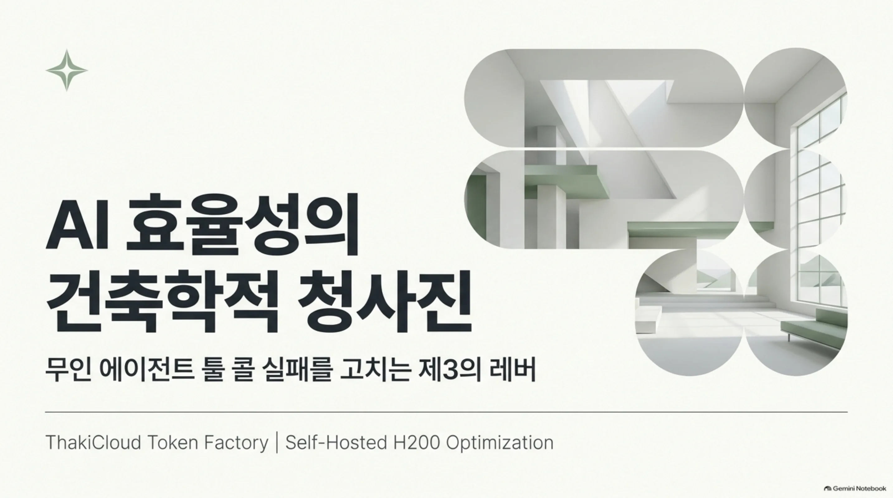
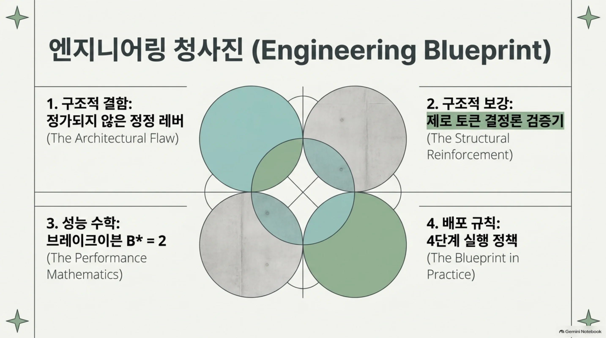
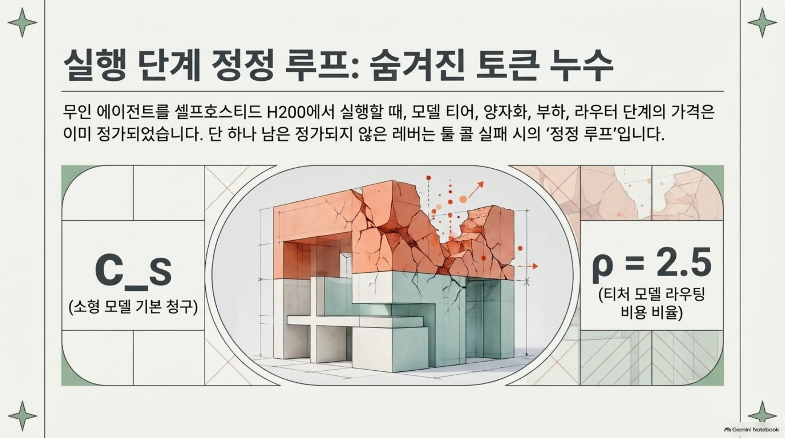
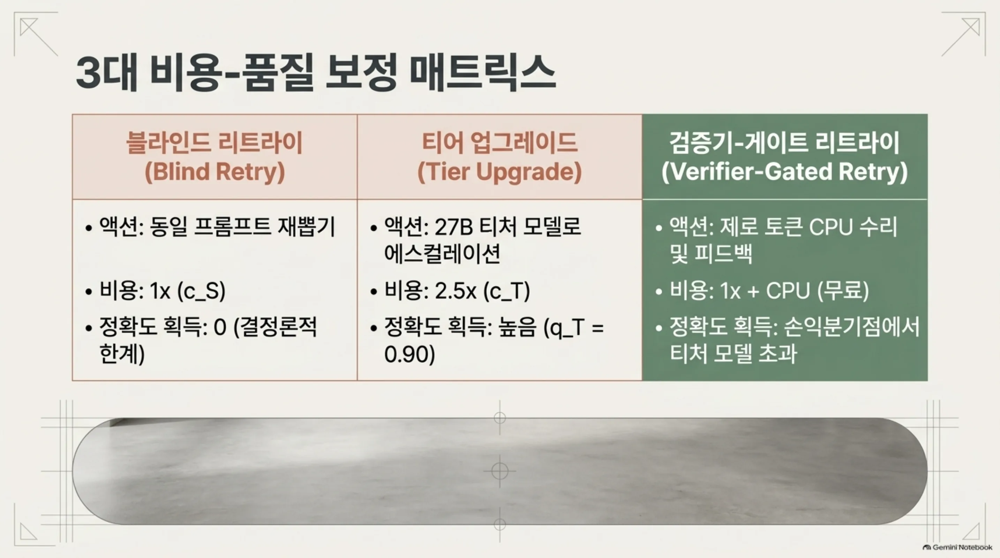

무인 에이전트를 셀프호스트드 H200에 올려 돌리고 에이전트의 툴 콜 실패를 고치는 데 드는 비용 정책을 정해야 하는 클라우드/AI 엔지니어라면 이 논문을 읽어야 합니다. 지금은 실패를 고치는 정정 레버가 두 개입니다. 둘 다 토큰으로 냅니다. 같은 프롬프트를 다시 뽑아 다수결을 취하는 리샘플링, 그리고 그 예산을 더 큰 모델로 보내는 티어 업그레드입니다. 이 논문은 제3의 레버, 검증 에러를 CPU에서 제로 토큰으로 잡아 그 에러 메시지를 리타이 프롬프트에 붙이는 결정론 검증기 게이트 리타이를 두 레버와 가격 비교합니다. 얼마만큼의 정확도를 사는지, 그리고 그 예산이 27B 티처에 보내는 것과 언제 브레이크이븐이 되는지를 닫힘 형태로 정가합니다. ThakiCloud 토큰 팩토리의 무인 에이전트 루프를 돌리는 사람에게, 실행 단계의 태스크당 청구 규칙이 됩니다.

읽기 전에 알아둘 것이 있습니다. 이 논문은 분석 논문이며 실행 단계의 새 실측을 보고하지 않습니다. 모든 프론티어 값은 명시된 가설과 선언된 셀프호스트드 단가 위에서 도출된 모델 추정치입니다. 구조적 결과, 블라인드 리타이의 평탄함과 피드백 프론티어의 모양과 브레이크이븐의 존재 조건은 가설에 의존하지 않고 성립합니다. 숫자는 논문 본문 말미의 7-arm 40-task 사전등록 프로토콜이 확인하는 몫이고, 그 실행은 선언 단가에서 최대 1.10달러, 기대 청구로는 약 0.60달러입니다.

## 쉽게 말하면

결재 사무실을 예로 들겠습니다. 회계사가 지출 결재서를 쓰고 고정 규칙을 가진 기계가 형식을 검사합니다. 기계는 토큰을 쓰지 않고 CPU에서 돌며 '날짜 항목이 ISO 형식이 아닙니다'처럼 수정 방법까지 알려 주는 에러 메시지를 냅니다. 그 메시지를 보고 다시 쓰면, 구조적 오류는 거의 전부(복구율 s1 ≈ 1) 바로잡힙니다. 다른 선택지는 두 가지입니다. 기계의 메시지를 무시하고 그대로 다시 쓰거나(블라인드 리타이), 시니어 회계사(2.5배 단가의 티처)에게 맡기거나(티어 업그레드)입니다.

이 논문의 질문은, 기계 + 다시 쓰기가 시니어를 언제 이기는가입니다. 결정론 디코딩에서 그대로 다시 쓰는 행위는 같은 문자열을 다시 뽑는 것이므로 정확도 증분은 0입니다. 기계가 사오는 것은 탐지 하나인데 그 탐지가 피드백 수리와 에스컬레이션 트리거를 가능하게 합니다. 예시 파라미터화에서 답은 이렇습니다. 시니어의 질적 엣지(0.90)를 시니어 원샷 청구의 47%(1.18 c_S)로 삽니다. 브레이크이븐은 리타이 1회, B* = 2에서 오며, 정지 천장(1 − p_s)까지의 전체 배당은 시니어 원샷 청구 하나 안으로 들어옵니다. 검증기는 순수한 선택권인 셈입니다. 플래그된 질량에서만 행사되고 오탐 페널티가 없습니다.

## 문제: 실행 단계 정정 루프, 정가되지 않은 레버

ThakiCloud의 비용-품질 시리즈는 무인 에이전트 루프를 단계별로 셀프호스트드 H200에서 정가해 왔습니다. 모델 티어 × 양자화(Precision Ladder), 부하(Concurrency Tax), 라우터의 마지막 단계(Apprentice Reranker, Menu Width)까지 가격이 매겨져 있습니다. 아직 정가되지 않은 레버가 하나 남았고 그것이 실행 단계의 정정 루프입니다. 툴 콜이 체크를 못 통과했을 때 하네스가 쓸 수 있는 선택지는 네 가지입니다. 같은 프롬프트를 다시 뽑거나, 여러 번 뽑아 다수결을 취하거나, 검증기 에러 메시지를 리타이 프롬프트에 붙이거나, 같은 예산을 더 큰 모델에 보내거나합니다.

여기서 질문은 두 개입니다. 어느 선택지가 달러당 가장 많은 정확도를 사오나요. 그리고 소형 모델의 리타이가 티처와 브레이크이븐이 되는 예산은 어디인가요. 직관적인 답은 티어 업그레드입니다. 더 큰 모델이면 더 정확하니까요. 그런데 셀프호스트드 고정 시간당 단가 과금이라는 이 시리즈의 플랫폼 전제에서는, 더 큰 모델로 보내는 것은 토큰 단가가 2.5배인 서빙으로 라우팅하는 것일 뿐입니다(ρ = c_T/c_S = 2.5, 선언된 단가 카드). 같은 돈을 소형 모델의 리타이 회수에 쓰면 이야기가 달라진다. 검증기가 에러를 잡아 그 메시지를 리타이 프롬프트에 넣는 순간, 리타이는 재뽑기가 아니라 수정이 되기 때문이다.

블라인드 리타이의 약함은 이미 외부 증거로 묶여 있다. 리타이 인식 모델 라우팅 연구는 실패 후 같은 프롬프트 리타이가 첫 시도보다 17~53%의 빈도로만 성공한다고 보고한다. 다시 뽑는 것만으로는 실패가 씻기지 않는다는 뜻이고 논문의 스티키 페일 가정(s_blind ≤ q0)은 이 범위 안에서 세운다. 반대로 검증 에러를 조건으로 삼으면 구조적 오류는 메시지가 수정을 규정하는 형태이므로 그 상한을 벗어날 수 있다. 이 논문은 그 차이를 가격으로 쓴다.

두 과거 결과의 명시적 업그레이드이기도 하다. Self-Consistency가 자유 형식 답안 위 다수결을 제안했다면 이 논문은 다수결을 구조화된 에이전틱 툴 콜로 끌어올린다. 투표 대상이 코드로 채점되는 정확 일치 툴 콜 문자열이고 판정이 제로 토큰 결정론 검증기이다. 이전 논문 Validator's Dividend가 무료 검증기 위에서 게이트 대 합의의 가격을 매긴 데서 리타이 정책은 블라인드(플래그는 뽑기를 버릴 뿐 모델에 아무것도 알려 주지 않음)였고 에스컬레이션 팔(같은 예산을 27B 티처에 쓰는 것)은 열려 있었다. 이 논문은 피드백 팔을 가격 매기고 에스컬레이션 팔을 브레이크이븐 B*로 닫는다.

## 설계: 두 티어, 세 태스크 가족, 일곱 팔

플랫폼은 시리즈 전제를 그대로 쓴다. 셀프호스트드 H200에서 하나 GPU가 하나 (모델, 정밀도) 점을 고정 시간당 단가로 서빙한다. 소형 티어는 Qwen3-4B(BF16, 시드 고정 그리디 디코딩)이고 티처 티어는 27B NVFP4 프로덕션 체크포인트이다. 티처는 이 시리즈의 800-case BFCL 스타일 스위트에서 89.6% 앵커를 찍은 체크포인트이며 모델에서는 q_T = 0.90으로 반올림한다. 평가는 judge-free이다. 결정론 BFCL 스타일 체크가 배포 게이트 g = 0.85에서만 정책을 인증한다.

태스크는 정확 지상 평면이 있는 싱글샷 결정론 툴 콜이고 전부 무료로 검증 가능한 세 가족이다. F1은 AST 화이트리스트를 지키는 산술 계산, F2는 엄밀한 ISO 날짜 스케줄링, F3은 정확 출력 리스트 필터링이다. 각 가족은 두 단계의 에러 분류를 가진다. 구조적 에러는 정적 체크가 수정 가능한 메시지와 함께 잡으며 메시지가 수정을 규정한다. 의미적 에러는 연산자 또는 순서가 틀린 것, 날짜가 하나 어긋난 것, 술어가 잘못된 것이며, 체크는 일부만 잡는다.

검증기 V는 두 단계이다. V_static은 스키마 + AST + 문법 검사이고 제로 토큰에 CPU 사이드이며 구조적 에러를 정보적으로 탐지하고 범위 및 파싱 체크로 의미적 에러의 일부까지 잡는다. V_oracle은 지상 평면 인식 기구로, 상한 장치이며 배포되지 않는다.

결과 분해(A1)에서 소형 모델의 뽑기는 세 갈래이다. q0로 맞고 p_d로 틀리지만 탐지 가능하고 p_s로 조용히 틀린다. δ = p_d/(1 − q0)가 정적 탐지율이다. 에러 분류(A2)에서 탐지 가능한 질량 p_d의 σ 분량은 구조적/정보적이며 복구율 s1 ≈ 1이고, 나머지 1 − σ는 의미적이며 복구율 s2 = q0 + φ이다. φ가 피드백 헤드룸으로, 관측된 에러를 조건으로 삼았을 때 기본 성공률을 넘는 것뿐이다. 클래스 안정성(A3)에서 각 태스크는 고정 잠김 클래스를 가지며, 클래스 안의 리페어 뽑기는 피드백 히스토리에 조건부 독립이다.

과금(A4, A5)도 시리즈 전제이다. 결정론 디코딩에서 같은 프롬프트 재뽑기는 같은 문자열이므로 s_blind = 0이다. 피드백 팔의 리타이 프롬프트는 수정, 즉 검증기 메시지 추가되므로 그 뽑기는 새 것이다. 뽑기당 청구는 소형 c_S, 티처 c_T이고 선언된 단가 카드에서 ρ = 2.5이다. 팔은 고정 태스크당 예산에서 일곱 개이다. A0 원샷(소형), A1 k개 스토케이스틱 뽑기의 다수결, A2 게이트 블라인드 리타이(결정론, 평탄함 컨트롤), A2s 게이트 블라인드 리타이(스토케이스틱), A3 게이트 피드백 리타이, A4 티처 원샷, A5 티처 게이트(민감도 팔)이다.

## 블라인드 게이트 리타이는 정확도를 0포인트밖에 못 산다

P1(블라인드 평탄함)이 이 논문의 가장 예리한 결과이다. 결정론 디코딩에서 블라인드 게이트 리타이는 어떤 예산 B ≥ 1에서도 원샷보다 정확도를 정확히 0 더해 준다. 같은 프롬프트를 다시 뽑으면 같은 문자열이 나오고 게이트는 플래그된 뽑기를 버릴 뿐이다. 버려도 되는 것은 원래 틀린 것이므로, 버려도 정확도는 안 오른다. 게이트의 유일한 기여는 제로 토큰 탐지이며 그것이 A3의 수리와 에스컬레이션 트리거를 가능하게 한다. 선택과 해결을 나누면 A2는 순수한 선택이고 A3는 선택 + 해결이다.

예시 파라미터화에서 A2와 A3가 B = 2에서 같은 청구 1.18 c_S를 낸다. A3는 16.8포인트의 품질을 사고 A2는 아무것도 못 산다. P1의 평탄함이 달러로 쓰인 것이다. 스티키 페일 상한은 문헌의 17~53% 리타이 성공률과 일치하고, 피드백만 그 상한을 넘을 수 있다. 정보적 분량 σ에서 구조적 에러는 재뽑기가 아니라 수정이 되기 때문이다.

## 피드백 프론티어: 다수결 크로스오버가 아래로 온다

피드백 프론티어(T1)는 닫힘 형태이다. Q_B^A3 = q0 + p_d R_{B-1}이고 R_{B-1}은 B − 1회 리페어 뽑기 중 적어도 하나가 맞을 확률로, σ와 1 − σ 분량에 s1과 s2로 가중된다. Q_1 = q0이고 B에 대해 증가하며 극한은 정지 천장(static ceiling) 1 − p_s이다. 블라인드 팔의 침묵 바닥 1 − p_s/(1 − p_d)보다 p_s p_d/(1 − p_d)만큼, 파라미터화에서 0.44포인트만큼 위에 있다. 이유는 게이트의 정보가 i.i.d. 뽑기 사이에서 고를 뿐 아니라, 탐지된 질량을 수리하기 때문입니다. 남은 침묵 p_s는 어떤 정적 검증기에서도 잡히지 않고, 오라클 티어만 천장을 올립니다(침묵 질량의 90% 플래그 가정).

*예시 파라미터화 하에서 블라인드 게이트 팔은 원샷 수준에서 평탄하게 유지되고 다수결은 느리게 오르며 피드백 게이트 리타이는 B = 2 근처에서 티처 원샷 품질을 교차하고 정지 천장 1 − p_s에 접근합니다. 분석 모델 추정이며 실측이 아닙니다.*

다수결과의 비교(P2)는 같은 예산에서 갑니다. B = k일 때 A3가 A1을 넘는 조건은 p_d ≥ p_d^{*,fb}(k) = (Q_k^{A1} − q0)/R_{k−1}이고 피드백 크로스오버는 이전 연구의 블라인드 크로스오버보다 아래로 옵니다. 파라미터화에서 p_d^{*,fb}(3) = 0.0969이고 블라인드 크로스오버는 0.1071입니다. φ > 0이거나 σ > 0이면 A3는 모든 예산에서 A1을 약 우세(weakly dominates)하고 탐지 가능한 질량 위에서는 강 우세입니다. 차이가 품질에만 있는 것도 아닙니다. 다수결 k = 3의 신뢰적으로 틀린 합의(confidently wrong consensus) 질량은 약 3.6포인트인데 A3의 알려진 틀린 발화(known-wrong emission)는 약 0.16포인트뿐입니다. 22배의 대비입니다. 달러당 정확도는 A3가 0.1425~0.1508, A1이 0.0284~0.0320, A4가 0.0400입니다.

정적 검증기는 제로 토큰(c_V = 0)이므로 φ > 0이거나 σ > 0이면 A3는 B ≥ 2에서 A2를 강 우세합니다(부정리, corollary). 검증기는 순수한 선택권인 셈입니다. 제로 비용의 수리 클레임을 탐지된 질량 p_d에서만 행사하고 맞는 질량 q0에서는 절대 행사하지 않는 것입니다. 오탐 페널티가 없으며, 침묵 질량은 놓친 것이지 오인(falsely flagged)한 것이 아닙니다. 에너지 장부에서도 리타이 뽑기마다 실제 디바이스 시간이 들고 태스크당 최대 B회 뽑기의 버스트는 부하 축을 움직입니다. 다만 B* = 2에서 버스트는 p_d 질량에 최대 1회 뽑기를 더할 뿐이라 손익분기점에서 부하 보정은 2차(경부하 regime)인 것입니다.

## 브레이크이븐 B*: 티처의 질적 엣지를 티처 청구의 47%로 살 때

스펜드 패리티 브레이크이븐(T2)은 이 논문의 시스템 레벨 결과라고 할 수 있습니다. B*는 소형 모델의 피드백 게이트 품질이 티처의 q_T에 도달하면서 청구가 티처 원샷(c_T)을 넘지 않는 가장 작은 예산입니다. 예시 파라미터화에서 티처의 질적 엣지 D = q_T − q0 = 0.10이고 구조적 질량 p_d σ = 0.108입니다. D ≤ p_d σ이므로 B_q = 2이고 D ≤ D_c = 0.1116(첫 리페어 배당)이므로 regime (i)에 있습니다. 교차는 첫 피드백 리타이에서 오며 배당은 피드백(검증기 메시지) 귀속입니다. 재뽑기 행운이 아닙니다.

Q_2 = 0.9681로 티처 원샷의 0.90을 넘어서고 청구는 1.18 c_S로 티처 원샷 청구(2.50 c_S)의 47%입니다. 정지 천장 1 − p_s까지의 전체 배당도 티처 원샷 청구 하나 안에 들어옵니다(E_∞ = 1.194 < ρ = 2.5). 민감도는 세 갈래입니다. 교차가 로그 분기(log branch)로 옮겨가며 천장에 닿기 전까지 B*는 2에서 3, 4로 움직입니다(σ = 0.40에서 D_c = 0.0774로 떨어져 첫 리타이 귀속이 깨져도 B* = 2, D = 0.17이면 B* = 3). 더 싼 티처(ρ = 1.5)는 게이트를 되살리지 못한다. 공유 regime에서 ρ는 실현 가능성 조건에만 들어오기 때문이다. 그리고 D ≥ p_d, 즉 티처의 엣지가 탐지 가능한 질량 전체를 넘으면 q_T ≥ 1 − p_s이고 정적 천장이 묶여 어떤 소형 모델 정책도 티처에 도달하지 못한다. 그때는 돈을 티처에 보내는 것이 정답이고(앱렌터의 에스컬레이션 조건이 지배), regime (iii)인 셈이다.

*블라인드 게이트 팔은 원샷보다 높은 청구를 내고 품질 증분이 0인 반면, 피드백 게이트 리타이와 블렌디드 정책은 티처 원샷을 품질로 넘어서고 청구는 티처의 일부분이다. 분석 모델 추정이며 실측이 아닙니다.*

티처를 같은 무료 검증기로 게이트링하는 A5 팔도 민감도 팔입니다. B_T = 2에서 0.9720을 2.70 c_S에 주며 A3@B*에 비용에서 지배당하고 B = 5에서는 두 차원 모두에서 지배당하는 것이다.

## 배포 규칙: 실행 단계 비용 정책

태스크당 정책은 게이트 g = 0.85, B* = 2에서 네 줄입니다. 소형 티어에서 d1를 뽑고 V_static으로 검사합니다. 통과하면 d1를 냅니다. 플래그(p_d 질량)되면 에러 메시지를 프롬프트에 붙이고 d2를 뽑아 다시 검사하기도 합니다. 통과하면 d2를 냅니다. 플래그되면 잔여 m_{B*} = 1.19%이고 티처에 에스컬레이션합니다. 한 번 뽑고 같은 무료 검증기가 게이트합니다.

청구 항등식은 bill* = c_S E_{B*} + m_{B*} c_T이고 파라미터화에서 1.21 c_S입니다. 품질은 Q* = 0.9788인가. 티처 전용이 2.50 c_S에 0.90이고 원샷이 1.00 c_S에 0.80인데 비해, 품질은 티처를 넘고 청구는 티처의 절반 미만입니다. 배포 규칙은 이것입니다. 게이트 g = 0.85, 피드백 리타이를 B*까지, 에스컬레이션을 잔여에서만.

이 레버는 시리즈의 가격 매겨진 축과 구성됩니다. (모델 × 정밀도), 부하, 라우터 단계, 그리고 이 논문의 B까지. 에스컬레이션 트리거는 태스크의 1.19%인 드문 루트로, 섀도우 프리필 패턴이 콜드 스타트 페널티 없이 서빙합니다.

## 사전등록 프로토콜: 최대 1.10달러로 확인

프로토콜은 고정 시드 40-task 결정론 스위트입니다. 14개 산술, 13개 날짜, 13개 필터링. 정확 지상 평면과 judge-free BFCL 스타일 코드 체크, 배포 게이트 g = 0.85. 모델은 Qwen3-4B(BF16, 시드 그리디) 대 27B NVFP4이고 선언된 단가 카드(ρ = 2.5)에서 일곱 팔을 돌리는 것이다.

P1의 반증은 A2s 팔이 맡습니다. 결정론 A2는 구성상 s_blind = 0이라 블라인드 평탄함의 반증 테스트는 스토케이스틱 A2s의 same-prompt 재뽑기에서 갑니다. 추정량은 스티키 페일 비율 s_blind/q0이고, B가 커짐에 따라 Q_B^{A2s}가 교환 가능 블라인드 형태를 아이템 플립 노이즈 바닥 안에서 추적하지 않으면 P1이 깨지고 뽑기가 부정 상관이라는 뜻입니다. A1은 태스크당 단일 k = 5로 핀되고 표의 k = 3 행은 분석적 매치드 예산 참고일 뿐 프로토콜 팔이 아닙니다.

추정량은 일곱 개. 정적 대 오라클 탐지율(δ, η_ox), 정보적 분량 σ, 피드백 헤드룸 φ, A2s 재뽑기의 스티키 페일 비율, 오탐율(결정론 체커는 맞는 뽑기를 플래그할 수 없어 0 가정, 프로토콜이 인증), 실측 브레이크이븐 B*, 버스트 부하 보정 H. 반증 규칙 P1~P6(블라인드 평탄함, 피드백 헤드룸, 스펜드 패리티, 탐지율 표류, 피드백 누적 붕괴, 버스트 페널티)과 강건성 R1~R4(고정 시드 3개, 가족 구성, 소형 티어 양자화 BF16 대 NVFP4, 서빙 부하)가 함께 써 놓습니다.

비용은 선언된 상한이기 때문. 태스크당 최악 27.5 c_S(소형 20 뽑기 + 티처 3 뽑기를 ρ = 2.5로 환산)이고 선언 c_S ≤ 1 mUSD/뽑기에서 40태스크 전체가 최대 1.10달러입니다. 기대 청구 15.33 c_S/태스크 기준 약 0.60달러인 셈. 프로토콜은 이 논문에서 사전등록되었고 이 논문에서는 실행되지 않았습니다.

## 회사, 사회, 과학에 닿는 곳

회사가 얻는 것은 ThakiCloud 토큰 팩토리의 실행 단계 비용 정책입니다. 태스크당 청구가 티처 전용 2.50 c_S에서 블렌디드 정책 1.21 c_S로, 품질은 0.9788로 티처 원샷(0.90)을 넘습니다. 브레이크이븐 B*가 닫힘 형태로 있어, 탐지율 δ나 정보적 분량 σ, 헤드룸 φ가 바뀌면 B*를 다시 계산합니다. 고정 품질에서 무인 에이전트 루프의 태스크당 비용을 내리는 구체적 비용 규칙입니다.

사회가 얻는 것은 거의 무료인 정확도 레버입니다. LLM judge 호출을 로컬 결정론 검증으로 바꾸면 정확도 상승이 제로 토큰 CPU 검사로 지불됩니다. 신뢰할 수 있는 무인 자동화의 비용과 에너지 바닥이 내려가, judge를 사기 어려운 소규모 셀프호스티드 배포도 그 바닥 아래로 올 수 있습니다.

과학에는 구조화된 에이전틱 툴 콜의 검증기 게이트 리타이에 대한 첫 정식 characterization가 남습니다. 정적 탐지율, 피드백 헤드룸, 고정 예산에서 무료 검증이 다수결과 티어 업그레드를 지배하는 위치까지. Self-Consistency를 무료 결정론 검증기 아래 구조화된 툴 콜로 끌어올리고 Validator's Dividend의 블라인드 리타이를 피드백 팔로, 열린 에스컬레이션 팔을 B*로 닫는 명시적 업그레이드입니다. 게이트는 고르고 피드백은 푼다는 분리(selection vs solving)와, 검증 피드백을 무게로 증류하는 오프라인 dual(σ와 φ를 체크포인트로 옮기면 B*가 다시 풀림)도 포함합니다.

## 한계: 아직 측정되지 않은 것

한계도 명시합니다.

첫째, 이 논문은 분석입니다. 모든 프론티어 값은 A1~A5 아래 닫힘 형태 도출이거나, 명시된 가정(표의 파라미터화), 선언된 단가, 인용 소수로 온 숫자입니다. δ, σ, φ, B*의 값은 사전등록 프로토콜이 확인하는 몫입니다.

둘째, 리타이는 i.i.d.가 아닐 수 있습니다. 누적 피드백이 리타이 사이에서 에러 타입을 이동시킬 수 있고(문헌 보고), 그때 클래스 안정성 형태는 프론티어를 과장합니다. 폴백은 fresh re-partitioning 형태로, B = 1과 무한에서 두 형태가 일치하고 파라미터화에서는 B = 3에서 0.08포인트 차이로 0에 수렴합니다. P5가 붕괴를 잡습니다.

셋째, 검증기에는 맹점이 있습니다. σ 분리는 구조 대 의미 갭의 툴 콜 쌍둥이입니다. 정적 검증기는 구조에서는 강하고 의미에서는 약하며 침묵 바닥 1 − p_s는 그 갭의 가격입니다. 오라클 티어(η_ox = 0.90 가정)만 올립니다.

넷째, 부하 상호작용은 1차 이상입니다. 청구 항등식은 헤드룸 가격 H에 대해 1차이고 안전 천장 근처에서 버스트 페널티는 2차가 아닙니다. P6와 R4가 그 구간을 바운딩합니다.

다섯째, 다수결 벤치마크는 최후의 말이 아닙니다. 다수결이 소형 모델을 해치는 조건과 예산 인식 거절이 문헌에 있고 A1은 둘이 정제하는 i.i.d. 벤치마크입니다. P2의 크로스오버가 A3가 A1을 대체하는 결정 규칙인 셈.

여섯째, 태스크 가족은 싱글샷입니다. 멀티턴 함수 콜에서는 상태와 검증기 메시지가 턀 사이로 확장되고 스펜드 패리티 항등식은 턀별 p_d로 다시 풀립니다.

논문 원문과 수반 자료는 Hugging Face 논문 상세 페이지에서 볼 수 있습니다. https://huggingface.co/datasets/thaki-AI/daily-paper-2026-11-13-verifier-gated-retry-cost-quality-frontier

*본문의 비용 수치는 선언된 셀프호스트드 과금 모델(기대 뽑기 수 × 선언 공칭 단가) 위의 닫힘 형태 도출이거나 시리즈 이전 연구에 귀속된 실측입니다. q_T = 0.90은 시리즈의 89.6% 앵커의 반올림 값이고 17~53% 스티키 페일 범위는 인용 문헌의 값입니다. 두 장의 그림의 프론티어 값은 명시된 가정 하의 모델 추정치이며 실측이 아닙니다. 7-arm 40-task 프로토콜은 논문에서 사전등록되었고 이 논문에서는 실행되지 않았으며, δ, σ, φ, B*의 실측 값은 실행 완료 시점에 보고됩니다.*
