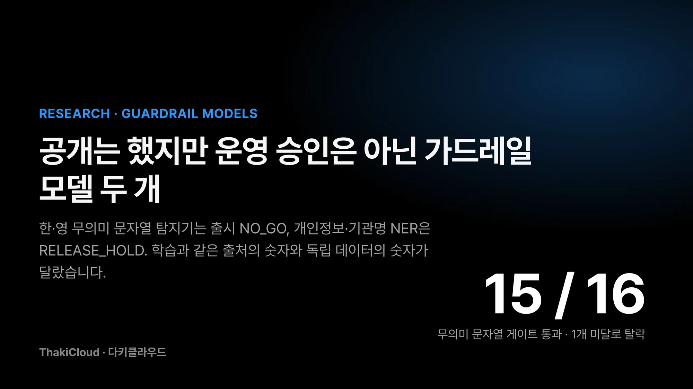
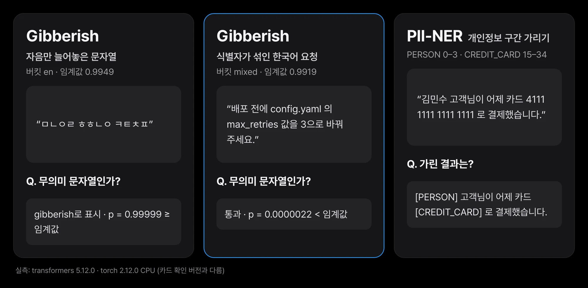
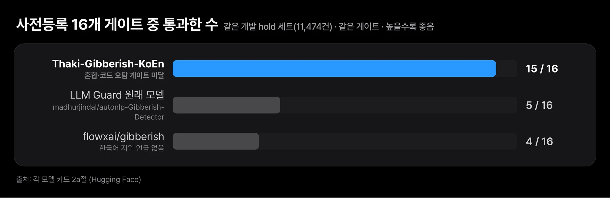
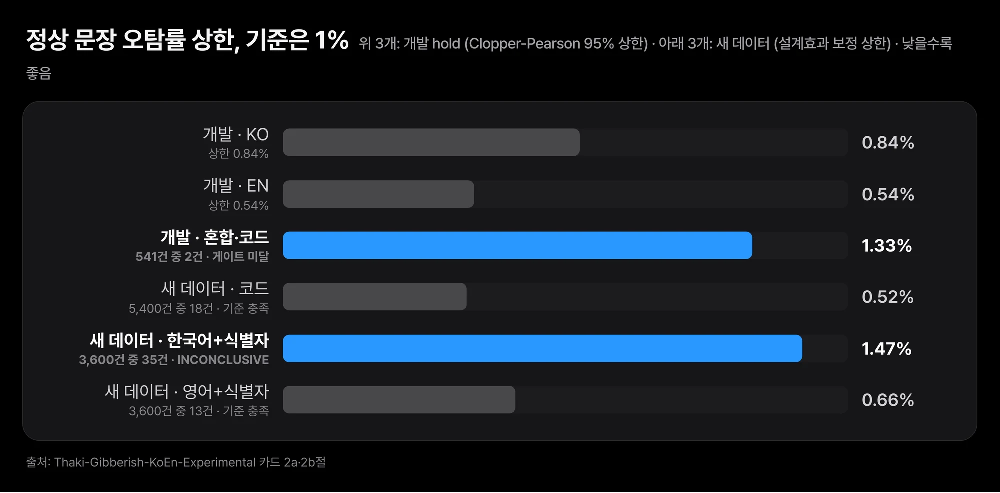
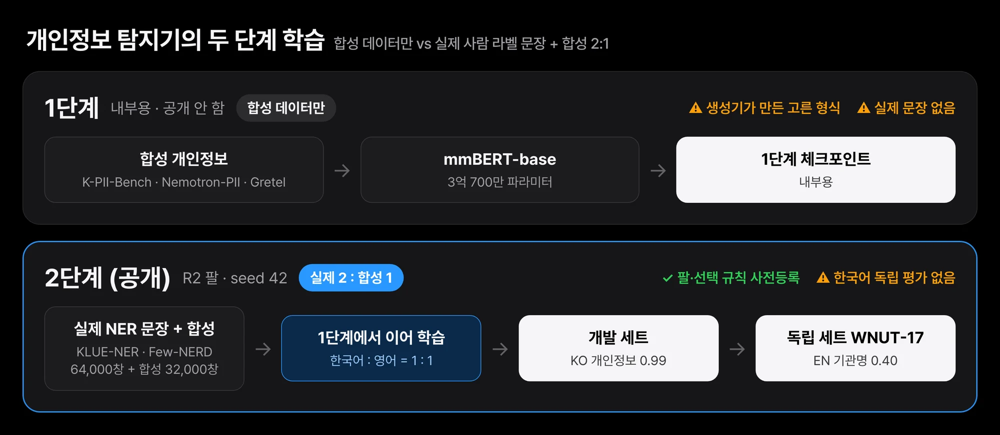
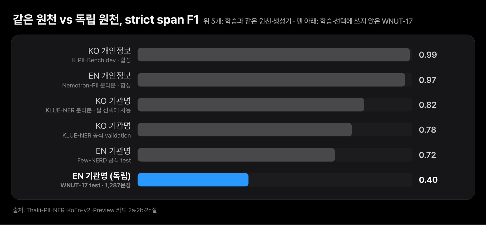

에이전트 앞에 거름망을 두면 두 가지 실수가 생깁니다. 정상 사용자의 질문을 막는 실수와, 막아야 할 입력을 흘려보내는 실수입니다. 키보드를 아무렇게나 두드린 문자열은 걸러야 하지만, 한국어 문장에 변수 이름 하나가 섞인 개발자의 질문까지 막으면 안 됩니다. 고객 이름과 카드 번호는 가려야 하지만, 가리는 모델이 처음 보는 말투의 글에서 얼마나 놓치는지는 잘 드러나지 않습니다.

다키클라우드는 이런 거름망 자리에 둘 후보 모델 두 개를 공개했습니다. 한국어와 영어의 무의미한 문자열을 거르는 모델과, 개인정보와 기관명이 든 구간을 찾는 모델입니다. 이름은 각각 [Thaki-Gibberish-KoEn-Experimental](https://huggingface.co/ThakiCloud/Thaki-Gibberish-KoEn-Experimental)과 [Thaki-PII-NER-KoEn-v2-Preview](https://huggingface.co/ThakiCloud/Thaki-PII-NER-KoEn-v2-Preview)이며 Hugging Face에 있습니다. **두 모델 모두 공개는 했지만 운영용 승인은 받지 못했습니다.** 무의미 문자열 탐지기의 출시 판정은 NO_GO이고 개인정보 탐지기는 RELEASE_HOLD입니다. 다른 사람이 들여다보고 재현할 수 있도록 연구 열람용으로 올린 것입니다.

두 모델이 보여 준 공통점은 하나입니다. 학습 데이터와 같은 출처에서 잰 숫자는 높았고 학습에 쓰지 않은 데이터에서 잰 숫자는 그보다 낮거나 판정을 내릴 수 없었습니다. 무의미 문자열 탐지기는 개발 세트에서 16개 게이트 중 15개를 통과했지만 한 개 때문에 떨어졌습니다. 개인정보 탐지기는 개발 세트의 한국어 개인정보 F1이 0.99였고 독립 영어 세트의 기관명 F1은 0.40이었습니다. 이 글은 두 숫자 사이의 거리와, 그 거리 때문에 판정을 보류한 이유를 다룹니다.


*두 실험 모델 요약. 무의미 문자열 탐지기는 16개 게이트 중 15개를 통과하고 출시 NO_GO, 개인정보 NER은 RELEASE_HOLD입니다.*

## 쉽게 말하면

한 문제집으로 공부한 학생을 떠올리면 됩니다. 같은 문제집의 뒷부분에서 시험을 보면 점수가 잘 나옵니다. 문제 유형과 말투가 익숙하기 때문입니다. 다른 출판사 문제집을 풀면 점수가 떨어지는 경우가 많습니다. 그래서 진짜 실력을 보려면 처음 보는 문제집으로 시험을 봐야 합니다.

이번 두 모델도 같습니다. 학습과 같은 문제집에서 본 시험은 점수가 높았습니다. 처음 보는 문제집에서는 무의미 문자열 탐지기가 한 유형에서 기준선 바로 위를 맴돌았고 개인정보 탐지기는 영어 기관명 점수가 크게 낮았습니다. 한국어로 된 처음 보는 문제집은 아예 구하지 못했습니다. 아래 내용은 이 문제집 이야기를 숫자로 옮긴 것입니다.

## 두 모델은 에이전트 입력과 출력을 거르는 스캐너 후보입니다

[LLM Guard](https://github.com/protectai/llm-guard)는 LLM에 들어가는 입력과 나오는 출력을 스캐너 여러 개로 검사하는 오픈소스 도구입니다. 스캐너 하나는 한 가지 위험만 봅니다. 무의미 문자열 스캐너(Gibberish)는 키보드 난타, 무작위 음절, 단어 샐러드, 단어 섞기, 반복 같은 입력을 잡습니다. 개인정보 스캐너는 이름·전화번호·카드 번호 같은 구간을 찾아 가립니다. 두 모델은 이 스캐너 뒤에 둘 한국어·영어 모델 후보로 만들었습니다.

무의미 문자열 탐지기는 다국어 인코더 mmBERT-small을 전체 미세조정한 이진 분류기입니다. 파라미터는 약 1.4억 개입니다. 텍스트 하나를 받아 `clean` 또는 `gibberish`로 나눕니다. 개인정보 탐지기는 mmBERT-base를 미세조정한 토큰 분류기로 파라미터는 3억 700만 개입니다. 문장에서 개인정보와 기관명이 든 글자 구간을 찾아 타입과 함께 돌려줍니다. 타입은 이름, 전화번호, 카드 번호, 이메일, 주소, 기관명 등 17종입니다.


*공개 체크포인트를 맥 CPU에서 직접 돌린 출력입니다. 입력 세 개는 이 글을 위해 직접 쓴 문장이며 정확도 근거가 아니라 동작 확인입니다. transformers 5.12.0에서 돌렸고, 카드가 확인한 버전(무의미 문자열 5.14.1, 개인정보 4.51.3)과 다릅니다.*

위 그림의 세 입력은 동작을 보여 주려고 직접 쓴 문장입니다. 자음만 늘어놓은 문자열은 gibberish 확률 0.99 이상으로 걸렸습니다. 한글 음절이 없어 영어 버킷으로 분류된 점도 보입니다. `config.yaml`과 `max_retries`가 섞인 한국어 요청 문장은 통과했습니다. 개인정보 탐지기는 이름과 카드 번호를 찾아 `[PERSON]`, `[CREDIT_CARD]`로 바꿨습니다. 같은 문장의 "어제"는 날짜·시간 타입으로 잡지 않았습니다. 손으로 쓴 세 문장은 정확도를 말해 주지 않습니다. 정확도는 아래 평가에서 봅니다.

## 무의미 문자열 탐지기는 16개 게이트 중 15개를 통과하고 떨어졌습니다

게이트는 공개 판정을 내리려고 평가 전에 정한 통과 기준입니다. 무의미 문자열 탐지기에는 게이트 16개를 미리 등록했습니다. 3개는 언어 버킷별 오탐률입니다. 버킷은 한국어(KO), 영어(EN), 한영 혼합·코드(mixed)입니다. 나머지 13개는 잡음 유형별 재현율 하한입니다. 재현율은 실제 무의미 문자열 중 모델이 잡아낸 비율입니다.

오탐률 기준은 1%입니다. 정확히는 정상 문장 오탐률의 단측 95% 상한(Clopper-Pearson)이 1% 이하여야 합니다. 상한을 보는 이유는 표본이 작을 때 운 좋게 낮게 나온 점추정을 믿지 않기 위해서입니다. 가드레일에서 오탐은 정상 사용자를 막는 일입니다. 막힌 사용자는 이유를 모른 채 같은 질문을 다시 쓰거나 서비스를 떠납니다. 무의미 문자열은 원래 드문 입력이라 정상 입력 100건 중 1건만 막아도 실제로 막는 건수 대부분이 정상 사용자일 수 있습니다.

판정 임계값도 평가 데이터를 열기 전에 고정했습니다. 버킷마다 보정용 정상 문장 점수의 99.5 백분위를 임계값으로 썼습니다. 세 버킷 모두 0.99를 넘는 높은 값이며 정확한 값은 아래 표에 적었습니다. 평가 결과를 본 뒤 임계값을 움직이면 오탐률을 원하는 만큼 낮출 수 있으므로 이 순서를 지켰습니다.

| 항목 (개발 세트의 평가용 절반, 11,474건) | KO | EN | 혼합·코드 |
|---|---|---|---|
| AUROC (정상 vs gibberish) | 0.994 | 0.999 | 0.998 |
| 오탐률 95% 상한 (게이트 ≤ 0.01) | 0.0084 | 0.0054 | **0.0133, 미달** (정상 541건 중 2건 오탐) |
| 잡음 유형 평균 재현율 (가장 낮은 유형) | 0.931 (단어 섞기 0.727) | 0.988 (단어 섞기 0.966) | - |
| 판정 임계값 (평가 전 고정) | 0.9967 | 0.9949 | 0.9919 |

AUROC는 정상 문장과 무의미 문자열을 점수로 얼마나 잘 갈라놓는지 보는 지표로, 1에 가까울수록 좋습니다. 세 버킷 모두 0.99 이상이었습니다. 그런데 혼합·코드 버킷에서 정상 문장 541건 중 2건을 잘못 걸렀습니다. 점추정은 0.4%이지만 표본이 541건뿐이라 95% 상한이 1.3%까지 올라갑니다. 이 게이트 하나가 미달이라 이 체크포인트는 개발 선택 단계에서 떨어졌습니다(DEV_SELECTION_FAIL).


*같은 개발 세트와 같은 16개 게이트에서 통과한 게이트 수입니다. 이 모델은 15개, LLM Guard 원래 gibberish 모델은 5개, 찾을 수 있었던 다른 공개 모델 중 가장 나은 flowxai/gibberish는 4개였습니다. 16개를 모두 통과한 모델은 없습니다.*

비교 대상도 같은 세트와 같은 게이트로 쟀습니다. LLM Guard가 기본으로 쓰는 [gibberish 모델](https://huggingface.co/madhurjindal/autonlp-Gibberish-Detector-492513457)은 16개 중 5개를 통과했습니다. AUROC는 한국어 0.63, 영어 0.93, 혼합 0.51이었습니다. 영어 중심으로 만든 모델이라 한국어와 혼합 입력에서 점수가 낮았습니다. 찾을 수 있었던 다른 공개 모델 중 가장 나은 [flowxai/gibberish](https://huggingface.co/flowxai/gibberish)는 4개를 통과했습니다. 이 모델도 한국어 지원을 밝히지 않았습니다. 이 모델이 가장 많은 게이트를 통과했지만, 16개를 모두 통과한 모델은 하나도 없습니다.

## 새 데이터에서는 한국어에 식별자가 섞인 문장이 1% 근처에서 걸렸습니다

개발 세트의 정상 문장은 학습과 같은 출처 계열에서 왔습니다. 문장은 달라도 말투와 주제가 비슷합니다. 그래서 학습이 끝난 뒤 정상 문장만 담은 새 세트를 따로 만들었습니다. 학습·개발 텍스트 전체와 겹치는 문장은 걸러 냈습니다. 이 세트에는 무의미 문자열이 없으므로 오탐만 잴 수 있습니다. 2026년 11월 9일에 사전등록한 규칙으로 한 번만 열어 채점했습니다.

세트는 세 층입니다. 첫째는 PyPI 패키지 175개와 표준 라이브러리에서 뽑은 1~4줄짜리 파이썬 코드 5,400건입니다. 둘째는 한국어 문장에 ASCII 코드 식별자를 끼운 3,600건이고 셋째는 영어 질문에 식별자를 끼운 3,600건입니다. 둘째와 셋째 층은 템플릿 틀 144개로 만들었습니다. 층마다 보정 상한과 군집 부트스트랩 상한이 둘 다 1% 미만이면 기준 충족, 점추정이 1% 이상이면 실패, 그 사이면 INCONCLUSIVE로 판정합니다.


*새 정상 문장 세트의 층별 오탐률과 보정 상한입니다. 코드 층은 0.33%(상한 0.52%), 영어+식별자 층은 0.36%(상한 0.66%)로 기준을 충족했습니다. 한국어+식별자 층은 3,600건 중 35건으로 0.97%(상한 1.47%)라 INCONCLUSIVE입니다. 기준은 1%입니다.*

코드 층과 영어 층은 기준을 충족했습니다. 문제는 한국어 문장에 식별자가 섞인 층이었습니다. 3,600건 중 35건을 무의미 문자열로 표시했고 35건 모두 혼합 버킷이었습니다. 오탐률 점추정은 0.97%로 기준선 바로 아래이고 보정 상한은 1.47%입니다. 실패로도 통과로도 판정할 수 없어 전체 결과는 INCONCLUSIVE였습니다. 프로젝트 책임자는 이 결과를 보고 연구를 종료하면서 FAIL과 RELEASE_HOLD를 유지했습니다.

이 결과를 표본 부족으로만 읽으면 안 됩니다. 참 오탐률이 1% 근처라면 표본을 늘려도 구간이 그 근처로 좁혀질 뿐 기준선 아래로 내려가지 않습니다. 한국어 개발자가 `user_id`나 `config.yaml`을 섞어 질문하는 일은 흔합니다. 바로 그 입력에서 모델이 약점을 보였습니다. 개발 세트 수치에는 이 약점이 드러나지 않았습니다.

군집 가정도 남은 문제입니다. 한국어 층의 틀 내 상관은 약 0.05로 계획값 0.01의 약 5배였습니다. 같은 틀에서 나온 문장끼리 결과가 비슷하게 움직였다는 뜻입니다. 보정 상한은 틀 군집에 대한 가정에 기대는데, 그 가정을 실제 입력으로 확인하지는 못했습니다. 템플릿 층은 실제 사용자 트래픽도 아닙니다. 가드를 배포한 적이 없어서 서비스 입력 분포가 없기 때문입니다.

## 개인정보 탐지기는 실제 사람 라벨 문장을 섞어 2단계로 학습했습니다

개인정보 탐지기의 1단계는 합성 개인정보 데이터만으로 학습했습니다. K-PII-Bench, Nemotron-PII, Gretel 합성 금융 개인정보입니다. 합성 데이터는 생성기가 틀에 값을 채워 만든 문장이라 형식이 고릅니다. 1단계 체크포인트는 내부용으로만 쓰고 공개하지 않았습니다.

2단계에서는 1단계에서 이어 사람이 라벨링한 실제 개체명 인식(NER) 문장을 섞었습니다. 개체명 인식은 문장에서 사람·장소·기관 같은 이름이 든 구간을 찾는 일입니다. 한국어는 KLUE-NER, 영어는 Few-NERD를 썼습니다. 실제 문장과 합성 데이터의 비율은 2:1이고 한국어와 영어는 1:1입니다. 학습 단위로는 64,000창과 32,000창입니다. 창(window)은 긴 글을 일정 길이로 잘라 한 번에 읽는 조각입니다. 비교할 학습 조건 묶음(팔, arm)과 그중 하나를 고르는 규칙은 학습 전에 사전등록했습니다. 공개한 체크포인트는 2단계의 R2 팔, seed 42입니다.


*1단계는 합성 개인정보만으로 학습한 내부용 체크포인트이고, 2단계는 사람이 라벨링한 실제 NER 문장과 합성 데이터를 2:1로 섞어 학습한 공개 체크포인트입니다. 평가는 개발 세트와 독립 세트로 나눠 봤습니다.*

두 모델 모두 AI 허브 데이터와 유료 API는 쓰지 않았습니다. 개인정보 탐지기는 LLM이 생성한 데이터도 쓰지 않았습니다. 무의미 문자열 탐지기의 정상 문장은 한국어·영어 댓글과 리뷰, 위키백과, Tatoeba, KLUE-YNAT 뉴스 제목, 허용형 라이선스 파이썬 코드 등이고 무의미 문자열은 이 문장에 자체 규칙 기반 잡음 생성기를 적용해 만들었습니다.

## 개발 세트 0.99와 독립 평가 0.40 사이에는 거리가 있습니다

지표는 strict span F1입니다. 예측 구간의 시작과 끝과 타입이 정답과 모두 같을 때만 맞힌 것으로 셉니다. 한 글자만 어긋나도 틀린 것입니다.

| 세트 | 성격 | 지표 | 이 모델 |
|---|---|---|---|
| K-PII-Bench 공식 dev | 학습과 같은 생성기의 합성 문장 | KO 개인정보, 공통 8종 | **0.9911** |
| Nemotron-PII, 학습에서 뺀 분할 | 같은 생성기의 합성 문장 | EN 개인정보, 공통 8종 | **0.9749** |
| Gretel 합성 금융, 학습에서 뺀 분할 | 같은 생성기 | EN 개인정보, 공통 8종 | 0.8466 |
| KLUE-NER train 중 학습에서 뺀 부분 | 같은 원천, 학습 조건 선택에 사용 | KO 기관명 | 0.8246 |
| Few-NERD 공식 validation | 같은 원천 | EN 기관명 | 0.6929 |
| **WNUT-17 test** (1,287문장) | **독립 원천**, 학습·선택에 쓰지 않음 | EN 기관명 / 인명 / 장소 | **0.4037** / 0.6408 / 0.5850 |

"공통 8종"은 개인정보 채점을 이름, 이메일, 전화번호, 카드 번호, IP, 신분증 번호, 계좌번호, 암호화폐 주소 8개 타입으로 좁힌 것입니다. 이 모델에는 암호화폐 주소 라벨이 없어서 그 타입은 채점하지 않았습니다.


*같은 원천에서 잰 개발 수치와 독립 원천에서 잰 수치(strict span F1)입니다. 합성 개인정보 개발 세트에서는 0.99와 0.97이지만, 학습에 쓰지 않은 WNUT-17 영어 소셜 미디어 글의 기관명은 0.40입니다. 한국어 독립 수치는 없습니다.*

개발 수치가 높은 이유는 문제집 비유 그대로입니다. 개인정보 개발 세트는 학습 데이터와 같은 생성기로 만든 합성 문장입니다. 전화번호와 카드 번호가 들어가는 자리와 형식이 학습 때와 같습니다. 한국어 기관명 세트는 학습과 같은 원천이고 2단계 학습 조건을 고를 때도 이 세트를 썼으므로 더 낙관적입니다. 같은 원천의 다른 분할에서도 수치는 비슷했습니다. KLUE-NER 공식 validation의 기관명은 0.78, Few-NERD 공식 test의 기관명은 0.72였습니다.

처음 보는 원천에서는 달랐습니다. WNUT-17은 트위터, 레딧, 유튜브, 스택익스체인지에서 모은 영어 글입니다. 학습이 끝난 뒤 고정된 후처리 규칙으로 한 번만 채점했습니다. 기관명 F1은 0.40, 인명은 0.64, 장소는 0.59였습니다. 같은 레시피의 seed 43과 44도 기관명이 0.41이었으므로 우연히 낮게 나온 값은 아닙니다. 그래서 래퍼는 기본 설정에서 기관명을 가리지 않고 검토용으로만 표시합니다.

한국어 독립 평가는 INCONCLUSIVE입니다. 라이선스가 깨끗하고 사람이 라벨링한 제3자 한국어 기관명·개인정보 평가 원천을 찾지 못했습니다. 그래서 한국어에서 처음 보는 글을 얼마나 잘 다루는지는 숫자가 없습니다. 전화번호, 카드 번호, 계좌번호 같은 패턴형 타입의 수치도 모두 학습과 같은 생성기에서 나왔습니다. 실제 서식, OCR 결과, 채팅 로그에서는 다르게 동작할 수 있습니다.

앞서 공개한 한국어 전용 모델 [Thaki-KoPII-Guard-v1](https://huggingface.co/ThakiCloud/Thaki-KoPII-Guard-v1)과도 같은 세트로 비교했습니다. K-PII-Bench 공식 dev의 공통 8종에서 두 모델 모두 F1 0.99였습니다. 차이의 95% 구간이 0을 포함하므로 두 모델을 구별할 수 없습니다. 이 모델은 영어 개인정보와 한·영 기관명을 더 다룹니다. 대신 공유 노드 CPU에서 문서당 지연이 100.2ms로 KoPII-Guard-v1(46.4ms)의 약 2배이고 최대 메모리도 2,222MB로 더 씁니다.

## 두 모델 모두 비용은 아직 재지 않았습니다

두 모델의 CPU 비용 판정은 COST_BLOCKED입니다. 다른 작업과 분리된 격리 벤치마크로 재지 않았다는 뜻입니다. 공유 환경에서 잰 값은 있습니다. 무의미 문자열 탐지기는 배치 1에서 텍스트당 p50 약 12ms, 최대 메모리 약 1.5GB였습니다. 개인정보 탐지기는 CPU 8스레드에서 문서당 p50 약 100ms였습니다. 두 값 모두 같은 노드를 다른 작업과 함께 쓴 상태의 측정이라 비용 근거로 쓰지 않습니다.

개인정보 탐지기의 RELEASE_HOLD 사유는 프로젝트 책임자가 세 가지로 적었습니다. 한국어 독립 일반화 근거가 없고 독립 영어 기관명 F1이 0.40 안팎이며 CPU 비용을 격리해서 재지 않았다는 것입니다. 무의미 문자열 탐지기는 개발 선택 FAIL, 후속 재검증 INCONCLUSIVE, 출시 NO_GO입니다. 이번 업로드로 바뀐 판정은 하나도 없습니다.

## 쓰기 전에 알아 둘 한계

- **운영 가드레일로 쓰지 마십시오.** 두 모델 모두 운영 사용 승인을 받지 않았습니다.
- **한국어에 식별자가 섞인 입력에서 실제 오탐이 나왔습니다.** 무의미 문자열 탐지기는 새 세트의 해당 층에서 3,600건 중 35건을 막았습니다.
- **한국어 단어 섞기가 가장 약합니다.** 개발 세트 재현율이 0.73입니다.
- **임계값이 매우 높습니다.** 모두 0.99를 넘어서 채점 코드, 라이브러리 버전, 자르기 방식이 조금만 달라져도 경계 근처 판정이 바뀔 수 있습니다. 고정 버전과 프로필의 규칙을 그대로 써야 합니다.
- **사전등록 파일을 한 번 고쳤습니다.** 무의미 문자열 탐지기의 후속 재검증 사전등록 파일을 커밋한 뒤, 데이터 개봉 전에 참조 키를 고쳤습니다. 원본은 남아 있고 이탈은 결과와 함께 기록했습니다.
- **개인정보 탐지기의 기관명은 검토용입니다.** 낯선 글에서 정밀도가 낮아 기본으로 가리지 않습니다.
- **비밀값은 범위 밖입니다.** API 키, 비밀번호, 토큰은 라벨이 아닙니다. 전용 시크릿 스캐너를 함께 써야 합니다.
- **개인정보 보호를 보장하지 않습니다.** 놓치는 구간이 생기므로 규제 준수나 외부 반출 여부를 이 모델 하나로 정하면 안 됩니다.
- **긴 글은 1,000자 창으로 자릅니다.** 창 경계에 걸린 개체는 놓치거나 쪼개질 수 있습니다.
- **토크나이저가 저장소에 없습니다.** 고정 리비전의 mmBERT에서 받아 쓰므로 HF 웹 추론 위젯은 동작하지 않습니다.

## Paxis에서는 입력·출력 스캐너 후보로만 놓고 봅니다

Paxis의 에이전트는 사용자 요청을 받아 문서를 읽고 도구를 부릅니다. 이 흐름의 앞뒤에는 거름망이 필요합니다. 들어오는 요청에서 무의미한 입력을 거르고 나가는 응답과 도구 호출 인자에서 개인정보를 가리는 자리입니다. 두 모델은 그 자리에 들어갈 후보로 만들었습니다. 지금 Paxis에 탑재된 것은 아닙니다.

이 자리에서는 오탐과 누락의 비용이 다릅니다. 입력 스캐너의 오탐은 정상 사용자의 업무를 멈춥니다. 한국어 개발자가 변수 이름을 섞어 쓴 요청을 100건 중 1건씩 막는다면 에이전트를 믿고 쓰기 어렵습니다. 개인정보 스캐너의 누락은 가려야 할 값이 로그나 외부 도구로 나가는 일입니다. 두 비용 모두 개발 세트 숫자로는 가늠할 수 없었고 이번 독립 평가가 그 점을 보여 줬습니다.

## 직접 돌려 보려면

두 저장소 모두 래퍼 코드를 함께 올렸습니다. 판정 규칙은 각 저장소의 프로필 JSON에 고정돼 있습니다.

```python
from huggingface_hub import snapshot_download
import sys

g = snapshot_download("ThakiCloud/Thaki-Gibberish-KoEn-Experimental"); sys.path.insert(0, g)
from thaki_gibberish import ThakiGibberish
print(ThakiGibberish(g).classify(["내일 회의 자료를 미리 공유드릴게요.", "ㅁㄴㅇㄹ ㅎㅎㄴㅇ ㅋㅌㅊㅍ"]))

p = snapshot_download("ThakiCloud/Thaki-PII-NER-KoEn-v2-Preview"); sys.path.insert(0, p)
from thaki_pii_ner import ThakiPIINER
m = ThakiPIINER(p)
print(m.redact("김민수 고객님이 어제 카드 4111 1111 1111 1111 로 결제했습니다."))  # ORG 는 기본으로 가리지 않음
```

카드의 수치와 같은 조건으로 돌리려면 카드가 확인한 버전을 씁니다. 무의미 문자열 탐지기는 transformers 5.14.1, 개인정보 탐지기는 transformers 4.51.3입니다. 이 글의 입출력 그림은 5.12.0에서 돌렸으므로 카드 조건과 다릅니다. 내려받은 가중치의 sha256은 두 카드에 적힌 값과 같았습니다.

## 끝으로

두 모델은 개발 세트에서 좋은 숫자를 냈습니다. 무의미 문자열 탐지기는 비교한 두 공개 모델(5개, 4개)의 세 배 이상 게이트를 통과했고 개인정보 탐지기는 합성 개인정보에서 F1 0.99를 냈습니다. 하지만 학습에 쓰지 않은 데이터에서는 한국어+식별자 오탐이 1% 근처에 머물렀고 영어 기관명 F1이 0.40으로 떨어졌습니다. 그래서 두 모델 모두 공개는 했지만 운영용 승인은 아닙니다.

가드레일 모델을 고르고 있다면 오늘 해 볼 첫 점검은 간단합니다. 후보 모델의 숫자가 학습 데이터와 같은 출처에서 나온 것인지 먼저 확인합니다. 그다음 실제 사용자가 쓸 법한 정상 문장, 예를 들어 한국어에 변수 이름이 섞인 요청을 수천 건 모아 오탐을 직접 세어 봅니다. 그 수가 기준에 가까우면 표본을 늘리기 전에 모델의 약점부터 의심하는 편이 맞습니다. 모델과 래퍼 코드는 Hugging Face의 [Thaki-Gibberish-KoEn-Experimental](https://huggingface.co/ThakiCloud/Thaki-Gibberish-KoEn-Experimental)과 [Thaki-PII-NER-KoEn-v2-Preview](https://huggingface.co/ThakiCloud/Thaki-PII-NER-KoEn-v2-Preview)에 있습니다.

## 출처와 데이터

- 모델: [ThakiCloud/Thaki-Gibberish-KoEn-Experimental](https://huggingface.co/ThakiCloud/Thaki-Gibberish-KoEn-Experimental), [ThakiCloud/Thaki-PII-NER-KoEn-v2-Preview](https://huggingface.co/ThakiCloud/Thaki-PII-NER-KoEn-v2-Preview). 가중치와 설정은 CC BY-SA 4.0, 래퍼 코드는 MIT입니다. 기반 모델은 [jhu-clsp/mmBERT-small](https://huggingface.co/jhu-clsp/mmBERT-small)과 [jhu-clsp/mmBERT-base](https://huggingface.co/jhu-clsp/mmBERT-base)(MIT)입니다. 이 글의 평가 수치는 모두 두 모델 카드에서 옮겼습니다.
- 학습 원천: 무의미 문자열 탐지기는 KOTE, NSMC, GoEmotions, DynaSent, 위키백과, Tatoeba, KLUE-YNAT, 허용형 라이선스 파이썬 패키지 코드입니다. 개인정보 탐지기는 K-PII-Bench, NVIDIA Nemotron-PII, Gretel 합성 금융 개인정보, KLUE-NER(Park et al., 2021), Few-NERD(Ding et al., 2021)입니다. 독립 평가는 WNUT-17(Derczynski et al., 2017)입니다. 원천별 리비전과 라이선스는 각 저장소의 NOTICE.md에 있습니다.
- AI 허브 데이터와 유료 API는 쓰지 않았습니다. 학습·평가 텍스트는 저장소와 이 글에 넣지 않았습니다. 입출력 그림의 문장은 이 글을 위해 직접 쓴 것입니다.
- 이전 글: [에이전트가 일하기 전에 개인정보부터 가립니다](/tech-blog/ko/agentops/thaki-kopii-guard-paxis-pii-gate/)
