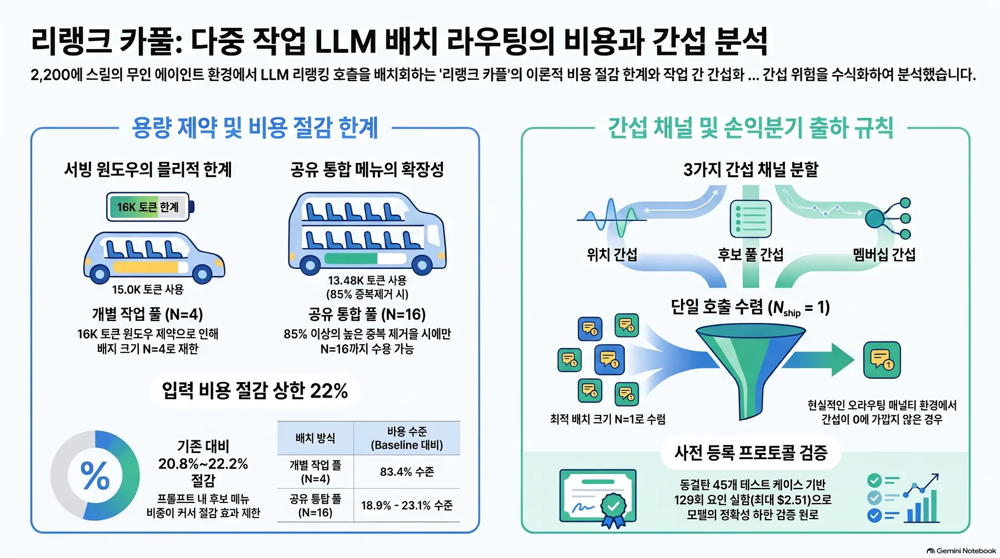
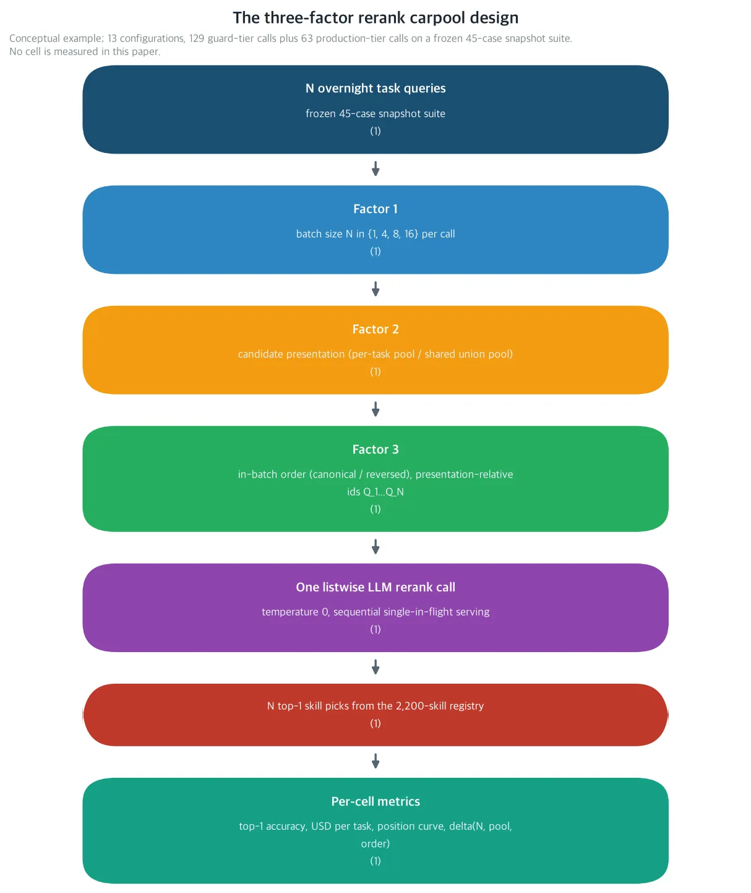
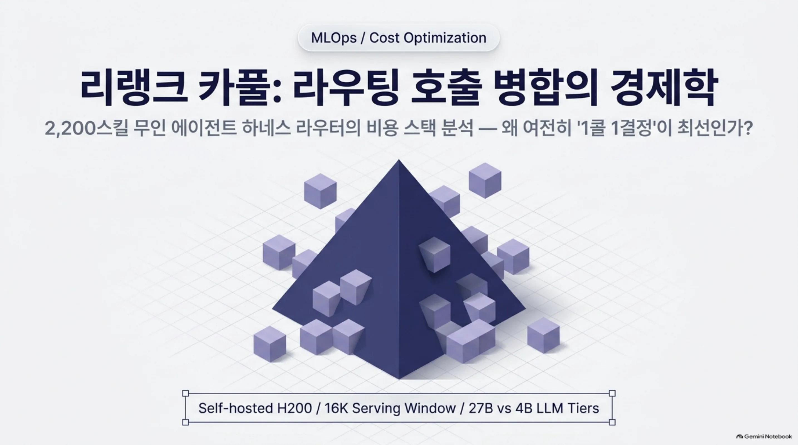
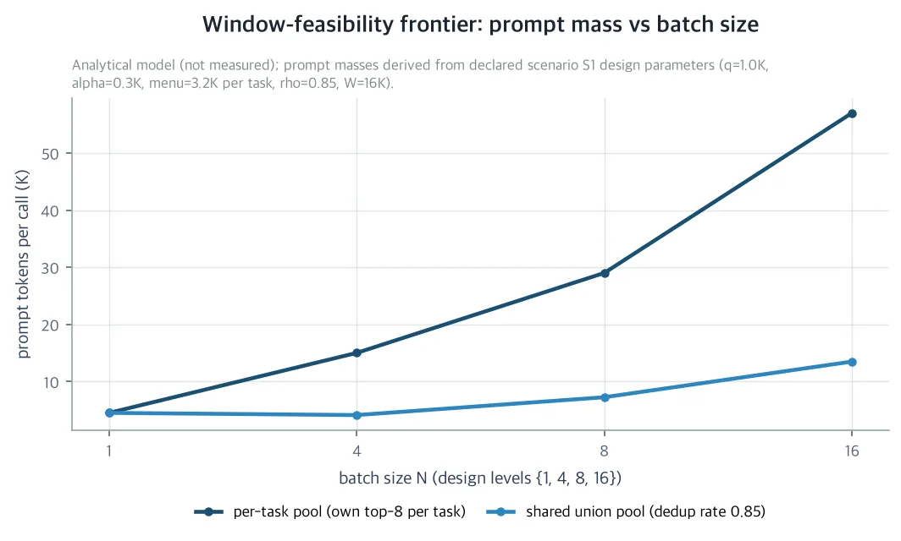
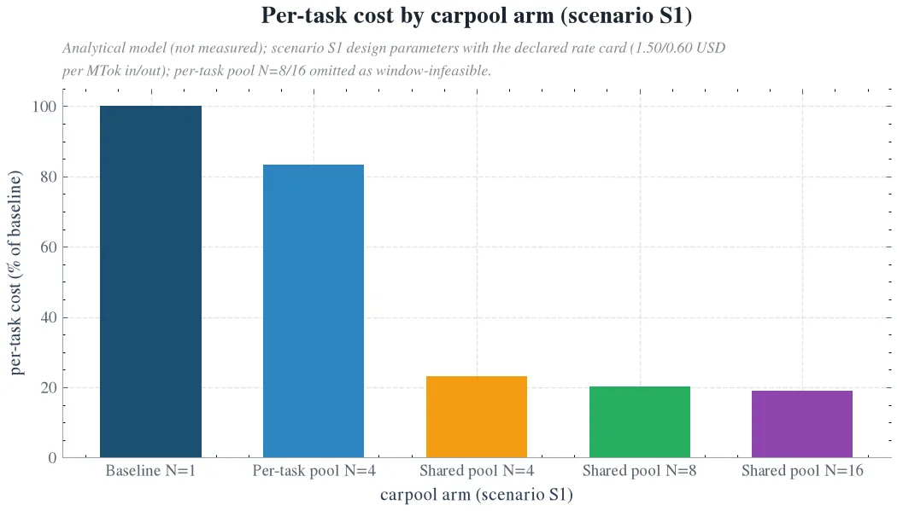
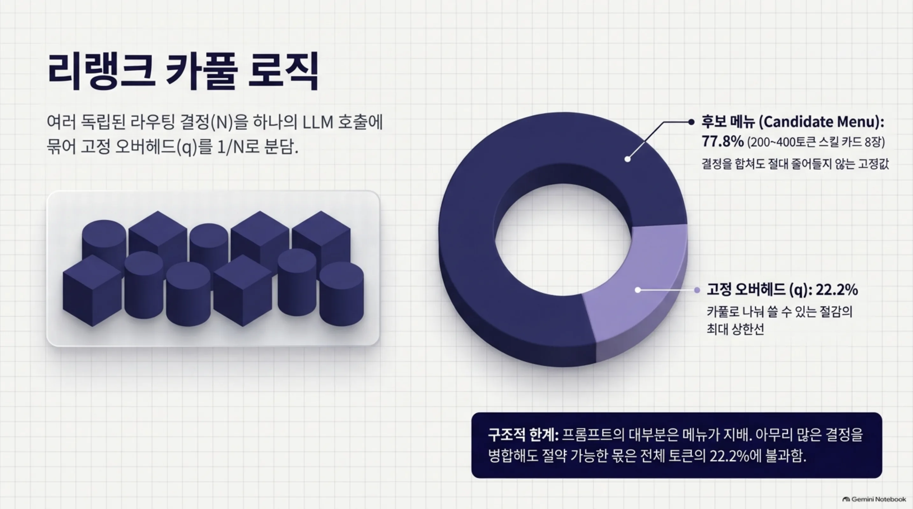
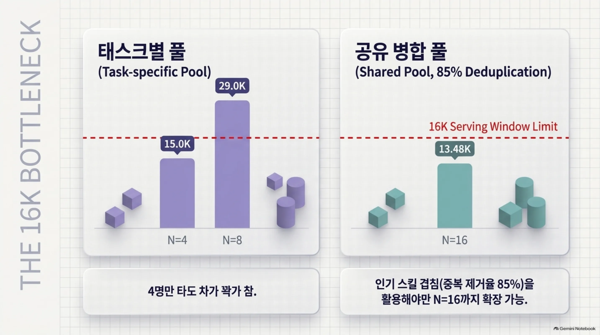
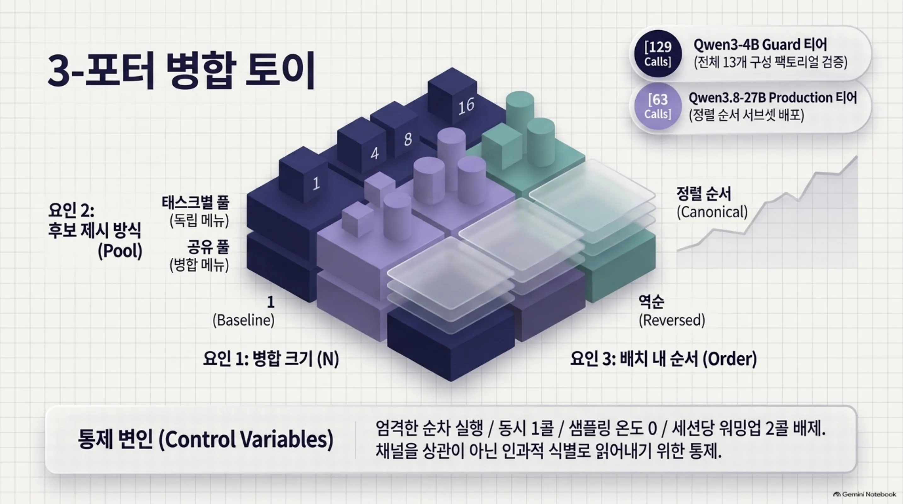
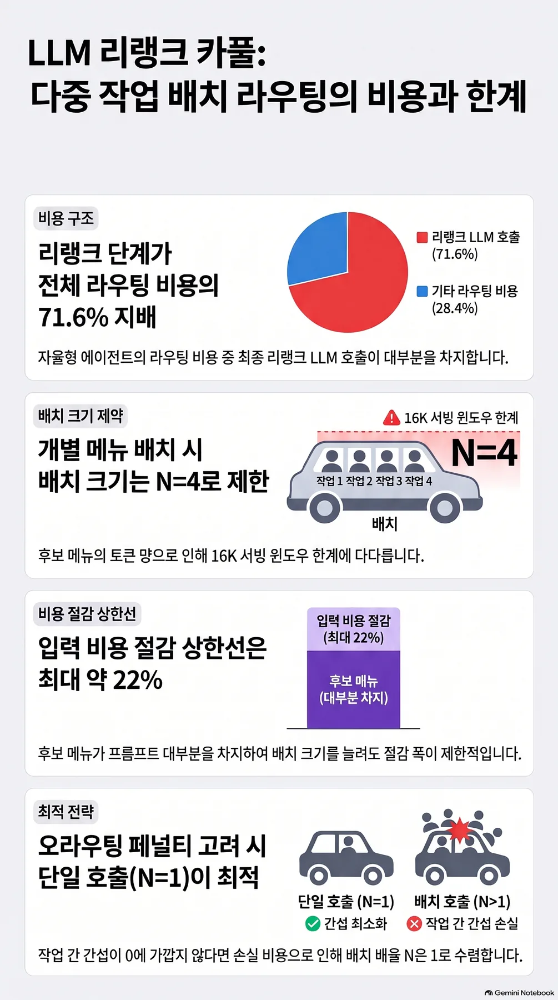

여러 개의 독립된 결정을 하나의 LLM 호출에 몰아넣으면, 호출마다 붙는 고정 비용을 결정 수만큼 줄일 수 있습니다. 같은 호출 안에 든 결정끼리 서로를 흔들면 그 절약은 통째로 지워질 수도 있고요. 셀프호스트드 GPU로 무인 에이전트를 돌리고, 그 라우터의 마지막 LLM 호출에 드는 비용 정책을 정해야 하는 엔지니어라면 이 논문을 읽을 가치가 있습니다.

ThakiCloud의 무인 에이전트 하네스는 셀프호스트드 H200 위에서 밤마다 수천 개의 태스크 스텝을 돌립니다. 각 스텝은 약 2,200개 스킬 레지스트리에서 스킬 하나를 골라야 하고, 골라짐의 마지막 단계가 LLM 리랭크 호출입니다. 그 호출 하나가 라우팅 청구액의 71.6%를 차지할 만큼 비싸고, 이 비용 스택의 모든 단계는 1콜 1결정, 즉 한 호출에 결정 하나에서만 정가되어 왔습니다. 한 호출이 독립 결정을 몇 개까지 나눠 쓸 수 있는지가 아직 미정가인 마지막 레버이며, 이 논문이 그 레버를 닫힘 형태로 정가합니다.

읽기 전에 짚어야 할 것은 하나입니다. 이 논문은 분석 논문이고, 본문에는 실행 단계의 새 실측이 없습니다. 모든 프론티어 값은 선언된 셀프호스트드 단가 카드와 시나리오 파라미터 위에서 도출한 닫힘 형태 모델 추정치입니다. 구조적 결과는 시나리오의 정확한 숫자에 의존하지 않고 성립하며, 시나리오에 의존하는 숫자를 확인하는 몫은 논문 말미의 사전등록 프로토콜이 맡습니다. 그 실행은 선언된 단가 카드에서 최악으로 팩토리얼 2.51달러, 전체 프로토콜 3.75달러 이하입니다.

## 쉽게 말하면

카풀, 말 그대로입니다. 출퇴근에 각자 자가용을 타면 유류비는 사람 수만큼 나갑니다. 한 대를 같이 타면 통행료와 주차비 같은 고정 부분을 그 수로 나눠 써서 아낍니다. 리랭크 카풀도 같은 셈법입니다. "이 8개 스킬 중 이 태스크엔 뭐가 최적인가"라는 질문을 N개 담아 하나의 LLM 호출에 보내면, 콜마다 한 번씩 붙는 고정 오버헤드 q를 N으로 나눠 쓰는 것입니다.

다만 스킬 라우팅 프롬프트에서 고정 오버헤드는 작고 후보 메뉴가 큽니다. 스킬 카드는 8장이고, 각 카드는 200~400토큰입니다. 프롬프트의 대부분은 메뉴이지 오버헤드가 아닙니다. 그래서 카풀 절감의 상한은 오버헤드가 프롬프트에서 차지하는 비중이며, 이 시나리오에서는 22.2%입니다. 즉, 사람 말로는 메뉴 값은 아무리 합쳐도 줄지 않고, 아낄 수 있는 몫은 콜마다 붙는 포장비뿐이라는 뜻입니다.

여기에 두 번째 문제가 겹칩니다. 여러 질문을 한 호출에 담으면 질문끼리 서로를 흔들고, LLM은 긴 목록의 가운데를 끝보다 덜 정확하게 답합니다. 이 현상은 U자 곡선으로 알려졌고, 라우팅은 상위 2개 스킬이 빈번하게 근접 타이기 때문에 컨텍스트의 작은 교란만으로도 최종 답이 뒤집힐 수 있습니다. 절감이 뒤집음 비용을 이기는지는 뒤에 나오는 브레이크이븐 채택 규칙이 답하는 질문입니다.

<!-- nlm-visual -->

*NotebookLM이 소스를 종합해 생성한 인포그래픽입니다.*

## 무엇을 해봤나

ThakiCloud의 비용-품질 시리즈는 라우터를 단계별로 정가해 왔습니다. 각 논문은 축 하나를 고정하고 1콜 1결정이라는 제약을 유지했습니다. 스코어링 단계의 정밀도 축(Gatekeeper)이 그랬고, 후보 메뉴의 폭 축은 Menu Width, k*=5의 니(knee)에서 commit과 menu가 갈리는 지점이었습니다. 밴드 안 결정(Indifference)은 1.18 SRA 포인트에 $60.5/밤짜리 expected-cost tie-break를 정가했습니다. 마지막 호출의 모델 티어는 Apprentice Reranker, 27B 티처 대 8B DPO 디스틸 학생이었습니다. 이 논문은 그 제약을 올립니다. 이전 논문 apprentice가 한 호출에 결정 하나에서 리랭크를 어느 모델 티어로 돌릴지를 정가했다면, 이 논문은 모델 티어 위에 한 호출에 결정을 얼마나 태울지를 정가하는 것입니다. 하네스가 프로덕션에 올리는 상수가 모델 티어, 카풀 크기, 풀, 순서의 4차원으로 넓어집니다.

카풀이 자명하지 않은 이유는 세 개입니다. 첫째, 스킬 라우팅 프롬프트에서 후보 메뉴가 문장을 지배하므로, 고정 오버헤드를 태스크 수로 나눠 쓰는 절감에는 상한이 있습니다. 둘째, 서빙 윈도우가 배칭 크기를 묶습니다. 단가 카드가 아니라 윈도우가 묶고, 풀 모드와 배칭 크기는 병합 메뉴를 통해 서로 결합됩니다. 셋째, 배칭은 상호 태스크 간섭을 도입하며, 그 간섭은 절감 전체를 지울 수 있습니다.

가장 가까운 외부 작업은 인-컨텍스트 배칭된 LLM 판정 연구입니다. 후보 집합이 없는 무작위 배치의 채점 판정에서 4~9B 모델에서 판정의 11~22%가 바뀐다고 보고하고, 순서·슬롯·구성원 채널의 정확한 분해를 주며, 캐시된 접두어를 둔 1콜 1아이템을 권고합니다. 그 권고는 캐시된 접두어가 비용의 대부분인 곳에서 합리적입니다. 하지만 라우팅 프롬프트에서 캐시 대상은 q뿐이고, 시나리오에서는 입력의 22.2%에 불과합니다. 그래서 카풀의 경제는 사전적으로가 아니라, 미스루팅 1회 페널티 M에 맞서 정가해야 합니다.

설계는 3요인 팩토리얼입니다. 요인 1은 한 호출에 태우는 결정의 수 N으로, 1, 4, 8, 16을 쓰며 N=1이 프로덕션 베이스라인입니다. 요인 2는 후보 제시 방식입니다. 태스크별 풀, 각 태스크가 자기 상위 8개 메뉴를 중복 허용으로 들고가는 방식과, 공유 풀, 하나의 병합 메뉴를 쓰고 중복 제거율이 실현 가능성을 결정하는 방식입니다. 요인 3은 배치 내 순서로, 정렬 순서(canonical)와 역순(reversed)입니다.

*사전등록 팩토리얼의 스키마입니다. 하나의 listwise LLM 호출이 N개의 독립 라우팅 결정을 싣고, 후보 제시(태스크별 풀 대 공유 병합 풀)와 배치 내 순서(정렬 순서 대 역순)가 나머지 두 요인입니다. 이 그림은 개념 스키마이며 실측 결과가 아닙니다.*

태스크 id는 제시 순서 기준 상대 id가 됩니다. 그래서 순서 대비가 태스크 신분의 상관으로 끝나지 않고, 선두 효과와 막바지 효과를 식별하게 됩니다. 구성은 13개로, N=1에서 1개에 N=4, 8, 16에서 각각 4개씩입니다. 태스크별 풀의 N=8과 16 구성 4개는 윈도우 가드 대상이며, 시나리오 규모의 카드에서는 윈도우에 들어맞지 않으므로 실행하지 않고 불가능으로 기록할 수 있습니다.

서빙 통제는 이 설계의 채널을 상관으로만 읽히지 않고 식별로 읽게 하는 이유입니다. 엄격한 순차 실행, 동시 1콜, 모든 티어에 동일한 vLLM 플래그, 샘플링 온도 0, 세션당 워밍업 2콜을 버리는 방식입니다. GPU 측 동시 배칭은 설계상 일정하게 고정되고, 셀 사이에서 변하는 것은 프롬프트 텍스트뿐입니다. 식별되는 채널이 전부 프롬프트 측인 이유는 이것이며, 서빙 윈도우가 조정 가능한 파라미터가 아니라 물리 상한인 이유도 이것입니다. 긴 컨텍스트에서는 KV 캐시 위 self-attention이 실행 시간을 지배하기 때문입니다.

측정 호스트는 동결된 45케이스 SRA-bench 스냅샷입니다. 메뉴는 프로덕션 임베딩 서버가 만든 프로덕션 하이브리드 리트리버(BM25와 dense retrieval)의 케이스별 상위 8개 오프라인 스냅샷이며, 측정 호스트는 리랭크 호출만 내고 런타임 검색은 하지 않아 메뉴 혼동이 제거됩니다. 45케이스 중 39케이스의 정답 스킬이 메뉴 안에 있고, 나머지 6케이스의 검색 놓침은 어떤 리랭크로도 고칠 수 없으므로, 정확도는 전체 슬라이스와 정답 메뉴 포함 슬라이스로 보고됩니다.

확인 실행은 사전등록 프로토콜로 예약되어 있습니다. Qwen3-4B guard 티어가 13구성 전체 팩토리얼, 129콜(45 + 12×4 + 6×4 + 3×4)을 돌립니다. Qwen3.8-27B NVFP4 production 티어가 63콜의 정렬 순서 서브셋(45 + 12 + 6, N ∈ {1, 8, 16}, 두 풀)을 돌립니다. 간섭이 티어에 의존하기 때문에 4B 티어가 13구성 표면을 커버하며, 배포된 그대로의 채택 상수는 27B 쪽의 몫입니다. 선언된 단가 카드에서 최악 비용은 팩토리얼 2.51달러 이하, 전체 프로토콜 3.75달러 이하입니다.

셀마다 보고 지표와 고치는 상수도 정해져 있습니다. 지표는 상위 1개 정확도(전체와 정답 메뉴 포함), 태스크당 토큰과 달러, 정답 태스크당 달러, N=1 대비 절감비율입니다. 파싱 실패, 잘못된 선택, 기권의 개수와, 실시간의 평균과 중위와 p95도 함께 보고됩니다. N=1이 정확도와 베이스라인 단가를 앵커합니다. N=4 구성 4개가 태스크별 풀 프론티어를 묶는 윈도우에서 고정합니다. N=8과 16의 공유 구성은 중복 제거 레짐과 병합 메뉴 교차 오염을 고정하며, 정렬 순서 대 역순 대비는 모든 N에서 비대칭 위치 가중을 묶습니다.

## 나온 결과

첫째, 이 하네스에서 카풀 크기를 묶는 축은 서빙 윈도우입니다. 단가 카드가 아니라 윈도우가 묶는 것입니다. 시나리오 S1의 세 입력값은 q=1.0K, 태스크 블록 p̄=3.5K, 윈도우 W=16K입니다.

태스크별 풀의 프롬프트 질량은 q + N·p̄로 선형 자라며, N=4에서 15.0K로 윈도우에 들어맞고 N=8의 29.0K는 들어맞지 않습니다. 즉, 사람 말로는 태스크별 메뉴를 싣는 카풀은 4명이 타면 차가 가득 찰 뿐, 8명이 타면 아예 길이 들어가지 못합니다.

공유 풀의 실현가능성은 중복 제거율에 결합됩니다. N=8은 51퍼센트 이상에서, N=16은 81퍼센트 이상에서만 가능합니다. 시나리오 스냅샷의 가장 긴 프롬프트, N=16 공유의 약 12.9K는 86퍼센트 중복 제거율을 함의합니다. 85퍼센트를 쓰면 병합 메뉴가 N=16까지도 윈도우 안에 머뭅니다.

*시나리오 S1에서 호출당 프롬프트 토큰 질량입니다. 태스크별 풀은 선형으로 자라 N=4에서 15.0K로 들어맞고, N=8의 29.0K는 16K 서빙 윈도우를 넘습니다. 85% 중복 제거의 공유 병합 메뉴는 N=16까지, 13.48K에서 실현 가능합니다. 이 그림은 닫힘 형태 비용 모델의 출력이며 실측 결과가 아닙니다.*

이 프론티어에서 읽히는 설계 사실이 하나 있습니다. 인기 스킬이 태스크 메뉴 사이에서 충분히 겹치기 때문에 병합 메뉴가 폭증하지 않습니다. 윈도우가 묶면 모델이 싸도 한 호출에 들어가는 질문 수가 늘지 않습니다. 단가 카드가 묶는다면 모델을 싸게 바꾸는 것만으로 카풀이 열렸겠지만, 이 하네스에서는 그렇지 않습니다. 풀 모드와 배칭 크기는 병합 메뉴를 통해 결합되어 독립적으로 고를 수 없습니다.

둘째, 후보 메뉴가 프롬프트를 지배할 때 절감 상한은 22.2%입니다. 카풀링의 입력 측 절감은 태스크당 정확히 r_in·q·(1−1/N)이며 풀 모드와 무관합니다. N이 무한대로 갈 때의 천장은 r_in·q이고, S1에서는 입력 청구의 q/(q+p̄), 그러니까 22.2%입니다. 즉, 사람 말로는 아무리 합쳐도 줄 수 있는 것은 메뉴 값이 아니라 호출마다 붙는 고정 오버헤드 몫뿐입니다.

간섭이 0이어도 N=16은 베이스라인 단가 c1의 20.8%에 그칩니다. c1은 태스크당 0.7센트 안팎의 단가이고, 입력 비중은 99.8%입니다. 태스크별 풀에서는 윈도우가 허용하는 유일한 레벨 N=4가 베이스라인의 83.4%입니다. 공유 풀은 그 위에 중복 제거 이득을 더하며, 이득의 상한은 메뉴 점유율, c1의 71.0%입니다. S1의 85퍼센트에서는 태스크당 비용이 베이스라인의 18.9~23.1%까지 내려갑니다.

*시나리오 S1에서 윈도우-실현 가능한 각 카풀 갈래의 모델 태스크당 비용, 1콜 베이스라인 대비 점유율입니다. 메뉴가 프롬프트를 지배하므로 태스크별 풀의 N=4는 절감이 적고(베이스라인의 83.4%), 85% 중복 제거의 공유 병합 메뉴는 18.9~23.1%까지 내려갑니다. 이 그림은 닫힘 형태 비용 모델의 출력이며 실측 결과가 아닙니다.*

비용 측 절반만으로는 결론이 나지 않습니다. 절감을 미스루팅 1회 페널티 M에 맞서 정가하는 것이 채택 규칙 N_ship = min(N*, N_qn, N_win)입니다. N*는 브레이크이븐이 성립하는 가장 큰 N이고, N_qn은 품질 열화가 허용치 안에 들어오는 가장 큰 N이며, N_win은 윈도우 상한입니다. 허용치는 1.2포인트 안팎으로, 시리즈의 밴드 안 타이브레이크가 쓴 예측 품질 비용입니다.

파라메트릭 간섭 스케줄 δ(N) = δ_16·(N/16)^γ 아래 시나리오 표는 이렇게 수렴합니다. 0 간섭 행만 카풀을 실제로 쓸 수 있고, 그때 채택 규칙의 결과는 윈도우 상한, 태스크별 풀에서 4, 공유 풀에서 16이 됩니다. 0 간섭 행을 제외한 모든 행에서, 시나리오 M의 2~10달러 모든 값에서 N_ship은 1로 수렴합니다. 시리즈가 선언한 M, commit과 menu의 갈림과 밴드 안 타이브레이크를 정가하는 50~200달러의 페널티,에서도 더 말할 게 없습니다. 모든 프론티어의 브레이크이븐이 78센트 이하이기 때문입니다. 프론티어 최대, 약 68센트와 약 77센트는 모두 그리드 밖 N=2에서 나옵니다. 정확한 값은 마지막 각주에 두었습니다. 시리즈 M으로 가격 매겨진 미스루팅 한 개는, N=16의 몇 푼에 불과한 병합 메뉴 중복 제거로는 못 사옵니다.

셋째, 배칭은 위치, 풀, 구성원 세 채널의 상호 태스크 간섭을 도입합니다. 위치 채널은 고정 N과 풀에서 정렬 순서 대 역순 대비입니다. 태스크 id가 제시 상대이므로 순서 대비가 선두 효과와 막바지 효과를 격리하고, 라벨 효과를 제거합니다. 풀 채널은 고정 N에서 태스크별 대 공유 대비로, 후보 메뉴의 교차 오염 효과를 식별하며, 중복 제거율은 스냅샷에서 알려져 있습니다. 구성원 채널은 태스크별 풀의 N 추이에서 예측 위치 페널티를 빼면 남는 유일한 채널이며, 어떤 공동 배치원이 프롬프트를 공유하느냐의 효과입니다.

이 분해는 인-컨텍스트 배칭된 LLM 판정 연구를 확장한 것입니다. 그 연구는 무작위 형성 배치의 채점 판정에서 순서, 슬롯, 구성원을 정확히 분해하고, 4~9B 모델에서 판정의 11~22%가 바뀐다고 보고합니다. 우리의 것은 제시된 후보 메뉴에서 나가는 상위 1개 선택이므로, 풀 채널과 경제 프론티어가 추가됩니다.

라우팅이 작은 교란을 증폭하는 이유는, 상위 2개 스킬이 빈번하게 근접 타이이기 때문입니다. 잠재 상위 1개 마진, 즉 정답 스킬과 2위 스킬의 점수 간격을 g_t로, 공동 배치원 N−1개가 일으키는 컨텍스트 교란의 표준편차를 σ_ctx로 둡니다. 공동 배치원이 독립 노이즈를 기여하면 교란 표준편차는 √(N−1)에 비례합니다. 근접 타이 태스크, 즉 마진이 작은 태스크는 교란이 작아도 0이 아닌 뒤집힘률로 뒤집힙니다. 교란 표준편차보다 작은 점수 레벨 효과는 보이지도 않습니다. 이 형태는 판정 연구가 보고한 컨텍스트 분산의 제곱근에 따른 뒤집힘률 스케일링, 4~9B 규모에서 판정의 11~22% 변화와 일치합니다.

긴 컨텍스트 이론은 프로토콜에서 시험할 4개의 위치 곡선 예측을 줍니다. P1: 배치의 가운데 1/3에서 위치 평균 정확도가 빠지는 U자 곡선, 내부 최소입니다. 선두 꼬리는 causal masking이, 막바지 앵커는 residual connection이 실어옵니다. P2: N이 커질수록 빠짐이 깊어집니다. P3: 근접 타이 태스크에서 빠짐이 크고, 무차별 밴드 슬라이스가 먼저 보여야 합니다. P4: 태스크별 단계 추론 출력을 더하면 빠짐이 줄지만, 출력 오버헤드를 곱하기 때문에 완화에도 가격표가 붙습니다. 이 네 개는 프로토콜에서 시험할 예측으로 쓰여 있는 것이지, 결과가 아닙니다.

과학에 남는 것도 명시합니다. 병행성 탓으로만 귀인되던 정확도 드리프트를 프롬프트(컨텍스트) 측 간섭과 분리한 것입니다. 배치 크기 × 공유/개별 후보 풀 × 배치 내 순서의 3요인 팩토리얼 실험으로 LLM 멀티쿼리 랭킹의 상호 태스크 간섭을 인과적으로 분해한 첫 시도입니다. 식별성 분해가 판정 연구의 순서/슬롯/구성원 분석에 후보 풀 채널을 더하고, P1~P4가 긴 컨텍스트 이론의 시험 가능한 귀결을 주며, 미스루팅 페널티 M에 맞서 카풀 크기를 정가하는 경제 프론티어가 완성됩니다.

## 그래서 무엇을 바꾸면 되나

가장 먼저, 채택 규칙을 측정 전에 쓸 수 있는 고정값으로 삼을 수 있습니다. 모든 상수가 완전히 명시된 시나리오 S1에서 닫힘 형태로 계산되기 때문입니다. 2,200스킬 ThakiCloud 하네스의 밤샘 루프는 태스크마다 1회씩 LLM 리랭크 호출을 냅니다. 이 논문은 그 호출을 N:1로 묶으면 절감되는 토큰 지출의 비율과, 품질 손실이 없는 최대 배칭 크기를 답합니다.

비용 축으로는 묶입니다. 태스크별 메뉴는 N=4, 공유 병합 메뉴는 N=16까지 윈도우 안에 들어갑니다. 하지만 채택 규칙은 그것을 미스루팅 페널티에 맞서 정가합니다. 시리즈 M의 50~200달러, 시나리오 M의 2~10달러 모든 값에서 실측 간섭이 0이 아닌 한 1콜 1결정으로 수렴합니다. 즉, 사람 말로는 한 대에 몇 명까지 태울지가 아니라, 잘못 태워 보내면 얼마의 손해가 나는지가 먼저 정해 주는 셈입니다.

두 번째, 프로덕션 LLM 라우팅의 프롬프트 측 배칭 경제를 재현 가능하게 실측하는 첫 프로토콜입니다. 대규모 LLM 호출을 돌리는 조직은 세 가지 설계 규칙을 가져다 쓸 수 있습니다. 서빙 윈도우가 배칭 크기를 묶고, 메뉴 지배가 오버헤드 절감의 상한이 되며, 간섭은 미스루팅 페널티에 맞서 정가되어야 합니다. 불필요한 추론 지출과 그에 따른 에너지 비용을 줄이는 규칙이고, 이 논문의 모든 숫자는 설계 파라미터와 인용 소스, 선언된 단가 카드 위의 닫힘 형태 모델 출력으로 추적됩니다. 비용 모델이 전부 공개되기 때문입니다.

## 못 믿을 부분

한계도 명시합니다.

첫째, 이 논문은 분석입니다. 모든 프론티어 값은 S1의 닫힘 형태 도출이거나, 명시된 가정과 선언된 단가 카드와 인용 소스에서 온 숫자입니다. 팩토리얼 셀 하나도 실측으로 단정되지 않았고, δ와 ρ_N과 파싱 성공률과 N*의 실측 값은 사전등록 프로토콜의 몫입니다.

둘째, 단일 플랫폼입니다. 셀프호스트드 H200뿐이고, 메뉴는 프로덕션 임베딩 서버로 만든 오프라인 스냅샷입니다. 측정 시점의 메뉴 혼동은 0이지만, 온라인 검색 드리프트는 포괄하지 않습니다.

셋째, 단가 카드는 선언되어 있고 모델 크기에 균일합니다. 시장 단가는 베이스라인 단가를 재정가하지만 구조를 바꾸지 않습니다.

넷째, 45케이스 스위트는 39케이스에서 정답 스킬이 메뉴 안에 있고, 어떤 리랭크로도 고칠 수 없는 6개의 검색 놓침을 남깁니다. 모든 정확도 서술은 슬라이스 조건부이고, 샘플링 온도 0의 결정론 서빙은 가격 매겨지지 않은 샘플링 채널을 배제합니다.

다섯째, 단일 2,200스킬 레지스트리가 ρ_N을 레지스트리 의존으로 만듭니다. S1의 400토큰 카드는 스냅샷 메뉴의 200~400토큰 카드당 범위의 보수적 상단입니다.

유효성 위협도 함께 적어 둡니다. 티어 또는 모델 업데이트가 δ 스케줄을 바꿉니다. 4B guard와 27B production을 분리한 이유입니다. 메뉴 드리프트가 ρ_N과 p̄을 바꾸므로, 리트리버 변경 시 재스냅샷이 필요합니다. 단가 카드 변경은 달러 값을 재스케일하지만 채택 규칙의 비율 구조는 바꾸지 않습니다.

자동 접두 캐싱(prefix caching)은 순차 실행, 동시 1콜 서빙이 캐시를 비활성화하지 않으므로, 청구 토큰은 선언된 단가 카드에서 캐시 독립이고 비용 모델에 영향을 주지 않습니다. 다만 셀당 실시간 채널은 캐시 상태 의존이므로 티어별로 캐싱 상태를 선언합니다. 4B guard 티어에서는 비활성화하고, S1의 400토큰 카드는 보수적 상단이며, 스냅샷의 실제 카드 크기는 프로토콜이 재계산합니다.

논문 원문과 수반 자료는 [Hugging Face 논문 상세 페이지](https://huggingface.co/datasets/thaki-AI/daily-paper-2026-11-14-rerank-carpool-batch-routing-interference)에서 볼 수 있습니다.

*본문의 비용 수치는 선언된 셀프호스트드 과금 모델(결정론 토큰 수 × 선언 단가 카드)과 시나리오 S1 위의 닫힘 형태 도출이며, 모델 추정치입니다. 세 장의 그림 값은 모델 출력(컨셉 스키마 1개, 비용 모델 2개)이며 실측이 아닙니다. 베이스라인 c1은 태스크당 $0.006764(입력 비중 99.8%)이고, 공유 풀 실현가능성 임계값은 ρ_8 ≥ 0.508, ρ_16 ≥ 0.801입니다. N=16 공유의 프롬프트 질량은 13.48K이며, 중복 제거율은 시나리오 0.85, 스냅샷 함의치 0.86입니다. 브레이크이븐 허용치 tol은 1.18pt(시리즈 밴드 안 타이브레이크의 예측 품질 비용)이고, 프론티어 최대는 $0.6829(shared, γ=0.5)와 $0.7726(shared, γ=1)로 모두 그리드 밖 N=2에서 나옵니다. N=16의 병합 메뉴 중복 제거 이득은 태스크당 $0.0055입니다. 서빙 플래그는 윈도우 16384, 메모리 사용률 0.90, 최대 동시 시퀀스 32, 샘플링 온도 0, 세션당 워밍업 2콜입니다. 13구성 129콜 guard 티어 팩토리얼(Qwen3-4B)과 63콜 production 티어 서브셋(Qwen3.8-27B NVFP4)은 이 논문에서 사전등록되었고, δ·ρ_N·N_ship의 실측 값은 실행 완료 시점에 보고됩니다. 최악 비용은 선언된 단가 카드에서 팩토리얼 $2.51, 전체 프로토콜 $3.75 이하입니다.*

<!-- nlm-visual -->

*NotebookLM이 소스를 종합해 생성한 인포그래픽입니다.*
