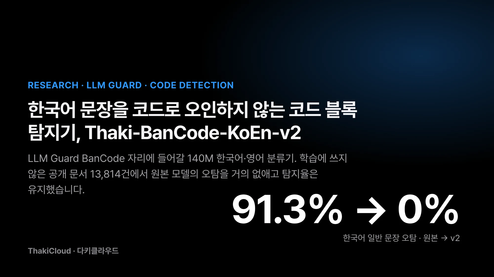
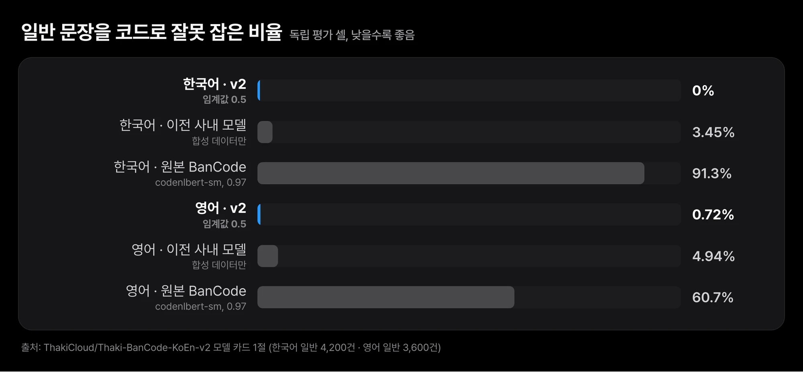
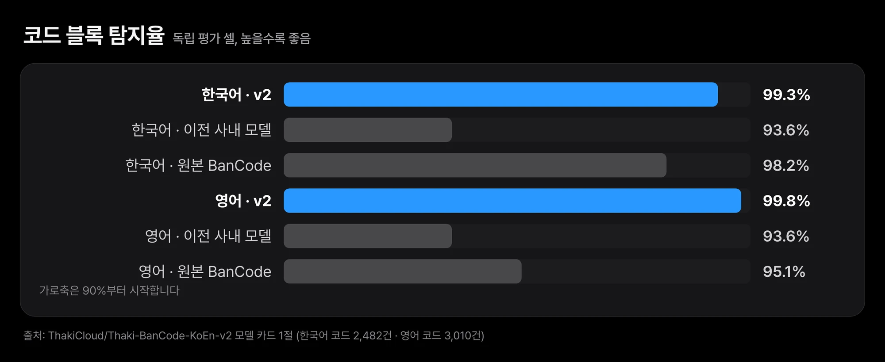
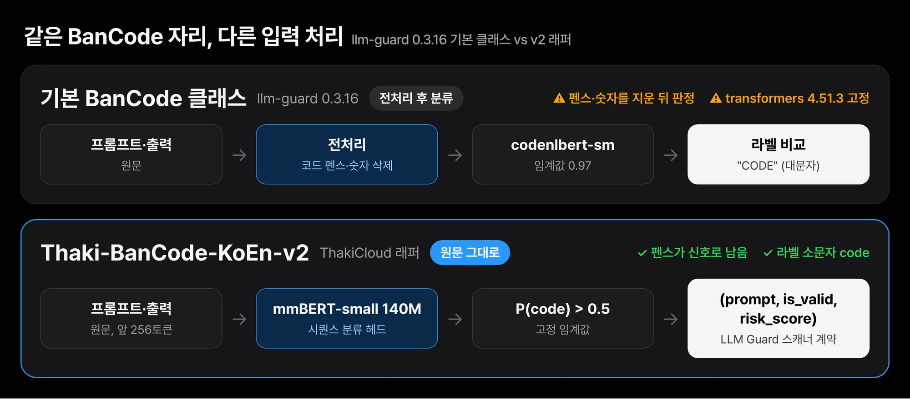
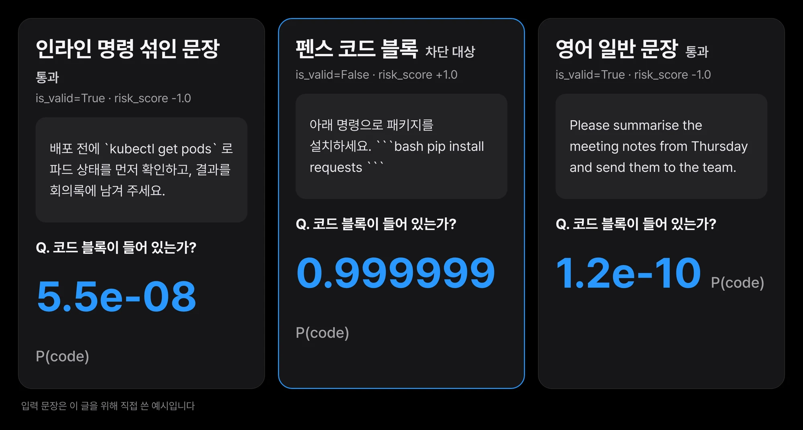

사내 챗봇에 "이 채널에서는 코드를 붙여 넣지 않는다"는 정책을 걸어 두는 팀이 있습니다. 이런 정책은 보통 코드 블록 탐지기 하나로 집행합니다. 오픈소스 가드레일 도구에도 이 일을 맡는 코드 차단 스캐너가 들어 있습니다. 그런데 이 스캐너의 기본 모델에 한국어 업무 문장을 넣어 보면 금방 문제가 드러납니다. 코드가 한 줄도 없는 회의 요청이나 보고서 문장도 코드로 잡힙니다. 평범한 질문을 보낸 사용자가 차단 메시지를 받는 일이 생깁니다. 명령어 이름 하나가 문장에 섞였다는 이유만으로 요청이 막히기도 합니다.

그 스캐너는 오픈소스 가드레일 도구 LLM Guard의 BanCode입니다. 다키클라우드는 이 자리에 넣을 한국어·영어 코드 블록 탐지기 [Thaki-BanCode-KoEn-v2](https://huggingface.co/ThakiCloud/Thaki-BanCode-KoEn-v2)를 공개했습니다. 140M 파라미터 분류기이고 백본은 [mmBERT-small](https://huggingface.co/jhu-clsp/mmBERT-small)입니다. 학습에 한 번도 쓰지 않은 공개 문서 13,814건으로 평가했습니다. 원본 BanCode 모델은 한국어 일반 문장의 91.3%, 영어 일반 문장의 60.7%를 코드로 잘못 잡았습니다. v2는 한국어 4,200건 중 0건, 영어 3,600건 중 26건(0.7%)이었습니다. 코드 탐지율은 한국어 99.3%, 영어 99.8%였습니다.

아래에서는 오탐이 어디서 나왔는지, v2를 어떤 데이터로 학습했는지, 독립 평가 결과와 약한 구간을 차례로 봅니다. 마지막으로 llm-guard 기본 BanCode 클래스에 이 모델을 그대로 끼우면 안 되는 이유와 동봉 래퍼 사용법을 정리합니다.


*Thaki-BanCode-KoEn-v2 요약. 학습에 쓰지 않은 원천으로 만든 독립 평가 셀 13,814건에서 잰 값입니다(한국어 일반 문장 4,200건 중 0건 오탐).*

## 쉽게 말하면

부엌 천장에 붙은 화재경보기를 떠올리면 됩니다. 경보기는 연기가 날 때만 울려야 합니다. 그런데 너무 예민한 경보기는 냄비에서 김만 올라와도 울립니다. 몇 번 그러고 나면 사람들은 경보기를 떼어 버립니다.

원본 BanCode 모델은 한국어 문장 앞에서 예민한 경보기였습니다. 한국어 일반 문장 10건 중 9건에 울렸습니다. 특히 `kubectl` 같은 명령어 이름이 문장 속에 잠깐 나오는 글에는 거의 전부 울렸습니다. 김이 조금 섞인 공기를 연기로 본 셈입니다. v2는 같은 부엌에서 김에는 울리지 않고 연기에는 99% 넘게 울렸습니다. 아래 내용은 경보기를 왜 바꿨고 새 경보기를 어떻게 달아야 하는지를 조금 더 정확한 말로 옮긴 것입니다.

## 원본 BanCode 모델은 한국어 일반 문장 10건 중 9건을 코드로 봤습니다

평가에는 학습에 쓰지 않은 원천으로 만든 고정 평가 세트를 썼습니다. 모델 카드는 이 세트를 독립 평가 셀이라고 부릅니다. Kubernetes, React, FastAPI, es-toolkit, Docker 공식 문서와 한국어 챗봇 말뭉치, UD Korean-Kaist와 UD English-EWT 문장이 들어갑니다. 학습·모델 선택·테스트에 쓴 원천과는 원천 단위로 분리했습니다. 정확히 같은 항목 1건과 거의 같은 항목 46건도 뺐습니다.

정답은 마크업 규칙 하나로 정했습니다. 언어 태그가 붙은 펜스 블록은 코드입니다. 펜스 블록은 백틱 세 개로 위아래를 감싼 코드 영역을 말합니다. 블록 밖 문단은 문장 속에 인라인 `code`가 섞여 있어도 코드가 아닙니다. 사람이 하나씩 판정하지 않았으므로 라벨 기준이 흔들리지 않습니다.

원본 모델 `vishnun/codenlbert-sm`은 LLM Guard 기본 임계값 0.97로, v2와 이전 사내 모델은 임계값 0.5로 채점했습니다. 세 모델 모두 같은 세트의 같은 원문을 같은 코드로 다키클라우드가 직접 채점했습니다. 원본 모델은 한국어 일반 문장 4,200건 중 91.3%를 코드로 잡았고 영어 3,600건 중 60.7%를 잡았습니다.


*학습에 쓰지 않은 공개 문서에서 일반 문장을 코드로 잘못 잡은 비율입니다. 원본 BanCode 모델은 한국어 91.3%, 영어 60.7%였고 v2는 0.00%(0/4,200), 0.72%(26/3,600)였습니다. 세 모델 모두 같은 원문을 같은 코드로 채점했습니다.*

가장 심한 곳은 인라인 코드가 섞인 산문이었습니다. 기술 문서에서 흔한 "`kubectl apply`로 적용합니다" 같은 문장입니다. 원본 모델은 이런 한국어 문장 1,200건 중 99.9%, 영어 1,200건 중 86.3%를 코드로 봤습니다. 실무 질문에는 명령어 이름이 자주 섞이므로 이 구간의 오탐은 곧 사용자 불편으로 이어집니다.

## 위키백과와 Stack Exchange 원문으로 다시 학습했습니다

v2는 실제 문서의 원문으로 학습했습니다. 한국어·영어 위키백과와 위키책, 그리고 Stack Exchange의 askubuntu·devops·dba·codereview 게시물입니다. 둘을 합쳐 47,448행을 썼습니다. 여기에 자체 서빙한 Qwen3.8-27B 양자화본으로 만든 한국어·영어 합성 코드와 산문 1,802행을 더했습니다. 합성 프롬프트에는 주제와 형식 지시만 넣었고 시드 데이터나 외부 API는 쓰지 않았습니다.

학습 문장은 전처리하지 않고 원문 그대로 넣었습니다. 펜스와 숫자도 지우지 않았습니다. 정답 규칙이 "펜스 블록이 있으면 코드"이므로 모델이 가장 먼저 배워야 할 신호도 펜스입니다. 반대로 문장 속 인라인 코드와 명령어 이름은 코드가 아닌 쪽 예시로 충분히 들어갔습니다.

이전 사내 모델은 합성 데이터만으로 학습했습니다. 이 모델의 오탐은 한국어 3.5%, 영어 4.9%로 원본보다 훨씬 낮았지만 탐지율이 두 언어 모두 93.6%에 머물렀습니다. 인라인 코드가 섞인 산문에서도 11%가량을 코드로 잡았습니다. 실제 문서를 학습에 넣은 v2에서 이 두 약점이 함께 줄었습니다.

미세조정 설정은 3 에폭, 배치 32, 최대 길이 256, 학습률 5e-5, fp32, 시드 42입니다. 클래스 불균형은 제곱근 가중치로 보정했고 에폭은 개발 세트 macro-F1로 골랐습니다. 개발 세트에는 KLUE-MRC, SQuAD, HumanEval 공개 항목 237건이 들어 있으며 가중치 갱신에는 쓰지 않았습니다. AI 허브 데이터는 쓰지 않았습니다.

## 학습에 쓰지 않은 문서에서도 오탐은 사라지고 탐지율은 유지됐습니다

채점은 사전등록한 대로 한 번만 했습니다. 평가 세트와 체크포인트, 임계값을 먼저 기록해 고정한 뒤 채점했다는 뜻입니다. 아래 표는 그 한 번의 결과입니다. 오탐 괄호 안의 상한은 Clopper-Pearson 95% 상한입니다. 관측한 오탐 건수로 볼 때 실제 오탐률이 이 값을 넘을 가능성은 5% 이하라는 의미입니다.

| 언어 (코드 / 일반) | 모델 | 일반 문장 오탐 (95% CP 상한) | 코드 탐지율 | AUROC |
|---|---|---:|---:|---:|
| 한국어 (2,482 / 4,200) | **v2** (임계값 0.5) | **0.00%** (0 / 4,200; ≤ 0.07%) | **99.3%** | 0.9999 |
| | 이전 사내 모델, 합성 데이터만 (0.5) | 3.45% | 93.6% | 0.9867 |
| | 원본 BanCode `vishnun/codenlbert-sm` (0.97) | 91.3% | 98.2% | 0.9025 |
| 영어 (3,010 / 3,600) | **v2** (임계값 0.5) | **0.72%** (26 / 3,600; ≤ 1.00%) | **99.8%** | 0.9999 |
| | 이전 사내 모델, 합성 데이터만 (0.5) | 4.94% | 93.6% | 0.9825 |
| | 원본 BanCode `vishnun/codenlbert-sm` (0.97) | 60.7% | 95.1% | 0.8445 |

오탐을 줄인 대가로 탐지율이 떨어지지는 않았습니다. 한국어 탐지율은 원본 98.2%에서 v2 99.3%, 영어는 95.1%에서 99.8%였습니다. AUROC도 함께 봐야 합니다. AUROC는 임계값을 어디에 두든 코드와 일반 문장을 점수 순서로 얼마나 잘 가르는지 나타냅니다. 원본 모델의 AUROC는 한국어 0.90, 영어 0.84로 두 언어 모두 1에 가까운 v2보다 낮았습니다. 임계값만 다시 맞춰서는 원본 모델로 v2 수준의 분리를 얻기 어렵다는 뜻입니다.


*같은 셀의 코드 블록 탐지율입니다. v2는 한국어 99.3%, 영어 99.8%로 원본 BanCode 모델(98.2%, 95.1%)보다 낮아지지 않았습니다. 이전 사내 모델은 두 언어 모두 93.6%였습니다.*

인라인 코드가 섞인 산문에서 차이가 가장 컸습니다. 이 구간의 오탐은 한국어 99.9%에서 0%로, 영어 86.3%에서 0.1%로 내려갔습니다. 이전 사내 모델은 같은 구간에서 한국어 11.1%, 영어 11.6%였습니다.

## 약한 구간은 마크업 블록과 영어 일반 문장입니다

평균만 보면 약점이 가려집니다. 아래는 평가 세트를 입력 종류별로 나눈 구간 가운데 표본이 50건 이상이면서 v2가 가장 약했던 곳입니다.

| 구간 | n | v2 | 이전 사내 | 원본 |
|---|---:|---:|---:|---:|
| 한국어 마크업 블록(HTML/XML 등), 탐지율 | 66 | 93.9% | 93.9% | 98.5% |
| 한국어 설명 없는 코드 조각, 탐지율 | 340 | 95.9% | 98.2% | 87.9% |
| 영어 일반 문장(UD English-EWT), 오탐 | 1,200 | 1.83% | 1.42% | 16.6% |
| 인라인 코드가 섞인 한국어 산문, 오탐 | 1,200 | 0.00% | 11.1% | 99.9% |
| 인라인 코드가 섞인 영어 산문, 오탐 | 1,200 | 0.08% | 11.6% | 86.3% |

한국어 HTML·XML 같은 마크업 블록은 66건 중 93.9%만 잡았습니다. 이 구간에서는 원본 모델(98.5%)이 더 나았습니다. 앞뒤 설명 없이 코드 조각만 있는 한국어 입력도 95.9%로 이전 사내 모델(98.2%)보다 낮았습니다. 영어 일반 문장은 UD English-EWT 1,200건 중 1.8%를 코드로 잡았습니다. 영어 전체 오탐 26건이 대부분 여기서 나왔고 이전 사내 모델(1.4%)보다도 조금 높습니다.

한 가지 더 기록해 둡니다. 채택 당시 확인한 한국어 공개 산문 91건(KLUE-MRC) 가운데 1건을 v2는 코드로 잡았고 이전 모델은 잡지 않았습니다.

개발 단계 수치도 모델 카드에 남아 있습니다. 학습 원천에서 떼어 학습 전에 봉인한 분할에서 v2의 오탐은 한국어 0.2%, 영어 0.4%였고 탐지율은 99.9%, 99.0%였습니다. 이 분할은 학습과 같은 원천에서 나왔으므로 독립 근거가 아닙니다. 공개 여부를 정한 채택 판정의 기록으로만 읽어야 하고, 처음 보는 문서에서도 통한다는 근거는 앞의 독립 평가입니다.

## llm-guard 기본 BanCode 클래스에 그대로 끼우면 안 됩니다

v2는 LLM Guard 스캐너 자리를 겨냥했지만 llm-guard 0.3.16의 기본 `BanCode` 클래스에 모델 이름만 바꿔 넣는 방식은 지원하지 않습니다. 이유는 세 가지입니다.

첫째, 기본 클래스는 분류 전에 마크다운 코드 펜스와 숫자를 지웁니다. v2는 펜스가 남은 원문으로 학습했고 펜스가 가장 중요한 신호입니다. 둘째, 기본 클래스는 예측 라벨을 대문자 문자열 `"CODE"`와 비교합니다. v2의 라벨은 소문자 `code`입니다. 셋째, 기본 클래스는 transformers 4.51.3을 고정합니다. 이 버전은 v2의 ModernBERT 설정과 토크나이저 조합을 읽지 못합니다.


*llm-guard 0.3.16의 기본 BanCode 클래스는 코드 펜스와 숫자를 지운 뒤 분류하고 라벨을 "CODE"와 비교합니다. v2는 펜스가 남은 원문으로 학습했으므로 동봉 래퍼로 원문을 그대로 넣어야 합니다.*

그래서 저장소에 들어 있는 래퍼 `bancode.py`를 씁니다. 래퍼는 LLM Guard 스캐너와 같은 `(sanitized_prompt, is_valid, risk_score)`를 돌려줍니다. risk_score는 LLM Guard의 `calculate_risk_score(score, 0.5)` 규칙을 따릅니다.

```python
from huggingface_hub import snapshot_download
import sys
d = snapshot_download("ThakiCloud/Thaki-BanCode-KoEn-v2")
sys.path.insert(0, d)
from bancode import BanCodeV2
scanner = BanCodeV2(d)
print(scanner.scan("Run this:\n```bash\npip install requests\n```"))   # (prompt, is_valid=False, risk_score)
```

이 저장소에는 토크나이저가 없습니다. 래퍼는 프로필 파일 `bancode_v2_profile.json`에 적힌 `jhu-clsp/mmBERT-small` 리비전 `abc32620dd4f6ab06f5fbe905dc25f310618e09f`에서 토크나이저를 받아 옵니다. 같은 이유로 Hugging Face 추론 위젯은 동작하지 않습니다. 모델 카드가 검증한 환경은 Python 3.11, torch 2.9.0(CPU), transformers 5.14.1, tokenizers 0.22.2입니다.

운영 프로필은 채택 때 고정했습니다. 점수는 P(`code`)이고 0.5를 넘으면 코드로 판정합니다. 입력은 앞 256토큰만 읽고 전처리 없이 원문을 그대로 넣습니다. 모델 카드는 이 임계값을 배포 데이터에 맞춰 다시 조정하지 말라고 적어 두었습니다.

공개 가중치를 내려받아 CPU에서 직접 돌려 봤습니다. 내려받은 `model.safetensors`의 sha256은 카드에 적힌 값과 같았습니다. 직접 쓴 예시 세 건이라 정확도를 말해 주지는 않지만 동작 모양은 보여 줍니다.


*공개 가중치를 CPU에서 직접 돌린 실제 출력입니다(transformers 5.12.0, 고정 리비전 토크나이저, 임계값 0.5). 인라인 명령이 섞인 업무 문장은 통과하고 펜스 블록만 걸립니다. 직접 쓴 예시 3건이라 정확도 근거는 아닙니다.*

`kubectl get pods`를 문장 속에 언급한 업무 요청은 P(code)가 0에 가까워 통과했습니다. `pip install requests` 펜스 블록이 든 설치 안내는 P(code)가 1에 가깝게 나와 차단 대상이 됐습니다. 영어 회의록 요청 문장도 통과했습니다. 이 실행은 카드가 검증한 5.14.1이 아닌 transformers 5.12.0에서 했습니다.

## Paxis에서는 코드 블록 정책 스캐너 후보입니다

Paxis는 에이전트가 사용자의 요청을 받아 업무를 수행하는 플랫폼입니다. 이런 환경에서는 프롬프트와 에이전트 출력을 정책 스캐너가 함께 봅니다. "이 채널에서는 코드를 주고받지 않는다"는 정책도 그중 하나가 될 수 있습니다. 다만 한국어 업무 문장에는 명령어 이름과 파일 경로가 자주 섞입니다. 스캐너가 이런 문장을 코드로 잡으면 사용자는 평범한 요청을 거절당합니다. 이런 일이 반복되면 팀은 결국 정책 자체를 끕니다.

v2는 이 비용을 줄이는 쪽의 후보입니다. 인라인 코드가 섞인 한국어 산문 1,200건에서 오탐이 0건이었고 펜스 블록 탐지율은 99% 이상을 유지했습니다. 적용 방향은 모델 카드의 권고와 같습니다. 처음에는 차단이 아니라 기록이나 경고 모드로 두고 자기 트래픽에서 판정 분포를 본 뒤 차단 여부를 정합니다. 실제 사용자 입력으로는 아직 평가하지 않았으므로 Paxis 트래픽에서 얼마나 정확한지는 이 글의 수치로 대신할 수 없습니다.

## 쓰기 전에 알아 둘 한계

- **실제 사용자 입력으로는 평가하지 않았습니다.** 독립 평가 세트는 공개 기술 문서와 일반 문장 말뭉치로 만들었습니다. Stack Exchange가 학습 원천이라 질의응답 형식의 원천은 독립 평가에 없습니다.
- **로그 블록은 평가하지 못했습니다.** 한국어 3건, 영어 4건뿐이라 보고만 했습니다. 언어 태그가 없는 블록(한국어 251건, 영어 264건)과 코드 안에 한글이 든 한국어 설정 블록(39건)도 보고만 했습니다.
- **펜스 없이 쓴 코드는 정의상 코드가 아닙니다.** 라벨을 마크업으로 정했기 때문입니다. 문장 속에 펜스 없이 붙여 넣은 긴 코드를 잡아야 한다면 이 모델의 정의와 맞지 않습니다.
- **앞 256토큰만 읽습니다.** 긴 문서 뒤쪽에 있는 코드 블록은 보지 못합니다.
- **사전학습 데이터와 겹쳤을 수 있습니다.** mmBERT 백본의 웹 사전학습 데이터에 같은 공개 문서가 들어 있었을 수 있고 이는 잴 수 없습니다.
- **지연 시간과 CPU 비용은 재지 않았습니다.** 이번 공개에서 속도는 주장하지 않습니다.
- **범위 밖 용도가 있습니다.** 코드가 악성인지, 비밀값이 들어 있는지는 판단하지 않습니다. 한국어와 영어 외 언어도 범위 밖입니다.
- **ONNX 변환본은 없습니다.**

## 끝으로

Thaki-BanCode-KoEn-v2는 원본 BanCode 모델이 한국어 일반 문장에 내던 오탐을 91.3%에서 0%로, 영어에서 60.7%에서 0.7%로 줄였습니다. 코드 탐지율은 한국어 99.3%, 영어 99.8%로 원본보다 낮아지지 않았습니다. 이 수치는 학습에 쓰지 않은 공개 문서 13,814건에서 사전등록한 대로 한 번 잰 결과입니다. 대신 한국어 마크업 블록과 영어 일반 문장에서 약하고 실제 사용자 입력으로는 아직 평가하지 않았습니다.

LLM Guard로 코드 금지 정책을 운영한다면 오늘 해 볼 첫 점검은 간단합니다. 지금 스캐너에 인라인 명령어가 섞인 한국어 업무 문장 몇 개를 넣어 보고 몇 건이 차단되는지 세어 보는 것입니다. 그 수가 적지 않다면 v2를 기록 모드로 나란히 붙여 판정을 비교해 볼 만합니다. 붙일 때는 기본 BanCode 클래스가 아니라 동봉 래퍼를 써야 합니다. 모델과 래퍼는 [Hugging Face](https://huggingface.co/ThakiCloud/Thaki-BanCode-KoEn-v2)에 있습니다.

## 출처와 데이터

- 모델: [ThakiCloud/Thaki-BanCode-KoEn-v2](https://huggingface.co/ThakiCloud/Thaki-BanCode-KoEn-v2). 이 글의 수치는 모두 모델 카드에서 옮겼고 사내 평가 원장과 대조했습니다. CPU 실행 예시 세 건만 이 글을 위해 따로 돌렸습니다.
- 라이선스: 구성요소마다 다릅니다. 미세조정 가중치와 설정(`model.safetensors`, `config.json`)은 CC BY-SA 4.0, 래퍼 코드와 프로필(`bancode.py`, `bancode_v2_profile.json`)은 MIT입니다. 토크나이저는 저장소에 포함하지 않았고 `jhu-clsp/mmBERT-small` 리비전 `abc32620dd4f6ab06f5fbe905dc25f310618e09f`에서 받으며 그 저장소의 조건을 따릅니다. 가중치의 CC BY-SA 4.0 표기는 토크나이저에 적용되지 않습니다.
- 백본: [jhu-clsp/mmBERT-small](https://huggingface.co/jhu-clsp/mmBERT-small) (MIT, Marone et al., 2025, arXiv:2509.06888). 원본 스캐너: Protect AI의 [LLM Guard](https://github.com/protectai/llm-guard), 원본 모델 [vishnun/codenlbert-sm](https://huggingface.co/vishnun/codenlbert-sm).
- 학습 데이터: 한국어·영어 위키백과와 위키책, Stack Exchange askubuntu·devops·dba·codereview(`HuggingFaceH4/stack-exchange-preferences` 경유), 모두 CC BY-SA. 자체 생성 합성 데이터 1,802행. 데이터는 재배포하지 않으며 출처 표기는 저장소의 `NOTICE.md`에 있습니다.
- 독립 평가 원천: Kubernetes·React·FastAPI·es-toolkit·Docker 문서, 한국어 챗봇 말뭉치, UD Korean-Kaist·English-EWT 문장.
- 이 모델은 사내 LLM 가드 연구 프로그램의 구성요소 하나로 단독 공개했습니다. 같은 프로그램의 URL 피싱 분류기는 독립 평가를 통과하지 못해 공개하지 않았고, 합성 데이터만 쓴 이전 사내 BanCode 모델도 공개하지 않습니다.
