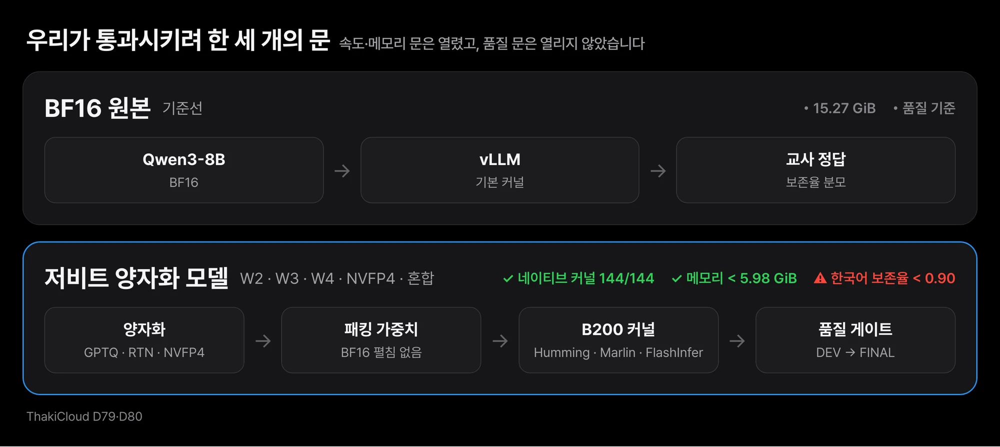
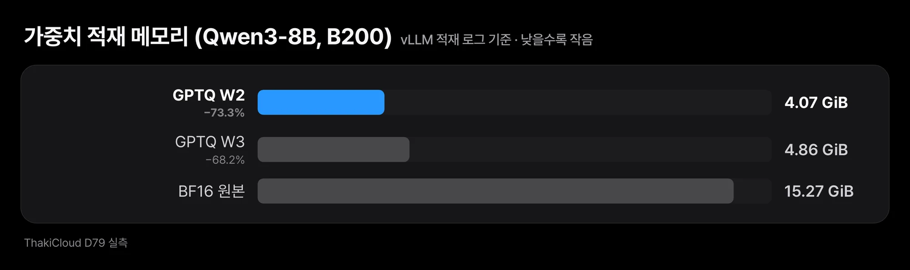
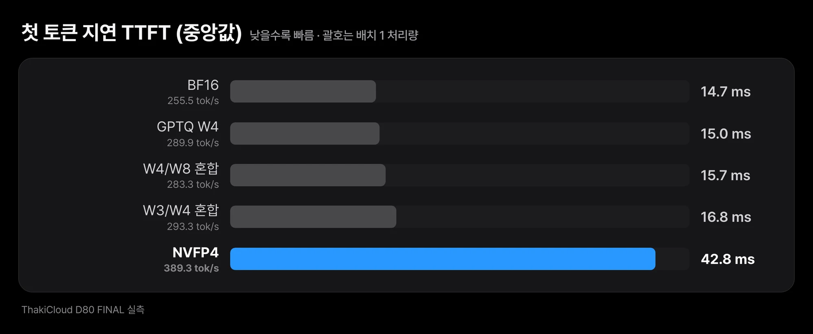
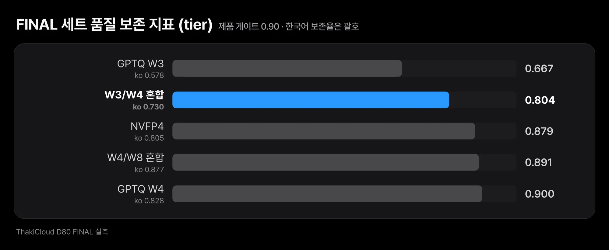
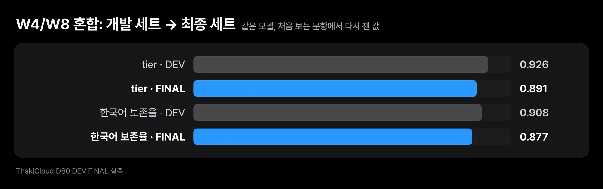

자가 호스팅 LLM의 GPU 비용을 줄이려고 저비트 양자화를 검토하는 엔지니어에게 드리는 실측 보고입니다. 다키클라우드는 NVIDIA B200에서 Qwen3-8B를 2비트부터 4비트까지 줄여 실제 서빙 경로로 돌렸습니다. 메모리와 커널 문제는 풀렸지만, 한국어 품질 기준을 통과한 모델은 아직 없습니다.

그래서 이 글은 성공 사례가 아닙니다. 어떤 문은 열렸고 어떤 문은 닫혀 있었는지를 숫자로 남기는 기술 리포트입니다. 품질 기준을 통과한 모델이 나오면 그때 따로 공개하겠습니다.

## 쉽게 말하면

여행 가방에 옷을 넣고 압축팩으로 공기를 빼는 장면을 떠올려 보시면 됩니다. 공기를 많이 뺄수록 가방은 작아집니다. 모델 양자화도 가중치 하나를 표현하는 비트 수를 줄여 GPU 메모리를 덜 쓰게 만드는 일입니다.

문제는 너무 세게 누르면 옷이 구겨진다는 점입니다. 2비트는 공기를 거의 다 뺀 상태에 가깝습니다. 가방은 가장 작아졌지만, 꺼낸 옷은 입을 수 없을 만큼 구겨졌습니다. 이 글의 나머지는 어디까지 누르면 옷이 버티는지, 어느 옷부터 구겨지는지를 잰 기록입니다.

## 우리가 통과시키려 한 세 개의 문

실험마다 같은 세 가지를 물었습니다. 첫째, 저비트 가중치가 BF16으로 펼쳐지지 않고 B200 전용 커널에서 그대로 도는가입니다. 둘째, 가중치 적재 메모리가 5.98 GiB 아래로 들어오는가입니다. 셋째, 원본 모델이 맞힌 문항을 양자화 모델도 맞히는가입니다.

셋째 기준은 원본이 맞힌 문항 가운데 양자화 모델이 계속 맞힌 비율인 보존율로 잽니다. 제품 기준은 전체 보존 지표(tier) 0.90 이상, 한국어 보존율 0.90 이상입니다. 숫자 문제와 추론 문제의 정확도 하락도 3%p 안쪽이어야 합니다.

*실행 경로는 끝까지 저비트로 돌았지만, 마지막 품질 게이트에서 모든 팔이 멈췄습니다.*

아래에서 "팔"은 비교 대상 설정 하나를 뜻합니다. 같은 모델을 같은 문항으로 재되, 양자화 방식만 바꾼 묶음입니다.

## 2비트는 메모리를 73% 줄였지만 답을 하나도 내지 못했습니다

BF16 원본은 가중치를 올리는 데 15.27 GiB를 씁니다. GPTQ 3비트는 4.86 GiB, 2비트는 4.07 GiB였습니다. 각각 68.2%와 73.3%를 줄인 셈입니다.

*2비트는 메모리를 73% 줄였지만 답을 내지 못했습니다.*

비트 수를 셀 때는 기준을 밝혀야 합니다. 선형층만 보면 3비트는 가중치당 3.125비트, 2비트는 2.125비트입니다. 임베딩과 출력층까지 넣은 모델 전체로는 5.08비트와 4.23비트입니다. "2비트 모델"이라는 이름만으로는 실제 메모리를 짐작하기 어렵습니다.

실행 경로 쪽은 기대한 그대로입니다. 어텐션 72개와 MLP 72개, 모두 144개 선형층이 저비트 전용 커널로 돌았습니다. 패킹된 가중치가 BF16으로 펼쳐지는 경로는 한 번도 잡히지 않았습니다. 배치 1 처리량도 GPTQ 2비트가 초당 304.9토큰으로 BF16의 253.8토큰보다 높았습니다.

그런데 답이 나오지 않았습니다. 2비트 팔의 품질 보존 지표는 0.115에 불과합니다. RTN 2비트는 생성 문항의 76%가 최대 길이에서 잘렸습니다. GPTQ 2비트는 99.9%가 잘렸고 연속한 두 단어 조합의 다양성(distinct-2)이 0.008까지 떨어졌습니다. 같은 구절을 끝없이 반복했다는 뜻입니다. 두 방식 모두 최종 답을 추출할 수 있는 응답이 하나도 없었습니다.

압축팩으로 치면 가방은 가장 작아졌지만 꺼낸 옷을 하나도 입을 수 없었던 경우입니다.

## 3비트에서 GPTQ는 RTN보다 확실히 낫지만 제품 기준에는 못 미칩니다

3비트에서는 양자화 방식의 차이가 크게 드러났습니다. 같은 문항을 짝지어 비교하면 GPTQ 3비트가 RTN 3비트보다 정답률이 29.9%p 높았습니다. 95% 신뢰구간은 27.9~32.0%p입니다. 숫자 문제에서는 차이가 64.6%p까지 벌어졌습니다.

그래도 GPTQ 3비트의 품질 보존 지표는 0.748이었습니다. 제품 기준 0.90과는 거리가 있습니다. 같은 세트에서 4비트 GPTQ는 0.898로 기준에 바짝 붙습니다. 비트를 하나 더 주면 옷이 덜 구겨진다는 것까지는 분명합니다.

## 메모리 상한 판정은 반올림 하나로 뒤집힐 수 있습니다

NVFP4 팔은 vLLM 적재 로그에 5.98 GiB로 찍혔습니다. 상한이 5.98 GiB 미만이니 이 값만 보면 탈락입니다. 하지만 로그는 소수 둘째 자리에서 반올림한 값입니다. 실제 값은 5.975~5.985 GiB 사이 어딘가였고 로그만으로는 통과인지 탈락인지 정할 수 없었습니다.

그래서 다음 실험부터 메모리 정의를 바꿨습니다. 적재 중에 실제로 올라간 가중치 바이트를 세고 반올림 없이 2³⁰으로 나눈 값이 5.98보다 작은지를 봅니다. 이 기준으로 NVFP4는 5.977 GiB로 통과했습니다. 경계선 근처에서는 측정 정의가 결론을 좌우한다는 점을 이때 배웠습니다.

## NVFP4는 처리량이 가장 높고 첫 토큰은 가장 늦습니다

B200의 FP4 경로인 NVFP4는 배치 1 처리량이 초당 389.3토큰으로 가장 높았습니다. BF16은 255.5토큰입니다. 반면 첫 토큰까지 걸린 시간(TTFT)은 중앙값 42.84 ms로 BF16의 14.68 ms보다 약 2.9배 길었습니다.

*NVFP4는 처리량이 가장 높지만 첫 토큰이 BF16보다 약 2.9배 늦습니다.*

이 차이는 한 번만 나온 값이 아닙니다. 앞선 실험에서 4B와 8B 모델을 NVFP4로 돌렸을 때도 TTFT가 BF16의 2.6~2.9배였습니다. GPTQ 4비트는 TTFT 15.04 ms로 BF16과 비슷했고 처리량은 초당 289.9토큰이었습니다. 긴 답을 뽑는 일괄 작업에는 NVFP4가, 사람이 기다리는 대화형 응답에는 GPTQ 계열이 유리한 구도입니다.

## GPTQ 4비트는 전체 지표를 겨우 넘었고 한국어에서 멈췄습니다

최종 평가 세트에서 GPTQ 4비트의 품질 보존 지표는 0.9002였습니다. 기준선을 아슬아슬하게 넘긴 값입니다. 그러나 한국어 보존율은 0.828이었습니다. 사전에 정해 둔 짝 비교에서는 GPTQ 4비트가 NVFP4보다 정답률이 2.0%p 높았고 신뢰구간은 0.7~3.4%p였습니다.

같은 4비트대라도 NVFP4의 한국어 보존율은 0.805였습니다. 여러 실험을 거치며 가장 일관되게 무너진 축이 한국어였습니다. 압축팩 안에서도 유독 쉽게 구겨지는 옷이 있었던 셈입니다.

## W3에 W4를 섞으면 품질이 재현 가능하게 오릅니다

다음으로 3비트 모델의 일부 층만 4비트로 되돌렸습니다. 144개 층 가운데 진단 세트에서 민감하게 나온 41개를 4비트로, 나머지 103개는 3비트로 두었습니다. 적재 메모리는 5.19 GiB입니다.

*W3/W4 혼합은 W3보다 크게 나아졌지만 어느 팔도 한국어 0.90을 넘지 못했습니다.*

이 혼합은 개발 세트에서 GPTQ 3비트보다 정답률이 7.5%p 높았습니다. 처음 보는 최종 세트에서도 10.3%p 높았고 신뢰구간은 8.6~12.0%p였습니다. 축별로는 숫자 문제 19.4%p, 추론 12.4%p, 한국어 5.8%p 상승입니다. 영어 개선 2.2%p는 신뢰구간이 0을 포함해 개선이라고 말하기 어렵습니다.

다만 절대 품질은 여전히 낮습니다. 품질 보존 지표 0.804, 한국어 보존율 0.730으로 품질 게이트를 모두 넘지 못했습니다. 3비트 대비 개선은 두 세트에서 재현됐지만, 제품으로 쓸 수 있는 수준까지는 오르지 않았습니다.

## 개발 세트에서 넘은 게이트가 최종 세트에서 다시 닫혔습니다

4비트 모델에서도 같은 방식을 썼습니다. 120개 층은 4비트로 두고 민감한 24개 층과 출력층을 8비트로 올렸습니다. 적재 메모리는 5.980 GiB로 상한 바로 아래입니다.

개발 세트 결과는 고무적이었습니다. 품질 보존 지표 0.926, 한국어 보존율 0.908로 두 기준을 모두 넘었습니다. 추론 문항 정확도 하락이 5.1%p로 남아 있었지만, 한국어 문제를 처음 넘긴 팔이었습니다.

*개발 세트에서 게이트를 넘던 값이 최종 세트에서 다시 아래로 내려갔습니다.*

처음 보는 최종 세트에서는 결과가 재현되지 않았습니다. 품질 보존 지표는 0.891, 한국어 보존율은 0.877로 내려갔습니다. 추론 정확도 하락도 9.0%p로 커졌습니다. 기준선 위에 있던 두 값이 모두 다시 기준 아래로 내려간 것입니다. 개발 세트에서 고른 층 구성이 그 세트에 맞춰져 있었을 가능성이 큽니다.

사전 계획에 없던 비교도 하나 덧붙입니다. 같은 최종 세트에서 이 혼합 모델은 순수 GPTQ 4비트보다 정답률이 2.4%p 낮았고 신뢰구간은 −3.6~−1.2%p였습니다. 이 값은 사후 탐색 결과라서 판정에는 쓰지 않았습니다. 8비트로 올린 층이 오히려 추론을 해쳤을 수 있다는 단서 정도로만 읽어 주시면 됩니다.

## 어느 층이 민감한지는 재는 방법마다 다르게 나왔습니다

혼합 정밀도의 성패는 어느 층을 보호하느냐에 달려 있습니다. 그래서 층 하나만 양자화했을 때의 손실과, 전부 양자화한 뒤 층 하나만 되돌렸을 때의 회복을 따로 쟀습니다. 손실은 출력 분포 차이(KL), 정답 로그우도, 정답 여유, 보존율 네 가지로 측정했습니다.

네 지표가 매긴 순위는 서로 거의 맞지 않습니다. 4비트 기준으로 지표 쌍 사이 Kendall τ 중앙값이 0.12와 0.15였습니다. 양자화 쪽 순위와 복원 쪽 순위의 상관도 0.29에 그쳤습니다. 압축팩으로 말하면 어느 옷이 잘 구겨지는지를 재는 방법마다 답이 달랐다는 뜻입니다. 이 순위로 몇 개 층을 보호하는 방식만 되풀이하지 않기로 한 이유입니다.

## 2비트는 양자화 격자를 바꿔도 살아나지 않았습니다

2비트가 무너진 이유가 대칭 격자 때문인지도 따져 볼 필요가 있었습니다. 대칭, 비대칭, 3값, 4단계 균형 격자 등 일곱 가지를 같은 진단 세트로 돌렸습니다. 결과는 일곱 격자 모두 같습니다. 반복 비율 100%, 잘림 비율 100%, 생성 문항 보존율 0입니다.

GPTQ 비대칭 2비트는 대칭보다 보존율이 4.7%p 높았습니다. 하지만 선택형 문항에서만 나온 차이였고 생성 문항은 여전히 하나도 살리지 못했습니다. 격자를 바꿔서 해결될 문제가 아니라고 판단하고 2비트 커널 패치 연구는 시작하지 않았습니다.

## 학습으로 되살리는 길도 이번 레시피에서는 막혔습니다

양자화 뒤 지식 증류로 품질을 되살리는 학습(QAD)도 시험했습니다. Qwen3-4B NVFP4 모델에서 증류 손실에 정답 교차 엔트로피를 더하자, 전체 정확도가 오히려 1.35%p 떨어졌습니다. 신뢰구간은 −2.63~−0.10%p였고 추론과 숫자 축이 특히 나빠졌습니다. 고정된 레시피 하나에서 나온 결과이므로 학습 기반 복구 전체를 부정하지는 않습니다.

## 결과를 한 표로 보면

최종 평가 세트(4,061문항) 기준 주요 팔을 모았습니다. 메모리는 반올림 없는 적재 바이트, 지연과 처리량은 배치 1 기준입니다.

| 팔 | 적재 메모리 | TTFT 중앙값 | 처리량 | tier | 한국어 보존율 |
|---|---|---|---|---|---|
| BF16 원본 | 15.27 GiB | 14.68 ms | 255.5 tok/s | 기준 | 기준 |
| NVFP4 | 5.977 GiB | 42.84 ms | 389.3 tok/s | 0.879 | 0.805 |
| GPTQ W4 | 5.684 GiB | 15.04 ms | 289.9 tok/s | 0.900 | 0.828 |
| W4/W8 혼합 | 5.980 GiB | 15.67 ms | 283.3 tok/s | 0.891 | 0.877 |
| W3/W4 혼합 | 5.191 GiB | 16.77 ms | 293.3 tok/s | 0.804 | 0.730 |
| GPTQ W3 | 4.864 GiB | 16.04 ms | 296.8 tok/s | 0.667 | 0.578 |

모든 양자화 팔이 메모리와 커널 기준은 통과했습니다. 한국어 보존율 0.90을 넘은 팔은 하나도 없었습니다.

## Paxis 업무 자동화의 실행 경제로 돌아가 보면

다키클라우드의 업무 자동화 플랫폼 Paxis는 고객 환경 안에서 모델을 직접 돌리는 경우가 많습니다. 모델이 작아지면 같은 GPU에 더 많은 작업을 올릴 수 있고 자가 호스팅의 단가가 내려갑니다. 그래서 저비트 양자화는 여전히 중요한 레버입니다.

하지만 업무 자동화에서 틀린 답은 한 번에 끝나지 않습니다. 잘못 고른 도구 호출이나 틀린 숫자는 뒤 단계 전체를 다시 돌리게 만듭니다. 이번 결과는 메모리 절감만으로 비용을 계산하면 안 된다는 점을 보여 줍니다. 한국어 품질을 유지하는 지점까지가 실제로 쓸 수 있는 압축률입니다.

## 지금까지의 결론과 다음 단계

정리하면 세 가지가 확인됐습니다. B200에서 2·3·4비트와 NVFP4 가중치를 BF16 펼침 없이 네이티브 커널로 서빙할 수 있습니다. NVFP4는 처리량에서, GPTQ 4비트는 첫 토큰 지연에서 유리합니다. 그리고 지금까지의 어떤 팔도 한국어 품질 기준을 넘지 못했습니다.

후속 실험은 진행 중입니다. 통과 조건은 이번과 같습니다. 한국어 보존율과 전체 보존 지표 0.90 이상, 적재 메모리 5.98 GiB 미만, 토큰당 지연 BF16 대비 1.10배 이내입니다. 여기에 처음 보는 최종 세트에서 결과가 재현되어야 하고 네이티브 패킹 커널로 돌아야 합니다. 이 조건을 모두 넘기 전에는 성공 사례로 공개하지 않겠습니다.

## 자주 묻는 질문

### 2비트 모델을 공개하지 않는 이유는 무엇입니까?

메모리와 속도는 좋지만 답을 내지 못하기 때문입니다. 생성 문항 대부분이 같은 구절 반복으로 잘렸고 추출 가능한 최종 답이 하나도 없었습니다.

### 4비트 GPTQ면 충분하지 않습니까?

전체 보존 지표 0.9002로 기준을 겨우 넘었지만 한국어 보존율이 0.828이었습니다. 한국어 업무에 쓰기에는 아직 손실이 큽니다.

### 개발 세트에서 통과한 모델을 왜 탈락시켰습니까?

선택에 쓴 세트에서 좋아 보이는 것은 그 세트에 맞춘 결과일 수 있습니다. 처음 보는 최종 세트에서 다시 재서 재현될 때만 통과로 봅니다. W4/W8 혼합은 그 과정에서 기준 아래로 내려갔습니다.

### NVFP4와 GPTQ 중 무엇을 골라야 합니까?

긴 출력을 일괄로 뽑는 작업이라면 처리량이 높은 NVFP4가 낫습니다. 사람이 첫 응답을 기다리는 대화형 서비스라면 TTFT가 BF16 수준인 GPTQ 계열이 낫습니다. 다만 두 경우 모두 한국어 품질을 따로 확인해야 합니다.

## 이 측정의 한계

모든 결과는 Qwen3-8B 한 모델, B200 한 종류, vLLM 0.29.0 한 버전에서 나왔습니다. 다른 모델이나 서빙 엔진에서는 숫자가 달라질 수 있습니다. 지연과 처리량은 배치 1 기준이며 동시 요청이 많은 환경의 처리량은 재지 않았습니다.

품질 평가는 원본이 맞힌 문항 기준 보존율입니다. 원본 모델 자체의 한국어 실력이 높다는 뜻은 아닙니다. 사후 비교는 판정에 쓰지 않았고 탐색 결과로만 표시했습니다. 평가 문항에는 외부 데이터셋이 포함되어 있어 문항 원문과 샘플은 공개하지 않습니다.

## 참고 자료

- [GPTQ: Accurate Post-Training Quantization for Generative Pre-trained Transformers](https://arxiv.org/abs/2210.17323)
- [vLLM 문서: Quantization](https://docs.vllm.ai/en/latest/features/quantization/)
- [NVIDIA: Introducing NVFP4 for Efficient and Accurate Low-Precision Inference](https://developer.nvidia.com/blog/introducing-nvfp4-for-efficient-and-accurate-low-precision-inference/)
- [Qwen3 기술 보고서](https://arxiv.org/abs/2505.09388)
