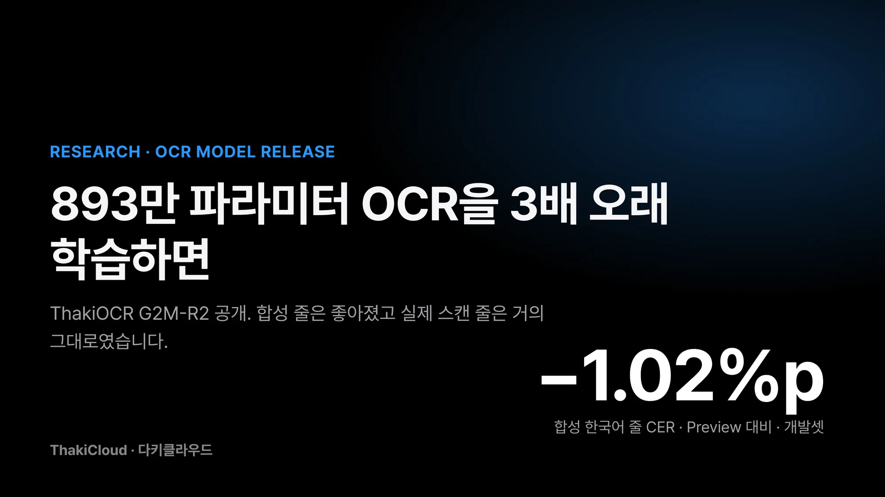
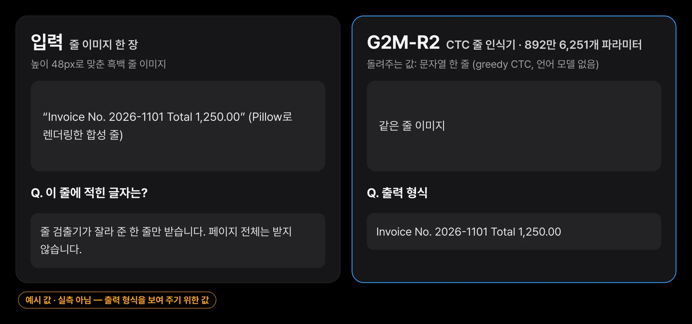
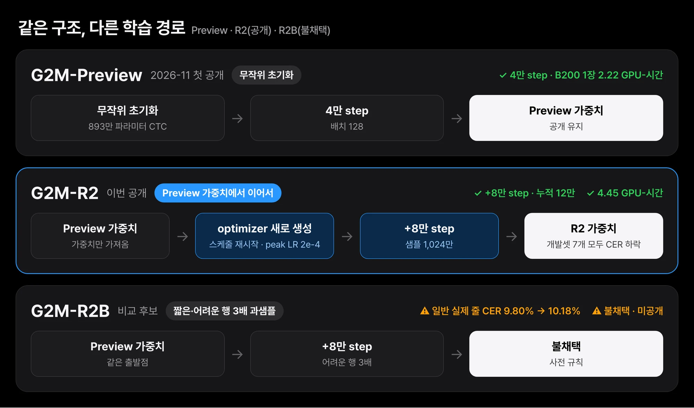
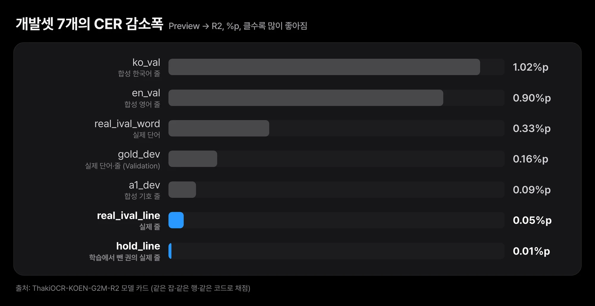

작은 문자 인식 모델을 쓰는 개발자는 비슷한 고민을 합니다. 모델을 키우기 전에 같은 모델을 더 오래 학습하면 충분하지 않을까 하는 고민입니다. 그래픽 카드 한 장으로 몇 시간만 더 돌리면 되니 가장 싼 선택처럼 보입니다. 다키클라우드는 이 질문을 893만 개의 가중치를 가진 한국어·영어 줄 인식 모델로 직접 확인했습니다.

결과는 반반입니다. 합성 한국어 줄의 글자 오류율은 6.38%에서 5.36%로 내려갔습니다. 그런데 실제 스캔 문서 줄은 8.43%에서 8.37%로 거의 그대로였습니다. 학습량만 늘린 효과는 생각보다 좁았습니다.

이전에 공개한 [ThakiOCR G2M-Preview](/tech-blog/ko/research/thakiocr-g2m-numbers-and-symbols/)는 4만 step을 학습한 모델입니다. 그 가중치에서 8만 step을 더 학습했습니다. 누적 12만 step으로 3배가 된 이 모델을 [ThakiOCR-KOEN-G2M-R2](https://huggingface.co/ThakiCloud/ThakiOCR-KOEN-G2M-R2)로 공개했습니다. 이 글에서는 학습을 어떻게 이어 갔는지부터 다룹니다. 이어서 좋아진 곳과 그대로인 곳, 그리고 버린 비교 후보 하나를 설명합니다. R2는 연구 프리뷰이며 제품용으로는 NO-GO입니다. 성능이 최고 수준이라고 주장하지 않습니다.


*ThakiOCR-KOEN-G2M-R2 요약. 수치는 R2 후보 선택에도 쓴 개발 평가셋에서 잰 값입니다.*

## 쉽게 말하면

같은 문제집을 세 번 푸는 학생을 떠올리면 됩니다. 두 번째, 세 번째로 풀수록 그 문제집 점수는 오릅니다. 그런데 처음 보는 시험지 점수는 생각만큼 오르지 않습니다. 문제집에 실린 유형만 더 익숙해졌기 때문입니다.

R2가 바로 이런 경우였습니다. 합성 줄은 사실상 끝없이 새로 만들 수 있어서 학습을 늘리면 그만큼 새 문제를 풉니다. 반면 실제 스캔 줄은 고유 이미지가 28,061장뿐이라 같은 장을 평균 약 115번씩 봤습니다. 같은 문제집을 115번 푼 셈입니다.

## 구조는 그대로 두고 학습만 이어 갔습니다

R2의 구조와 전처리는 Preview와 같습니다. 잘라 낸 텍스트 한 줄을 받아 문자열 하나를 돌려주는 CTC 줄 인식기입니다. CTC는 글자 위치를 따로 맞추지 않고 줄 전체를 한 번에 읽어 글자열로 옮기는 학습 방식입니다. 파라미터는 8,926,251개이고 출력할 수 있는 글자는 14,250자입니다. 라이선스는 Apache-2.0입니다.


*입력은 잘라 낸 텍스트 줄 이미지 한 장, 출력은 문자열 하나입니다. 카드 속 문장은 inference.py --demo 가 렌더링하는 합성 줄이며, 출력 칸은 형식 예시일 뿐 실제 추론 결과가 아닙니다.*

출발점은 Preview 가중치입니다. 가중치만 가져왔습니다. optimizer는 새로 만들었고 학습률 스케줄도 처음부터 다시 돌렸습니다. 배치는 128, 최고 학습률은 2e-4입니다. B200 한 장에서 4.45 GPU-시간이 걸렸습니다.

학습에 뽑은 샘플은 1,024만 개입니다. NVIDIA 합성 한국어 줄이 35%, 합성 영어 줄이 15%입니다. AI 허브(AI-Hub) 데이터셋 71299의 Training 줄이 31.5%, 같은 데이터의 단어가 3.5%입니다. 나머지 15%는 다키클라우드가 만든 합성 기호 줄입니다. 학습 이미지와 평가 이미지는 SHA-256 해시로 대조했고 겹치는 이미지는 없었습니다.


*R2는 Preview 가중치에서 출발해 8만 step을 더 학습했습니다. 짧은·어려운 행을 3배로 뽑은 R2B는 일반 실제 줄이 나빠져 학습 전에 정한 규칙대로 고르지 않았습니다.*

## 개발셋 7개가 모두 좋아졌지만 개선은 합성 줄에 몰렸습니다

두 모델은 같은 잡에서 같은 행과 같은 코드로 채점했습니다. Preview는 학습 시작 전에, R2는 학습이 끝난 뒤에 쟀습니다. 낮을수록 좋은 CER이고 시드는 1개입니다.

| 평가셋 | 내용 | G2M-Preview | G2M-R2 | 변화(%p) |
|---|---|---|---|---|
| ko_val | NVIDIA 합성 한국어 줄 | 6.38% | **5.36%** | −1.02 |
| en_val | NVIDIA 합성 영어 줄 | 5.49% | **4.59%** | −0.90 |
| gold_dev | AI 허브 71299 Validation 단어·줄 | 4.34% | **4.17%** | −0.16 |
| real_ival_word | AI 허브 71299 내부 검증 단어 | 8.87% | **8.53%** | −0.33 |
| real_ival_line | AI 허브 71299 내부 검증 줄 | 8.43% | **8.37%** | −0.05 |
| hold_line | 학습에서 뺀 권(volume)의 실제 줄 | 4.47% | **4.46%** | −0.01 |
| a1_dev | 다키클라우드 합성 기호 줄 | 0.36% | **0.28%** | −0.09 |

7개 모두 내려갔다는 점은 분명합니다. 하지만 크게 움직인 것은 합성 줄 두 개였습니다. 실제 스캔 줄 두 개는 0.05%p와 0.01%p라서 개선이라고 부르기 어렵습니다. 즉, 사람 말로는 문제집 점수는 올랐고 처음 보는 시험지 점수는 거의 그대로라는 뜻입니다.


*합성 줄(ko_val·en_val)에서 약 1%p씩 내려갔고 실제 스캔 줄(real_ival_line·hold_line)은 0.05%p, 0.01%p에 그쳤습니다. 모두 R2 선택에 쓴 개발셋이며 시드 1개입니다.*

이 7개는 모두 개발 평가셋입니다. R2 후보 두 개 중 하나를 고르는 데 썼으므로 독립 테스트셋이 아닙니다. Preview 카드에 실린 독립 평가(기호 테스트, 실제 홀드아웃)는 이번에 다시 돌리지 않았습니다.

## 짧은 실제 텍스트는 오히려 조금 나빠졌습니다

평균만 보면 놓치는 부분이 있습니다. 공백을 뺀 세 글자 이하의 실제 줄에서 CER이 32.76%에서 33.91%로 올랐습니다. 해당 줄은 49개뿐이라 표본이 작습니다. 짧은 실제 단어도 8.68%에서 8.72%로 조금 올랐습니다.

아주 짧은 필드는 이 모델이 가장 약한 곳입니다. 서식의 칸 하나에 든 두세 글자가 여기에 해당합니다. 학습을 늘려도 이 약점은 줄지 않았습니다.

날짜도 그대로입니다. 실제 개발 줄에서 날짜 토큰 완전 일치는 44%에서 55% 사이였습니다. 연도 점 뒤에 공백이 있는 `YYYY. M.DD` 형식에 약한 점은 Preview 때와 같습니다.

두 원화 기호 `₩`와 `￦`를 헷갈리는 문제는 R2에서 다시 재지 않았습니다. 그래서 해결됐는지 알 수 없습니다. 정확한 코드 포인트가 필요하다면 이 모델에 맡기지 않아야 합니다.

## 어려운 행을 더 보여 준 후보는 규칙대로 버렸습니다

R2와 함께 R2B라는 후보를 학습했습니다. 출발점과 step 수는 같고 짧은 행과 어려운 행을 3배로 늘려 뽑았습니다. 약점을 직접 더 연습시키면 나아질지 보려는 시도였습니다.

R2B는 합성 데이터와 숫자·기호 행에서는 R2보다 좋았습니다. 그런데 실제 줄 가운데 숫자·기호도 없고 짧지도 않은 일반 행의 CER이 9.80%에서 10.18%로 올랐습니다. 학습 전에 "일반 실제 텍스트가 나빠지는 후보는 고르지 않는다"는 규칙을 정해 두었습니다. 그래서 R2B는 고르지 않았고 공개하지도 않습니다.

즉, 사람 말로는 약한 유형만 더 연습시키자 평범한 문장 실력이 떨어졌다는 뜻입니다. 결과를 본 뒤에 기준을 바꾸지 않으려고 규칙을 먼저 적어 둔 것입니다.

## 공개본을 토큰 없이 내려받아 다시 돌려 봤습니다

공개로 바꾼 뒤 로그인하지 않은 환경에서 공개 리비전(01be3221)을 내려받았습니다. 파일 9개의 해시가 원본과 모두 일치했습니다. 그다음 CPU fp32로 ko_val과 en_val에서 각각 512행을 다시 읽혔습니다.

예측 문자열은 한국어 512행 중 511행, 영어 512행 중 510행이 학습 환경 결과와 같았습니다. 1,024행 중 3행이 달랐습니다. CPU와 GPU의 연산 차이 때문으로 추정합니다. 같은 행의 CER은 한국어 4.47% 대 4.47%, 영어 4.93% 대 4.94%였습니다. 그래서 완전히 같은 결과가 재현된다고 말하지는 않습니다.

## 쓰기 전에 알아 둘 한계

- **실제 이미지 개선이 거의 없습니다.** 실제 스캔 줄 CER은 8.43%에서 8.37%로 바뀌었을 뿐입니다.
- **짧은 실제 텍스트는 조금 나빠졌습니다.** 세 글자 이하 실제 줄은 32.76%에서 33.91%로 올랐습니다(49행).
- **날짜와 원화 기호는 그대로이거나 미확인입니다.** `YYYY. M.DD` 약점은 남아 있고 `₩`/`￦` 혼동은 다시 재지 않았습니다.
- **독립 테스트가 아닙니다.** 모든 수치가 후보 선택에도 쓴 개발셋에서 나왔고 시드는 1개입니다.
- **금융·계약 문서의 핵심 필드에 쓰면 안 됩니다.** 금액, 계좌·식별 번호, 날짜, 계약 조건은 사람이 확인해야 합니다.
- **줄 입력만 받습니다.** 페이지에서 글자 위치를 찾지 못하므로 줄 검출기와 함께 써야 합니다.

## Paxis 문서 업무에서는 검증 단계 앞에 둡니다

Paxis에서 문서 업무를 자동화할 때 OCR은 값을 채우는 첫 단계일 뿐입니다. R2 같은 작은 줄 OCR은 CPU에서도 돌아가서 내부망에 두기 쉽습니다. 다만 짧은 필드와 날짜가 약하므로 그 뒤에 중요 필드 검증과 사람 확인을 둬야 합니다. 이런 구성은 [Paxis 검증 글](/tech-blog/ko/agentops/thakiocr-paxis-verify-before-commit/)에서 다룹니다.

## 끝으로

같은 893만 파라미터 모델을 3배 오래 학습하자 개발셋 7개가 모두 좋아졌습니다. 하지만 좋아진 곳은 대부분 끝없이 새로 만들 수 있는 합성 줄이었습니다. 실제 스캔 줄은 거의 그대로였고 짧은 실제 텍스트는 조금 나빠졌습니다. 같은 문제집을 더 푸는 것으로는 처음 보는 시험지 점수가 오르지 않았습니다.

그래서 다음 연구 R3-Real은 학습 시간이 아니라 실제 이미지 쪽을 봅니다. 실제 이미지의 다양성을 늘리고 실제 촬영에 가까운 증강을 넣어 볼 계획입니다. 결과는 아직 알 수 없습니다.

직접 써 보려면 모델 저장소를 받아 `python inference.py --demo`부터 돌려 보면 됩니다. 비교할 수 있도록 [Preview 저장소](https://huggingface.co/ThakiCloud/ThakiOCR-KOEN-G2M-Preview)도 그대로 두었습니다.

```bash
pip install torch numpy pillow safetensors
python inference.py line.png              # one or more line images
python inference.py --demo                # renders an English line and reads it back
```

## 출처와 데이터

- 모델: [ThakiCloud/ThakiOCR-KOEN-G2M-R2](https://huggingface.co/ThakiCloud/ThakiOCR-KOEN-G2M-R2) (Apache-2.0, 연구 프리뷰, 리비전 01be3221). 이 글의 수치는 모두 모델 카드와 같은 실험 원장에서 옮겼습니다.
- 학습 데이터: NVIDIA OCR-Synthetic-Multilingual-v1(CC BY 4.0), AI 허브(AI-Hub) 데이터셋 71299(Training 분할), SIL OFL 1.1 글꼴로 만든 합성 기호 줄.
- AI 허브 데이터와 그 가공물은 재배포하지 않습니다. 모델 저장소와 이 글에는 AI 허브 이미지, 크롭, 라벨이 들어 있지 않습니다.
- 이전 글: [ThakiOCR G2M: 숫자와 기호를 더 정확하게 읽는 두 번째 공개 모델](/tech-blog/ko/research/thakiocr-g2m-numbers-and-symbols/) · [한국어 OCR 오픈소스 모델 5종 비교](/tech-blog/ko/research/korean-ocr-open-models-2m-to-27b/)
