작은 문자 인식 모델을 실제 서류에 붙여 본 개발자라면 같은 장면을 겪습니다. 합성 문장으로 잰 점수는 좋은데 스캐너로 읽은 신청서에서는 틀린 글자가 자꾸 나옵니다. 그래서 학습을 더 돌려 보지만 실제 문서 점수는 잘 움직이지 않습니다.

다키클라우드도 지난번에 이 벽을 확인했습니다. 893만 파라미터 한국어·영어 줄 인식 모델을 3배 오래 학습했더니 합성 문장의 글자 오류율은 약 1%p씩 내려갔습니다. 그런데 실제 스캔 줄은 8.43%에서 8.37%로 거의 그대로였습니다. 글자 오류율은 정답 글자 가운데 틀리게 읽은 비율이고 낮을수록 좋습니다. 이 글에서는 영어 약자인 CER로 적습니다. 지난 실험은 [G2M-R2 공개 글](/tech-blog/ko/research/thakiocr-g2m-r2-three-times-training/)에 정리했습니다.

이번에는 학습 시간 대신 학습 데이터를 바꿨습니다. 실제 문서 출처를 하나 더 넣은 R3A와, 데이터는 그대로 두고 촬영 상태를 흉내 낸 변형을 넣은 R3B를 나란히 학습했습니다. 둘 다 실제 줄 CER을 내렸지만 고친 오류의 모양이 달랐습니다. 합성 성능을 덜 잃은 R3A를 [ThakiOCR-KOEN-G2M-R3](https://huggingface.co/ThakiCloud/ThakiOCR-KOEN-G2M-R3)로 공개했습니다. 실제 줄 CER은 8.37%에서 8.16%로 내려갔습니다.

이 글에서는 두 방법이 무엇을 바꿨는지, 결과를 보기 전에 어떤 규칙을 정해 두었는지, 그 규칙으로 무엇을 골랐는지를 차례로 설명합니다. 개선 폭은 약 0.2%p로 작습니다. 모든 수치는 시드 1개로 잰 개발셋 결과이며 독립 테스트가 아닙니다.

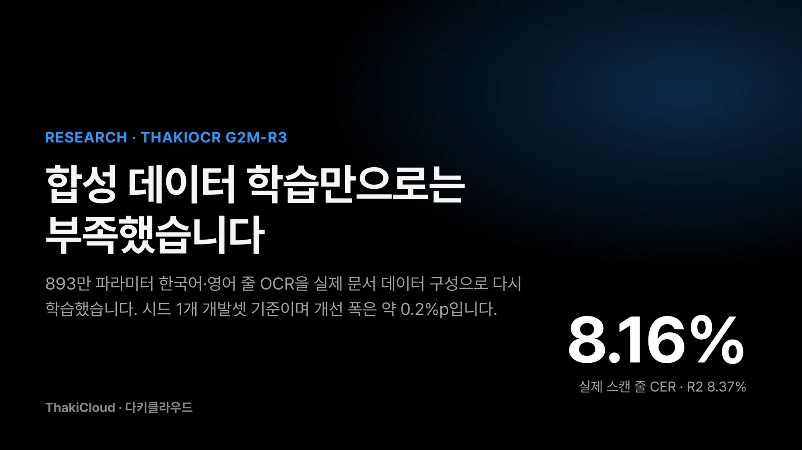
*ThakiOCR-KOEN-G2M-R3 요약. 수치는 후보 선택에도 쓴 개발 평가셋 값입니다.*

## 쉽게 말하면

지난 글의 비유를 이어 가겠습니다. R2는 같은 문제집을 115번 푼 학생이었습니다. 문제집 점수는 올랐지만 처음 보는 시험지 점수는 거의 그대로였습니다.

이번에는 학생에게 두 가지를 시켜 봤습니다. R3A는 다른 출판사 문제집을 한 권 더 사 주고 원래 문제집을 푸는 횟수를 줄인 경우입니다. R3B는 원래 문제집을 그대로 두되 흐리게 복사하거나 비뚤게 찍은 종이로 푸는 연습을 시킨 경우입니다.

두 학생 모두 시험 점수가 조금 올랐습니다. 다만 새 문제집을 받은 학생은 짧은 단어 문제에서 더 나아졌습니다. 흐린 종이로 연습한 학생은 긴 문장 문제에서 더 나아졌습니다. 흐린 종이 연습을 한 학생은 원래 깨끗한 문제집 점수를 더 많이 잃었습니다.

<!-- nlm-visual -->
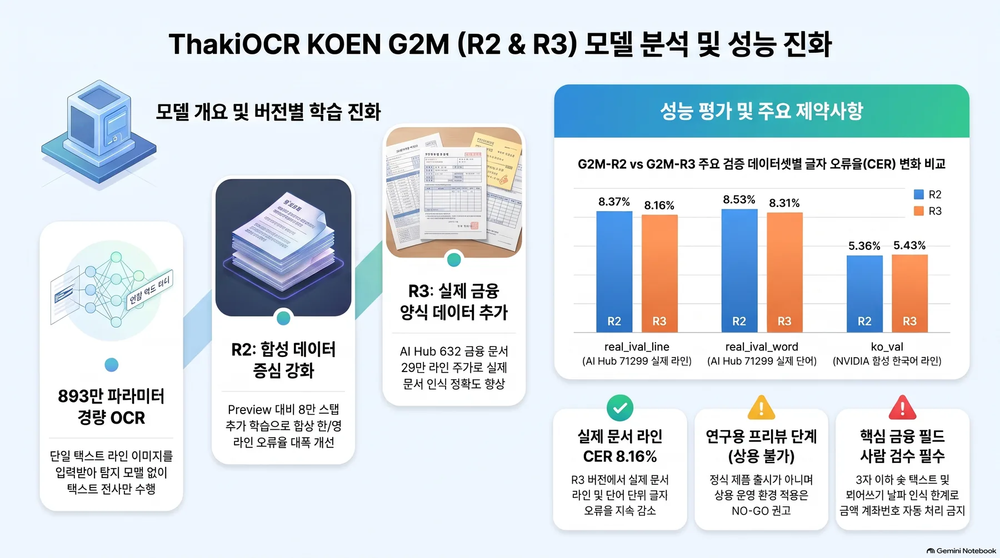
*NotebookLM이 소스를 종합해 생성한 인포그래픽입니다.*

## 구조는 그대로 두고 데이터만 한 가지씩 바꿨습니다

두 후보의 출발점은 공개된 G2M-R2 가중치입니다. 구조와 전처리는 R2와 같습니다. 잘라 낸 텍스트 한 줄을 받아 문자열 하나를 돌려주는 CTC 줄 인식기이고 파라미터는 8,926,251개입니다. CTC는 글자 위치를 따로 맞추지 않고 줄 전체를 한 번에 글자열로 옮기는 학습 방식입니다.

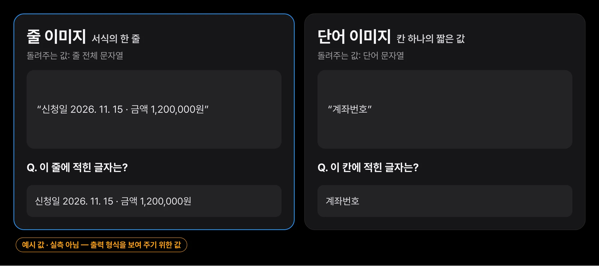
*입력은 잘라 낸 텍스트 줄 이미지 한 장, 출력은 문자열 하나입니다. 카드 속 문장은 직접 만든 형식 예시이며 실제 추론 결과가 아닙니다.*

학습 설정은 두 후보가 같습니다. optimizer는 새로 만들었고 학습률은 1e-4, 배치는 128, 시드는 42입니다. B200 한 장에서 먼저 1만 step 파일럿을 돌렸습니다. 파일럿이 미리 정한 개선 조건을 넘으면 같은 설정으로 2만 step을 더 이어 갔습니다.

R3A는 실제 문서 출처를 바꿨습니다. 금융 서식 문서인 AI 허브(AI-Hub) 금융업 특화 문서 OCR 데이터(632)의 Training 분할을 학습 샘플의 30%로 넣었습니다. 대신 R2가 의존하던 AI 허브(AI-Hub) OCR 데이터(공공)(71299) 비중은 35%에서 20%로 줄였습니다. 같은 실제 줄을 평균 약 115번 보던 것이 약 25번으로 줄도록 설계한 비율입니다. 나머지는 NVIDIA 합성 줄 35%와 다키클라우드 합성 기호 줄 15%입니다.

R3B는 데이터 비율을 R2와 같게 두고 학습 이미지에만 변형을 넣었습니다. 이런 변형을 증강이라고 부릅니다. 조명과 대비 변화, JPEG 압축, 흐림, 저해상도, 약한 기울임·회전·원근 왜곡, 잡음을 섞었습니다. 실제 이미지에는 60%, 합성 이미지에는 30% 확률로 적용했습니다. 글자를 잘라 내거나 정답을 바꾸는 변형은 쓰지 않았습니다.

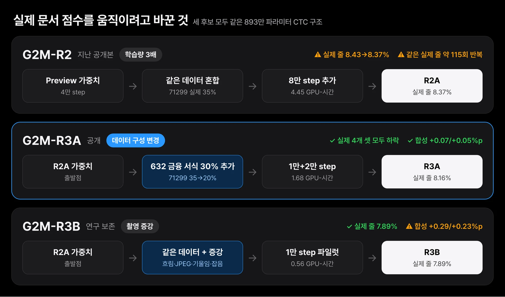
*R2는 학습 시간만 늘렸습니다. R3A는 실제 문서 출처를 하나 더 넣었고, R3B는 같은 데이터에 촬영 증강을 넣었습니다.*

평가셋과 홀드아웃은 두 후보 모두 학습에 쓰지 않았습니다. 71299 공식 Validation 분할과 632 봉인 평가셋, 평가 전용으로 받은 다른 AI 허브 데이터도 학습에서 뺐습니다.

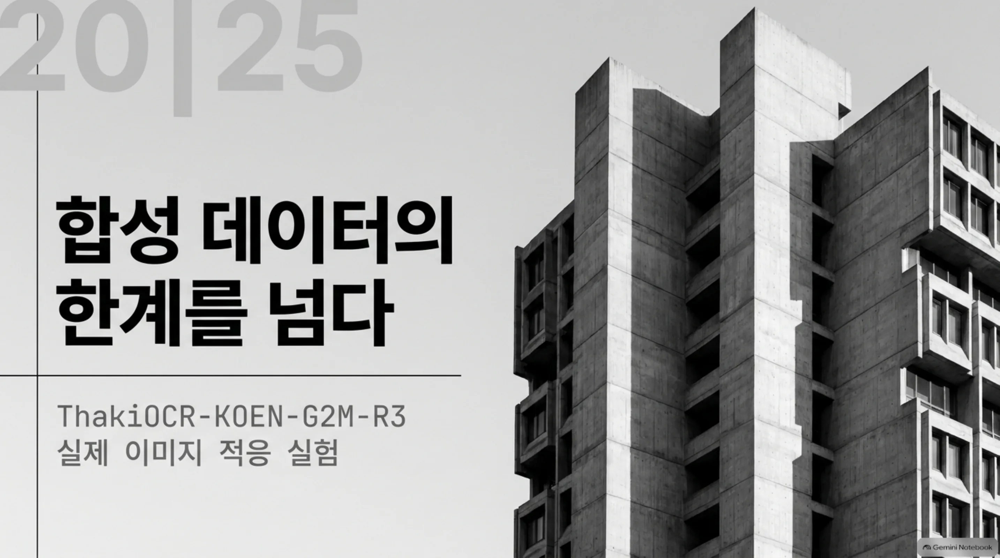

## 결과를 보기 전에 고르는 규칙을 적어 두었습니다

작은 차이를 다루는 실험에서는 결과를 본 뒤 유리한 지표를 고르기 쉽습니다. 그래서 고르는 규칙을 실험 원장에 먼저 적었습니다. 규칙은 두 번에 나눠 정했습니다.

첫 번째 규칙은 학습을 시작하기 전에 정했습니다. 파일럿이 "개선"으로 인정되려면 실제 줄과 실제 단어 CER이 모두 출발점보다 낮아야 합니다. 또 실제 평가셋 네 개 가운데 어느 것도 0.10%p 넘게 나빠지면 안 됩니다. 합성 평가셋이 0.5%p 넘게 나빠지면 따로 표시합니다.

두 번째 규칙은 처음 계획에 없었습니다. 파일럿 결과를 본 뒤 추가했고 연장 학습 결과를 읽기 전에 원장에 고정했습니다. 연장본은 실제 줄과 실제 단어에서 파일럿보다 나빠지지 않을 때만 채택합니다. 그렇지 않으면 파일럿 체크포인트를 그대로 씁니다. R3A와 R3B 가운데 최종 후보는 실제 이미지 개선 폭과 합성 성능 손실을 함께 보고 고릅니다.

즉, 사람 말로는 "실제 문서에서 하나라도 나빠지면 버린다"를 먼저 적고 결과를 열었다는 뜻입니다.

## R3A는 실제 평가셋 네 개를 모두 조금씩 내렸습니다

세 체크포인트는 같은 평가 행과 같은 코드로 채점했습니다. R2A는 공개된 G2M-R2와 같은 가중치입니다.

| 평가셋 | 내용 | R2A(출발점) | R3A 파일럿 | R3A 연장(공개) | 변화(%p) |
|---|---|---|---|---|---|
| real_ival_line | AI 허브 71299 내부 검증 줄 | 8.37% | 8.17% | **8.16%** | −0.21 |
| real_ival_word | AI 허브 71299 내부 검증 단어 | 8.53% | 8.36% | **8.31%** | −0.22 |
| gold_dev | AI 허브 71299 Validation 단어·줄 | 4.17% | 4.12% | **4.09%** | −0.08 |
| hold_line | 학습에서 뺀 권(volume)의 실제 줄 | 4.46% | 4.40% | **4.38%** | −0.08 |
| ko_val | NVIDIA 합성 한국어 줄 | 5.36% | 5.50% | 5.43% | +0.07 |
| en_val | NVIDIA 합성 영어 줄 | 4.59% | 4.69% | 4.64% | +0.05 |

연장본은 실제 줄과 단어에서 파일럿보다 나빠지지 않았습니다. 그래서 규칙대로 연장본을 골랐습니다. 실제 평가셋 네 개가 모두 내려갔고 합성 줄은 0.07%p와 0.05%p 올랐습니다.

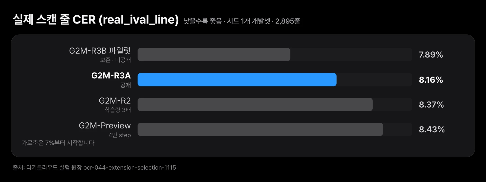
*R2A 대비 R3A의 실제 평가셋 CER 변화. 네 개 모두 내려갔고 폭은 0.08~0.22%p입니다. 시드 1개 개발셋 값입니다.*

R2 글에서 실제 스캔 줄은 3배 학습으로 0.05%p 움직였습니다. 이번에는 그보다 적은 학습으로 0.21%p 움직였습니다. 학습 시간이 아니라 데이터 구성이 이 숫자를 움직였다고 볼 근거입니다. 하지만 0.2%p는 여전히 작은 차이입니다. 시드를 바꿔 다시 학습하면 이 정도는 흔들릴 수 있습니다. 그 폭은 아직 재지 않았습니다.

새로 넣은 632 쪽은 차이가 컸습니다. 학습에 없던 서식의 632 개발 줄 CER이 파일럿에서 10.88%에서 6.63%로 내려갔습니다. 다만 학습 데이터와 같은 출처라 이 숫자는 선택 근거로 쓰지 않았습니다.

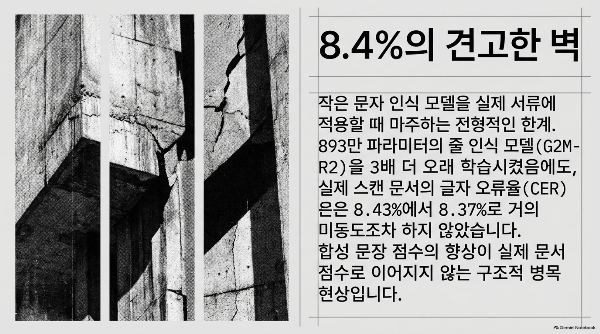

## R3B는 줄 단위에서 더 좋았지만 다른 곳을 더 잃었습니다

증강을 넣은 R3B도 파일럿 개선 조건을 넘었습니다. 실제 줄 CER은 R3A보다 더 많이 내려갔습니다.

| 평가셋 | R2A | R3B 파일럿(보존) | R3B 연장(기각) | R3A 연장(공개) |
|---|---|---|---|---|
| real_ival_line | 8.37% | **7.89%** | 7.82% | 8.16% |
| real_ival_word | 8.53% | 8.44% | 8.53% | **8.31%** |
| gold_dev | 4.17% | 4.19% | 4.11% | **4.09%** |
| hold_line | 4.46% | **4.35%** | 4.33% | 4.38% |
| ko_val | 5.36% | 5.65% | 5.52% | **5.43%** |
| en_val | 4.59% | 4.82% | 4.72% | **4.64%** |

R3B 연장본은 실제 줄에서 7.82%로 표 전체에서 가장 낮았습니다. 그런데 실제 단어 CER이 파일럿 8.44%에서 8.53%로 올라 출발점과 같아졌습니다. 두 번째 규칙대로 연장본은 버리고 파일럿을 R3B 후보로 남겼습니다.

그다음 R3A 연장본과 R3B 파일럿을 비교했습니다. 실제 평가셋 네 개는 둘이 나눠 가졌습니다. R3A는 단어(8.31% 대 8.44%)와 gold_dev(4.09% 대 4.19%)에서 앞섰습니다. R3B는 줄(7.89% 대 8.16%)과 hold_line(4.35% 대 4.38%)에서 앞섰습니다. 네 개 평균은 6.24% 대 6.22%로 사실상 같았습니다.

남은 기준은 합성 성능 손실이었습니다. R2A 대비 R3A는 합성 한국어 +0.07%p, 영어 +0.05%p였고 R3B는 +0.29%p, +0.23%p였습니다. 일반 성능을 덜 잃은 R3A를 골랐습니다.

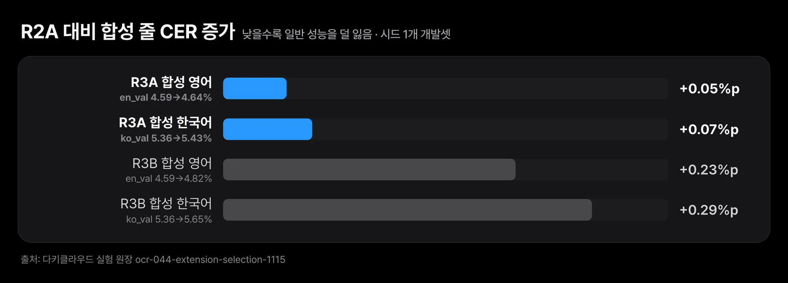
*실제 평가셋 네 개는 두 후보가 비겼고, 합성 줄 손실은 R3A가 더 작았습니다. 그래서 R3A를 골랐습니다.*

즉, 사람 말로는 R3A가 모든 지표에서 이긴 것이 아니라 비긴 상황에서 덜 잃은 쪽을 골랐다는 뜻입니다. 줄 단위 실제 문서만 본다면 R3B가 더 나은 선택일 수 있습니다. R3B 체크포인트는 공개하지 않고 연구용으로 보존합니다.

## 두 방법이 고친 오류는 모양이 달랐습니다

같은 0.2%p 안팎이라도 어디서 나왔는지가 다릅니다. 실제 문서 출처를 늘린 R3A는 단어 단위 평가에서 더 좋아졌습니다. 짧은 단어 크롭은 글자 하나하나의 모양이 결과를 좌우합니다. 새 출처의 다양한 글꼴과 서식이 여기에 도움이 됐다고 추정합니다.

증강을 넣은 R3B는 줄 단위 평가에서 더 좋아졌습니다. 긴 줄에는 흐림, 기울어짐, 고르지 않은 조명이 줄 전체에 걸쳐 나타납니다. 촬영 변형을 연습한 효과가 여기서 나왔다고 추정합니다. 대신 깨끗한 합성 줄 점수를 더 많이 잃었습니다.

두 추정 모두 오류 사례를 하나하나 분류해 확인한 결과는 아닙니다. 평가셋별 CER 차이에서 읽은 해석입니다. 두 방법을 합치면 둘의 장점이 모두 남는지도 아직 시험하지 않았습니다.

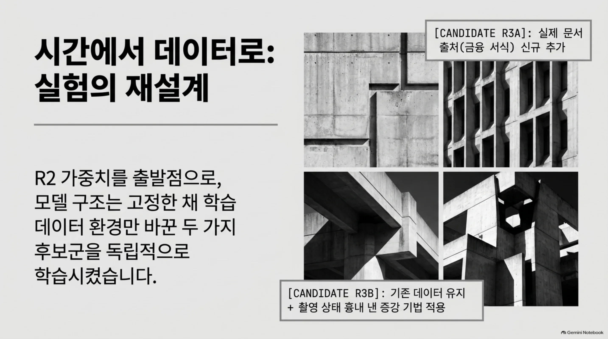

## 학습 비용은 그래픽 카드 한 장으로 두 시간이 안 됩니다

R3A는 파일럿 0.57 GPU-시간과 연장 1.11 GPU-시간을 합쳐 B200 한 장에서 1.68 GPU-시간을 썼습니다. R3B도 파일럿과 연장을 합쳐 1.67 GPU-시간이었습니다. R2가 4.45 GPU-시간을 써서 실제 줄을 0.05%p 움직인 것과 비교하면, 데이터 구성 실험이 훨씬 싼 편이었습니다.

## 공개본을 토큰 없이 내려받아 다시 돌려 봤습니다

공개로 바꾼 뒤 로그인하지 않은 환경에서 공개 리비전(59fd1fbe)을 내려받았습니다. 내려받은 가중치 파일의 해시는 원본과 같았습니다. 그다음 CPU fp32로 합성 한국어 줄과 합성 영어 줄에서 각각 512행을 다시 읽혔습니다.

예측 문자열은 한국어 512행과 영어 512행이 모두 학습 환경 결과와 같았습니다. 같은 행의 CER도 한국어 4.75%, 영어 5.02%로 일치했습니다. R2 때는 1,024행 중 3행이 달랐는데 이번에는 다른 행이 없었습니다. 다만 512행씩만 확인한 결과입니다.

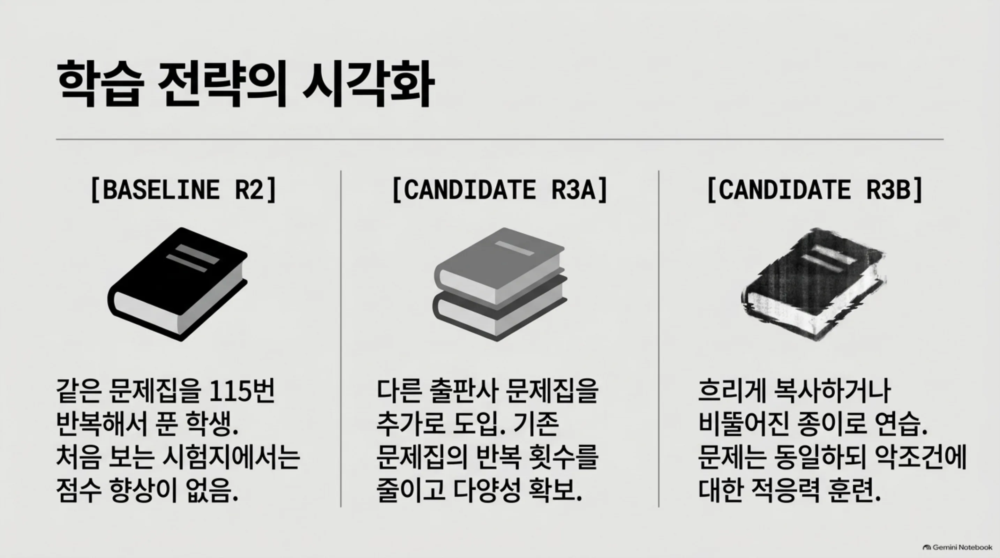

## 쓰기 전에 알아 둘 한계

- **개선 폭이 작습니다.** 실제 평가셋 개선은 0.08~0.22%p입니다. 시드 1개 결과이고 시드 간 흔들림은 재지 않았습니다.
- **독립 테스트가 아닙니다.** 모든 수치가 후보 선택에 쓴 개발셋에서 나왔습니다.
- **모든 지표에서 R2보다 낫지 않습니다.** 합성 한국어 줄은 5.36%에서 5.43%로, 합성 영어 줄은 4.59%에서 4.64%로 조금 나빠졌습니다.
- **R3B보다 모든 면에서 낫지도 않습니다.** 실제 줄 CER만 보면 R3B 파일럿이 7.89%로 더 낮습니다.
- **R2 때의 약점은 다시 재지 않았습니다.** 세 글자 이하 짧은 줄, `YYYY. M.DD` 날짜 형식, `₩`/`￦` 혼동이 나아졌는지는 이번에 확인하지 않았습니다.
- **금융·계약 문서의 핵심 필드에 그대로 쓰면 안 됩니다.** 금액, 계좌·식별 번호, 날짜는 사람이 확인해야 합니다.
- **줄 입력만 받습니다.** 페이지에서 글자 위치를 찾지 못하므로 줄 검출기와 함께 써야 합니다.

## Paxis 문서 업무에서는 검증 단계 앞에 둡니다

Paxis로 문서 업무를 자동화할 때 OCR은 값을 채우는 첫 단계입니다. G2M-R3 같은 작은 줄 OCR은 CPU에서도 돌아가서 내부망에 두기 쉽습니다. 실제 서식에서 조금 더 정확해졌지만 중요 필드 검증과 사람 확인을 뒤에 두는 구성은 그대로입니다. 이 구성은 [Paxis 검증 글](/tech-blog/ko/agentops/thakiocr-paxis-verify-before-commit/)에서 다룹니다.

## 끝으로

학습 시간만 늘린 R2는 실제 스캔 줄을 거의 움직이지 못했습니다. 이번에는 데이터를 바꿨고 더 적은 학습으로 실제 평가셋 네 개가 모두 조금씩 내려갔습니다. 실제 문서 출처를 바꾼 방법과 촬영 증강을 넣은 방법은 서로 다른 오류를 줄였습니다. 결과를 보기 전에 정한 규칙에 따라 합성 성능을 덜 잃은 R3A를 G2M-R3로 공개했습니다.

내 문서에 써 보려면 모델 저장소를 받아 `python inference.py --demo`부터 돌려 보면 됩니다. 그다음 내 서류의 줄 이미지 몇 장을 R2와 R3로 각각 읽혀 비교해 보시기를 권합니다. 차이가 0.2%p 수준이라 내 문서에서는 결과가 달라질 수 있습니다.

```bash
pip install torch numpy pillow safetensors
python inference.py line.png              # one or more line images
python inference.py --demo                # renders an English line and reads it back
```

<!-- nlm-visual -->
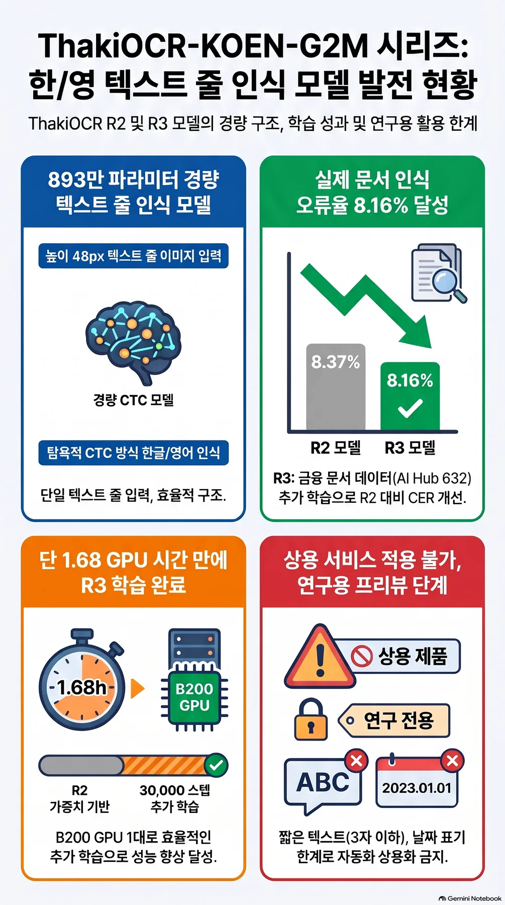
*NotebookLM이 소스를 종합해 생성한 인포그래픽입니다.*


## 출처와 데이터

- 모델: [ThakiCloud/ThakiOCR-KOEN-G2M-R3](https://huggingface.co/ThakiCloud/ThakiOCR-KOEN-G2M-R3) (Apache-2.0, 연구 프리뷰, 리비전 59fd1fbe). R2 저장소 [ThakiCloud/ThakiOCR-KOEN-G2M-R2](https://huggingface.co/ThakiCloud/ThakiOCR-KOEN-G2M-R2)는 그대로 둡니다. 이 글의 수치는 모두 같은 실험 원장에서 옮겼습니다.
- 학습 데이터: NVIDIA OCR-Synthetic-Multilingual-v1(CC BY 4.0), AI 허브(AI-Hub) OCR 데이터(공공)(71299) Training 분할, AI 허브(AI-Hub) 금융업 특화 문서 OCR 데이터(632) Training 분할, SIL OFL 1.1 글꼴로 만든 합성 기호 줄.
- AI 허브 데이터와 그 가공물은 재배포하지 않습니다. 모델 저장소와 이 글에는 AI 허브 이미지, 크롭, 라벨이 들어 있지 않고, 이 글의 수치는 모두 집계값입니다.
- 이전 글: [G2M-R2: 학습량 3배 실험](/tech-blog/ko/research/thakiocr-g2m-r2-three-times-training/) · [G2M Preview: 숫자와 기호](/tech-blog/ko/research/thakiocr-g2m-numbers-and-symbols/) · [213만 파라미터 ThakiOCR A](/tech-blog/ko/research/thakiocr-a-small-korean-english-line-ocr/) · [KO-v1: OvisOCR3 한국어 LoRA](/tech-blog/ko/research/thakiocr-ko-v1-ovisocr3-korean-finetune/) · [KO-v2 진단 실험](/tech-blog/ko/research/thakiocr-ko-v2-vision-lora-merge-research/) · [Large-27B-R2B](/tech-blog/ko/research/thakiocr-large-27b-r2b-qwen-korean-ocr/) · [한국어 OCR 오픈소스 모델 비교](/tech-blog/ko/research/korean-ocr-open-models-2m-to-27b/)
