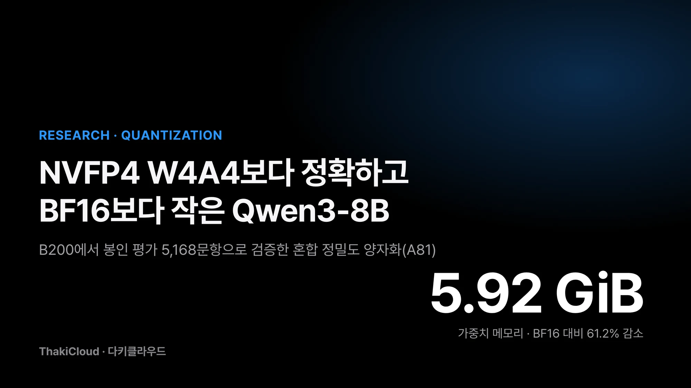
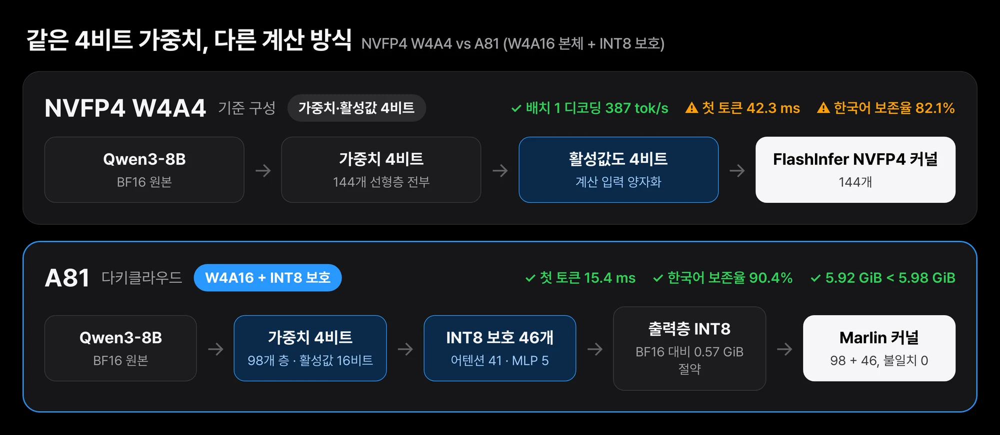
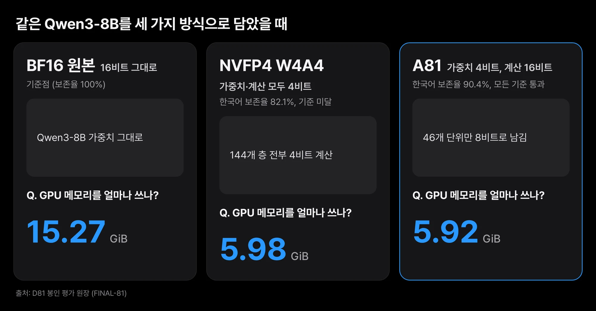
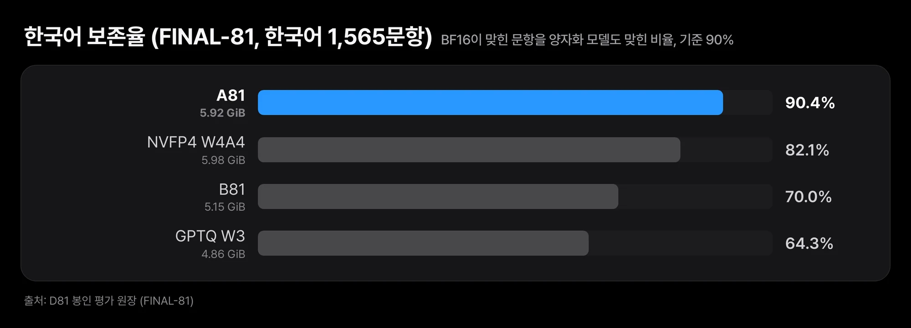
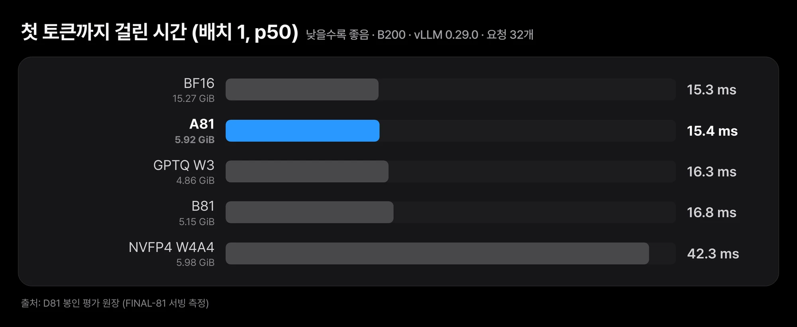

*A81은 메모리·커널·품질·지연 기준을 모두 통과한 유일한 구성이었습니다.*

8B 모델 하나를 6기가바이트 남짓한 GPU 메모리에 넣으면서 한국어 답의 품질은 원본에 가깝게 지키고 싶은 분들께 드리는 후속 실측입니다. 지난 글에서 다키클라우드는 메모리를 크게 줄이는 데는 성공했지만 한국어 품질 기준을 통과한 모델은 하나도 없었다고 보고했습니다.

이번에는 통과한 구성이 나왔습니다. 가중치는 4비트로 줄이고 계산은 16비트로 하며 민감한 46개 부분과 출력층만 8비트로 남긴 구성입니다. 한 번도 본 적 없는 5,168문항 평가에서 메모리 5.92기가바이트, 한국어 보존율 90.4%로 모든 기준을 넘었습니다.

다만 한국어 기준을 넘은 여유는 0.36%p밖에 되지 않습니다. 이 글은 무엇이 통과했는지와 함께, 그 결과를 어디까지 믿어도 되는지를 같이 적습니다.

## 쉽게 말하면

지난 글에서는 여행 가방을 압축팩으로 줄이는 장면에 빗댔습니다. 이번에 찾은 방법은 짐을 넣을 때는 세게 누르되, 꺼내 입을 때는 옷을 펴서 입는 쪽입니다. 보관할 때만 작게 접고 실제로 쓸 때는 원래 모양으로 돌아오게 하는 셈입니다.

거기에 쉽게 구겨지는 옷 몇 벌은 압축팩 대신 조금 덜 누르는 파우치에 따로 담았습니다. 가방은 조금 커졌어도 정해진 크기 안에 들어갔습니다. 꺼낸 옷도 입을 만했습니다.

반대로 꺼내 입을 때도 접힌 채로 입는 방식은 가방이 비슷한 크기인데도 옷이 더 구겨졌습니다. 이 차이가 이번 글의 핵심입니다.

## 지난 글에서 남은 숙제는 한국어 품질이었습니다

[지난 글](/tech-blog/ko/research/b200-low-bit-quantization-limits/)에서 다룬 실험은 메모리와 커널 문제를 풀었습니다. 2비트 모델은 메모리를 73% 줄였지만 답을 내지 못했고 3·4비트와 혼합 정밀도 구성은 한국어 보존율 0.90 기준 앞에서 멈췄습니다.

이번 실험의 기준은 지난 글과 같습니다. 가중치 적재 메모리는 5.98 GiB 미만이어야 합니다. 원본이 맞힌 문항을 양자화 모델도 맞히는 비율인 보존율은 전체와 한국어 모두 90% 이상이어야 합니다.

숫자·추론 문제의 정확도 하락은 3%p 안쪽, 답 형식 오류 증가는 2%p 안쪽이어야 합니다. 토큰 하나를 만드는 시간은 원본의 1.1배를 넘으면 안 됩니다. 마지막으로 144개 선형층이 모두 의도한 저비트 커널에서 돌아야 합니다.

기준은 평가 전에 봉인했습니다. 구성을 고르는 데 쓴 선택용 평가셋(SEL-81)과 최종 판정용 평가셋(FINAL-81)은 서로 겹치지 않습니다. 최종 평가는 한 번만 돌렸습니다.

## 가중치는 4비트로, 계산은 16비트로 했습니다

*W4A4는 가중치와 계산 입력을 모두 4비트로 줄입니다. A81은 가중치만 4비트로 두고 계산 입력은 16비트로 유지하며, 민감한 46개 모듈과 출력층을 INT8로 남깁니다.*

비교 대상은 NVFP4 W4A4입니다. NVFP4는 B200이 직접 지원하는 4비트 부동소수점 형식입니다. W4A4는 가중치와 계산에 들어가는 활성값을 모두 4비트로 줄인다는 뜻입니다.

A81은 같은 NVFP4 가중치를 쓰되 활성값은 16비트로 둡니다. 이런 방식을 W4A16, 또는 NVFP4A16이라고 부릅니다. 여기에 품질에 민감한 46개 모듈을 8비트 정수(INT8)로 남기고 출력층도 INT8로 줄였습니다.

메모리 계산은 빠듯했습니다. 활성값을 16비트로 두고 출력층을 원본 정밀도로 남기면 6.01 GiB가 되어 기준을 넘습니다. 출력층을 INT8로 바꾸면 0.57 GiB가 줄어듭니다. 그 여유 안에서 46개 모듈을 INT8로 되돌리는 데 0.50 GiB를 썼습니다.

46개 모듈은 선택용 평가셋에서 한국어와 추론 정확도를 함께 본 민감도 순위로 골랐습니다. 41개가 어텐션 쪽 투영이었고 MLP 쪽은 5개뿐이었습니다. 최종 측정에서 144개 층 가운데 98개가 NVFP4 커널, 46개가 INT8 커널에서 돌았고 어긋난 층은 없었습니다.

## 봉인 평가 5,168문항에서 모든 기준을 통과했습니다

*메모리는 가중치 적재 바이트를 2^30으로 나눈 값입니다. A81만 한국어 기준을 넘었습니다.*

*A81만 한국어 기준 90%를 넘었습니다. 여유는 0.36%p로 좁습니다.*

최종 평가셋에는 한국어 1,565문항, 영어 1,043문항, 숫자 1,320문항, 추론 870문항이 들어 있습니다. 네 구성을 같은 문항으로 잰 결과는 아래 표와 같습니다.

| 구성 | 메모리 (GiB) | 전체 보존율 | 한국어 보존율 | 판정 |
|---|---|---|---|---|
| BF16 원본 | 15.27 | 기준 | 기준 | 기준 |
| A81 | 5.917 | 0.931 | 0.904 | 통과 |
| NVFP4 W4A4 | 5.977 | 0.887 | 0.821 | 품질 미달 |
| B81 (3·4비트 혼합) | 5.153 | 0.810 | 0.700 | 품질 미달 |
| GPTQ W3 | 4.864 | 0.748 | 0.643 | 품질 미달 |

*표: FINAL-81 봉인 평가. 보존율은 BF16이 맞힌 문항 가운데 양자화 모델도 맞힌 비율입니다. 메모리는 가중치 적재 바이트를 2^30으로 나눈 값입니다.*

A81은 원본보다 메모리를 61.2% 적게 쓰면서 전체 정확도는 원본 대비 0.3%p만 낮았습니다. 같은 문항을 짝지어 비교하면 NVFP4 W4A4보다 1.4%p 높았습니다. 다중 비교를 보정한 신뢰구간은 +0.2%p에서 +2.6%p였습니다.

이 우위는 사전 등록한 단 하나의 비교에서 나왔습니다. 영역별로 나누면 추론에서 3.8%p 높았습니다. 한국어 영역만 따로 보면 1.1%p 높았지만 구간이 0을 포함했습니다.

## 4비트 계산이 더 빠른데도 고르지 않은 이유

*W4A4는 토큰당 디코딩은 가장 빠르지만 첫 토큰이 BF16보다 약 2.8배 늦었습니다. A81은 BF16과 비슷합니다.*

속도만 보면 W4A4가 앞섭니다. 요청을 하나씩 처리하는 배치 1 조건에서 W4A4는 초당 387토큰을 만들었습니다. A81은 272토큰, 원본은 255.4토큰이었습니다.

그런데 첫 토큰이 나오기까지는 W4A4가 42.3 ms로 가장 느렸습니다. A81은 15.4 ms로 원본의 15.3 ms와 거의 같았습니다. 짧은 답을 자주 주고받는 대화형 서비스라면 사용자가 먼저 느끼는 것은 첫 토큰 지연입니다.

결정을 가른 것은 품질이었습니다. W4A4는 한국어 보존율 82.1%로 기준에 크게 못 미쳤습니다. 속도 기준은 A81도 통과했으므로, 기준을 넘지 못한 구성을 더 빠르다는 이유로 고를 수는 없었습니다.

정리하면 A81은 원본보다 작고 원본과 비슷한 속도로 돌면서 한국어 품질을 기준선 위로 지킨 구성입니다. W4A4는 토큰 생성이 가장 빠르지만 이번 기준에서는 한국어 품질이 부족했습니다.

## 정확도가 오른 이유는 대부분 16비트 계산 쪽입니다

A81과 W4A4는 두 가지가 동시에 다릅니다. 활성값이 4비트에서 16비트가 되었고 46개 모듈이 INT8 보호를 받았습니다. 어느 쪽이 정확도를 올렸는지는 별도 개발용 평가셋에서 탐색적으로만 나눠 봤습니다.

활성값만 16비트로 바꾸자 정확도가 2.8%p 올랐습니다(구간 +1.6%p ~ +4.0%p). 그 위에 INT8 모듈을 더한 효과는 -0.3%p였고 구간이 0을 포함했습니다. 다만 그때 쓴 모듈 배치는 17개짜리 이전 버전이었습니다.

그래서 "정확도 개선은 대부분 16비트 활성값에서 온 것으로 보인다"까지만 말할 수 있습니다. A81의 46개 모듈 배치가 독립적으로 얼마를 더했는지는 확인하지 못했습니다. INT8 모듈이 확실하게 한 일은 메모리 기준 안에서 출력층과 민감한 층을 다시 배치할 여유를 만든 것입니다.

선택 단계에서는 한국어 보정 데이터를 늘리는 방법도 시험했습니다. 3비트 계열 구성 B81의 보정 문장 절반을 한국어로 바꾸자 한국어는 2.2%p 올랐지만 구간이 0을 포함했습니다. 반면 추론은 12.3%p 떨어졌습니다. A81은 기본 보정 데이터를 그대로 썼습니다.

## 그대로 믿기 전에 알아둘 네 가지

첫째, 한국어 여유가 좁습니다. 한국어 보존율 기준 90%를 0.36%p 차이로 넘었습니다. 한국어 문항은 1,565개입니다. 같은 레시피로 다시 만들면 기준 아래로 내려갈 수도 있습니다.

둘째, 같은 레시피로 두 번 만든 모델이 바이트 단위로 같지 않았습니다. 선택 단계와 최종 단계의 체크포인트 해시가 달랐으며 두 체크포인트 모두 보관하지 않았습니다. 다시 만들 때마다 품질이 얼마나 흔들리는지는 아직 재지 않았습니다.

셋째, 속도는 배치 1에서만 쟀습니다. 요청을 많이 묶어 처리하는 환경에서는 W4A4의 처리량 우위가 더 커질 수 있습니다. 그 조건은 이번 측정 범위 밖입니다.

넷째, 모델 하나(Qwen3-8B), GPU 하나(B200), 서빙 엔진 버전 하나(vLLM 0.29.0)의 결과입니다. 다른 모델이나 다른 버전에서 같은 배치가 통한다는 보장은 없습니다.

## 다키클라우드는 이 결과를 이렇게 씁니다

다키클라우드는 고객이 가진 GPU 위에 모델을 직접 올려 서빙하는 일이 많습니다. 같은 GPU에 더 많은 모델이나 더 긴 문맥을 넣으려면 가중치 메모리를 줄여야 합니다. 그렇다고 한국어 품질을 내줄 수는 없습니다. A81은 저희 실험에서 두 조건을 처음으로 함께 통과한 레시피입니다.

공개 대상 A81 체크포인트는 따로 저장한 뒤 새 실행 환경에서 다시 불러와 검증했습니다. 이어서 기존 평가셋과 겹치지 않는 독립 평가셋 REL-81(4,694문항)에서 미리 등록해 둔 품질·서빙 기준을 모두 통과했습니다. 한국어 정답 보존율은 0.926이고, 한국어·영어·수치·추론 네 축을 합친 정답 보존율은 0.930입니다. GPU 가중치 메모리는 5.917GiB, 토큰당 생성 시간(TPOT)은 BF16의 0.927배였습니다. 이 수치는 논문의 FINAL-81 결과와 다른 빌드에서 잰 것이라 합치지 않고 따로 적습니다.

수치 문항 정확도는 BF16보다 2.20%p 낮았고 95% 신뢰구간은 −4.13~−0.27%p였습니다. 허용 기준인 −3%p보다 큰 손실일 가능성을 통계적으로 배제하지 못했으므로, 상용 서비스에서 쓰려면 수치 정확도를 따로 검증해야 합니다.

이번 결과는 저장된 체크포인트 하나에 대한 연구용 릴리스 검증입니다. 사전 등록한 게이트를 통과했다는 뜻이지 상용 서비스 승인을 받았다는 뜻은 아니며, 다른 하드웨어나 운영 환경에서의 성능도 보장하지 않습니다.

## 끝으로

4비트 가중치를 쓰더라도 계산까지 4비트로 줄일지는 따로 판단해야 합니다. 이번 실험에서는 그 선택이 한국어 품질을 갈랐습니다. 직접 시험해 보신다면, 같은 4비트 가중치에서 활성값만 16비트로 바꾼 구성부터 비교해 보시길 권합니다.

메모리 기준이 빠듯하다면 출력층을 INT8로 줄이는 것이 첫 번째 여유를 만듭니다. 그 여유를 민감한 층에 다시 쓰는 방법은 이번 결과가 보여 준 배치 하나일 뿐이니, 자신의 평가셋으로 다시 재 보셔야 합니다.

논문 정보, 공개 체크포인트, 집계 결과는 아래에 있습니다.

- 논문: Beyond Bitwidth: Deployment-Constrained Mixed-Precision Quantization for Multilingual LLM Inference on NVIDIA Blackwell (arXiv 프리프린트 준비 중이며, 공개되면 링크를 추가합니다)
- 공개 체크포인트(연구용, 상용 미승인): [ThakiCloud/Qwen3-8B-NVFP4A16-INT8-Mixed-B200](https://huggingface.co/ThakiCloud/Qwen3-8B-NVFP4A16-INT8-Mixed-B200)
- 집계 결과·레시피·재현 안내: [ThakiCloud/B200-LowBit-Quantization-Benchmarks](https://huggingface.co/datasets/ThakiCloud/B200-LowBit-Quantization-Benchmarks)
- 지난 글: [메모리는 73% 줄었지만 모델은 답하지 못했습니다](/tech-blog/ko/research/b200-low-bit-quantization-limits/)
