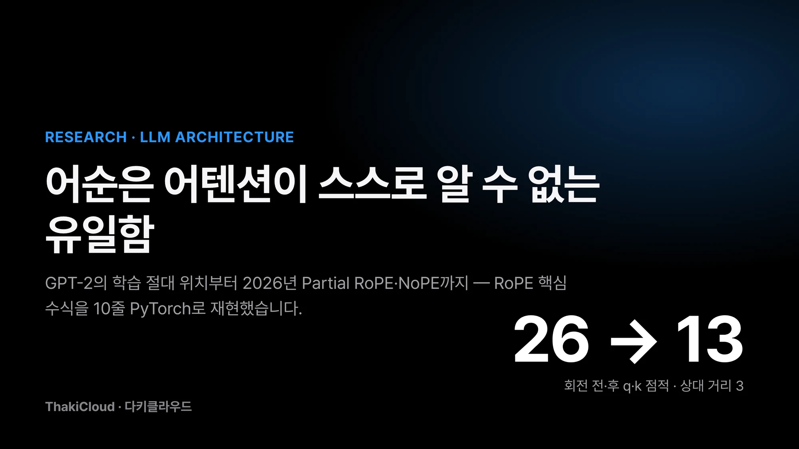
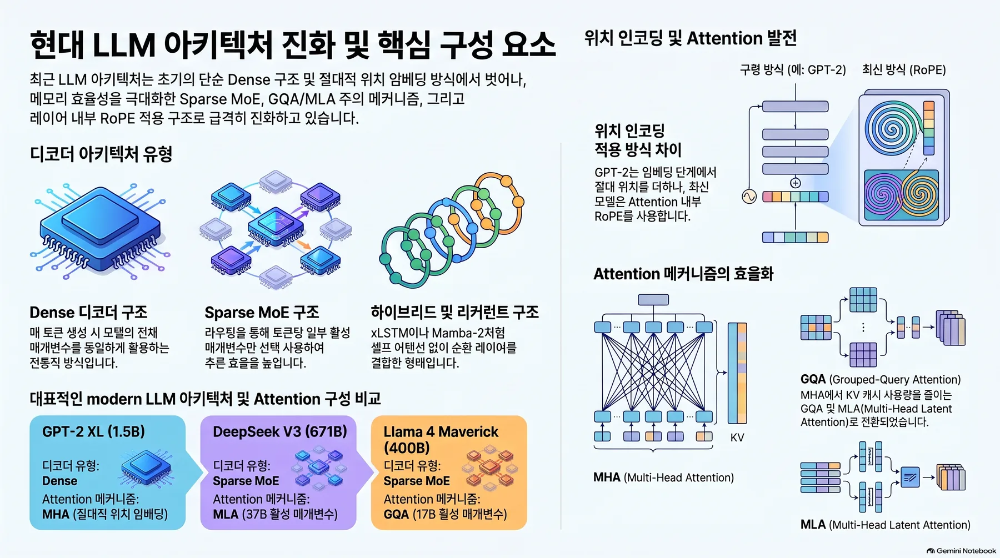
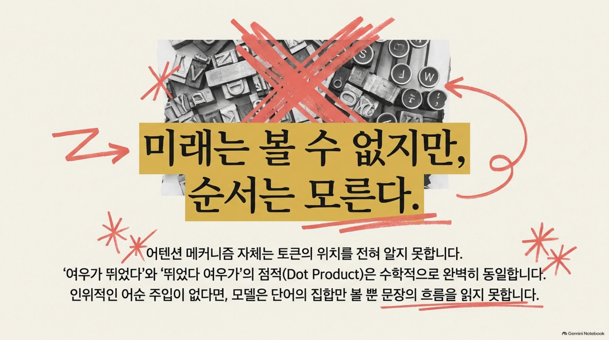
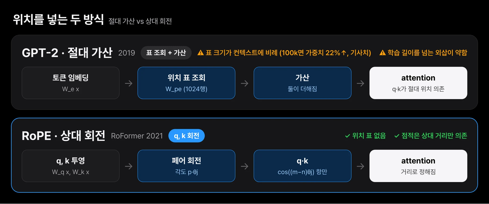
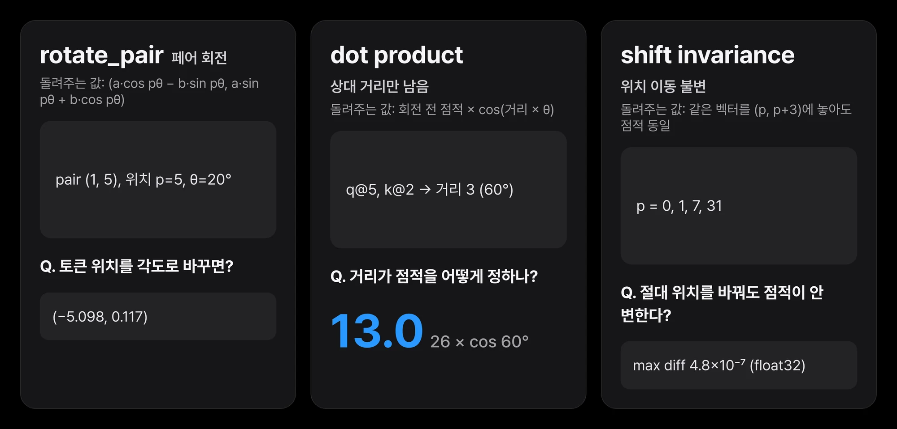
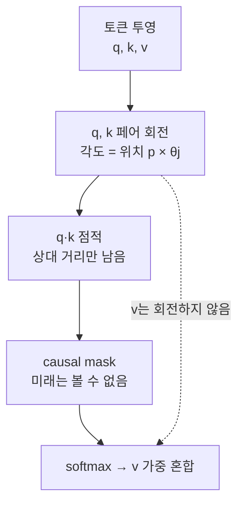
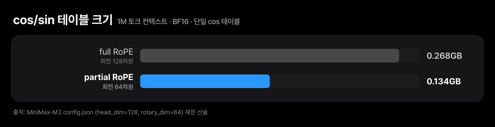
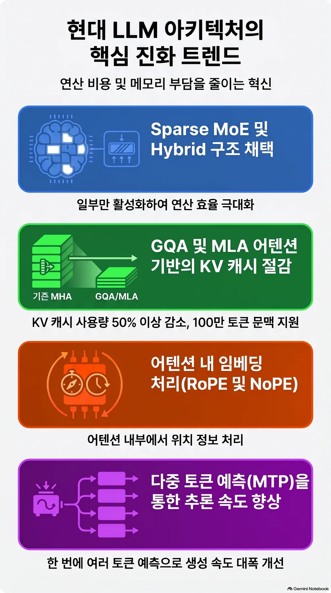
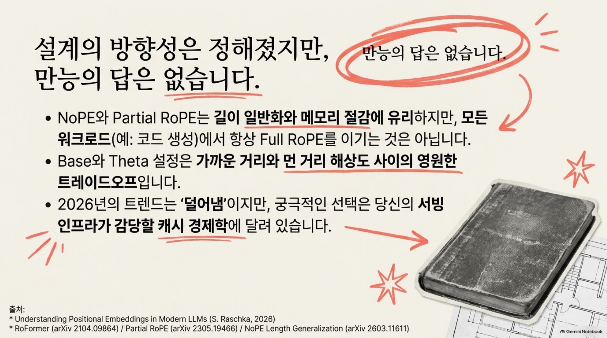

2026년 오픈 모델 config를 열면 포지셔널 임베딩(positional embedding, 토큰의 위치를 알려주는 장치) 필드가 조용히 있습니다. MiniMax-M3에는 `partial_rotary_factor: 0.5`가 있고 SmolLM3는 4층마다 RoPE를 빼도록 구성됩니다. 이 필드들은 오타가 아니라 설계 결정입니다. 포지셔널 임베딩이 하는 일을 모르면 이 필드들이 왜 존재하는지 설명할 수 없습니다.

장 컨텍스트 모델을 자기 GPU에서 서빙하거나 파인튜닝을 담당하는 분이라면, "어순이 왜 비싸고 왜 쌉니까"를 끝까지 읽으면 됩니다. 하나의 결론을 먼저 드립니다. 2026년의 포지셔널 임베딩은 단일 기법이 아니라, 컨텍스트 경제학을 정하는 설계 축입니다.

RoPE의 핵심 수학은 한 문장입니다. 회전한 쿼리와 키의 점적은 둘 사이의 상대 거리에만 의존합니다. 이 글은 튜토리얼의 핵심을 모델 가중치 없이 PyTorch로 재현했습니다. 토이 예제에서 회전 전 점적 26이 상대 거리 3에서 정확히 13.000, 거리 2에서 19.917이 됩니다. 1M 토크 컨텍스트에서는 partial RoPE의 cos/sin 테이블이 full RoPE보다 0.134 GB 작습니다(단일 테이블, BF16, 실측 산술).


*Sebastian Raschka 포지셔널 임베딩 튜토리얼을 재현한 글입니다.*

## 쉽게 말하면

쿼리와 키의 각 특성 페어를 시계 바늘이라고 생각해 보겠습니다. 바늘마다 회전 속도가 다릅니다. 빠른 바늘은 짧은 거리에서 한 바퀴를 돌고 느린 바늘은 거의 움직이지 않습니다. RoPE는 토큰 위치만큼 이 바늘들을 회전시킵니다. 어텐션이 두 시계의 바늘로 점적을 계산할 때 본 것은 바늘 각도 차이, 즉 상대 거리뿐입니다.


*각 특성을 시계 바늘로 보는 RoPE의 원리.* 절대 위치는 어느 시계가 몇 시를 가리키느냐가 아니라 두 시계의 차이가 몇 시간인가만 중요합니다. 예를 들어 10시 바늘과 1시 바늘 사이는 90도입니다. 낮이든 밤이든 그 각도 차이는 같습니다. 어텐션이 읽는 것은 두 바늘이 어느 시계에 붙어 있느냐가 아니라, 서로 몇 도 차이인가입니다.

partial RoPE는 몇 개의 바늘을 뺀 시계입니다. 기계 자체(cos/sin 테이블)가 작아집니다. NoPE(no positional embedding)는 바늘을 전부 뺀 시계이고 어순은 causal mask의 "미래를 못 본다"는 사실만으로 들어옵니다. 2026년 모델들의 이야기는 이 시계에서 몇 개의 바늘을 빼느냐의 이야기입니다.

<!-- nlm-visual -->

*NotebookLM이 소스를 종합해 생성한 인포그래픽입니다.*

## 어텐션이 어순을 따로 알려줘야 하는 이유

어텐션은 토큰 사이의 관련도를 계산합니다. 그런데 두 토큰의 점적에는 그 토큰이 몇 번째 자리에 있는지 포함되지 않습니다. "여우가 뛰었다"에서 "여우"와 "뛰었다"의 점적은, "뛰었다 여우가"에서 같은 두 토큰의 점적과 같습니다. 위치가 없으면 두 문장은 같은 계산으로 합쳐집니다.


*어텐션이 위치를 모르므로, 어순은 밖에서 주입받아야 합니다.*

causal mask가 주는 정보는 "미래 토큰은 못 본다"는 것뿐입니다(튜토리얼의 설명). 각 토큰이 볼 수 있는 토큰 집합은 자리에 따라 다르긴 합니다. 하지만 거기서 들어오는 것은 "왼쪽에서 오른쪽으로"라는 방향 정보뿐이고 거리의 크기는 들어오지 않습니다. 어순 자체는 밖에서 넣어 줘야 합니다.

어떻게 넣느냐가 Transformer 이후 여섯 갈래로 갈라졌습니다.

| 방식 | 어순을 넣는 방법 | 의존 대상 | 대표 |
|---|---|---|---|
| 학습 절대 | 표에서 위치 벡터 더하기 | 절대 위치 | GPT-2 |
| 고정 사인 | 사인/코사인 벡터 더하기 | 절대 위치 | 원본 Transformer |
| RoPE | 쿼리/키를 위치별 회전 | 상대 거리 | LLaMA, Qwen3 |
| Partial RoPE | 일부 차원만 회전 | 상대 거리(바늘 줄임) | MiniMax-M3 |
| NoPE | 명시 신호 없음 | causal mask만 | SmolLM3(매 4층) |
| 학습 상대 bias | 점수에 학습 bias 추가 | 상대 오프셋 | T5, Inkling |

튜토리얼이 집계하는 아키텍처 갤러리 기준으로, 2026년에도 "softmax attention 레이어 전부 RoPE"가 여전히 가장 많습니다. 다만 그 점유율은 2025년에서 2026년으로 줄고 2026년 하반기로 다시 줄었습니다. partial RoPE는 2025년 소수에서 2026년 두 집단 모두 다수가 됐습니다(튜토리얼 집계치).

## GPT-2는 더하고, RoPE는 돌린다


*GPT-2는 토큰에 위치 벡터를 더합니다. RoPE는 q, k를 위치 각도로 회전시켜 점적이 상대 거리만 의존하게 합니다.*

GPT-2는 학습 위치 표를 씁니다. 표는 1024행이고 컨텍스트는 표 길이만큼을 넘을 수 없습니다. 이 표는 1024 위치에서 전체 가중치의 0.30%이지만, 100k 컨텍스트로 확장하면 22%를 넘습니다(튜토리얼 수치). 위치 정보가 컨텍스트 길이에 비례해 커지는 가중치가 되는 겁니다.

원본 Transformer(2017)는 고정 사인/코사인 벡터를 더했습니다. 각 위치가 주파수 여러 개로 만든 고정 벡터를 얻고 학습 파라미터는 없습니다. 토큰 임베딩은 모델 폭의 제곱근으로 스케일된 뒤 이 벡터가 더해집니다. 이 고정 함수는 훈련 길이 밖에서도 값을 만들 수 있어 외삽에 유리하리라는 의도였다고 튜토리얼은 설명합니다. 다만 역시 절대 위치별로 더해지는 방식이라, 상대 거리 신호가 직접 들어오지는 않습니다.

RoPE(RoFormer, 2021)는 다른 길입니다. 토큰에 아무것도 더하지 않습니다. 대신 어텐션 안쪽에서 쿼리와 키를 회전시킵니다. 밸류는 회전하지 않습니다. 회전 각도는 위치와 특성 페어별 고유 주파수의 곱입니다. 시계 비유로 말하면, RoPE는 토큰에 "지금 몇 시"라고 적어 주는(GPT-2) 대신, 바늘을 위치만큼 돌려 두는 방식입니다.

## 26에서 13으로: 어순이 각도가 되는 순간


*RoPE가 돌리는 값의 모양. 입력은 벡터 페어와 위치, 출력은 회전된 벡터와 상대 거리만 아는 점적입니다(run-3.log 실측).*

튜토리얼의 핵심 구간입니다. 쿼리와 키의 특성 페어 (1, 5) 하나를 회전시킵니다. 각도는 위치당 20도. 쿼리는 위치 5, 키는 위치 2에 있습니다. 회전 전 점적은 1×1 + 5×5 = 26입니다.

```python
import torch

theta = torch.deg2rad(torch.tensor(20.0))  # 위치당 20°
m, n = 5, 2                                # 쿼리, 키 위치

def rotate_pair(pair, angle):
    a, b = pair
    c, s = torch.cos(angle), torch.sin(angle)
    return torch.stack((a * c - b * s, a * s + b * c))

q = torch.tensor([1., 5.])
k = torch.tensor([1., 5.])
q_rot = rotate_pair(q, m * theta)
k_rot = rotate_pair(k, n * theta)

print(q @ k)          # 26
print(q_rot @ k_rot)  # 13.000  ==  26 × cos((m−n) × 20°)
```

이 코드를 그대로 돌리면, 회전 후 점적은 정확히 13.000입니다. 회전 전 값 26에 각도 차이(60도)의 코사인을 곱한 것과 같습니다. 키를 위치 3으로 옮기면 19.917(각도 차이 40도)이 됩니다. 점적이 절대 위치가 아니라 두 토큰 사이 거리로만 정해졌다는 뜻입니다.

이건 우연이 아닙니다. 회전한 두 벡터의 점적을 전개하면, 최종 식에는 mθ와 nθ가 개별적으로 나오지 않습니다. 각도 차이 (m−n)θ로만 다시 쓸 수 있는 항이 남습니다. 그래서 26×cos 60°가 13이 되는 겁니다. 점적이 절대 위치의 함수였던 것을, 회전이 거리의 함수로 바꾼 것입니다.

실제 모델에서는 20도 고정 각도가 특성 페어별 주파수로 바뀝니다. 공식은 base의 (-2j/d) 승입니다. j는 페어 번호, d는 헤드 차원입니다. 헤드 차원 8, base 10,000이면 위치당 각도는 1, 0.1, 0.01, 0.001 라디안 넷이 됩니다(실측 출력). 튜토리얼의 rope_params는 이 역주파수를 먼저 내고 위치와 곱해 각도를 만든 뒤 cos/sin 테이블로 바꿉니다. 테이블 크기는 (최대 길이, d/2)였고, 제 실행에서는 16×4로 나왔습니다(실측). 빠른 바늘(1.0)은 짧은 거리에서 주기를 잃고 느린 바늘(0.001)은 긴 거리까지 구분합니다. 시계의 초침·분침·시침과 같은 원리입니다.



회전에는 두 표기가 있습니다. split-half는 (j, j+4)를, interleaved는 (2j, 2j+1)을 페어로 씁니다. 둘 다에 무작위 벡터를 넣고 검증했습니다. 특성 순서를 재정렬한 뒤 두 표기의 최대 차이는 0.000e+00입니다. 페어링만 다른 같은 회전입니다. Qwen3 from-scratch 노트북은 split-half 표기를 씁니다.

## 회전은 거리에만 의존하고, 위치에는 의존하지 않는다

점적이 정말 상대 거리만 의존한다면, 같은 두 벡터를 시퀀스 안에서 더 뒤로 옮겨도 점적은 변하지 않아야 합니다. 같은 쿼리/키 벡터를 위치 (0,3), (1,4), (7,10), (31,34)에 각각 돌려 놓고 점적을 측정했습니다. 네 결과 모두 1.2444였고 최대 차이는 4.8×10⁻⁷였습니다(float32 측정 오차 수준, 실측).

이 불변성이 RoPE가 학습 길이보다 긴 시퀀스에서도 동작하는 이유입니다. 모델이 배우는 것은 "거리 3인 두 토큰의 점적"이고 이 규칙은 위치 30에서도, 30,000에서도 유효합니다. base(10,000)와 theta 값은 느린 바늘이 얼마나 먼 거리까지 구분하는가를 정합니다. MiniMax-M3는 rope_theta 5,000,000을 씁니다. base 대비 500배라, 느린 바늘을 훨씬 더 늦게 돌리는 1M 컨텍스트에 맞춘 선택입니다.

## 2026년의 답: 반만 돌리거나, 안 돌리거나


*회전 차원을 128에서 64로 줄이면 테이블이 정확히 절반입니다. run-3.log 실측 산술입니다.*

cos/sin 테이블은 (최대 길이 × 회전 차원) 크기의 조회 표입니다. 컨텍스트가 1M 토크가 되면 이 테이블 자체가 BF16에서 수백 MB가 됩니다. MiniMax-M3는 128차원 헤드에서 rotary_dim 64만 회전시킵니다. 헤드당 회전 페어 32개. 나머지 64차원은 회전 없이 어텐션을 통과합니다. 위치 정보를 32개 페어만 가져다 놓기 때문에, cos/sin 테이블은 회전하는 차원의 각도만 저장하면 됩니다. rotary_dim이 작을수록 테이블이 작아지는 구조입니다. 테이블은 정확히 절반이 됩니다. 단일 cos 테이블 산술로 full RoPE 0.268 GB, partial 0.134 GB, 절감 0.134 GB입니다(실측 산술). 튜토리얼도 같은 구성에서 BF16 128 MiB 절감이라고 계산합니다.

partial RoPE 논문(arXiv 2305.19466)은 1B~8B 모델을 학습해, 헤드 특성의 약 10%만 회전해도 최종 손실이 비교 가능한 경우가 많다고 보고합니다. 다만 일부 평가에서는 full RoPE가 더 좋았습니다(논문 보고서). "바늘을 몇 개 빼느냐"에 정답이 없다는 뜻입니다.

NoPE는 더 강한 입장을 취합니다. 길이 일반화 논문(arXiv 2603.11611)은 107M 소형 모델을 학습하고 학습 길이보다 긴 구간에서 10개 과업을 평가했을 때 포지셔널 임베딩이 없는 NoPE가 전체 1위였다고 보고합니다. 명시적 위치 코드보다, causal mask가 주는 암시적 신호가 더 긴 구간에서 더 안정적으로 일반화됐다는 뜻입니다(논문 보고). 별개의 1.3B 코드 모델 실험에서는 가장 긴 테스트 길이에서 예측이 나빠졌습니다(논문 보고).

SmolLM3(3B)는 이 방향을 실전에 적용합니다. 36개 블록에서 RoPE를 3개 블록에 쓰고 4번째 블록에서는 쓰지 않는 패턴을 반복합니다(Hugging Face 블로그, 확인). 전부 NoPE로 돌리는 대신 일부 레이어만 빼는 혼합 패턴이 2026년의 중간 지점입니다.


*NoPE 하이브리드: Causal Mask만으로 어순이 성립하는 구간.*

Inkling(975B)은 다른 길을 갑니다. 학습 상대 위치 bias를 쓰는데 어텐션 점수에 학습된 bias를 추가하는 방식이고 윈도우 어텐션 레이어와 글로벌 어텐션 레이어 모두에 씁니다(튜토리얼 설명).

| 모델 | 포지셔널 방식 | 비고 |
|---|---|---|
| LLaMA | full RoPE | 원 모델부터 표준 |
| Qwen3 | full RoPE | split-half 표기 |
| MiniMax-M3 | partial RoPE | 128차원 중 64차원, 1M 컨텍스트 |
| SmolLM3 | 혼합 | 3층 RoPE / 1층 NoPE (36블록) |
| Inkling | 학습 상대 bias | 975B, 윈도우+글로벌 어텐션 |

## ThakiCloud에서는 포지셔널 임베딩이 컨텍스트 경제학입니다

서빙팀이 보는 위치는 KV 캐시입니다. cos/sin 테이블은 KV 캐시보다 작지만, 포지셔널 방식의 선택은 얼마만큼의 컨텍스트를 신뢰하고 서빙할 수 있느냐를 정합니다. 32k까지 학습한 모델을 200k에서 쓰면, 외삽 품질은 위치 정보를 어떤 방식으로 인코딩했느냐로 갈라집니다.

다키클라우드의 학습·서빙 플랫폼 Metis는 K8s GPU 큐 위에서 모델을 서빙합니다. 장 컨텍스트 서빙에서 config의 포지셔널 필드는 캐시 크기를 정하는 계약입니다. `partial_rotary_factor`는 배포 전 메모리를 계산하게 해 주는 필드입니다. 예를 들어 1M 컨텍스트, BF16, 단일 cos 테이블 기준으로는 full RoPE 0.268 GB, partial RoPE 0.134 GB입니다. KV 캐시 자체와 비교하면 작은 수이지만, 배포 전에 예산에 넣어야 하는 고정 비용입니다. 그리고 외삽 품질은 같은 메모리라도 200k 컨텍스트가 실제로 쓰이는지 정합니다. 온프레미스나 소버린 환경에서는 이 계산 둘 다 GPU 대수 결정에 직접 이어집니다.

Paxis 쪽에서는 에이전트 이야기가 나옵니다. 에이전트 세션은 턴이 쌓일 때마다 토큰이 자랍니다. 시스템 지시, 도구 스키마, 이전 턴의 출력이 모두 컨텍스트에 남기 때문에, 수십 턴만 쌓여도 100k 토큰 안팎에 이릅니다. 세션이 길면 장 컨텍스트 외삽 품질이 곧 업무 경제학이 됩니다. SmolLM3 같은 NoPE 레이어 패턴 모델이나 partial RoPE 모델이 에이전트 스택에 들어오면, "한 GPU에서 얼마나 긴 대화를 유지할 수 있는가"의 비용 곡선이 바뀝니다. 같은 하드웨어에서 세션을 더 오래 유지하는 것은, 더 큰 모델으로 바꾸는 것보다 싼 길이일 수 있습니다. 그 계산의 재료 중 하나가 config의 포지셔널 필드들입니다.


*장 컨텍스트 서빙에서 포지셔널 필드는 캐시 크기 계약이자 에이전트 세션 길이의 물리적 한계입니다.*

## 쓰기 전에 알아둘 네 가지

첫째, NoPE가 만능은 아닙니다. 길이 일반화 논문은 1.3B 코드 모델에서 가장 긴 테스트 길이에서 예측이 나빠졌다고 보고합니다. 둘째, partial RoPE도 모든 평가에서 앞서는 것이 아닙니다. partial RoPE 논문은 일부 평가에서 full RoPE가 더 좋다고 보고합니다. 셋째, base와 theta는 가까운 거리와 먼 거리의 해상도 트레이드오프입니다. 가장 느린 페어의 주기(파장)는 대략 2π를 base로 곱한 값입니다. base 10,000이면 약 6.3만 토큰 주기입니다. 컨텍스트가 이 주기보다 길어지면 느린 바늘이 주기 반복에 들어가서 먼 거리 구분이 흐려집니다. universal한 최적값은 없고 MiniMax-M3의 5,000,000은 이 주기를 1M 컨텍스트에 맞추기 위한 선택입니다. 넷째, 2026년 동향(partial 다수화, NoPE 레이어 출현)은 방향성이지, 특정 워크로드의 정답은 아직 아닙니다.

<!-- nlm-visual -->

*NotebookLM이 소스를 종합해 생성한 인포그래픽입니다.*

## 끝으로

어텐션은 어순을 스스로 알 수 없습니다. GPT-2는 표를 더했고 RoPE는 그걸 회전의 각도로 바꿨고 2026년 모델들은 그 시계에서 바늘을 몇 개 빼느냐를 정하고 있습니다. 핵심 수학은 한 문장입니다. 회전한 쿼리와 키의 점적은 상대 거리에만 의존합니다.

첫 실험을 하고 싶다면, 위에서 10줄인 rotate_pair가 전부입니다. 같은 페어를 거리 0, 2, 3에 두고 점적을 출력해 보십시오. 26, 19.92, 13이 보이면 RoPE의 원리를 손에 넣은 것입니다.


*어느 포지셔널 방식을 고르느냐는 결국 해당 서빙 인프라의 캐시 경제학 문제입니다.*

- 튜토리얼: [Understanding Positional Embeddings in Modern LLMs](https://magazine.sebastianraschka.com/p/understanding-positional-embeddings) (Sebastian Raschka, 2026-11-15)
- Qwen3 from-scratch 노트북: [LLMs-from-scratch ch05](https://github.com/rasbt/LLMs-from-scratch/blob/main/ch05/11_qwen3/standalone-qwen3.ipynb)
- RoFormer (RoPE): [arXiv 2104.09864](https://arxiv.org/abs/2104.09864)
- Partial RoPE: [arXiv 2305.19466](https://arxiv.org/abs/2305.19466)
- NoPE 길이 일반화: [arXiv 2603.11611](https://arxiv.org/abs/2603.11611)
- 아키텍처 갤러리: [LLM architecture gallery](https://sebastianraschka.com/llm-architecture-gallery/)
