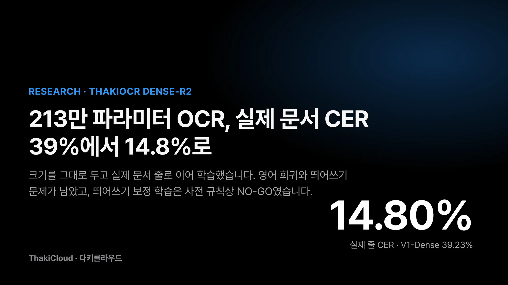
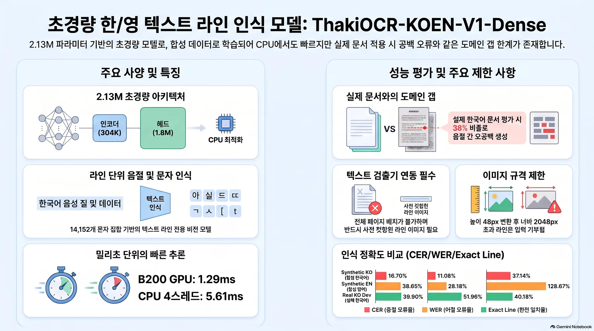
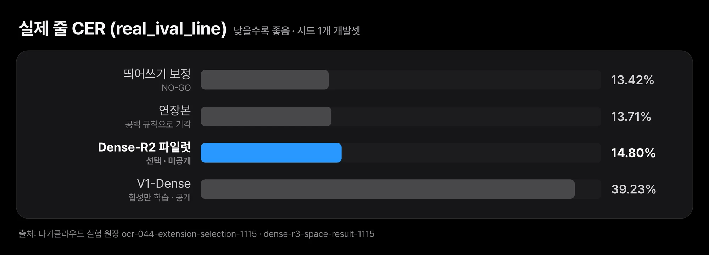
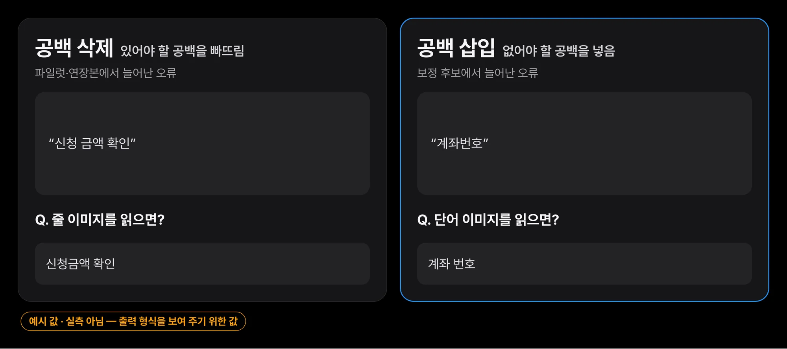
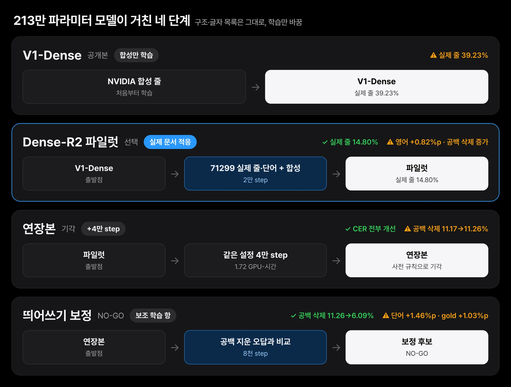
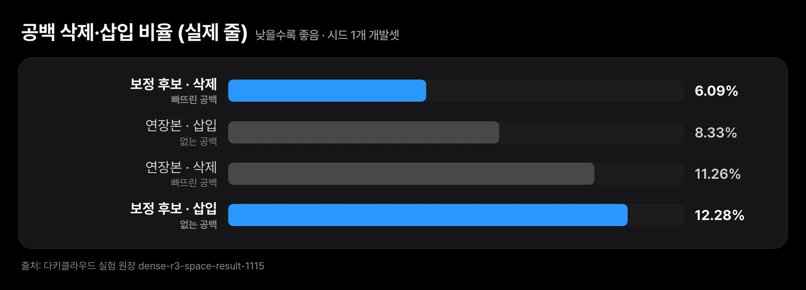
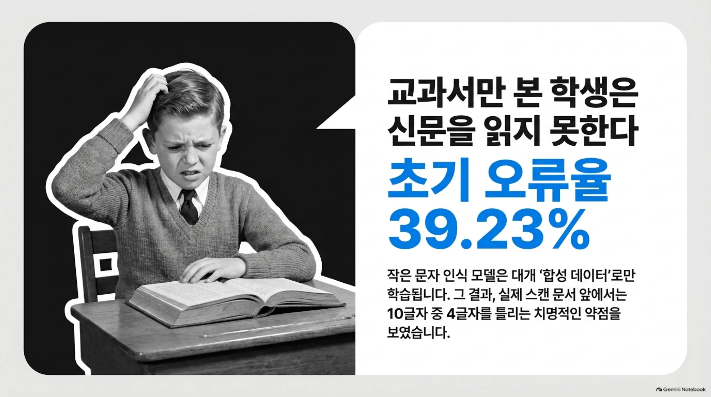
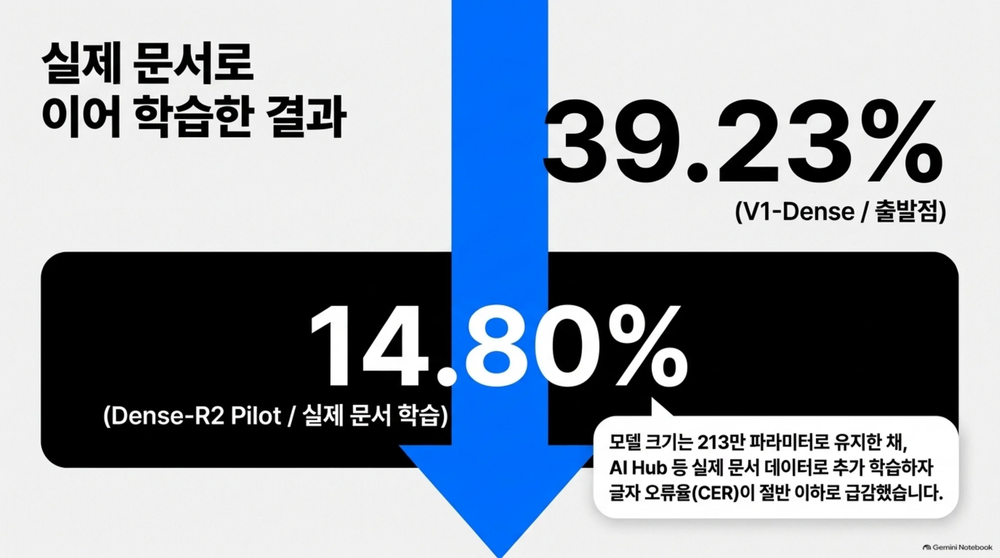
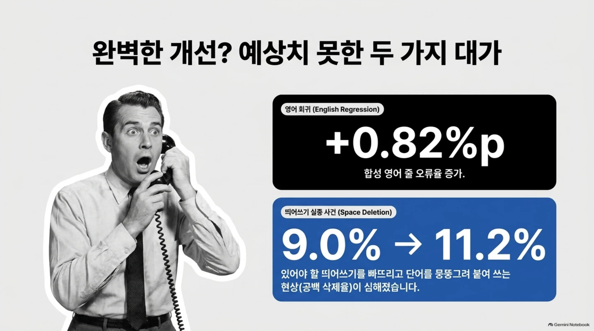
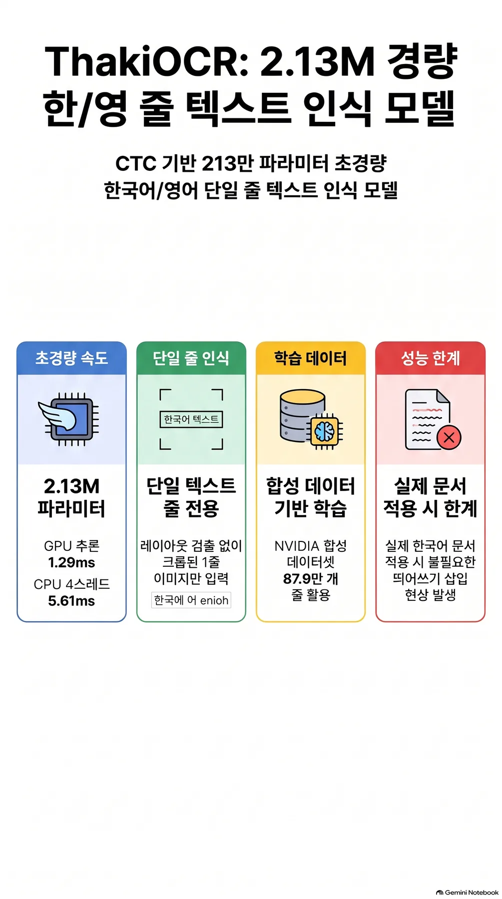

그래픽 카드 없는 서버나 작은 기기에서 문서를 읽어야 하는 개발자는 큰 모델을 쓰기 어렵습니다. 그래서 수백만 개 가중치짜리 작은 문자 인식 모델을 찾습니다. 그런데 작은 모델은 대개 합성 문장으로만 학습돼 있어서 실제 스캔 서류 앞에서는 크게 틀립니다.

다키클라우드가 공개한 213만 파라미터 줄 인식 모델도 그랬습니다. 합성 데이터로만 처음부터 학습했고 실제 문서 줄에서는 글자 오류율이 39.23%였습니다. 글자 오류율은 정답 글자 가운데 틀리게 읽은 비율이고 낮을수록 좋습니다.

이번에는 이 모델의 크기를 그대로 두고 실제 문서 줄로 이어 학습했습니다. 실제 줄 글자 오류율은 39.23%에서 14.80%로 내려갔습니다. 대신 합성 영어 줄 오류율이 0.82%p 나빠졌고 있어야 할 띄어쓰기를 빠뜨리는 일이 늘었습니다.

이 글은 그 개선과 대가, 그리고 대가를 고치려던 두 번의 시도를 다룹니다. 더 오래 학습한 연장본은 띄어쓰기 삭제가 조금 늘어 기각했습니다. 띄어쓰기를 지키도록 하는 보정 학습은 삭제를 크게 줄였지만 이번에는 없는 띄어쓰기를 넣는 일이 늘어 기각했습니다. 모든 수치는 시드 1개 개발셋 결과이고 독립 테스트가 아닙니다. 이번 실험의 새 체크포인트는 공개하지 않습니다. 출발점 모델은 [ThakiOCR A](/tech-blog/ko/research/thakiocr-a-small-korean-english-line-ocr/) 글에서 소개했고 이 글에서는 글자 오류율을 영어 약자인 CER로 적습니다.

*ThakiOCR Dense-R2 연구 기록 요약. 수치는 시드 1개 개발셋 값입니다.*

## 쉽게 말하면

받아쓰기를 배우는 학생을 떠올리면 됩니다. 이 학생은 교과서 문장으로만 연습해서 실제 신문을 받아쓰게 하자 열 글자 중 네 글자를 틀렸습니다.

그래서 실제 신문 문장으로 연습을 시켰더니 틀리는 글자가 열 개 중 한두 개로 줄었습니다. 그런데 이번에는 띄어 써야 할 곳을 붙여 쓰는 버릇이 생겼습니다.

선생님이 "띄어쓰기를 빠뜨리지 마라"고 따로 지도하자 붙여 쓰는 일은 절반 가까이 줄었습니다. 대신 띄어 쓰지 말아야 할 곳까지 띄어 쓰기 시작했습니다. 긴 문장 점수는 조금 올랐지만 짧은 단어 받아쓰기 점수는 떨어졌습니다.

<!-- nlm-visual -->

*NotebookLM이 소스를 종합해 생성한 인포그래픽입니다.*

## 실제 문서 줄로 이어 학습하자 실제 줄 CER이 39%에서 14.8%로 내려갔습니다

출발점은 공개된 [ThakiOCR-KOEN-V1-Dense](https://huggingface.co/ThakiCloud/ThakiOCR-KOEN-V1-Dense)입니다. 파라미터는 2,130,249개입니다. 줄 이미지 한 장을 받아 문자열 하나를 돌려주는 CTC 줄 인식기입니다. CTC는 글자 위치를 따로 맞추지 않고 줄 전체를 한 번에 글자열로 옮기는 학습 방식입니다.

구조와 출력할 수 있는 글자 목록은 바꾸지 않았습니다. 학습 데이터만 G2M-R2와 같은 혼합으로 바꿨습니다. 실제 문서는 AI 허브(AI-Hub) OCR 데이터(공공)(71299)의 Training 분할 줄과 단어이고 여기에 NVIDIA 합성 줄과 다키클라우드 합성 기호 줄을 섞었습니다. 글자 목록에 없는 글자가 든 학습 행은 뺐습니다. B200 한 장에서 2만 step, 0.88 GPU-시간을 학습했습니다. 이 체크포인트를 Dense-R2 파일럿이라고 부르겠습니다.

| 평가셋 | 내용 | V1-Dense | Dense-R2 파일럿 | 변화(%p) |
|---|---|---|---|---|
| real_ival_line | AI 허브 71299 내부 검증 줄 | 39.23% | **14.80%** | −24.43 |
| real_ival_word | AI 허브 71299 내부 검증 단어 | 54.68% | **19.15%** | −35.53 |
| gold_dev | AI 허브 71299 Validation 단어·줄 | 37.33% | **10.64%** | −26.69 |
| hold_line | 학습에서 뺀 권(volume)의 실제 줄 | 24.12% | **8.02%** | −16.10 |
| ko_val | NVIDIA 합성 한국어 줄 | 16.77% | **15.13%** | −1.64 |
| en_val | NVIDIA 합성 영어 줄 | **11.11%** | 11.92% | +0.82 |
| a1_dev | 다키클라우드 합성 기호 줄 | 10.58% | **1.26%** | −9.32 |

실제 평가셋 네 개가 모두 크게 내려갔습니다. 실제 줄은 39.23%에서 14.80%로, 실제 단어는 54.68%에서 19.15%로 줄었습니다. 같은 크기 모델이 학습 데이터만 바꿔 이만큼 달라졌습니다. 다만 출발점이 실제 문서를 한 번도 본 적 없는 모델이라 개선 폭이 클 수밖에 없었다는 점도 함께 봐야 합니다.

*V1-Dense, Dense-R2 파일럿, 연장본, 띄어쓰기 보정 후보의 실제 줄 CER. 시드 1개 개발셋 값입니다.*

## 대가는 영어 회귀와 띄어쓰기 삭제였습니다

나빠진 곳은 두 군데입니다. 첫째, 합성 영어 줄 CER이 11.11%에서 11.92%로 0.82%p 올랐습니다. 학습 전에 정한 기준에서 합성 평가셋이 0.5%p 넘게 나빠지면 따로 표시하기로 했고 이 회귀가 그 기준을 넘었습니다.

둘째, 띄어쓰기를 빠뜨리는 일이 늘었습니다. 정답에 있는 공백 가운데 모델이 빠뜨린 비율을 공백 삭제율이라고 부르겠습니다. 실제 줄에서는 9.0%에서 11.2%로, 홀드아웃 줄에서는 3.3%에서 8.6%로 올랐습니다. 줄 단위 문서에서 단어가 붙어 나오면 뒤에 오는 필드 추출과 검색이 함께 흔들립니다.

V1-Dense는 원래 반대 문제가 있었습니다. 실제 단어 이미지에서 음절 사이에 없는 공백을 넣었습니다. 실제 문서로 학습하자 그 버릇은 줄었지만 줄 안에서는 공백을 빠뜨리는 쪽으로 기울었습니다.

*공백 삭제와 공백 삽입의 차이. 카드 속 문장은 직접 만든 형식 예시이며 실제 추론 결과가 아닙니다.*

## 더 오래 학습한 연장본은 사전 규칙으로 기각했습니다

파일럿이 미리 정한 개선 조건을 넘었으므로 같은 설정으로 4만 step을 더 이어 갔습니다. 연장본은 CER만 보면 모든 평가셋에서 파일럿보다 좋았습니다. 실제 줄은 13.71%, 실제 단어는 17.87%였고 합성 영어 줄도 10.68%로 V1-Dense보다 0.43%p 낮아졌습니다.

그런데 연장본을 고르는 규칙에는 띄어쓰기 조건이 있었습니다. 공백 삭제율이 파일럿보다 나빠지면 CER과 관계없이 연장본을 버린다는 조건입니다. 연장본의 실제 줄 공백 삭제율은 11.17%에서 11.26%로 0.09%p 올랐습니다. 홀드아웃 줄은 8.64%에서 8.40%로 내려갔지만 조건은 두 평가셋 모두를 봅니다.

이 규칙은 처음 계획에 없었습니다. 파일럿 결과를 본 뒤 추가했고 연장 학습 결과를 읽기 전에 원장에 고정했습니다. 차이가 작아서 아쉬운 판정이었지만 결과를 본 뒤 규칙을 다시 해석하지 않았습니다. 그래서 Dense-R2의 선택 체크포인트는 파일럿으로 남았습니다.

즉, 사람 말로는 숫자가 더 좋아 보이는 후보를 먼저 적어 둔 규칙 때문에 버렸다는 뜻입니다.

*V1-Dense에서 Dense-R2 파일럿, 연장본, 띄어쓰기 보정 후보로 이어진 경로와 각 판정입니다.*

## 띄어쓰기 보정 학습은 삭제를 줄였지만 삽입을 늘렸습니다

연장본은 버렸지만 CER이 가장 좋은 출발점이었습니다. 그래서 연장본에서 짧게 띄어쓰기만 바로잡는 학습을 한 번 더 해 보기로 했습니다. 판정 규칙은 학습 전에 원장에 먼저 적었습니다.

방법은 10월에 같은 구조의 모델로 시험했던 보조 학습 항을 그대로 썼습니다. 공백이 있는 실제 학습 줄마다 공백 하나를 지운 오답 문장을 만들고 모델이 정답 문장을 그 오답보다 확실히 더 그럴듯하게 보도록 벌점을 줍니다. 학습률은 연장본의 4분의 1로 낮추고 8천 step만 돌렸습니다. 하이퍼파라미터 탐색 없이 한 번만 학습했습니다.

통과 조건은 여섯 가지였습니다. 공백 삭제율이 두 평가셋에서 모두 연장본보다 낮고 파일럿 이하여야 합니다. 실제 평가셋 네 개의 CER은 연장본보다 0.10%p 넘게 나빠지면 안 됩니다. 합성 영어 줄은 V1-Dense 이하, 합성 한국어 줄은 연장본보다 0.50%p 이내여야 합니다.

| 항목 | 연장본 | 보정 후보 | 변화(%p) | 판정 |
|---|---|---|---|---|
| 공백 삭제율, 실제 줄 | 11.26% | **6.09%** | −5.17 | 통과 |
| 공백 삭제율, 홀드아웃 줄 | 8.40% | **4.92%** | −3.48 | 통과 |
| 공백 삽입, 실제 줄 | **8.33%** | 12.28% | +3.95 | (규칙 밖) |
| 공백 삽입, 홀드아웃 줄 | **6.54%** | 9.19% | +2.65 | (규칙 밖) |
| CER, real_ival_line | 13.71% | **13.42%** | −0.29 | 통과 |
| CER, hold_line | 7.41% | **7.22%** | −0.19 | 통과 |
| CER, real_ival_word | **17.87%** | 19.33% | +1.46 | 실패 |
| CER, gold_dev | **9.82%** | 10.85% | +1.03 | 실패 |
| CER, en_val | 10.68% | **10.60%** | −0.08 | 통과 |
| CER, ko_val | 12.81% | **12.73%** | −0.08 | 통과 |

목표였던 공백 삭제율은 크게 줄었습니다. 실제 줄에서 11.26%에서 6.09%로, 홀드아웃 줄에서 8.40%에서 4.92%로 내려갔습니다. 줄 단위 CER도 조금 좋아졌고 영어 회귀도 없었습니다.

하지만 실제 단어 CER이 1.46%p, gold_dev CER이 1.03%p 올랐습니다. 허용 한도 0.10%p를 크게 넘었으므로 판정은 NO-GO입니다. 이 체크포인트는 승격하지 않고 연구 기록으로만 남깁니다.

*실제 줄 기준 연장본과 띄어쓰기 보정 후보의 공백 삭제·삽입 비율. 삭제가 줄어든 만큼 삽입이 늘었습니다.*

## 실패 원인은 공백 쪽으로 기운 전체 습관으로 추정합니다

숫자를 나란히 놓으면 무슨 일이 있었는지 보입니다. 공백 삭제가 줄어든 만큼 공백 삽입이 늘었습니다. 실제 줄에서 삭제는 5.17%p 줄었고 삽입은 3.95%p 늘었습니다. 공백을 모두 지우고 잰 CER은 실제 줄 11.64%에서 11.81%, 홀드아웃 줄 5.53%에서 5.57%로 거의 그대로였습니다. 글자 자체를 읽는 능력은 변하지 않고 공백을 내는 습관만 바뀌었다는 뜻입니다.

그 습관이 단어 평가에서 문제가 됐다고 추정합니다. 보조 학습 항은 공백이 있는 실제 줄에서만 작동했습니다. 모델은 공백을 빠뜨리지 않는 법보다 "공백을 더 자주 낸다"는 전체 습관을 배웠을 수 있습니다. 공백이 거의 없는 단어 크롭에서는 이 습관이 그대로 오류가 됩니다. 다만 단어 평가셋과 gold_dev의 공백 삽입은 따로 재지 않아서, 이 설명은 아직 가설입니다.

또 학습 시작 때 이미 보조 항 대상 행의 약 95%가 정답을 오답보다 충분히 높게 보고 있었습니다. 학습 끝에는 약 96%였습니다. 소수의 행이 전체 공백 습관을 움직인 것으로 보입니다.

다음에 이어 간다면 항을 대칭으로 만드는 것이 첫 후보입니다. 공백 하나를 지운 오답과 함께 없는 자리에 공백 하나를 넣은 오답도 만들고 단어 크롭을 공백이 없어야 하는 예로 쓰는 방식입니다. 이 실험은 아직 돌리지 않았고 이어 갈지는 따로 정합니다.

## 학습은 짧았고 데이터 준비가 길었습니다

Dense-R2 파일럿은 0.88 GPU-시간, 연장본은 1.72 GPU-시간이었습니다. 띄어쓰기 보정 학습 자체는 0.48 GPU-시간이었습니다. 그런데 이 학습은 CPU가 적은 H200 노드에서 돌면서 데이터 준비에만 약 2.5시간이 걸렸습니다. 한 번은 데이터 준비 중 시간 제한에 걸려 학습 없이 끝났습니다. 그래서 보정 실험이 GPU를 점유한 시간은 스모크 포함 7.03시간이었습니다.

## 쓰기 전에 알아 둘 한계

- **새 체크포인트는 공개하지 않습니다.** Dense-R2 파일럿, 연장본, 띄어쓰기 보정 후보 모두 Hugging Face에 올리지 않았습니다. 공개된 것은 출발점인 V1-Dense뿐입니다.
- **독립 테스트가 아닙니다.** 모든 수치는 후보 선택에도 쓴 개발셋에서 시드 1개로 잰 값입니다.
- **선택된 파일럿에도 약점이 있습니다.** 합성 영어 줄 CER은 V1-Dense보다 0.82%p 나쁘고 공백 삭제율은 실제 줄 11.2%, 홀드아웃 줄 8.6%입니다.
- **띄어쓰기 실패 원인은 가설입니다.** 단어 평가셋의 공백 삽입을 따로 재지 않았습니다.
- **크기 대비 정확도가 아직 높지 않습니다.** 거의 같은 실제 줄 평가셋에서 893만 파라미터 [G2M-R3](/tech-blog/ko/research/thakiocr-g2m-r3-real-document-adaptation/)는 8.16%입니다. 213만 파라미터 모델은 14.80%입니다.

## 작은 모델은 Paxis에서 1차 판독 자리에 맞습니다

Paxis로 문서 업무를 자동화할 때 모든 줄을 큰 모델로 읽을 필요는 없습니다. 213만 파라미터 모델은 CPU에서도 가볍게 돌아서 1차 판독이나 사전 분류에 둘 수 있습니다. 다만 띄어쓰기와 영어 회귀가 남아 있으므로 값 검증과 사람 확인을 뒤에 둬야 합니다. 이 구성은 [Paxis 검증 글](/tech-blog/ko/agentops/thakiocr-paxis-verify-before-commit/)과 [계층형 문서 추론 글](/tech-blog/ko/llmops/thakiocr-metis-tiered-document-inference/)에서 다룹니다.

## 끝으로

모델 크기를 그대로 두고 실제 문서 줄로 이어 학습하자 213만 파라미터 모델의 실제 줄 CER이 39.23%에서 14.80%로 내려갔습니다. 그 대가로 영어 회귀와 띄어쓰기 삭제가 생겼습니다. 이를 고치려던 연장 학습과 띄어쓰기 보정 학습은 모두 먼저 적어 둔 규칙에서 기각됐습니다. 특히 보정 학습은 띄어쓰기를 빠뜨리는 문제를 띄어쓰기를 더 넣는 문제로 바꿨습니다.

작은 OCR 모델을 직접 다룬다면 CER 하나만 보지 말고 공백 삭제와 삽입을 따로 재 보시기를 권합니다. 이번처럼 CER은 좋아지는데 공백 습관이 한쪽으로 기우는 일이 생깁니다. 공개된 [V1-Dense](https://huggingface.co/ThakiCloud/ThakiOCR-KOEN-V1-Dense)로 내 문서 줄 몇 장을 읽혀 보고 공백을 지운 결과와 그대로인 결과를 나란히 비교하는 것이 가장 빠른 첫 실험입니다.

<!-- nlm-visual -->
*NotebookLM이 소스를 종합해 생성한 인포그래픽입니다.*

## 출처와 데이터

- 공개 모델: [ThakiCloud/ThakiOCR-KOEN-V1-Dense](https://huggingface.co/ThakiCloud/ThakiOCR-KOEN-V1-Dense) (Apache-2.0). 이 글의 Dense-R2 파일럿, 연장본, 띄어쓰기 보정 후보는 공개하지 않았습니다.
- 학습 데이터: NVIDIA OCR-Synthetic-Multilingual-v1(CC BY 4.0), AI 허브(AI-Hub)의 OCR 데이터(공공)(71299) Training 분할, SIL OFL 1.1 글꼴로 만든 합성 기호 줄.
- AI 허브 데이터와 그 가공물은 재배포하지 않습니다. 이 글에는 AI 허브 이미지, 크롭, 라벨이 들어 있지 않고 수치는 모두 집계값입니다.
- 이전 글: [213만 파라미터 ThakiOCR A](/tech-blog/ko/research/thakiocr-a-small-korean-english-line-ocr/) · [G2M-R3: 실제 이미지 적응 실험](/tech-blog/ko/research/thakiocr-g2m-r3-real-document-adaptation/) · [G2M-R2: 학습량 3배 실험](/tech-blog/ko/research/thakiocr-g2m-r2-three-times-training/) · [G2M Preview: 숫자와 기호](/tech-blog/ko/research/thakiocr-g2m-numbers-and-symbols/) · [KO-v1: OvisOCR3 한국어 LoRA](/tech-blog/ko/research/thakiocr-ko-v1-ovisocr3-korean-finetune/) · [KO-v2 진단 실험](/tech-blog/ko/research/thakiocr-ko-v2-vision-lora-merge-research/) · [Large-27B-R2B](/tech-blog/ko/research/thakiocr-large-27b-r2b-qwen-korean-ocr/) · [한국어 OCR 오픈소스 모델 비교](/tech-blog/ko/research/korean-ocr-open-models-2m-to-27b/)
