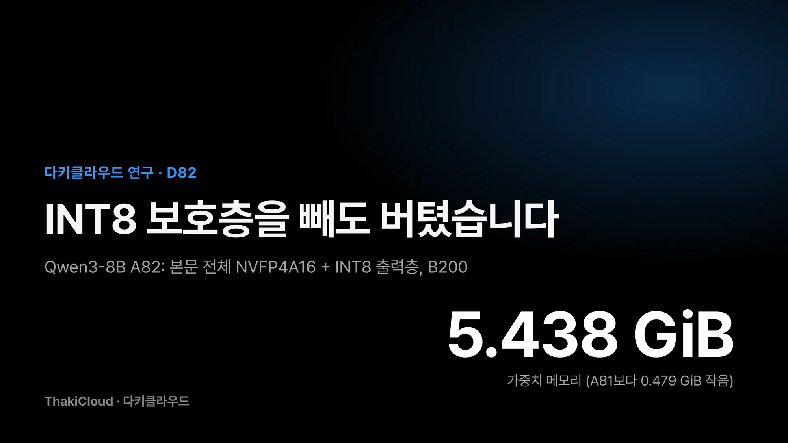
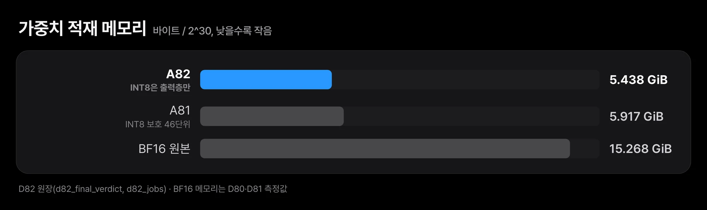
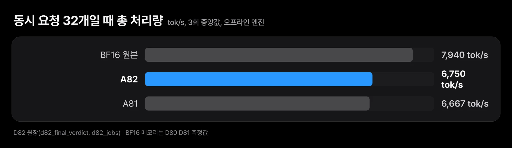

*A82는 본문의 INT8 보호층 46개를 모두 NVFP4A16으로 되돌리고 출력층만 INT8로 남긴 구성입니다.*

[지난 글](/tech-blog/ko/research/b200-nvfp4a16-int8-mixed-qwen3-8b/)에서 다키클라우드는 Qwen3-8B를 5.917 GiB로 줄인 A81을 공개했습니다. 그 구성은 품질에 민감하다고 본 46개 단위를 8비트 정수(INT8)로 남겨 두었습니다. 지난 글 끝에서 그 46개가 독립적으로 얼마나 기여했는지는 확인하지 못했다고 적었습니다.

이번에는 그 보호를 모두 걷어낸 구성 A82를 시험했습니다. 본문은 전부 4비트 가중치로 두고 출력층만 INT8로 남겼습니다. 메모리는 5.438 GiB로 0.479 GiB 더 줄었습니다. 미리 정한 기준에서 A81보다 크게 나빠지지 않았다는 검정도 통과했습니다.

다만 이 결과는 "A82가 A81보다 낫다"는 뜻이 아닙니다. 이 글은 무엇이 확인됐고 무엇이 아직 열려 있는지를 나눠 적습니다.

## 쉽게 말하면

지난 글에서는 여행 가방 압축팩에 빗댔습니다. A81은 쉽게 구겨지는 옷 46벌을 압축팩 대신 덜 누르는 파우치에 따로 담은 가방이었습니다. 이번에는 그 파우치를 모두 빼고 옷을 전부 압축팩에 넣었습니다.

가방은 더 작아졌습니다. 꺼낸 옷을 같은 기준으로 살펴보니 전체적으로 입을 만한 상태는 지켰습니다. 그런데 셔츠 몇 벌은 한 번 볼 때는 더 구겨져 보였고 다시 볼 때는 비슷해 보였습니다. 셔츠만 따로 판단하기에는 살펴본 벌 수가 부족했습니다.

## 물은 질문은 하나였습니다

D82 실험의 질문은 데이터를 보기 전에 정했습니다. 전체 정확도에서 A82가 A81보다 1.5%p 넘게 나빠지지 않는가입니다. 이렇게 "크게 나빠지지 않았다"를 확인하는 검정을 비열등성 검정이라고 부릅니다.

검정은 이 하나뿐이었습니다. "A82가 더 정확하다"를 따지는 우월성 검정은 미리 등록하지 않았습니다. 그래서 결과가 좋게 나와도 우월하다고 주장하지 않습니다.

평가셋은 둘을 새로 만들었습니다. 다음 단계로 보낼지 정하는 선택용 SEL-82와 최종 판정용 FINAL-82입니다. 두 세트는 문항과 원문을 공유하지 않고, 이전 실험에서 쓴 문항도 모두 뺐습니다. 판정 규칙은 각 실행 전에 봉인했습니다.

## 비열등성 기준을 통과했습니다

A82와 A81을 같은 문항으로 풀게 하고 문항마다 맞힘 여부를 짝지어 비교했습니다. 최종 평가셋에서 짝을 지은 게이트 문항은 10,210개였습니다.

| 평가셋 | A82 − A81 | 95% 신뢰구간 | 판정 |
|---|---|---|---|
| SEL-82 (10,198문항) | +1.49%p | +0.88 ~ +2.10%p | 다음 단계로 선택 |
| FINAL-82 (10,210문항) | +0.71%p | +0.10 ~ +1.31%p | 비열등성 통과 |

*표: 문항별 짝 정답 차이와 95% 신뢰구간. 비열등성 마진은 −1.5%p입니다.*

최종 평가에서 구간의 아래쪽 끝은 +0.10%p였습니다. 마진 −1.5%p보다 한참 위입니다. 사전 등록한 판정은 통과입니다.

구간이 0보다 위에 있으니 A82가 더 낫다고 읽고 싶어질 수 있습니다. 하지만 우월성은 처음부터 검정 대상이 아니었습니다. 이 결과로 말할 수 있는 것은 "보호층을 빼도 전체 정확도가 크게 떨어지지 않았다"까지입니다.

## 메모리는 0.479 GiB 더 줄었습니다

*A82는 BF16보다 64.4%, A81보다 0.479 GiB 작습니다. BF16 값은 D80·D81에서 같은 엔진과 GPU로 잰 값입니다.*

A82의 가중치 적재 메모리는 5.438 GiB입니다. A81의 5.917 GiB보다 작고 BF16 원본의 15.268 GiB보다 64.4% 작습니다. BF16 값은 이번에 다시 재지 않았고, 이전 실험에서 같은 엔진과 GPU로 잰 값을 썼습니다.

커널도 확인했습니다. 양자화한 선형층 144개가 모두 B200의 NVFP4 커널에서 돌았고, 출력층은 INT8 커널에서 돌았습니다. 원래 정밀도로 되돌아가 계산한 층은 없었습니다.

A81 공개 때 쓴 BF16 대비 기준도 모두 넘었습니다. 한국어 보존율은 0.914로 기준 0.90 위였습니다. 토큰 하나를 만드는 시간은 요청을 하나씩 처리하는 배치 1에서 BF16의 0.919배였습니다.

## 영역별로 보면 추론은 아직 결론이 없습니다

전체 정확도 아래에는 한국어, 영어, 숫자, 추론 네 영역이 있습니다. 영역별 차이는 확증 검정이 아니라 보고용으로만 쟀습니다. 숫자와 추론 영역은 문항 수가 적어 검정력이 부족하다고 결과를 보기 전에 선언해 두었습니다.

| 영역 (A82 − A81) | SEL-82 | FINAL-82 |
|---|---|---|
| 한국어 | +0.38%p (−0.53 ~ +1.29) | −0.81%p (−1.71 ~ +0.08) |
| 영어 | −0.10%p (−0.89 ~ +0.68) | −0.31%p (−1.17 ~ +0.55) |
| 숫자 (검정력 부족) | +5.50%p (+4.26 ~ +6.74) | +3.40%p (+2.19 ~ +4.62) |
| 추론 (검정력 부족) | −3.47%p (−5.66 ~ −1.28) | −0.40%p (−2.62 ~ +1.82) |

*표: 영역별 짝 정답 차이와 95% 구간. 보고용이며 확증 검정이 아닙니다.*

눈에 띄는 것은 추론입니다. 선택용 평가셋에서는 A82가 A81보다 3.47%p 낮았고 구간 전체가 0 아래였습니다. 최종 평가셋에서는 차이가 −0.40%p로 줄었고 구간이 0을 포함했습니다.

두 결과를 합쳐도 추론 성능이 같다는 증거는 되지 않습니다. 같은 차이가 평가셋에 따라 이만큼 흔들렸다는 것은 이 영역의 문항 수로는 판단할 수 없다는 뜻입니다. 추론이 중요한 서비스라면 A81과 A82를 자신의 문항으로 다시 비교해야 합니다.

숫자 영역은 두 평가셋 모두 A82가 높았습니다. 이것도 검정력이 부족한 영역의 보고값이므로 숫자 계산이 좋아졌다고 주장하지는 않습니다. 한국어 보존율은 A82가 0.914, A81이 0.937로 A81이 높았습니다.

## 요청이 몰리면 BF16이 더 빨랐습니다

*동시 요청 32개에서는 BF16의 총 처리량이 A82보다 약 18% 높았습니다. A82는 메모리를 줄이는 용도입니다.*

이번에는 지난 글에서 빠져 있던 동시 요청 조건도 쟀습니다. 같은 GPU에서 세 모델을 차례로 돌렸고 각각 3회 측정의 중앙값을 썼습니다.

요청이 하나일 때는 A82가 초당 274.9토큰으로 BF16의 252.3토큰보다 빨랐습니다. 요청 8개에서도 A82가 조금 앞섰습니다. 그런데 요청 32개에서는 BF16이 초당 7,940토큰으로 A82의 6,750토큰보다 약 18% 많이 처리했습니다.

그러니 A82는 처리량을 늘리는 도구가 아닙니다. 같은 GPU에 모델을 더 작게 올려야 할 때 쓰는 구성입니다. 이 동시성 수치는 오프라인 엔진에서 잰 값이라 HTTP 서버나 네트워크 대기 시간은 들어 있지 않습니다.

## 그대로 믿기 전에 알아둘 네 가지

첫째, 이번 결과는 비열등성 하나만 확인했습니다. A82가 A81보다 정확하다는 주장은 하지 않습니다.

둘째, 추론과 숫자 영역은 설계 단계부터 검정력이 부족했습니다. 추론 차이는 평가셋에 따라 −3.47%p와 −0.40%p로 크게 달랐습니다.

셋째, 한국어 보존율은 A81보다 낮습니다. 둘 다 0.90 기준은 넘었지만 A82 쪽 여유가 더 좁습니다.

넷째, Qwen3-8B 하나, B200 하나, vLLM 0.29.0 하나에서 잰 결과입니다. thinking 모드와 긴 글 생성, 안전성은 평가하지 않았습니다.

## 다키클라우드는 이 결과를 이렇게 씁니다

다키클라우드는 고객 GPU 위에 모델을 직접 올리는 일이 많고, Paxis의 업무 자동화도 결국 그 위에서 돕니다. 가중치 메모리가 줄면 같은 GPU에 더 긴 문맥이나 더 많은 모델을 넣을 수 있습니다. 이번 결과는 그 여유를 0.479 GiB 더 만들 수 있다는 근거입니다.

동시에 A81을 대체하지는 않습니다. 추론 비중이 큰 작업이나 한국어 여유가 중요한 작업에는 A81이 여전히 기준 구성입니다. 메모리가 가장 빠듯한 배치에서 A82를 후보로 두고, 실제 업무 문항으로 다시 재서 고를 생각입니다.

A82는 상용 서비스 승인을 받은 모델이 아니라 연구용 공개입니다. 다른 하드웨어나 운영 환경에서 같은 성능이 나온다고 보장하지도 않습니다.

## 끝으로

지난 글에서 열어 둔 질문은 46개 보호층이 무엇을 했느냐였습니다. 이번 결과로 보면 전체 정확도를 지키는 데는 꼭 필요하지 않았습니다. 하지만 추론 영역에서 그 보호가 무엇을 했는지는 아직 모릅니다.

그래서 다음 실험 D83은 이 질문을 직접 겨냥해 준비하고 있습니다. 46개 단위를 하나씩 또는 무작위로 되돌렸을 때의 차이, 숫자와 추론 사이의 맞바꿈, 다른 크기 모델에서도 같은 결과가 나오는지를 새 평가셋과 충분한 문항 수로 다시 잴 계획입니다.

공개 체크포인트와 집계 결과는 아래에 있습니다.

- A82 공개 체크포인트(연구용, 상용 미승인): [ThakiCloud/Qwen3-8B-NVFP4A16-INT8Head-B200](https://huggingface.co/ThakiCloud/Qwen3-8B-NVFP4A16-INT8Head-B200)
- D82 집계 결과·레시피·재현 안내: [ThakiCloud/B200-LowBit-Quantization-Benchmarks-D82](https://huggingface.co/datasets/ThakiCloud/B200-LowBit-Quantization-Benchmarks-D82)
- 비교 대상 A81: [ThakiCloud/Qwen3-8B-NVFP4A16-INT8-Mixed-B200](https://huggingface.co/ThakiCloud/Qwen3-8B-NVFP4A16-INT8-Mixed-B200)
- 지난 글: [NVFP4 W4A4보다 정확하고 BF16보다 작은 Qwen3-8B](/tech-blog/ko/research/b200-nvfp4a16-int8-mixed-qwen3-8b/)
