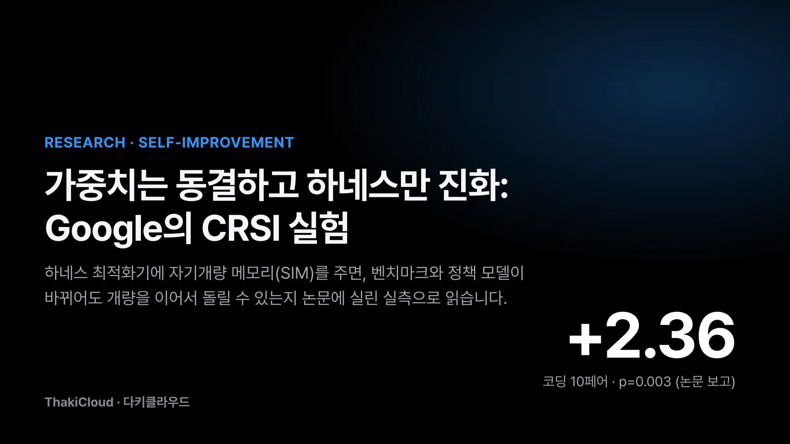
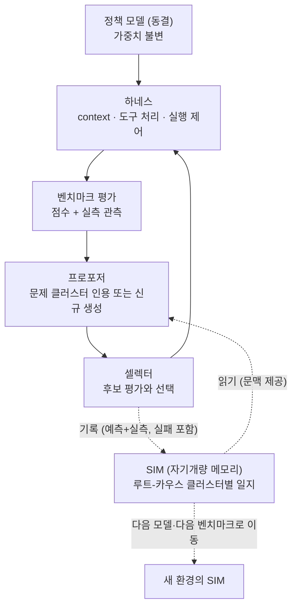
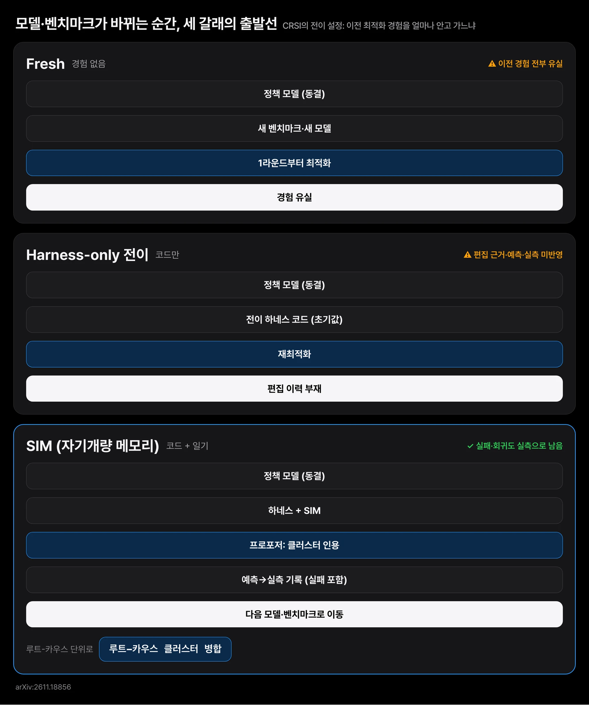
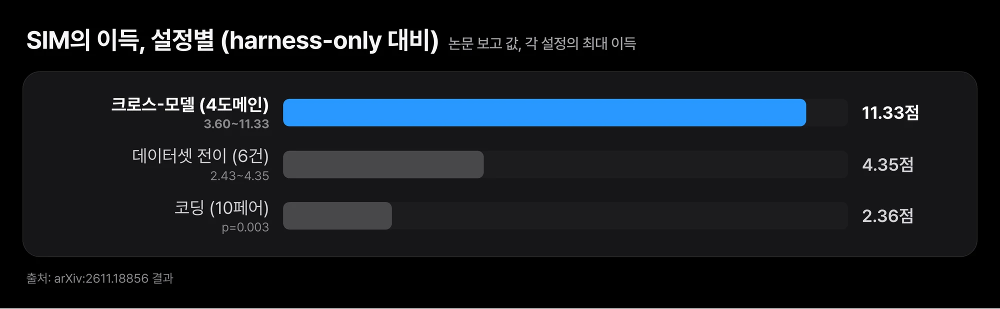

*가중치는 동결하고 하네스만 진화: Google의 CRSI 실험. arXiv:2611.18856의 자기개량 메모리(SIM) 결과를 이번 실험의 자로 다시 읽습니다.*

에이전트 하네스를 돌리면서 한 번쯤 마주하는 장면이 있습니다. 이번 주에 잘렸던 리트라이 로직이 다음 주에는 다시 필요하고, 벤치마크를 바꿨더니 어제 확신했던 프롬프트가 오늘에는 이유를 모를 정도로 떨어집니다. 매번 처음부터 다시 찾는 비용은 누적되지 않고, 쌓인 맥락도 다음 세션으로 안 갈아입힙니다.

Google Cloud AI와 Google DeepMind, Penn State 공동 저자들의 논문 "Self-Improvement Memory Enables Continual Recursive Self-Improvement"(arXiv: 2611.18856, 2026-11-13)가 이 문제를 정식으로 다룹니다. LLM의 가중치를 동결하고, 모델을 감싸는 실행 가능한 하네스(context 구성, 도구 처리, 실행 제어)만 프로포저와 셀렉터 에이전트가 진화시키는 설정에서, 벤치마크가 바뀌거나 정책 모델이 바뀌어도 최적화를 이어서 돌리는 CRSI(Continual Recursive Self-Improvement)를 정의하고, 그 기억을 옮기는 장치인 SIM(Self-Improvement Memory)을 제안합니다.

핵심 결과를 먼저 적면 이렇습니다. 코딩 도메인 10페어 독립 반복에서 SIM이 하네스만 전이하는 방식보다 평균 +2.36점(p=0.003) 높았고, 6개 데이터셋 전이는 전부 SIM이 최고였으며(+2.43~+4.35), Opus에서 Gemini로 정책 모델을 바꾼 크로스-모델 전이에서는 +3.60~+11.33점의 개량을 이었습니다. 다만 라벨만 전이하면 효과가 섞였고(−1.82~+2.40), 한 세대 앞선 Gemini 4 Argon에서는 전이 자체가 −0.8로 역전했습니다. 개량이 이어지는 조건과 끊기는 조건이 이번 실험으로 갈라지는 것입니다.

> 📄 **심층 리뷰 전문(DOCX)**: 이 논문의 상세 피어리뷰를 [Google Drive에서 다운로드](https://drive.google.com/file/d/1JGwjSAN8xri3ZfGLkqAyr-ZJtFO2Ic_F/view)할 수 있습니다.

## 쉽게 말하면

시계 수리공의 작업 일기를 상상해 보세요. 수리공이 새 시계를 고를 때마다 처음부터 배움을 다시 시작한다면, 100년을 일해도 실력은 고집니다. 일기가 있다면 다릅니다. "이 모델은 자물쇠가 풀리면 3시 방향이 잘립니다" 같은 증상별 기록, 시도할 때 내린 예측, 실측 결과, 그리고 그 시계를 만들던 세대까지 남아 있습니다. 새 시계(새 모델)가 들어오면 일기를 그대로 들고 가는데, 같은 증상은 일기에 이미 있으니 새로 깨닫지 않아도 됩니다. 이 논문의 SIM이 바로 그 일기이고, CRSI는 "시계 세대와 관계없이 수리를 이어서 한다"는 규칙입니다.

다만 일기가 모든 새 시계에 그대로 통하지는 않습니다. 시계 모델이 크게 달라지면, 이전 세대의 수리 습관이 오히려 걸림돌이 될 수 있습니다. 수리공은 일기를 가져가되, 새 시계에서 다시 점검합니다. 논문의 Argon 역전 결과가 바로 이 부분입니다.

## 가중치가 아니라 하네스가 최적화 대상인 이유

RSI(Recursive Self-Improvement)라고 하면 보통 모델 스스로 모델을 더 잘하게 만드는 그림을 떠올립니다. 이 논문의 설정은 다릅니다. 정책(policy)을 내리는 LLM은 처음부터 끝까지 동결되고, 바뀌는 것은 그것을 실행으로 감싼 하네스입니다. 하네스에는 프롬프트 구조, 도구 호출 처리, 실행 제어, 검증 로직 같은 실행 가능한 코드와 텍스트가 들어 있습니다.

왜 가중치를 안 건드리느냐. 가중치 업데이트는 학습 데이터와 비용이 새로 들고, 모델이 바뀔 때마다 처음부터 다시해야 합니다. 하네스 최적화는 평가 점수 하나를 보고 편집을 시도하는 루프로 돌 수 있고, 산출물이 텍스트와 코드라서 그대로 다른 환경으로 옮길 수 있습니다. 논문이 정의하는 CRSI의 전제 조건은 여기에 있습니다. 다른 벤치마크나 다른 정책 모델로 갈아타더라도, 하네스의 인터페이스(입출력 계약)만 공유되면 최적화 루프를 멈추지 않고 이어서 돌리는 것입니다.

"인터페이스가 공유된다"는 말은 구체적입니다. 이전 벤치마크에서 최적화된 하네스가 새 벤치마크에 놓였을 때, 새 환경의 입력(문제, 도구, 평가 함수)을 그대로 받아들이고 같은 형식의 출력을 돌려주는 계약이 유지되는 상태입니다. 계약이 유지되면 전이 하네스는 새 환경의 초기값으로 출발하고, 계약이 깨지면 전이는 처음부터 다시 돌리는 fresh 실행과 다름이 없습니다. 그래서 이 논문의 전이 결과들은 모두 "호환 인터페이스"라는 조건 아래에서만 유효하고, 이 전제는 결과 해석에 반드시 붙여 읽어야 합니다.



하네스는 한 방향으로만 흐르는 게 아니라, 평가 점수를 보고 편집을 시도하고, 그 시도의 전후를 메모리에 남기는 고리를 도는 구조입니다. 이 고리가 CRSI의 "지속"을 만드는 부분이고, 고리에 SIM이 끼는 자리가 이 논문의 기여입니다.

루프의 실제 크기는 논문에 따라 매 라운드에 5개 후보 편집을 만들고, 10라운드까지 돌리는 구성입니다. 매 후보마다 "이 편집을 하면 점수가 이렇게 변할 것"이라는 예측을 평가 전에 적고, 평가 뒤 실측을 붙입니다. 그래서 하나의 라운드가 끝나면 하네스가 하나 바뀌는 동시에, 메모리에는 성공과 실패를 가리지 않고 5줄의 일지가 쌓입니다.

## 실패도 기록하는 일기의 구조

SIM의 설계 원칙은 "남기는 것"에 있습니다. 기존 RSI 연구가 성공한 편집만 다음 세션에 넘기는 것과 달리, SIM은 시도마다 세 가지를 기록합니다.

첫째, 변경 내용과 근거. 어떤 편집을 했고, 왜 했는지. 둘째, 예측과 관측. 편집하기 전에 "이렇게 바꾸면 점수가 이렇게 변할 것"이라고 적은 예측, 그리고 평가 후 실측한 관측을 쌍으로 남깁니다. 셋째, 출전. 도메인, 벤치마크, 정책 모델, 라운드를 함께 적어 그 기록이 어디서 나온 것인지 추적 가능합니다.

이 세 가지를 묶는 단위가 루트-카우스(근본 원인) 클러스터입니다. 같은 증상의 재발을 반복 편집으로 처리하는 대신, "이 편집들 모두 X라는 근본 원인에서 나왔다"고 클러스터링합니다. 이미 알려진 클러스터에 새 시도가 붙으면 새 항목을 만들지 않고 이력이 누적되고, 회귀(점수 하락)한 편집도 실측 관측과 함께 남습니다. reverted(되돌려진) 편집의 미해결 예측까지 보존한다는 점도 이 구조의 특징입니다.

SIM의 한 줄을 실제 형식으로 그리면 이런 모양입니다.

```
cluster:   C-017 (리트리 폭주: 실패 후 동일한 호출 반복)
round:     6
edit:      재시도 시 백오프 인터벌을 지수형으로 변경
rationale: C-017 이력에서 선형 백오프가 3번 되돌려짐
predicted: 점수 +1.5 (도구 호출 횟수 감소)
observed:  +0.8 (호출 횟수 감소했으나 검증 지연 증가)
context:   coding / mbpp / opus-policy / round-6
```

예측과 관측의 쌍이 핵심입니다. "예측 +1.5, 실측 +0.8"이라는 기록은 다음 라운드에서 프로포저가 같은 종류의 편집을 고를 때 "이 편집은 기대보다 약하게 작용한다"는 근거가 됩니다. 성공만 남기면 이런 보정이 불가능합니다.

이 설계가 전이에서 값을 발휘합니다. 벤치마크가 바뀌면 하네스는 처음부터 다시 돌 수 있지만, SIM은 "이러한 종류의 문제에서 이런 편집이 이렇게 끝났다"는 기록을 그대로 안고 갑니다. 정책 모델이 바뀌어도 마찬가지고, 모델이 바뀌어 증상이 달라져도, 같은 루트-카우스는 이력을 떨어뜨리지 않고 병합됩니다. 시계 수리공의 일기가 왜 새 시계에 함께 가는지, 여기서 알 수 있습니다.

## 벤치마크와 모델이 바뀌었을 때, 실제로 무엇이 이어졌나


*CRSI의 전이 설정 세 갈래. 이전 최적화 경험을 얼마나 안고 가느냐가 실험의 핵심 변수입니다.*

논문의 실험 세팅을 정리하면 이렇습니다. 프로포저와 셀렉터는 둘 다 LLM 에이전트이고, 편집 대상은 하네스, 평가는 벤치마크 점수입니다. 조건은 세 갈래로 나뉩니다. Fresh(처음), Harness-only transfer(하네스 코드만 전이, 라벨과 기록은 버림), SIM(하네스 + 메모리 전이).

코딩 도메인에서 SIM과 harness-only 전이를 10페어 독립 반복으로 돌린 결과, SIM이 평균 +2.36점 높았습니다. 95% 신뢰구간 [1.05, 3.68], paired t-test t(9)=4.06, p=0.003, 효과량 d_z=1.28, 10페어 중 9페어에서 승리. 이 논문의 통계적 뒷받침이 가장 단단한 수치입니다.

6개 데이터셋 전이(벤치마크가 바뀌는 경우)에서는 SIM이 전부 최고였으며, harness-only 대비 +2.43~+4.35점이었습니다. 크로스-모델 전이(Opus에서 Gemini로 정책 모델을 바꾼 4도메인)에서는 +3.60~+11.33점까지 벌어졌습니다.

전이의 시작점도 함께 봐야 합니다. 벤치마크가 바뀐 환경에서 전이 하네스는 fresh 시드보다 낮게 시작합니다. 이전 벤치마크에 맞춘 편집이 새 환경에서는 초기 손해를 만드는데, SIM의 이득은 그 손해를 회복하고 그 위로 오르는 전체 경로입니다. 그래서 fresh 최종 점수 대비로는 크로스-모델 이득이 +1.08~+1.77(엔지니어링 도메인 +9.56 제외) 수준으로 줄어듭니다. "harness-only 대비 +11.33"과 "fresh 대비 +1.77"은 다른 숫자이고, 둘 다 같은 실험의 값입니다.

다만 두 주의치가 있습니다. 첫째, 라벨만 전이하면(하네스 편집 없이 문제 클러스터 라벨만 가져가는 조건) 효과가 −1.82~+2.40으로 섞였습니다. "무엇이 문제였는지"의 라벨만으로는 안 되고, 편집과 예측과 관측이 함께 가야 한다는 뜻입니다. 둘째, 한 세대 앞선 Gemini 4 Argon에서는 전이 하네스가 −0.8로 역전했습니다(CRSI 94.8 대 fresh RSI 95.6). 다음 세대가 충분히 좋아지면, 이전 세대의 최적화 기록이 오히려 새 모델에 맞지 않는 습관이 될 수 있습니다.

논문은 또 다른 비교도 남깁니다. 텍스트 분류 도메인에서 모델별로 하네스를 독립 최적화한 구성(B1)과, 공통 하네스를 한 번 최적화해 통합 운영한 구성(S2)을 붙이면, 통합 구성이 77.08점으로 모델별 독립 76.30점을 약간 앞서습니다. 개량이 모델 경계를 건너가서 쌓인다는 점을, 같은 환경 안에서 보여주는 수치입니다.

| 설정 | SIM vs harness-only | 특징 |
|---|---|---|
| 코딩 10페어 | +2.36 (p=0.003) | 통계적 뒷받침 가장 단단 |
| 데이터셋 전이 6건 | +2.43~+4.35 | 전부 SIM이 최고 |
| 크로스-모델 4도메인 | +3.60~+11.33 | Opus→Gemini |
| 라벨만 전이 | −1.82~+2.40 | mixed, 편집이 없어 안 됨 |
| Gemini 4 Argon | −0.8 | 역전, 한 세대 앞 |


*논문 보고 값(각 설정 최대 이득). 참고로 한 세대 앞 Gemini 4 Argon에서는 전이가 −0.8로 역전했습니다.*

라벨만 전이한 조건의 mixed effect를 해석하면, SIM의 가치가 어디에 있는지 더 선명해집니다. 문제 클러스터의 라벨("이 구역이 리트리 폭주다")은 증상의 지형도일 뿐, 그 지형에서 어떤 편집이 어떻게 끝났는다는 지식이 아닙니다. 새 벤치마크에서 프로포저가 지형도는 보고도, 그 지형에서 실제로 통했던 손길과 실패한 손길이 따로 묻혀 있지 않으면, 결국 다시 시행착오를 반복합니다. 일기에 "증상"만 적혀 있고 "처방과 그 결과"가 없는 것과 같은 상태입니다.

## 에이전트가 계속 진화하는 시스템에 뭘 남기는가

이 논문이 ThakiCloud의 Paxis(에이전트 플랫폼)에서 직접 읽히는 이유는, Paxis가 하네스 자체를 진화시키는 구조를 갖고 있기 때문입니다. 스킬이 자동 생성되고, 실행되고, 회고되어 수정되고, 다음 실행에 반영되는 루프가 Paxis의 상시 동작입니다. 다만 그 루프가 남기는 기록의 형식은 이 논문 이전이었습니다. 편집과 근거는 있었지만, 예측과 실측의 쌍, 루트-카우스 클러스터, 출전(도메인·모델·라운드)까지 구조화되어 있지는 않았습니다.

SIM 형식으로 읽으면, Paxis의 스킬 진화 로그에 "이 스킬의 이 편집은 어떤 루트-카우스였고, 편집 전에 어떤 점수 변화를 예측했고, 실측은 어떻게 나왔는가"를 클러스터 단위로 묶는 것입니다. 구체적으로 스킬 편집 하나가 남기는 일지가, 앞서 본 SIM 기록과 같은 필드를 갖는 형태입니다. 루트-카우스(이 실패가 어떤 종류의 문제였는가), 편집 내용, 편집 전 예측, 편집 후 실측, 그리고 도메인·모델·라운드라는 출전까지 함께 적히는 것입니다.

이 형태가 갖는 의미는 모델 교체 시점에 드러납니다. 모델이 Opus에서 다음 세대로 바뀌는 순간, 이전 세대에서 쌓인 "이러한 종류의 실패에서 이런 편집이 이렇게 끝났다"는 기록이 새 세대의 첫 최적화 라운드에서 바로 맥락이 됩니다. 논문의 크로스-모델 결과(+3.60~+11.33)는 그 맥락이 실제로 점수로 이어졌다는 증거입니다. 반대로, Argon에서 −0.8로 역전된 결과는 "다음 세대가 좋으면 이전 기록을 그대로 이식해도 된다"는 유혹에 대한 경고입니다. 기록은 안고 가되, 새 모델에서 재검증 없이 복기하지 않는 선을 지켜야 합니다.

ai-platform 쪽에서는 다른 각도입니다. 고객이 자기 에이전트 하네스를 여러 모델로 돌릴 때, "모델을 바꾸면 하네스도 처음부터 다시 튜닝해야 하나"는 실용적인 질문입니다. 이 논문의 답은 "인터페이스가 공유되는 한, 메모리를 안고 이어서 돌릴 수 있다"입니다. 하네스 최적화를 서비스로 제공하는 구성이라면, SIM은 모델 교체 시점에고객의 자산을 보존하는 장치로 읽힙니다.

## 이어서 쓰기 전에 알아둘 네 가지

**1. 독립 반복이 코딩밖에 없습니다.** 나머지 도메인은 조건당 단일 런(n=1)입니다. +2.36(p=0.003)은 코딩에서만 성립한 통계고, 다른 도메인의 전이 이득은 단일 런의 값입니다.

**2. 전이는 새 시드보다 낮게 시작합니다.** 전이 하네스는 fresh 시드보다 낮은 점수에서 출발합니다. 그래서 크로스-모델 이득의 상당 부분은 "전이 적자를 되찾는 것"입니다. fresh 최종 대비로는 +1.08~+1.77(엔지니어링 +9.56 제외) 수준입니다. "전이해서 11.33점 올랐다"는 말이 fresh 대비가 아님을 구분해야 합니다.

**3. 비용 회계가 없습니다.** 프로포저와 셀렉터가 매 라운드 LLM을 부르는데, 그 비용은 논문에 회계되지 않았습니다. 매 라운드 5개 후보를 만들고 10라운드까지 돌린다는 것은, 첫 편집 하나를 확정하기 전까지 후보별 평가 실행과 프로포저·셀렉터의 LLM 호출이 수십 번 이미 일어난다는 뜻입니다. 하네스 최적화의 이득이 그 비용보다 큰지는 이 논문으로 답할 수 없고, 재현하려면 자기 환경의 평가 비용부터 먼저 계산해야 합니다.

**4. 최적자와 대상이 같은 계열입니다.** 프로포저와 셀렉터가 대상 정책 모델과 같은 계열 LLM이면, "자기 자신을 더 잘게 만드는" 편향이 배제되지 않습니다. 다른 계열의 최적자로는 일반화되지 않는 실험입니다.

## 끝으로

이 논문이 남기는 가장 실용적인 문장은, "가중치는 동결하고 하네스를 진화시키되, 시도를 예측·실측 쌍과 루트-카우스 클러스터로 기록하면 벤치마크와 모델이 바뀌어도 개량이 이어진다"는 것입니다. 그리고 그 이어짐의 한계도 함께: 한 세대 앞에서는 기록이 습관이 되고, 비용은 회계되지 않습니다.

오늘 바로 할 수 있는 첫 실험은 하나입니다. 가장 최근에 reverted(되돌려진) 하네스 편집 하나를 꺼내, 편집 전 예측, 편집 후 실측, 루트-카우스를 지금부터라도 SIM 형식으로 기록해 보는 것입니다. 다음 모델 교체 시점에 그 일기가 맥락이 되는 경험은, 논문보다 먼저 와 있습니다. 그리고 그 일기에 Argon의 교훈, "기록은 안고 가되 새 모델에서 재검증한다"는 한 줄도 함께 적어 두십시오.

> 📄 **심층 리뷰 전문(DOCX)**: 이 논문의 상세 피어리뷰를 [Google Drive에서 다운로드](https://drive.google.com/file/d/1JGwjSAN8xri3ZfGLkqAyr-ZJtFO2Ic_F/view)할 수 있습니다.

- 논문: [arXiv:2611.18856](https://arxiv.org/abs/2611.18856)
- 저자: Xin Yu, Fei Xia, Jiaqi Pan, Youbao Tang, Chengzhi Liu (Google Cloud AI), Adams Yu, Sicong Jiang (Google DeepMind), Yanfei Chen (Google Cloud AI Research), Lingzhou Xue (Penn State), Ting Yu (Google Cloud AI)
- 제출: 2026-11-13

출처: arXiv:2611.18856 (2026-11-18 접근), 저자 소속은 HTML 풀버전 기준.
