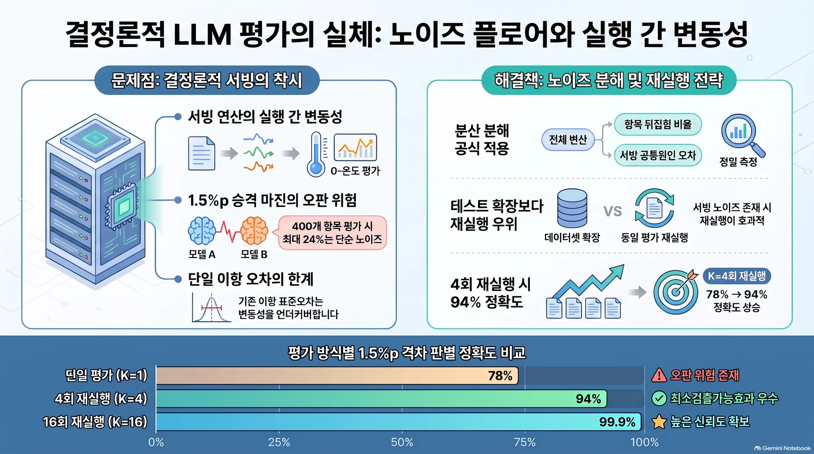
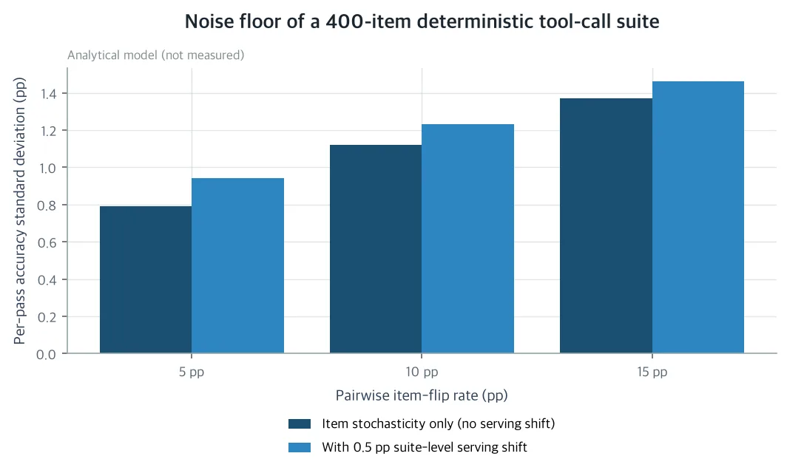
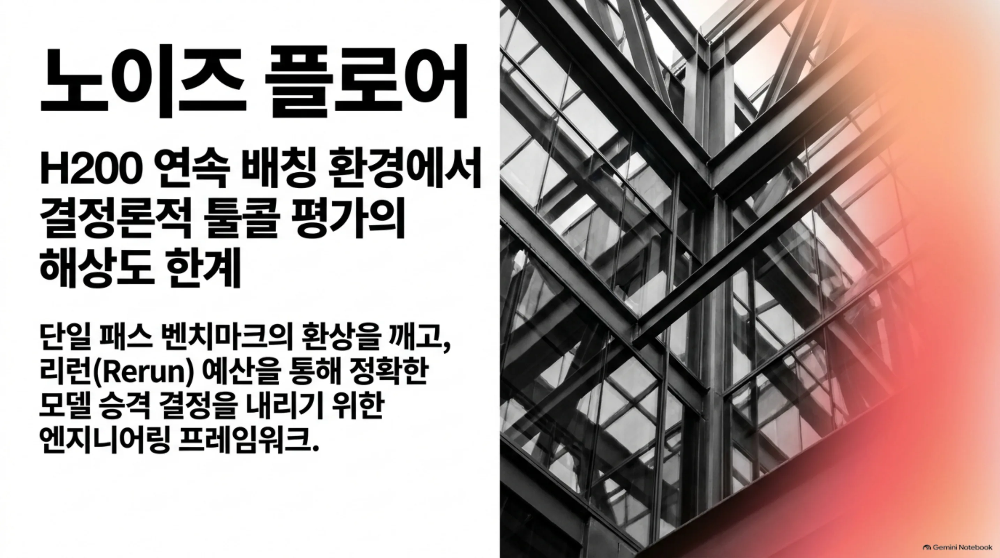
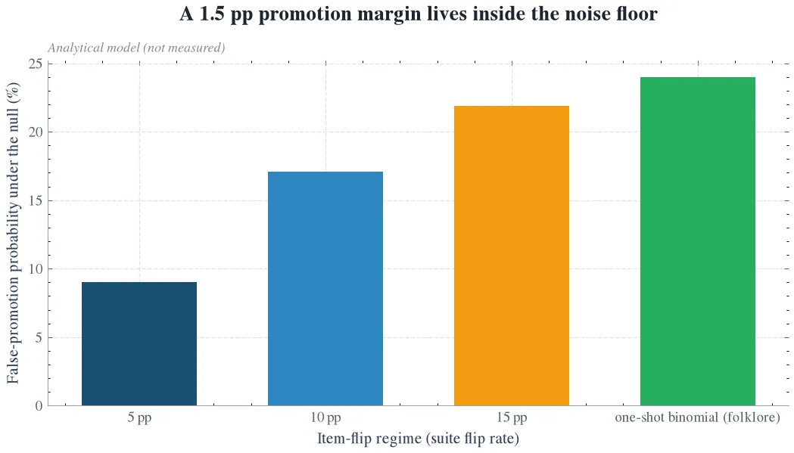
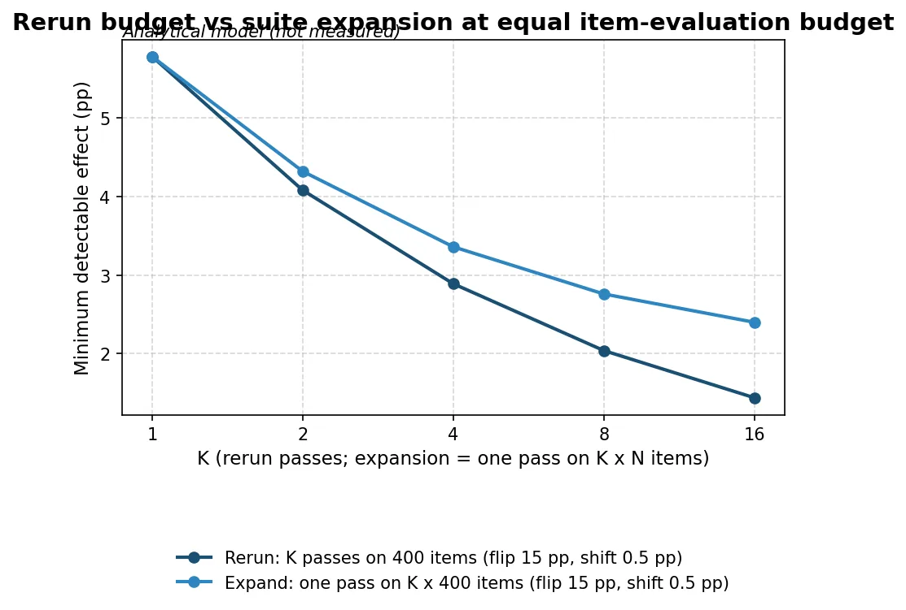
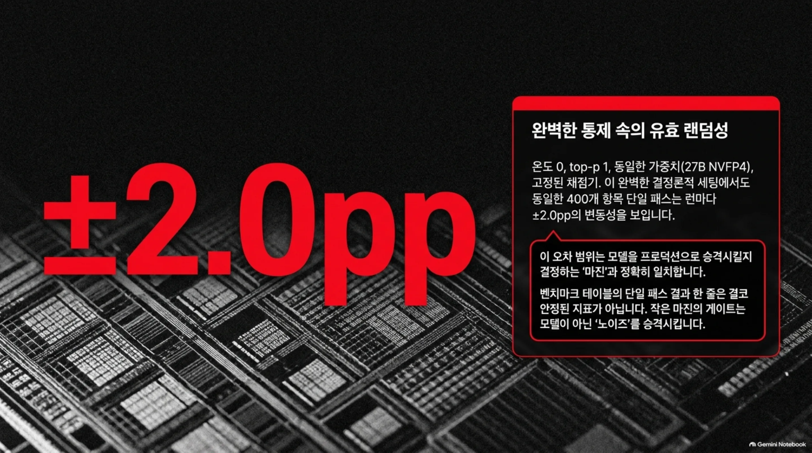
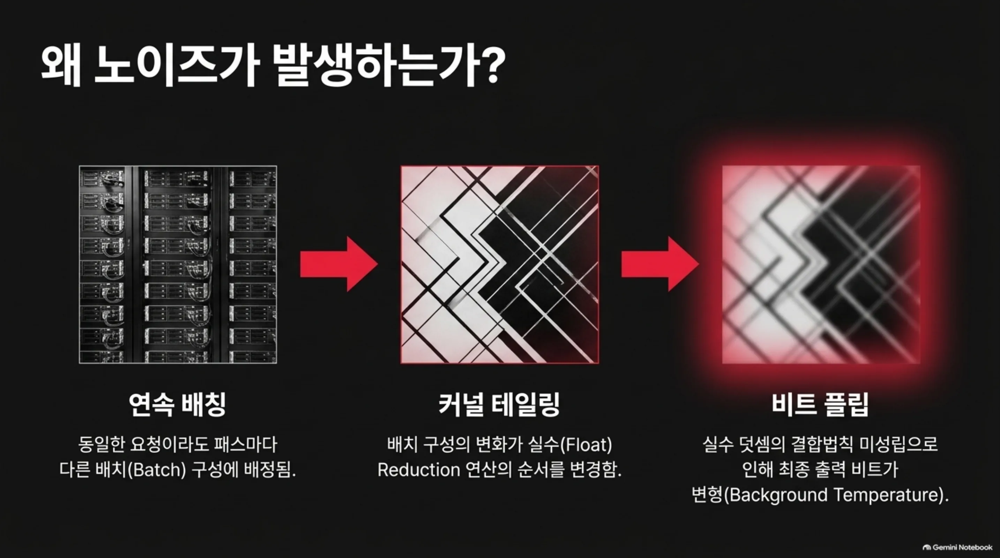
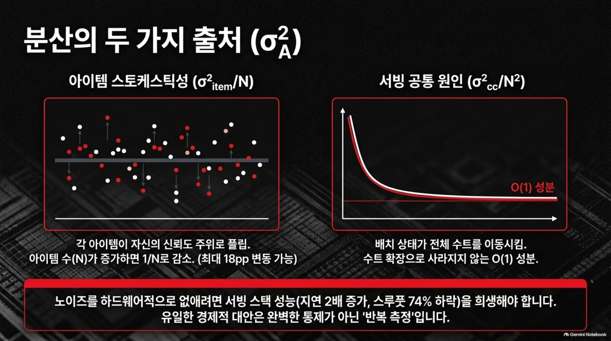
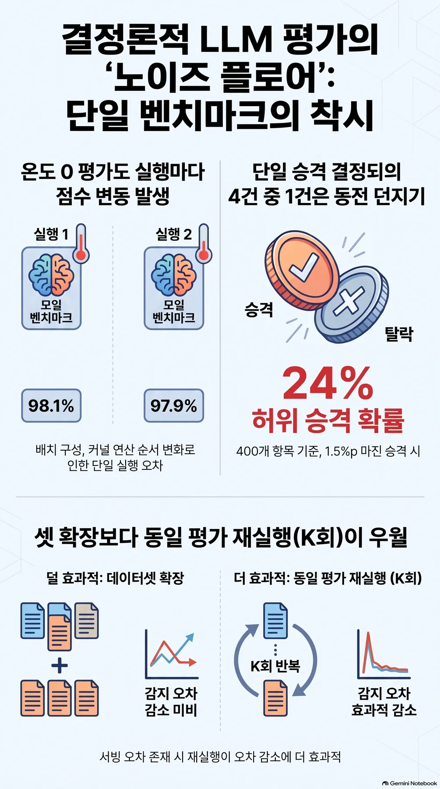

셀프호스트드 추론 플릿을 돌리며 벤치마크 줄을 근거로 모델을 승격하거나, 양자화 정밀도를 바꾸거나, 라우팅 티어를 남기고 버리는 결정을 내리는 분이라면 이 글을 끝까지 읽어야 합니다. 대상 독자는 H200급 하드웨어에서 vLLM 스타일 연속 배칭 서빙을 운영하는, 수백 개의 코드 채점 툴콜 프로브로 모델 비교를 하는 클라우드/AI 엔지니어입니다. 글의 이유는 단순합니다. 단일 패스 벤치마크 줄이 안정된 양이 아니기 때문인 셈입니다. 온도 0에서도 같은 항목, 같은 가중치인데 패스마다 수 포인트씩 점수가 달라집니다. 여기서 승격 결정을 하는 마진이 바로 그 크기입니다.

이 글이 소개하는 "The Noise Floor" 논문은 그 확률 변수에 확률 법칙을 주는 분석 논문입니다. 연속 배칭 서빙에서 결정론적 AST 채점 BFCL 툴콜 평가의 노이즈 플로서 이론을 닫힘 형태로 유도합니다. 승격 게이트가 구분해 낼 수 있는 것, 즉 최소 검출 효과(MDE), 리런 예산, 오판 승격 확률, 드리프트 경계를 줍니다. 확인 대상인 실측 프로토콜도 함께 고정하고 사전등록합니다. 새 엔드포인트 실측을 보고하지는 않습니다. 예시 표와 그림의 값은 운영점 기준의 모델 도출 값입니다. 프레이밍은 vLLM 스타일 서빙의 한 단계 업그레이드입니다. PagedAttention과 연속 배칭이 셀프호스트드 서빙을 빠르다고 만들었습니다. 이 논문은 측정 가능하게 만듭니다.

## 결정론적 평가가 아닌 결정론적 측정

셀프호스트드 추론 플릿은 비교로 살아갑니다. single-call 카테고리에 어떤 모델 티어를 올릴지, 27B급 프로덕션 체크포인트를 BF16에서 NVFP4로 승격할지 더 작은 풀프리시전 모델로 낮출지, DPO 팔이나 라우팅 티어를 둘지, 버릴지, 이런 선택이 이어집니다. 모든 결정에서 근거는 벤치마크 테이블의 한 줄입니다. 수백 개의 코드 채점 툴콜 프로브, 한 패스, 하나의 정확도 숫자. ThakiCloud 비용-품질 시리즈의 Precision Ladder, Concurrency Tax, Grader Confound는 모두 한 번 검증되지 않은 전제를 공유합니다. 한 번 지난 줄이 안정된 양이라는 전제입니다.

그렇지 않습니다. 온도 0, top-p 1, 고정 채점기, 동일한 가중치여도 연속 배칭 엔진을 통한 같은 400개 항목의 패스는 런마다 수 포인트씩 다를 수 있습니다. 요청은 패스마다 다른 배치에 앉습니다. 배치 구성이 커널의 테이링과 실수 reduction 순서를 결정합니다. 실수 덧셈은 결합법칙이 성립하지 않으므로 출력 비트가 바뀝니다. 이 효과로 생기는 유효 랜덤성은 문헌에서 배경 온도(background temperature)로 정형화되어 있습니다. 저희 프로덕션 랩에서 27B NVFP4 엔드포인트의 일회성 재현성 체크가 400개 항목 single-call 카테고리에서 ±2.0pp 밴드를 관측했습니다. 승격 판단을 하는 마진과 같은 크기의 밴드입니다. 줄 아래 바닥이 이만큼 넓으면, 근접 타이 비교는 동전 던지기가 됩니다. 작은 마진의 게이트는 노이즈를 승격시킵니다.

노이즈를 없앨 수 있습니다. 다만 대가는 서빙 스택 자체입니다. 배치 불변 커널은 2배 넘는 지연과 최대 74%의 스루풋을 지불합니다. 고정 배치 지오메트리는 배포별 계약 아래에서만 비트를 유지합니다. 경제적 함의는 명확합니다. 노이즈를 제거하는 것은 서빙 스택에 비용을 냅니다. 측정하는 것은 리런만 들입니다. 이 논문은 후자를 택합니다.

<!-- nlm-visual -->

*NotebookLM이 소스를 종합해 생성한 인포그래픽입니다.*

## 노이즈 두 출처: 아이템 플립과 서빙 공통 원인

이 논문이 세우는 것은 닫힘 형태의 분해 하나입니다. 정적성(A1), 조건부 독립성(A2), 공통 원인 비음성(A3) 가정 아래 패스당 정확도 분산 σ²_A는 둘로 갈라집니다. 아이템 스토케스틱성 항 σ²_item/N(각 아이템이 자신의 신뢰도 주위로 플립)과 서빙 공통 원인 항 σ²_cc/N²(배치 상태가 수트를 통째로 이동)입니다. 전자는 1/N로 줄어듭니다. 후자는 수트 레벨 시프트에서 O(1)입니다. 수트 확장으로는 사라지지 않습니다. 플립-분산 브리지(Proposition 1)가 이를 측정 가능한 대상으로 만듭니다. σ²_A는 수트 아이템 플립률 φ̄를 2N으로 나눈 값으로 아래에서 꽉 잡힙니다. 정확도 90%의 400개 항목 수트는 항목 쌍 기준 최대 18pp까지 플립할 수 있습니다. 그 상한을 넘는 관측은 정적성이나 독립성 가정 자체를 부정합니다.

*패스당 수트 정확도의 표준편차가 아이템 플립 질량(φ̄)에 따라 커지고 수트 레벨 서빙 시프트(τ)는 수트 확장으로 제거할 수 없는 성분을 더합니다. N=400, p̄=0.90 기준의 분석 모델 값이며 실측이 아닙니다.*

두 번째 귀결은 관행 교정입니다. 단일 패스 이항 표준오차 p̄(1−p̄)/N은 보수적이라고 취급되지만, 서빙 시프트 τ가 임계 s_r/√N 아래일 때만 유효한 상한입니다. 그 위에서는 이항 구간이 under-cover합니다. 관행 표준오차를 보고하는 것이 오히려 반보수적으로 바뀝니다. 단일 패스에서는 전혀 볼 수 없는 공통 원인은, 바로 리런 예산이 사야 할 대상입니다.

## MDE, 리런 예산, 게이트 해상도의 한계

분산을 손에 넣으면 승격 판단이 필요한 양들은 닫힘 형태가 됩니다. 패스당 분산이 σ²_A인 두 팔이 각각 K 패스를 돌릴 때, 유의 수준 0.05(양측), power 0.80에서 MDE는 MDE_K = 2.8016×sqrt(2σ²_A/K)입니다. 목표 효과 ε를 분해하는 데 필요한 리런 예산은 K*(ε)입니다. 예산은 정확도 수준 p̄에 의존하지 않습니다. 플립률을 통해서만 연결됩니다. 경계에 가까운 항목이 많은 수트는 같은 정확도에서 더 많은 리런을 필요로 합니다.

예시 계산(표 1)은 프로덕션 운영점 N=400, p̄=0.90을 고정합니다. 플립률은 모델적으로 가능한 5~15pp를, 서빙 시프트는 0과 0.5pp를 커버합니다. 단일 패스 MDE는 3.1~5.9pp입니다. 고정 1.5pp 마진 게이트의 null 오판 승격 확률은 9~24%입니다. 승격 판단 5개 중 하나가 동전 던지기라고 읽힙니다. 그 마진의 alpha-safe 예산 K_safe는 2~6 패스입니다. 랭킹 결과는 더 구체적입니다. 실제로 1.5pp 차이가 있는 두 팔을 단일 패스로 비교하면 78.1%로 올바르게 랭킹됩니다. 4 패스는 93.9%, 16 패스는 99.9%입니다. 시리즈 게이트의 1.5pp 마진은 해결 가능합니다. 다만 멀티패스 예산에서만입니다.

정확도 90%의 400개 항목 수트에서 고정 1.5pp 단일 패스 마진의 null 오판 승격 확률이 아이템 플립 질량에 따라 올라갑니다. 관행 단일 패스 이항 표준오차 아래에서는 약 4분의 1의 오판 승격에 이릅니다. 분석 모델 값이며 실측이 아닙니다.*

## 리런 대 수트 확장: 동예산의 답

해상도를 사려면 같은 수트를 다시 돌리거나 수트를 넓히거나, 둘 중 하나를 택해야 합니다. 동예산 정리가 같은 아이템-평가 예산에서 답을 줍니다. 비교 대상은 400개 항목 4 패스(1,600 평가)와 1,600개 항목 1 패스입니다. 수트-시프트 모델에서 배치 시프트 τ는 확장 패스의 모든 아이템에 동일하게 작용합니다. 확장으로는 사라지지 않습니다. 리런은 K로 나누어 줍니다. φ̄=15pp, N=400, K=4에서 리런의 MDE 우위는 τ=0(타이)에서 0%, 0.5pp에서 14%, 1.0pp에서 30%입니다. τ=0 타이에서도 실측 σ̂_A, φ̂, 순서 대조를 주는 것은 리런뿐입니다. 수트 확장의 유일한 진정한 장점, 신규 항목 커버는 다른 통계적 목표입니다. 이미 발표된 어떤 줄의 노이즈 플로서도 낮추지 못합니다.

*논문의 운영점(N=400, φ̄=15pp, τ=0.5pp)에서 같은 수트를 K번 다시 돌리면 MDE가 1/sqrt(K)로 내려가지만, 항목 수 K배를 단일 패스로 확장하면 아이템 스토케스틱성 부분만 줄고 서빙 시프트 성분은 제자리에 남습니다. 분석 모델 값이며 실측이 아닙니다.*

함께 오는 진단 도구가 두 개입니다. 순서 민감도 대조는 패스를 고정 순서와 셔플 순서로 교대시킵니다. 유의한 대조는 배치 구성을 1차 노이즈 출처로 식별하고(스케줄러/지오메트리 레벨 수정), 비유의 대조는 노이즈를 커널 레벨 수치로 위치시킵니다(불변 또는 고정 구성 커널 레벨 수정). 두 갈래의 수정이며 보완 예산은 전혀 다릅니다. quiet-item sandwich는 두 팔 모두 K 패스에 걸쳐 일정하게 유지된 항목(quiet set) 위에서 팔 간 차이를 한정합니다. 구성상 quiet 차이는 서빙 노이즈를 품지 않습니다. 대신 그 대가는 quiet set 밖의 항목, 즉 플립-유도 질량 1−w_K만큼의 상한 폭으로 치릅니다.

## 사전등록 실측 프로토콜: 다섯 예측과 다섯 반증자

프로토콜은 실행 전에 엔드포인트, 수트, 패스, 모든 임계를 고정합니다. E1(주 실험)은 27B급 dense 체크포인트의 BF16 대 NVFP4, 셀프호스트드 H200입니다. Hopper 실리콘에서는 NVFP4급 가중치가 dequantized GEMM 경로로 서빙되므로, 양자화 드리프트는 동일(가중치 FP4 고정)하고 서빙 수치만 네이티브 배포와 다릅니다. E2는 4B급 BF16 대 동적 양자화 FP8, Hopper 네이티브 경로로, 측정 가능한 low-bit 대리 팔입니다. 수트는 400개 single-call BFCL 스타일 항목, 난이도 계층화(easy/medium/hard), 실행 전에 동결되고 버전 고정됩니다. 채점은 AST/JSON 정확 일치입니다. judge 모델은 없습니다. 팔당 K=8 패스, 고정 순서와 셔플 순서 각각 4 패스로 교대. 온도 0, top-p 1, max tokens 고정, 엔진과 커널 버전 고정, 경부하입니다.

다섯 예측(P1~P5)은 각각 지정된 반증자(R1~R5)를 달고 있습니다. P1(분해): 실측 분산은 플립률 하한과 단일 패스 이항 상한 사이에 자리합니다. P2(계층 구조): 플립 질량은 아이템 신뢰도가 1/2 근처인 medium 계층에 집중됩니다. P3(순서): 경부하에서 순서 대조는 비유의입니다. 커널 레벨 수치가 잔여를 운반합니다. P4(양자화 증폭): NVFP4의 플립률이 BF16보다 넓어집니다. low-bit 가중치는 정확도를 낮추는 것만으로 끝나지 않습니다. 경계선 항목을 신뢰도 경계로 밀어 바닥 자체를 넓힙니다. P5(게이트 감사): K=1에서 BF16 대 NVFP4 single-call 차이는 한 패스로 구분되지 않습니다. K=K*(1.5pp)에서 차이의 부호가 마지막 3 패스에서 안정합니다. 반증자는 대칭적입니다. R1은 초이항 공통 원인(순서 상관 상태나 동반 세입자 트래픽), R2는 easy나 hard 계층의 플립 피크, R3는 배치 구성의 1차성, R4는 low-bit에서 바닥이 넓어지지 않는 것, R5는 1.5pp가 achievable 바닥 아래라는 것입니다. 총 예산은 2 엔드포인트 × 2 팔 × 8 패스 × 400 항목 = 12,800 아이템 평가입니다. 최악 시 지출은 팔당 K_max×N×t_item으로 캡됩니다.

## 기여와 한계

기여는 세 갈래입니다. ThakiCloud 토큰 팩토리에는 H200에서 양자화 모델, DPO 팔, 라우팅 티어를 승격할 때의 최소 신뢰 BFCL 델타와 리런 예산을 줍니다. 근접 타이 모델의 승격 판단이 노이즈-유도 오판으로 남지 않게 됩니다. 셀프호스트드 배포의 사회에는 평가 클레임을 정직하게 한정합니다. 단일 패스 줄을 사실처럼 취급하지 않고 실측 바닥에 기대어 효과 크기를 보고합니다. 바닥이 요구하는 리런 예산을 더 싸게 보이는 수트 확장 대신 씁니다. 바닥 안에 있는 양자화 이득의 과대청구도 멈춥니다. LLM 평가의 과학에는 low-bit 양자화와 연속 배칭, 온도 0에서 결정론적 코드 채점 툴콜 평가의 run-to-run 분산, 아이템 레벨 플립률, MDE를 닫힘 형태로 정량한 첫 결과를 줍니다. 이미 그린 모든 비용-품질 프론티어 아래에서 빠져 있던 측정-통계 레이어입니다.

한계도 처음부터 명시되어 있습니다. 정적성은 고정 스택과 경부하에서만 성립하므로, 프로토콜의 바닥은 프로덕션 바닥의 하한입니다. 동시 시퀀스는 공유 메모리와 스케줄링 상태를 통해 상호작용합니다. 순서 대조가 지정된 진단입니다. 채점기는 결정론적이며 완전하다고 가정합니다. 채점기 선택 축은 별개입니다. per-turn 바닥은 멀티턴 에이전틱 워크로드의 트레젝션 바닥의 하한입니다. 아이템 스토케스틱성 항은 아키텍처 불변이지만 공통 원인 항은 커널 전용(Hopper 대 Blackwell)입니다. E2가 존재하는 이유가 여기에 있습니다. 모든 경계는 (p̄, φ̄) 레짐에 의존합니다. 게이트는 플릿이 아니라 카테고리별로 재교정되어야 합니다. MDE와 예산 공식은 N=400에서 가우시안 근사를 씁니다. 더 작은 수트에서는 구조를 그대로 두고 정확한 검정이나 순열 검정으로 바꿉니다. 이 논문은 분석 논문입니다. 측정은 사전등록 프로토콜입니다. 그 예측은 어떤 결과도 보기 전에 고정되어 있습니다.

논문 전문과 그림 자료는 아래 Hugging Face dataset 페이지에서 볼 수 있습니다.

- 논문 페이지: [thaki-AI/daily-paper-2026-11-19-noise-floor-quantized-tool-call-eval](https://huggingface.co/datasets/thaki-AI/daily-paper-2026-11-19-noise-floor-quantized-tool-call-eval)

<!-- nlm-visual -->

*NotebookLM이 소스를 종합해 생성한 인포그래픽입니다.*
