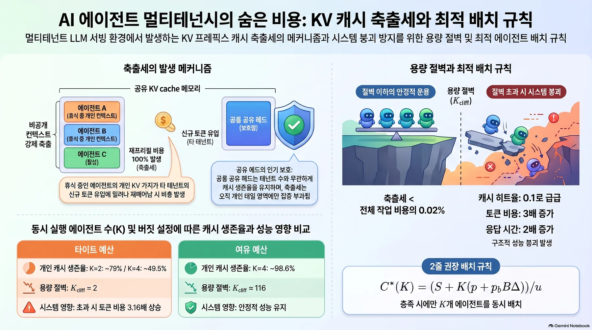
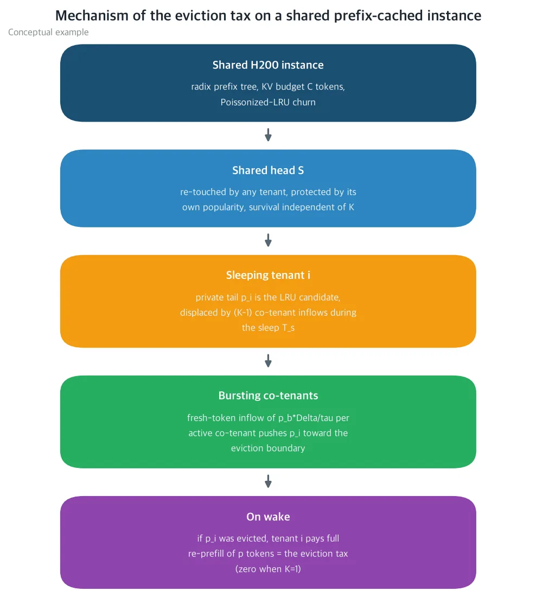
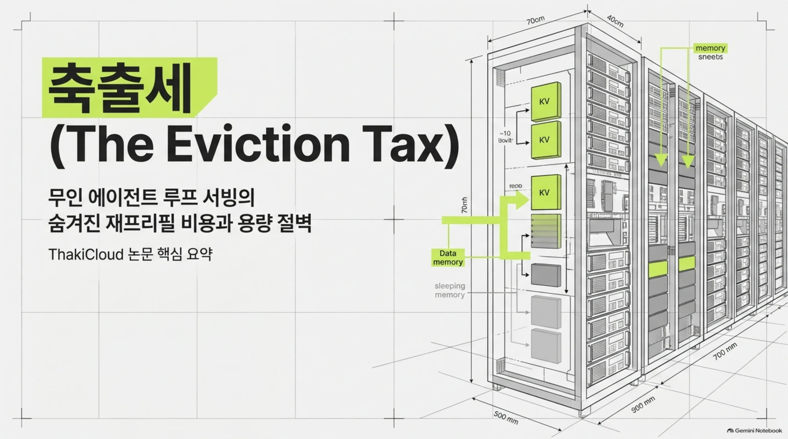
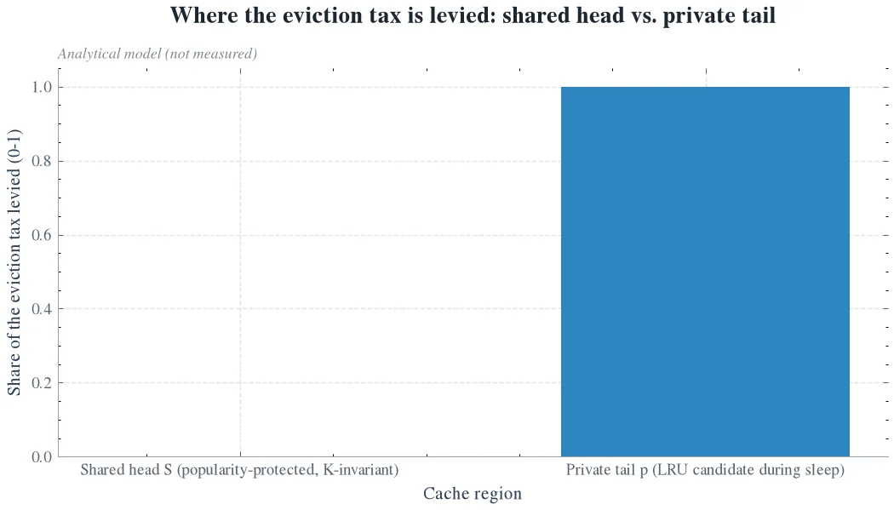
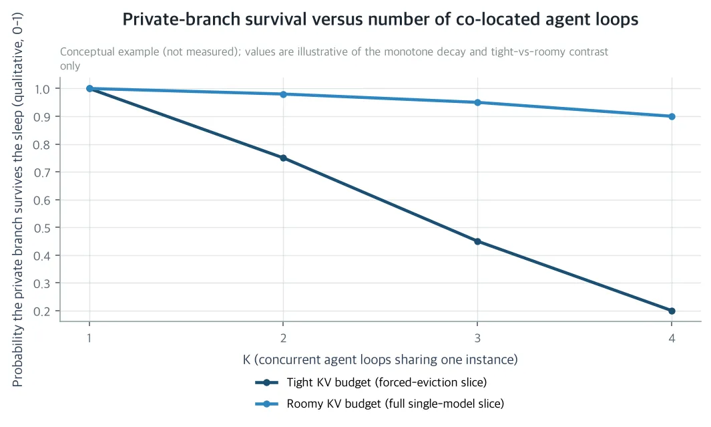
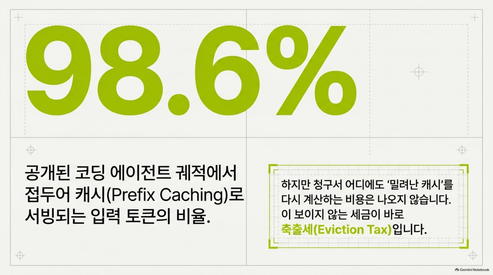
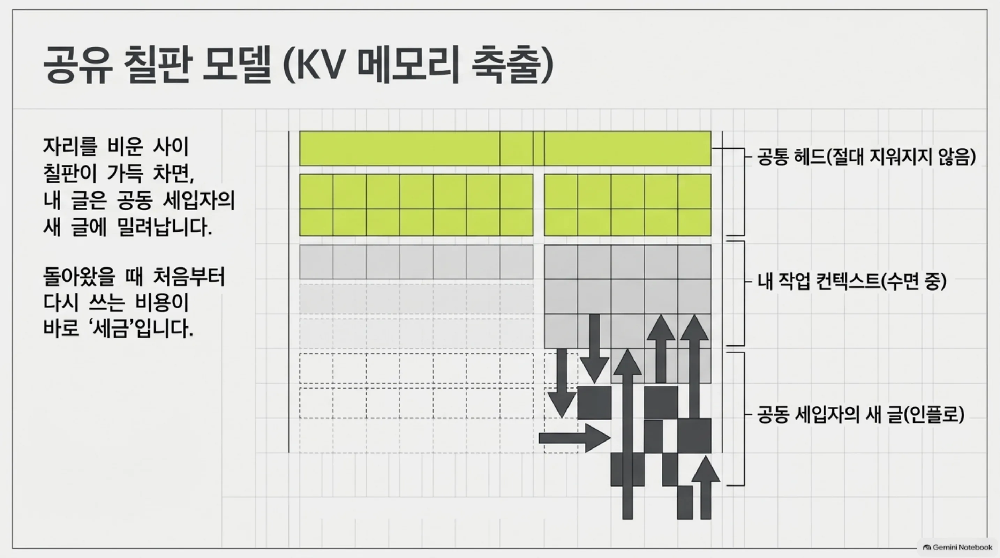
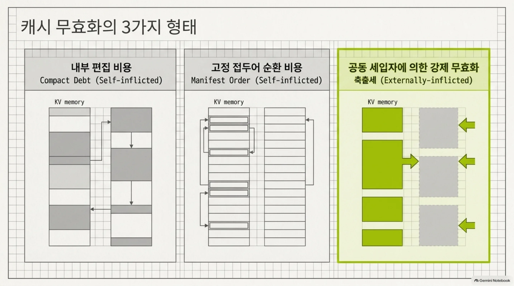
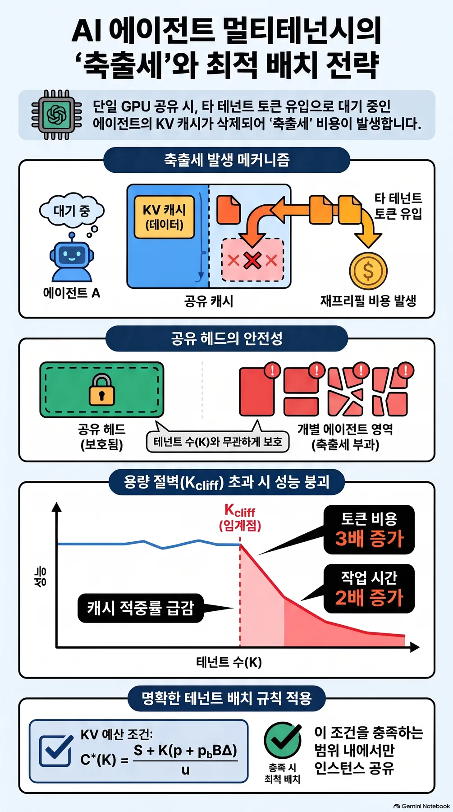

무인 에이전트 루프를 여러 개, 같은 H200 위에서 돌리는 분이라면 하나만은 먼저 알아야 하는 숫자가 무엇인가. 하나의 서빙 인스턴스에 몇 개의 루프까지 함께 넣을 수 있는지 그 상한입니다. 이 논문의 답은 한 줄로 압축됩니다. 그 상한을 정하는 것은 용량이지, 가격이 아닙니다.

이 글은 ThakiCloud의 축출세 논문 소개라는 뜻입니다. K개의 무인 루프가 접두어 캐시가 켜진 인스턴스 하나를 공유하면, 자고 있던 루프는 깨어날 때 자기 컨텍스트가 공동 세입자의 트래픽에 밀려난 채 발견합니다. 전체를 재처리, 곧 재프리필을 치르는 것입니다.

토큰당 청구서 어디에도 뜨지 않는 이 비용을 논문은 eviction tax라고 이름 붙였습니다. 이 세금을 닫힘 형태로 정가하고 언제부터 전용 인스턴스로 갈아타야 하는지 답합니다.

읽기 전에 짚어 두겠습니다. 이 논문은 분석 논문이고 본문에는 새 실측이 없습니다. 모든 숫자는 선언된 상수 카드(단가 카드)와 인용된 측정 연구 위에서 닫힘 형태로 도출한 값입니다. 그 예측들을 검증할 4팔 사전등록 반증 프로토콜을 논문 말미에 고정해 둡니다.

## 쉽게 말하면

공유 칠판을 생각해 보세요.

여럿이가 같은 칠판에 글을 씁니다. 칠판이 가득 차면 누군가는 가장 오래된 글부터 지웁니다. 내가 썼다가 자리를 비운 글은 칠판이 빠듯하면 남의 새 글에 밀려 지워집니다. 돌아왔을 때 나는 그 글부터 다시 써야 하는 것입니다. 다시 쓰는 비용이 세금인 셈입니다.

이 논문에서 칠판은 서빙 인스턴스의 KV(key-value, 모델이 입력을 처리할 때 남기는 중간 상태) 메모리입니다. 글은 각 에이전트 루프 컨텍스트의 캐시이고 지우는 규칙은 가장 오랫동안 쓰이지 않은 것부터 나가는 LRU를 따릅니다. 자고 있는 루프의 컨텍스트는 "썼다가 자리를 비운 글"이고 공동 세입자의 새 토큰은 "새 글"에 해당합니다. 루프가 깨어났을 때 자기 컨텍스트가 지워져 있으면 전부 재처리, 곧 재프리필(re-prefill)을 칩니다. 논문은 이 비용을 닫힘 형태로 정가합니다.

한 가지 더 기억해 두세요. 칠판 맨 위의 제목은 매 턴마다 모든 사람이 읽으니까 한 번도 지워지지 않습니다. 누가 항상 읽기 때문에 항상 새롭고 공동 세입자가 몇 개나 되는지와 무관합니다. 세금은 각자의 전용 구역에만 붙습니다. 그래서 논문이 주는 핵심은 헤드를 공유하는 것과 용량을 공유하는 것을 따로 결정하게 만든다는 것입니다.

<!-- nlm-visual -->

*NotebookLM이 소스를 종합해 생성한 인포그래픽입니다.*

## 무엇을 해봤나

접두어 캐시(prefix caching)는 에이전틱 추론의 기본 경제가 됐습니다. 무인 루프는 매 턴마다 자라는 컨텍스트를 다시 보내고 접두어 캐시는 그 재송을 할인합니다. 히트면 새 토큰 분량의 작은 증분 프리필이 되고 미스면 1만~4만 토큰 컨텍스트를 통째로 다시 계산합니다. 공개된 코딩 에이전트 궤적에서는 입력 토큰의 98.6%가 접두어 캐시로 서빙됩니다. 평탄 입력 과금은 이상에 가까운 캐싱 아래 루프 비용을 약 7배 과대계산합니다.

그런데 그 문헌의 재사용 정가는 전부 프로그램 하나씩을 기준으로 했습니다. 라디시 트리(radix tree)는 공유 상태입니다. 서로 다른 스케줄과 컨텍스트를 가진 K개의 독립 루프가 인스턴스 하나를 돌리면, 모든 세입자의 새 토큰 인플로가 다른 모든 세입자의 캐시된 분지를 지움 경계 쪽으로 미칩니다. 버스트 사이를 자고 있던 루프는 공동 세입자의 버스트에 전용 컨텍스트를 빼앗긴 채 깨어나 전체를 재처리합니다. 단일 세입자 회계에도, 재송 토큰만 재는 어떤 청구서에도 보이지 않는 세입자 간 부정 외부효과입니다.

자고 있는 루프의 전용 분지가 수면 중 공동 세입자의 새 토큰 인플로에 밀려나는 구조인가. 공유 헤드는 어느 세입자가든 다시 건드리므로 보호되고 세금은 전용 꼬리에만 부과됩니다. 개념 예시이며 실측이 아닙니다.*

이것은 ThakiCloud가 앞서 정가한 두 효과의 서빙 사이 거울입니다. 컴팩트 데트(Compact Debt)는 루프 자신의 인컨텍스트 편집이 내는 비용이고, 매니페스트 오더(Manifest Order)는 항상 활동하는 코로케이트 루프들이 공유하는 고정 접두어의 순환 비용입니다. 둘 다 자기 스스로가 캐시를 무효화하는 셀프 인플릭트형인 셈입니다. 축출세는 공동 세립자의 버스트가 자기 수면 중에 캐시를 빼앗아가는, 외부에서 강제되는 무효화입니다.

설정은 셀프호스트드 H200 하나, 접두어 캐시가 켜진 페이지드 KV 엔진, 그리고 동시 K개의 무인 에이전트 루프입니다. 각 루프는 매 턴마다 공통 헤드(시스템 프롬프트와 툴 스키마)와 자기 전용 작업 컨텍스트를 재송합니다. 새 토큰을 일정량 덧붙이고 몇 턴을 버스트한 뒤, 긴 시간 자는 버스트-슬립 임무이기도 합니다. 지우는 규칙은 이 시리즈가 써 온 포아송화 LRU 모델입니다. 한 항목의 마지막 사용 이후 누적 새 토큰 인플로가 KV 예산을 넘으면, 그 항목이 축출됩니다. 모든 숫자는 선언된 상수 카드 위에서 평가됩니다. 예를 들어 H200 스팟 인스턴스는 시간당 2.25달러, 전용 작업 컨텍스트는 12,000토큰, 수면은 30분입니다. 전체 상수 카드는 말미 각주에 두었습니다.

## 나온 결과

첫째, 웨이크당 축출세는 수면 중 공동 세입자 인플로의 순수 함수입니다. 기대 재프리필 회수분 X(K)는 전용 컨텍스트 크기 p, 수면 중 축출될 확률, 프리필 단가 차 (1−ρ)의 곱이고 K=1에서 정확히 영입니다. 축출 확률은 1 − e^−(K−1)Λ이고 Λ는 공동 세입자의 버스트 임무비와 턴당 새 토큰, 수면 시간의 곱을 턴 간격과 KV 예산의 곱으로 나눈 무차원 수입니다. 홀로 도는 루프의 전용 분지는 불멸인 것입니다. 세금은 1센트까지 전부 공동 세입자에게 귀인됩니다.

둘째, 공유 헤드는 자기 인기로 보호됩니다. 헤드가 공동 세입자의 휩쓸림을 견디는 확률은 C/(C+Δ)이며 K와 무관합니다. 세입자가 늘어나면 헤드의 사용 간격은 짧아지고, 밀어내는 인플로도 같은 속도로 늘어 두 효과는 상쇄됩니다. 선언된 상수에서 조인된 예산의 헤드 생존율은 약 96퍼센트입니다. 4개 루프가 함께 도는 전용 컨텍스트의 웨이크 생존율은 약 50퍼센트에 그칩니다. 하나의 캐시된 헤드가 K개 루프를 서빙한다는 통합 이득은 온전한 채 세금은 전용 꼬리だけに 부과됩니다.

*귀인 대조입니다. 웨이크당 재프리필 회수분은 100퍼센트 공동 세입자 귀인이고 전부 전용 작업 컨텍스트에 떨어집니다. 공유 헤드의 생존 확률은 K에 무관하며 헤드는 모든 레짐에서 캐시 할인을 유지합니다. 분석 모델이며 실측이 아닙니다.*

여기서 더 중요한 귀결이 하나 있습니다. 전용 컨텍스트가 통째로 축출되는 극한에서도, 웨이크 턴은 캐시를 전혀 안 쓰는 것보다 여전히 쌉니다. 공통 헤드의 할인이 남아 있기 때문이니까요. 그래서 축출세는 캐시 스위치를 끌지 결정하는 변수가 아닙니다. 몇 개의 루프를 함께 넣을지 결정하는 변수입니다. 스위치는 모든 레짐에서 켜집니다.

셋째, 레짐은 용량 절벽(capacity cliff)에서 갈라집니다. 버스트 피크 작업 집합은 공통 헤드 S에 루프당 전용 컨텍스트 p와 비행 중인 버스트 분량을 더한 것입니다. 그것이 KV 예산을 넘으면 인스턴스는 반안정 붕괴(metastable collapse) 레짐에 들어갑니다. 전적으로 서브크리티컬인 최대 테넌시는 K_cliff = ⌊(uC − S)/(p + p_b BΔ)⌋입니다. 선언된 상수에서 조인된 멀티모델 풀 슬라이스는 2를, H200 풀 예산은 약 116을 줍니다. 좁은 칠판에서는 세 번째 사람의 글이 들어가지 않고, 넓은 칠판에서는 현실적인 인원이면 문제가 안 됩니다.

*정성적 형태입니다. 자고 있는 세입자의 전용 분지가 수면을 견디는 확률은 코로케이트 루프 수 K에 따라 줄어듭니다. KV 예산이 조이면 더 빠르게 줄고 용량 절벽이 먼저 물립니다. 값은 예시이며 스케일에 맞지 않습니다. 분석 모델이며 실측이 아닙니다.*

절벽 아래에서는 세금이 작습니다. 선언된 상수에서 태스크당 달러 비용의 2×10⁻⁴ 미만이고 달러만 놓고 보면, 브레이크이븐은 약 1억 토큰의 전용 컨텍스트에서나 옵니다. 출고된 컨텍스트 윈도우보다 1~2자릿수 더 큰 값입니다. 즉, 사람 말로는 청구서만 보면 통합 결정은 절대 바뀌지 않습니다. 축출세는 가격의 현상이 아니라 용량과 시간의 현상입니다.

절벽 위에서는 이야기가 달라집니다. 반안정 붕괴에서 캐시 히트율은 약 10퍼센트로 빠지고 턴당 실시간은 2배가 되며, 청구 뷰의 토큰 비용은 3배로 불어납니다. 좁은 칠판에서는 칠판이 계속 지워져 누구 글도 남지 않는 상태입니다. 이때 공유는 더 이상 작은 세금 문제가 아닙니다. 레짐 자체가 바뀐 것입니다.

세금을 조종하는 것은 무차원곱 Λ입니다. 수면 시간이나 턴당 새 토큰을 두 배로 하면 세금이 두 배가 되고 KV 예산을 두 배로 하면 절반이 됩니다. 더 자주 도는 루프, 곧 임무비가 큰 루프는 절벽을 낮춥니다. 버스트 피크 작업 집합이 임무비와 함께 자라기 때문입니다.

넷째, 손익분기 동시도(break-even concurrency)는 용량 절벽 그 자체입니다. 셀프호스트드 실시간 SLO 뷰에서는 절벽 위 턴당 실시간이 2배가 되어 SLO가 묶입니다. 토큰 청구 뷰에서는 통합이 아무것도 아끼지 못합니다. 토큰당 과금이라 절벽 아래에서는 차이가 없고 절벽 위에서는 붕괴가 토큰 비용을 불립니다. 용량 수용 뷰에서는 절벽이 곧 수용 경계입니다. 모든 운영 뷰에서 손익분기 테넌시 K*는 K_cliff와 같습니다.

배포 가능한 규칙은 2줄입니다. K개 루프를 코로케이트하는 것은 KV 예산 C가 C*(K) = (S + K(p + p_b BΔ))/u 이상일 때입니다. 그 아래에서는 전용 인스턴스를 예약합니다. 선언된 조인 슬라이스(32,000토큰)는 정확히 2개 루프를 감당하고 3개째는 41,000토큰이 필요합니다. 즉, 사람 말로는 좁은 칠판에는 정확히 두 사람이 앉고 세 번째는 자기 칠판이 필요합니다.

이 논문은 이 예측들을 반증에 겁니다. 4팔 프로토콜은 A0(전용, K=1), A1(공유, K=2, 조인 예산), A2(공유, K=4, 조인 예산), A3(공유, K=4, 풀 예산)입니다. 각 팔마다 사전에 정한 반증 기준이 있습니다. 예를 들어 A2의 실측 웨이크 재프리필이 예측과 2배 이상 달라면 세금 항등식이 기각됩니다. 같은 팔의 지속 히트율이 50퍼센트 이상이면 용량 절벽은 무너집니다. 새 계측은 필요 없습니다. 기존 밤샘 에이전트 하네스로 전용 H200의 텔레메트리만 씁니다.

## 그래서 무엇을 바꾸면 되나

ThakiCloud의 H200 토큰 팩토리에는 테넌시 정책의 숫자가 됩니다. 서빙 인스턴스당 몇 개의 무인 에이전트 루프를 코로케이트할지, 멀티테넌트 에이전트 워크로드에서 접두어 캐시를 켜 둘지는 이제 2줄로 결정합니다. 코로케이트 루프당 KV 슬라이스를 C*(K)로 예산 짓고 캐시 스위치는 켜 두며, 공통 헤드를 키워 나갑니다. 헤드는 공짜로 키워도 좋습니다. 통합 이득만 올리고 세금 채널에는 닿지 않으니까요.

대규모 무인 자동화를 돌리는 모든 조직에는, 공유 GPU에 에이전트 루프를 몰아넣는 것이 유휴 용량 절약보다 재프리필 비용을 더 먹이는 레짐이 어디인지 보여 줍니다. 통합 절약은 GPU 시간 청구서에 뜨고 축출세는 안 뜨기 때문에, 가격만 보고 공유 결정을 하면 틀어지는 방향이 정해져 있습니다. 그 레짐을 용량과 시간의 문제로, 손실 전에 붙잡는 것이 추론 지출과 에너지 둘 다 줄입니다.

과학에는 라디시 트리 스타일 공유 접두어 구조의 에이전틱 멀티테넌시에서, 부정 외부효과를 닫힘 형태로 정가한 첫 결과인가. 멀티테넌트 LLM 서빙은 그동안 지연 채널(공정성 격리, 요청당 귀인)로 연구되었습니다. KV 메모리 채널은 보안 문제, 사이드 채널로만 다뤄졌습니다. 이 논문은 그 메모리 채널을 비용 문제로 정가합니다. 세입자당 재프리필 팽창과 손익분기 동시도로 단일 세입자 재사용 경제를, 공유 인스턴스 레짐으로 올립니다. 이 시리즈의 회계도 여기서 닫힙니다. 셀프 인플릭트 무효화(컴팩트 데트), 상주 활동 순환(매니페스트 오더), 컴퓨트 큐 간섭(리랭크 카풀)에 이어, 외부 인플릭트 축출까지입니다.

## 못 믿을 부분

첫째, 이 논문은 분석이고 본문에 새 실측이 없습니다. 모든 숫자는 선언된 상수 카드와 인용된 측정 연구의 닫힘 형태 출력입니다. 붕괴 앵커(히트율 0.1, 턴 시간 2τ)는 두 엔진을 관통한 최근 측정 연구 하나에서 가져온 레짐 파라미터입니다.

둘째, 캐시 순환 모델은 선언된 가정이지 실측 맞춤이 아닙니다. 포아송화 LRU는 블록 단위 라디시 트리 축출을 근사합니다. 중첩 구조는 성립하지만 체류 분포는 가정인가. 수면 위상은 i.i.d.이고 동기화 테넌시는 공유 헤드의 최악이자 전용 분지의 최상이므로, 피크 작업 집합 규칙은 보수적이다.

셋째, 모델 클래스는 dense GQA의 4B~32B이다. MoE와 100만 토큰 윈도우는 열려 있다. 클로즈드루프 반안정 붕괴, 도착 트래픽이 절벽을 트래픽 상태의 수용 경계로 만드는 데스 스플(death spiral)은 다음 타깃인 셈이다.

*본문의 비용 수치는 선언된 H200 단가 카드 위의 닫힘 형태 출력이며 실측이 아니다. 공통 헤드 S는 512토큰, 전용 컨텍스트 p는 12,000토큰, 턴당 새 토큰 Δ는 1,500, 버스트 B는 6턴(턴 간격 τ 60초), 수면 T_s는 1,800초(30분), 임무비 p_b는 1/6이다. KV는 토큰당 약 72 KiB, H200 스팟 단가는 시간당 2.25달러, 새 프리필 단가 c_p는 약 2.1×10⁻⁸ 달러/토큰이다. 세금-절약비 κ는 press 예산에서 K=2가 6.2×10⁻⁵, K=3이 8.3×10⁻⁵, K=4가 1.0×10⁻⁴이고 relax 예산에서 K=2가 1.4×10⁻⁶, K=4가 2.8×10⁻⁶이다. 달러 브레이크이븐 전용 컨텍스트 p*는 K=2(press)에서 1.9×10⁸토큰, K=4(press)에서 1.2×10⁸토큰이다. press 예산의 C*(K)는 K=2가 27.5K, K=3이 41.0K, K=4가 54.5K토큰(72 KiB/토큰 모델 기준 약 1.9~3.9 GB의 KV 예산)인가. press 예산은 멀티모델 풀의 강제 축출 슬라이스 32,000토큰(2.3 GB), relax 예산은 0.85×(141−4.5)GB, 약 1.57M토큰의 풀 단일모델 예산입니다. 헤드 생존 확률은 press 0.956, relax 0.999이고 K=4의 전용 생존 확률은 press 0.495, relax 0.986입니다. 초임계 레짐의 청구 뷰 토큰 비용은 약 3.16배, 사이클당 세금은 1.58×10⁻³달러입니다. 사전등록 4팔 예측은 A1이 tax(2)≈4.2×10⁻⁵달러/웨이크·s_priv(2)≈0.79, A2가 붕괴 h*≈0.1·τ*≈2τ·billing ≈3.2배, A3가 tax(4)≈2.87×10⁻⁶달러/웨이크입니다.*

논문 전문과 그림 자료는 아래 Hugging Face dataset 페이지에서 볼 수 있습니다.

- 논문 페이지: [thaki-AI/daily-paper-2026-11-20-eviction-tax-kv-prefix-cache](https://huggingface.co/datasets/thaki-AI/daily-paper-2026-11-20-eviction-tax-kv-prefix-cache)

<!-- nlm-visual -->

*NotebookLM이 소스를 종합해 생성한 인포그래픽입니다.*
