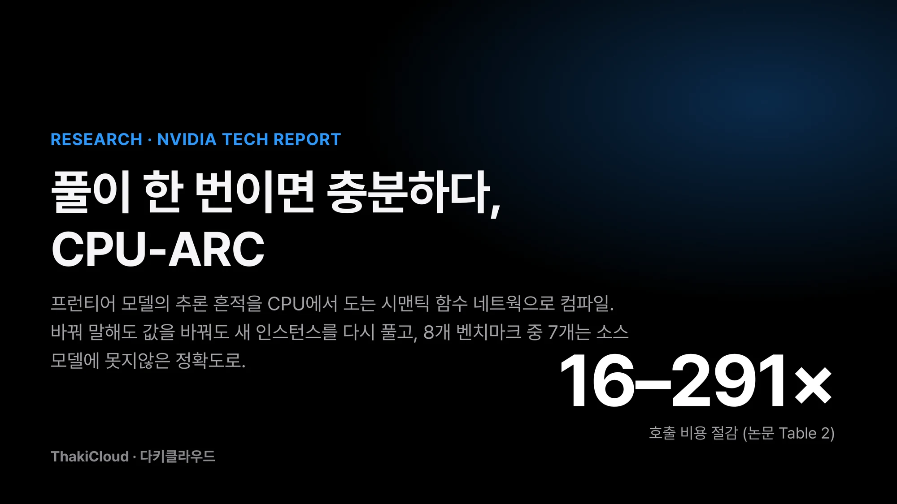
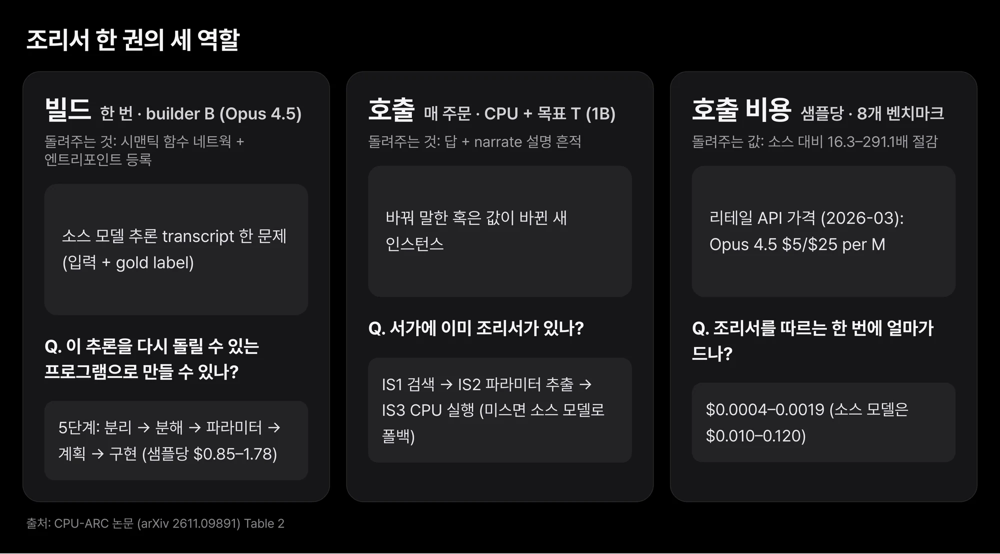
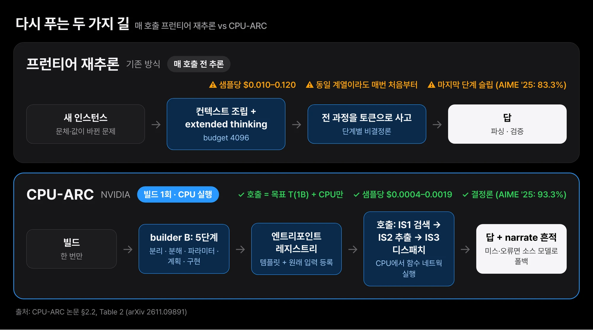
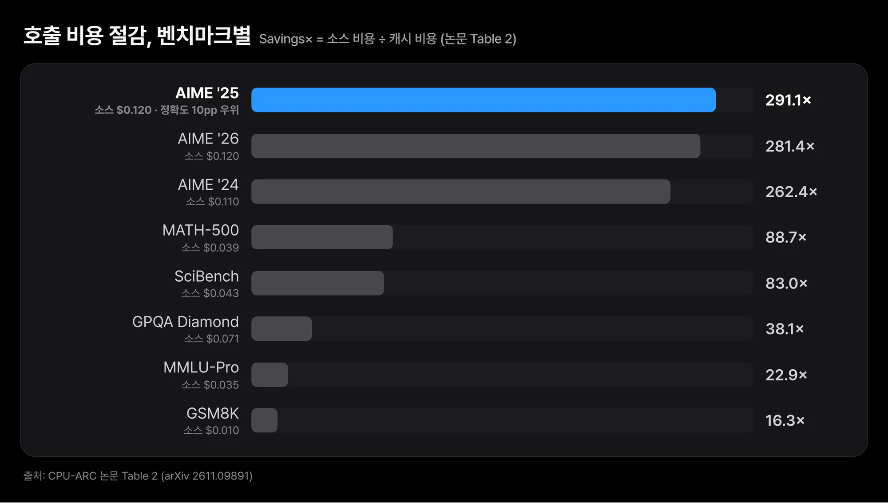
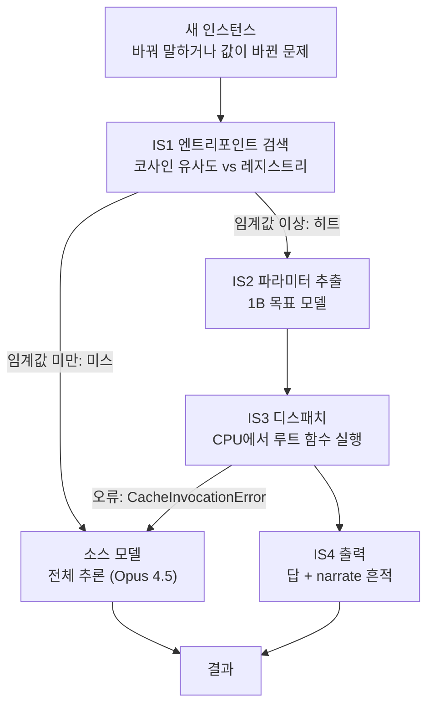

매일 같은 계열의 일을 반복하는 에이전트를 돌리는 분을 대상으로 쓴 글입니다. 같은 모양의 문의를 분류하고 같은 필드를 보고서에서 빼고 매번 숫자만 다른 계산 문제를 푸는 에이전트. NVIDIA의 28페이지 기술 보고서 CPU-ARC가 답하는 질문은 여기에서 생깁니다. 같은 문제 계열의 새 인스턴스를 풀 때, 추론을 처음부터 다시 사고하는 것 대신 풀이 과정을 코드 실행으로 대체할 수 있느냐. 답은 가능이고, 가격 차이는 큽니다. 추론 흔적을 CPU에서 도는 시맨틱 함수 네트웍으로 컴파일하면, 새 인스턴스를 푸는 데 드는 비용은 소스 모델 재추론의 16분의 1에서 291분의 1입니다. 정확도는 8개 벤치마크 중 7개에서 소스 모델에 못지않았고, AIME 2025에서는 10점 높았습니다.

이 글은 CPU-ARC(arXiv 2611.09891)가 무엇을 만들고, 그 숫자가 어떤 가격 전제로 나왔고, 적용 전에 알아둘 한계가 어디인지 다룹니다. ARC의 Python 함수 네트웍 구조, 빌드와 호출의 역할 분업, 바꿔 말한 입력에 대한 견고성 테스트, 브레이크이븐 계산까지. 본문에 새 실측은 없습니다. 모든 수치는 논문 Table 2와 부록에 실린 값입니다.

읽기 전에 전제 하나를 짚어 둡니다. 소스 모델 S와 빌더 B는 모두 Claude Opus 4.5이고, 호출 시점에 도는 소형 목표 모델 T는 fine-tuned Llama 3.2 1B입니다. 비용 수치는 2026년 3월 리테일 API 가격 기준이라, 가격이 변하면 브레이크이븐도 함께 이동합니다.

*NVIDIA 기술 보고서 CPU-ARC. 한 번 추론한 흔적을 CPU 실행 코드로 바꾸면, 새 인스턴스 호출 비용이 16에서 291배 줄었습니다.*

## 쉽게 말하면

레스토랑의 레시피 서가를 생각해 보세요.

메뉴 첫 개발은 헤드 셰프, 곧 프런티어 모델의 일입니다. 재료를 고르고 조리법을 고민하고 맛을 보는, 비싼 인건비를 치르는 과정이지요. CPU-ARC의 핵심은 그 개발이 끝난 뒤에 있습니다. 헤드 셰프가 쓴 조리서, 곧 ARC(agentic reasoning cache)가 서가에 꽂히면, 같은 메뉴에 소스만 바꾸거나 양만 바꾸는 주문은 더 이상 헤드 셰프의 일이 아닙니다. 주방의 기본 장비를 쓰는 라인쿡, 곧 1B 소형 모델이 조리서를 따라 메뉴를 만들면 됩니다.

조리서가 일반 텍스트가 아니라 Python 코드가 그 이유입니다. 양이 '큰 통'으로 바뀌면 그 값을 받아 계산하는 함수가 그대로 도니까요. 바꿔 말한 주문도 같은 조리서로 만들어야 하므로, 논문은 주문의 문체를 바꾸고 값을 바꾸고 둘을 함께 바꿔가며 조리서가 여전히 같은 맛, 곧 fidelity를 내는지 검증합니다.

서가에 없는 메뉴가 들어오면 어떻게 되나. 게이트가 미스로 판정하면 그 주문은 다시 헤드 셰프에게 갑니다. 논문의 gated serving 구조 그대로입니다. 캐시 실패는 원래 경로로 돌아가는 신호에 불과합니다.

## 조리서의 실체는 Python 함수 네트웍

*조리서 한 권의 세 역할. 빌드는 비싼 모델이 한 번 하고, 호출은 1B 소형 모델 + CPU가 매번 합니다.*

ARC는 '시맨틱 함수'의 네트웍입니다. 각 함수는 Context 객체를 받아 '자연어 설명 → 값' 딕셔너리를 돌려주는 Python callable입니다. 입력과 출력과 호출 대상이 고정 식별자가 아니라 자연어 설명과 예시로 참조됩니다. 함수 B가 함수 A를 부를 때, A를 이름이 아니라 설명으로 찾습니다.

런타임 프라임티브는 일곱 개입니다. load는 계층적 컨텍스트 메모리에서 벡터 유사도로 값을 가져옵니다. do는 설명으로 다른 시맨틱 함수를 찾아 호출합니다. narrate는 사람이 읽는 추론 흔적을 남깁니다. lm은 소형 목표 모델 T에게 분류, 요약, 단문 생성을 묻습니다. extract는 verbatim 값 추출을 하고 convert와 smart_convert는 다단계 타입 변환을 합니다. smart_convert는 T가 값을 Python 리터럴로 다시 쓰게 하고 ast.literal_eval()로 검증합니다. invoke_tool은 터미널이나 웹 검색 같은 외부 도구를 잇습니다.

소형 모델은 lm, extract, smart_convert 세 군데에서만 쓰입니다. 맡은 일은 초보 자연어 처리, 곧 값 추출과 형식 변환과 분류로 한정됩니다. 무거운 사고는 빌드 시점에 이미 빌더가 끝냈고, 코드에 들어 있지 않습니다. 함수 레지스트리가 안정되면 do와 load 조회를 정적으로 해석해, 임베딩 엔진과 벡터 스토어 없이 도는 자립 Python 모듈로 컴파일할 수 있습니다. lm과 extract 호출은 예외로 남습니다.

항목의 크기는 작습니다. 논문의 예시인 SciBench 이상 기체 항목은 시맨틱 함수 3개, 컴파일 후 약 57줄입니다. 본문 코드가 '간결을 위해' 축약돼 실제 항목은 더 크지만, 문제 하나당 수십 줄이라는 크기감은 그대로입니다.

## 빌드는 비싸고, 실행은 거의 무료다

*프런티어 재추론은 매 호출 전 과정을 다시 사고합니다. CPU-ARC는 빌드 한 번, 호출은 CPU + 1B만.*

조리서를 만드는 일은 비쌉니다. 빌더 B도 Opus 4.5이고, 소스 transcript를 5단계로 컴파일합니다. 1단계는 사용자 입력과 기대 출력을 분리합니다. 2단계는 추론을 함수 크기의 논리 연산 위계 목록으로 분해하고 재사용 가능 부분 계산을 마킹합니다. 3단계는 파라미터를 인식해 일반 입력 템플릿과 '파라미터 설명 → 구체 값' 사전을 만듭니다. 4단계는 만들 함수, 의존 구조, bottom-up 구현 순서를 계획합니다. 구조가 원래 파라미터 값에 의존하면 안 됩니다. 5단계는 에이전트 루프로 구현합니다. 레지스트리에서 재사용 가능 동등물을 검색하고 후보를 쓰고 정적 분석을 하고 transcript 조각 테스트와 판정에서 실패하면 다시 씁니다.

그 빌드의 비용은 샘플당 소스 호출의 12에서 84배, $0.85에서 $1.78입니다. 한 번 치는 값입니다. 반면 호출은 목표 T와 CPU만으로 돕니다. IS1은 입력을 임베딩해 엔트리포인트 레지스트리와 코사인 유사도로 검색하고 임계값 미만이면 미스로 소스 모델에 넘깁니다. IS2는 1B extractor가 파라미터 값을 추출합니다. IS3은 새 Context에서 루트 함수를 CPU로 디스패치합니다. IS4는 결과 딕셔너리와 narrate 흔적을 출력합니다. 논문은 이 부분을 명시합니다. 호출은 목표 소형 모델과 CPU 실행만 쓰고, 비싼 소스와 빌더는 건설 시에만 필요하다고.

브레이크이븐은 B/(S−C) 호출 수입니다. AIME 계열은 약 13회, GSM8K는 약 90회. 문제 계열이 열두 번쯤 불리면 비싼 소스를 쓰던 AIME 계열은 이미 빌드 비용을 회수합니다. 그 뒤 각 호출은 $0.0004에서 $0.0019입니다.

## 16에서 291배, 절감은 소스 가격의 함수다

*Savings×는 소스 비용 나누기 캐시 비용. 소스 호출이 비쌀수록 절감이 큽니다.*

Savings×는 호출마다의 소스 비용 대 캐시 비용 비율입니다. 측정 전제는 2026년 3월 리테일 API 가격입니다. Opus 4.5는 입력 $5.00/M, 출력 $25.00/M, 캐시 write $6.25/M, 캐시 read $0.50/M입니다. Llama 3.2 1B는 입력 $0.023/M, 출력 $0.194/M입니다. 빌더의 멀티턴 루프는 prompt caching으로 비용을 낮춥니다.

절감이 벤치마크마다 다른 이유가 여기 있습니다. AIME은 소스 호출 자체가 샘플당 $0.11에서 $0.12라, 캐시 $0.0004가 262에서 291배가 됩니다. GSM8K는 소스가 $0.01이라 16배입니다. 이 숫자의 성질은 가격 비율입니다. Opus 가격이 내리면 291배도 같이 내려갑니다.

정확도 쪽이 더 흥미롭습니다. 캐시가 소스 모델에 동급 이상인 벤치마크는 8개 중 7개입니다. AIME 2025는 캐시 93.3%, 소스 83.3%로 10점 우위입니다. 논문의 설명은 결정론 코드 실행이 소스 모델의 마지막 단계 슬립을 회피한다는 것이지요. GSM8K만 캐시가 뒤지고 격차는 0.5점(98.0 대 98.5)입니다. 사고를 코드로 바꾸는 것이 얻는 것은 비용 절감만이 아니라 결정론이고, 결정론은 마지막 단계가 많은 AIME에서는 품질이기도 합니다.

## 바꿔 말해도, 값을 바꿔도

견고성 테스트는 3모드입니다. phrasal은 파라미터를 그대로 두고 문제의 문체만 바꿉니다. parametric은 문체를 그대로 두고 값을 바꿉니다. combined은 둘을 동시에 바꿉니다. equi-substantive, 즉 같은 실질의 문제여야 한다는 제약 아래요. 교란 생성기 G는 소스와 같은 Opus 4.5이고 판정은 Opus 4.5 두 인스턴스 패널의 만장일치입니다.

| 벤치마크 | Fidelity | Phrasal | Parametric | Combined |
|---|---|---|---|---|
| MATH-500 | 99.6 | 96.7 | 94.5 | 91.6 |
| AIME '24 | 100.0 | 96.0 | 99.3 | 95.1 |
| AIME '25 | 90.0 | 98.4 | 91.2 | 93.4 |
| AIME '26 | 90.0 | 97.9 | 90.9 | 90.8 |
| GPQA Diamond | 98.5 | 93.8 | 93.9 | 94.0 |
| GSM8K | 99.5 | 96.2 | 94.2 | 92.5 |
| MMLU-Pro | 100.0 | 95.7 | 96.7 | 91.9 |
| SciBench | 99.4 | 97.5 | 98.8 | 96.4 |

모든 값은 통과율, 퍼센트입니다. combined이 90.8에서 96.4로 가장 낮고 phrasal이 96.0에서 98.4로 가장 높습니다. fidelity, 곧 캐시와 소스의 답 일치율은 90.0에서 100.0입니다. 단, 견고성 테스트는 캐시가 이미 golden-correct로 답한 문제에 대해서만 적용됩니다. 미스한 문제에서 정확도가 얼마나 떨어지는지에 대한 답은 이 표 안에 없습니다.

배포 형태는 gated serving입니다. 캐시를 먼저 시도하고 미스나 오류가 생기면 요청은 풀 LLM으로 떨어집니다.

## ThakiCloud 제품에서는

Paxis의 스킬 축은 이미 '작동한 코드 + SKILL.md'를 저장하는 구조입니다. CPU-ARC는 그 구조에 가격 모델을 줍니다. 반복되는 스킬은 두 번째 출현부터 모델 호출이 아니라 빌드 + 코드 실행입니다. 브레이크이븐 선은 문제 계열에 따라 열두 번에서 아흔 번입니다. 하루에 열두 번 불리는 스킬은 빌드 비용을 이미 회수했고, 마진 실행 비용은 CPU 코드 + 1B 모델에 가깝습니다. P3 티어, 곧 비싼 프런티어 모델의 반복 태스크가 두 번째 출현부터 P0 티어, 곧 CPU + 소형 모델의 경제로 내려앉는 것이지요. 이것은 실측이 아니라, 논문의 브레이크이븐 구조를 Paxis 스킬 원장에 적용한 시사입니다.

ai-platform 렌즈에서는 CPU-ARC가 서빙 티어 사이의 CPU 실행 계층입니다. 빌드는 GPU 또는 API를 쓰는 배치 잡으로, 플랫폼 큐 잡의 규율에 그대로 들어갑니다. 호출은 CPU입니다. GPU 점유도 없고 큐 대기도 없습니다. gated serving, 곧 미스면 풀 모델로 가는 패턴은 서빙 스택에 그대로 배치할 수 있고 프런티어 API 의존을 로컬 1B 목표 + CPU 실행으로 바꾸는 온프렘 스토리에도 들어맞습니다.

정직하게 말하면, 우리 워크로드에서 히트율과 브레이크이븐은 아직 잰 적이 없습니다. 첫 실험은 생산에서 반복되는 태스크 계열 하나를 골라 호출 빈도를 세는 일입니다.

## 적용 전에 알아둘 것

범위입니다. 논문의 주장은 '창의성이 크게 필요하지 않고 특정 지시 실행에 초점을 두는' 도메인으로 향합니다. 수학·과학 벤치마크는 '의도적으로 가장 어려운 사례'라는 exploratory framing입니다. open-ended 생성과 창작 작업은 이 구조의 바깥입니다.

히트율입니다. 논문은 히트율 수치를 하나도 보고하지 않습니다. 실제 워크로드의 얼마가 캐시에 맞는가는 실제 절감을 가르는 숫자이고 자기 환경에서 재어야 합니다. 이 글의 모든 숫자는 '이미 풀어둔 뒤'의 조건부 절감입니다.

안전성입니다. 생성 코드 실행의 안전성에 대한 전문 논의가 본문에 없습니다. sandbox나 security라는 말 자체가 안 나옵니다. 안전 장치는 등록 전 판정 검증, ast.literal_eval 타입 검증, 오류 시 gated 폴백 세 가지뿐입니다. 프로덕션에서 CPU 코드를 돌리는 것은 별도 격리 스토리가 필요합니다.

컴파일은 함수 네트웍을 동결합니다. 갱신은 재컴파일이고 유사 함수 여러 개를 하나로 일반화하는 것은 open problem입니다.

마지막으로 가격입니다. 모든 비용 숫자는 2026년 3월 리테일 API 가격 기준입니다. Opus 가격이 움직이면 Build×와 Savings× 비율이 함께 움직입니다.

## 끝으로

레시피 비유가 논문을 닫습니다. 첫 개발은 비쌉니다. 빌드가 소스의 12에서 84배이기 때문입니다. 실행은 쌉니다. 16분의 1에서 291분의 1이기 때문입니다. 브레이크이븐은 열두 번에서 아흔 번 호출입니다. 그리고 결정론은 비용 이야기만이 아니라 품질 이야기입니다. AIME 2025의 10점 우위가 그 증거입니다.

같은 계열의 일을 반복하는 에이전트를 돌린다면, 먼저 셀 것은 모델 토큰이 아니라 '태스크 계열별 주당 호출 횟수'입니다. 브레이크이븐 선, 곧 열두 번을 넘는 계열이 CPU-ARC형 캐싱이 수익 나는 곳입니다. 계열 하나를 고르고 호출을 세어 보세요. 빈도가 선을 넘으면, trace 하나를 파라미터화 함수로 바꾸는 파일럿이 다음 실험입니다.

> 📄 **심층 리뷰 전문(DOCX)**: 이 논문의 상세 피어리뷰를 [Google Drive에서 다운로드](https://drive.google.com/file/d/1LybLlQENoUHjxuhxry2qo85k8ww5mzuO/view)할 수 있습니다.

- 논문: [CPU-ARC: Agentic Reasoning Caching for on-CPU Reasoning Reuse (arXiv 2611.09891)](https://arxiv.org/abs/2611.09891)
- [DAIR Academy 논문 요약](https://academy.dair.ai/papers/cpu-arc-agentic-reasoning-caching-for-on-cpu-reasoning-reuse-2611.09891)
- 출처 트윗: [hjguyhan](https://x.com/hjguyhan/status/2124287085981131185)
