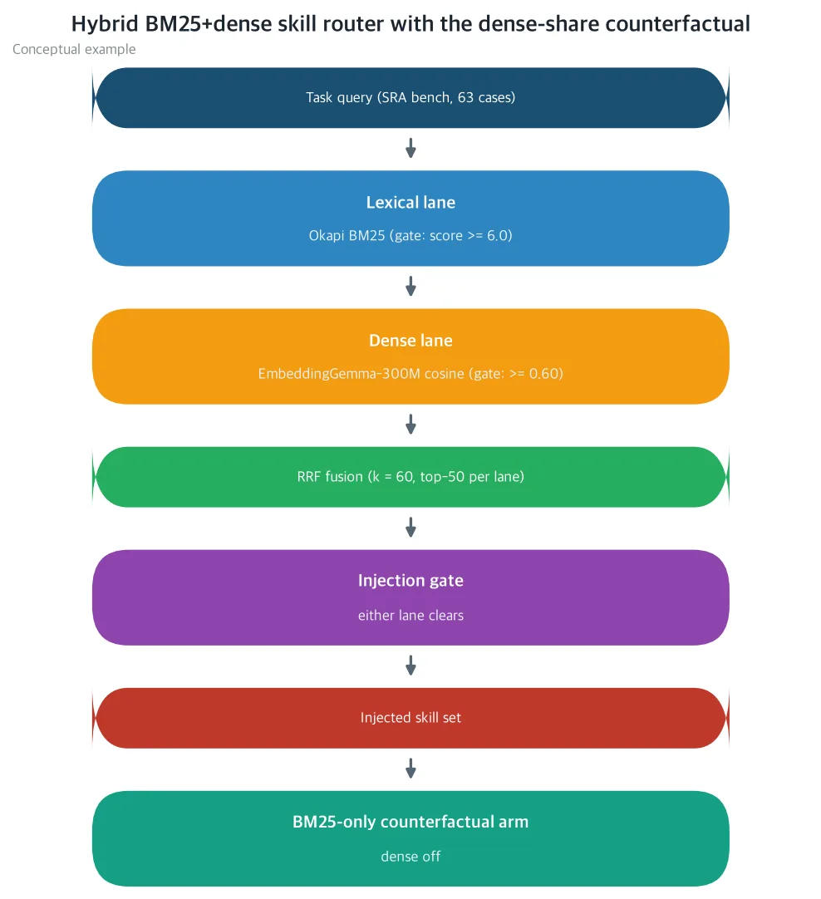
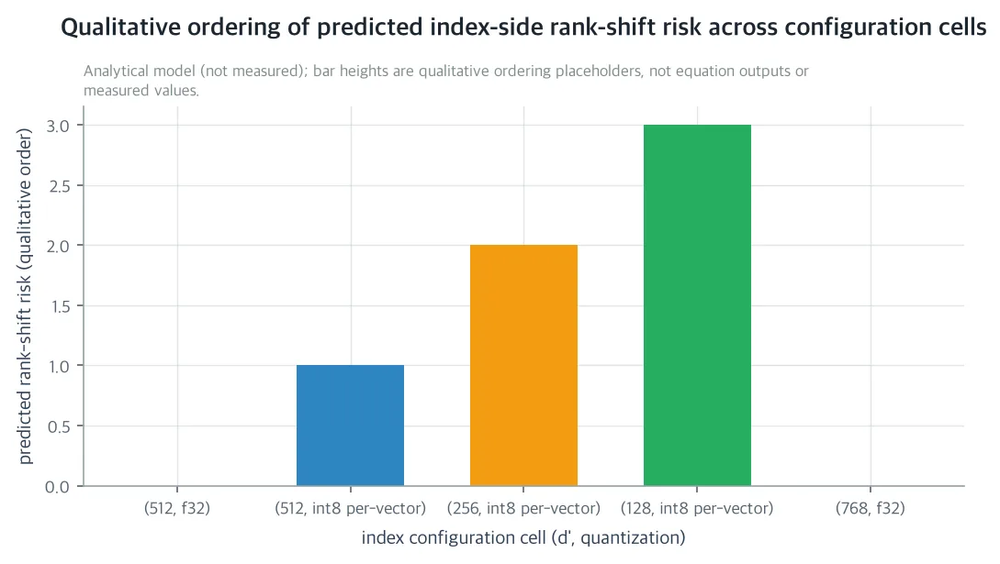
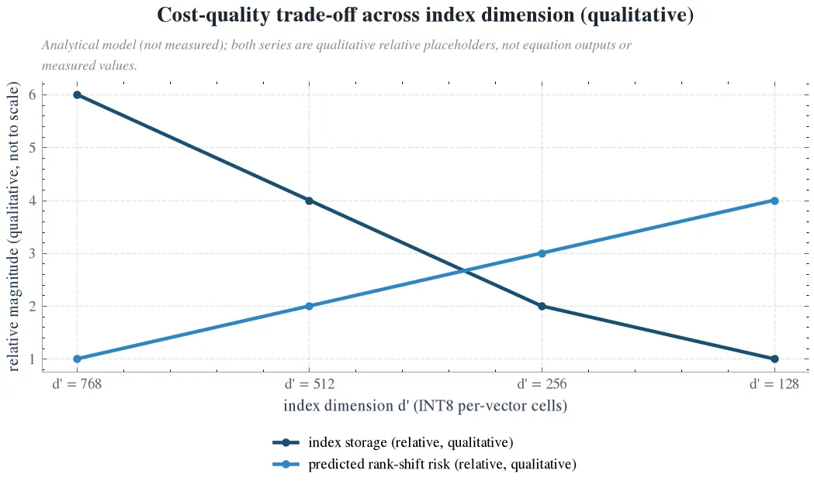

스킬 수천 개를 레지스트리에 두고 밤사이 오는 태스크마다 어떤 스킬을 컨텍스트에 넣을지 hybrid 검색 라우터로 결정하는 하네스를 셀프호스트드 H200에서 돌리는 국내 클라우드/AI 엔지니어면, 이 글의 대상입니다. ThakiCloud가 라우터의 각 단계를 가격 매겨 온 시리즈에서, 아직 안 쟜던 단계는 dense 임베딩 백본 하나뿐입니다. 이 글이 소개하는 논문은 그 마지막을 메웁니다. dense 레인이 실제로 내는 정확도의 몫(dense share)을 닫힘 형태로 분리하고 백본 크기·INT8 index quantization·index dimension의 cost-quality knee를 셀프호스트드 H200에서 찾지요. 읽기 전 한 가지 짚어 두겠습니다. 이 논문의 모든 수치는 선언된 nominal parameter를 전제로 한 닫힘 형태나 exact arithmetic이고 14-arm factorial 측정은 protocol로 pre-registered 돼 있습니다. 측정은 아직 나온 게 아니라, 이 논문은 지도와 일정표까지 함께 주는 편이지요.

## 문제의식: 라우터의 마지막 미정가 단계, 임베딩 백본

생산 라우터는 두 레인으로 돌아간다. lexical BM25 레인과 dense cosine similarity 레인이 독립적으로 검색하고 Reciprocal Rank Fusion(RRF, 각 레인의 top 50을 k=60으로 합치는 fusion)이 두 목록을 하나로 엮는다. 합쳐진 후보가 주입 게이트를 통과해야 실제로 모델 컨텍스트에 들어가고 BM25 점수가 6.0 이상이거나 cosine이 0.60 이상인 스킬만 살아남는다. 라우팅 실수 하나면 틀린 스킬이 컨텍스트에서 실행되므로, 이 결정은 태스크 미스로 바로 청구된다. registry는 선언된 nominal 2,029개 스킬이고 라우팅 품질은 동결된 SRA bench 63개 케이스(positive 45, out-of-domain 환각 probe 10, 금지 스킬 negative 8)로 점수를 받는다.

dense 레인은 장식이 아니다. 시리즈의 앞선 실측에서 hybrid 라우터는 BM25-only 대비 Recall@5와 top-1에서 8.9pp의 lift를 냈고 결정당 1,440.3 token의 통행료를 썼다. dense 레인이 진짜 정확도를 싣는다는 증거인 셈이다. 다만 그 8.9pp는 합계 숫자일 뿐이다. series 어디에서도 dense 레인 자신의 기여를 BM25-only counterfactual과 분리해 잴 적도 없고 그 기여를 만들어 내는 백본의 가격도 매겨지지 않았다. 앞선 양자화 연구도 backbone 고정, dimension 고정, model-side INT8 한 축만 분석했다. dense lane이 compression에 얼마나 견고한지가 잰 것이었다.

이 논문은 그래서 두 질문을 답한다. hybrid 라우팅 정확도의 얼마가 dense stage의 몫이며 백본 크기·INT8 index quantization·Matryoshka index dimension을 가로질러 정확도 대 serving cost의 knee는 어디에 있는가. 생산 dense 백본은 EmbeddingGemma-300M입니다. 3×10^8 parameter encoder이고 native dimension은 768이며 생산에서는 512로 truncate됩니다. 변수는 세 축이지요. A는 encoder 크기 P, B는 저장 corpus vector의 양자화(f32, per-vector INT8, global-scale INT8), C는 truncate dimension d'({128, 256, 512, 768})입니다. B는 순수 index-side 채널이기 때문입니다. 저장된 corpus vector만 건드리고 query vector는 serving마다 f32로 새로 나옵니다. A와 C는 공유 encoder를 통해 query와 corpus 양쪽에 작용하는 것입니다.

측정 설계는 무관한 도메인에서 의도적으로 가져 온 것이었습니다. 블록체인 연구에서 먼저 나온 individual-level cross-protocol decentralization 측정은, protocol-level 합의 품질의 일부를 individual validator의 몫으로 돌리는 새 지표를 두 단계 프레임워크에 담은 것이었습니다. 이 논문은 그 설계 자체를 skill routing으로 옮깁니다. retrieval lane이 individual-level unit이 되고 fusion protocol(BM25-only와 RRF hybrid)이 합의와 대응하고 dense share가 individual-level contribution 지표가 됩니다. 건너온 교훈은 숫자가 아니라 구조인 셈입니다. 큰 protocol을 판단하기 전에, 먼저 작은 unit의 기여를 잽니다.

*태스크 query가 lexical BM25 레인과 dense 임베딩 레인으로 퍼져 나가는 구조입니다. RRF fusion(k=60)과 생산 주입 게이트가 주입될 스킬 집합을 만들고 dense-off BM25-only arm이 dense share를 정의하는 counterfactual입니다. 개념 도식이며 실측 데이터로 그린 그림이 아닙니다.*

## dense share: recovery와 loss의 분리

dense share는 query별로 Δ_K로 정의됩니다. BM25-only arm이 놓친 gold skill을 hybrid arm이 다시 넣으면 recovery이고 반대로 BM25-only가 맞혔던 것을 hybrid가 빼내면 loss입니다. Δ_K는 recovery에서 loss를 뺀 값이고 전체 dense share는 positive query 전체 평균입니다. 이 논문은 RRF 아래에서 이 양을 닫힘 형태로 보이게 하지요.

top-1 레벨의 결과는 gate입니다. gold가 lexical rank i(i ≥ 1)에 있다고 하고 gold의 dense rank를 G, lexical top-1의 dense rank를 A라 놓지요. binding challenger 가정(lexical top-1이 가장 강한 fused 경쟁자) 아래에서, hybrid top-1이 gold가 되는 필요충분조건은 (1/(k+G)) − (1/(k+A)) > i/(k(k+i))입니다. 우변은 lexical lane이 rank i에서 스스로 만든 fused-score 격차이고 dense lane이 자기 rank contrast로 그 격차를 넘어야 합니다. G=0인 특수케이스가 가장 깔끔하지요. dense lane에서 gold가 최상위일 때, top-1이 복구되려면 dense lane이 틀린 lexical top-1을 gold의 lexical offset보다 한 칸 아래(최소 i+1)에 랭킹해야 한다. loss gate는 거울상인 셈입니다. dense lane이 옳은 lexical top-1 gold를 자기 rank 2(0-indexed) 이하로 둘 때만 그 gold를 빼낼 수 있다. 복구를 가두는 기하가 손상을 가두는 기법이기도 하다.

Recall@5 레벨은 다른 기계인가. gold가 lexical rank 5에서 49(BM25 top-5 밖, fusion list 안)에 있으면, dense rank G가 49 이하라면 hybrid top-5에 들어옵니다. k=60에서 가장 나쁜 코너 (i,G)=(49,49)라 해도 fused score 2/109가 lexical 제5 후보의 1/64를 넘어서, 산술은 strict하기 때문. top-5 dense share는 일계에서 mid-list 질량, 곧 gold가 lexical rank 5~49에 있는 빈도에서 loss 항을 뺀 것과 같습니다. 두 레벨은 다른 query class가 싣는 것이다. top-1은 near-tie discord query, Recall@5는 mid-list 질량이요. dense contribution이라는 하나의 scalar는 이 두 기구를 뒤섞고 8.9pp aggregate lift는 두 discord set에 걸친 합으로 풀립니다. "집계로는 이득인데 개별 query에선 손해"인 fusion tax도 query 레벨로 풀립니다. tax는 정확히, compensating recovery 없이 dense lane이 옳은 lexical top-1을 뒤집는 near-tie discord query에서만 부과됩니다.

기억할 숫자가 하나 더 있지요. RRF damping입니다. dense list에서 후보를 한 칸 움직이면 fused score가 변하는 양은 최대 1/(k(k+1)), k=60에서 2.73×10^-4 fused-score unit입니다. index-side perturbation이 fused score에 닿는 통로는 전부 이 감쇠를 거르고 이것이 다음 섹션의 양자화와 truncate 논리를 가능하게 하는 지렛대입니다.

## perturbation이 fused score에 닿는 방식: INT8 양자화와 Matryoshka truncate

index-side 두 축은 저장 corpus vector만 건드리고 query vector는 매 routing 결정마다 f32로 새로 나오는 것입니다. perturbation은 저장된 코드와 dimension에서만 옵니다. 논문은 이 perturbation을 일계로 fused score까지 propagate합니다.

per-vector INT8은 좌표당 1 byte에 vector별 4-byte scale을 붙이고 dequant 이후 재정상화합니다. dimension별 rounding error는 s_v/254 반단계에서 균등하고 near-isotropic unit vector의 nominal spectral 상수 2.5 아래에서 cosine shift 표준편차는 d'=512에서 약 2.5×10^-4, d'=128에서 약 5.0×10^-4입니다. scheme 선택이 변수입니다. global-scale INT8은 corpus 전체가 4-byte scale 하나를 공유하고 자기 vector max가 corpus max보다 작은 vector는 더 굵은 effective step으로 양자화됩니다. variance는 그 비율의 제곱만큼 부풀고 단일 outlier(ratio 8)가 있는 nominal registry에서 해당 vector의 variance는 per-vector 대비 64배입니다. variance로는 per-vector가 이깁니다.

dimension truncate는 다른 채널입니다. Matryoshka truncate는 vector를 d' prefix로 바꾸고 일계 cosine shift는 ½(τ_u+τ_v)·cos_full입니다. τ는 잘려 나간 tail energy, 곧 뒤에 붙은 꼬리의 에너지에 해당합니다. 이 shift는 균일한 shrinkage가 아니라 후보별 positive bias입니다. 저장 vector마다 τ가 달라 dense list가 후보별로 재렬서되고 재렬서의 크기는 dense top-50에서 shift의 spread로 잡힙니다. 논문은 model-safe band를 d' ≥ 0.3·d로 선언합니다. 768 grid에서 256, 512, 768은 band 안이고 128(83.3% 축소)은 heavy-truncation regime입니다. 이 band의 앵커는 시리즈 밖의 결과입니다. random truncate는 축소 70%까지는 거의 무해하다는, random truncate와 MRL training의 첫 직접 비교에서 나온 경계입니다.

두 채널은 서로 다른 vector factor에 작용하므로 quadrature로 합쳐집니다. σ_tot = √(σ_int8² + σ_trunc²)입니다. 그 위에 rank-safety margin diagnostic이 올라갑니다. query가 fused score로 인증받은 flip-ball radius δ*는, 한 dense rank move의 최악 비용 δ_RRF로 나누면 δ*/δ_RRF rank position을 흡수합니다. 합성 shift는 일계에서 J·σ_tot rank position을 움직이고 J는 dense-list density(nominal 0.1 cosine당 50 rank, 중앙값 간격 0.002)입니다. 구성 (P, d', quant)가 query에 rank-safe인 필요충분조건은 M = δ*_rank − J·σ_tot ≥ 0이고 registry 전체 rank-safe는 동결 bench의 모든 query에서 M ≥ 0입니다. 숫자로 읽으면, d'=512 per-vector INT8에서 J·σ_tot는 약 0.125 rank position이므로, 인증 margin이 3.4×10^-5를 넘는 모든 query에 rank-safe입니다. d'=128이면 요건이 6.8×10^-5로 두 배가 되고 heavy-truncation spread가 더해집니다.

이 diagnostic의 운용 가치는 입력에 있습니다. δ*(fused list), σ_trunc(저장 측 tail energy), σ_int8(선언된 quantizer 형태)까지 전부, router가 이미 만들어 내는 float score에서 나옵니다. float score만으로 계산되므로, INT8 serving을 루프에 넣지 않고 구성을 정가합니다.

*f32 cell은 양자화·truncate shift가 없고 INT8 per-vector cell 사이에서는 index dimension이 작을수록 예상 rank-shift 위험이 커집니다. 128-dim cell은 추가로 heavy-truncation regime에 들어갑니다. 선언된 nominal parameter 위 analytical model이며 실측 값이 아닙니다.*

## cost-quality knee: encoding이 지배하므로 index side는 GPU 시간으로는 거의 무료

cost model은 선언된 H200 카드 위에서 돌아간다. GPU-hour당 $2.00, dense throughput 989 TFLOPS 30% utilization, 태스크 query 32 token, 스킬 설명 128 token, overnight cycle당 routing 결정 10,000건, registry 2,029 스킬이다. query를 P-parameter backbone으로 encode하면 2·P·T_q FLOP, P=3×10^8에서 19.2 GFLOP, 약 65µs, cycle당 $0.0004 안팎이다. routing 한 건의 dense matvec는 2·N·d' FLOP을 쓰는데, d'=512에서 2,077,696 FLOP으로 query encoding의 1/9,240 미만이다. registry mutation 후 index 재빌드는 1.56 PFLOP, 약 5.5초, $0.003 수준이며 이건 mutation마다 한 번이지 결정당 비용이 아니다. resident index는 N·d'·b byte이고 b는 f32에서 4, per-vector INT8에서 1+4/N, global-scale INT8에서 1이다.

구조적 결과는 encoding 지배이다. 모든 production width d'와 P ≥ 3×10^8에서 matvec 대 encoding FLOP비는 10^-3 미만이고 production point에서 정확히 1/9,240이다. index-side 축(dimension, quantization)은 정확도에 σ_trunc와 σ_int8로만 들어오고 cycle GPU 시간은 0.1% 미만이다. size 축 P는 정확도에 선언된 backbone quality level A_0(P)로, 비용에는 encoding과 build로 들어온다. 두 축 family가 비용에서 decouple되고 A_0(P)에서만 coupled되는 구조다. 그래서 cost-quality knee는 둘로 갈라진다. index-storage를 정확도와 바꾸는 index-side knee는 GPU 시간으로는 싸고 GPU encoding과 build를 backbone quality level과 바꾸는 size knee는 그 반대다. fusion protocol은 RRF k=60으로 고정하고 query-adaptive fusion weight는 모델 안으로 들이지 않는 별도 축이다.

index-side 정확도 model은 cosine shift의 일계다. A(P, d', quant) = A_0(P) − κ·σ_trunc − κ·σ_int8이고 선언된 conversion factor κ는 unit-1 cosine shift당 25pp다. pre-registered knee rule은 단순하지요. gated-Recall@5가 최고 cell 대비 선언된 2.0pp 안에 들어오는 구성 중 최소 저장 cell입니다. model의 point prediction은 knee를 (512, per-vector INT8)에 둡니다. 더 싼 (256, per-vector INT8) cell은 허용 band 안에 남아 있고 (128, *)는 band 바깥이지요. f32-512 reference 대비 exact byte arithmetic으로 512에서 3.98×, 256에서 7.9× 절감입니다.

corollary 하나가 이 규칙에 재사용 가치를 줍니다. index storage는 N에 선형이고 per-pair cosine shift는 N과 무관하며 one-time build cost도 N에 선형이지요. index-side knee는 registry 규모에 invariant합니다. 셀프진화 registry가 2,029에서 4,058로 두 배가 돼도 구성 규칙은 그대로이고 storage·build time·절대 달러만이 선형으로 움직입니다. 즉, 사람 말로는 스킬 수를 어떻게 늘려도 "어떤 구성을 고를지"는 다시 묻지 않아도 됩니다.

논문은 이걸 5단계 decision rule로 포장하지요. d*는 0.3·d_P 이상의 가장 작은 production step으로 잡습니다(declared nominal에서 d_P=512이므로 floor는 153.6). quant*는 INT8 per-vector입니다. byte 수는 global-scale variant 대비 4N byte 이내인데 per-vector precision을 유지합니다. registry mutation마다 float score에서 rank-safety diagnostic을 재실행해 재인증합니다. diagnostic이 fail이면 (d_P, f32)로 fallback해, 새 구성이 인증될 때까지 앵커를 유지합니다. storage와 build budget은 새 N에서 다시 도출합니다. declared nominal registry에서 rule이 돌려내는 값은 (512, int8_per-vector)입니다. 1.05 MB 대 4.17 MB, 3.98×입니다. rule의 가치는 steady-state GPU 달러에 있지 않습니다. declared $2,040/night step-execution budget에 비하면 routing 단계는 한 방울 수준이고 rule의 몫은 storage·build 프론티어와 인증된 rank-safety margin, 그리고 registry가 바뀌어도 새 factorial measurement 없이 자기 구성을 재인증한다는 사실입니다.

*index dimension을 768에서 128으로 줄이면, 대략 선형으로 떨어지는 storage와 오르는 예상 rank-shift 위험을 바꿉니다. 128은 heavy-truncation regime에 들어가고 knee rule은 선언된 정확도 허용 안에서 rank-safe인 가장 작은 dimension을 고릅니다. 선언된 nominal parameter 위 analytical model이며 실측 값이 아닙니다.*

## 회사, 사회, 과학이 얻는 것

ThakiCloud의 셀프진화 하네스에 이 논문이 주는 것은, SRA 라우팅 정확도를 유지하는 가장 싼 임베딩 백본 구성입니다. 크기, INT8 index quantization, index dimension 세 축을 하나의 cost-quality knee로 묶고 5단계 rule로 registry mutation 이후에도 선택을 재인증합니다. registry는 밤마다 바뀌므로, rule이 재인증하는 구성이 곧 nightly router의 H200 serving cost 절감입니다.

회사 밖 팀에게는 재현 가능한 ablation recipe가 남지요. opaque vendor default나 leaderboard-first model selection 대신, 자기 registry와 자기 bench 위에서 dense-share decomposition과 per-bit·per-dimension knee rule을 다시 돌릴 수 있습니다. leaderboard 최상위 model이 deployment 최적은 거의 아니라는 것은 앞선 연구가 확립한 결과이고 그 이유는 general-domain benchmark(MTEB류)가 retrieval quality를 잴 뿐 routing contribution은 재지 않기 때문입니다. 이 recipe는 구조적으로 domain-specific이고 정확도 있는 skill routing을 셀프호스트하는 비용과 에너지 기준을 낮추지요.

과학적으로는, hybrid 스킬 라우터의 빠진 dense-stage ablation을 메웁니다. RRF fusion 아래에서 dense share를 lexical share와 분리하고 recovery를 loss와 분리하고 routing accuracy를 bit당·index dimension당 정가하지요. top-1 recovery gate와 rank-safety margin diagnostic이 lane ablation을 closed-form certificate로 바꾸고 blockchain cross-protocol 측정 설계에서 건네온 lane-level contribution measurement는 general embedding benchmark의 domain-specific upgrade입니다. 앞선 단일 축 양자화 연구도, size × quantization × dimension 전체 공간과 BM25-only counterfactual을 포함한 명시적 upgrade로 갈아탑니다.

## 못 믿을 부분: 선언값의 범위와 pre-registered protocol

논문은 한계를 다섯 가지로 스스로 열거하지요.

첫 번째는 binding challenger 가정이 일계 model이라는 점입니다. 모든 closed form은 선언된 nominal fusion 상수(k=60, FUSE_N=50, lane weight 동일) 아래 성립합니다. query-adaptive fusion weight나 rerank stage가 상수를 움직여도, 움직이는 것은 closed form의 상수이지 기하가 아닙니다. discord set은 여전히 near-tie top-1 성분과 mid-list Recall@5 성분으로 갈라지고 rule의 3단계가 매 registry mutation 이후 재인증합니다.

두 번째는 size 축이 EG-300M 한 점이라는 점입니다. dense-only 정확도 앵커 A_0(P)는 이 P에서만 선언적 nominal이고 family 전체에서 instance화되지 않았습니다. 후속 backbone(통합 멀티모달 표현)나 sparse mixture-of-experts encoder(활성 parameter 대 serving throughput 트레이드오프)가 축이 향하는 방향이고 rule의 1·5단계가 선언된 P마다 (d*, quant*)과 budget을 다시 도출합니다.

세 번째는 bench resolution입니다. 고정 63케이스 SRA bench에서 positive 케이스 하나는 Recall@5의 1/45, 약 2.2pp입니다. 2.2pp는 선언된 2.0pp knee tolerance보다 거칩니다. 케이스 한 건의 flip이 cell을 knee 경계 너머로 보낼 수 있습니다. protocol은 바닥이지 천장이 아닙니다. arm과 metric은 model에 손을 대지 않고 더 큰 bench로 확장됩니다.

네 번째는 declared nominal card입니다. 모든 달러는 card에 선형 scale되고 GPU-hour당 $2.00 H200 rate는 선언값이지 market measurement가 아닙니다. 구성 cell 사이의 storage·FLOP ordering은 card에 invariant하지만, 절대 달러는 invariant하지 않습니다. registry size 2,029도 nominal이지 기록된 snapshot count가 아니고 pre-registered run이 시작점에서 snapshot을 pin해 nominal을 calibrate합니다.

다섯 번째는 cross-lingual interaction 미모델링입니다. 이중 언어 query에서 perturbation budget은 앞선 연구의 language-wall offset과 additive로 합쳐지고 joint 분석은 scope 밖입니다. rule의 fallback이 3단계 재인증으로 그 degradation을 커버합니다.

pre-registered protocol은 model의 예측이 실측과 만나는 지점입니다. arm 14개입니다. byte-identical lexical path의 bm25_only(dense-off counterfactual), dimension 4개 각각의 dense_only(contribution isolation), production gate와 RRF fusion(k=60, FUSE_N=50, 0-indexed rank) 아래 dimension {128, 256, 512, 768} × {f32, int8_per-vector} 8 cell의 hybrid, 그리고 (512, int8_global-scale) 1 cell의 hybrid입니다. 전체 arm이 같은 pinned snapshot, analyzer, gate을 공유하므로 cell 간 차이는 dense index 구성 (d', q)로만 귀속됩니다. metric은 Recall@5, Top-1, gated Recall@5, hallucination rate, k=5와 k=8의 negative-avoidance, available-only variant이며 query마다 hybrid(512, f32) reference 대비 recovery set과 loss set을 기록합니다. knee는 최고 gated-Recall@5 cell 대비 2.0pp(declared) 안의 최소 저장 hybrid cell입니다. arm, threshold, tolerance 중 어느 것도 post hoc로 정해지지 않습니다.

논문 원문과 수반 자료는 논문 상세 페이지에서 볼 수 있습니다. https://huggingface.co/datasets/thaki-AI/daily-paper-2026-11-22-dense-share-embedding-backbone-frontier

*본문의 수치는 전부 이 논문의 선언된 nominal parameter 위 closed form 또는 exact arithmetic입니다. registry 2,029 스킬, H200 $2.00/GPU-hour, 989 TFLOPS 30% utilization, query 32 token, 설명 128 token, overnight cycle 10,000 routing 결정, nominal spectral 상수 2.5, dense-list density 0.1 cosine당 50 rank(중앙값 간격 0.002), conversion factor unit-1 cosine shift당 25pp, knee tolerance 2.0pp, RRF k=60, FUSE_N=50, 주입 게이트 BM25 6.0 또는 cosine 0.60. 8.9pp hybrid-over-BM25 lift와 결정당 1,440.3 token은 시리즈 앞선 논문의 실측 인용입니다. 세 그림은 개념 도식(첫째)과 선언된 nominal parameter 위 analytical model(나머지 둘)이며 실측 값으로 그린 것이 아닙니다. 14-arm factorial protocol은 pre-registered이고 그 실측 결과는 이 논문에 포함되지 않습니다.*