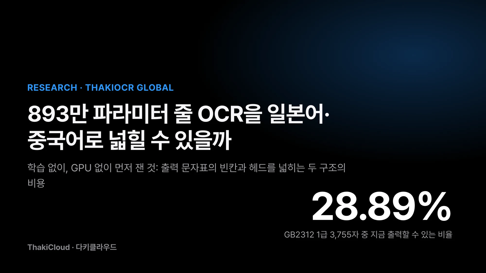
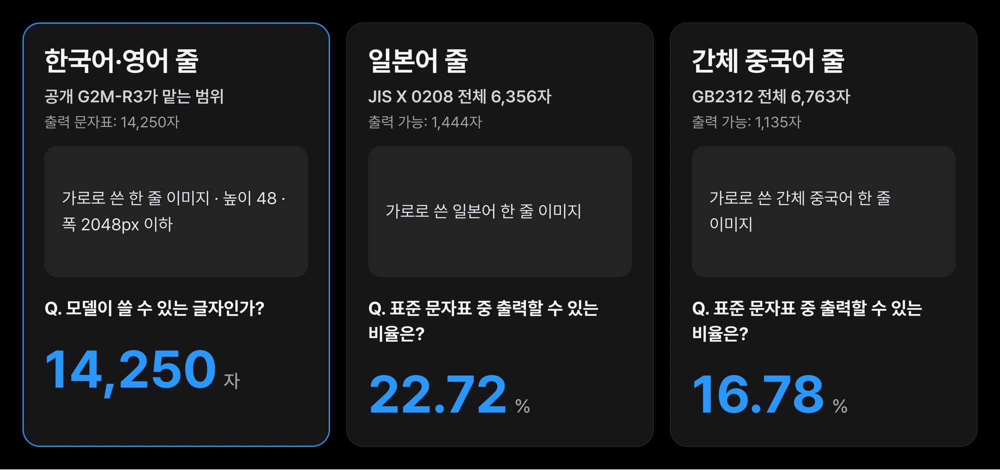
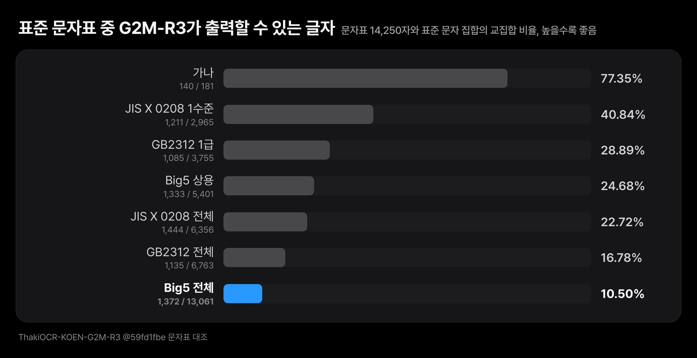
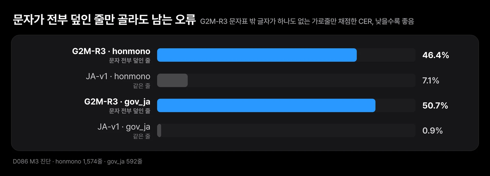
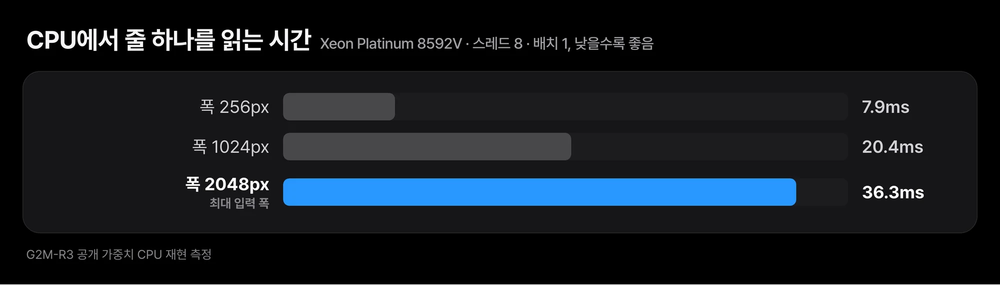
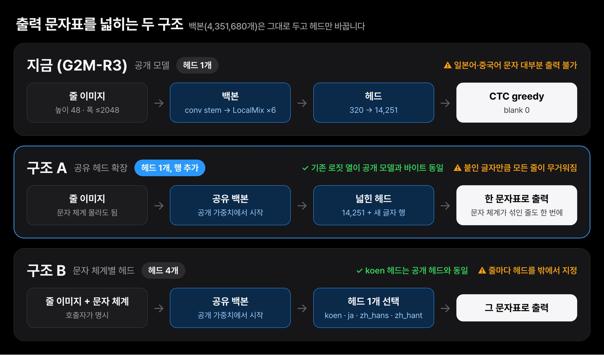
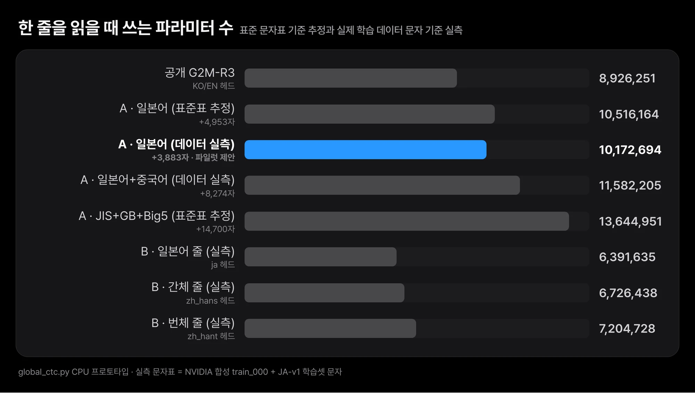

한국어와 영어로 학습한 작은 문자 인식 모델이 쓸 만해지면 다음 요청이 바로 옵니다. 일본 거래처 서류도 읽어 달라는 요청입니다. 중국어 영수증도 같은 모델로 처리하고 싶다는 요청도 따라옵니다. 이 글은 그런 요청을 받은 문자 인식 엔지니어와 모델 엔지니어를 위해 씁니다.

다키클라우드가 공개한 893만 파라미터 줄 인식기는 일본어·중국어 문자 대부분을 출력할 수조차 없습니다. 간체 중국어 상용 한자 3,755자 가운데 모델 문자표에 있는 글자는 1,085자, 28.89%입니다. 그렇다면 출력 문자만 늘리면 될까요? 출력할 수 있는 글자로만 된 일본어 줄을 골라 채점해 보니 오류율이 여전히 46.4%와 50.7%였습니다. 기준 모델은 [ThakiOCR-KOEN-G2M-R3](https://huggingface.co/ThakiCloud/ThakiOCR-KOEN-G2M-R3)이고 상용 한자 집합은 GB2312 1급입니다.

그래서 이 글의 결론은 두 가지입니다. 출력 헤드를 넓혀야 합니다. 그리고 그것만으로는 부족해서 백본도 일본어 글자 모양을 배워야 합니다. 이번에는 학습과 GPU를 하나도 쓰지 않고 이 결론에 필요한 숫자를 쟀습니다.

*ThakiOCR-KOEN-G2M-R3(리비전 59fd1fbe)를 기준으로 잰 다국어 확장 사전 점검입니다. 학습과 GPU 사용은 0입니다.*

## 쉽게 말하면

옛 인쇄소의 활자함을 떠올리면 됩니다. 식자공이 원고를 아무리 정확하게 읽어도 활자함에 없는 글자는 찍을 수 없습니다. 그 자리는 비거나 비슷한 다른 활자로 채워집니다.

OCR 모델에서 활자함은 출력 문자표이고 그 문자표를 담는 부분이 헤드입니다. 원고를 읽는 눈과 손은 백본입니다. G2M-R3의 활자함에는 한국어·영어용 활자 14,250개가 들어 있습니다. 일본어·중국어 원고를 주면 꺼낼 활자가 없는 경우가 대부분입니다.

그런데 활자함에 활자가 있는 원고에서도 이 식자공은 자주 틀렸습니다. 한국어·영어 원고만 읽어 온 식자공이라 일본어 글자 모양에 눈이 익지 않았기 때문입니다. 활자함을 넓히는 일과 식자공이 일본어를 읽도록 가르치는 일은 함께 해야 합니다.

## 지금 모델은 문자 14,250개 안에서만 답합니다

G2M-R3는 잘라 낸 텍스트 한 줄을 받아 문자열 하나를 돌려주는 CTC 줄 인식기입니다. CTC는 글자 위치를 따로 맞추지 않고 줄 전체를 한 번에 글자열로 옮기는 학습·디코딩 방식입니다. 입력은 높이 48 회색조 이미지이고 폭은 2048px까지 받습니다. 그보다 긴 줄은 거부하므로 잘라서 넣어야 합니다.

구조는 단순합니다. 합성곱 줄기(stride 4)가 이미지를 프레임 열로 바꿉니다. 프레임 수는 (폭+3)//4이고 폭 2048px에서는 512개입니다. 이 프레임은 Linear 160→320을 거쳐 LocalMixBlock 6개와 LayerNorm에서 다듬어집니다. 마지막 헤드 Linear(320, 14251)가 프레임마다 blank와 14,250자 중 하나를 고릅니다. 디코딩은 greedy CTC이고 blank는 0번입니다. 출력은 NFC로 정규화하고 NBSP는 공백으로 바꿉니다.

파라미터 8,926,251개 가운데 헤드가 4,574,571개로 51.25%입니다. 백본은 4,351,680개입니다. 글자 하나를 문자표에 더할 때마다 헤드에 320개 가중치와 bias 1개, 합쳐 321개가 붙습니다. 출력 문자표를 담는 헤드가 모델 크기의 절반을 차지한다는 뜻입니다.

*같은 모델에 줄을 넣어도 출력 문자표에 없는 글자는 답으로 나올 수 없습니다. 비율은 표준 문자표 가운데 G2M-R3 문자표에 있는 글자의 비율입니다.*

또 하나의 제약은 방향입니다. 이 모델은 왼쪽에서 오른쪽으로 쓴 가로줄만 지원합니다. 세로로 조판한 일본어는 이번 확장 범위에서도 뺐습니다. 이 글의 모든 계획과 수치는 가로줄 기준입니다.

## 일본어·중국어 표준 문자표는 대부분 활자함 밖에 있습니다

모델 문자표를 각 지역의 표준 문자 집합과 대조했습니다. 결과는 다음과 같습니다.

| 표준 문자표 | 표준 문자 수 | G2M-R3 문자표에 있는 글자 | 비율 |
|---|---|---|---|
| GB2312 1급 (간체 상용) | 3,755 | 1,085 | 28.89% |
| GB2312 전체 | 6,763 | 1,135 | 16.78% |
| Big5 상용 (번체) | 5,401 | 1,333 | 24.68% |
| Big5 전체 | 13,061 | 1,372 | 10.5% |
| JIS X 0208 1수준 | 2,965 | 1,211 | 40.84% |
| JIS X 0208 전체 | 6,356 | 1,444 | 22.72% |
| 가나 | 181 | 140 | 77.35% |

가나가 77.35%로 가장 높고 나머지는 모두 절반에 못 미칩니다. 일본어 상용 한자인 JIS X 0208 1수준도 40.84%입니다. 번체 전체인 Big5는 10.5%에 그칩니다.

*가나를 빼면 일본어·중국어 표준 문자표의 절반 이상이 출력 문자표 밖에 있습니다.*

이 표가 말하는 것은 성능이 아니라 상한입니다. 백본이 일본어 글자 모양을 완벽하게 본다고 해도 JIS X 0208 전체 가운데 77% 넘는 글자는 꺼낼 활자가 없습니다.

## 활자가 있는 줄에서도 오류가 절반 가까이 남았습니다

빈칸이 실제 줄에서 얼마나 크게 드러나는지 보려고 일본어 평가 세트 네 개를 채점했습니다. 비교 대상 JA-v1은 기존 일본어 VLM LoRA 모델이 미리 낸 예측을 고정해 둔 것입니다. 두 모델 모두 같은 가로줄만 채점했습니다.

| 세트 | 줄 수 | G2M-R3 CER | JA-v1 CER |
|---|---|---|---|
| gov_ja | 2,000 | 59.4% | 1.1% |
| tc_matched | 300 | 70.7% | 9.2% |
| honmono | 1,927 | 56.6% | 7.0% |
| ndl_p2 | 111 | 92.1% | 5.1% |

CER은 정답 글자 가운데 틀리게 읽은 비율이고 낮을수록 좋습니다. 네 세트 모두 정답 글자 가운데 G2M-R3 문자표 밖 글자가 1%를 넘어 판정은 UNSUPPORTED_VOCAB입니다. 그래서 이 표만으로는 두 모델의 실력을 비교할 수 없습니다.

그래서 한 단계 더 들어갔습니다. 정답 글자가 전부 G2M-R3 문자표 안에 있는 줄만 골라 다시 채점했습니다. honmono에서는 1,574줄, gov_ja에서는 592줄이 남았습니다. 이 줄들은 활자함 문제가 없는데도 G2M-R3의 CER이 honmono 46.4%, gov_ja 50.7%였습니다. 같은 줄에서 JA-v1은 7.1%와 0.9%였습니다.

*출력할 수 있는 글자로만 된 줄에서도 G2M-R3의 CER은 46.4%와 50.7%였습니다. 헤드만 넓혀서는 부족하고 백본이 일본어 글자 모양을 배워야 합니다.*

이 숫자가 이 글의 핵심입니다. 오류의 큰 부분은 활자가 없어서가 아니라 백본이 일본어 글자 모양을 모르기 때문에 생깁니다. 헤드에 새 글자 행만 붙이고 백본을 얼려 두면 이 오류는 줄지 않습니다. 확장 학습은 백본까지 같이 움직여야 합니다.

한국어 회귀 확인용으로 만든 idoc_ko 세트(283줄)도 채점했습니다. G2M-R3는 56.6%, JA-v1은 72.8%였습니다. 진단해 보니 이 세트는 줄 인식 평가로 맞지 않았습니다. 여러 줄이 한 크롭에 담긴 것으로 보이는 46줄은 CER 120%였고 예측이 정답보다 2.1배 길었습니다. 이 46줄이 전체 편집 오류의 57%를 차지했습니다. 정답이 크롭의 일부만 담은 18줄은 CER이 990%까지 올라갔습니다. 정확히 일치한 줄 비율은 두 모델 모두 42.8%로 같았습니다. 그래서 G2M-R3 56.6%가 JA-v1 72.8%보다 낮다는 것을 실력 차이로 읽지 않습니다.

## 넓히기 전에 한국어·영어 기준선을 CPU에서 다시 고정했습니다

백본까지 움직이면 기존 한국어·영어 출력이 흔들릴 가능성이 더 커집니다. 흔들렸는지 알려면 지금 값을 먼저 못 박아야 합니다. 그래서 공개 가중치를 재학습 없이 CPU에서 다시 돌려 이전 기록과 맞춰 봤습니다.

| 세트 | 이전 예측과 같은 줄 비율 | CER | 기록값 대비 CER 차이 | 숫자 F1 |
|---|---|---|---|---|
| ko_val (5,000줄) | 99.92% | 5.43% | +0.002%p | 0.917 |
| en_val (5,000줄) | 99.94% | 4.64% | +0.001%p | 0.870 |

두 세트 모두 예측이 거의 그대로 재현됐고 CER 차이는 0.01%p에도 못 미쳤습니다. 숫자 F1은 숫자 토큰을 맞게 읽었는지를 따로 본 값입니다. 실제 문서 세트는 이전 예측을 다시 채점해 확인했습니다. gold_dev 4.1%, hold_line 4.4%, real_ival_line 8.2%, real_ival_word 8.3%로 [G2M-R3 공개 글](/tech-blog/ko/research/thakiocr-g2m-r3-real-document-adaptation/)의 값과 어긋나지 않습니다.

속도도 같이 쟀습니다. Xeon Platinum 8592V에서 스레드 8개, 배치 1로 돌리면 줄당 13.35ms, 초당 74.9줄이었습니다. 최대 메모리 사용량(RSS)은 710MiB였습니다. 스레드 1개로 줄이면 줄당 40.9ms, 초당 24.4줄입니다.

배치를 키우면 오히려 느려집니다. 스레드 8개에서 배치 128로 묶으면 초당 14.6줄로 떨어지고 메모리는 6.1GiB까지 올라갔습니다. 그래서 CPU에서는 배치 1로 돌리는 편이 낫습니다.

*줄이 길수록 시간이 늘지만 최대 폭 2048px에서도 36.3ms였습니다. 폭별 값은 중앙값이고 같은 설정의 전체 측정에서는 줄당 평균 13.35ms였습니다.*

## 학습 데이터에는 어떤 글자가 얼마나 있는지 셌습니다

활자함을 몇 칸 넓힐지는 표준 문자표만으로 정할 수 없습니다. 그래서 다국어 학습 데이터 후보인 NVIDIA OCR-Synthetic-Multilingual-v1(CC BY 4.0)의 train_000 샤드를 CPU로 셌습니다.

| 샤드 | 줄 수 | 문자 종류 | G2M-R3에 없는 문자 | 글자 단위 OOV | 99% / 99.9%를 덮는 문자 수 | 세로 샘플 |
|---|---|---|---|---|---|---|
| ja | 472,197 | 5,070 | 2,714 | 4.57% | 1,607 / 2,882 | 3.23% |
| zh_hans | 471,007 | 7,397 | 5,079 | 17.59% | 2,537 / 4,669 | 3.50% |
| zh_hant | 473,847 | 8,887 | 6,230 | 14.61% | 2,993 / 5,642 | 3.25% |

OOV는 등장한 글자 가운데 G2M-R3 문자표 밖 글자의 비율입니다. ja 샤드는 등장 글자의 99%를 1,607자로, 99.9%를 2,882자로 덮습니다. 표준 문자표 전체보다 훨씬 적은 수로 실제 데이터 대부분을 덮는다는 뜻입니다.

CTC 길이 조건도 확인했습니다. 폭 2048px의 프레임 512개 안에 정답 글자열이 들어가야 학습할 수 있습니다. 이 조건을 못 맞추는 줄은 ja 0줄, zh_hans 5줄, zh_hant 3줄이었습니다. 다만 폭 2048px을 넘는 줄이 ja 3,957줄, zh_hans 3,560줄, zh_hant 4,139줄 있어서 잘라 쓰거나 빼야 합니다. ja 가로줄 455,288줄의 폭 중앙값은 294px이고 99번째 백분위가 1,999px입니다. 줄당 글자 수는 중앙값 10자, 99번째 백분위 71자입니다.

실제 일본어 줄 데이터인 JA-v1 학습셋도 셌습니다. 41,828줄과 4,274쪽인데 줄의 86%인 35,912줄이 세로쓰기입니다. 가로줄은 5,916줄이고 그중 381줄은 CTC 길이 조건을 못 맞춥니다. 문자 종류는 4,557자이고 G2M-R3에 없는 문자가 2,901자, OOV는 12.85%입니다. 세로쓰기를 범위에서 뺐기 때문에 이 세트에서 쓸 수 있는 실제 줄은 가로줄뿐입니다.

평가 세트와 학습 데이터가 겹치는지도 봤습니다. honmono 평가 정답과 같은 문자열이 NVIDIA ja에 820줄, JA-v1 학습셋에 1,383줄 있었습니다. 텍스트만 맞춘 결과라 짧은 상용 문구가 숫자를 부풀렸을 수 있습니다. 그래도 파일럿 학습 데이터에서는 이런 줄을 모두 지우기로 했습니다.

## 활자함을 넓히는 두 구조의 크기를 쟀습니다

구조 A는 공유 헤드 확장입니다. 헤드 하나를 그대로 두고 새 글자 행을 뒤에 붙입니다. 새 행은 가중치를 0으로 두고 bias를 기존 최솟값보다 낮게 시작합니다. 그래서 확장 직후에는 기존 글자의 로짓 열이 공개 모델과 바이트 단위로 같습니다.

구조 B는 백본을 공유하고 문자 체계마다 헤드를 따로 둡니다. 헤드는 koen, ja, zh_hans, zh_hant 네 개이고 koen 헤드는 공개 헤드와 같습니다. 줄마다 어느 헤드를 쓸지는 호출하는 쪽이 정합니다. 자동 판별은 넣지 않았습니다.

*구조 A는 헤드 하나에 새 글자 행을 뒤에 붙이고, 구조 B는 백본을 공유하면서 문자 체계마다 헤드를 따로 둡니다. 두 구조 모두 학습 전 CPU 프로토타입입니다.*

파라미터 수는 두 가지 방식으로 셌습니다. 처음에는 표준 문자표를 기준으로 추정했습니다. 다음에는 위에서 센 실제 학습 데이터 문자로 다시 실측했습니다. 실측 문자표는 NVIDIA train_000 샤드와 JA-v1 학습셋에 실제로 나온 글자입니다.

| 구성 | 표준 문자표 기준 추정 | 실제 학습 데이터 문자 기준 실측 |
|---|---|---|
| 공개 G2M-R3 | 8,926,251 | 8,926,251 |
| A, 일본어 추가 | +4,953자 → 10,516,164 | +3,883자(총 18,133자) → 10,172,694 |
| A, 일본어+중국어 추가 | +14,700자(총 28,950자) → 13,644,951 | +8,274자 → 11,582,205 |
| B, 헤드 전부 적재 | 17,389,095 | 16,194,012 |
| B, 일본어 줄 하나 | 6,450,378 | 6,391,635 |
| B, 간체 줄 하나 | 6,522,924 | 6,726,438 |
| B, 번체 줄 하나 | 8,544,582 | 7,204,728 |

실측 기준 B의 헤드 크기는 ja 2,039,955, zh_hans 2,374,758, zh_hant 2,853,048입니다. koen 헤드는 4,574,571로 그대로입니다. 일본어만 넓히는 구조 A는 실측으로 10,172,694개가 되어 공개 모델보다 약 14% 커집니다.

*실제 학습 데이터 문자로 다시 세면 구조 A 일본어 확장은 10,172,694개로 표준표 추정보다 작아집니다. 구조 B는 한 줄에 헤드 하나만 씁니다.*

크기만 보면 구조 B가 줄마다 더 가볍습니다. 그래도 구조 A를 먼저 권합니다. 앞에서 본 것처럼 백본도 학습해야 하므로 어느 구조든 한국어·영어 데이터를 섞어 다시 보여 주는 리플레이가 필요합니다. 그러면 B에 남는 차이는 언어 선택 계약입니다. 호출하는 쪽이 줄마다 문자 체계를 골라야 합니다. 그리고 일본어와 영문·숫자가 섞인 줄에서 헤드를 잘못 고를 위험이 생깁니다. 구조 A는 그런 계약이 없고 섞인 줄도 한 헤드로 읽습니다.

두 구조는 CPU 프로토타입 코드로 만들었고 테스트 8개를 통과했습니다. 공개 `model.safetensors`를 그대로 읽어 들여 보존 조건을 확인했습니다. 아직 어느 쪽도 학습하지 않았으므로 일본어·중국어 정확도는 이 글에 없습니다.

## 첫 GPU 파일럿은 구조 A 일본어로 제안했습니다

학습 비용은 이전 실측으로 가늠할 수 있습니다. 기준은 B200 한 장, 배치 128입니다.

> 비용 근거: 1,000 step에 약 0.05~0.057 GPU-시간입니다. G2M-R3를 만든 R3A 학습은 1만 step에 0.569, 2만 step에 1.112 GPU-시간이었습니다.

그래서 첫 파일럿은 구조 A로 일본어를 넓히는 실험으로 제안했습니다. 2만 step, 배치 128, B200 약 1.1~1.4 GPU-시간이고 상한은 1.5 GPU-시간입니다. 학습 데이터는 NVIDIA ja 가로줄, JA-v1 가로 실제 줄, 한국어·영어 리플레이이고 평가 정답과 같은 문자열은 지웁니다.

통과 조건도 미리 정했습니다. 한국어·영어 CER 변화는 0.5%p 안이어야 합니다. 일본어 글자 단위 OOV는 1% 이하여야 합니다. 주장은 가로 줄 인식까지만 합니다. 이 파일럿은 아직 승인 전이며 돌리지 않았습니다.

## 쓰기 전에 알아 둘 한계

- **일본어·중국어 정확도는 아직 없습니다.** 이번에는 학습도 GPU 사용도 없었습니다. 위 수치는 상한, 진단, 비용이지 확장 모델의 성능이 아닙니다.
- **세로쓰기 일본어는 범위 밖입니다.** 가로줄만 다루고 폭 2048px을 넘는 줄은 잘라서 넣어야 합니다.
- **일본어 세트 표는 성능 비교가 아닙니다.** 네 세트 모두 문자 부족 판정입니다. 문자가 전부 덮인 줄 결과는 백본 학습이 필요하다는 진단입니다.
- **idoc_ko는 줄 인식 평가로 쓰지 않습니다.** 여러 줄 크롭과 정답 일부 누락이 섞여 있어 실력 비교가 되지 않습니다.
- **학습·평가 중복은 텍스트로만 셌습니다.** 짧은 상용 문구가 숫자를 부풀렸을 수 있습니다. 파일럿에서는 겹친 줄을 지웁니다.
- **CPU 수치는 서버 한 종류에서 잰 값입니다.** Xeon Platinum 8592V 한 종류의 결과이고 다른 CPU에서는 달라질 수 있습니다.

## Paxis 문서 업무에서는 문자표와 백본이 같이 갑니다

Paxis로 문서 업무를 자동화할 때 OCR은 값을 채우는 첫 단계입니다. G2M-R3 같은 작은 줄 OCR은 CPU에서도 줄당 10ms대로 돌아서 내부망에 두기 쉽습니다. 다만 해외 거래처 서류까지 같은 흐름에 넣으려면 두 가지를 확인해야 합니다. 모델이 그 글자를 출력할 수 있는지, 그리고 그 글자 모양을 배웠는지입니다. 어느 쪽이 빠져도 뒤의 검증 단계에서 고칠 수 없습니다. 검증 단계 구성은 [Paxis 검증 글](/tech-blog/ko/agentops/thakiocr-paxis-verify-before-commit/)에서 다룹니다.

## 끝으로

지금 G2M-R3는 일본어·중국어 표준 문자표의 대부분을 출력할 수 없습니다. GB2312 1급 기준 28.89%, JIS X 0208 1수준 기준 40.84%만 활자함에 있습니다. 그런데 활자가 있는 일본어 줄에서도 CER이 46.4%와 50.7%였습니다. 그래서 다국어 확장은 헤드를 넓히고 백본도 함께 학습하는 일입니다. 실제 학습 데이터 문자로 세면 일본어 구조 A는 10,172,694개입니다. 첫 파일럿은 한국어·영어 리플레이를 섞은 이 구성으로 제안했습니다.

내 모델에도 같은 점검을 해 볼 수 있습니다. 출력 문자표와 대상 언어 문자 집합의 교집합을 먼저 세어 보시기 바랍니다. 그다음 문자가 전부 덮인 줄만 골라 채점해 보면 헤드 문제와 백본 문제를 나눠 볼 수 있습니다.

## 출처와 데이터

- 기준 모델: [ThakiCloud/ThakiOCR-KOEN-G2M-R3](https://huggingface.co/ThakiCloud/ThakiOCR-KOEN-G2M-R3) (Apache-2.0, 연구 프리뷰, 리비전 59fd1fbe).
- 다국어 학습 데이터 후보: NVIDIA OCR-Synthetic-Multilingual-v1 (CC BY 4.0). ja, zh_hans, zh_hant의 train_000 샤드 문자 분포를 집계했습니다.
- G2M-R3 학습에 쓴 AI 허브(AI-Hub) 데이터와 평가 세트의 원본, 크롭, 정답 텍스트는 이 글에 싣지 않았습니다. 글의 수치는 모두 집계값입니다.
- 이전 글: [G2M-R3: 실제 문서 적응](/tech-blog/ko/research/thakiocr-g2m-r3-real-document-adaptation/) · [Dense-R2 연구 기록](/tech-blog/ko/research/thakiocr-dense-r2-real-document-adaptation/) · [G2M-R2: 학습량 3배 실험](/tech-blog/ko/research/thakiocr-g2m-r2-three-times-training/)
