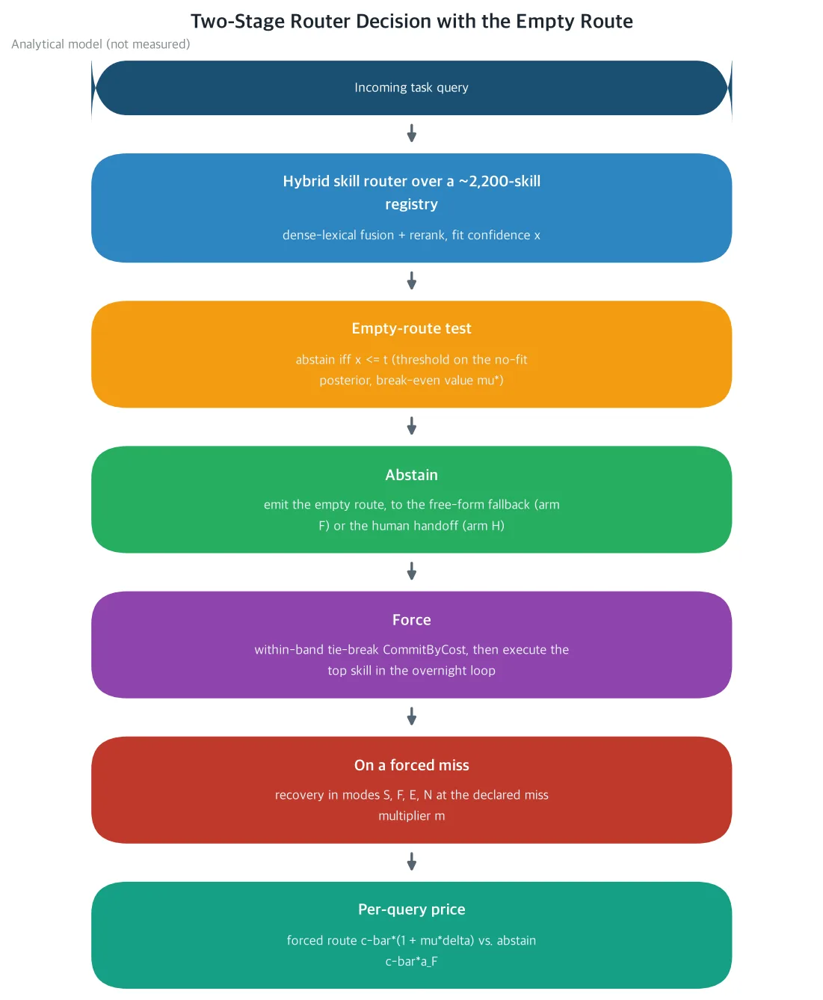
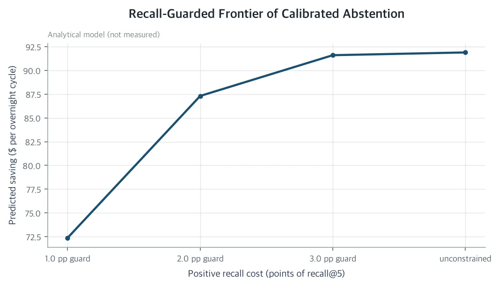
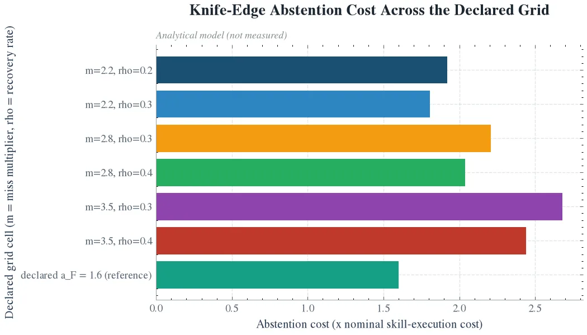

셀프호스트드 GPU에서 큰 스킬 레지스트리 위의 무인 에이전트를 돌리면서 라우터가 실패할 때의 비용을 정해야 하는 분을 위한 글입니다. 이 논문은 등록된 스킬이 하나도 안 맞는 태스크에서 라우터가 '라우트하지 않겠다'고 말할 수 있는 순간을 비용 최적의 방기 임계값으로 정가합니다. 선언된 요금 카드에서 지금의 동결된 50.0% negative avoidance 게이트는 under-abstaining인가. 즉 방기를 너무 적게 하고 있고 캘리브레이션된 임계값으로 바꾼다면 negative avoidance가 86.6%까지 올라가고 그 대가로 positive recall@5는 3.40포인트 내려가며 밤사이 순절감 $91.89(선언된 총액의 3.65%)가 예상됩니다. 2,200개 스킬 레지스트리를 셀프호스트드 H200에서 돌리는 무인 밤사이 루프에서 라우터가 언제 손을 멈출지를 정하는 배포 규칙입니다.

읽기 전에 한 가지를 밝혀 둡니다. 이 논문은 분석 논문이고 선언된 전제 위에서 입장을 세웁니다. 새 실측을 보고하지 않습니다. 모든 수치는 선언된 공칭 전제 위의 닫힘 형태의 예측이거나 인용 소스에 귀속되는 결과입니다. 본문의 세 그림은 분석 모델이 그린 도식이며 실측 데이터가 아닙니다. 확인과 반증은 논문 말미에 사전등록된 arm-and-falsification 프로토콜의 몫이고 네 팔(arms A0~A3), 네 측정(M1~M4), 다섯 반증 기준(F1~F5)으로 구성됩니다. F3는 동결 게이트가 이미 knife-edge, 즉 이미 비용 최적이라는 null을 사전등록하므로 이 분석이 호도로 읽히지 않도록 설계되어 있습니다.

## 쉽게 말하면: 배차 센터의 '안 배차' 결정

택시 배차를 생각해 보세요. 앱이 호출을 받으면 배차 센터는 두 가지를 정합니다. 어느 기사에게 줄 것인가, 그리고 아예 안 줄 것인가입니다. '안 준다'는 결정을 택하면 호출은 대기하거나 다른 수단에 넘어가지만 '주겠다'고 정해 놓고 실제로는 아무 기사가 맞지 않는 호출이면 가장 가까운 기사를 강제로 붙입니다. 그 기사는 헛되이 원정을 하고 도착해서 취소합니다. 유류비와 시간이 사라지고 호출자의 신뢰도 함께 사라집니다. 강제로 붙이는 쪽은 실패한 라우트의 하류 비용이고 안 붙이는 쪽은 빈 배차의 대가입니다. 두 쪽 모두 값이 있는 셈입니다. 그런데 배차 센터의 경계 규칙은 '점수가 상수를 넘으면 배차' 한 줄입니다. 값이 있는 두 선택지 사이를 점수 상수가 나누고 있는 셈입니다.

스킬 라우터도 마찬가지입니다. 라우터의 결정은 두 부분으로 이루어집니다. which, 등록된 스킬 중 어느 후보를 고를 것인가, 그리고 whether, 아예 맞는 스킬이 없는 경우 빈 집합을 내보내고 폴백을 부를 것인가입니다. 평가 관행은 which에는 집착하듯 가격을 매깁니다. recall@k, top-1, set recall입니다. whether는 점수 상수에 맡깁니다. 이 논문은 whether에 값을 매깁니다. 강제 라우트의 하류 미스 비용은 이미 이 시리즈(Miss Price)에서 정가되어 있고 방기 폴백에도 비용(레이턴시와 인간 핸드오프)이 선언되어 있습니다. 양쪽의 값이 있으면 경계는 계산이 됩니다. 상수가 아니라요.

## 문제: 캘리브레이션 결과처럼 보이는 50.0%는 상수

우리 하네스에서 증상은 구체적이고 반복적이다. 최근 SRA-Bench 체크포인트 두 번에 걸쳐 negative 스플릿의 avoidance가 50.0%로 머물러 있었고 같은 기간 positive recall@5는 개선되었다. 캘리브레이션의 결과처럼 보이는 정체인데, 실제로는 상수다. 프로덕션 인젝션 게이트는 융합 점수가 선언된 임계 상수를 넘을 때마다 스킬을 실행한다. 스킬 없는 태스크의 점수 분포를 보면, 그 상수 아래쪽에 우연히 50.0%가 나온다. 이 정체는 최적화의 출력이 아니라, 부호까지 측정할 수 있는 캘리브레이션의 우연이다.

이 틈의 주위 대상은 이미 정가되어 있다. Miss Price는 단일 라우터 미스의 값을 매겼다. 미스 배율 m, 미스 후 복구 분류 R={S,F,E,N}와 복구율 rho, 브레이크이븐 라우팅 정확도 alpha*의 값이다. 다만 정책은 열려 있었다. 미스의 값은 매겨졌지만 그 값이 정책으로 쓰이지는 않았다. Indifference Band는 근접 동점 안쪽의 결정을 매겼다. 인디퍼런스 밴드 B_delta와 기대비용 타이브레이크 CommitByCost(delta)로 선언된 공칭 요금에서 밤사이 $60.5를 1.18 SRA top-1 포인트의 예측 품질 비용으로 절약한다. Composite는 같은 코퍼스에서 스킬 없는 스플릿(75개 태스크 중 10개)을 측정했고 게이트의 멀티 후보 신호가 스킬 없는 태스크와 골드를 구분해 낸다는 것을(스킬 없는 태스크에서 0/10 게이트 발화, 골드에서 91.23% 게이트 관찰) 보였다. 다만 그것은 캘리브레이션되어 있지 않았다.

이 논문은 그 루프를 닫는다. 빈 집합에 대한 결정을 정가하고 측정된 미스 비용을 방기 정책으로 바꾼다. Indifference Band의 명시적 업그레이드이다. 그 논문은 밴드 멤버 중 무엇을 커밋할지를 물었고 이 논문은 아예 맞는 스킬이 없는 경우 정답이 빈 집합인지 먼저 묻는다.

## 설계: 빈 경로의 두 팔과 선언된 요금 카드

하네스는 셀프호스트드 H200 서빙 경로 위에서 무인 밤사이 에이전트 루프를 돌린다. 하이브리드 스킬 라우터는 약 2,200개 자기진화 스킬(Composite 측정 시점 2,283개 항목)의 프로덕션 레지스트리 위에 각 태스크 쿼리를 라우팅한다. 밀집-문자열 융합이 후보를 검색하고 리랭커가 최상위 후보를 점수화하며, 정규화된 fit confidence x(선언된 스케일 위의 리랭 점수)가 라우터의 방기에 관련되는 신호다. 프로덕션 게이트는 융합 점수가 선언된 상수를 넘을 때만 스킬을 실행하고 그 아래에서는 태스크가 자유 형식 폴백으로 넘어간다. SRA-Bench는 내부 스킬 라우팅 평가 코퍼스이고 이 프로토콜은 negative 스플릿(등록된 스킬이 아무것도 안 맞는 태스크)에 합성된 out-of-scope 쿼리 홀드아웃을 더해 쓴다.

fit confidence x에서 정책은 force(최상위 후보로 라우팅해 루프에서 실행)와 abstain(빈 경로를 내보냄)을 고른다. 방기에는 선언된 두 팔이 있다. 자유 형식 폴백(arm F)과 인간 핸드오프(arm H)이다. 비용은 스킬 실행의 공칭 단가 c̄ 단위로 선언된다. c̄는 실행당 $0.42이고 밤사이 실행 4,860회는 약 $2,040의 스텝 실행 예산에 맞는다. 태스크 믹스에서 negative와 positive의 선언된 점유율은 0.25 대 0.75이다. 미스 배율 m은 2.8, 유효 복구율 rho는 0.30으로 선언된다. 강제 미스 후 복구를 뺀 순수 초과 비용 Delta=(m-1)(1-rho)는 1.26을 낸다. 자유 형식 폴백 팔의 비용 a_F는 1.6 c̄이고 인간 핸드오프 팔 a_H는 8.0 c̄이다. 선언된 점수 모델은 positive의 fit confidence 분포 F_p=Beta(9,4)와 그 거울 F_n=Beta(4,9)를 쓴다. 동결 게이트 경계 tau=0.2976은 F_n(tau)=0.5, 즉 50.0% avoidance를 실현하는 운영점이다. 모든 항목은 선언된 공칭 입력이며 측정이 아니다.

그 위에서 이 논문은 빈 경로를 no-fit posterior mu(x)=P(neg|x)에 대한 reject-option 결정으로 형식화한다. 리랭 신뢰도가 유도하는 mu(x)이며 선언된 점수 모델 아래 x에 대해 엄격히 감소한다. 임계 정책 pi_t는 x가 t 이하일 때 abstain하고 avoidance A(t)=F_n(t)와 positive 라우팅률 R(t)=1-F_p(t)가 비용 곡선의 모양을 준다.

*정책의 구조다. 빈 경로 테스트(abstain iff fit confidence x <= t, t는 no-fit posterior mu*에서 유도된 임계값)가 밴드 안쪽 타이브레이크보다 앞서고 인디퍼런스의 두 쪽은 강제 라우트의 미스 비용과 방기 팔의 비용으로 정가되어 있다. 분석 모델 도식이며 실측이 아닙니다.*

## 결과 1: 인디퍼런스와 knife-edge, 50.0% 정체의 부호

쿼리 하나가 no-fit posterior mu일 때, force의 기대 비용은 c̄(1+mu*Delta)이고 abstain(arm F)의 기대 비용은 c̄*a_F입니다. 1 < a_F < 1+Delta이면 브레이크이븐 posterior가 하나 존재하고, mu*=(a_F-1)/Delta=(a_F-1)/((m-1)(1-rho))입니다. force가 싼 쪽은 mu < mu*인 경우뿐입니다. 이 형태는 reject-option의 Chow형 임계로, 거부 비용을 빈 경로 팔 비용 a_F*c̄로, 오분류 비용을 무인 루프의 하류 미스 비용 Delta*c̄로 놓은 것입니다.

pointwise-Bayes 정책이 전역 최적입니다. 관찰 가능한 점수 x 위에서 mu(x)>=mu*일 때 abstain하는 정책은 임계 theta_mu=mu^(-1)(mu*)의 임계 규칙과 일치합니다. 그 임계 규칙이 x 위의 모든 측정 가능 정책, single-threshold 정책류 전체에서 기대 비용 C(t)를 최소화합니다. 선언된 거울 Beta 쌍 아래 f_n/f_p가 엄격히 감소하므로 C'(t)는 부호를 한 번만 바꾸고 최소점은 유일합니다.

동결 게이트를 대면한 보조정리가 논문의 가장 예리한 문장입니다. 동결 게이트 pi_tau(F_n(tau)=0.5, 50.0% avoidance)가 비용 최적인 필요충분 조건은 a_F가 knife-edge 비용 a_F^dagger=1+mu(tau)(m-1)(1-rho)와 일치할 때뿐이라는 것입니다. 다시 말해 50.0% 정체는 정확히 하나의 선언된 방기 비용에서만 비용 최적의 경계입니다. 그 비용의 양쪽이 어떤 쪽인지 부호는 모델 의존적이지 않습니다. mu(tau) > mu*이면 under-abstaining(경계가 위로, avoidance가 50.0%보다 위에 가야 함), mu(tau) < mu*이면 over-abstaining, 같으면 knife-edge입니다.

regime은 세 갈래입니다. a_F >= 1+Delta이면 mu*가 (0,1)을 벗어나 빈 경로는 언제도 비용 최적이지 못 하고 정책은 항상-force가 됩니다. Miss Price의 라우터 폐기 보조정의 방기 버전입니다. a_F <= 1이면 항상-abstain이 됩니다. 내부 regime은 1 < a_F < 1+Delta입니다. 인간 핸드오프 팔은 a_H=8.0 >= 1+Delta=2.26이므로 언제든 내부의 기본 팔이 될 수 없고 경제적으로 관련되는 빈 경로는 자유 형식 팔(a_F=1.6)입니다. 복구의 역할도 명심할 만합니다. 루프가 강제 미스에서 잘 복구할수록(rho가 클수록) Delta는 줄고 mu*는 오르지만 a_F^dagger는 내려옵니다. 어느 쪽으로 보나 최적의 방기 집합은 줄어듭니다. 복구가 좋아질수록 빈 경로의 가치는 낮아집니다.

## 결과 2: 선언된 요금 카드 위의 프런티어, 50.0%에서 86.6%

선언된 값을 대입하면 그림이 한 장으로 압축됩니다. 선언된 점수 모델에서 mu(tau)=0.961이고 mu*=(1.6-1)/1.26=0.476입니다. 동결 경계는 no-fit 지역 깊숙이 앉아 있으므로, 부호 검사는 게이트가 under-abstaining임을 가릅니다. 최적 임계는 theta_mu=0.450이고 knife-edge 비용 a_F^dagger=1+0.961*1.26=2.210을 줍니다. 즉, 50.0% 정체가 비용 최적이라 하려면 자유 형식 폴백이 공칭 스킬 실행의 거의 두 배(2.21배) 비싸야 합니다.

avoidance는 50.0%에서 86.6%로 오릅니다. +36.55포인트입니다. 그 대가는 positive recall@5의 3.40포인트입니다. 동결 게이트에서 positive의 기본 방기율은 0.16%이고 임계 0.450에서 3.56%로 오릅니다. 비용 장부는 이렇습니다. 동결 게이트의 밤사이 총비용 C(tau)는 $2,517.24이고 최적 임계에서 C(theta_mu)는 $2,425.35를 냅니다. 순절감은 밤사이 $91.89, 선언된 동결 게이트 총액의 3.65%입니다. 크로스풋으로 보면, negative 조각이 (tau, theta_mu] 구간의 강제 미스를 피기로 $123.11/밤을 남기고 positive 조각이 방기된 맞는 태스크로 $31.22/밤을 씁니다. 두 값의 합이 -$91.89입니다. 품질 비용 환산은 1 recall 포인트당 $27.03입니다.

recall guard를 넣으면 프런티어가 어디까지 살아남는지 봅니다. 배포가 무제약 최적을 받아들이지는 않으므로, 허용 recall 비용 epsilon이 1.0, 2.0, 3.0포인트인 제약 경계를 계산합니다. 제약은 세 구간 모두에서 bind하고, 절감은 guard에 대해 오목합니다. 마지막 recall 포인트가 가장 싸다는 뜻입니다. 1.0포인트 guard에서 경계는 0.385, avoidance는 74.2%, 절감은 $72.37입니다. 2.0포인트 guard에서 경계 0.420, avoidance 81.4%, 절감 $87.31입니다. 3.0포인트 guard에서 경계 0.443, avoidance 85.4%, 절감 $91.60입니다. 3.0포인트 guard가 무제약 절감의 99.7%를 유지하고 모든 guard에서 avoidance 리프트는 24포인트를 넘습니다.

*밤사이 순절감(예측)과 허용되는 positive recall 비용의 프런티어입니다. 오목하므로 3.0포인트 guard가 무제약 최적 절감 $91.89의 99.7%를 유지하고 모든 guard에서 avoidance 리프트는 24포인트를 넘습니다. 분석 모델 도식이며 실측이 아닙니다.*

knife-edge의 민감도도 확인해 둔다. 방향 결론은 (mu(tau), mu*) 쌍에 기대므로 선언된 (m, rho) 그리드 전부를 쓸어본다. a_F^dagger=1+mu(tau)(m-1)(1-rho)는 그리드 전체에서 1.807에서 2.681 사이를 가진다. 전부 선언된 a_F=1.6보다 엄격히 위에 있기 때문이다. 동결 게이트는 중앙점뿐 아니라 선언된 그리드의 모든 셀에서 under-abstaining이다. 50.0% 정체를 비용 최적으로 만들 knife-edge는, 자유 형식 폴백이 공칭 스킬 실행의 거의 두 배로 비싸야 나온다.

*선언된 (m, rho) 그리드 각 셀의 knife-edge 비용 1+mu(tau)(m-1)(1-rho)는 무엇인가. 전 셀이 선언된 자유 형식 팔 비용 a_F=1.6보다 엄격히 위에 있어, 동결 50.0% avoidance 게이트는 중앙점뿐 아니라 모든 선언된 셀에서 under-abstaining인 셈이다. 분석 모델 도식이며 실측이 아닙니다.*

이 프런티어는 인디퍼런스 밴드의 타이브레이크와 두 단계로 합성됩니다. 전체 라우팅 결정은 (i) 빈 경로 테스트, x <= t면 abstain, (ii) 아니면 밴드 안쪽 기대비용 타이브레이크 CommitByCost(delta)입니다. within-band 불변 전제(D4) 아래 단계는 분리되고 결합 예측은 $91.89 + $60.50 = 밤사이 $152.39, 선언된 동결 게이트 총액의 6.05%입니다. 품질 비용은 3.40 recall@5 포인트(빈 경로)와 이미 Band Two에 귀속된 1.18 top-1 포인트로, 서로 다른 지표라 배포 장부에 따로 적습니다.

## 캘리브레이션 갭과 공격면: 프런티어가 전제하는 것

프런티어 전체가 mu(·) 위에서 돌고 있습니다. 임계 theta_mu=mu^(-1)(mu*)는 캘리브레이션 대상이고, 선언된 D3 점수 모델(AUROC 0.980)은 사실이 아니라 전제입니다. 인용된 네 결과가 위험의 범위를 한정합니다. 첫 번째로, LLM 기반 IT 티켓 라우팅에서 prompted-LLM confidence의 correctness AUROC는 0.500이었고 그 구성에서는 어떤 임계도 fixed-rate defer를 이기지 못했습니다. 우리 F1 null(선언된 AUC < 0.65)은 빈 경로 프런티어가 정확히 그 장치로 퇴화하는 regime입니다. 두 번째로, 신뢰도 기반 라우팅의 이득은 태스크 의존적이고(AUC 0.510~0.705) 다른 도메인의 값으로 이득이 이동하지 않으므로, M1 없이는 판단이 성립하지 않습니다. 세 번째로, 태스크 무관한 자기 보고 신뢰도(P(IK)형)는 새 태스크에서 miscalibration을 보였습니다. no-fit posterior는 스킬 없는 스플릿에서 추정해야 하며 일반 답안 신뢰도 채널에서 빌려 올 수 없습니다. 네 번째로, 답안 신뢰도는 질문의 답 가능성(answerability)을 거의 구분하지 못 합니다. hidden-state probe가 0.69~0.77 AUROC를 낼 때 답안 신뢰도는 근접 랜덤 수준에 머물렀습니다. none 옵션은 레지스트리에 대한 답 가능성 결정입니다. 그 신호는 캘리브레이션된 레지스트리-fit 신호, 곧 리랭 신뢰도여야 합니다. 지금 프로덕션 게이트는 그 신호를 캘리브레이션되지 않은 채로(스킬 없는 0/10 대 골드 91.23% 게이트 관찰) 쓰고 있습니다.

공격면도 설계에 포함합니다. 방기 결정은 가용성 공격 표적으로, caution-first 프롬프팅 하에서 유도된 과다 방기가 한 모델 계열에서 9.8%에서 86.3%까지 올랐습니다. 경계는 아래로 내려갈수록 방기 집합이 커지므로(선언: negative의 50.0%에서 86.6%) 표적이 됩니다. 완화는 구조적입니다. 게이트는 라우터 내부의 fit 채널만 소비하고(저신뢰 콘텐츠 경로 없음), recall guard가 경계에 바닥을 깔며(위 guard 값), 스킬 설명 채널, 곧 decoy 채널은 provenance 체크 대상입니다.

## 사전등록 프로토콜: 확인과 반증, null까지

프로토콜은 선언된 D2~D3을 실측값으로 교체하는 것을 목표로 SRA-Bench 위에서 사전등록됩니다. negative 스플릿은 기존 스킬 없는 케이스에 합성된 out-of-scope 쿼리 홀드아웃을 더합니다. 선언된 규모는 positive 2,400, negative 960(mix p_n=0.25)입니다. 검정력(양측, alpha=0.05, power 0.8)으로 보면, recall 효과(기본 0.16%에서 3.40포인트)는 약 247개의 positive면, avoidance 효과(50.0%에서 36.55포인트)는 약 25개의 negative면 충분합니다. 선언된 규모는 이 최소한의 약 10배, 약 38배입니다. out-of-scope 홀드아웃의 이질성에 대한 여유가 남는 셈입니다.

팔은 네 개입니다. A0는 동결 게이트(t=tau)입니다. A1은 임계 규칙으로, 캘리브레이션 스플릿에서 피팅한 mu_hat(x)로 abstain iff mu_hat(x)>=mu*를 따릅니다(temperature scaling). A2는 그리드 경계로, 단조성을 가정하지 않고 캘리브레이션 스플릿에서 선언된 기대 비용 C(t)를 t에 대해 최소화합니다(전역 최적성 명제의 강건성 팔). A3는 guard로, A1/A2 경계를 epsilon이 1.0, 2.0, 3.0 recall 포인트에서 클립합니다.

측정은 네 개입니다. M1 no-fit 캘리브레이션: 스킬 없는 스플릿의 mu_hat reliability diagram(calibration slope, ECE, neg-discrimination AUROC)에 부호 검사 sign(mu_hat(tau)-mu*)를 붙이고 판별과 보정 효용을 따로 보고합니다. M2 빈 경로 미스 배율 m_0: A0에서 negative 쿼리를 강제 실행하고 표준 하네스 토큰과 wall-time 장부에서 값을 매깁니다. 선언된 사전: m_0-m의 부호는 알 수 없습니다. 빈 경로 decoy는 나쁜 집합의 최상이므로, 더 싼 방향으로 기울 수 있고 '겉으로는 좋아 보이는' 최상이면 더 비쌀 수도 있습니다. M3은 팔별 비용 장부, 토큰, wall time, 핸드오프, 복구 모드 믹스 R={S,F,E,N}를 기록합니다. M4는 positive의 각 경계에서 recall@5를 측정합니다.

반증 기준은 다섯 개이고 전부 null 결정 규칙을 가집니다. F1: neg-discrimination AUROC가 0.65 미만이면 임계 정책류는 선언된 비용 밴드 안에서 무작위와 구별되지 못 하고 null을 보고하며, fixed-rate defer를 권장합니다. F2: 실측 m_0가 1.30 미만이면 Delta_0=(m_0-1)(1-rho_meas)로 재계산하고 a_F가 knife-edge 값 이상이면 빈 경로는 언제든 내부가 아니고 프런티어가 항상-force로 붕괴합니다. F3: |mu_hat(tau)-mu*|가 0.05 미만이면 동결 50.0% 게이트는 tolerance 안에서 knife-edge에 있고 정체를 비용 최적이라 보고합니다. 이 null은 이 분석이 존재하는 이유가 되는 null입니다. F4: 3.0포인트 guard가 무제약 실측 절감의 90% 미만만 남기면 knee가 guard 밴드 안쪽에 있습니다. 그때는 guard된 경계를 배포하고 knee를 보고합니다. F5: D4가 깨지면(A1/A2의 neg 루트 top-1 decoy 구성이 선언된 tolerance를 벗어나면) 두 단계가 결합되고, (t, delta) 결합 프런티어를 다시 계산합니다.

결정 규칙은 M4 제약 아래 M3 장부를 최소화하는 팔의 승리입니다. 사후 팔 선택은 없습니다. 전체 sweep(밤사이 4 사이클)는 선언된 카드에서 최대 4 x $2,517.24 = $10,069를 씁니다.

## 회사, 사회, 과학에 닿는 곳

회사가 얻는 것은 ThakiCloud 스킬 라우팅 파이프라인과 밤사이 무인 에이전트 루프에 배포 가능한 방기 게이트입니다. SRA-Bench에서 recall이 개선되는 동안 50.0%로 정체된 negative_avoidance, 즉 맞는 스킬 없는 태스크에 억지로 라우트하는 실패 모드가, 비용 최적의 방기 정책으로 바뀝니다. 이미 측정된 미스 비용(m, rho)이 정책 임계값 mu*로 결합되어 낭비 토큰과 실패 루프가 정량적으로 줄어듭니다. 선언된 카드에서 밤사이 $91.89(3.65%), 인디퍼런스 밴드와 합쳐 $152.39(6.05%)입니다. 레지스트리가 자기진화하므로 mu_hat와 knife-edge는 매 밤사이 사이클에 다시 fit하고, 그 비용은 스칼라 임계 하나이므로 라우팅 단계 오버헤드는 무시할 수 있습니다.

사회가 얻는 것은 '행동하지 않을 때를 아는' 라우터입니다. none 옵션을 비용 최적의 캘리브레이션 결정으로 만들어, 오프스코프 태스크의 잘못된 실행을 줄입니다. 자체 H200 하네스로 에이전트 스택을 돌리는 소규모 팀의 자동화 오남용 위험과 비용이 내려갑니다. 무인 자동화의 신뢰성 1단계입니다.

과학에 남는 것은 대형(약 2,200개) 스킬 등록표에서 하이브리드 라우팅의 정밀도를 positive 케이스로만 측정하는 관행에서 한 걸음 지난 것입니다. none 옵션을 no-fit posterior 위의 비용 최적 임계로 정가한 논문은 이 시리즈뿐 아니라 조사한 외부 문헌에도 없습니다. route-to-nothing(none 옵션) 행동에 대한 결정이론적 비용-품질 프런티어와 캘리브레이션 프레임워크를 정립합니다. no-fit posterior 위의 브레이크이븐 mu*, 전역 최적 임계 규칙, 동결 상수 게이트의 knife-edge 보조정(부호 검사는 모델 무관)과 regime 분리는 D1~D3 하에서 모델 무관하게 성립합니다. 이 논문은 Indifference Band의 '동점이 된 후보 중 무엇을 커밋할 것인가'를 'null에 대한 결정, 언제 라우트하지 않을 것인가'로 끌어올린 명시적 업그레이드입니다.

## 한계: 아직 선언된 것, 아직 측정되지 않은 것

첫째, 모든 프런티어 수치는 선언된 공칭 입력 위의 평가, 즉 예측입니다. 결과인 척 하지 않습니다. pivot 값 mu(tau)는 가장 중요한 선언된 입력이면서 가장 확실하지 않은 하나입니다. M1이 그것을 측정하고 F3는 헤드라인이 틀렸을 수 있는 null(동결 게이트가 이미 knife-edge)을 사전등록해 둡니다.

둘째, 빈 경로의 미스는 m과 별개의 대상입니다. m_0는 m과 다릅니다. 빈 경로 decoy는 (정의상) 맞는 스킬을 포함하지 않는 집합의 최상이기 때문입니다. m_0가 낮으면 빈 경로의 가치는 떨어지고(F2), '겉으로는 좋아 보이는' 최상이면 높습니다. 선언된 D2는 m_0=m을 쓰고 프로토콜이 실측으로 교체합니다.

셋째, 규모와 드리프트입니다. 레지스트리는 자기진화하고 p_n, F_n, decoy 품질은 레지스트리 성장과 함께 움직입니다. mu*와 a_F^dagger는 사이클별 대상이고, 선언된 적응 규칙은 매 밤사이 사이클에 mu_hat를 다시 fit하고 knife-edge를 재평가하는 것입니다.

넷째, must-not-use 스플릿은 비용 regime이 아니라 안전 regime입니다. 스킬은 있지만 쓰면 안 되는 8개 태스크에서 정답은 a_H와 무관하게 핸드오프 팔로 방기하는 것입니다. 무한 리스크의 극한으로, 빈 경로가 유일한 방어 가능한 행동입니다. 이 논문의 비용 프런티어는 스킬 없는/out-of-scope 스플릿에만 적용됩니다.

다섯째, 위치입니다. 프런티어가 측정되었다는 것을 주장하지 않습니다. 주장하는 것은 정책류(no-fit posterior 위의 임계), 인디퍼런스 대수(D1~D3 하에서 모델 무관), knife-edge(동결 50.0% 정체는 정확히 하나의 선언된 방기 비용에서만 비용 최적이고, 선언된 카드는 그 한쪽에 있습니다), 그리고 null을 가진 사전등록 프로토콜입니다.

논문 원문과 수반 자료는 Hugging Face 논문 상세 페이지에서 볼 수 있습니다. https://huggingface.co/datasets/thaki-AI/daily-paper-2026-11-23-empty-route-abstention-frontier

*본문의 모든 수치는 선언된 공칭 입력(D1~D3) 위의 닫힘 형태의 예측이거나, 시리즈 이전 연구(Miss Price, Indifference Band, Composite)와 인용 문헌에 귀속된 결과입니다. mu(tau)=0.961, mu*=0.476, theta_mu=0.450, a_F^dagger=2.210, avoidance 50.0%->86.6%, recall@5 -3.40포인트, 밤사이 순절감 $91.89(3.65%), guard 3.0포인트에서 99.7% 유지, 결합 절감 $152.39(6.05%)는 전부 선언된 점수 모델과 요금 카드의 평가입니다. 세 그림은 분석 모델의 도식이며 실측이 아닙니다. 사전등록 프로토콜(arms A0~A3, M1~M4, F1~F5)은 이 논문에서 실행되지 않았고, mu(tau), m_0, 실측 절감의 보고는 실행 완료 시점에 이뤄집니다.*