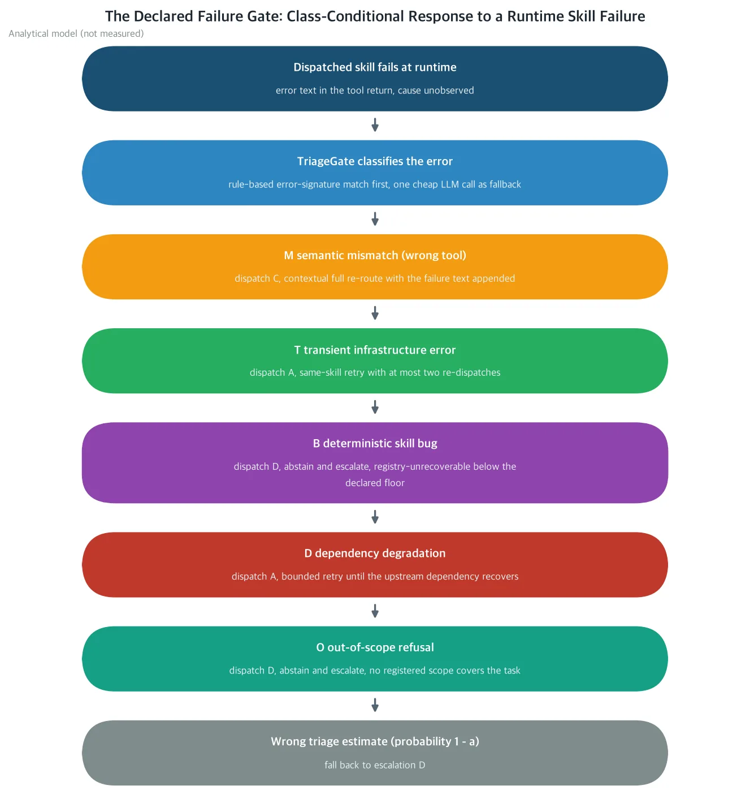
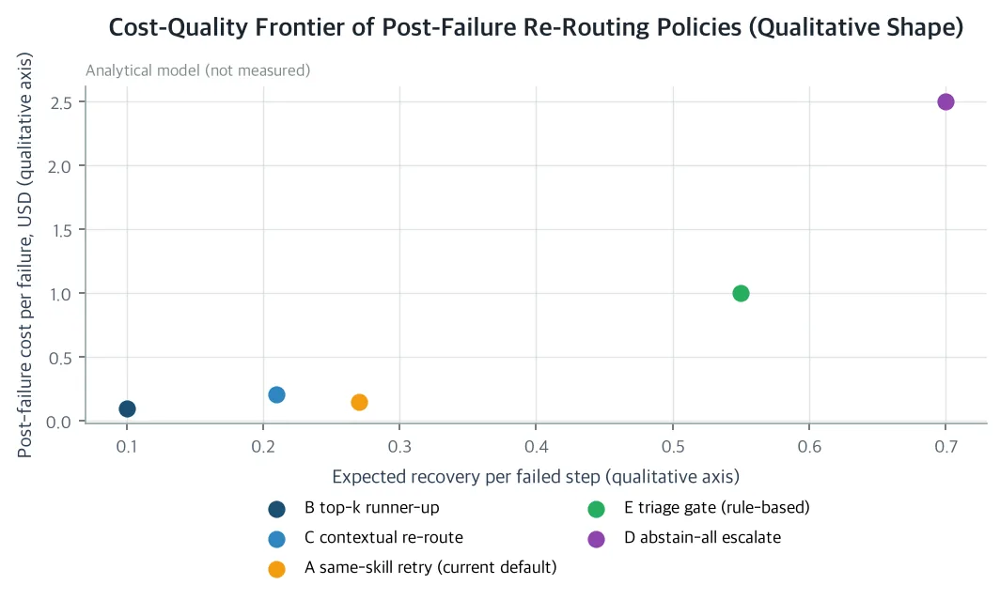
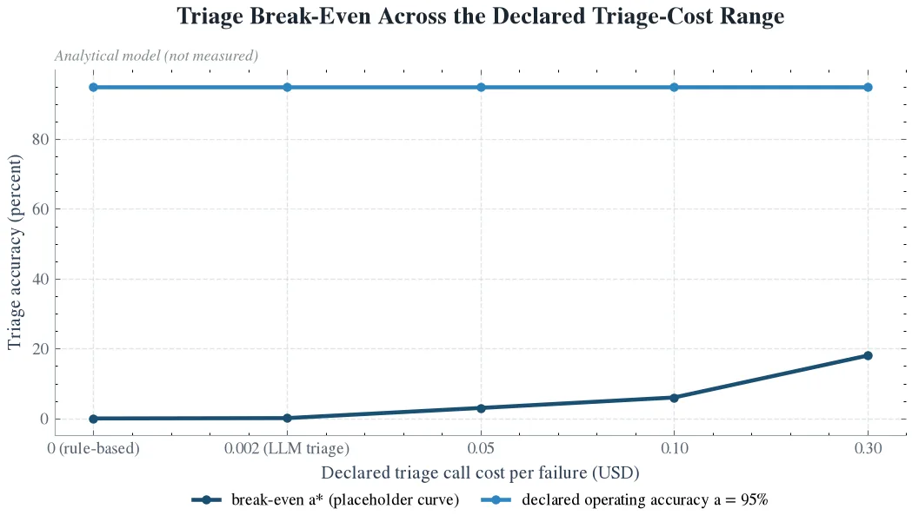

셀프호스트드 GPU 위에서 무인 에이전트를 밤사이 대규모로 돌리고 실행이 깨졌을 때의 비용을 정해야 하는 분을 위한 글입니다. 에이전트는 밤마다 수천개의 등록된 스킬 가운데 하나를 골라 태스크를 실행에 넘깁니다. 골랐던 스킬이 실행 도중 실패하면 지금의 응답은 하나뿐인 블라인드 재시도로 돌아갑니다. 방금 실패한 그 스킬을 원인과 무관하게 두 번 더 재분배하는 구조입니다. 타임아웃이든, 프로그램 버그든, 범위 밖 거부든, 같은 응답과 같은 비용을 받지만, 성공할 확률은 구조적으로 다릅니다.

이 논문의 핵심 결과는 실패의 원인을 읽으면 응답의 경제학이 바뀐다는 것입니다. 툴이 돌려준 에러 텍스트를 보고 원인을 분류한 뒤 그 원인에 최적의 응답을 보내는 값싼 triage 한 번이, 현재 기본값보다 밤마다 272건 더 많은 실패 태스크를 회복합니다. 가격은 전체를 인간에게 넘기는 비용의 절반도 못 됩니다. triage가 이득이 되는 브레이크이븐은 triage 정확도 0.12%이고, 룰 기반 triage라면 0입니다.

읽기 전에 한 가지를 밝혀 둡니다. 이 논문은 선언된 전제 위에서 입장을 세우는 분석 논문이고 새 실측을 보고하지 않습니다. 모든 수치는 선언된 공칭 전제 위의 닫힘 형태 예측이거나, 인용 참고 문헌에 귀속되는 결과입니다. 본문에 든 그림 세 장은 분석 모델이 그린 도식이며 실측 데이터가 아닙니다. 이 논문은 직전 논문 Miss Price의 명시적 한 단계 업그레이드이기도 합니다. 그 논문은 라우팅 미스의 비용을 정가하고 미스 이후의 모든 복구를 단일 복구율로 뭉쳤습니다. 어떤 원인에는 어떤 응답이 최적인지를 묻지 않았습니다. 이 논문은 정확히 그 열린 질문을 정가합니다.

## 쉽게 말하면: '다시 켜보세요'만 아는 수리점

수리점을 생각해 보세요. 고객 전화 한 통이 들어옵니다. 기기가 멈췄습니다. 수리점은 원인을 묻지 않고 같은 기수에게 같은 장비를 두 번 더 내보냅니다. 만약 전원이 꺼진 것이라면 정답입니다. 다시 켜면 됩니다. 부속품이 망가진 것이라면 같은 기수의 같은 장비는 같은 실패를 반복할 뿐입니다. 보증이 지난 장비라면 애초에 헛된 방문입니다. 변하는 것은 원인뿐이고 응답은 그것과 함께 달라져야 합니다.

에이전트 하네스도 마찬가지입니다. 증상은 항상 한 줄, 툴이 에러를 돌려준 것입니다. 그런데 원인은 다섯 갈래로 나뉩니다. 골랐던 스킬이 애초에 틀린 스킬인 시맨틱 불일치, 타임아웃 같은 일시적 인프라 오류, 스킬 안의 결정론적 버그, 상위 의존성이 느려지거나 낡은 의존성 열화, 태스크가 범위 밖이라 스킬이 거절하는 경우입니다. 지금의 밤사이 기본값은 이 다섯 원인을 하나의 문제로 취급해 블라인드 재시도합니다.

이 논문은 원인을 안다면 최적의 응답이 무엇인지, 그리고 그 값이 얼마인지를 묻습니다. 답은 한 장의 표로 나옵니다. 시맨틱 불일치에는 실패 컨텍스트를 붙인 재라우팅, 일시적 오류에는 동일 스킬 재시도, 결정론적 버그에는 인간 에스컬레이션, 의존성 열화에는 재시도, 범위 밖 거부에는 에스컬레이션. 이 한 장의 표가 논문의 핵심 결과입니다.

## 문제: 디스패치 이전은 전부 정가됐고 실패 이후의 응답만 값이 없다

시리즈는 라우트된 스킬이 디스패치되기 이전의 모든 단계를 정가해 왔습니다. 정가된 대상은 하이브리드 검색과 융합의 점수부터, 유료 listwise 리랭커 호출, 폭 5로 동결된 메뉴, 인디퍼런스 밴드 안쪽의 기대비용 타이브레이크, 그리고 라우팅 미스의 사후 가격에 이릅니다. Miss Price는 미스 그 자체를 정가했습니다. 미스 배율, 복구율, 브레이크이븐 라우팅 정확도까지입니다. 다만 미스 이후의 모든 복구를 단일의 집합 복구율 rho로 뭉쳤습니다. 다섯 원인 가운데 어떤 것이 어떤 응답으로 복구됐는지, 그 답은 남겨 두었습니다.

문제는 여기서 나옵니다. 집합 복구율 하나만으로는 정책을 고를 수 없습니다. 실패한 스텝의 26%를 회복하는 정책과 73%를 회복하는 정책은 원인별 구성이 다르고 밤사이 경제학도 다릅니다. 그런데 지금의 밤사이 기본값인 블라인드 재시도는 0.26의 복구율에 앉아 있고 선언된 밤사이 품질 하한 0.50보다 한참 아래입니다. 하한을 매일 놓치고 있으면서 얼마에 고칠 수 있는지는 모릅니다. 이 논문은 실패 이후의 응답 공간, 실패 클래스별 재라우팅 정책을 정가해 그 질문에 답합니다.

## 설계: 다섯 원인, 네 응답, 그리고 triage 게이트

전제는 선언된 요금 카드에 있습니다. 스텝당 비용은 $0.11이고 밤사이 라우팅 스텝은 18,000개, 총 예산은 $2,040으로 잡힙니다. 실패 발생률은 5%로 선언되므로 밤마다 900개 스텝이 실패합니다. 하네스는 셀프호스트드 H200 클러스터의 vLLM 서빙 위를 도는 무인 루프이고 2,200개 스킬 레지스트리는 계속 진화하는 구조입니다.

네 응답은 지금의 기본값과 다른 세 가지 대안으로 구성됩니다. A는 동일 스킬 재시도, 실패한 스킬을 두 번까지 재분배하는 지금의 기본값입니다. B는 동결된 top-5 메뉴의 두 번째 후보, 즉 러너업으로 메뉴 선택 자체는 무료이고 디스패치에만 비용이 붙습니다. C는 컨텍스트 풀 재라우팅, 실패 텍스트를 태스크 쿼리에 붙여 라우터를 다시 질의하는 팔입니다. 재쿼리의 비용은 $0.08로 책정됩니다. D는 포기 및 에스컬레이션, 디스패치를 멈추고 태스크를 인간 검증자에게 넘기는 팔입니다. 비용은 원인 무관한 $2.50으로 선언됩니다.

다섯 번째 팔 E가 triage 게이트입니다. 툴 리턴의 에러 텍스트를 읽고 우선 룰 기반 에러 시그니처로 원인을 분류합니다. 불확실하면 LLM 호출 한 번을 폴백으로 씁니다. 그 호출은 $0.01도 안 되는, 스텝당 비용의 2% 미만입니다. 분류가 맞으면 그 원인에 최적의 응답을 보내고 틀리면 에스컬레이션 D로 떨어집니다. 실패 게이트의 구조는 아래 그림에 있습니다.

*선언된 실패 게이트입니다. 런타임 실패에서 값싼 triage 단계가 툴 리턴을 보고 실패 클래스를 추정하고 클래스 최적 정책을 디스패치하며 오분류 시 에스컬레이션으로 떨어집니다. 분석 모델 도식이며 실측이 아닙니다.*

선언된 전제 위에서 원인별 최적 응답표는 한 명제로 나옵니다. 클래스별 복구 하한 0.30을 부과하고 그 하한을 지나는 가장 싼 정책을 집니다. 시맨틱 불일치 M은 재라우팅 C가 0.45로 하한을 넘었고, 비용 $0.18은 에스컬레이션의 $2.50보다 훨씬 쌉니다. 일시적 오류 T는 재시도 A가 $0.13에 0.84를 회복합니다. 결정론적 버그 B와 범위 밖 거부 O는 레지스트리 안의 어떤 정책도 하한을 넘지 못해 에스컬레이션만이 가능한 복구입니다. 의존성 열화 D는 재시도 A가 $0.15에 정확히 0.30을 회복합니다. 이 지배 맵, M은 C로, T는 A로, B는 D로, D는 A로, O는 D로 읽힙니다.

## 결과 1: 비용-품질 프런티어의 접점은 triage 게이트

비용-품질 프런티어는 팔 여섯 개의 아래 포락입니다. x축은 실패한 스텝당 기대 복구율, y축은 실패당 비용이고 그 아래 가장자리를 읽습니다. 네 고정 정책 A부터 D, 오라클 원인을 아는 triage 게이트, 룰 기반 triage 게이트까지 여섯 팔로 구성됩니다.

선언된 밤사이 품질 하한 0.50에서는 그림이 한 문장으로 요약됩니다. 모든 고정 정책이 불가능하고 유일한 예외는 abstain-all D입니다. 지금의 기본값 A는 0.26의 복구율로 하한에서 약 24포인트 아래에 있습니다. B는 0.09, C는 0.21입니다. D는 0.73의 복구율로 지납니다. 다만 실패당 $2.50입니다. 밤마다 900개 실패면 $2,250이 되고 이는 $2,040의 밤사이 스텝 예산 전체의 110.3%에 이릅니다. 응답 하나 D가 밤사이 스텝 예산 전체보다 씁니다.

triage 게이트가 예산 안에서 가능한 유일한 대안입니다. 룰 기반 triage, 선언된 정확도 0.95는 실패당 $0.94에 실패한 스텝의 약 0.56을 회복합니다. 밤사이 비용은 $847.5로 예산의 41.5%입니다. 밤마다 미회복되는 실패 태스크는 393건이고 현재 기본값의 665건보다 272건 적습니다. 완화된 하한 0.25에서는 회복 매입 효율이 abstain-all의 1.9배입니다. $725.2로 272건이라는 계산이 됩니다.

*실패 후 재라우팅 정책의 비용-품질 프런티어입니다. 고정 정책들은 선언된 밤사이 품질 하한 아래에 저비용으로 뭉쳐 있고 triage 게이트가 abstain-all 비용의 일부분으로 하한을 지납니다. 점의 위치는 순서를 보존한 플레이스홀더로 논문의 닫힘 형태 좌표가 아니라, 분석 모델이 그린 도식입니다.*

## 결과 2: triage 브레이크이븐은 0.12%이고, 룰 기반이면 0

게이트가 답해야 하는 질문은, 얼마나 틀려도 이득인지를 정하는 것이다. 브레이크이븐 정리로 나옵니다. triage 호출 비용이 실패당 수익 격차에 triage 정확도를 곱한 것보다 작으면 triage가 이득이고 브레이크이븐 정확도 a*는 triage 호출 비용을 $1.64로 나눈 값입니다. LLM 폴백 호출이면 0.12%이고 룰 기반 triage면 0으로 내려갑니다. 정확도 0.12%는 어떤 에러 시그니처 분류기보다 한참 아래에 있어 이 브레이크이븐은 구조적으로 사소한 것이다. 품질은 결코 구속 조건이 되지 않습니다. 게이트는 abstain-all이 지나는 곳에서 언제나 하한을 지키고, 기대 복구율은 선언된 정확도 범위 전체에서 0.55 이상입니다.

민감도도 같은 방식으로 선언됩니다. 선언된 교란은 원인 혼합 변경(일시적 오류 0.40), 에스컬레이션 비용 두 배($5.00), 클래스별 하한 상향(0.45), 실패 발생률 두 배(0.10, 밤마다 1,800건), triage 정확도 하향(0.75) 다섯 가지입니다. 선언된 그리드 전체에서 브레이크이븐은 0.2% 아래를 유지하고 게이트는 하한에서 가능하고 abstain-all보다 싼 구조로 유지됩니다. 실패율 0.10이면 게이트가 밤마다 $1,695, abstain-all이 $4,500으로 예산의 220%입니다. triage 정확도 0.75이면 실패당 비용이 $1.27으로, 여전히 abstain-all보다 49% 쌉니다.

*선언된 triage 비용 범위 위의 triage 브레이크이븐입니다. 브레이크이븐 정확도는 triage 호출 비용에 대해 선형으로 오르고 선언된 운영 정확도 95% 한참 아래에 머뭅니다. 플레이스홀더 값은 선형 관계의 순서와 모양을 보여 주며, 논문의 닫힘 형태 결과가 아니라 분석 모델이 그린 도식입니다.*

## 사전등록 프로토콜: 1,575 에피소드, 선언 비용 $454.2

모든 숫자가 선언인 만큼 논문은 선언을 확인하거나 반증할 프로토콜을 사전등록해 둡니다. fault-injection 팩토리얼 설계입니다. 규모는 SRA 케이스 63개 × 원인 5 × 팔 5, 1,575 에피소드로 구성됩니다. 시드된 실패 스트림은 팔 전체가 동일하고 각 팔이 같은 케이스에서 같은 실패를 마주합니다. 격리되는 것은 응답의 효과뿐입니다. 에피소드별 회계는 라우터, 검색, 재쿼리, triage, 디스패치 토큰과 wall time, 결정론적 점수입니다. 팔 D는 원인 무관 평탄하므로 케이스당 에스컬레이션 하나씩, 63 에피소드 부분샘플로 돌고 전체 프로토콜 비용은 $454.2로 $500 예산 안에 들어 있습니다.

반증 기준은 여섯 개, R1부터 R6까지입니다. 각각은 선언된 공칭 값 위의 닫힘 형태 예측이고 밴드 바깥의 하네스 실행은 대응하는 선언을 반증합니다. 일시적 오류에서 재시도가 0.84 복구율을 내야 하는 것, 버그와 거부 클래스에서 재시도의 복구가 거의 0이어야 하는 것, 시맨틱 불일치에서 재라우팅이 0.45를 회복해야 하는 것, 룰 기반 triage 정확도가 0.90 이상이어야 하는 것, 범위 밖 거부에서 에스컬레이션이 0.30 부분 복구에 머무는 것, 그리고 에피소드당 비용이 선언값의 ±25% 이내여야 하는 것이 기준의 내용입니다.
사후 팔 선택은 없습니다. 모든 기준을 생존하면서 선언된 기대 비용을 최소화하는 팔, 선언값 $0.94의 팔 E가 승리합니다. 기준 하나가 반증되면 성공과 비용 행렬의 대응 셀을 다시 선언하는 절차가 정해져 있습니다.

## 회사, 사회, 과학에 닿는 곳

회사가 얻는 것은 배포 가능한 실패 게이트 결정 규칙, triage된 원인과 품질 하한을 응답으로 매핑하는 조회표 하나입니다. ThakiCloud 스킬 라우터에 그대로 들어가는 drop-in이고 새 모델도 라우팅 장부에 추가 단계도 없습니다. 툴 리턴의 regex 시그니처가 전부입니다. 선언된 전제에서 밤사이 기본값은 하한을 놓치는 정책, 0.26의 복구율과 밤마다 665건의 미회복에서 하한을 지키는 정책, 0.56의 복구율과 393건으로 바뀝니다. 밤사이 비용은 $847.5로 예산의 41.5%입니다.

사회가 얻는 것은 특정 표가 아니라 문제의 모양을 읽는 것입니다. 타임아웃, 버그, 거부는 블라인드 재시도가 하나로 취급하는 세 개의 다른 문제입니다. 같은 실패도 원인에 따라 구조적으로 다른 응답을 요구합니다. 셀프호스트드 인프라로 무인 에이전트 스택을 돌리는 팀의 범용 설계 원칙으로 남는 것은 이 문장입니다. 밤사이 품질 하한이 지켜지고 놓치는 곳은 재시도 루프가 아니라 실패 게이트에서 갈립니다.

과학에 남는 것은 실패 클래스 × 응답 공간의 첫 닫힘 형태 정가, triage 브레이크이븐, 그리고 집합 지표 갭입니다. 단일의 집합 복구율 하나로 원인별 배분은 식별되지 않고 같은 집합 성공률과 비용의 두 팔은 원인별 복구가 완전히 달라질 수 있습니다. 미스율과 뭉친 복구율로만 보는 오프라인 지표는 응답을 정가하지 못합니다. 이 논문은 미스의 비용에서 실패에 대한 최적 대응으로 한 단계 올립니다.

## 한계: 전제 위에서 선언된 숫자, 측정이 아님

첫째, 모든 크기는 선언된 공칭 전제 위의 닫힘 형태 예측입니다. 성공 행렬과 비용 행렬은 선언이고 실패 스트림은 태스크와 원인별로 시드되어 팔 전체가 공유합니다. triage 정확도 0.95는 선언이지 측정이 아닙니다. R4가 정확히 그 값을 시험하는 기준입니다. 민감도 그리드는 어떤 단일 파라미터 교란에서도 브레이크이븐과 가능성 결론이 움직이지 않음을 보여 주지만 결합 견고성을 주장하지는 않습니다.

둘째, 클래스 선편 확률은 시드 스트림의 설계 선택입니다. 원인별 최적 응답을 정하는 지배 맵은 선편 확률에 무관하지만 프런티어의 집합 좌표는 무관하지 않습니다. 실제 밤사이의 원인 혼합이 선언된 것과 다르면 프런티어의 접점도 함께 이동합니다.

셋째, 범위를 정해 둡니다. 프런티어가 정가하는 것은 단일 스텝 실패, 디스패된 스킬 하나, 툴 리턴 하나, 응답 하나입니다. 하나의 실패가 이후 스텝이 소비하는 상태를 오염시키는 다단계 연쇄는 범위 밖이고, 논문은 그 경계 자체를 명시적으로 표시해 둡니다.

논문 원문과 수반 자료는 Hugging Face 논문 상세 페이지에서 볼 수 있습니다. https://huggingface.co/datasets/thaki-AI/daily-paper-2026-11-24-second-route-failure-rerouting-policy

*본문의 모든 수치는 선언된 공칭 전제 위의 닫힘 형태 예측이거나 인용 참고 문헌에 귀속된 결과입니다. 정밀 닫힘 형태 값은 팔 집합 A(0.261, $0.1359), B(0.0905, $0.0927), C(0.2073, $0.1773), D(0.725, $2.50), triage 게이트 오라클(0.555, $0.8597), 룰 기반 a=0.95(0.5635, $0.9417), 밤사이 비용 $847.5 대 $122.3 대 $2,250, triage 호출 비용 $0.002, 브레이크이븐 a* = c_tri / $1.6403 = 0.12% (룰 기반은 0), 프로토콜 비용 $454.2까지입니다. 그림 세 장은 분석 모델 도식이며 fig2와 fig3의 점 위치는 순서를 보존한 플레이스홀더로 논문의 닫힘 형태 좌표가 아닙니다. 사전등록 fault-injection 프로토콜(1,575 에피소드, R1~R6)은 이 논문에서 실행되지 않았고, 실측값의 보고는 실행 완료 시점에 이뤄집니다.*